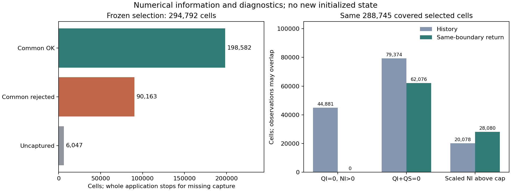

# 같은 KDM6 반환 경계의 빙정·눈·입자수 사전정보

**고정 CONTROL의 실제 06→12 UTC 실행에서 QI·QS·NI와 같은 호출의 물리 상태를 함께 확보했다.** 호스트 정리 전 QI에 history의 QS를 결합하는 대신, 8개 rank의 같은 wrapper 반환 경계를 하나의 정보 자료로 조립한다. 전체 12 UTC history는 기존 이전 주기 예보와 바이트 단위로 같다. 새 자료로 기존 생성 규칙의 수치 진단도 수행했지만, **원래 선택 영역의 6,047셀이 미확보이므로 전체 초기화 제안은 생성하지 않는다.** 현재 B1·26개 조건과 PR167의 기존 history 기반 전체 거부 결과는 유지한다.

## 1. 고정한 자료와 추출 경계

PR168의 선택 셀 호스트 제거 경로는 완료된 근거로 사용한다. 이번 실행의 산출물은 초기화에 필요한 분율과 평균질량을 **같은 단계의 자료로 해석할 수 있도록 하는 정보 스냅샷**이다. 호스트 미량 제거 설정, 물리 계수, 초기화 분율·평균질량 유지식은 바꾸지 않는다.

| 항목 | 고정 값 |
|---|---|
| 사례 / 주기 / 유효 시각 | 2026-08-16 / 06 UTC / 12 UTC |
| CONTROL 소스 SHA-256 | `f391b211c6e111f92a7213cc5a651606ec6b5826a47063e3057ab2d819e9a595` |
| 실행파일 SHA-256 | `3a286f6691fa94c2dccf55b14e4cbf609b8c9540c2caf83556969932ca9854ea` |
| 호출 | 외부 단계 1080, 20초, 각 rank의 첫 대응 wrapper 반환 |
| 실행 | MPI 8개 rank, 기존 06 UTC 입력·경계장, CONTROL 내부 설정 유지 |
| 원래 선택 영역 | 분석 파일의 저장 QI+QS가 양수인 294,792셀 |

같은 probe의 step 1 짧은 실행에서 인수·처리 범위를 먼저 확인한 뒤, TARGET_STEP만 1080으로 바꿔 전체 실행했다. 실제 명령 진입 주소 `0x2283ac0`에서 인수를 읽는다. 함수 이름 breakpoint의 prologue 해석 문제를 반복하지 않는다. 목표 반환에서 실제 처리 범위와 필드별 REAL32 바이트·주소·해시를 저장한다. 한 rank의 모든 가능한 target 호출이나 처리 범위 밖 halo까지 포착했다고 주장하지 않는다.

| 필드 | 역할 / 단위 |
|---|---|
| QI·QS | 같은 반환의 빙정·눈, kg/kg dry air |
| NI | 같은 반환의 공개 입자수 혼합비, kg⁻¹ dry air |
| TH·QV | 같은 반환의 건조온위 K와 수증기 kg/kg dry air |
| DEN·PII·P·DELZ | 같은 호출의 입력 밀도 kg/m³, Exner 계수, 전체 압력 Pa, 층 두께 m |

단위는 보관 소스 계약과 실제 인수 ABI의 해석이다. DEN의 공기 질량 기준을 독립적으로 다시 확정한 결과는 아니며, `TH×PII`는 wrapper 경계의 온도 재구성이다. 내부 KDM 온도의 정확한 저장 단어라고 하지 않는다. 물리 시계는 직접 읽지 않았고 단계·설정·로그·정시 history로 시각을 연결했다. NI는 KDM 인수 주소이며 독립 live scalar-base 대응을 새로 증명하지 않았다.

## 2. 정보 자료의 범위와 원래 영역의 중단 조건

실제 처리 교집합은 Fortran 1기준 `i=2…233, j=2…281, k=1…39`이다. 8개 rank 사이 중복은 없으며, 외곽 미확보 셀은 **아홉 필드 모두 NaN**으로 유지한다. memory halo가 있다는 이유로 처리하지 않은 외곽을 유효 자료로 채우지 않는다.

| 공간 범위 | 셀 수 |
|---|---:|
| 전체 격자 | 2,573,532 |
| 실제 확보 | 2,533,440 |
| 미확보 외곽 | 40,092 |
| 원래 선택 영역 | 294,792 |
| 선택 영역 중 확보 | 288,745 |
| 선택 영역 중 미확보 | **6,047** |

선택 영역과 수용 정책은 전체 target 수치를 보기 전에 고정했다. 누락이 하나라도 있으면 전체 제안을 공통 생성기 호출 전에 중단한다. 확보 교집합은 진단 전용이며 새로운 적용 마스크가 아니다. history 값으로 채우거나 성공 셀만 게시하지 않는다. [고정 정의](evidence/coherent_ice_prior_20261113/fixed_application/definition.json)

전체 확보 영역에는 양의 QI·NI 쌍 320,221셀, 두 값 모두 0인 2,213,219셀이 있다. `QI>0, NI≤0` 또는 `QI≤0, NI>0`은 없다. 이는 수치적 대응의 관찰이며 신뢰도 판정이 아니다. QV에는 최솟값 `−1.16415319×10⁻¹⁴ kg/kg`인 작은 음수 44개가 있어 그대로 보존한다. 따라서 이 자료를 완성된 물리 초기장으로 취급하지 않는다.

## 3. 같은 확보 셀에서 history와 반환 자료를 비교

아래 분모는 원래 영역 전체가 아닌 **동일한 확보 교집합 288,745셀**이다. 각 관찰 조건은 중복 가능하며 독점적인 거부 원인 분류가 아니다. 수농도 계산에는 기존 분석 파일의 REAL32 `1/(AL+ALB)`를 사용하며, 새로 포착한 배경 DEN으로 바꾸지 않는다.

| 관찰 조건 | 정리 후 history | 같은 경계의 반환 자료 |
|---|---:|---:|
| QI=0·NI>0 | 44,881 | **0** |
| QI+QS=0 | 79,374 | **62,076** |
| 양의 쌍 중 평균질량이 공칭 범위 안 | 162,777 | 207,652 |
| 양의 쌍 중 평균질량이 공칭 범위 밖 | 0 | 6 |
| 기존 확대식의 저장 NI×분석 밀도가 상한 초과 | 20,078 | **28,080** |

같은 영역의 저장 단어 차이는 QI 44,881개, QS 2,073개, NI 0개다. QS도 저장 경계에서 달라진 셀이 있으므로 정리 전 QI·NI와 history QS를 섞지 않는 것이 필요하다. 이 비교만으로 모든 차이의 개별 호스트 실행 경로를 계측했다고 하지 않는다.

양의 QI·NI 쌍 207,658셀에서 배경 고체수분 중앙값은 약 `6.03287×10⁻⁵ kg/kg`, 분석/배경 총량비 중앙값은 2.0258이다. 같은 비의 99백분위는 약 `2.5040×10⁸`, 최대는 `4.0115×10¹²`이다. 이는 약한 배경 특성이 큰 분석 증분으로 확대되는 상태가 여전히 있음을 보여 주는 분포이며, 새 질량 문턱이나 신뢰도 규칙을 정한 결과가 아니다. [대응 진단](evidence/coherent_ice_prior_20261113/science/snapshot_diagnostic.json)

## 4. 변경하지 않은 공통 생성기의 진단

기존 Fortran 공통 함수와 동일 입력 정책을 pinned Intel IFX 2026 O0로 새 scratch에서 실행했다. 전체 선택 영역은 미확보 6,047셀 때문에 중단한다. 이와 별도로 명시한 확보 교집합만 수치 진단했다.

| 구분 | 결과 |
|---|---:|
| 전체 적용 상태 | `STOP_UNCOVERED_BEFORE_COMMON` |
| 확보 교집합 진단 | 288,745셀 |
| 개별 공통 연산 통과 | 198,582 |
| 개별 공통 연산 거부 | 90,163 |
| 교집합 일괄 진단의 첫 실패 `(i,j,k)` | `(150,228,11)` |
| 독립 NumPy 수용/거부 분류·통과 QI/QS/NI 저장 단어 대조 | 일치 |

첫 실패는 분석 고체수분이 있지만 배경 총량은 없는 기존 유형이다. 이 통과 수는 배경 특성을 믿어도 된다는 승인이나 부분 초기화 성공률이 아니다. 일괄 진단 역시 실패하므로 제안을 게시하지 않는다. 새 `wrfinput`, 실제 새 초기화의 첫 이류·첫 KDM 사용, 12→18 UTC 예보는 없다. [Intel 실행 기록](evidence/coherent_ice_prior_20261113/science/common_receipt.json)

## 5. 신뢰도와 생성 규칙에서 남은 결정

현재 규칙은 배경 분율과 평균질량을 정확히 유지한다. 분석 총량을 A, 배경을 `(fε,(1−f)ε,fε/m)`로 두면, 양의 ε에 대한 이상적 결과는 `(fA,(1−f)A,fA/m)`이다. **배경이 약해져도 영향이 약해지지 않는다.** REAL32의 저장·underflow 경계는 이 대수적 성질과 구분한다.

이번 자료로 수치적 쌍과 같은 단계의 분율을 해석할 수 있게 됐지만, 작은 배경을 큰 분석 총량에 적용할 신뢰도를 확보한 것은 아니다. 호스트 정리 전 정보를 확보해도 배경 부재와 상한 충돌은 남는다. 공칭 평균질량 범위를 통과하는 것 역시 관측 적합성이나 불확실성의 근거가 아니다.

따라서 이번에는 EPS 문턱, 신뢰도 혼합 가중치, 입경 사전값, 상한 절단, 분율 재조정을 새로 정하지 않는다. 다음 후보에는 관측 또는 독립적으로 정한 사전모형에 따른 분율·평균질량의 불확실성과 적용 범위가 필요하다. 실제 부재·호스트 제거·미확보를 구분하고, 미확보를 0으로 간주하지 않아야 한다. 기존 반환 상태를 초기값으로 역복사하지 않는다.

## 6. 구현·검증·재생 범위

새 도구 `tools/assemble_ice_prior_snapshot.py`는 명시한 단위·질량 기준, rank/시각/ABI 필드, 처리 범위, 압축 전후·필드별 해시, 중복과 저장 후 단어를 검사한다. 입력을 다시 확인하고 완료 후에만 자료를 게시하며 실패 시 자신이 만든 파일을 철회한다. 기존 제안 생성기·모멘트 완성기·물리 소스는 변경하지 않는다. 정보 조립 PASS와 과학적 사전정보 승인, 초기화 제안 승인은 서로 다른 상태다.

| 검증 | 결과 |
|---|---|
| 실제 실행 | exit 0, 8개 rank 정상 완료 |
| 실행 입력 89개 | 전후 해시 일치 |
| 12 UTC history | 기존 SHA `1da30619…c55d840`와 일치 |
| 원시→조립 배열 | 22,800,960 REAL32 단어 일치 |
| 조립 도구의 경계 시험 | Python 7개 통과 |
| 공통 연산 | pinned IFX 2026 O0, 독립 수용/거부 분류·통과 저장 단어 일치 |

8개 gzip 원시 묶음과 상대 경로 manifest를 공개한다. 약 91 MB의 비압축 원시·전역 NPZ·전체 NetCDF·실행파일은 중복 게시하지 않는다. 조립 NPZ는 [재생 안내](evidence/coherent_ice_prior_20261113/native/README.md)에 따라 소스 밖 새 scratch에 재구성한다. 해시 연결은 자료의 계보를 확인하며 과학적 독립성이나 신뢰도를 대신하지 않는다.

Graphify 증분 그래프와 KG의 파생 보고서·감사 기록은 KLAPS50과 Cloud-BAL을 따로 갱신한다. 구조 추출은 부분적인 Fortran CALL 연결과 제한된 문서 의미 범위를 가지며, 그래프 최신성은 위 실행·수치 검증이나 예보 일반화 근거가 아니다. 완료 항목과 열린 신뢰도·미확보·독립 사건 평가를 구분해 기록한다.
