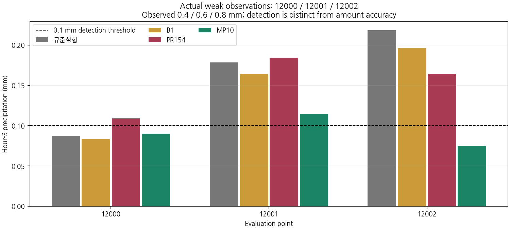
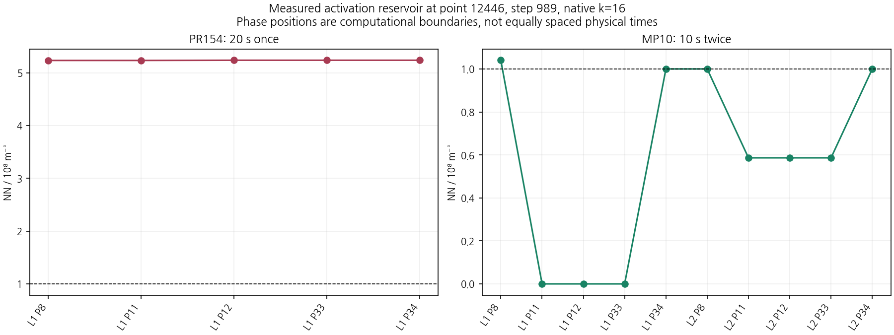
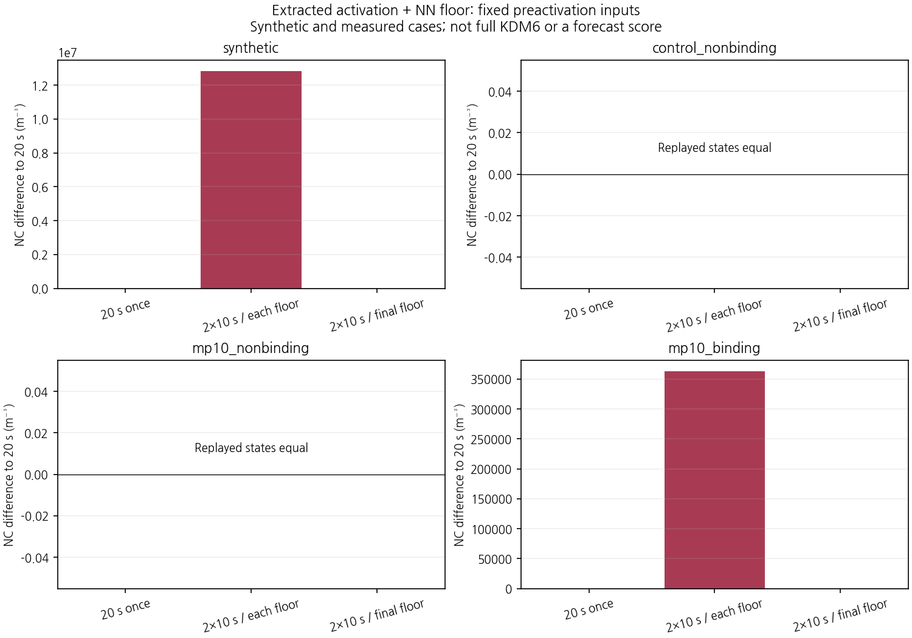
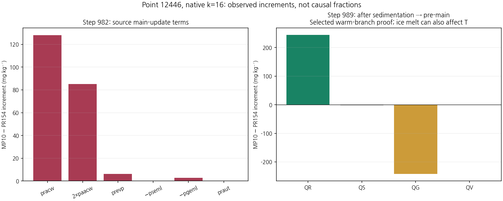
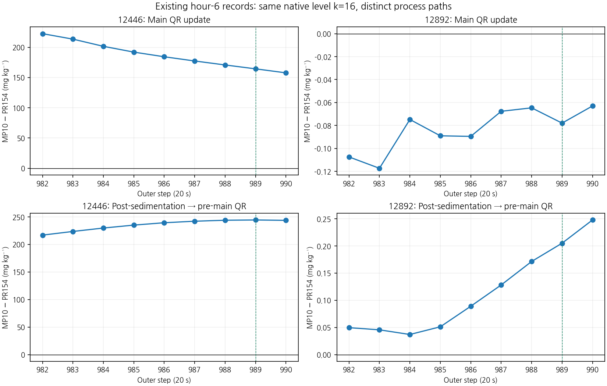
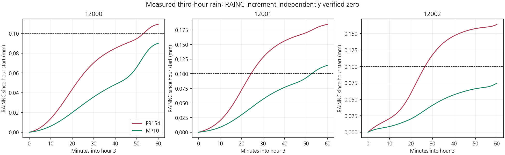
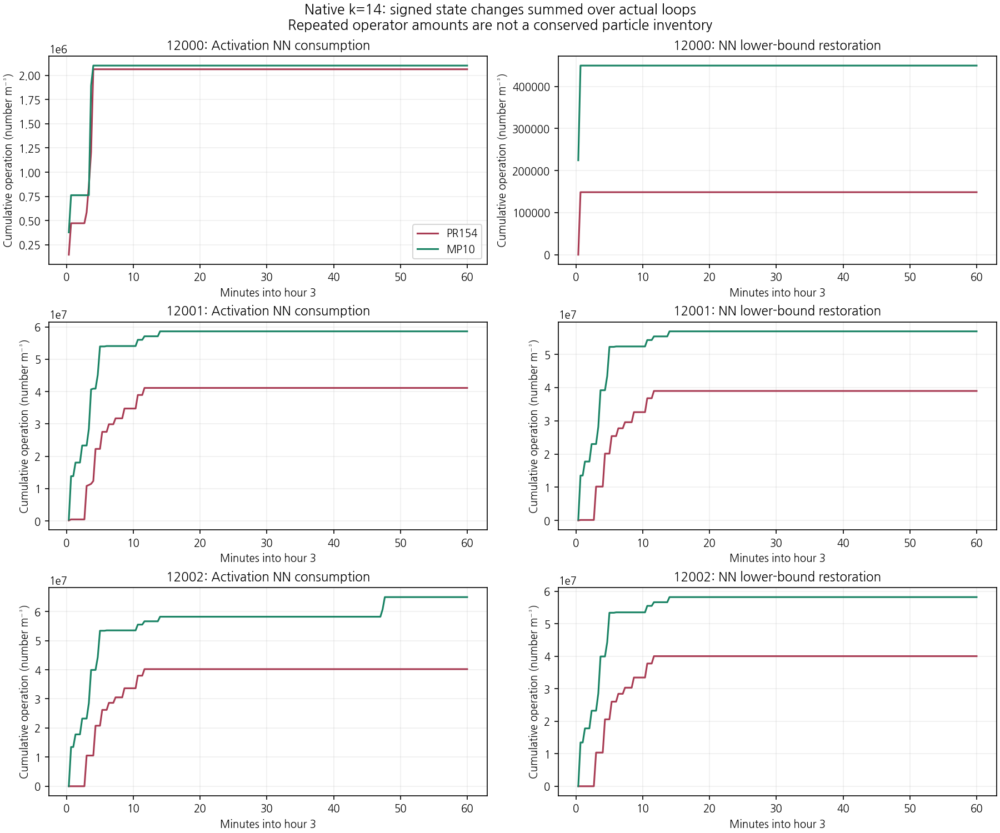
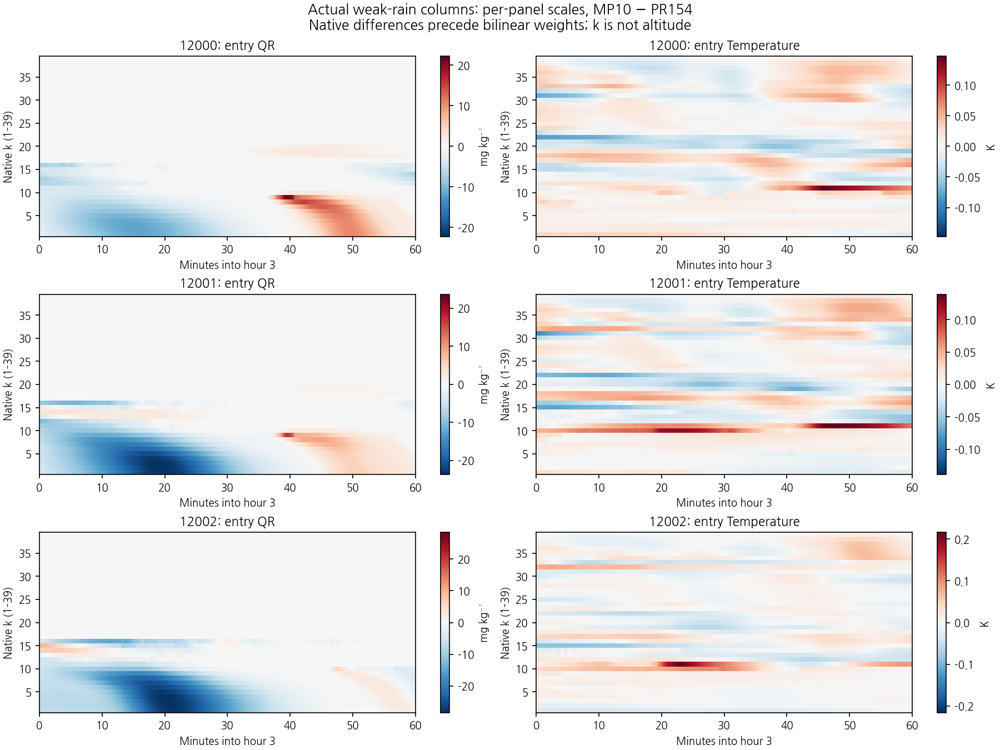

# 내부 시간분할에 따른 활성화 수 저장량 복원과 약한 강수 검출의 변화

## 초록

미세물리 내부 시간분할 MP10에서 발생한 실제 약한 강수의 검출 소실과 강한 강수 과잉을 조사하였다. 기존 원시 기록에서 활성화, NN 하한 복원, 주 과정 비 증가 및 침강 후 융해를 분리하고, 실제 약한 관측 강수의 인접 소실·유지 지점 12000–12002를 추가 계측하였다. 두 구성의 새 3시간 예보 8개 history는 대응하는 기존 예보와 바이트 단위로 일치하였다. 소스에서 추출한 활성화 블록은 측정 입력의 갱신을 REAL32 비트까지 재현하였다. 고정 입력에서는 반복 사이 NN 하한 복원이 추가 활성화를 만들지만, 같은 지점의 실제 둘째 반복은 과포화가 음수가 되어 활성화가 발생하지 않았다. 이 구분을 근거로 NN 하한의 복원 시점만 외부 호출 끝으로 맞춘 단일 6시간 후보를 평가하였다. 후보는 B1 보호 9/11, 규준실험 회복 12/15로 **21/26·미채택**이었다. 실제 약한 관측 구간의 +6시간 검출은 MP10보다 7개 증가했지만 무강수 구간의 오경보도 38개 순증하여, **현재 B1을 유지한다.**

## 1. 연구 목적

낮은 강수 문턱의 CSI에는 더 강한 관측 강수의 적중도 포함된다. 따라서 실제 약한 관측 구간 $0.1\le RN1<1$ mm의 검출·강도와 전체 임계값 CSI를 구분한다. 기존 MP10은 22/26으로 미채택이며 현재 B1을 유지한다. 본 연구의 대상은 +3시간 실제 약한 강수의 소실과 +6시간 과잉을 같은 과정 경계에서 연결하고, 확인한 한 연산의 처리 시점에 한정하여 수정 가설을 시험하는 것이다.

사례 초기시각은 **2026년 8월 16일 12 UTC**이다. +3시간은 **14–15 UTC**, +6시간은 **17–18 UTC**의 한 시간 강수량이며 초기시각부터 누적량이 아니다. 규준실험의 저장 배열 키는 `ORIGINAL`, 현재 B1은 `IMPROVED_BG_FIXED`이다. PR154는 보존 침강·첫 빙정 속도 단위 수정을 갖는 미채택 구성으로, 이번 진단의 `CONTROL`에 해당한다. MP10은 그 구성의 내부 계산을 외부 20초당 10초 두 번 수행한다.

## 2. 자료와 실험 설계

### 2.1 실제 약한 강수의 소실·유지 대조

세 지점의 +3시간 관측은 모두 실제 약한 구간에 속한다. 검출 문턱은 예측 0.1 mm이다.

| 지점 | 관측, mm | 규준실험 | B1 | PR154 | MP10 | 의미 |
|---|---:|---:|---:|---:|---:|---|
| 12000 | 0.4 | 0.087401 | 0.083075 | 0.109104 | 0.089873 | PR154가 얻은 검출을 MP10에서 소실 |
| 12001 | 0.6 | 0.178596 | 0.164248 | 0.184435 | 0.114413 | 검출 유지 대조 |
| 12002 | 0.8 | 0.218296 | 0.196373 | 0.163958 | 0.074673 | 규준실험·B1·PR154의 검출을 MP10에서 소실 |

이는 소실 12곳 전체를 대표하는 통계 표본이나 독립 기상 사례가 아니다. 세 인접점의 보간 기둥은 서로 겹친다. 중복 제거한 8개 기둥 가운데 기존에 기록된 곳은 5개이며, 새 위치는 Fortran 1 기반 `(j,i)=(86,155),(86,158),(87,158)`의 **3개**이다. 기존의 12300은 관측 1.4 mm이므로 이 실제 약한 구간의 직접 대조로 사용하지 않는다.

PR154와 MP10을 같은 입력·물리 설정에서 0–3시간 재적분하여 2–3시간의 180개 외부 호출·39층을 상세 계측하고, 지상 누적은 0–3시간에 기록하였다. 기존 다섯 기둥에서는 이전 계측과 모든 공통 과정·진입·반환 기록을 원시 비트로 대조하였다. 새로 추가한 활성화 전후 경계는 phase 35/36이며 기존 계산식은 변경하지 않았다.

### 2.2 기록 단위와 경계

| 변수 | 내부 표현 | 단위·해석 |
|---|---|---|
| QR | `qrs(:,:,1)` | 비 질량 혼합비, kg/kg |
| NC | `nci(:,:,1)` | 구름방울 수농도, m⁻³ |
| NN | `nci(:,:,3)` | 구름방울 활성화에 사용하는 수 저장량, m⁻³ |
| 공개 NC·NN·NR | 내부 수농도/`den` | 공기질량 기준 수 혼합비, kg⁻¹ |
| `pgmlt` | 침강 뒤 융해 블록 | 이미 `dtcld`를 포함한 혼합비 증분 |
| `pgeml` | 주 과정률 블록 | `dtcld`를 곱해 상태 증분으로 쓰는 별도 항 |

NN은 눈 입자수나 비 입자수 QNRAIN과 다르다. 이번 변경은 초기 QRAIN/QNRAIN을 바꾸지 않는다. 공개 수 혼합비와 내부 수농도를 더하지 않으며, 수농도의 층별 면적량에는 층 두께만 곱하고 밀도를 다시 곱하지 않는다. 모든 대응 차이는 원래 격자의 값을 REAL64로 승격해 뺀 뒤 고정된 네 보간 가중치를 적용한다. 각 구성의 실제 내부 반복과 침강 하위단계를 먼저 합하며, 서로 다른 길이의 같은 반복 번호를 직접 짝짓지 않는다.

## 3. 수학적·기상학적 과정 분해

### 3.1 활성화와 하한 복원의 비가환성

소스의 `sw`는 액체 물 기준 과포화를 **퍼센트**로 나타낸 값이다.

$$
sw=100\left(\frac{q_v}{q_{sat,w}}-1\right),\quad
f=\min\left[1,\left(\frac{sw}{0.48}\right)^{0.6}\right]\quad(sw>0).
$$

비음수 입력에서 이상적인 한 번의 활성화 수 증분을

$$
A=\min\{\max[(NN+NC)f-NC,0],NN\}
$$

로 두면 `ncact=A/dtcld`이므로 $\Delta NC=A$, $\Delta NN=-A$에서 시간간격은 산술적으로 소거된다. 씨앗 반지름은 소스의 **1.5 μm**이다. 그 구형 질량을 $m_0=4\pi\rho_w r_0^3/3$으로 쓰면, 수증기 공급 제한을 포함한 질량 전환은 이상적으로

$$
B=\min\left(\frac{m_0 A}{\rho},\max(q_v,0)\right),\quad
\Delta q_v=-B,\quad\Delta q_c=B,\quad\Delta T=\frac{L_v B}{c_{pm}}
$$

이다. 정확한 재현에는 각 중간 연산의 REAL32 반올림, 실제 소스의 제한 순서와 `max` 처리를 유지한다. 이 식은 전체 KDM6에서 시간간격이 무관하다는 뜻이 아니다.

첫 활성화가 작동하고 입력의 $f$를 고정하면 $NC_1=f(NC_0+NN_0)$이다. 그 뒤 하한 $a=10^8$ m⁻³가 복원한 양을 $R=\max(a-NN_1,0)$로 두면, 다음 활성화의 추가 수 증분은 이상적으로

$$ A_2=fR $$

이다. 하한이 없는 고정 입력의 두 번째 활성화는 이미 같은 목표 수농도에 도달하여 추가 증분이 없다. 따라서 내부 시간분할은 연속 과정률만 나누는 일이 아니라 **하한 복원과 활성화의 적용 순서를 함께 바꾸는 일**이다.

기존 과잉점 12446의 step 989, `(i,j,k)=(154,89,16)`에서는 실제 MP10의 NN이 첫 반복에 104,049,712→0→100,000,000, 둘째 반복에 100,000,000→58,649,712→100,000,000 m⁻³으로 변했다. phase 8→11의 NN·QV 변화는 해당 소스 구간의 활성화와 연결되지만, NC·QC 변화에는 작은 비 입자의 구름방울 전환도 포함한다. phase 11→12의 NN 반환과 phase 33→34의 말미 제한은 별도로 분리하였다.

### 3.2 고정 입력 재생과 실제 둘째 반복의 차이

새 약한 강수 계측의 MP10 step 361, `(i,j,k)=(156,86,14)`, 첫 반복에서 실제 NN은 **100,641,640→99,070,376**으로 감소하고, 최종 응결 구간에서는 그대로 유지된 뒤 말미 하한으로 **100,000,000**이 된다. 키가 같은 여섯 phase 기록 86개 원시값을 독립 대조하였다.

이 입력에서 $sw=0.1002669334\%$, $f\simeq0.39079581$, $R=929,624$ m⁻³이다. 이상적인 $fR$은 약 363,293 m⁻³이며, 소스 추출 Intel 재생의 REAL32 결과는 **363,296 m⁻³**이다.

| 고정 활성화 입력의 계산 | 마지막 NC, m⁻³ |
|---|---:|
| 20초 한 번 | 63,552,224 |
| 10초 두 번·각 반복 하한 | 63,915,520 |
| 10초 두 번·마지막 하한만 | 63,552,224 |

각 측정 입력의 관측된 시간간격에서는 활성화 뒤 NC·NN·QV·QC·T 다섯 저장값을 비트까지 재현하였다. 합성 입력 한 건, 하한이 작동하지 않는 측정 입력 두 건, 위 측정 입력 한 건을 같은 방식으로 비교하였다.

**하지만 실제 모형의 같은 셀 둘째 반복에서는 `sw=−0.00094771385%`이고 NN 소비는 0이다.** 첫 반복 뒤 응결과 열역학 상태 변화가 과포화를 바꾸기 때문이다. 따라서 위 표는 고정된 활성화 입력에서 하한 재적용의 효과를 분리한 결과이며, 실제 둘째 반복의 추가 활성화량이나 전체 강수 변화가 아니다. 이 차이를 무시하고 국지 표를 예보의 인과 기여로 확대하지 않는다.

### 3.3 비 증가와 융해의 구분

12446의 step 982, k=16에서 각 구성의 실제 내부 반복을 먼저 더한 뒤 네 기둥을 보간하면 다음과 같다.

| 항 | MP10−PR154 비 증분, kg/kg |
|---|---:|
| 주 과정의 실제 QR 증분 | +2.22490070×10⁻⁴ |
| `pracw × dt` | +1.28031781×10⁻⁴ |
| `paacw × dt` 두 항 | +8.52595337×10⁻⁵ |
| `prevp × dt` | +6.34629005×10⁻⁶ |
| `−pgeml × dt` | +2.85237255×10⁻⁶ |

표는 REAL64로 계산한 항별 노출량이다. 실제 코드는 `paacw`를 순서대로 두 번 더하므로, 정확한 재현에서 이를 임의로 한 번의 REAL32 곱셈으로 바꾸지 않는다. `praut`·`−pseml`도 전체 재계산에 포함했다. 432개 원래 격자·반복 기록의 QR 갱신을 소스 연산 순서로 재현한 잔차는 모두 **0**이다. 이 상태의 입력 QC·QR도 이미 달라져 있으므로 항의 크기를 계수의 인과 기여율로 해석하지 않는다.

step 989의 마지막 비·눈·싸락눈 침강 경계(phase 10)와 주 갱신 전(phase 6)의 차이는 QR +2.44484×10⁻⁴, QS −2.03802×10⁻⁶, QG −2.42446×10⁻⁴ kg/kg, QV 0이다. 일반적으로 이 구간에는 빙정 침강·융해와 비 동결도 존재한다. 선택 사건에서는 실제 마지막 빙정 침강 뒤 QI를 포함하고 소스에 고정된 `xlf0=350000`과 관측 `cpm`을 사용해 모든 융해의 최대 냉각을 바깥 방향 REAL32 반올림으로 상한 계산하였다. 12개 구성·모서리·반복 모두에서 최저 기온의 0℃ 초과 여유가 양수이며 최솟값은 **0.94699097 K**이다.

이 선택 사건에서는 비 동결 분기가 배제되어 QR·QS·QG 변화를 **눈·싸락눈의 비 전환**으로 분리할 수 있다. 기온 변화에는 빙정 융해도 들어가므로 전체 −0.0846 K를 눈·싸락눈만의 효과로 부르지 않는다. 이 분기 증명은 고정한 호스트 상수 소스·빌드 계보를 전제로 하며, 모든 시간·격자에 일반화하지 않는다. `pgmlt`는 이미 시간간격이 반영된 증분이므로 시간을 다시 곱하지 않는다.

## 4. 실제 약한 강수 소실의 새 진단

새 계측의 한 시간 RAINNC는 세 지점·두 구성 모두 기존 +3시간 총강수와 정확히 일치했다. 해당 시간 RAINC 증분이 0인 것은 원래 누적장의 별도 대조로 확인하였다. 내부 활성화 전후는 CONTROL 56,160쌍, MP10 112,320쌍이며 네 보간 기둥·39층이 빠짐없이 연결된다.

k=14의 NN 말미 하한 복원 시간합은 검출 유지점 12001과 소실점 12002 모두 MP10에서 증가한다. 따라서 하한 복원이 많다는 사실만으로 약한 강수 소실을 분류할 수 없다. 이 값은 동일 입자의 개체수를 추적한 재고가 아니라, 반복된 연산의 수농도 증분 합이다. k는 고정 고도가 아닌 원래 모형층 인덱스이다.

12002의 k=2에서는 +3시간 첫 KDM6 진입부터 QR가 PR154보다 **7.40757×10⁻⁶ kg/kg 작다**. 그 시간의 호출 내부 순변화 차이 합은 +3.96523×10⁻⁷, 반환 후 다음 진입까지의 차이 합은 +6.46459×10⁻⁶ kg/kg이다. 마지막에는 상태 차이가 크게 줄어도 한 시간 지상 강수는 0.163958→0.074673 mm로 감소한다. 마지막 QR만으로 지상 누적 강수를 추정할 수 없으며, 창 시작 전에 형성된 상태와 시간별 공급·낙하를 함께 보아야 한다.

호출 사이 항에는 외부의 모든 처리가 포함된다. 실제 수송 증분이나 플럭스를 확보하지 않았으므로 이를 수송만의 효과로 명명하지 않는다. 각 원래 격자의 차이를 먼저 구해 보간했으며, 해당 시간창 밖의 공백을 연결하여 장부를 만들지 않았다.

## 5. NN 하한 복원 시점 후보와 6시간 검증

수정 후보 `MP10_NN_END`는 외부 20초·내부 10초 두 번, B1 초기장, 초기 NN 하한, 매 내부 반복의 NN 상한 및 다른 PSD 제한을 유지한다. **반복 말미의 NN 하한만 마지막 내부 반복에 적용한다.** 하한값·물리 계수·입경·수상체 질량은 새로 조정하지 않았다.

NN의 하한 연산을 $\mathcal L_a$, 상한을 $\mathcal U_b$, 나머지 한 내부 반복을 $\mathcal F_{10}$, 기존 외부 진입 처리를 $\mathcal I$로 쓰면 계산 순서는

$$
\text{MP10}:\quad
\mathcal U_b\mathcal L_a\mathcal F_{10}
\mathcal U_b\mathcal L_a\mathcal F_{10}\mathcal I,
$$
$$
\text{후보}:\quad
\mathcal U_b\mathcal L_a\mathcal F_{10}
\mathcal U_b\mathcal F_{10}\mathcal I
$$

이다. 여기서 $a=10^8$, $b=2\times10^{10}$ m⁻³이다. 하한의 시간분할 의존성을 시험하는 수치 정책이며 관측에서 CCN을 복원한 초기화가 아니다. 실제 계산은 가변 과포화와 모든 다른 미세물리 과정을 포함하므로 고정 입력의 표만으로 성능을 예측하지 않았다.

표준 MP10과 비교한 전체 빌드 아카이브 372개 구성원 중 KDM6 객체 하나만 다르고 나머지 371개는 동일했다. 별도의 전체 모형 20초 계측은 실제 10초 두 반복과 마지막 반복의 하한 분기를 확인했다. 그 표본의 내부 수농도는 하한·상한 안쪽이므로 활성 제한의 효과는 별도 소스 추출 Intel 커널의 하한 미달·상한 초과 사례로 검사했다. 이 두 검증 범위를 구분한다.

채택 기준은 실행 전에 고정하였다. 현재 B1 보호는 +1시간의 여섯 임계값과 각 시간 5 mm의 중복을 제거한 11개, 규준실험 회복은 +2–+6시간의 0.1·0.5·1 mm 15개이다. 모든 CSI는 정수 H/M/F의 정확한 분수로 비교한다. 시간·임계값을 평균하지 않으며 약한 관측 구간의 조건부 오차는 보조 진단이다.

### 5.1 고정 조건의 평가 결과

실제 6시간 예보는 초기 history가 표준 MP10과 바이트 단위로 같았고 89개 공통 입력도 유지되었다. 전체 일곱 history의 11개 수상체·수 변수는 유한값이었다. 유한값 검사는 비음수성이나 전체 물수지의 증명이 아니다. 저장된 점 배열에서 216개 범주 점수와 36개 연속 점수, 26개 조건을 독립 재계산한 결과가 일치하였다.

| 구성 | B1 보호 | 규준실험 회복 | 전체 충족 | 채택 |
|---|---:|---:|---:|---|
| PR154 | 9/11 | 12/15 | 21/26 | 미채택 |
| MP10 | 9/11 | 13/15 | 22/26 | 미채택 |
| MP10_NN_END | **9/11** | **12/15** | **21/26** | **미채택·현재 B1 유지** |

MP10 대비 +2시간 0.5 mm 회복을 잃었으며, 새로 통과한 보호·회복 조건은 없다. 아래 미달 조건은 모두 기존의 B1 또는 규준실험 기준으로 평가한다.

| 미달 조건 | 공식 기준 | H: 기준→후보 | F: 기준→후보 | CSI: 기준→후보 |
|---|---|---:|---:|---:|
| +1시간 ≥10 mm | B1 보호 | 10→9 | 83→86 | 0.070423→0.062069 |
| +6시간 ≥5 mm | B1 보호 | 168→163 | 226→294 | 0.292683→0.253894 |
| +2시간 ≥0.5 mm | 규준실험 회복 | 397→404 | 212→236 | 0.299623→0.299481 |
| +3시간 ≥0.1 mm | 규준실험 회복 | 786→798 | 817→925 | 0.327637→0.318309 |
| +6시간 ≥1 mm | 규준실험 회복 | 505→525 | 479→583 | 0.348998→0.338491 |

+2시간 0.5 mm의 실패는 표시 자릿수의 문제가 아니다. 적중 404개를 유지한다고 가정하면 오경보를 236개에서 235개로 한 곳 줄여야 규준실험 CSI 이상이 된다. 반면 +6시간 5 mm는 B1보다 적중이 5개 적고 오경보가 68개 많아, 차이의 규모와 유형이 다르다.

[여섯 구성의 모든 시간·임계값 H/M/F·CSI와 연속 오차](evidence/cp02_activation_path_20261110/evaluation/FULL_SCORES.md), [26개 조건 원표](evidence/cp02_activation_path_20261110/evaluation/results/admission_constraints.csv), [임계값별 그림·시간별 강수 지도](evidence/cp02_activation_path_20261110/FIGURES.md)를 함께 제공한다.

### 5.2 실제 약한 강수와 오경보의 반응

아래의 검출은 관측 $0.1\le RN1<1$ mm에서 예측이 0.1 mm 이상인 경우이며, 같은 강도 구간은 예측도 0.1 이상 1 mm 미만인 경우이다.

| 예보시간 | MP10 검출 | 후보 검출 | MP10 같은 강도 구간 | 후보 같은 강도 구간 |
|---|---:|---:|---:|---:|
| +1시간 | 268 | 267 | 175 | 174 |
| +2시간 | 255 | 254 | 161 | 160 |
| +3시간 | 229 | 231 | 143 | 146 |
| +4시간 | 255 | 256 | 126 | 127 |
| +5시간 | 316 | 314 | 167 | 163 |
| +6시간 | 266 | 273 | 118 | 128 |

+6시간 검출은 266→273, 같은 강도 구간은 118→128로 늘었다. 그러나 관측 0.1 mm 미만에서 신규 오경보 52곳·해소 14곳으로 오경보가 **38곳 순증**한다. 같은 약한 관측 마스크의 MAE는 0.918600→0.944738 mm, RMSE는 2.057222→2.106365 mm로 증가한다. 검출과 같은 강도 구간의 증가만으로 전체 개선을 판단할 수 없다. 이는 채택 기준을 대체하지 않는 보조 진단이다.

+3시간 12002는 후보에서도 **0.075940 mm**로 0.1 mm 미만이며, 기존 MP10의 0.074673 mm에서 적중을 회복하지 못했다. 인접 12000도 0.087626 mm로 미검출이고 12001은 0.114421 mm로 검출을 유지한다. NN 하한 복원 시점만 바꾸는 가설은 이 실제 약한 강수 소실을 해결하지 못했다.

임계값별 CSI는 각 시간·조건을 그대로 제시한다. 통과 개수나 시간 평균으로 최적 구성을 선정하지 않았다. 후속 연구에서는 12002에서 분석 창 시작 전에 이미 존재하는 비 질량·열역학 차이가 언제 커졌는지와 지상 도달의 시간 변화를 우선 연결해야 한다. 이번 후보의 점수를 근거로 하한값·활성화 계수를 다시 조정하지 않는다.

## 6. 한계와 고찰

NN 복원, 활성화, 응결, 융해 및 침강의 연결은 정해진 원래 격자와 시간창의 기록에 근거한다. 활성화 블록의 정확 재생, 같은 호출의 국지 물·잠열 전달, 전체 영역 물·에너지 수지의 완결은 서로 다른 검증이다. 미량 제거, 경계 수송과 전체 수지는 여전히 별도로 확인해야 한다. RN1 상류 시간 구간·coverage/QC와 독립 기상 사례 검증, 기존 C2 T39 문제도 이 연구로 해결된 것이 아니다.

실제 모형에서 과포화가 바뀌어 국지 고정 입력과 다른 반응이 나타난 점은 중요하다. 활성화에 사용할 수가 늘어났다는 이유만으로 약한 강수 증가나 오경보 증가를 단정할 수 없다. 지점·층·시간에 따라 응결·증발과 수종 전환, 공급과 침강의 연결이 달라진다. 후속 선택은 과정을 설명할 수 있는 최소 변경과 실제 시간·임계값별 성능을 함께 근거로 해야 한다.

관련 시험 **545개**가 고정 Intel 프로파일을 적용한 새 추출 디렉터리에서 통과했다. 네이티브 실행 근거·점수·소스·그림은 독립 에이전트 검토를 거쳤으며, 재현 범위는 각 영수증에 구분하였다.

## 7. 자료와 재현 근거

- [세 지점·보간 기둥·원래 강수량](evidence/cp02_activation_path_20261110/cohorts/selected_points.csv)
- [기존 원시 기록의 과정 분해](evidence/cp02_activation_path_20261110/analysis/README.md)
- [새 3시간 계측과 원시 자료](evidence/cp02_activation_path_20261110/native/README.md)
- [고정 입력 재생의 실제 범위](evidence/cp02_activation_path_20261110/local_replay/README.md)
- [실제 둘째 반복의 음의 과포화와 비활성](evidence/cp02_activation_path_20261110/local_replay/actual_loop2_contrast.json)
- [공개 packed 자료의 110개 원시값 독립 대조](evidence/cp02_activation_path_20261110/local_replay/portable_recount_receipt.json)
- [반복말미 제한의 원시 비트 증명](evidence/cp02_activation_path_20261110/local_replay/native_floor_proof.json)
- [실제 약한 강수의 단계별 분석](evidence/cp02_activation_path_20261110/weak_analysis/summary.json)

과거의 해시 고정 증거는 수정하지 않았다. 이전 schema 설명문에 남은 `1–180, 721–1080`은 당시 실제 `1–180, 361–540, 901–1080`과 다른 주석이며, 새 [schema 보완 문서](evidence/cp02_activation_path_20261110/native/schema/contract_supplement.json)에 이를 정정하고 새 실행의 상세 361–540·지상 1–540 범위를 명시하였다. 새 phase 35/36의 12개 필드와 기존 상태 phase의 18개 필드도 별도로 구분하였다. 이 설명 정정은 계산식을 바꾸지 않는다.
