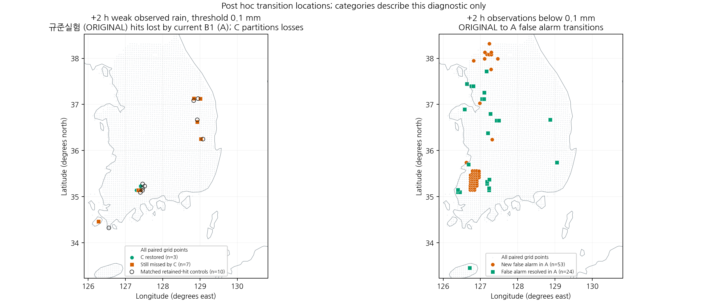
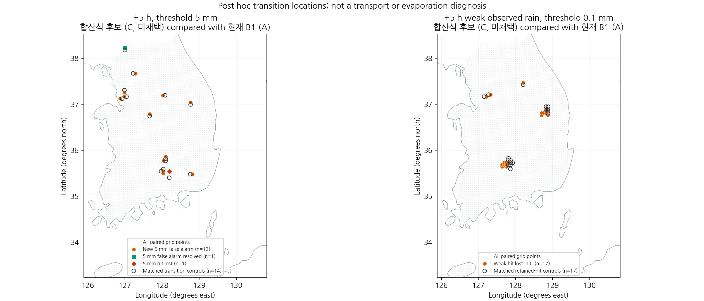
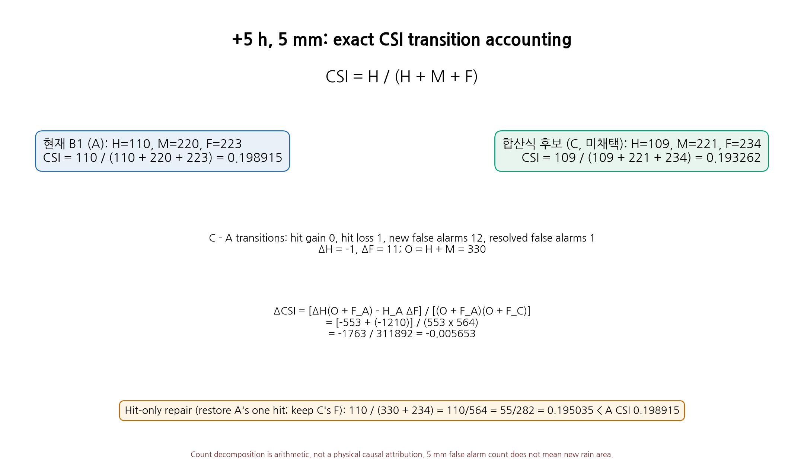
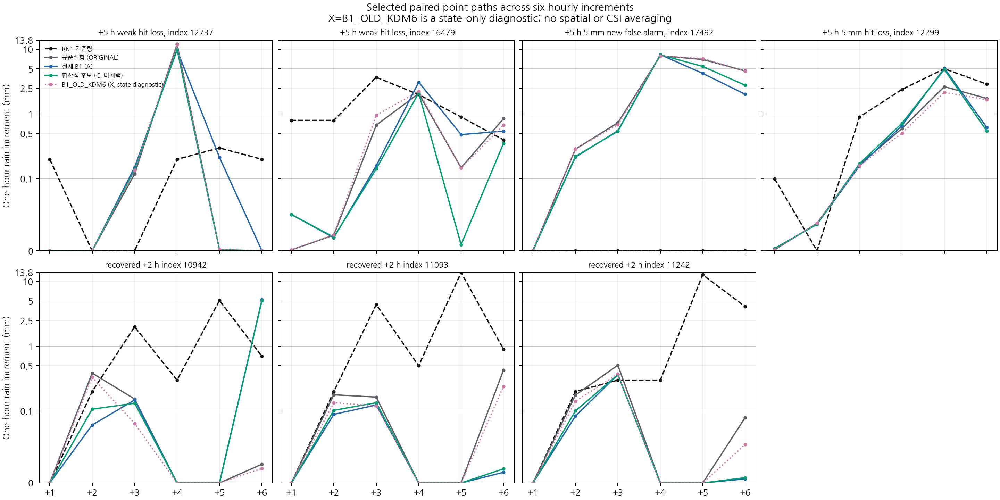
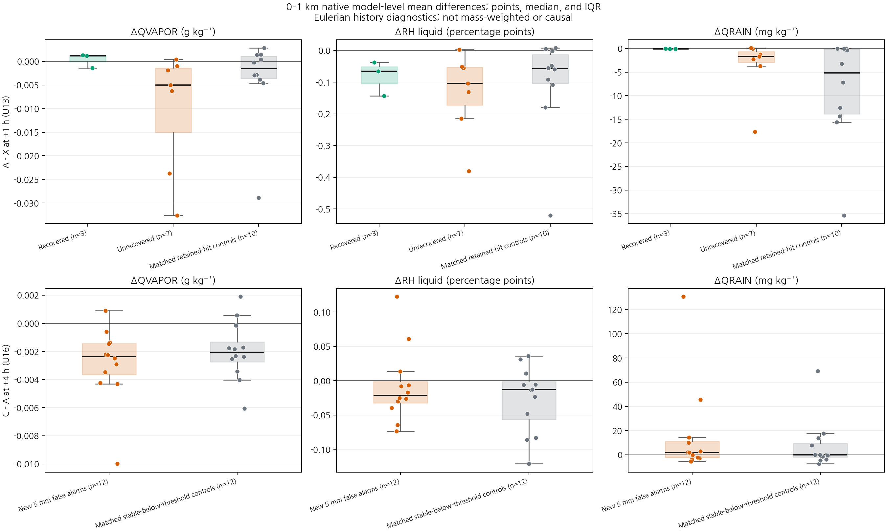

# 후반 약한 강수 누락과 강한 강수 오경보의 공동 진단

## 초록

2026년 8월 16일 12 UTC 사례의 6시간 예보에서 후반 약한 강수 누락과 강한 강수 오경보를 함께 진단하였다. 규준실험·현재 B1·PH 합산식 후보 및 동일 B1 초기장의 기존 KDM6 대조를 연결하고, 270개 초점·대조 지점의 정시 history 28개를 재추출하였다. +2시간에 B1이 잃은 실제 약한 강수 적중 10곳 중 기존 KDM6 대조에서는 9곳이 적중한 반면, 신규 오경보 53곳 중 32곳은 이 대조에서 임계값 미만이었다. +5시간 합산식 후보의 5 mm 악화는 적중 소실 1곳보다 신규 오경보 12곳을 함께 설명해야 한다. 선행 하층 수증기·습도·비 혼합비의 변화는 실패와 유지 집단에서 중첩되어 단일 부호나 문턱값으로 실패를 구분하지 못하였다. 현재 B1을 유지하며, 다음 검증은 같은 초기장의 실행파일 변경에 따른 강수 영역 경계·시간 분포와 실제 생성·소멸·낙하 증분의 연결에 집중한다. 이번 진단은 새 성능 개선이나 과정별 인과 수지의 완결을 뜻하지 않는다.

**핵심어:** 강수예측, 약한 강수 검출, 오경보 전이, 임계성공지수, 시간 분포, 열역학 진단

## 1. 서론

현재 B1은 첫 시간과 일부 강한 강수 조건에서 규준실험보다 나은 점수를 얻었지만, 예보 2시간 이후 낮은 임계값의 성능 회복은 미완료다. 이전 PH 차분별 합산의 실제 6시간 대조에서도 C·D는 각각 10/26·11/26 조건에 그쳐 미채택하였다. 이번 연구는 그 판정을 유지하면서, 다음 물리 수정의 진단 대상을 약한 강수 누락과 과잉 강수에 함께 맞춘다.

C의 +5시간 5 mm 악화는 적중 1곳 소실과 오경보 11곳 순증으로 구성된다. 적중 소실만 추적하면 주요 악화 집단인 신규 5 mm 오경보 12곳을 빠뜨린다. 또한 +2시간의 약한 강수 회복 3곳만으로 후반 개선을 판단할 수 없으므로, 현재 B1이 규준실험 대비 잃은 10곳 전체와 남은 7곳을 함께 비교한다.

## 2. 자료 및 방법

### 2.1 실험 계보와 이번 작업의 범위

초기 시각은 **2026년 8월 16일 12 UTC**, 평가 종료는 같은 날 18 UTC다. 강수량은 각 한 시간 구간량이며, 초기부터의 누적 강수량이 아니다. 이번 작업은 보관된 점 배열과 실제 WRF history를 재분석하는 진단이다. 새 초기화 후보나 새 예보 적분을 성능 결과로 추가하지 않는다.

| 표기 | 초기화 | KDM6 0 과정률 처리 | PH 합산식 | 진단 역할 |
|---|---|---|---|---|
| ORIGINAL | 규준실험 초기장 | 수정 이전 | 기존 식 | 규준실험 |
| A | 현재 B1 | FIX | 기존 식 | 현재 유지 구성 |
| C | 현재 B1과 동일 | FIX | 차분별 합산 | 미채택 수치 후보 |
| B1_OLD_KDM6 | 현재 B1과 동일 | 수정 이전 | 기존 식 | A와 같은 초기화의 과거 물리 대조 |

A와 B1_OLD_KDM6는 보존된 실행 기록의 89개 입력 중 실행파일을 제외한 **88개가 바이트 단위로 같다.** 이는 같은 초기장에서 실행파일 변경의 전체 반응을 비교할 근거이며, 특정 미세물리 과정의 기여를 확정하는 증거는 아니다. B·D의 점 자료는 이전 판정과 조건부 검출 표를 재확인하는 문맥 자료로 유지한다.

### 2.2 사건 정의와 초점 집단

예측과 RN1 기준량의 사건 조건은 모두 임계값 이상(`>=`)이다. 실제 약한 강수는 $0.1\le RN1<1$ mm이며 검출 문턱은 예측 0.1 mm다. 5 mm 신규 오경보는 RN1<5 mm이고, A에서는 5 mm 미만이던 예측이 C에서 5 mm 이상이 된 경우다. 예측에 처음 비가 생겼다는 뜻으로 사용하지 않는다.

| 초점 | 사건 | 지점 수 |
|---|---|---:|
| +2시간 ORIGINAL→A, 실제 약한 강수 | 적중 소실 / 획득 | 10 / 2 |
| 그 소실 10곳의 A→C 반응 | 회복 / 미회복 | 3 / 7 |
| +2시간 ORIGINAL→A, RN1<0.1 mm | 신규 / 해소 오경보 | 53 / 24 |
| +5시간 A→C, 5 mm | 신규 / 해소 오경보 | 12 / 1 |
| +5시간 A→C, 5 mm | 적중 소실 / 획득 | 1 / 0 |
| +5시간 A→C, 실제 약한 강수 | 적중 소실 / 획득 | 17 / 6 |
| +6시간 A→C, 실제 약한 강수 | 적중 소실 / 획득 | 8 / 2 |

같은 관측 강도 구간에서 가장 가까운 미사용 유지 지점을 결정적으로 대조군에 배정했다. 관측 구간은 대조군 선정·평가용이며 초기화 규칙에 사용하지 않는다. 역할별 중복을 허용하되 지점 배열은 **270개 고유 평가점**으로 중복 제거한다. 158개 대조 연결에는 집단 사이 재사용된 대조점이 있으며, 이를 독립 기상 사례로 집계하지 않는다. 가까운 지점이라고 고도·습도·초기 수종까지 같다고 가정하지 않는다.

### 2.3 CSI 변화의 수학적 분해

같은 평가 표본과 임계값에서 $O=H+M$은 고정된다. 따라서

$$
CSI_C-CSI_A=
\frac{\Delta H(O+F_A)-H_A\Delta F}{(O+F_A)(O+F_C)}.
$$

이 식의 두 항은 적중·오경보 사건 수 변화에 대한 **점수의 대수 분해**다. 증발·응결·수송의 물리 기여율이 아니다. +5시간 5 mm에서 $O=330$, $H_A=110$, $F_A=223$, $H_C=109$, $F_C=234$이므로

$$
\Delta CSI=\frac{-553-1210}{553\times564}
=-0.00565260.
$$

잃은 적중 한 곳만 복구하되 C의 오경보를 유지한 가상 점수는 $110/(330+234)=0.195035$다. 이는 현재 B1의 $110/(330+223)=0.198915$보다 낮다. 이 점수 재계산은 가상의 사건 수 비교이며 WRF 수정 실험을 뜻하지 않는다.

### 2.4 시간·공간 진단과 해석 경계

고정 지점의 +4·+5·+6시간 한 시간 강수 합과 +5시간 비중, 최대 강수 시간, 여섯 시간 경로를 비교한다. +5시간 소실 17곳을 먼저 고정한 뒤 각 지점의 세 시간 강수 합 증감 부호를 집계한다. 이는 여러 시간의 적중 획득·소실 건수를 더하는 것과 다르다. 지점의 강수 합을 영역 강수 질량이나 물수지로 해석하지 않는다.

공간 진단은 같은 3,688개 평가 좌표에서 반경 5·10·20 km의 표본 수와 강수 범위, 임계값을 넘는 가장 가까운 예측·RN1 지점까지의 거리를 계산한다. 최근접 거리는 전체 공통 평가 좌표에서 찾고, 반경별 강수 범위는 별도로 집계한다. 질의 지점을 포함하며 거리에는 반지름 6,371 km의 구면 대원거리를 사용한다. 이 대응거리는 강수계의 실제 이동 궤적이 아니며, 공간 이웃으로 CSI를 재정의하지 않는다.

### 2.5 WRF 정시 상태와 강수 성분

네 구성의 초기 및 +1–+6시간 history를 같은 RN1 평가점의 WRF 네 모서리·39층으로 연결한다. 원래 REAL32 모서리 값과 REAL64 진단·가중값을 구분해 보존한다. history의 `T`는 건조 온위 섭동이며 `THM`과 구분한다.

$$
\theta=T_{\rm history}+300,\qquad
p=P+PB,\qquad
T_{\rm diag}=\theta(p/10^5)^{R_d/c_p}.
$$

상대습도와 입경 같은 비선형 진단은 모서리에서 먼저 계산한 뒤 공간 가중한다. 일반적으로 $f(\sum w_ix_i)\ne\sum w_if(x_i)$이므로, 평균 상태에 포화 함수를 한 번 적용한 값으로 바꾸지 않는다. 필요한 모서리에서 비 질량 또는 입자수가 0이면 진단 입경은 미정의로 남긴다. 이 입경은 활성 미세물리 입자군을 판정하는 소스 임계값 검사와 별개다.

RAINC·RAINNC·RAINSH의 원래 누적값과 정시 차분을 보존하고, RAINC+RAINNC 구간량을 기존 점 배열과 검증한다. 성분 차분과 공간 가중의 연산 순서에 따른 REAL64 오차만 허용한다. 정시 상태는 KDM6 호출 진입·반환이나 내부 과정률이 아니다. 높이는 기존 9.81 m s⁻² 진단 규약을 명시하고, MU/MUB·hybrid 계수는 원시 값으로 남긴다. 실제 시점의 건조공기 질량과 전체 수지의 완결을 주장하지 않는다.

## 3. 결과

### 3.1 같은 B1 초기장의 실행파일 대조

기존 KDM6 대조를 이하 X로 쓴다. +2시간 ORIGINAL→A 약한 강수 적중 소실 10곳 중 **X에서는 9곳이 적중**한다. C가 회복한 3곳은 모두 그 9곳에 포함된다. 유일한 나머지 17524는 X에서도 0.082972 mm로 미검출이다. 이는 동일 초기장의 실행파일 변경과 실패 집단의 관계를 좁히는 조건부 결과이며, “원인의 90%” 같은 인과 기여율이 아니다.

| +2시간 실제 약한 강수 소실점 | RN1, mm | 규준실험 | 현재 B1 A | 합산식 C | 기존 KDM6 X |
|---:|---:|---:|---:|---:|---:|
| 8689 | 0.9 | 0.127452 | 0.081927 | 0.072961 | 0.129561 |
| 10942 | 0.2 | 0.384992 | 0.080582 | **0.106871** | 0.333770 |
| 10943 | 0.4 | 0.231367 | 0.077965 | 0.094574 | 0.184300 |
| 10944 | 0.5 | 0.142071 | 0.070042 | 0.074967 | 0.119528 |
| 11093 | 0.2 | 0.178296 | 0.095345 | **0.102657** | 0.134829 |
| 11242 | 0.2 | 0.176608 | 0.092940 | **0.100392** | 0.141619 |
| 14697 | 0.3 | 0.100096 | 0.076862 | 0.076010 | 0.107314 |
| 15887 | 0.2 | 0.108849 | 0.087008 | 0.085737 | 0.108526 |
| 17524 | 0.8 | 0.102733 | 0.096325 | 0.093529 | 0.082972 |
| 17527 | 0.7 | 0.106697 | 0.095674 | 0.095438 | 0.107247 |

같은 시각 B1의 신규 오경보 53곳에서는 X도 오경보인 곳이 21곳이고, **X<0.1 mm에서 A≥0.1 mm로 바뀐 곳은 32곳**이다. 따라서 약한 강수 적중만 되돌리는 목적의 일괄 증량은 오경보와 함께 평가해야 한다. C의 회복 3곳은 약 5–14 km 범위의 가까운 집단이며 문턱 초과량도 작다.

**그림 1.** 왼쪽은 ORIGINAL→A 소실 10곳의 C 회복 여부와 유지 대조군, 오른쪽은 같은 시간 강수유무 오경보의 생성 53곳·해소 24곳이다. 범주는 사후 진단용이다.

실제 약한 관측 강수의 검출 수는 후반 전체를 따로 유지한다. +2시간 C의 3곳 회복을 후반 전 시간의 개선으로 확대할 수 없다.

| 예보시간 | 현재 B1 A | C | C−A | D | D−A |
|---|---:|---:|---:|---:|---:|
| +2시간 | 230 | 233 | +3 | 228 | −2 |
| +3시간 | 219 | 219 | 0 | 215 | −4 |
| +4시간 | 230 | 229 | −1 | 229 | −1 |
| +5시간 | 258 | 247 | −11 | 273 | +15 |
| +6시간 | 233 | 227 | −6 | 232 | −1 |

### 3.2 +5시간 5 mm 악화의 주 대상은 오경보 집단

C−A는 적중 소실 1·획득 0, 신규 오경보 12·해소 1이다. 신규 오경보 12곳의 RN1 구간은 <0.1 mm 6곳, 0.1–1 mm 미만 2곳, 1–5 mm 미만 4곳이다. 모두 A에서도 4.15–4.99 mm를 예측하던 곳이다.

| +5시간 신규 5 mm 오경보 | RN1, mm | 규준실험 | 현재 B1 A | 합산식 C | 기존 KDM6 X |
|---:|---:|---:|---:|---:|---:|
| 12147 | 4.5 | 4.907012 | 4.793062 | 5.004011 | 4.937855 |
| 12161 | 1.8 | 3.288052 | 4.856385 | 5.056801 | 3.207309 |
| 12296 | 2.9 | 4.700353 | 4.664530 | 5.102240 | 4.677841 |
| 13041 | 0.6 | 9.422851 | 4.844521 | 5.191478 | 8.400089 |
| 13340 | 0.5 | 6.610403 | 4.950475 | 5.392809 | 6.038822 |
| 16312 | 0.0 | 4.837817 | 4.757203 | 5.008995 | 4.493741 |
| 17225 | 1.0 | 4.433160 | 4.333980 | 5.048509 | 4.460216 |
| 17341 | 0.0 | 5.161671 | 4.154833 | 5.040003 | 5.529938 |
| 17492 | 0.0 | 6.978485 | 4.246365 | 5.435601 | 7.203475 |
| 17659 | 0.0 | 8.233783 | 4.989872 | 5.043050 | 7.998678 |
| 17790 | 0.0 | 6.184907 | 4.737062 | 5.405335 | 6.231425 |
| 19136 | 0.0 | 5.867205 | 4.919452 | 5.037851 | 5.383072 |

**12곳 중 같은 7곳은 규준실험과 X에서도 이미 ≥5 mm**다. 나머지 5곳은 규준실험·A·X 모두 5 mm 미만이다. C는 일부 기존 과잉 강수의 문턱 초과를 되돌린다. 이를 모든 지점에서 “새 강수 생성”으로 부르면 안 된다.

**그림 2–3.** 신규 5 mm 오경보 12곳과 적중 소실 1곳을 함께 유지한다. CSI 대수 분해는 적중 복구만으로 보호 실패가 해결되지 않음을 보이며, 과정별 물리 기여를 의미하지 않는다.

### 3.3 시간·공간 문맥은 한 가지 증발 설명으로 축약되지 않는다

+5시간 약한 적중 소실 17곳 중 고정 지점의 +4–+6시간 강수 합이 C에서 증가한 곳은 5곳, 감소한 곳은 12곳이다. 12737은 +5시간 0.2145→0.0012 mm로 줄지만 세 시간 합은 0.071945 mm 증가한다. 반면 16479는 세 시간 합도 1.662458 mm 감소한다. 이 차이는 시점별 강수 분포와 지속성을 따로 확인할 근거다.

+2시간 소실 10곳에서 가장 가까운 A≥0.1 mm 평가점은 모두 약 5.08–5.12 km 이내다. +5시간 소실 17곳에서 가장 가까운 C≥0.1 mm 평가점은 12곳이 10 km 이내, 전부 20 km 이내다. 반대로 신규 5 mm 오경보 12곳 중 **10곳에는 20 km 이내 RN1≥5 mm 평가점이 없다.** 최근접 거리 중앙값은 76.46 km다. 이 결과는 공통 평가 표본 안의 위치 문맥이며 관측 coverage 밖의 비 부재나 강수계 이동을 증명하지 않는다.

**그림 4.** 17492의 기존 과잉 강수, 12299의 5 mm 적중 소실, 12737·16479의 서로 다른 시간 경로를 함께 제시한다. 10942·11093·11242의 +2시간 회복도 다른 시간의 오차와 구분한다. 세로축은 0 부근을 표시하는 symlog 축이다.

### 3.4 선행 하층 상태도 실패·유지를 단독으로 가르지 못한다

원래 모서리마다 해당 구성의 지상고도 기준 0–1 km 모형층을 산술평균한 뒤 공간 가중하였다. 이는 건조공기 질량 평균이나 과정 적분량이 아니다. 다음 표는 **집단 중앙값**으로, CSI를 평균하거나 후보를 순위화한 값이 아니다.

| 구간·대비 | 집단 | 수증기 차이, kg/kg | 액체 물 상대습도 차이, %p | 비 혼합비 차이, kg/kg |
|---|---|---:|---:|---:|
| +1시간, A−X | 다음 시간 약한 적중 소실 10곳 | −1.642e−6 | −0.08484 | −6.927e−7 |
| +1시간, A−X | 대응 적중 유지 10곳 | −1.542e−6 | −0.05721 | **−5.192e−6** |
| +4시간, C−A | 다음 시간 신규 5 mm 오경보 12곳 | −2.375e−6 | −0.02121 | +2.008e−6 |
| +4시간, C−A | 대응 문턱 미만 유지 12곳 | −2.079e−6 | −0.01304 | −9.406e−9 |

적중 유지 대조군의 비 혼합비 감소 중앙값이 오히려 소실 집단보다 크다. 수증기·상대습도 변화도 두 집단에 중첩한다. 따라서 “하층 비가 줄었으므로 약한 적중 소실” 또는 “습도가 낮아졌으므로 오경보 해소” 같은 부호만의 규칙은 충분하지 않다. 신규 5 mm 오경보 집단의 선행 비 혼합비 증가는 후속 낙하·생성 경로를 조사할 단서이며 지상 강수의 인과 기여율은 아니다.

**그림 5.** 위는 +1시간 A−X의 C 회복 3곳·미회복 7곳과 부모 소실 집단에 배정한 유지 대조 10곳이다. 아래는 +4시간 C−A의 신규 5 mm 오경보 12곳과 문턱 미만 유지 대조 12곳이다. 점·중앙값·사분위 범위를 모두 표시한다. 단위는 각각 g/kg, 상대습도 퍼센트포인트, mg/kg로 변환했다.

### 3.5 재현성

28개 실제 history의 원래 모서리·층·강수 성분을 해시로 고정했다. **24개 시간·구성 강수 재구성 모두 통과**했고 기존 점 배열과의 최대 절대차는 1.51×10⁻¹⁴ mm다. 상태 파일의 RAINSH 누적·구간량은 모두 0이다. 독립 재계산은 6,480개 지점별 강수 경로, 15,120개 층별 특징 행의 120,960개 값, 3,072개 물리 대비 집계와 표별 건수·분위수를 대조했다.

[전체 사건·대조 연결](evidence/cp02_failure_focus_20261105/targets/event_membership.csv), [전이 수](evidence/cp02_failure_focus_20261105/targets/transition_counts.csv), [시간 문맥](evidence/cp02_failure_focus_20261105/targets/temporal_diagnostics.csv), [공간 문맥](evidence/cp02_failure_focus_20261105/targets/spatial_neighbors.csv), [물리 대비 전체 표](evidence/cp02_failure_focus_20261105/context/cohort_physical_contrasts.csv), [모든 지점의 강수 성분](evidence/cp02_failure_focus_20261105/context/point_surface_paths.csv)를 제공한다. 시간별·임계값별 성능 표는 [기존 6시간 전체 점수표](evidence/cp02_grouped_forecast_20261105/figures/rendered/full_score_tables.md)를 유지한다.

## 4. 고찰

검증할 다음 가설은 **같은 B1 초기장에서 0 과정률 처리 변경이 만든 결합 상태 반응이 강수 영역 경계와 시간 분포를 바꾸어, 약한 적중 소실과 신규 오경보를 함께 만든다**는 것이다. 9/10 적중 소실과 32/53 신규 오경보의 실행파일 대조는 이 가설을 우선 조사할 근거다. 그러나 정시 프로파일은 비의 공급·수송·성장·증발·낙하를 분리하지 못하므로, 특정 증발 항이나 온도 변화가 원인이라고 확정하지 않는다.

다음 제한 실험은 같은 B1 초기장의 OLD/FIX를 유지하면서 소실 10곳·유지 대조와 신규 53곳·해소 24곳에 연결된 격자의 유효 비 생성·소멸, 침강 및 지상 유출을 같은 호출 기준으로 기록해야 한다. 다른 처리의 영향은 실제 수송 증분·플럭스가 확보된 항만 분리하고 나머지는 호출 사이 전체 순변화로 남긴다. C의 +5시간 오경보 12곳은 과잉 강수의 보호 대조로 유지한다.

이를 통해 물리 반응이 확인되기 전에는 기존 0 분기로 단순 복귀하거나 전역 입경·습도 문턱·증발 및 자동변환 계수를 조정하지 않는다. 다음 수정 후보는 확인된 한 경계에 한정하고, **기존 B1 보호 11개와 ORIGINAL 수준 회복 15개**를 그대로 적용한다. 실제 약한 관측 구간의 적중 획득·소실과 관측 음성의 오경보 생성·해소도 함께 제출한다.

## 5. 결론 및 한계

현재 B1의 +2시간 실패를 규준실험·같은 초기장의 기존 KDM6·미채택 합산식 후보와 연결하였다. 약한 적중 소실과 신규 오경보가 실행파일 변경에 함께 반응하며, C의 +5시간 악화는 신규 5 mm 오경보 집단이 핵심임을 확인했다. 시간·공간 문맥과 선행 하층 상태는 실패를 하나의 증발 또는 습도 규칙으로 설명하기 어렵게 한다. 다음 단계는 실제 생성·소멸·낙하 증분과 지상 강수의 연결이며, 이번에는 새 수정 후보나 예보 성능 향상을 추가하지 않는다.

현재 B1 유지 및 C·D 미채택 판정과 기존 26개 조건은 그대로다. 단일 사례의 사후 진단 집단이며, RN1 상류 시각·coverage·QC, 독립 사례 검증, 과정별 플럭스와 영역 물·에너지 수지, 별도 C2 T39와 H/A/N 1시간 완료는 미완료다.
