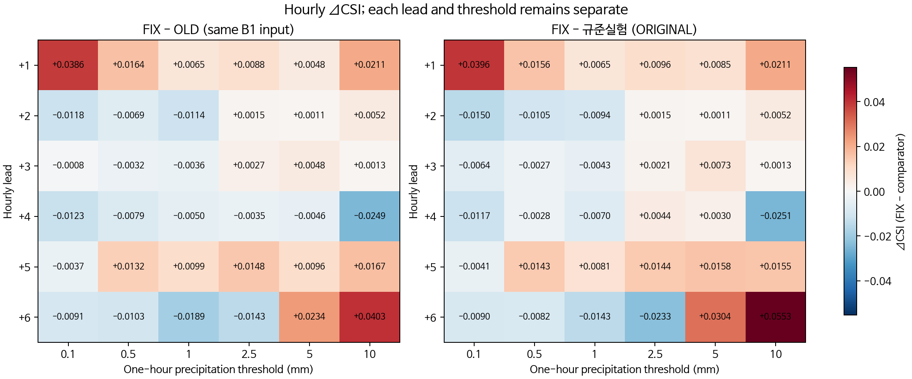
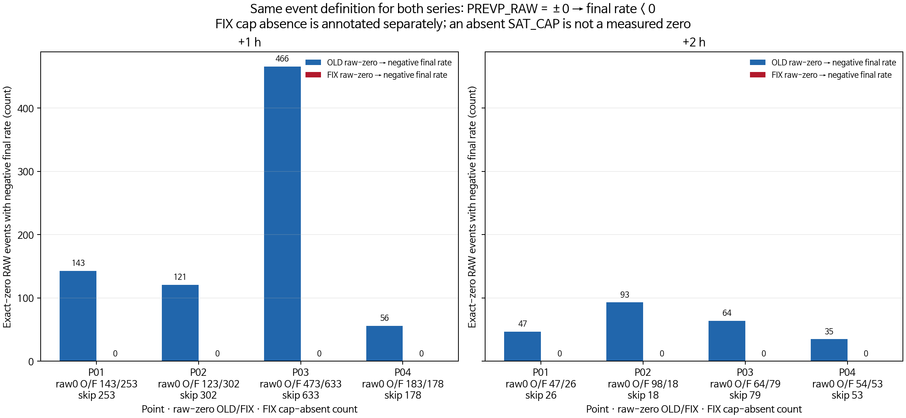
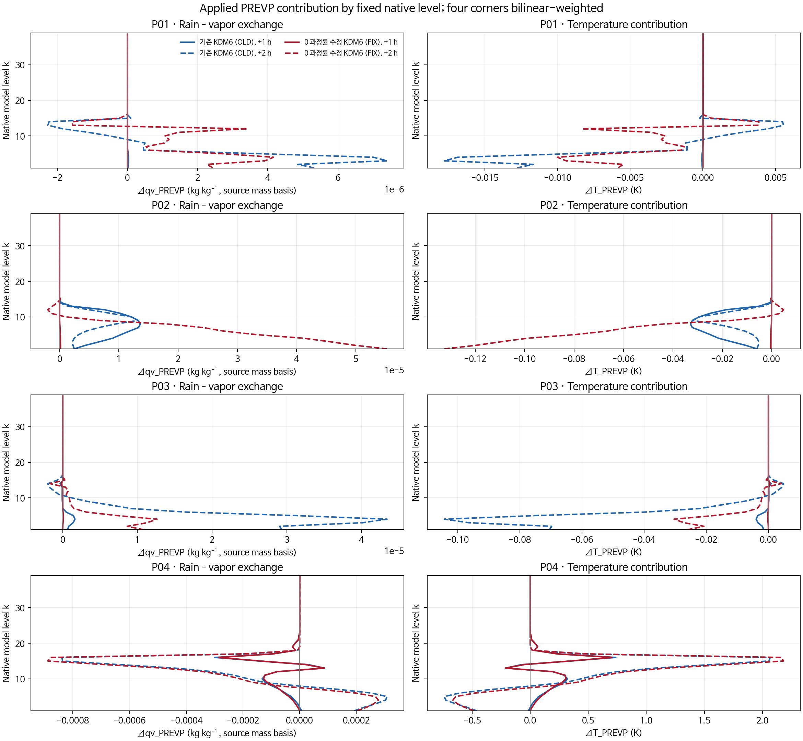
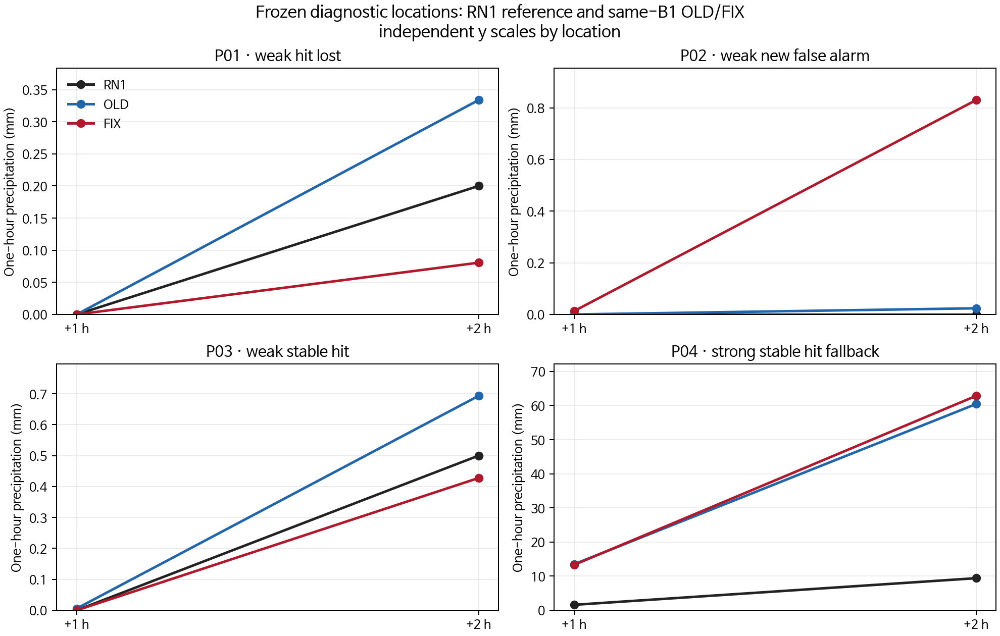

# B1 KDM6의 첫 두 시간 과정 진단

**요약.** 같은 B1 초기장으로 구동한 기존 KDM6(OLD)와 0 과정률 수정 KDM6(FIX)의 12–14 UTC 기록을 비교했다. 고정된 네 지점에서 OLD는 정확한 영 `PREVP_RAW` 뒤 음의 `SAT_CAP` 및 음의 최종 과정률로 이어진 사례 1,025건을 보였고, FIX에서는 1,542개의 정확한 영 `PREVP_RAW` 사례에서 `SAT_CAP` 분기가 기록되지 않은 채 최종 과정률이 부호 있는 영으로 남았다. 이는 관측된 분기 전이의 차이다. 지점별 수증기·온도 응답은 서로 달랐고, 이 네 지점 분석으로 이후 CSI 변화의 인과성을 확정할 수는 없다. 새 후보의 점수는 평가하지 않았다.

## 1. 목적과 자료

초기 시각은 2026-08-16 12 UTC (21 KST)다. OLD는 `ORIGINAL_B1_100`, FIX는 `IMPROVED_BG_FIXED`이며 두 실행은 같은 B1 `wrfinput_d01`을 사용했다(SHA-256 `9f8b494dbf5ce765e4320701475d6a65be1f591d72a4f9bf5e929c208be563e5`). +1 h는 12–13 UTC, +2 h는 13–14 UTC의 **시간별 강수량**이다. +2 h는 초기시각부터의 누적강수가 아니다.

본 진단의 P01–P04는 +2 h B1 점수 차이에서 사후 선택한 네 RN1 지점이다. 역사적 표나 다른 실험의 P01과 혼동하지 않도록 이 문서의 지점 ID로만 사용한다. 각 지점은 네 개 질량격자 모서리와 고정된 bilinear 가중치로 연결된다. 이는 선택 위치의 보간 진단이며 면적 가중 물질량이나 연직 기둥의 물·에너지 수지이 아니다.

| 본 진단 지점 | 선택 그룹 | RN1 표본 인덱스 | 위도, 경도 (°) | RN1 +2 h (mm) | OLD +2 h (mm) | FIX +2 h (mm) |
|---|---|---:|---:|---:|---:|---:|
| P01 | 약한 적중 소실 | 476 | 35.13950, 127.28880 | 0.2 | 0.3338 | 0.0806 |
| P02 | 약한 신규 오경보 | 819 | 35.46572, 126.78839 | 0.0 | 0.0239 | 0.8300 |
| P03 | 약한 강수 적중 유지 | 439 | 35.09215, 127.39987 | 0.5 | 0.6933 | 0.4277 |
| P04 | 강한 강수 적중 유지 대체군 | 544 | 35.16274, 128.46669 | 9.4 | 60.4462 | 62.8380 |

RN1 입력의 상류 시각과 공간 coverage/QC는 미확정이다. 위 RN1 값은 저장된 점수 배열을 표시하며, 검증된 관측 계약을 뜻하지 않는다. 강한 적중 증가군은 비어 있어 P04는 미리 정한 강한 강수 적중 유지 대체군이다.

## 2. 정의와 과정식

기존 6시간 점수 표는 이 진단을 위해 다시 산출하지 않았다. 비교 맥락에서 **규준실험** `ORIGINAL`, 같은 B1 입력의 **기존 KDM6** `ORIGINAL_B1_100` (OLD), **0 과정률 수정 KDM6** `IMPROVED_BG_FIXED` (FIX)를 함께 보인다. 각 예측시간와 임계값을 독립적으로 유지했다.

시간별 강수 사건은 `P_h ≥ 임계값`으로 정한다. 적중 H, 누락 M, 오경보 F에 대해

$$
\mathrm{CSI}=\frac{H}{H+M+F}.
$$

고정된 네 모서리의 KDM6 과정률 `prevp`와 동일 업데이트의 시간 간격 `Δt_cld`에서, 수증기와 비의 PREVP 단독 증분은

$$
\Delta q_v^{(\mathrm{PREVP})}=-\mathrm{prevp}\,\Delta t_{cld},\qquad
\Delta q_r^{(\mathrm{PREVP})}=+\mathrm{prevp}\,\Delta t_{cld}.
$$

두 항은 같은 source mass-variable basis에서 대수적으로 상쇄한다. WRF의 `q`/`qr`를 혼합비로 해석하면 각각 kg kg⁻¹ 단위이며, wrapper는 이 두 변수에 `den`을 곱하거나 나누지 않는다. 이 변수별 단위 해석은 WRF 혼합비 관례에 조건부다. `prevp < 0`이면 비에서 수증기로 이동하고, `prevp > 0`이면 수증기에서 비로 이동한다.

비 과정률만의 잠열 온도 항은

$$
\Delta T^{(\mathrm{PREVP})}=\frac{xl\,\mathrm{prevp}}{c_{pm}}\,\Delta t_{cld}.
$$

따라서 양의 `xl`에서 음의 `prevp`는 이 항으로 냉각하고, 양의 `prevp`는 가열한다. 이는 전체 온도 변화가 아니다. 다른 상변화 항도 온도 업데이트에 포함된다. 실제 과정 업데이트 값은 `PRE_UPDATE`에서 `POST_STEP`까지의 국지 명령 순서상의 계측 지점이며, 뒤따르는 KDM6 계산을 모두 포함한 함수 반환이나 13→14 UTC 대기 상태 차이가 아니다.

고정한 [KDM6 source](evidence/cp02_b1_two_hour_process_20261103/native/source/module_mp_kdm6_BASE.f90)의 식에서 음의 `SAT_CAP`은 `SATDT/2` 제한값이 음수인 경우다. 진단된 분기 전이는 다음과 같다. 점선 연결은 이후 점수 변화와의 관계가 입증되지 않았음을 표시한다.

```mermaid
flowchart LR
    Z[PREVP_RAW = ±0] --> C{SATDT/2 < 0?}
    C -->|OLD: min(0, SATDT/2)| A[음의 SAT_CAP, 최종 음률 1,025 / 1,185]
    C -->|OLD: SATDT/2 ≥ 0| O[최종 +0 160 / 1,185]
    Z -->|FIX: .ne. 0 조건 실패| S[SAT_CAP 분기 미기록, 최종 부호 있는 영 1,542 / 1,542]
    A --> W[비 감소 · 수증기 증가]
    A --> T[PREVP 온도항은 냉각]
    W -. 이후 CSI 연결 미입증 .-> CSI[+2…+6 h 약한 임계값 점수]
    T -. 이후 CSI 연결 미입증 .-> CSI
```

## 3. 결과

### 점수 맥락

기존 표에서 현재 B1 FIX의 +1 h CSI는 OLD보다 여섯 임계값 모두 높다. +2 h에는 약한 세 임계값의 FIX−OLD 차이가 음수다. 이는 보존된 OLD/FIX 비교이지 새 후보의 성능 결과가 아니다. 현재 B1의 5 mm CSI는 보존 표에서 규준실험보다 여섯 예측시간 모두 높다. 향후 후보의 보호 조건은 현재 B1을 직접 기준으로 +1 h 여섯 임계값을 보존하고, 각 예측시간의 5 mm CSI를 보존하는 것이다. 이 진단에서는 새 후보의 해당 조건을 평가하지 않았다.

| 1시간 강수량 임계값 (mm) | +1 h FIX−OLD ΔCSI | +2 h FIX−OLD ΔCSI |
|---:|---:|---:|
| 0.1 | +0.0386 | −0.0118 |
| 0.5 | +0.0164 | −0.0069 |
| 1.0 | +0.0065 | −0.0114 |
| 2.5 | +0.0088 | +0.0015 |
| 5.0 | +0.0048 | +0.0011 |
| 10.0 | +0.0211 | +0.0052 |



`ORIGINAL`, OLD, FIX의 절대 CSI는 [별도 그림](evidence/cp02_b1_two_hour_process_20261103/figures/b1_hourly_csi.png)과 변하지 않은 [전체 6시간 점수 표](evidence/weak_strong_balance_20261030/analysis/categorical_scores.csv)에 둔다. +2…+6 h 저임계값 CSI 회복은 이 보존 표에서 확인되지 않는다.

전체 예측시간×임계값 수치는 별도 [CSI 표](evidence/cp02_b1_two_hour_process_20261103/tables/CSI_BY_LEAD_THRESHOLD.md)와 [108행 CSV](evidence/cp02_b1_two_hour_process_20261103/tables/categorical_scores_108_rows.csv)에 정리되어 있다. 본문 그림은 각 예측시간와 임계값을 개별 표시하며 평균 점수는 만들지 않는다.

### 영 전환 분기

아래 수는 본 진단 네 지점의 네 모서리와 39개 연직층에서 센 사건 수다. 적분 강수량이나 면적 가중 수가 아니다. 0–2 h 열은 +1 h와 +2 h 사건 수의 합이며, 두 시간별 결과도 함께 표시한다.

| 본 진단 지점 | 그룹 | OLD 음의 SAT_CAP→음의 최종률 (+1, +2, 0–2 h) | OLD 나머지 raw-zero→+0 (+1, +2, 0–2 h) | FIX SAT_CAP 분기 미기록→최종 ±0 (+1, +2, 0–2 h) |
|---|---|---:|---:|---:|
| P01 | 약한 적중 소실 | 143, 47, 190 | 0, 0, 0 | 253, 26, 279 |
| P02 | 약한 신규 오경보 | 121, 93, 214 | 2, 5, 7 | 302, 18, 320 |
| P03 | 약한 강수 적중 유지 | 466, 64, 530 | 7, 0, 7 | 633, 79, 712 |
| P04 | 강한 강수 적중 유지 대체군 | 56, 35, 91 | 127, 19, 146 | 178, 53, 231 |
| **합계** | 네 지점 합 | **786, 239, 1,025** | **136, 24, 160** | **1,366, 176, 1,542** |

OLD에서는 raw-zero 경로의 `else`가 `min(0, SATDT/2)`를 적용했다. `SATDT/2 < 0`인 1,025건은 음의 `SAT_CAP`과 음의 최종률이 되었고, 나머지 160건은 최종 `+0`이었다. FIX의 `else if (PREVP_RAW .ne. 0)`는 이 raw-zero 행에서 분기하지 않는다. 따라서 1,542건 모두 `SAT_CAP`이 영으로 측정된 것이 아니라 그 필드가 기록되지 않았으며, 최종률은 부호 있는 영이다. OLD의 1,025건은 시간 단계 1–360에 걸쳐 나타나 최초 호출에만 국한되지 않았다. P03의 OLD 음의 전이 수(530)가 P01(190)보다 많으므로 이 분기 수만으로 CSI 그룹의 순서를 설명하지 않는다.

영률의 입자수 상태도 달랐다. OLD의 raw-zero 1,185건에서는 `nrs=0`, `n0r=0`이었다. FIX의 1,542건 중 1,531건은 두 값이 영이고, 11건은 작은 양의 `nrs`/`n0r`와 `RH=0.848–0.912`를 보였다. 나머지 PREVP 식 피연산자가 충분하지 않아 이 11건의 기원을 전체 식으로 재현하거나 초기 PSD seed로 해석하지 않는다. 이 제한과 전이 수는 [독립 과정 검토](evidence/cp02_b1_two_hour_process_20261103/review/science_review.json) 및 [원시 이벤트 재검토](evidence/cp02_b1_two_hour_process_20261103/review/independent_trace_review.json)에 기록했다.



막대는 네 모서리와 연직층별 사건 수를 지점·시간별로 합한 count다. 각 지점의 raw-zero 총수와 FIX cap 미기록 수는 막대 계열과 분리해 주석으로 표시했다. 세부 위치는 [모서리·연직층별 전이 그림](evidence/cp02_b1_two_hour_process_20261103/figures/b1_zero_rate_transitions_level_corner.png)에 별도로 남겼다. 따라서 SAT_CAP 부재를 영 값으로 오인하지 않는다.

### 국지 수증기와 온도 응답

아래 프로파일은 각 WRF 고유 연직층을 따로 표시한다. 네 모서리는 bilinear 위치 가중으로 결합하며, 연직층 간 합산은 하지 않는다. `Δqv_PREVP`와 `ΔT_PREVP`는 최종 적용률을 각 단계의 `Δt_cld`, `xl`, `cpm`에 연결한 시간 합이다. 양의 수증기 증분은 비에서 수증기로의 이동, 음의 온도 증분은 해당 PREVP 항의 냉각을 뜻한다. 지점별로 응답의 부호와 크기가 달라 모든 PREVP를 일률적인 증발 또는 냉각으로 묘사할 수 없다.



P02에서 +2 h FIX의 총 PREVP 수증기 증분은 일부 높이에서 OLD보다 클 수 있다. 0 과정률에서 음의 `SAT_CAP`으로 이어지는 경로가 사라졌다고 해서 모든 연직층·시간에서 전체 증발량이나 냉각량이 줄었다고 추론할 수 없다. 과정률 자체도 이후 상태 변화에 반응한다.

### 네 지점의 강수량



점별 y축 범위는 독립적이다. RN1 상류 시각과 coverage가 미확정이므로 이 그림도 관측 입력의 적합성을 검증하지 않는다.

## 4. 논의와 한계

각 구성에서 224,640개의 `PRE_UPDATE`→`POST_STEP` 업데이트를 비교했다. 명령 순서에 따른 REAL32 재구성의 최대 `q` 및 `T` 잔차는 두 구성 모두 0이었다. 방정식 항을 다른 부동소수점 순서로 계산한 차이의 최댓값은 `q` 약 9.31×10⁻¹⁰, `T` 약 1.53×10⁻⁵ K였다. 이는 계산 순서에 따른 작은 잔차이며, 물·에너지 수지이 닫혔다는 뜻은 아니다.

이 분석은 한 사례, 네 사후선택 위치, 네 모서리, 39개 연직층, 처음 두 예보시간으로 제한된다. 시간 합은 위치 보간을 위한 모서리 가중 과정 진단이며 기둥·영역 수지이 아니다. 선택 지점 간 물리 상태와 강수 응답은 다르므로 국지 분기 전이로 CSI 변화의 인과성을 정하지 않는다. 입자수의 최초 작성·진단 정책과 PSD 초기화는 이 진단에서 확정되지 않으며 임의의 seed를 추론하거나 추가하지 않았다. 새 후보의 점수·보호 조건은 아직 검증하지 않았다.

전체 상태 갱신 프로파일은 [수증기](evidence/cp02_b1_two_hour_process_20261103/figures/b1_q_state_vertical_profiles.png)와 [온도](evidence/cp02_b1_two_hour_process_20261103/figures/b1_t_state_vertical_profiles.png)에 별도 수록했다. 이 값은 시간합한 국지 `PRE_UPDATE`→`POST_STEP` 갱신이며 13→14 UTC 대기 상태 차이나 전체 KDM6 반환이 아니다.

## 5. 결론

네 지점의 확인 가능한 차이는 OLD에서 1,025건 관측된 영 `PREVP_RAW`→음의 `SAT_CAP`→음의 최종률 전이가 FIX에서 발생하지 않았다는 것이다. 해당 PREVP 항은 수증기 증가·비 감소·잠열 냉각으로 연결되지만, 네 지점의 전체 응답은 연직층과 지점에 따라 다르고, 이후 저임계값 CSI와의 인과 연결은 입증되지 않았다. 현재 B1 첫 시간과 5 mm 예측시간 기준을 지키면서 +2…+6 h 저임계값을 회복하는 새 후보는 이 진단으로 선택되지 않았다.

## 재현 및 검증 기록

그림 입력·출력 SHA-256과 byte 수는 [render receipt](evidence/cp02_b1_two_hour_process_20261103/figures/render_receipt.json)에 있다. 오프라인 그림·표 묶음은 `/NHNHOME/WORKSPACE/26weather002_A/yhlee/KLAPS50/scratch/b1_two_hour_figures_20261103/all_figures.zip`이며, CRC·항목 해시 기록은 [package receipt](evidence/cp02_b1_two_hour_process_20261103/figures/package_receipt.json)에 있다. 묶음에는 18개 score context, 선택 지점, 통합 국지 과정 성분표와 그림이 포함되며 원시 trace는 포함하지 않는다. 전체 source gate, 분석 로그, 압축 원시 기록 및 실행 환경은 별도 [진단 증거 디렉터리](evidence/cp02_b1_two_hour_process_20261103/)에 보존한다.
