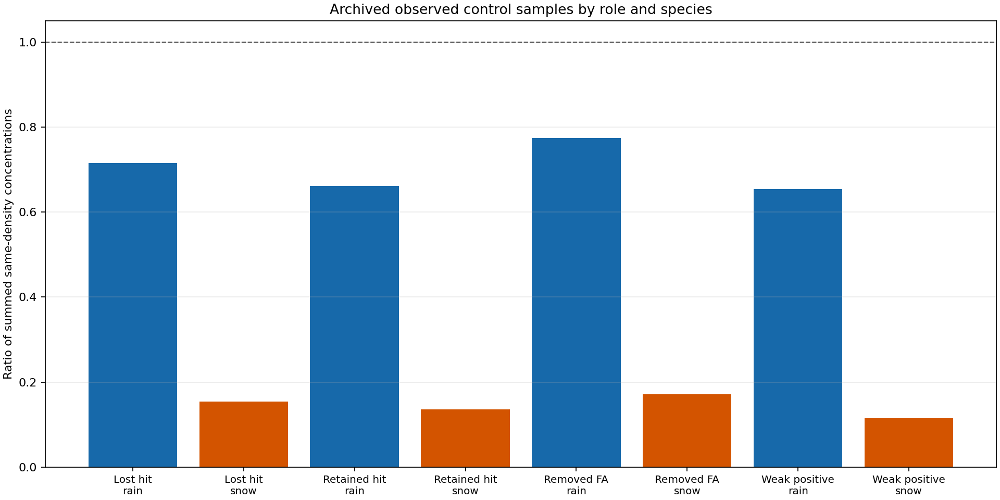

# CP02 캡처 재현성 복구와 관측층 대조

기준은 PR123 병합본 `8c278b643c5fa2b663f32d2b68d0f59e0301a989`다.
과거 CP02 OFF/HYDRO/LIQUID 사례의 분석이며 최신 C2와 구분한다.

## 누락 증거 파일 복구

`cp02_control_capture_analysis.py`가 읽는 `standard_radar_analyzer_attempt.log`는
PR123의 로컬 작업 경로에는 있었지만 `*.log` ignore 규칙으로 커밋에서 빠졌다.
검증 manifest에 해시를 기록하는 것만으로 Git 추적 여부를 보장하지 못한 결함이다.
정상 캡처의 CLI 실패를 [수정 전 기록](evidence/cp02_control_reproducibility_20261029/before_fix.txt)에 보존했다.

원래 로그의 1,265바이트를 복구했으며 SHA-256은
`7b38e3165cf733ba38a849042a5abe7083189d6ce90b05edcb8c70b302cda405`다.
기존 manifest와 정확히 일치하고 해당 경로에만 ignore 예외를 추가했다.
기존 분석기의 검사·계산과 과거 캡처·결과·manifest는 변경하지 않았다.

새 회귀시험은 로그의 정확한 manifest 항목과 기존 50개 산출물의 존재·크기·해시를
검사한다. 복구 후 정상 CLI의 440행 profiles CSV는 이전 보존본과 바이트 동일하다.
[수정 후 CLI](evidence/cp02_control_reproducibility_20261029/after_fix_cli.txt)에 결과를 기록했다.

## 새 관측층의 비교량

새 HYDRO 캡처의 440개 층 중 실제 관측층 141개에 같은 진단 밀도를 적용한다.
`Cdiag = rho_d * qdiag`, `Cbg_eq = rho_d * qbg`이며 단위는 kg m-3다.
REAL64 진단량과 최종 REAL32 저장량을 분리한다. `Cbg_eq`는 과거 배경 생성 때의
실제 농도가 아니라 현재 캡처한 진단 밀도로 표현한 등가 농도다.

집단별 비율은 해당 상의 관측층에서 `sum(Cdiag) / sum(Cbg_eq)`로 계산한다.
층 두께·면적·건조공기 질량을 가중한 총질량 또는 지상 강수량 비율이 아니다.
배경 합이 0인 비율은 정의되지 않으므로 숫자 0 대신 null로 표시한다.

| 선정 집단 | rain 층 | rain 비율 | snow 층 | snow 비율 |
| --- | ---: | ---: | ---: | ---: |
| 적중 소실 | 33 | 0.71483525 | 3 | 0.15373328 |
| 적중 유지 | 34 | 0.66200347 | 17 | 0.13595266 |
| 오경보 제거 | 25 | 0.77467255 | 6 | 0.17119439 |
| 약한 관측 강수·세 예보 <5 mm | 22 | 0.65361220 | 1 | 0.11551995 |

rain·quality 32만 비교해도 적중 소실 31층의 비율은 0.71335931,
적중 유지 34층은 0.66200347이다. 선택한 적중 유지 표본에서 상대 감소가 더 크다.
따라서 감소 유무·상대 비율 하나만으로 적중 손실을 설명할 수 없다. 감소가 강수
손실과 무관하다는 결론도 아니다. 사후 선정 표본이며 온도·고도·반사도·강수계
조건을 맞춘 인과 비교가 아니다. snow 집단 일부는 표본이 매우 작다.

[141개 표본 CSV](evidence/cp02_control_reproducibility_20261029/science/control_density_samples.csv)와
[집단·상·QC별 18행 CSV](evidence/cp02_control_reproducibility_20261029/science/control_density_groups.csv)는
배경·진단·최종 혼합비와 농도 합, 차이·비율, dBZ·기온·압력·밀도 범위를 함께 담는다.
[요약 JSON](evidence/cp02_control_reproducibility_20261029/science/control_density_comparison.json)은
캡처와 분석기 해시를 연결한다. 실행 당시 절대 경로는 실행 위치의 기록이며,
그 경로에 원본을 다시 배치해야 한다는 요구가 아니다.

## WRF 첫 호출 계측 준비 상태

[읽기 전용 바이너리 조사](evidence/cp02_control_reproducibility_20261029/wrf_probe/README.md)에서
당시 CP02 WRF 실행파일이 보존돼 있고 SHA-256이 기존 실행 기록과 같음을 확인했다.
미세물리 driver와 KDM6 심볼은 있지만 DWARF 디버그 정보는 없다. 따라서 실제
인자 주소·타입·MPI rank별 격자 소유권을 확인하는 ABI 검증이 다음 단계다.
함수 심볼이 있다는 사실만으로 과정별 tendency를 읽을 수 있다고 판단하지 않는다.
함께 보관된 소스의 해시는 기록했지만 정확한 컴파일 입력 소스임을 검증하지는 않았다.

새 WRF 적분이나 Fortran 빌드는 실행하지 않았다. 현재 계측 자료는 LAPSPREP
초기화 경로이며 WRF 첫 미세물리 PRE/POST를 대신하지 않는다.

## 검증 범위

추적 파일만 내보낸 별도 디렉터리에서 기존 집중 시험 106개와 새 시험 9개,
총 115개가 통과했다. 정상 CLI 결과와 기존 440행 profiles를 비교하고, 기존
manifest의 50개 파일이 모두 Git index에 있으며 크기·해시가 일치함을 확인했다.
전체 portable suite는 이번 실행 범위가 아니다.

## 남은 해석 범위

WRF 첫 미세물리·수송의 실제 PRE/POST와 과정량, 층별 건조공기 질량을 연결해야
초기 차이가 언제 지상 강수 차이로 이어지는지 판단할 수 있다. 이번 변경은
수종 보정계수나 물리 정책을 바꾸지 않으며 새 예보 성능을 입증하지 않는다.
RN1 상류 시각·coverage, 정확한 당시 배경 생성 규약, C2 T39/H/A/N 1시간 완료,
전체 물·에너지 수지는 계속 미완료다.
