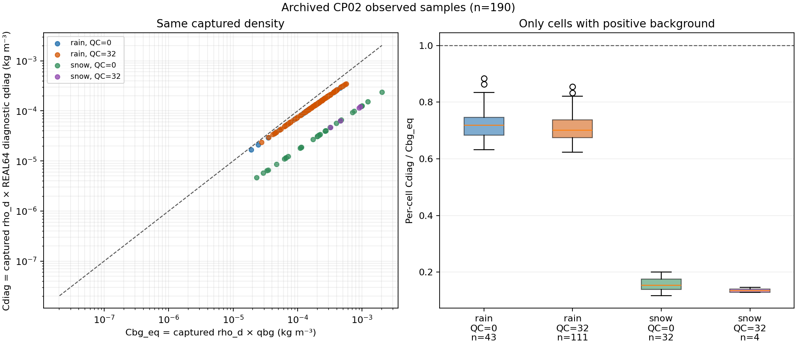

# CP02 공통 밀도 비교와 강수검증 대조 지점

기준은 PR122 병합본 `a0413424f79787a9055210f72756a3e44868eda2`다.
CP02의 보존된 초기화·6시간 예보를 대상으로 하며 최신 C2 예보와 구분한다.

## PR122 검토 문서의 버전 연결

기존 과학 검토가 가리키는 문서와 최종 문서의 차이는 기존 `binary_probe.json`을
가리키는 근거 링크 한 줄이다. 검토 당시 문서를 복원해 SHA-256
`66a52c589aea3d6ba1f1f61c88c17f6ca771934b800ca7c476acdaad2c8b2aa9`와
정확히 일치함을 확인했다. 최종 문서의 수치·해석 문장은 동일하다.
과거 검토 영수증은 유지하고 [복원본과 최종본의 연결 기록](evidence/cp02_density_controls_20261029/pr122_review_version_reconciliation.json)
및 [정확한 차이](evidence/cp02_density_controls_20261029/pr122_review_version_delta.patch)를 추가했다.

## 비교량의 정의

동일 표본의 실제 캡처된 진단 건조공기 밀도 `rho_d`를 두 항에 공통으로 사용한다.

```text
C_diag = rho_d * q_diag
C_bg_eq = rho_d * q_bg
```

단위는 kg m-3다. `C_bg_eq`는 진단 밀도로 표현한 배경 등가 농도이며 당시 배경 생성에
사용한 실제 밀도·농도를 복원한 값이 아니다. 같은 표본의 후보/배경 비율은 밀도를
곱해도 변하지 않지만, 여러 표본을 합한 비율은 밀도 가중에 따라 달라질 수 있다.
저장층·지점의 비가중 통계는 면적·층 질량 가중 수지나 지상 강수 감소량이 아니다.

## 190개 관측 표본의 공통 밀도 비교

REAL64 진단 작업 배열 `qdiag`와 최종 REAL32 후보 `qfinal`을 별도로 보존했다.
배경 QR·QS는 캡처의 실제 입력과 같고, density 반환값과 상분할 호출의 밀도도
같음을 검사한다. 모든 표본에서 total은 해당 상의 REAL64 수종과 같으며, 최종
REAL32 저장값은 total을 REAL32로 변환한 값이다.

| 수종 | quality | 표본 수 | ΣCdiag / ΣCbg_eq | 개별 비율 중앙값 | 개별 비율 10–90% |
| --- | ---: | ---: | ---: | ---: | --- |
| rain | 0 | 43 | 0.68782657 | 0.718671 | 0.651395–0.810348 |
| rain | 32 | 111 | 0.68262825 | 0.701348 | 0.651733–0.784775 |
| snow | 0 | 32 | 0.13509729 | 0.153419 | 0.127740–0.189963 |
| snow | 32 | 4 | 0.13271587 | 0.134433 | 0.128495–0.144041 |



[표본별 CSV](evidence/cp02_density_controls_20261029/density/density_comparison.csv)는
위치·층, dBZ, 온도·압력·밀도, 상·quality, 배경·진단·최종 수종과 농도를 포함한다.
[요약 JSON](evidence/cp02_density_controls_20261029/density/density_comparison.json)에
입력·분석기·도구 해시와 검증 관계를 기록했다. quality 0에서도 감소가 크다는
기존 해석은 유지된다. 동일 밀도 표현은 과거 배경 생성식이나 강수 영향의 인과관계를
복구하지 않는다. snow quality 32는 4개 표본이다.

## 강수검증 지점과 초기화 격자 연결

첫 시간 ≥5 mm 기준에서 사후 선정한 네 집단을 각 4점씩 사용했다.

| 집단 | 조건 |
| --- | --- |
| 적중 소실 | RN1·OFF ≥5, HYDRO 또는 LIQUID <5 mm |
| 적중 유지 | RN1·세 예보 모두 ≥5 mm |
| 오경보 제거 | RN1 <5, OFF ≥5, HYDRO 또는 LIQUID <5 mm |
| 약한 관측 강수·예보 임계값 미만 | 0<RN1<5, 세 예보 모두 <5 mm; 무강수 조건이 아님 |

이는 같은 강수계·고도·온도를 완전히 맞춘 통계적 대조군이 아니라 탐색용 표본이다.
기존 3,688점의 전체 점수와 여섯 시간·여섯 임계값 판정은 그대로 유지한다.

각 RN1 지점에 대해 기존 검증기의 WRF 네 모서리·가중치를 복원했다.
16점 × 세 실험의 원래 12·13 UTC 누적 강수 차이를 재보간한 48개 값은 canonical
NPZ와 정확히 같다. [보간·재계산 영수증](evidence/cp02_density_controls_20261029/controls/receipt.json)과
[WRF 모서리 표](evidence/cp02_density_controls_20261029/controls/wrf_mapping.csv)에 연결했다.
WRF 좌표와 초기화 자료의 좌표 연결은 별도 표로 남겼다.
초기화 원래 격자에서의 기하학적 연결은 과거 metgrid 내부의 모든 보간 연산을
복원했다는 뜻이 아니다.

추가 4점은 전체 초기화 격자에서 반사도 valid가 거짓이며 배경 rain 또는 snow가
양수인 탐색용 표본이다(각 수종 2점). RN1 검증 표본과의 최근접 거리는 약
283–467 km이므로, 해당 강수 손실의 가까운 대조군이나 성능 검증점으로 취급하지
않는다. 실제 `observed` 분기는 별도 실행 캡처로 확인한다.

## 새 표본의 실제 초기화 분기

보관된 Intel LAPSPREP 실행파일과 기존 계측 스크립트를 그대로 사용해 HYDRO를
새 scratch에서 재생했다. 입력 114개와 런타임 파일 41개의 실행 전후 해시가 유지됐고,
생성된 WPS와 shadow NetCDF는 기존 보관 출력과 바이트 동일하다. 새 모델 예보나
Fortran 재빌드는 수행하지 않았다.
[실행 영수증](evidence/cp02_density_controls_20261029/capture/replay_receipt.json)에
실행파일·입력·런타임 및 출력 식별을 기록했다.

20개 기둥 × 22층 중 진단 후 실제 `observed=True`는 141개, False는 299개다.
외부 탐색 표본 4개 기둥의 88개 층은 모두 실제 False이며 여섯 수종은 입력과
같이 유지됐다. 이 중 양의 배경 rain은 21개 층 표본, snow는 17개 층 표본이며
각각 최종값과 같다(수종별 개수는 중복될 수 있음). 이는 해당 표본에서 확인한 배경 보존 동작이다. 전 영역 또는 모든
QC 조합의 정책 검증으로 확대하지 않는다.

| 선정 집단 | 실제 관측 True 층 표본 | rain 감소 | snow 감소 |
| --- | ---: | ---: | ---: |
| 적중 소실 4점 | 36 | 33 | 3 |
| 적중 유지 4점 | 51 | 34 | 17 |
| 오경보 제거 4점 | 31 | 25 | 6 |
| 약한 관측·세 예보 <5 mm 4점 | 23 | 22 | 1 |
| 외부 양의 배경·반사도 결측 후보 4점 | 0 | 0 | 0 |

[새 440행 캡처 분석](evidence/cp02_density_controls_20261029/capture/control_analysis.json)과
[표본별 비교](evidence/cp02_density_controls_20261029/capture/control_profiles.csv)에
주 실행·writer 재생의 입력·반환을 구분했다.
따라서 수종 감소는 적중 소실 표본에만 나타나는 현상이 아니다. 선정한 기둥 수는
같아도 관측된 층·상·온도 조건이 다르므로 변경 개수만으로 효과 크기나 인과성을
비교하지 않는다. 실제 첫 WRF 미세물리·수송 반응은 아직 별도 연결이 필요하다.

기존 20점의 분석기는 모든 강수 작업 배열의 REAL32 변환값이 최종 후보와 같다는
그 사례의 조건을 검사한다. 새 외부 표본에서는 작업 배열이 0이어도 양의 배경이
유지돼 이 조건이 성립하지 않는다. 기존 분석기를 완화하지 않고, 새 표본에는
호출·상태 구조 검사를 재사용하면서 실제 관측 여부와 작업 배열·입력·출력을
분리해 보고한다. 기존 정상 20점 결론이나 생산 코드 결함을 뜻하지 않는다.

## 검증과 재현 범위

기존 집중 시험 79개와 새 밀도·선정·캡처 시험 27개, 총 106개가 통과했다. 유지 파일별
실행기의 12개·8개·7개도 통과했으며 같은 시험이므로 더해 세지 않는다. 전체 portable
suite를 실행한 결과가 아니다. 새 세 시험 파일은 portable 자동 발견 목록에 등록됐다.
실제 GDB 재생은 보관 Intel 실행파일만 사용했고 GNU/ifort 대체 빌드는 하지 않았다.

## 남은 범위

수종을 임의 증량하거나 QC·상분할 정책을 변경하지 않는다. 정확한 당시 배경 생성
규약, 초기화의 변경이 강수 적중·실패에 미친 인과효과, RN1 상류 시각·coverage,
최신 C2의 T39 해결·H/A/N 1시간 완료, 전체 물·에너지 수지는 별도 미완료 항목이다.
