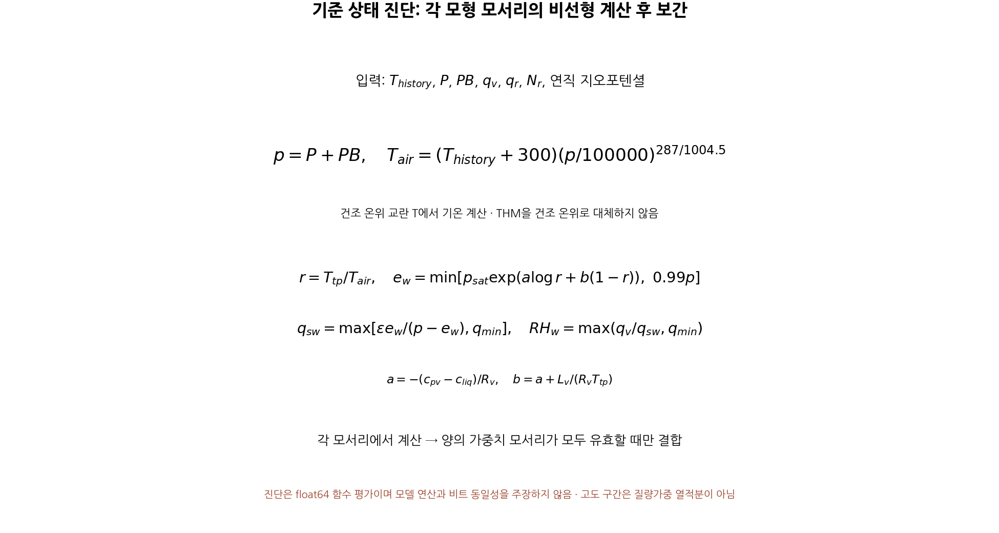
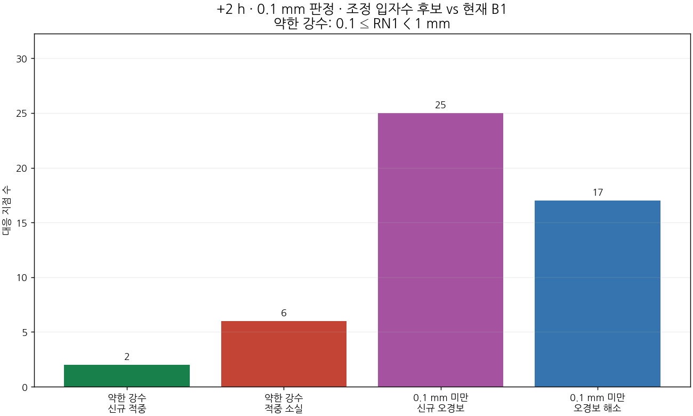
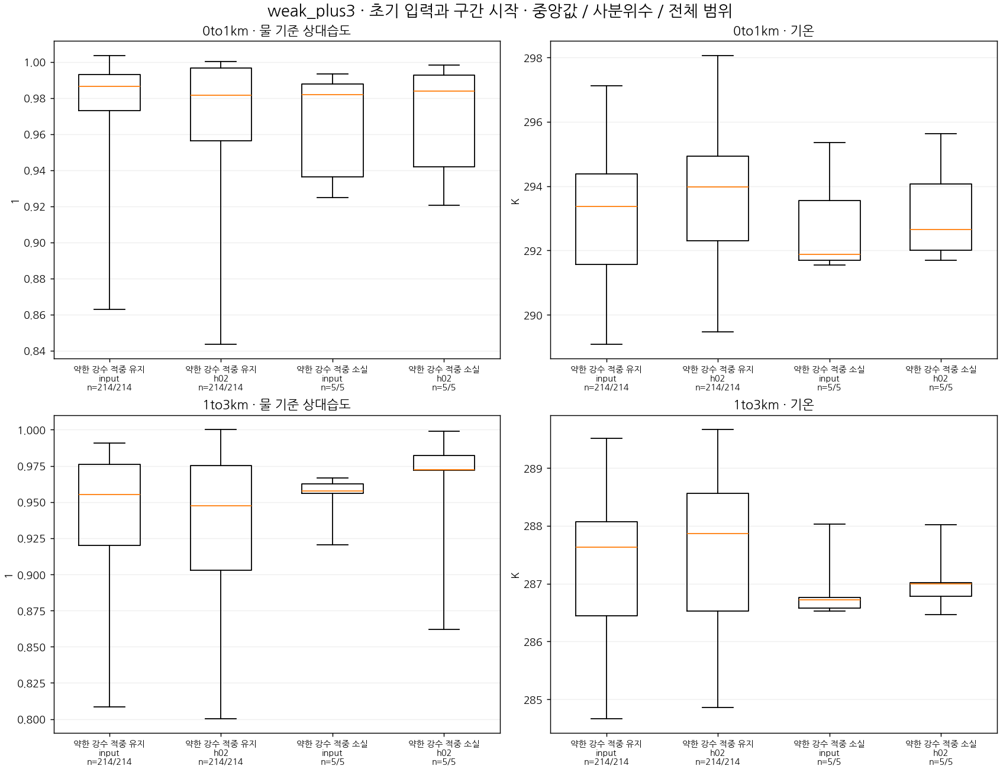
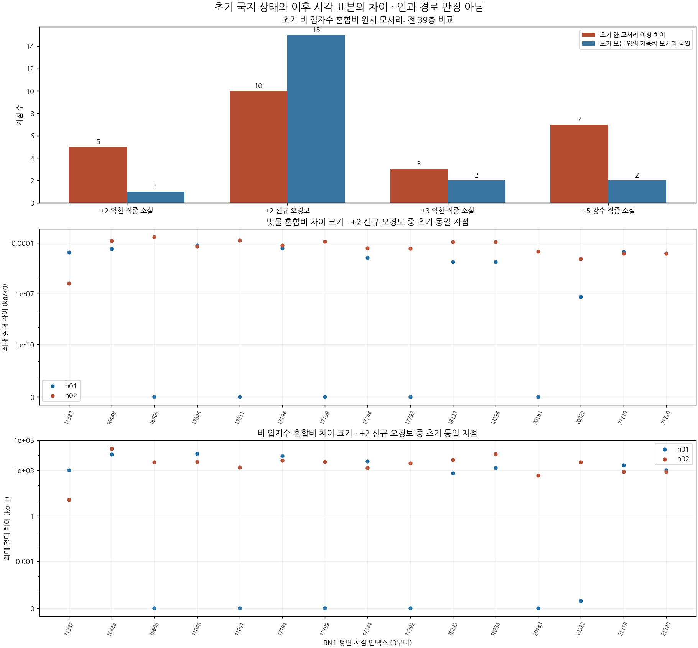

# 비 입자수 초기화의 강수 검출 실패 유형과 환경 상태: CP02 단일 사례의 조건별 진단

## 초록

공통 비 입경 0.65 mm 후보가 후반 약한 강수를 회복하지 못한 이유를 좁히기 위해, CP02 단일 사례의 실패 유형과 초기·정시 환경을 비교하였다. 기존 6시간 예보의 3,688개 평가점·여섯 임계값에서 모든 398,304개 쌍별 전이를 보존하고, 세 구성의 초기 입력 및 0–6시간 정시 자료 24개에서 39층 상태를 진단하였다. +2시간 실제 약한 강수 구간에서는 적중 획득 2개·소실 6개, 관측 음성 구간에서는 신규 오경보 25개·해소 17개가 나타났다. +5시간 5 mm 적중의 순감소 3개는 소실 9개와 획득 6개로 나뉘었다. 실패 집단의 하층 습도·온도 분포는 유지 집단과 중첩하고, +3시간 약한 강수 소실 집단은 구간 시작 시점에 더 건조하지 않았다. 신규 오경보 25곳 중 15곳에서는 평가 네 모서리의 전 층 초기 비 입자수 변화가 없었으나 이후 정시 비 질량·입자수 차이가 나타났다. 따라서 시험한 공통 입경 감소의 실패를 국지 초기 습도 또는 입경 하나로 설명할 근거는 부족하다. 새 후보나 새 적분을 추가하지 않고 현재 B1을 유지하며, 후속 검증은 초기 변경 영역 밖으로 전달되는 상태 차이와 강수 공급·미세물리 경계를 좁혀 추적하는 데 둔다.

**핵심어:** 비 입자수 초기화, 약한 강수 검출, 임계성공지수, 오경보, 액체 물 기준 상대습도, 연직 구조

## 1. 서론

현재 B1의 +2시간 이후 낮은 임계값 성능을 회복하는 것이 개발 목표다. 앞선 공통 질량가중 평균입경 0.65 mm 후보는 사전 조건 26개 중 10개만 충족해 채택하지 않았다. 본 연구는 추가 전역 입경 값을 시험하기에 앞서, 실패를 **실제 약한 강수의 적중 소실, 관측 음성 구간의 신규 오경보, 5 mm 이상 사건의 적중 소실**로 나누어 초기 상태와 시간별 연직 구조를 비교한다.

이 구분은 강수량 하나를 늘리거나 줄이면 세 문제가 함께 해결된다는 가정을 피하기 위한 것이다. 관측 강도 구간과 예보 전이는 진단 집단을 정의하는 데만 사용한다. 장래 초기화 규칙에 관측 결과나 미래 예보 성패를 입력하는 방법을 제안하지 않는다. **이번 연구는 기존 예보의 진단이며 새 수정 후보나 새 WRF 적분을 추가하지 않았다.**

## 2. 자료 및 방법

### 2.1 사례와 비교 범위

초기시각은 2026년 8월 16일 12 UTC(21 KST)다. 공통 RN1 평가점 3,688개, 예측시간 +1∼+6시간 및 여섯 임계값 0.1·0.5·1·2.5·5·10 mm를 그대로 유지한다. 예측시간별 양은 `RAINC+RAINNC`의 연속 정시 차이인 **한 시간 강수량**이며 초기시각부터의 누적량이 아니다. 지점 수는 독립 기상 사례 수가 아니다.

| 표시명 | 식별자 | 이번 역할 |
|---|---|---|
| 규준실험 | `ORIGINAL` | 기존 채택 조건의 회복 기준 |
| 현재 B1 | `IMPROVED_BG_FIXED` | 유지하는 구성 및 전이 비교 기준 |
| 기존 입자수 후보 | `B1_RAIN_NUMBER_PRIOR` | 공통 입력 질량가중 평균입경 약 0.862 mm, 미채택 |
| 조정 입자수 후보 | `B1_RAIN_NUMBER_DM065` | 공통 입력 질량가중 평균입경 0.65 mm, 미채택 |

기존 6시간 배열·점수·실행 계보는 [PR146의 보존 자료](evidence/cp02_rain_number_process_20261104/README.md)를 사용한다. 시간·임계값·후보 사이 CSI를 평균하지 않는다. 현재 B1의 +1시간 여섯 임계값과 매시간 5 mm CSI를 보호하는 11조건 및 +2∼+6시간의 낮은 세 임계값을 규준실험 이상으로 회복하는 15조건을 변경하지 않는다.

### 2.2 점수 변화와 관측 강도별 전이

임계값 $\tau$에서 RN1 기준량과 예측량이 각각 $\tau$ 이상이면 사건으로 정의한다. 적중 H, 누락 M, 오경보 F에 대해

$$
\mathrm{CSI}=\frac{H}{H+M+F}=\frac{H}{O+F},\qquad O=H+M
$$

이다. 같은 표본에서 O는 고정되므로 B1(0)에서 후보(1)로의 점수 차이는 정확히

$$
\Delta\mathrm{CSI}
=\frac{H_1-H_0}{O+F_1}
-\frac{H_0(F_1-F_0)}{(O+F_0)(O+F_1)}
$$

로 쓸 수 있다. 이는 점수의 대수적 분해이며 개별 물리 과정의 인과 기여율이 아니다. 적중 획득·소실과 오경보 생성·해소를 각각 같은 지점끼리 계산한다.

실제 약한 강수 집단은 **0.1≤RN1<1 mm**, 관측 음성 집단은 **RN1<0.1 mm**로 구분한다. 관측 음성은 강수량이 정확히 0이라는 뜻이 아니다. 1≤RN1<5 mm와 RN1≥5 mm도 별도로 보존한다. 여섯 시간·여섯 임계값·세 B1 대비 비교의 모든 398,304개 지점 전이를 기록하고, 중복·누락·좌표·입력 배열 동일성을 검사한다.

### 2.3 온도·상대습도와 입경의 진단 규약

시간별 WRF `T`는 건조 온위의 300 K 섭동을 나타내는 진단 출력이며, `THM`은 수증기를 포함하는 예측 온위의 섭동이다. 보관한 실제 소스·Registry·설정 `USE_THETA_M=1`과 두 필드의 수치 관계를 함께 대조했다. 온도는

$$
T_K=(T_{\mathrm{history}}+300)
\left(\frac{P+PB}{10^5}\right)^{R_d/c_p}
$$

로 복원한다. `THM+300`을 이 식에 직접 넣지 않는다. 전체 24개 입력·정시 파일에서

$$
T_{\mathrm{history}}+300\simeq
\frac{THM+300}{1+(R_v/R_d)q_v}
$$

의 최대 차이는 약 $5.98\times10^{-5}$ K다. 이 차이는 저장 정밀도를 포함한 필드 관계 검사이며 온도 예측 오차가 아니다.

KDM6의 액체 물 포화 함수와 같은 함수형으로

$$
r=\frac{273.16}{T_K},\qquad
 a=-\frac{c_{pv}-c_l}{R_v},\qquad
 b=a+\frac{L_v}{R_v\,273.16},
$$
$$
e_s=\min\{610.78\exp[a\ln r+b(1-r)],\,0.99p\},
\qquad q_s=\max\left\{\frac{(R_d/R_v)e_s}{p-e_s},q_{\min}\right\},
\qquad RH_w=\max\{q_v/q_s,q_{\min}\}
$$

를 계산한다. $p=P+PB$, $R_d=287$, $c_p=1004.5$, $R_v=461.6$, $c_{pv}=1846.4$, $c_l=4190$, $L_v=2.5\times10^6$, $q_{\min}=10^{-15}$를 사용한다. $RH_w$는 **액체 물 기준 상대습도의 비율**이며 얼음 기준 상대습도나 실행 중 내부 배열을 직접 읽은 값이 아니다. 이중정밀도 진단 계산을 원래 REAL32 과정 연산의 비트 재생으로 주장하지 않는다.

같은 공기질량 기준의 비 질량 혼합비 $q_r$와 수 혼합비 $N_r$가 모두 양수일 때, 형상모수 $\mu=1$인 감마 분포의 모멘트 비로

$$
D_m=5\left(\frac{q_r}{4000\pi N_r}\right)^{1/3}
$$

를 진단한다. 이는 **제한 전 모멘트 비의 등가 입경**이다. 입자수가 0이면 입경은 미정의이며 0이나 소스 대체 기울기로 채우지 않는다. 실제 순간 DEN이 없는 상태에서 이 값만으로 소스의 내부 수농도 하한·입경 제한기 활성 여부를 판정하지 않는다.

온도·습도·입경 같은 비선형 진단은 WRF 네 모서리에서 각각 계산한 뒤 기존 가중치로 연결한다. 일반적으로 $\sum w_c f(X_c)\ne f(\sum w_c X_c)$이므로 가중한 상태에서 포화 함수나 입경을 다시 계산하지 않는다. 양의 가중치를 가진 필수 모서리에서 미정의인 값이 있으면 해당 점의 진단값을 미정의로 유지하고 유효 표본 수를 별도 표시한다.

*그림 1. 건조 온위·수증기 포함 온위, 액체 물 상대습도 및 비선형 진단과 모서리 가중의 순서. 초기화 정책이나 새 상대습도 문턱값을 뜻하지 않는다.*

### 2.4 고정 위치의 시간별 상태

현재 B1·기존 입자수 후보·조정 후보 각각의 초기 `wrfinput`과 +0∼+6시간 history, 합계 **24개 원본 파일**의 크기·SHA-256·시각·격자를 확인했다. 기존 WRF bilinear 네 모서리 및 가중치를 그대로 사용해 3,688개 전 평가점·39층을 연결했다. 원래 영역에 대한 crop offset을 복원한 후 좌표를 독립 검산했다. 상태는 입력과 +0시간 자료를 따로 보존하며, 초기 입력의 207개 비표적 변수·차원·메타데이터는 세 구성에서 동일하고 QNRAIN만 다르다. 초기 입력과 +0시간 자료 사이의 작은 압력·온도 변화도 두 자료를 합쳐 쓰지 않는 이유다.

이 자료는 **고정 위치의 Eulerian 정시 단면**이다. 같은 위치의 이전 시각과 이후 시각이 같은 공기덩이·빗방울을 뜻하지 않으며, 낙하 궤적이나 수송의 인과 경로로 읽지 않는다. 모형층 번호와 지상고도 AGL을 구분한다. 사전 고정한 지상 0–1 km 및 1–3 km 구간의 모형층 산술평균은 질량 가중 평균이 아니며 후보의 상대습도 게이트가 아니다.

## 3. 실패 유형별 검출 결과

### 3.1 통과 수와 새로 회복한 조건은 다르다

| 구성 | 회복 조건 통과 | 현재 B1의 미달 조건에서 새로 통과 |
|---|---:|---:|
| 현재 B1 | 2/15 | 기준 |
| 기존 0.862 mm 입자수 후보 | 3/15 | 1개 |
| 조정 0.65 mm 입자수 후보 | 2/15 | **0개** |

현재 B1이 이미 통과한 조건은 +5시간 0.5·1 mm다. 조정 후보가 통과한 두 조건도 동일하다. 기존 후보는 추가로 +5시간 0.1 mm를 통과했으나 조정 후보에서는 이 조건을 잃었다. 따라서 현재 B1의 13개 미달 조건을 이번 조정이 새로 회복했다는 근거는 없다. 통과 개수를 평균 성능 점수나 후보 순위로 사용하지 않는다.

### 3.2 +2시간 실제 약한 강수의 적중 소실과 신규 오경보

검출 문턱을 0.1 mm로 고정했을 때 다음과 같다.

| RN1 기준 구간 | 표본 수 | 규준실험 | 현재 B1 | 기존 후보 | 조정 후보 |
|---|---:|---:|---:|---:|---:|
| 0.1≤R<1 mm, 적중 | 974 | 238 | 230 | 232 | **226** |
| R≥1 mm, 적중 | 693 | 470 | 456 | 459 | **458** |
| R<0.1 mm, 오경보 | 2,021 | 427 | 456 | 463 | **464** |

현재 B1→조정 후보에서 실제 약한 강수는 적중 획득 2개·소실 6개로 순 4개 감소했다. 1 mm 이상 집단의 적중은 순 2개 증가해 전체 적중은 686→684개다. 관측 음성 집단에서는 신규 오경보 25개·해소 17개로 순 8개 증가했다. CSI는 0.323128→0.320976으로 악화했다.

*그림 2. 낮은 임계값 CSI와 실제 약한 관측 강수 집단을 구분한 +2시간 전이. 개수는 공간 평가점이며 독립 강수계 수가 아니다.*

### 3.3 +3시간과 5 mm 사건도 순변화만으로 요약하지 않는다

+3시간 실제 약한 강수 구간의 0.1 mm 검출에서는 적중 유지 214개, 적중 소실 5개, 새 적중 1개다. 관측 음성 집단의 오경보는 신규 31개·해소 19개다. 앞선 상세 진단의 P01은 이 시각 RN1이 2 mm이므로 실제 약한 강수 집단과 구분한다.

+5시간 5 mm 사건에서 적중은 순 3개 감소하지만 실제 전이는 **적중 소실 9개와 획득 6개**다. 오경보의 순감소만으로 성능 개선을 판정하지 않는 이유다. 후속 상태 비교는 이 세 실패 집단의 모든 지점과 적중 유지·회복 또는 오경보 해소 집단을 함께 포함한다.

## 4. 초기 환경과 시간별 상태 비교

### 4.1 습도 차이는 시간·층·실패 유형에 따라 달라진다

다음은 **현재 B1 상태**에서 각 사후 집단의 지상고도 0–1 km 및 1–3 km 층 상대습도를 비교한 것이다. 각 모서리에서 해당 구간의 모형층을 산술평균한 뒤 공간 가중하고, 집단의 중앙값을 표시한다. 초기값은 예보 전 입력, 구간 시작은 +2시간 사건에 대해 +1시간, +3시간 사건에 대해 +2시간, +5시간 사건에 대해 +4시간 정시 자료다. 구간 시작 상태는 미래 초기화 규칙에 사용할 입력으로 제안하는 값이 아니다.

| 사건·집단 | n | 초기 0–1 km RH, % | 구간 시작 0–1 km RH, % | 구간 시작 1–3 km RH, % |
|---|---:|---:|---:|---:|
| +2시간 약한 강수 적중 소실 | 6 | 95.08 | 93.84 | 97.48 |
| +2시간 약한 강수 적중 유지 | 224 | 97.89 | 96.75 | 97.21 |
| +2시간 신규 오경보 | 25 | 93.07 | 89.03 | 98.79 |
| +2시간 오경보 해소 | 17 | 92.79 | 89.95 | 98.69 |
| +3시간 약한 강수 적중 소실 | 5 | 98.19 | 98.39 | 97.22 |
| +3시간 약한 강수 적중 유지 | 214 | 98.66 | 98.17 | 94.72 |
| +5시간 5 mm 적중 소실 | 9 | 98.89 | 96.86 | 91.01 |
| +5시간 5 mm 적중 유지 | 101 | 98.30 | 96.12 | 96.08 |

+2시간 약한 강수 소실 집단의 하층 중앙값은 유지 집단보다 낮다. 그러나 초기 사분위 구간은 소실 **90.62–98.08%**, 유지 **92.90–99.23%**로 중첩한다. +3시간 소실 집단의 구간 시작 하층 중앙값은 오히려 유지 집단보다 조금 높다. 신규 오경보와 해소 집단도 초기 하층 습도 분포가 넓게 겹친다. 이 결과를 일정 상대습도 문턱값으로 성패를 구분하는 근거로 사용하지 않는다.

+5시간 5 mm 소실 집단에서는 +4시간의 1–3 km 습도가 유지 집단보다 낮다. 초기 하층은 오히려 더 습했으므로 초기 습도와 이후 환경을 구분해야 한다. 강수 입자의 증발 가능성과 관련해 조사할 상태 차이지만, 고정 위치의 습도만으로 실제 빗방울이 그 층을 통과했거나 증발이 적중 소실을 만들었다고 확정하지 않는다.

온도도 같은 방향으로 일관되지 않는다. 초기 0–1 km 공기 온도 중앙값은 +2시간 약한 강수 소실/유지 집단에서 약 293.62/293.66 K로 가깝고, +3시간에는 291.88/293.36 K, +5시간 5 mm 집단에서는 295.39/294.97 K다. 단일 초기 온도 값으로 세 실패 유형을 설명하는 가정 역시 뒷받침되지 않는다. 전체 범위·사분위·유효 표본 수는 별도 그림·표로 제공한다.

*그림 3. +3시간 실제 약한 강수의 적중 유지·소실 집단에서 초기 입력과 +2시간 정시 층 상태의 분포. 상자는 사분위, 수염은 전체 범위이며 상대습도 기준으로 집단을 선택하지 않았다.*

### 4.2 국지 초기 입자수 변화가 없는 신규 오경보도 존재한다

초기 입력의 **양의 bilinear 가중치를 가진 네 모서리·39층 중 QNRAIN 수치가 하나라도 달라졌는가**를 원시 값으로 확인했다. 이는 전체 모형에서 초기 변경이 없었다는 뜻이 아니다.

| 실패 집단 | 전체 n | 네 모서리의 초기 QNRAIN 변화 있음 | 변화 없음 |
|---|---:|---:|---:|
| +2시간 약한 강수 적중 소실 | 6 | 5 | 1 |
| +2시간 신규 오경보 | 25 | 10 | **15** |
| +3시간 약한 강수 적중 소실 | 5 | 3 | 2 |
| +5시간 5 mm 적중 소실 | 9 | 7 | 2 |

초기 변화가 없는 신규 오경보 15곳에서 +1시간 정시 비 질량·입자수 차이는 10곳, +2시간에는 15곳 모두에서 나타났다. 각 지점의 39층·양의 가중치 모서리에 대한 최대 절대 비 혼합비 차이는 +2시간에 약 **4.02×10⁻⁷∼2.27×10⁻⁴ kg/kg**, 입자수 혼합비 차이는 **11.76∼27,703 kg⁻¹**였다. 단순 차이 유무뿐 아니라 진폭을 함께 확인한 결과다. 최대값은 지점의 지상 강수량이나 기둥 수종 질량이 아니다.

이 연결은 평가점의 국지 초기 NR 변경에만 한정된 설명이 충분하지 않음을 보여 준다. 다른 위치의 변경이 수종 공급·열역학·역학 결합을 통해 영향을 줄 가능성을 조사해야 한다. 현재 기록은 시간별 고정 위치 자료이므로, 차이의 실제 최초 시각·상류 위치·이동 경로·과정별 기여는 아직 알 수 없다.

*그림 4. 실패 집단의 국지 초기 입자수 변경 유무와 신규 오경보 15곳의 정시 최대 비 혼합비 차이. 네 모서리의 고정 위치 비교이며 실제 첫 변화 시각·입자 궤적·인과 경로를 뜻하지 않는다.*

## 5. 기상학적 해석과 다음 검증

이번 진단은 두 가정을 제한한다. 첫째, 명목 낙하속도를 낮추는 공통 입경 조정만으로 실제 약한 강수 적중이 늘어난다는 가정은 시험한 후보에서 성립하지 않았다. 둘째, 실패 지점이 일관되게 더 건조하거나 차가운 초기 환경이라는 가정도 전 집단에서 성립하지 않았다. 국지 환경 차이가 무관하다는 뜻은 아니며, 지점·층·시간에 따라 다르게 작용한다는 결과다.

다음에 검증할 가설은 **초기 변경 영역에서 만들어진 비 질량·입자수 및 수증기·열 상태 차이가 주변 공급과 과정 반응을 바꾸어, 초기 NR 변화가 없는 평가점에서도 강수 문턱 통과를 바꾼다**는 것이다. 현재는 조사 가설이며 검증된 수송 경로나 인과 사슬이 아니다. 먼저 +2시간 신규 오경보 중 국지 초기 변경이 없는 집단과 실제 약한 강수 소실·유지 집단을 비교해, 기존 정시 사이에서 차이가 나타나는 구간과 상류 공급을 좁힌다.

추가 계측은 그 제한된 지점과 0–2시간 구간에서 비·입자수·수증기·온도, 미세물리 전후, 침강·지상 유출 및 호출 사이 전체 순변화를 같은 경계로 연결하는 데 둔다. 바람과 수종 수송의 실제 연산을 확인하기 전에는 호출 사이 차이를 수송만의 효과로 부르지 않는다. +5시간 5 mm 소실의 경우 +4∼+5시간 중층 상태와 강수 공급을 별도 대상으로 삼는다.

상대습도 문턱값·입자수 하한·새 전역 입경을 이 사후 분류에서 바로 만들지 않는다. 물리적으로 설명되는 입력 관계가 정의된 뒤에만 한 후보를 사전 고정하고, 기존 26개 조건과 실제 약한 강수의 획득·소실 및 오경보 생성·해소를 함께 재평가한다. 후보 선정에는 CSI를 사용하고 평균 점수로 시간별 실패를 상쇄하지 않는다.

## 6. 결론

공통 입경 조정의 실패를 실제 관측 강도와 사건 전이로 나눴다. 조정 후보의 회복 조건 2/15는 현재 B1이 이미 통과한 두 조건이며 새로 회복한 조건은 0개다. +2시간 실제 약한 강수의 적중 감소와 신규 오경보 증가, +5시간 5 mm 적중 소실·획득의 공존을 독립적으로 확인했다.

전 평가점의 초기·정시 상태에서 습도·온도 분포는 실패·유지 집단 사이에 중첩했고, 신규 오경보 다수는 국지 초기 QNRAIN이 바뀌지 않은 곳에서도 발생했다. 따라서 다음 개발은 새 전역 배율보다 **변경 영역에서 평가점으로 이어지는 공급·상태 차이와 과정 경계**를 좁혀 검증하는 데 집중한다. 새 예보·수정 후보를 추가하지 않았으며 **현재 B1을 유지한다. 후반 낮은 임계값 성능 회복 목표는 여전히 미달성이다.**

## 자료와 재현성

[보존 자료 안내](evidence/cp02_failure_regimes_20261104/README.md)와 [그림 모음](evidence/cp02_failure_regimes_20261104/FIGURES.md)에 점 전이, 원래 입력 식별자, 진단 규약·코드·시험·독립 검토를 연결한다. 기존 PR146 보고서·점수·원시 과정 자료는 수정하지 않는다. 전체 물·에너지 수지, 실제 강수 입자의 궤적·수송 경로, RN1 상류 시각·coverage/QC, 독립 기상 사례, real 내부 작성 분기의 소스 대응, 별도 C2 T39는 미완료다.

## 참고 자료

- Cloud-BAL PR146: [비 입자수 과정 반응과 6시간 입경 대조](https://github.com/gonos2k/Cloud-BAL/blob/aca6ffe0b9aa1705a20586bab4ab4b1fbe126b17/docs/CP02_RAIN_NUMBER_PROCESS_20261104.md). 기존 실행·고정 선택 규약·점 자료의 원출처.
- WRF/KDM6 [온위·포화 함수·상수의 원문 발췌와 해시](evidence/cp02_failure_regimes_20261104/state/source_context/manifest.json). 실행 중 값을 직접 읽은 기록과 진단 재구성을 구분한다.
- [모든 시간·임계값·관측 강도별 전이](evidence/cp02_failure_regimes_20261104/transitions/results/transition_counts.csv), [집단별 상태 분포](evidence/cp02_failure_regimes_20261104/figures/population_summaries.csv), [국지 초기 입자수 변경과 이후 진폭](evidence/cp02_failure_regimes_20261104/science/local_initial_change.csv).
