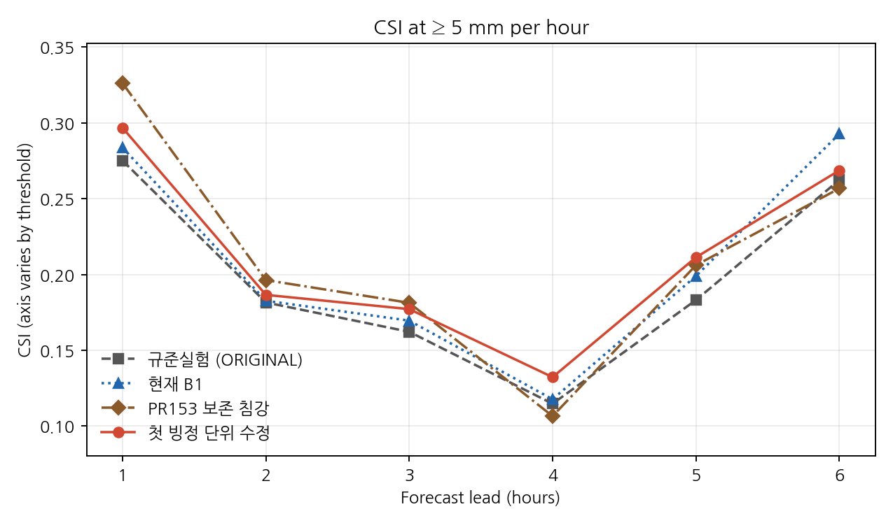
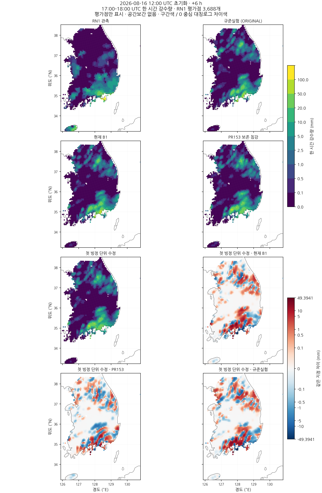

# 첫 빙정 침강의 속도 단위와 6시간 강수 예측 반응

## 초록

공유 경계 이동량을 사용하는 KDM6 보존 침강 후보에서 첫 빙정 침강의 속도 단위를 점검하였다. 비·눈·싸락눈 침강 중 재호출되는 `slope_kdm6`는 빙정의 질량·수 가중 속도도 m/s로 다시 작성하지만, 그 뒤 깊이 변환에서 빙정이 제외되어 첫 빙정 교환에 잘못된 시간척도가 전달된다. 본 연구는 첫 진입 경계에서 두 속도를 한 번만 층 두께로 나누고, 기존 보존식·정밀도·초기화·물리 계수를 유지한 후보를 검증한다. 국지 시험의 속도 배열 선언도 실제 소스의 REAL64와 맞춘다. 보존성과 이동 시간척도를 별도로 검사하고, 실제 6시간 예보에서 수정 후보는 보호 9/11·회복 12/15, 합계 21/26을 충족하여 직전 후보의 19/26보다 개선됐으나 전체 조건에는 미달했다. +4시간 5 mm 보호와 +3시간 낮은 세 임계값을 회복했지만, +1시간 10 mm와 +6시간 조건은 미충족이므로 현재 B1을 유지한다.

**핵심어:** 빙정, 침강, 낙하속도, 시간척도, 미세물리, 임계성공지수

## 1. 서론

직전 보존 침강 후보는 후반 낮은 임계값 회복을 현재 B1의 2/15에서 10/15로 늘렸지만, +4·+6시간 5 mm 성능을 보호하지 못해 19/26으로 미채택됐다. 실제 약한 관측 강수의 검출이 늘어난 동시에 오경보도 증가했으므로 강수 부족만으로 남은 오차를 설명할 수 없다.

이번에는 계수를 조정하기 전에 소스에서 확인한 첫 빙정 전달의 단위 불일치를 수정한다. 질량이 보존된다는 사실은 올바른 낙하 시간척도를 보증하지 않는다. 이 구분이 이번 실험의 수학적 출발점이다.

## 2. 자료 및 방법

### 2.1 비교 구성과 시간 정의

초기시각은 **2026년 8월 16일 12 UTC**다. +4시간 강수는 15–16 UTC, +6시간은 17–18 UTC의 한 시간 강수이며 초기시각부터의 누적량과 구분한다.

| 구성 | 역할 |
|---|---|
| 규준실험 ORIGINAL | +2∼+6시간 낮은 임계값 회복 기준 |
| 현재 B1 | 기존 +1시간·5 mm 보호 기준 |
| PR153 보존 침강 후보 | 새 수정의 직접 대조, 기존 판정 19/26·미채택 |
| CONTROL | PR153 후보를 다시 빌드한 실행 동등성 대조 |
| 첫 빙정 단위 수정 후보 | PR153 후보에 첫 진입 속도 변환 두 곳만 복원 |

초기 QRAIN/QNRAIN, 공유 경계 이동량, 국지 REAL64 계산과 REAL32 저장, 올바른 0 과정률 처리 및 다른 물리 계수는 유지한다. 보호 기준을 CONTROL이나 직전 후보로 낮추지 않는다.

### 2.2 호출 경계에서의 단위 변환

`slope_kdm6`의 출력인 질량 가중 낙하속도 $v_m$와 수 가중 낙하속도 $v_N$의 단위는 m/s다. 침강 갱신에서 사용하는 계수는

$$
a_{m,k}=\frac{v_{m,k}}{\Delta z_k},\qquad
a_{N,k}=\frac{v_{N,k}}{\Delta z_k}
$$

로 단위가 s⁻¹이다. 최초 속도 계산 뒤에는 이 변환을 수행하지만, 앞선 수종의 침강 루프에서 `slope_kdm6`를 재호출하면 빙정 속도도 다시 m/s로 덮어쓴다. 그 뒤 변환에서 빙정 질량·입자수가 빠져 첫 빙정 교환이 물리 속도를 이미 정규화된 계수로 소비한다.


수정은 해당 미세물리 반복마다 앞선 수종 루프가 끝난 뒤 첫 빙정 루프에 들어가기 직전, 대상 격자·층에 다음 두 줄을 한 번 적용한다. 예보 전체의 첫 호출에만 적용하는 변경이 아니다.

```fortran
work1(i,k,4) = work1(i,k,4) / delz(i,k)
workn(i,k,2) = workn(i,k,2) / delz(i,k)
```

빙정 하위단계 말미의 기존 변환은 유지한다. 매 하위단계 시작에서 다시 나누는 방식은 사용하지 않는다.

### 2.3 보존성과 시간척도의 독립성

기존 침강식의 `dend`를 $\rho_k$로 두고 면적당 빙정량을 $M_k=\rho_k\Delta z_kq_{i,k}$로 정의하면 공유 교환은

$$
T_k=\min\!\left(M_k^{\rm pre},M_k^{\rm pre}\frac{v_{m,k}\Delta t}{m_{\rm ice}\Delta z_k}\right),\qquad
M_k^{\rm post}=M_k^{\rm pre}-T_k+T_{k+1}
$$

다. 공여량 상한은 비음성과 경계 보존을 지키지만, 잘못된 계수도 상한에 걸려 전량 이동할 수 있다. 예를 들어 두께 100 m, 시간간격 20초, 질량 속도 0.5 m/s, 하위단계 수 1의 올바른 이동 비율은 0.1이다. 깊이 변환이 빠지면 숫자 10을 이동 비율처럼 사용하여 공여량 전부로 제한된다. 두 경로 모두 같은 이동량을 차감·증가시키므로 질량 수지 검사만으로 이 차이를 검출할 수 없다.

내부 입자수는 수농도이며 면적당 입자수는 $\mathcal N_k=n_k\Delta z_k$다. 수 가중 속도에 대해서도 $v_N\Delta t/(m_{\rm ice}\Delta z)$를 사용하고 밀도를 다시 곱하지 않는다. 질량·수 속도를 하나로 대체하지 않는다. 이 국지 정의로 실제 시점의 건조공기 질량이나 전 영역 물수지를 새로 확정하지 않는다. 층 두께의 수치가 두 경로 차이에 관여하지만 이를 모델 전체 오차의 일정 배율로 일반화하지 않는다.

### 2.4 실제 소스와 시험 정밀도

실제 소스의 `work1/workn`은 DOUBLE PRECISION이다. 이전 추출 드라이버의 기본 REAL 선언을 복사본에서 REAL64로 바로잡고, 속도 초기화의 나눗셈도 REAL64로 수행하였다. 수상체·입자수·층 두께·밀도·시간간격·기존 누적 배열은 원래 자료형을 유지한다. 이전 보존 후보의 실제 6시간 예보를 새 시험의 결과로 재표기하지 않는다.

국지 시험은 실제 `slope_kdm6` 루틴·모듈 선언과 공유 빙정 교환문을 소스에서 추출한다. 관련 상수는 실제 `kdm6init` 식에서 초기화하고, 비활성 수종의 사용하지 않는 계수는 0으로 둔다. 전체 warm-loop 미세물리와 WRF 초기화의 실행은 아니다. 매번 계산한 원시 속도를 따로 저장하여 첫 경계와 후속 경계의 정규화가 원시 속도/층 두께와 같은지 검사한다. 한 번과 네 번의 하위단계를 시험하여 중복 나눗셈을 구분한다.

이 소스 유래 기둥 설정의 실제 출력은 질량 속도 약 0.5 m/s, 수 속도 약 0.125 m/s다. 두께 100 m·20초에서 기존 첫 전달은 질량·입자수 각각 100%로 제한되지만 수정 후 약 10%·2.5%다. 가정한 수 속도가 0.2 m/s인 독립 수치 예시라면 올바른 비율은 4%이며, 여기의 실제 추출 루틴 출력과 구분한다. 두 경로 모두 보존되므로 이동 비율·정규화 시점·정밀도를 함께 검사한다.

지정 Intel IFX 프로파일의 새 scratch에서 O0/O2로 기존 일곱 보존 사례와 결합 기둥 시험을 실행하였다. 이는 국지 시험 범위의 검증이며 실제 예보 성능과 전체 물·에너지 수지의 완료를 대신하지 않는다.

### 2.5 예측 평가 규약

WRF 네 모서리의 고정 쌍선형 가중치로 RN1 평가점의 강수량을 대응한다. 지도는 평가점 사이를 추가로 공간보간하지 않는다. 3,688개 동일 평가점과 여섯 예측시간, 0.1·0.5·1·2.5·5·10 mm의 여섯 임계값을 유지한다. $CSI=H/(H+M+F)$를 정수 사건 수의 정확한 분수로 비교한다. 시간·임계값·실험을 평균하여 후보를 선택하지 않는다.

현재 B1의 +1시간 여섯 임계값과 매시간 5 mm CSI를 보호하는 11개, ORIGINAL 대비 +2∼+6시간의 0.1·0.5·1 mm를 회복하는 15개, 합계 **26개 전부 충족**을 요구한다. 실제 약한 관측 구간 $0.1\le RN1<1$ mm의 적중 획득·소실과 관측 음성 $RN1<0.1$ mm의 신규·해소 오경보도 비교한다. PR153에서 미리 정해진 +4시간 적중 소실 8곳과 +6시간 신규 5 mm 오경보 102곳은 고정 진단 집단으로 유지하며 초기화 규칙에 사용하지 않는다.

## 3. 결과

### 3.1 실행 동등성과 국지 검증

두 구성 모두 8개 MPI rank로 6시간을 완주하였다. 다시 빌드한 CONTROL의 +0∼+6시간 history 7개는 PR153 보존 후보와 바이트 단위로 같고, 수정 후보의 초기 history도 같다. 입력 89개, 시간간격·경계장·물리 표를 유지하고, 실행파일에는 두 깊이 변환만 추가하였다. 컴파일·링크 및 실행 중 라이브러리를 지정 Intel 프로파일과 연결해 검증하였다.

국지 O0/O2 시험에서 기존 일곱 보존 사례와 실제 소스 유래 속도–교환 기둥 사례가 통과하였다. 이 결과는 첫 교환의 단위를 검증하며 전체 대기 수지를 검증한 것은 아니다. 6시간 예보의 변화는 이번 단위 수정에 대한 전방 민감도이며 +4·+6시간의 특정 물리 연쇄를 아직 직접 분해하지 않았다.

### 3.2 고정 26개 조건에 따른 판정

| 후보 | 현재 B1 보호 | 규준실험 수준 회복 | 합계 | 현재 B1의 미달 조건에서 새 회복 | 판정 |
|---|---:|---:|---:|---:|---|
| PR153 보존 침강 | 9/11 | 10/15 | 19/26 | 8 | 미채택 |
| 첫 빙정 단위 수정 | **9/11** | **12/15** | **21/26** | **10** | **미채택, 현재 B1 유지** |

수정 후보는 +2∼+5시간의 낮은 세 임계값 12개를 모두 규준실험 이상으로 회복했다. 직전 후보 대비 +3시간 세 조건을 새로 통과했지만 +6시간 0.1 mm 회복은 잃어 순증은 두 조건이다. 보호 조건에서는 +4시간 5 mm를 회복하고 +1시간 10 mm를 새로 미달했다. 통과 개수는 성능 평균이나 새로운 순위 지표가 아니다.

남은 다섯 조건은 **+1시간 10 mm 보호, +6시간 0.1·0.5·1 mm 회복, +6시간 5 mm 보호**다. 모든 조건 충족 규약을 유지하여 운영 구성은 바꾸지 않는다.

### 3.3 예측시간·임계값별 CSI

아래는 수정 후보의 CSI다. 전체 네 구성의 H/M/F·CSI 144행 및 MAE/RMSE 24행은 [전체 점수표](evidence/cp02_first_ice_velocity_20261109/evaluation/results/FULL_SCORES.md), [원시 점수 CSV](evidence/cp02_first_ice_velocity_20261109/evaluation/results/categorical_scores.csv)에 제공한다. `ORIGINAL`은 규준실험, `IMPROVED_BG_FIXED`는 현재 B1, `CONSERVATIVE_SEDIMENTATION`은 PR153 후보, `FIRST_ICE_VELOCITY`는 이번 후보다.

| 예측시간 | ≥0.1 mm | ≥0.5 mm | ≥1 mm | ≥2.5 mm | ≥5 mm | ≥10 mm |
|---|---:|---:|---:|---:|---:|---:|
| +1시간 | 0.449052 | 0.335500 | 0.334140 | 0.379913 | 0.296703 | 0.068966 |
| +2시간 | 0.338318 | 0.307292 | 0.313433 | 0.253968 | 0.186544 | 0.137725 |
| +3시간 | 0.331600 | 0.291302 | 0.293076 | 0.272152 | 0.177143 | 0.080153 |
| +4시간 | 0.333198 | 0.286517 | 0.266762 | 0.189418 | 0.132302 | 0.049834 |
| +5시간 | 0.345840 | 0.278384 | 0.254671 | 0.232238 | 0.211268 | 0.212230 |
| +6시간 | 0.371865 | 0.333678 | 0.330744 | 0.327638 | 0.268562 | 0.198697 |

현재 B1 대비 CSI 차이는 다음과 같다. 회복 조건의 기준은 이 차이표와 별개로 규준실험에 고정한다.

| 예측시간 | ≥0.1 mm | ≥0.5 mm | ≥1 mm | ≥2.5 mm | ≥5 mm | ≥10 mm |
|---|---:|---:|---:|---:|---:|---:|
| +1시간 | +0.019630 | +0.007056 | +0.005257 | +0.012880 | +0.013121 | -0.001457 |
| +2시간 | +0.015190 | +0.018153 | +0.029554 | +0.015285 | +0.003882 | -0.005988 |
| +3시간 | +0.010350 | +0.014759 | +0.012070 | +0.010773 | +0.007586 | -0.002524 |
| +4시간 | +0.013215 | +0.010359 | +0.014023 | +0.004836 | +0.014552 | +0.012033 |
| +5시간 | +0.021416 | +0.010975 | +0.017514 | +0.001636 | +0.012353 | +0.033126 |
| +6시간 | +0.008665 | -0.003013 | -0.003944 | -0.004263 | -0.024121 | -0.039398 |

### 3.4 실제 약한 강수와 관측 음성 구간

실제 약한 관측 구간은 $0.1\le RN1<1$ mm이며 검출 문턱은 예측 0.1 mm다. 아래 표는 현재 B1 대비 동일 지점 전이다. 낮은 임계값 전체 CSI에는 더 강한 관측 강수도 포함되므로 이 표를 별도로 유지한다.

| 예측시간 | 약한 강수 B1 적중 | 후보 적중 | 적중 획득 / 소실 | 관측 음성 오경보 B1 → 후보 |
|---|---:|---:|---:|---:|
| +1시간 | 246 | 265 | 19 / 0 | 86 → 95 |
| +2시간 | 230 | 254 | 28 / 4 | 456 → 473 |
| +3시간 | 219 | 237 | 21 / 3 | 818 → 918 |
| +4시간 | 230 | 240 | 25 / 15 | 827 → 850 |
| +5시간 | 258 | 304 | 51 / 5 | 735 → 755 |
| +6시간 | 233 | 264 | 40 / 9 | 866 → 918 |

모든 시간에서 실제 약한 강수 적중은 현재 B1보다 증가했다. 그러나 +6시간의 낮은 세 임계값은 규준실험에 미달하며, 관측 음성 구간의 오경보도 증가했다. 강수 공급을 늘리는 것만으로 남은 문제를 해결했다고 할 수 없다.

### 3.5 강한 강수 보호와 고정 실패 집단

| 예측시간·임계값 | 현재 B1 H / F / CSI | PR153 H / F / CSI | 수정 후보 H / F / CSI |
|---|---|---|---|
| +1시간 ≥10 mm | 10 / 83 / 0.070423 | 11 / 87 / 0.075342 | 10 / 86 / 0.068966 |
| +4시간 ≥5 mm | 67 / 225 / 0.117750 | 63 / 247 / 0.106599 | 77 / 238 / 0.132302 |
| +6시간 ≥5 mm | 168 / 226 / 0.292683 | 163 / 287 / 0.256693 | 170 / 285 / 0.268562 |

+1시간 10 mm는 현재 B1과 적중 수가 같지만 오경보가 3개 늘어 보호 조건을 잃었다. +4시간 5 mm는 현재 B1보다 적중 10개·오경보 13개가 함께 증가한 결과 CSI가 높다. +6시간 5 mm는 적중 2개 증가에 비해 오경보가 59개 증가하여 보호에 실패한다. 직전 후보보다 나아졌다는 사실만으로 현재 B1 보호를 대체하지 않는다.

미리 고정한 PR153의 +4시간 적중 소실 8곳 중 **7곳이 회복되고 1곳은 남았다**. +6시간 신규 5 mm 오경보 102곳 중 **37곳이 해소되고 65곳은 남았다**. 이는 고정 집단의 후속 반응이며 수정 후보 전체의 신규·해소 사건 수와 다르다.

| 대표점 | 시간 | RN1 | 현재 B1 | PR153 | 수정 후보 |
|---|---|---:|---:|---:|---:|
| 12461 | +4시간 | 5.900000 | 5.109033 | 1.196169 | 3.788482 |
| 10196 | +6시간 | 0.200000 | 1.266140 | 16.919591 | 9.246764 |

앞뒤 시간의 한 시간 강수와 3–5시간·5–6시간 합은 [고정 집단 자료](evidence/cp02_first_ice_velocity_20261109/evaluation/cohorts/cohorts.csv)에 함께 보존했다. 여러 시간 합은 시점·지속성 진단용이며 한 시간 CSI 조건을 대체하거나 영역 물수지로 해석하지 않는다.

## 4. 고찰

수정의 물리적 의미는 빙정의 침강 이동률을 층 두께와 일관된 시간척도로 복원하는 것이다. 빙정의 질량·수 모멘트는 서로 다른 낙하속도를 사용하며, 층간 전달이 바뀌면 이후 융해·성장·수종 교환과 지상 도달도 달라질 수 있다. 이번 예보는 그 결합 반응을 보여 주지만 특정 과정의 인과 기여율을 새로 추정하지 않았다. 보존·비음성·단위 정합성과 강수 CSI는 각각 검증해야 한다.

현재 결과는 +4시간 보호 실패를 해소하고 후반 낮은 임계값 회복을 확대한 진전이다. 반면 +6시간에는 강한 강수 오경보 증가가 남고 +1시간 10 mm 보호도 잃었다. 따라서 다음 연구는 **이번 후보의 5–6시간 구간에서 5 mm 신규 오경보와 해소 대조를 함께 추적**하고, +1시간 10 mm 오경보도 확인하는 범위가 타당하다. 과거 OLD/FIX의 0–2시간·4–5시간 상세 기록을 이번 후보의 두 실패 구간에 직접 적용하지 않는다. 새 계수나 입경·습도 문턱을 현재 점수만으로 선택하지 않는다.

단일 기상 사례의 3,688개 공간 평가점은 독립 사례 3,688개가 아니다. RN1 상류 시각·coverage/QC 확정과 조정에 사용하지 않은 독립 사례 검증은 미완료다. 같은 시점의 건조공기 질량, 물·에너지 수지와 경계 플럭스의 전체 연결, 기존 C2 T39 문제도 별도 미완료이며 CP02 완주로 해결되지 않는다.

## 5. 결론

첫 빙정 침강에 필요한 두 깊이 변환을 복원하고 국지 속도 배열의 정밀도를 실제 소스와 맞췄다. 실제 6시간 후보는 21/26으로 직전 19/26보다 진전했으나 미채택이다. 현재 B1을 유지한다. 모든 시간의 실제 약한 강수 검출 증가와 후반 오경보 확대를 함께 확인했으며, 다음 수정은 남은 실패 시간대의 과정 근거로 제한한다.

## 재현 자료와 그림

- [전체 그림 12개: 임계값별 CSI 6개·시간별 강수 지도 6개](evidence/cp02_first_ice_velocity_20261109/FIGURES.md) · [그림·표 ZIP](evidence/cp02_first_ice_velocity_20261109/all_figures.zip)
- [전체 H/M/F·CSI 및 MAE/RMSE](evidence/cp02_first_ice_velocity_20261109/evaluation/results/FULL_SCORES.md) · [26개 조건](evidence/cp02_first_ice_velocity_20261109/evaluation/results/admission_constraints.csv)
- [이전 보존 후보의 그림](evidence/cp02_sedimentation_conservation_20261109/FIGURES.md)
- [동등성 근거](evidence/cp02_first_ice_velocity_20261109/forecast/proof/comparability.json) · [독립 점수 재계산](evidence/cp02_first_ice_velocity_20261109/review/independent_recount.json)





## 근거 자료

- [직전 침강 보존 후보의 6시간 평가](CP02_SEDIMENTATION_CONSERVATION_20261109.md)
- [첫 빙정 속도 변환 패치](../patches/kdm6_first_ice_velocity.patch)
- [정밀도·실제 속도 출력·국지 시험의 범위](evidence/cp02_first_ice_velocity_20261109/native/README.md)
- [동결 실행·평가 계획](evidence/cp02_first_ice_velocity_20261109/forecast/launch_plan.json)
