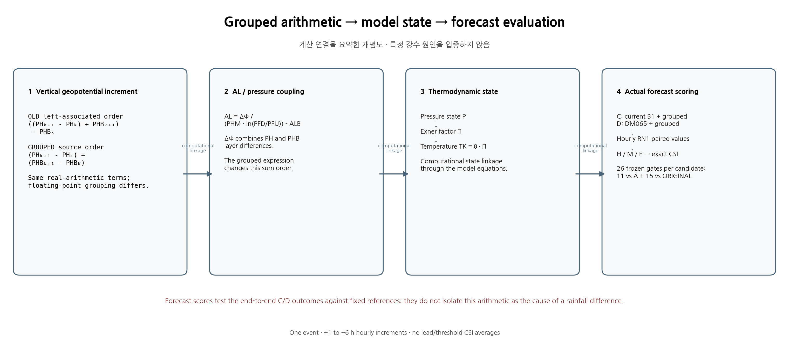
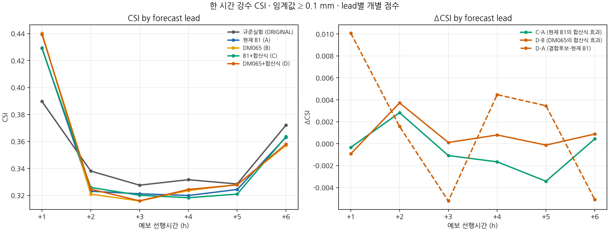
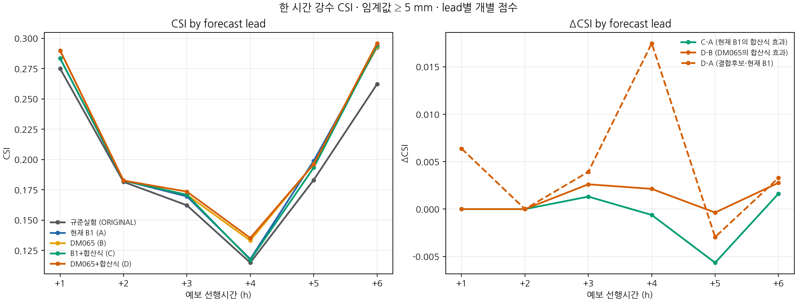
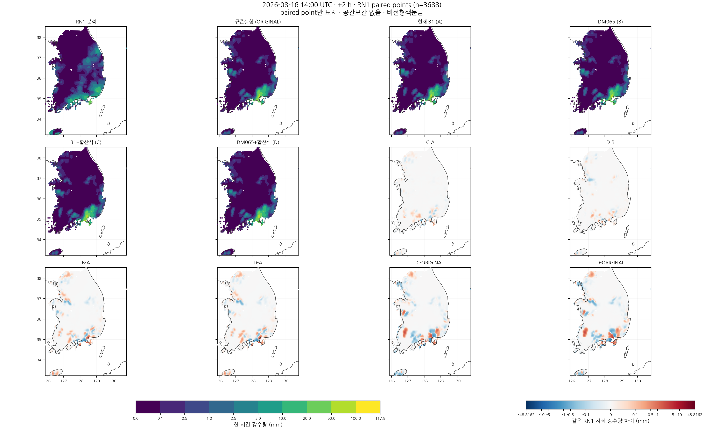

# 지오퍼텐셜 차분 합산 순서가 초기 비 입자수 민감도와 시간별 강수예측에 미치는 영향

## 초록

현재 B1과 미채택 비 입자수 초기화 DM065에 지오퍼텐셜 차분별 합산을 각각 적용하여 2026년 8월 16일 12 UTC부터 6시간 예보를 수행하였다. 기존 합산식의 재빌드 대조는 정시 history 14개가 과거 예보와 바이트 단위로 일치하였다. 새 후보 C·D는 +2시간 0.1 mm CSI가 현재 B1 대비 각각 +0.002826, +0.001566 높았다. DM065에서 합산식만 바꾼 D−B의 같은 조건 변화는 +0.003718이다. 고정된 보호·회복 조건은 각각 10/26, 11/26 충족에 그쳤다. 현재 B1의 미달 조건에서 새로 회복한 조건은 모두 0개이며, 두 후보는 +5시간 5 mm 성능을 보존하지 못했다. 합산 오차를 줄이는 연산 변경과 약한 강수 예보 개선은 별도 검증 대상이며, 본 사례에서는 두 후보를 채택하지 않고 현재 B1을 유지한다.

**핵심어:** 지오퍼텐셜 차분, 단정도 반올림, 비 입자수, 시간별 강수예측, 임계성공지수

## 1. 서론

본 연구의 목표는 현재 B1의 첫 시간 및 5 mm 이상 강수 예측 성능을 유지하면서, 예보 2–6시간의 낮은 강수 임계값에서 발생한 적중 소실과 오경보를 줄이는 것이다. 선행 공통 입경 초기화 실험 DM065는 현재 B1의 미달 조건을 새로 회복하지 못했다. 이에 새 입경을 선택하기에 앞서, 압력 계산에 사용되는 지오퍼텐셜 차분의 단정도 합산 순서를 독립적인 수치 실험 요인으로 검증하였다.

이전 선택 표본에서 순차 합산은 저장된 입력의 정확합에 존재하는 작은 차이를 크게 표현하거나 반대로 지우기도 했다. 여기서 개선하려는 대상은 저장된 단정도 피연산자의 합산 오차다. 두 예보 사이의 차이가 작아지는 것을 수치 정확도의 정의로 사용하지 않는다. 수치 정확도의 변화가 강수예측 개선으로 이어지는지는 별도 전방 적분과 관측 평가로 판단한다.

## 2. 자료 및 방법

### 2.1 사례와 대조 실험

초기 시각은 **2026년 8월 16일 12 UTC**, 적분 종료는 같은 날 18 UTC이다. 시간간격 20초, MPI 8개 rank, 동일 영역·경계장·물리 설정을 유지한다. 강수는 정시 누적장의 차분으로 계산한 각 한 시간 구간량이며, 초기부터의 누적량이 아니다. 규준실험은 ORIGINAL이라는 별도의 고정 관측 비교 기준으로 사용한다.

| 기호 | 초기장 | 지오퍼텐셜 합산식 | 역할 |
|---|---|---|---|
| A | 현재 B1 | 기존 순차 합산 | 성능 보호 기준 |
| B | DM065 | 기존 순차 합산 | 초기 비 입자수 대조 |
| C | 현재 B1 | 차분별 합산 | 우선 평가 후보 |
| D | DM065 | 차분별 합산 | 초기화와 합산식의 상호작용 평가 |
| ORIGINAL | 규준실험 | 기존 식 | 후반 낮은 임계값 회복 기준 |

**네 실험 모두 KDM6의 정확한 0 과정률 처리 수정(FIX)을 공통으로 유지한다.** 본문의 기존·변경 합산식은 PH 계산의 평가 순서만 가리키며, 앞선 OLD/FIX 미세물리 분기 대조와 실험축이 다르다. DM065는 비 질량을 유지한 채 초기 질량가중 평균입경 0.65 mm를 가정하여 QNRAIN을 작성한 미채택 대조군이다.

A와 B의 과거 결과를 사용하기 전에 동일 소스의 재빌드 대조를 6시간 적분하여 초기 및 매 정시 history를 비교한다. C와 D는 실제 새 적분 결과로 평가한다. 오프라인 피연산자 고정 계산은 새 예보의 대체물이 아니다.

### 2.2 수치 합산과 압력 경로

층 경계의 섭동 지오퍼텐셜을 $\phi$, 기본장 지오퍼텐셜을 $\phi_b$, 각 REAL32 연산 반올림을 $\mathrm{fl}$로 쓰면, 기존 분자는

$$
N_{\rm seq}=\mathrm{fl}\{\mathrm{fl}[\mathrm{fl}(\phi_{k+1}-\phi_k)+\phi_{b,k+1}]-\phi_{b,k}\}
$$

이며, 변경 분자는

$$
N_{\rm grp}=\mathrm{fl}[\mathrm{fl}(\phi_{k+1}-\phi_k)+\mathrm{fl}(\phi_{b,k+1}-\phi_{b,k})]
$$

이다. 두 식의 실수 대수값은 같지만 유한 정밀도에서는 평가 순서에 따라 값이 달라진다. 층 차분을 먼저 구하면 큰 기본장 값을 더했다가 빼는 중간 상쇄에 따른 반올림 오차를 줄일 수 있다. 다만 모든 입력에서 정확 반올림을 보장하는 일반 정리는 아니며, 확인한 입력과 실행 경로의 결과를 제시한다.

해당 분자는 소스의 분모와 기본장 항을 거쳐 AL과 압력 계산에 사용되고, 전처리의 Exner 함수 $\Pi$와 미세물리 실제 기온 $T_K=\mathrm{fl}(\theta\Pi)$에 연결된다. 같은 온위에서도 압력·Exner 함수 차이로 실제 기온이 달라질 수 있으므로, 최초 기온 차이를 잠열 가열 또는 냉각으로 바로 해석하지 않는다. 20183의 PH 경로와 17051 상층 표본의 소스 `t` 입력 경로는 구분한다.

Exner 함수의 연속 관계를 쓰면

$$
\Pi=(p/p_0)^\kappa,\qquad \kappa=R_d/c_p,
\qquad
\frac{\delta T_K}{T_K}\simeq\frac{\delta\theta}{\theta}+\kappa\frac{\delta p}{p}.
$$

이는 작은 섭동의 1차 근사다. 온위가 같아도 압력 차이가 실제 기온 차이로 이어질 수 있다는 기상학적 의미를 설명하며, 실제 저장값의 재현에는 앞의 REAL32 곱셈과 반올림을 사용한다. 이후 포화 상태와 구름·비 과정의 반응은 수증기·압력·기온을 함께 확인해야 한다.

### 2.3 평가 지표와 사전 채택 조건

동일한 RN1 평가점 3,688개와 임계값 **0.1, 0.5, 1, 2.5, 5, 10 mm**를 모든 실험·시간에 적용한다. 적중 H, 누락 M, 오경보 F에서

$$
\mathrm{CSI}=\frac{H}{H+M+F}
$$

를 계산하며, 채택 비교는 정수 사건 수의 분수로 수행한다. 시간 또는 임계값을 평균한 점수로 후보를 선정하지 않는다. C와 D 각각에 다음 26개 조건을 동일하게 적용한다.

1. 현재 B1(A)의 +1시간 여섯 임계값 및 +1–+6시간 5 mm CSI를 보호한다. 중복을 제외하면 11개 조건이다.
2. 규준실험(ORIGINAL) 대비 +2–+6시간의 0.1·0.5·1 mm CSI를 회복한다. 15개 조건이다.

두 후보 모두 통과하면 사전에 고정한 강한 강수 CSI의 개별 시간 순서로 한 개를 선정한다. 하나도 통과하지 못하면 현재 B1을 유지한다. DM065 대비 D의 개선만으로 채택 기준을 낮추지 않는다.

합산식 자체의 주 대조는 **C−A와 D−B**이다. **D−A는 초기화와 합산식이 함께 다른 결합 후보를 현재 B1과 비교하는 값**이며, 합산식 단독 효과로 해석하지 않는다.

추가로 실제 약한 관측 강수($0.1\le RN1<1$ mm)의 0.1 mm 적중 획득·소실과 관측 음성($RN1<0.1$ mm)의 신규·해소 오경보를 분리한다. 낮은 임계값 CSI에는 강한 관측 강수의 적중도 포함되므로 두 진단은 서로 대체하지 않는다.

## 3. 결과

### 3.1 실행 및 수치 연산 검증

기존 합산식을 재빌드한 B1·DM065 대조가 모두 6시간을 완료했으며, 초기장과 +1–+6시간의 전체 history **14개가 과거 결과와 바이트 단위로 일치**했다. 변경 실행파일을 사용한 C·D도 6시간을 정상 완료했다. 새 합산식의 소수 격자 검증에서는 실제 명령의 차분·합산·나눗셈 및 AL 저장을 원시 SIMD 값과 연결했다. 별도의 60개 저장 입력 산술 시험은 고정 Intel IFX의 O0·O2에서 각 단계 REAL32 재계산과 일치했다. 이는 연산 검증이며 강수 성능 판정은 아래 실제 예보로 구분한다.

### 3.2 사전 조건에 따른 후보 판정

| 후보 | 현재 B1 보호 | 규준실험 수준 회복 | 전체 | 현재 B1 미달 조건의 새 회복 | 판정 |
|---|---:|---:|---:|---:|---|
| C | 8/11 | 2/15 | 10/26 | 0 | 미채택 |
| D | 9/11 | 2/15 | 11/26 | 0 | 미채택 |

**두 후보 모두 26개 조건을 충족하지 못해 현재 B1을 유지한다.** 두 후보에서 회복으로 집계된 조건은 +5시간 0.5·1 mm이며, 현재 B1도 이미 규준실험 이상인 조건이다. 따라서 이번 합산식 변경으로 새로 통과한 후반 회복 조건은 없다. C는 +1시간 0.1 mm, +4·+5시간 5 mm 보호 조건에서 미달했고, D는 +1시간 2.5 mm와 +5시간 5 mm에서 미달했다. 통과 개수는 미완료 조건의 요약이며 평균 성능 점수나 후보 순위로 사용하지 않는다.

### 3.3 예보시간·임계값별 CSI 변화

아래는 각각 **후보−현재 B1(A)의 CSI**다. 양수는 개선, 음수는 악화다. 단위 없는 개별 점수 차이이며 시간·임계값 평균을 구하지 않았다.

**C: B1 초기장 + 차분별 합산**

| 예보 선행시간 | ≥0.1 mm | ≥0.5 mm | ≥1 mm | ≥2.5 mm | ≥5 mm | ≥10 mm |
|---|---:|---:|---:|---:|---:|---:|
| +1시간 | -0.000340 | +0.000268 | +0.000000 | +0.000000 | +0.000000 | +0.000000 |
| +2시간 | +0.002826 | -0.000749 | +0.000836 | +0.000000 | +0.000000 | +0.000000 |
| +3시간 | -0.001084 | +0.001578 | -0.004043 | -0.002937 | +0.001317 | -0.000324 |
| +4시간 | -0.001653 | -0.007015 | -0.001286 | -0.000686 | -0.000618 | +0.000394 |
| +5시간 | -0.003421 | -0.000854 | +0.001240 | -0.002493 | -0.005653 | -0.003280 |
| +6시간 | +0.000436 | +0.002192 | +0.001361 | +0.007210 | +0.001637 | +0.010975 |

**D: DM065 초기장 + 차분별 합산**

| 예보 선행시간 | ≥0.1 mm | ≥0.5 mm | ≥1 mm | ≥2.5 mm | ≥5 mm | ≥10 mm |
|---|---:|---:|---:|---:|---:|---:|
| +1시간 | +0.010080 | +0.009768 | +0.006468 | -0.001606 | +0.006381 | +0.000000 |
| +2시간 | +0.001566 | -0.000749 | +0.004673 | +0.000092 | +0.000000 | +0.006890 |
| +3시간 | -0.005220 | -0.003872 | -0.003702 | -0.001688 | +0.003932 | +0.001323 |
| +4시간 | +0.004474 | +0.002727 | +0.006358 | +0.001163 | +0.017481 | +0.008463 |
| +5시간 | +0.003458 | -0.004134 | +0.000467 | -0.016238 | -0.002944 | -0.012438 |
| +6시간 | -0.005092 | -0.004420 | +0.002685 | +0.015878 | +0.003289 | -0.014269 |

[모든 실험의 H·M·F·CSI·POD·FAR·ETS와 시간별 연속형 점수 전체 표](evidence/cp02_grouped_forecast_20261105/figures/rendered/full_score_tables.md)를 제공한다. [2×2 개별 대비와 상호작용](evidence/cp02_grouped_forecast_20261105/analysis/contrasts.csv)은 C−A, D−B, B−A, D−C와 차이의 차이를 별도로 보존한다.

### 3.4 +2시간 실제 약한 강수 검출

관측 0.1–1 mm 미만 표본 974개와 관측 0.1 mm 미만 표본 2,021개를 분리하고, 예측 0.1 mm 이상 여부를 계산하였다.

| 실험 | 전체 ≥0.1 mm 적중 H | 전체 누락 M | 오경보 F | 전체 CSI | 실제 약한 관측 강수의 검출 |
|---|---:|---:|---:|---:|---:|
| 규준실험 | 708 | 959 | 427 | 0.338109 | 238 |
| 현재 B1 (A) | 686 | 981 | 456 | 0.323128 | 230 |
| DM065 (B) | 684 | 983 | 464 | 0.320976 | 226 |
| B1 + 합산식 (C) | 692 | 975 | 456 | 0.325954 | 233 |
| DM065 + 합산식 (D) | 689 | 978 | 455 | 0.324694 | 228 |

C는 현재 B1보다 실제 약한 강수 적중을 **3곳 획득하고 0곳 소실**하여 검출이 230→233곳으로 늘었다. 관측 음성 구간에서는 신규·해소 오경보가 각각 6곳으로 전체 오경보 수는 같다. 전체 적중은 6곳 늘었으므로, 나머지 3곳은 관측 1 mm 이상 표본의 변화다. 그러나 약한 강수 검출은 규준실험의 238곳에 미달하며, 전체 CSI도 규준실험 수준에 이르지 못했다.

D의 +2시간 전체 CSI도 현재 B1보다 높지만, 실제 약한 강수 검출은 **228곳으로 현재 B1의 230곳보다 적다.** 낮은 임계값의 전체 CSI 상승을 약한 관측 강수의 검출 증가와 동일시할 수 없음을 보여 준다. D−B에서는 실제 약한 강수의 새 적중 6곳·소실 4곳, 신규 오경보 5곳·해소 14곳으로 합산식의 대조 효과가 나타났다. 같은 조건의 전체 CSI 변화는 **D−B=+0.003718**로, 결합 후보의 현재 B1 대비 변화 **D−A=+0.001566**과 구분해야 한다.

### 3.5 기존 강한 강수 이득의 보존 여부

+5시간 5 mm에서 두 후보 모두 현재 B1 보호 조건을 충족하지 못했다.

| 실험 | H | M | F | CSI |
|---|---:|---:|---:|---:|
| 현재 B1 (A) | 110 | 220 | 223 | 0.198915 |
| B1 + 합산식 (C) | 109 | 221 | 234 | 0.193262 |
| DM065 + 합산식 (D) | 107 | 223 | 216 | 0.195971 |

따라서 +2시간 일부 저임계값의 상승만으로 이번 변경을 채택할 수 없다. +6시간 10 mm에서는 C가 현재 B1보다 높고 D는 낮아, 입력 초기화와 시간에 따라 반응 방향이 달라진다. 한 구간의 이득을 전체 예보 개선으로 확대하지 않는다.

### 3.6 그림 및 강수 분포

그림 1. 실수 대수식의 동일성과 유한 정밀도 평가 순서의 차이, 그리고 압력·Exner 함수·실제 기온에서 관측 강수 평가까지의 계산 연결. 화살표는 계산상 전달 관계이며 특정 강수 변화의 과정별 인과 기여를 확정하지 않는다.

그림 2–4. 같은 3,688개 평가점의 개별 시간 CSI 및 +2시간(13–14 UTC) 한 시간 강수 분포. 지도에는 관측과 모든 실험, C·D의 현재 B1 및 규준실험 대비 강수 차이를 함께 표시한다. 합산식의 주 대조인 C−A·D−B와 결합 후보 비교인 D−A를 구분하고 B−A 초기화 대조도 제공한다. 시간·실험 사이 색 눈금을 고정하며 새 공간 보간을 하지 않는다. 약한 강수와 강한 강수를 함께 식별하도록 강수량은 공통 구간별 색 눈금, 차이는 0.1 mm 부근을 선형으로 표시하는 공통 대칭 로그 색 눈금을 사용한다. 색의 간격을 강수량의 선형 간격으로 읽어서는 안 된다.

**[임계값별 여섯 그림·시간별 여섯 지도·도식 전체 13장](evidence/cp02_grouped_forecast_20261105/FIGURES.md)**과 [오프라인 그림 묶음 ZIP](evidence/cp02_grouped_forecast_20261105/figures/rendered/figures.zip)을 함께 제공한다.

## 4. 고찰

합산 정확도 향상은 두 초기화의 차이를 항상 줄이는 조치가 아니다. 기존 계산이 지웠던 입력 차이를 복원할 수도 있다. 따라서 상호작용 $(D-C)-(B-A)$은 개별 시간·임계값의 점수 차이로 해석하며 물리 과정의 인과 기여율로 환산하지 않는다.

초기 NR의 전달 영역과 유효 비 과정의 활성 영역도 구분해야 한다. 선행 연구에서 초기 NR은 같지만 첫 진입 NR이 다른 154,317개 셀 중 104,517개는 양의 QR이 질량 임계값 미만이었다. 47,888개는 질량 조건만 충족하므로 수농도 조건과 실제 과정 시점 상태를 추가 확인해야 한다. 20330의 선택 k=2 셀은 첫 네 진입 모두 질량·수농도 임계값 미만이었다. 이들은 전달 경로의 증거이며, 그 자체가 지상 강수 변화의 증거는 아니다.

강수 분포 변화는 미세물리 내부 증분과 호출 사이의 전체 순변화가 함께 누적된 결과다. 합산식 변경 뒤의 열역학·동역학 상태는 원래 적분과 달라지므로, 기존 phi7 입력에서 계산한 상쇄가 새 적분의 phi7에서도 반복된다고 가정하지 않는다. 강수 성분은 RAINC와 RAINNC를 구분하고, 성능 변화만으로 증발·응결·수송의 단일 원인을 확정하지 않는다.

## 5. 결론 및 한계

차분별 합산의 실제 실행 순서와 AL 저장을 확인하고, 동일한 B1·DM065 입력에 대해 새 6시간 예보를 완료하였다. 합산식 변경은 +2시간 낮은 임계값에서 일부 이득을 만들었지만, 후반 약한 강수 회복 및 기존 강한 강수 이득의 공동 보존 목표를 달성하지 못했다. 따라서 현재 B1을 유지하고 C·D를 미채택한다.

다음 개선에서는 C가 +2시간에 획득한 실제 약한 강수 적중 3곳과 +5시간에 잃은 약한 강수 적중 및 5 mm 적중을 대조해야 한다. 같은 초기 비 질량·입자수에서 압력·Exner·온습도 차이가 이후 구름·비 생성과 지상 RAINNC 변화로 이어지는 구간을 비교하고, 그 결과를 근거로 한 가지 수정 가정을 정하는 것이 적절하다. 현재 점수만으로 특정 과정률이나 입경을 추가 조정할 근거는 확보되지 않았다.

본 사례의 공간 평가점 3,688개는 독립적인 기상 사례 3,688개를 의미하지 않는다. RN1 상류 관측 시각·coverage·QC, 독립 사례 검증, 같은 시점 건조공기 질량과 과정별 물·에너지 수지, C2 T39 및 H/A/N 1시간 완료는 별도의 미완료 항목이다. 6시간 적분 성공과 강수 점수 계산은 이들 항목의 완료를 대신하지 않는다.

## 재현 자료

[평가 계획](evidence/cp02_grouped_forecast_20261105/evaluation_plan.json), 실행·컴파일 기록과 입력 해시, 원시 연산 캡처, 점 자료와 시간별·임계값별 전체 표를 함께 보존한다. 지도는 동일 평가점의 강수 분포를 표시하며 격자 강수장으로 새 보간한 자료가 아니다. 해안선은 [Natural Earth 공개 자료](https://www.naturalearthdata.com/downloads/50m-physical-vectors/)를 사용한다.
