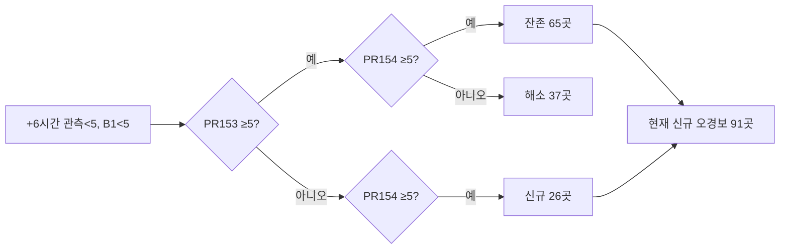
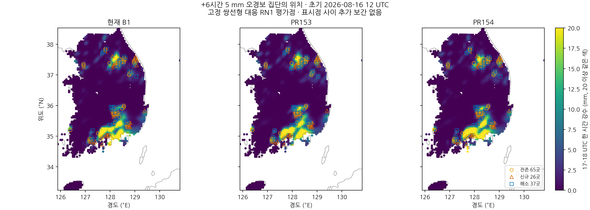
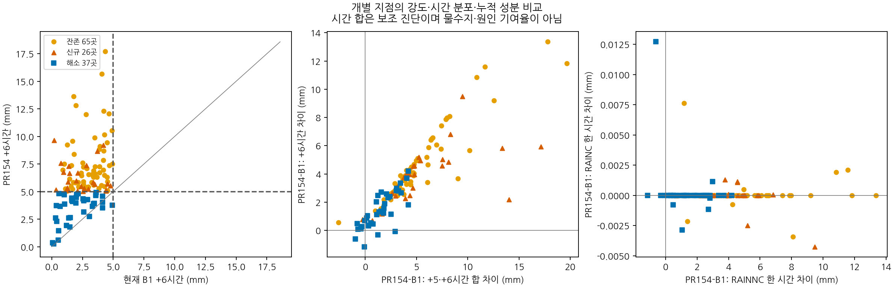
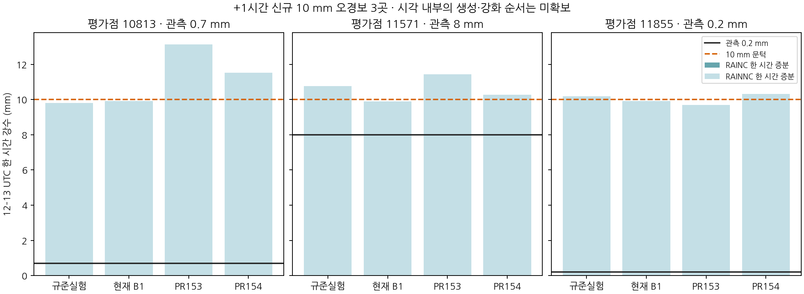
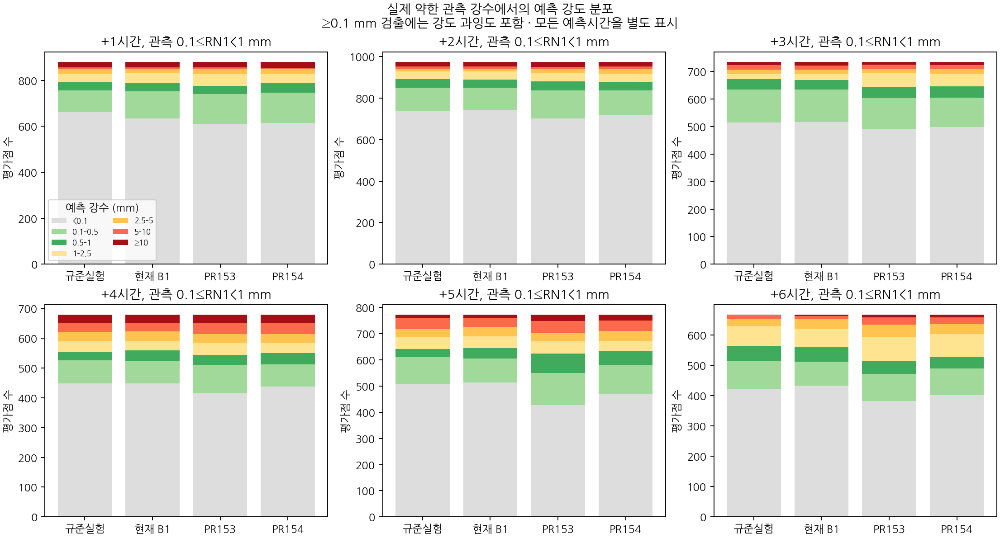

# 빙정 침강 단위 수정 후 강수 오경보의 위치·강도·시간 분해

## 초록

보존 침강과 첫 빙정 속도 단위 수정을 적용한 PR154 후보는 26개 조건 중 21개를 충족하였으나 +1시간 10 mm 보호와 +6시간 조건에 미달하였다. 본 연구는 추가 계수 조정 전에 저장된 실제 예보의 오경보 전이를 재분류하고, 28개 정시 history에서 대류 누적 강수 RAINC와 격자규모 누적 강수 RAINNC를 같은 평가 가중치로 분리하였다. 88,512개 구성·시간·평가점의 총강수가 기존 점 배열과 비트 단위로 일치하였다. +6시간 잔존 65곳과 신규 26곳에서는 B1 대비 RAINNC 증가가 확인됐고, 해소 37곳에서는 PR153 대비 RAINNC가 감소하였다. 관측이 실제 약한 구간의 검출 증가에는 강도 과잉도 포함되어 낮은 임계값 CSI와 별도로 평가해야 한다. 이번 변경은 기존 예보의 진단이며 새로운 예보나 성능 개선을 추가하지 않는다. PR154 후보는 21/26으로 미채택하고 현재 B1을 유지한다.

**핵심어:** 빙정 침강, 강수 오경보, 임계성공지수, 강수 강도, RAINNC, 시간 분포

## 1. 서론

첫 빙정 침강 직전에 물리 속도 m/s를 층 두께로 나누어 s⁻¹로 복원한 수정은 단위와 시간척도를 바로잡았다. 단위 정합성과 공유 경계 보존을 유지하면서도, 지상 강수 오경보의 위치와 강도가 바뀌었다. 따라서 이번에는 새로운 입경·습도 문턱·증발계수를 선택하지 않고 실패와 해소 집단을 함께 비교한다.

규준실험은 ORIGINAL, 현재 B1은 `IMPROVED_BG_FIXED`, PR153 보존 침강 후보는 `CONSERVATIVE_SEDIMENTATION`, PR154 첫 빙정 단위 수정 후보는 `FIRST_ICE_VELOCITY`다. 아래에서 각각 O, A, C, I로 줄여 쓴다. 모든 후보의 판정 기준은 현재 B1 보호 11개와 규준실험 수준 회복 15개에 고정한다. 후보·예측시간·임계값을 평균해 선정하지 않는다.

## 2. 자료 및 방법

### 2.1 사례와 강수 구간

초기시각은 **2026년 8월 16일 12 UTC**다. +1시간은 12–13 UTC, +6시간은 17–18 UTC의 한 시간 강수다. +5·+6시간 합은 시점·지속성 진단을 위한 16–18 UTC 양이며, 한 시간 CSI나 영역 물수지를 대신하지 않는다. 같은 3,688개 RN1 평가점을 사용하며 이는 독립 기상 사례 3,688개가 아니다.

PR154에 보존된 시간별 배열의 해시·고정 26개 판정을 대조했다. 네 구성의 실제 WRF history를 12–18 UTC에서 읽어 시각·좌표·성분·단위와 누적 규약을 확인했다. `BUCKET_MM=-1`, `PREC_ACC_DT=0`이며 버킷 카운터는 없고 RAINSH는 0이다. 허용오차 10⁻⁶ mm를 넘는 누적 역행은 거부한다.

### 2.2 고정 집단과 전체 전이의 구분

관측을 $R_o$, 예측을 $R_A,R_C,R_I$로 두고 +6시간에서

$$E=\{R_o<5, R_A<5\}$$

를 고정한다. 진단 집단은

$$
S_p=E\cap\{R_C\ge5,R_I\ge5\},\quad
S_n=E\cap\{R_C<5,R_I\ge5\},\quad
S_r=E\cap\{R_C\ge5,R_I<5\}
$$

로 각각 잔존·신규·해소다. 이 조건에는 B1 미만이라는 제약이 있으므로 $R_o<5$ 전체에서 계산한 C→I 전이와 다르다. +1시간의 신규 10 mm 오경보는 별도로 $R_o<10,R_A<10,R_I\ge10$으로 정의한다. 이 사후 집단을 예보 초기화 규칙으로 사용하지 않는다.

+1시간 세 지점에는 관측·B1·PR153·PR154가 모두 10 mm 이상인 가장 가까운 적중 유지점을 대조로 연결했다. 거리의 결정적 동률은 평가점 ID 순으로 처리하며 대조점 재사용을 허용한다. 거리만으로 물리 조건이 같음을 주장하지 않는다.

### 2.3 강수 성분과 연산 순서

history 설명은 RAINC를 누적 대류 강수, RAINNC를 누적 격자규모 강수로 정의한다. 소스의 KDM6 호출 경로는 `RAIN=rainnc`를 전달하며 네이티브 반환–history 연결 근거도 보존되어 있다. 그러나 RAINNC의 변화가 어느 단일 미세물리 과정에서 생겼는지 또는 어떤 상류 상태의 영향인지는 이 성분 분리만으로 확정할 수 없다.

고정 쌍선형 공간 연산자를 $\mathcal B$, 누적 성분을 $C_t,N_t$라 하면 기존 총강수는

$$P_h=\max\{\mathcal B(C_t+N_t)-\mathcal B(C_{t-1}+N_{t-1}),0\}$$

이다. 두 성분은 각각 누적장을 먼저 보간한 뒤 차분한다. 원래 연산 순서를 유지했을 때 총강수 88,512개가 PR154와 비트 단위로 같았다. 따로 계산한 성분의 합과 총강수는 부동소수점의 합산·보간 순서에 따라 최대 **7.82×10⁻¹⁴ mm** 차이가 난다. 이 반올림 차이를 새로운 강수 과정으로 취급하지 않는다.

각 격자 네 모서리의 누적 성분·가중치를 보관하여 전체 history 없이도 재계산할 수 있게 했다. crop 상대 0 기준, 전체 WRF 0 기준, Fortran 1 기준을 구분하여 다음 계측 위치에 전달한다. 예를 들어 평가점 9897의 왼쪽 아래 모서리는 crop (66,63), WRF 0 기준 (71,137), Fortran (72,138)이다. 그림은 평가점 사이를 추가 공간보간하지 않는다.

## 3. 결과

### 3.1 전체 오경보와 고정 집단

| +6시간 5 mm 비교 | 신규 오경보 | 해소 오경보 | 전체 F |
|---|---:|---:|---:|
| PR153 → PR154 | 48 | 50 | 287 → 285 |
| 현재 B1 → PR154 | 91 | 32 | 226 → 285 |

고정 집단은 잔존 **65곳**, 신규 **26곳**, 해소 **37곳**이다. 이전 102곳에서 37곳을 해소한 것만 보아서는 새 실패를 설명할 수 없다. 현재 B1 대비 신규 91곳의 관측은 <0.1 mm 38곳, 0.1–1 mm 미만 17곳, 1–5 mm 미만 36곳이다. 이 중 PR154가 10 mm 이상을 예측한 곳도 9곳이다.

B1 기준 +6시간 5 mm 사건은 H=168, M=180, F=226이며 PR154는 H=170, M=178, F=285다. 적중 170개를 유지한다고 가정할 때 B1 CSI 이상에 필요한 오경보 상한은

$$F_I\le\left\lfloor\frac{170(348+226)}{168}-348\right\rfloor=232$$

이다. 현재 285에서 최소 53개를 줄여야 한다는 계산이다. 실제 수정이 적중을 그대로 보존한다는 예측은 아니다.

### 3.2 강수 증감은 저장 RAINNC 성분에 주로 나타남

아래는 각 집단의 **개별 지점 RAINNC 한 시간 증분의 중앙값**이다. 구성별 성능 평균이나 영역 질량 평균이 아니다.

| 집단 | 지점 수 | 현재 B1, mm | PR153, mm | PR154, mm |
|---|---:|---:|---:|---:|
| 잔존 | 65 | 3.257098 | 7.319470 | 6.618329 |
| 신규 | 26 | 2.252117 | 4.311548 | 5.684812 |
| 해소 | 37 | 1.959367 | 5.789637 | 3.905949 |

잔존 65곳과 신규 26곳 모두 B1 대비 RAINNC가 증가했다. 증가량의 최소는 각각 **0.5561 mm·0.6390 mm**이고, 같은 지점의 RAINC 차이 절댓값 최대는 **0.00765 mm·0.00425 mm**다. 해소 37곳에서는 PR153 대비 RAINNC가 모두 감소했으며 감소량은 **0.4646–5.6309 mm**다. RAINC가 정확히 0이라고 가정하지 않고 두 성분을 함께 유지한다.

이는 강수 문턱 교차가 저장된 격자규모 누적 성분의 변화와 연결된다는 근거다. 대류 반응이 다른 상태를 통해 RAINNC에 영향을 주었는지, 융해·증발·성장·침강 중 어느 항이 작동했는지는 별도의 과정 자료가 필요하다.

### 3.3 한 시간의 재배치만으로 설명되지 않는 지점도 있음

PR154의 +5·+6시간 합이 B1보다 큰 곳은 잔존 집단 **64/65**, 신규 집단 **25/26**이다. 합 차이의 중앙값은 각각 **+4.0387 mm·+4.6601 mm**다. 대부분은 최소한 이 두 시간 범위에서 +5시간 강수를 +6시간으로 옮긴 결과만으로 설명되지 않는다. 반면 해소 집단도 **30/37**은 두 시간 합이 B1보다 크다. 5 mm 문턱의 오경보 해소와 예측량 오차의 감소는 같은 조건이 아니다.

### 3.4 +1시간의 신규 10 mm 오경보 3곳

| 지점 | RN1, mm | B1 RAINNC | PR153 RAINNC | PR154 RAINNC | PR154 RAINC |
|---|---:|---:|---:|---:|---:|
| 10813 | 0.7 | 9.914597 | 13.131365 | 11.518156 | 0.000229 |
| 11571 | 8 | 9.888779 | 11.429366 | 10.276518 | 0.000972 |
| 11855 | 0.2 | 9.919134 | 9.691458 | 10.321436 | 0.000000 |

10813·11571은 PR153에서 이미 10 mm 오경보였으며, PR154가 양을 줄여도 문턱 위에 남았다. 11855는 PR153에서 10 mm 미만이었다가 PR154에서 넘었다. 따라서 세 곳 모두 B1 대비 신규지만, PR153 대비 반응은 서로 다르다. 상대 비교와 물리 시간창을 섞지 않는다.

### 3.5 실제 약한 강수 검출과 과도한 강도

관측이 $0.1\le RN1<1$ mm인 곳에서 예측 ≥0.1 mm를 검출로 정의한다. 그 가운데 예측 ≥5 mm는 검출에는 포함되지만 관측에 비해 과도한 강도다.

| 예측시간 | B1 검출 | PR153 검출 | PR154 검출 | B1 예측≥5 mm | PR153 예측≥5 mm | PR154 예측≥5 mm |
|---|---:|---:|---:|---:|---:|---:|
| +1시간 | 246 | 270 | 265 | 32 | 31 | 32 |
| +2시간 | 230 | 271 | 254 | 33 | 34 | 35 |
| +3시간 | 219 | 243 | 237 | 28 | 25 | 26 |
| +4시간 | 230 | 262 | 240 | 56 | 64 | 64 |
| +5시간 | 258 | 344 | 304 | 46 | 69 | 62 |
| +6시간 | 233 | 284 | 264 | 15 | 32 | 29 |

PR154는 모든 시간에서 B1보다 많이 검출하지만 PR153보다는 적다. +3시간 낮은 임계값 CSI 회복은 관측 ≥1 mm 적중 증가와 전체 오경보 감소도 포함한다. 실제 약한 강수 검출의 추가 개선으로 일반화하지 않는다. 한 임계값의 CSI, 실제 관측 강도별 검출, 강도 과잉을 함께 제시해야 한다.

## 4. 고찰 및 다음 과정 진단 범위

시간차분한 RAINNC가 해당 강수 증감의 주 성분이라는 사실은 확인됐다. 그러나 이는 미세물리 내부 생성·제거·침강 또는 상류 수송의 인과 분해가 아니다. 정시 출력만으로 강수의 최초 생성 시각이나 이동 경로도 결정할 수 없다.

다음 제한적 과정 진단은 **이번 PR154 후보 자체**의 5–6시간에서 잔존 65곳·신규 26곳·해소 37곳을 비교하는 범위가 적절하다. 각 기둥의 빙정·눈·싸락눈·비 질량, 비·빙정 입자수, 수증기·온도·압력, 침강 전후와 실제 지상 누적 증분을 같은 호출·하위단계로 연결해야 한다. +1시간 세 지점과 적중 유지 대조는 0–1시간에서 별도로 비교한다. 실제 수송 증분·플럭스가 없는 호출 사이 변화는 외부 순변화로 남긴다. 전체 모서리 선택과 좌표는 [지점별 경로표](evidence/cp02_ice_false_alarm_20261109/cohorts/point_paths.csv)에 제공한다.

이번 자료만으로 빙정 속도·입경·습도 문턱이나 증발 계수를 다시 조정하지 않는다. 확인된 보존식과 단위 수정은 유지하며, 원인 연산이 밝혀진 뒤 한 수정 가설을 기존 26개 조건으로 평가한다. 기존 OLD/FIX의 0–2시간·4–5시간 과정 기록을 이번 후보의 실패 시간대에 대한 직접 증거로 사용하지 않는다.

## 5. 결론

오경보가 해소된 위치만큼 새로 생긴 위치도 함께 관리해야 한다. PR154의 +6시간 신규 오경보 91곳과 +1시간 세 곳은 RAINNC 변화에서 주로 구분되며, +5·+6시간 합도 대부분 증가한다. 실제 약한 강수 검출은 B1보다 좋지만 강도 과잉이 남고 PR153보다 검출 수는 감소했다. 이번 결과는 다음 계측을 위한 진단이며 새 예보 성능 개선이 아니다. **21/26·PR154 미채택·현재 B1 유지**를 유지한다.

RN1 상류 시각·coverage/QC, 독립 기상 사례 검증, 같은 시점 질량 기준의 전체 물·에너지 수지와 별도 C2 T39는 미완료다. 국지 배열 재현이나 그래프 갱신을 이 항목들의 완료로 해석하지 않는다.

## 자료 및 재현 근거

- [전체 그림: 새 진단 4장과 기존 시간·임계값별 예보 12장](evidence/cp02_ice_false_alarm_20261109/FIGURES.md)
- [모든 예측시간·임계값·실험의 점수표](evidence/cp02_first_ice_velocity_20261109/evaluation/results/FULL_SCORES.md): 기존 PR154 결과, 새 점수 아님
- [전체 집단 요약](evidence/cp02_ice_false_alarm_20261109/cohorts/summary.json) · [관측·예측 강도 교차표](evidence/cp02_ice_false_alarm_20261109/cohorts/lead_bins.csv)
- [성분별 88,512개 지점·시간 값](evidence/cp02_ice_false_alarm_20261109/surface/native/hourly_points.csv) · [원래 모서리·가중치 NPZ](evidence/cp02_ice_false_alarm_20261109/surface/native/native_corners.npz)
- [독립 원배열 재계산](evidence/cp02_ice_false_alarm_20261109/review/independent_recount.json)
- [PR154 수학·기상학적 해석과 6시간 실험](https://github.com/gonos2k/Cloud-BAL/pull/154)
