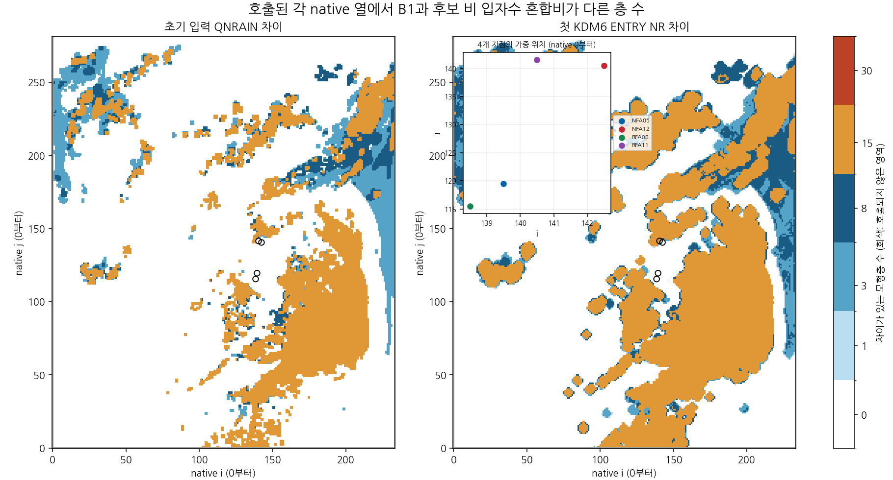
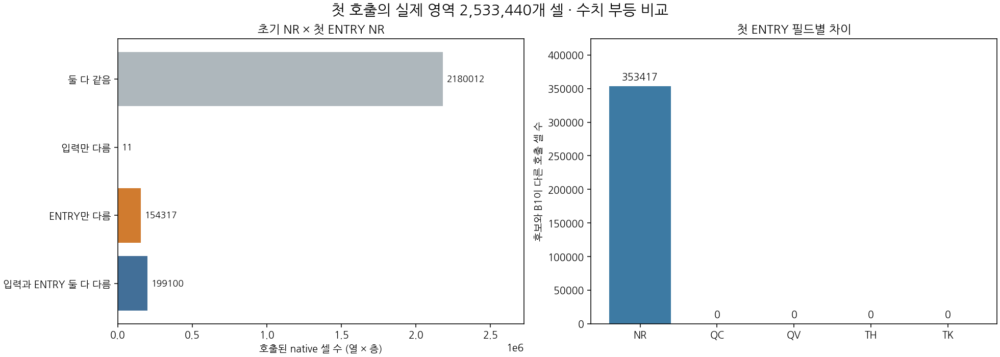
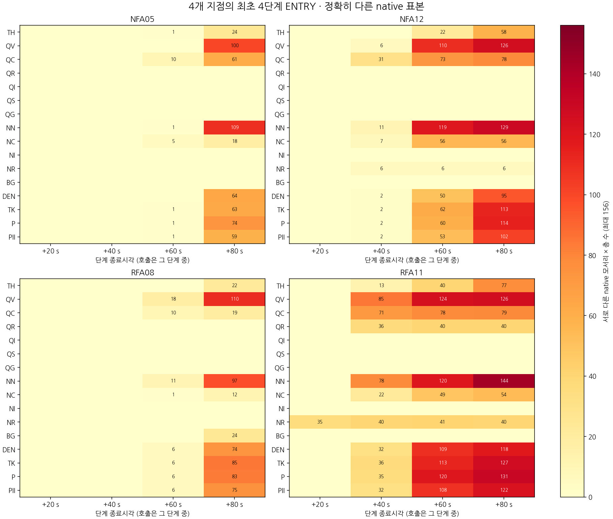
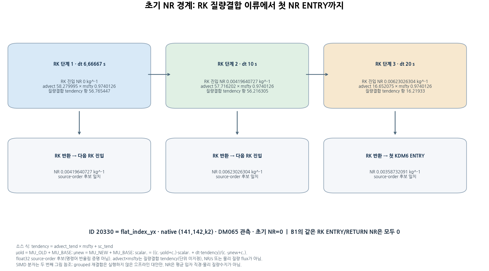
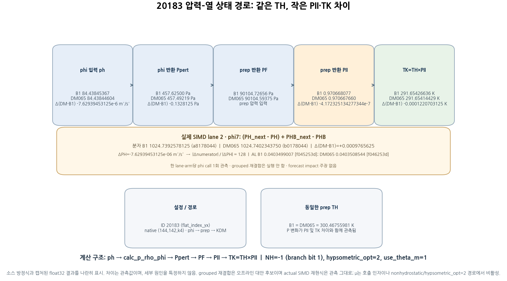

# 초기 비 입자수 경계와 첫 KDM6 호출 전파 경로

## 초록

현재 B1과 미채택 DM065의 기존 2시간 CP04 적분에서 모델 입력의 `QNRAIN`과 첫 KDM6 wrapper 진입 `NR`을 전역 대조하고, 선택 셀의 첫 네 호출을 재생하였다. 실제 첫 호출 코어 2,533,440개 중 두 구성의 초기 `QNRAIN`은 199,111개에서 달랐다. 첫 진입 `NR`은 353,417개에서 달랐으며, 그중 154,317개는 초기 `QNRAIN`이 같았던 호출 코어였다. 두 구성의 첫 진입에서 `QV`, `QC`, `TH`, `TK`에는 수치 차이가 없었다. 이 비교는 초기화 경계와 이후 호출 경계의 차이를 확정하지만, 그 자체로 작성자나 수송 원인을 특정하지 않는다.

추가된 한 셀의 포인터 결속 재생에서는 DM065의 `NR`이 질량 결합 Runge–Kutta(RK) 스칼라 갱신에서 첫 KDM6 호출 전에 생성되는 경로를 관측했다. 선택한 20330 셀에서는 이 생성이 해당 셀의 첫 KDM6 호출보다 앞선다. 별도의 20183 표본 재생에서는 첫 pressure 차이의 작성 경계와 이후 압력 생산자를 확인했고, 최종 작성자인 `calc_p_rho_phi`를 연결했다. 그 셀의 활성 EOS 입력 중 `ph_k`(지오포텐셜)는 B1 대비 −7.62939453125×10⁻⁶ m² s⁻² 달랐고, 반환 섭동압 차이는 −0.1328125 Pa였다. `phi` 호출 7의 실제 SIMD lane 2 재생은 numerator의 기계 연산 순서 `(PH(k+1)−PH(k))+PHB(k+1)−PHB(k)`를 두 arm에서 확인했다. 이 표적 lane에서 B1/DM065의 저장 numerator는 각각 1024.7392578125와 1024.740234375 m² s⁻²였고, 독립 재검토가 명령과 저장값을 확인했다. 대응하는 `mu`는 달랐으나 관측된 이 분기에서 비활성 피연산자였다.

이는 전역 첫 진입 통계와 제한 표본의 작성자·SIMD 경로를 연결한 진단이다. 실제 SIMD 산술 검증은 표적 20183의 `phi` 호출 7, lane 2에서 arm별 한 사례다. 그룹화한 대안은 오프라인 비교에만 남아 있다. 새 수치 수정이나 예보 후보·성능 개선은 없다. 현재 B1을 유지한다.

**주요어:** 비 입자수 혼합비, RK 이류, 질량 결합, 섭동압, Exner 함수, KDM6

## 1. 연구 범위와 비교 경계

본 연구는 새 예보 개선을 제안하지 않고 다음 질문에 한정한다. (1) 입력 `QNRAIN`과 첫 KDM6 진입 `NR`의 차이는 전역 어디서 나타나는가? (2) 표본 셀의 차이가 실제로 어느 단계에서 만들어지는가? (3) 첫 KDM6의 초기 열역학 변수와 압력·Exner 경계는 어떻게 연결되는가?

수치 성능 비교의 규준실험은 **ORIGINAL**이며, 경계·작성자 재생의 구성은 현재 기준 **B1**과 미채택 후보 **DM065**다. 이 명칭들은 서로 다른 역할을 가진다. 분석은 보존된 2시간 적분 자료와 각 구성의 80초 제한 진단 재실행을 사용했으며, 새 6시간 예보나 새 초기화 후보는 만들지 않았다.

전역 wrapper 기록의 첫 진입·반환 스키마는 14개 필드(`TH`, `QV`, `QC`, `QR`, `QI`, `QS`, `QG`, `NN`, `NC`, `NI`, `NR`, `BG`, `DEN`, `TK`)이며, 전역 스키마에는 압력 `P`나 Exner `PII`가 없다. `QNRAIN`과 wrapper `NR`은 공기 질량 기준 입자수 혼합비다. 내부 체적 수농도와 혼동하지 않는다.

## 2. 자료와 방법

### 2.1 전역 첫 호출 경계

수평 격자 234×282, 질량층 39개 중 두 구성 각각에서 실제 호출된 코어는 2,533,440개였다. 전체 배열은 2,573,532개 셀이고, 바깥 물리 경계의 40,092개 셀은 MPI halo가 아니라 해당 호출에서 관측되지 않은 경계 셀이므로 결측으로 유지했다. 8개 rank의 입력, 다섯 단계 원시 스트림, 호출 소유권, 스키마 및 입력 파일 해시를 영수증에 결속했다. 전역 분석의 숫자 비교는 signed zero를 같게 취급하며 비유한 값은 실패 처리한다.

`initial QNRAIN → first KDM6 wrapper entry NR`는 서로 다른 시점의 경계 비교다. 그 사이에 있는 계산이나 작성자를 전역 차이만으로 추론하지 않는다. 첫 wrapper 진입에서 열역학·수증기 상태를 함께 대조했으며, `P`·`PII`가 없는 한계는 선택 셀의 추가 기록으로 보완하되 전역 전체로 일반화하지 않는다.

### 2.2 선택 셀 재생

포인터 인식형 rank 5 캡처에서 RN1 `flat_index_yx=20330` 지점(1-based native `(i,j,k)=(141,142,2)`)의 첫 네 KDM6 진입을 같은 시각·같은 배열 기반으로 RK 반환과 연결했다. 같은 모델 단계에서 RK1·RK2 반환값은 다음 RK stage의 상태 갱신에 들어갔다. 첫 KDM6 진입 `NR`과 원시 REAL32 단어가 같은 반환은 RK3 반환이었다. 다른 같은 인덱스 후보 배열은 분류되지 않은 채 남겼다. 분석은 이 한 셀, 이 네 호출의 관측에 한정한다.

RN1 `flat_index_yx=20183` 지점(1-based native `(i,j,k)=(144,142,4)`)에서는 각 arm·표적별 15회의 실제 `phi` 호출을 포함해 `solve_em` RK 호출자, 동역학 `calc_p_rho`, 전처리, KDM6 경계를 짝지었다(두 표적×두 arm에서 60회). `phi` 단계 표기는 KDM 진입 횟수와 별개인 실제 관측 호출 순서다. 자료는 각 경계의 원시 실수 단어, 포인터, 호출자·분기 메타데이터를 보존했다. 16개 섭동압-전처리 포인터 연결과 48개 전처리-KDM 값 연결은 확인되었으나, 포인터 일치만으로 그 사이 쓰기가 전혀 없었다고 결론내리지는 않는다.

### 2.3 RK와 압력–Exner–TK 수식 경계

`module_em`의 `rk_update_scalar`는 `tendency=advect_tend×msfty+sc_tend`를 만들고, `M_o=MU_OLD+MU_BASE`, `M_n=MU_NEW+MU_BASE`, `A_o=c_1M_o+c_2`, `A_n=c_1M_n+c_2`를 사용해 스칼라를 갱신한다.

\[
\begin{aligned}
\text{RK1: }&S_1\leftarrow S_2,\quad S_2\leftarrow(A_oS_1+\Delta t\,tendency)/A_n,\\
\text{RK2/3: }&S_2\leftarrow(A_oS_1+\Delta t\,tendency)/A_n.
\end{aligned}
\]

코드에서 `S_1`은 RK1에서 `S_2`를 복사한 뒤 RK2/3 동안 그 저장 기준 상태로 유지된다. 이후 단계마다 현재 `S_2`를 재귀적으로 `S_1`에 복사하지 않는다. 이 표본의 첫 네 호출에서 QNR 배열은 위 질량 결합 RK 경로에 연결되며, `advect_tend`와 세 번째 RK에서 0인 scalar tendency가 포착되었다. 이 식은 선택점의 `NR` 값이 첫 KDM6 호출 전 생성되는 단계를 설명한다.

선택 경로에서 섭동압 `P`와 전처리에서 계산하는 전압력 `PF=P+PB`는 서로 다른 경계량이다. 관측된 `calc_p_rho_phi`는 압력 `P`와 소스 계량값 `AL+ALB`를 계산한다. 뒤의 전처리는 건조 `TH`, Exner `PII=((P+PB)/P0)**RCP`, 실제 온도 곱을 구성한다. `AL+ALB`의 물리적 공기 질량 기준은 본 자료에서 확정하지 않았다. 관측된 `non_hydrostatic` 분기에서 `hypsometric_opt=2`일 때, 소스의 층별 깊이 항은

\[
AL=\frac{PH_{k+1}-PH_k+PHB_{k+1}-PHB_k}{PHM\ln(PFD/PFU)}-ALB,
\]

여기서 `PHM=C3H×MUTS+C4H+PTOP`, `PFD=C3F(k)×MUTS+C4F(k)+PTOP`, `PFU=C3F(k+1)×MUTS+C4F(k+1)+PTOP`이다. `use_theta_m=1`이 관측된 이 경로에서 EOS 중간값은 `x=R_D×(T0+t)/(P0×(AL+ALB))`; 그 뒤 `calc_p_rho_phi`는 `P=P0×x**(CP/CV)−PB`에 해당하는 섭동압을 쓴다. 식과 변수명은 실행 소스 경로를 설명하며, 제한된 경계 관측을 열원별 열역학 예산으로 해석하지 않는다. 기존 전체 2시간 보고서에는 실제 실행 순서에 따른 추가 열역학 설명이 있다.

## 3. 결과

### 3.1 전역 경계에서 확인한 차이

| 경계 비교 | 결과 |
| --- | ---: |
| 전체 호출 코어 | 2,533,440 |
| 두 구성의 초기 `QNRAIN`이 다른 호출 코어 | 199,111 |
| 두 구성의 첫 진입 `NR`이 다른 호출 코어 | 353,417 |
| 초기 `QNRAIN`은 같지만 진입 `NR`이 다른 호출 코어 | 154,317 |
| 첫 진입 `QV`, `QC`, `TH`, `TK` 차이 | 각각 0 |

초기 입력 `QNRAIN` 차이 199,111개는 두 구성 간 차이를 실제 호출 코어 안에서 센 값이다. 비교 대상 입력 파일 전체의 비호출 경계 셀을 포함한 차이 수와 혼합하지 않는다. 첫 진입 NR 차이 중 154,317개는 초기 상태 차이가 없던 호출 코어에서 발생했다. `ENTRY`의 QR 분포에는 음수도 포함되며, 이를 활성화 임계값이나 유효 강수량으로 재분류하지 않는다.

**그림 1.** 초기 입자수 혼합비 차이의 실제 호출 지원 영역. 이 그림은 초기 경계 통계이며 작성자나 이동 경로를 보여주지 않는다.

**그림 2.** 초기 입력과 첫 wrapper 진입 사이의 전역 차이 집계. `QV/QC/TH/TK`의 첫 진입 값은 양 구성 간 수치상 일치한다.

### 3.2 NR은 첫 KDM6 전에 질량 결합 RK 경로에서 생성됨

20330에서 B1의 대응 QNR RK 반환은 0이었다. DM065의 초기 RK1·RK2·RK3 반환 `NR`은 각각 0.0041964073, 0.0062302630, 0.0035873209이며, 해당 초기값은 0이었다. 포인터로 분류된 이 배열의 세 번째 RK 반환 단어는 같은 시간단계 KDM6 진입 NR 단어와 일치했다. 따라서 이 표본에서 첫 KDM6 이전에 DM065의 NR이 만들어지는 실제 경로는 비 입자수 생성 모듈이 아니라 `module_em`의 질량 결합 RK 스칼라 갱신과 연결된다.

세 번째 RK 갱신의 저장 전 관측 피연산자에는 `advect_tend`가 나타났다. RK 단계의 Δt는 순서대로 약 6.6667 s, 10 s, 20 s였다. B1의 NR은 같은 캡처에서 0을 유지했다. 해당 셀의 초기 차이가 없는 경우에도, 미세물리 호출 전에 대기 중 RK 이류·갱신 경로가 입자수 차이를 만들 수 있음을 보여준다. 이는 이 표본에서 관측된 작성 경로이며, 154,317개 전역 셀의 모두에 같은 경로를 확장하거나 오차·잘못된 수송이라고 판정하는 근거가 아니다.

**그림 3.** 선택 지점의 첫 네 호출 경계. 전체 첫 호출 전선과 한 점의 RK 재생은 서로 다른 분석 수준이다.

**그림 4.** `flat_index_yx=20330`, k=2의 초기 NR, RK3 질량 결합 이류 항과 단계별 첫 진입/반환 연결.

### 3.3 압력 갱신, EOS 피연산자, Exner 및 TK

20183에서 B1과 DM065의 첫 `phi` 반환 압력은 처음에는 같았다. 동역학의 acoustic `calc_p_rho` 호출은 마지막 압력 작성자가 아니었다. 압력 필드의 실제 최종 생산자는 `calc_p_rho_phi`였으며, 관측 설정은 `non_hydrostatic=-1`(원시 정수의 하위 비트 1), `hypsometric_opt=2`, `use_theta_m=1`이었다. 따라서 `hypsometric_opt=2`의 실제 비정수압 설정 경로로 기술한다. 확인한 16개 포인터와 원시 단어 브리지, 호출자 및 반환 기록은 해당 관측을 뒷받침한다. 이는 보존된 실행·소스 대응의 해당 경로 판정이며, 포인터 일치나 소스 연결만으로 일반적인 컴파일러 명령 수준 등가성을 뜻하지 않는다.

20183의 첫 pressure/EOS 차이가 나타난 단계에서 EOS 진입 피연산자는 캡처된 활성 입력 중 차이는 `ph_k`뿐이었다. `ph_k`는 지오포텐셜(m² s⁻²)이며 B1 대비 DM065에서 −7.62939453125×10⁻⁶ m² s⁻², 반환 섭동압 `P`는 −0.1328125 Pa 달랐다. `mu`도 달랐지만 관측된 분기에서 비활성 입력이었다. 이 결과는 해당 표본·해당 단계의 변수 연결이지, 2,533,440개 전체에서 압력의 유일한 원인이라는 주장이 아니다.

이후 준비 경계에서는 `t`와 수증기로 건조 `TH=(t+T0)/(1+(R_v/R_d)×QV)`를 구성하며, KDM 진입의 실제 온도 대응은 `TK=TH×PII` 곱이다. 이 온도 변환은 호출 내 경계 변환이며, `t` 자체를 실제 온도로 해석하지 않는다. 전역 첫 wrapper 진입에서 TK가 같다는 관측은 그 뒤 첫 KDM 진입까지의 열역학·압력 입력이 전역 스키마에서 동등했다는 뜻은 아니다. 그 스키마는 `P`와 `PII`를 담지 않으며 표본의 변화는 이후 시점에 포착됐다. `TH×PII`의 곱 차이를 응축 가열, 압축 가열 등 과정별 온도 원인으로 배분하지 않았다.

**그림 5.** `flat_index_yx=20183`의 관측된 `phi → prep → KDM` 압력·Exner·온도 경로와 별도로 표시한 수치 안정성 후보.

### 3.4 직접 계측한 단정도 합산과 대안 산술

보존된 60개 `phi` 입력 행(2개 표적×2개 arm×15회)에 대해 정확 유리수 합, 소스 순서 REAL32, 그룹화 REAL32를 오프라인 비교했다. 이 행들에서는 그룹화 합이 정확 합에 더 가까웠다. 이 60행 결과는 실제 기계 연산 순서의 캡처가 아니다.

별도의 새 원래 실행파일 재생은 20183의 `phi` 호출 7, lane 2(네 lane 중 세 번째 실수)에서 양 arm의 실제 연산을 기록했다. B1과 DM065 모두 `(PH(k+1)−PH(k))`를 먼저 계산하고, 결과에 `PHB(k+1)`을 더한 뒤 `PHB(k)`를 뺐다. 12개 순서화된 SIMD 명령 스톱, XMM lane, 주소·저장 단어를 대조한 독립 재검토도 이 경로를 확인했다. 해당 lane의 중간값과 최종값은 다음과 같다.

| arm | 첫 뺄셈 | `PHB(k+1)` 덧셈 뒤 | numerator | 저장된 `AL` |
| --- | ---: | ---: | ---: | ---: |
| B1 | 45.50829315185547 | 9546.8134765625 | 1024.7392578125 | 0.04034990072250366 |
| DM065 | 45.50830078125 | 9546.814453125 | 1024.740234375 | 0.04035085439682007 |

캡처 피연산자에서 `PH(k)` 변화(DM065−B1)는 −7.62939453125×10⁻⁶ m² s⁻²였고, 정확 유리수 평가의 분자 차이 절대값은 7.62939453125×10⁻⁶ m² s⁻²였다. 관측된 순차 REAL32 분자 차이 절대값은 0.0009765625 m² s⁻²로, 정확 입력 차이의 128배다. 이 산술 경로는 두 실행의 한 표적·한 lane에 대한 기계 관측이다. 모든 격자·층·호출의 인과 설명이나 예보 영향은 아니다.

안정성 후보 `[(PH(k+1)−PH(k))+(PHB(k+1)−PHB(k))]`는 오프라인 그룹화 비교에만 존재하며 네이티브 실행이나 예보에서 평가되지 않았다. 실제 기계 순서가 확인된 다음 단계는 이 후보를 최소 변경으로 평가하고, 물리 정책을 바꾸지 않는 B1–DM065 짝지은 전방 확인에서 같은 26개 사전 조건 및 약한 강수 적중·오경보 전이를 확인하는 것이다. 전체 질량·물·에너지 수지는 계속 미해결이다.

## 4. 논의와 한계

실제 분자 산술 순서·피연산자·반올림은 20183 한 표적 lane에서 확인했다. 다음 단계는 이 제한 관측의 근거 위에서만 최소 수치 안정성 식을 평가하는 것이다. 후보 식이 근거를 얻더라도 물리 정책을 바꾸지 않는 짝지은 전방 확인을 별도로 거치고, 동일한 사전 고정 26개 조건과 약한 강수 적중/오경보 전이를 평가해야 한다. 새 CSI 표를 여기서 만들지 않았으며 기존 [시간·임계값별 전체 점수표](evidence/cp02_rain_number_process_20261104/followup/figures/FULLSCORES.md)를 기준 자료로 참조한다. 전체 질량 및 물·에너지 예산은 계속 미해결이다.

이번 결과는 전역 경계와 선택 표본의 서로 다른 증거 수준을 함께 보여준다. 전역 차이 집계는 수와 공간 지원을 제공한다. 셀 수준 포인터·호출 캡처는 특정 RK 반환이 같은 시점 KDM 진입으로 이어지는 것을 확인한다. pressure/EOS 캡처는 선택 위치의 작성자·피연산자 순서를 제한한다. 이 세 결과를 결합해도 포착하지 않은 모든 셀·단계의 내부 경로가 자동으로 결정되지는 않는다.

핵심 한계는 다음과 같다.

- 첫 wrapper 전역 14개 필드에는 `P`·`PII`가 없다. 압력 해석은 두 표본 셀의 제한된 추가 캡처다.
- NR 작성자 분석은 rank 5의 20330 및 첫 네 호출에 한정한다. 같은 인덱스의 다른 배열 후보 일부는 분류되지 않았다.
- pressure/EOS 수치 비교는 20183의 선택 경계에 한정한다. 소스·원시 값의 연결은 완전한 바이너리 명령 흐름이나 벡터 lane 검증과 다르다.
- 실제 SIMD numerator 순서는 두 arm의 한 표적·한 lane에서 독립 검토됐으며, 다른 격자·층·호출에 대한 일반화는 검증되지 않았다. grouped 식은 오프라인 비교에만 있고 native 실행은 없다.
- 고정점 진입·반환 차이는 공기 궤적이나 순수 수송량을 제공하지 않는다. 본 연구는 물·에너지 보존 수지를 닫지 않는다.
- 최초 수치 차이가 작다는 사실만으로 과학적 중요성, 구현 오류 또는 후속 강수 변화에 대한 인과성을 정하지 않는다.

## 5. 연구·성능 판정

새 초기화·물리 수정·예보 점수 산출은 수행하지 않았다. 규준실험 ORIGINAL 대비 비교와 현재 B1 판정은 기존에 동결한 기준을 유지한다. DM065의 기존 선정 기준 충족은 보호 8/11, 규준실험 미달 회복 2/15, 합계 10/26이며 미채택이다. B1 미달 조건 중 DM065가 새로 회복한 조건은 0개다. 따라서 현재 B1을 유지한다. 이번 경계 추적은 수치 경로의 관측을 추가했으며 성능 개선 후보를 만들지 않았다.

## 6. 증거 자료 및 재현

[증거 번들 설명](evidence/cp02_initial_boundaries_20261105/README.md)은 전역 호출 영역, 좌표·배열 순서, 단위, 미관측 경계와 주요 제한을 정의한다. 최종 [전체 그림 색인](evidence/cp02_initial_boundaries_20261105/gallery/FIGURES.md)과 [모든 그림 묶음](evidence/cp02_initial_boundaries_20261105/gallery/all_figures.zip)을 제공한다. 핵심 연결 자료는 다음과 같다.

- [전역 결과 영수증](evidence/cp02_initial_boundaries_20261105/results/receipt.json), [경계 앵커](evidence/cp02_initial_boundaries_20261105/results/anchors.csv), [희소 차이 배열](evidence/cp02_initial_boundaries_20261105/results/sparse/)
- [초기 입력/진입 재계산](evidence/cp02_initial_boundaries_20261105/baseline/results/receipt.json), [선택 전선 표](evidence/cp02_initial_boundaries_20261105/baseline/results/entry_frontier.csv)
- [20330 RK 작성자 분석](evidence/cp02_initial_boundaries_20261105/science/writer_nr20330/analysis.json), [쌍별 RK 피연산자](evidence/cp02_initial_boundaries_20261105/science/writer_nr20330/paired_rk_operands.csv), [독립 검토](evidence/cp02_initial_boundaries_20261105/validation/independent_writer_nr_review.json)
- [20183 pressure/EOS 분석](evidence/cp02_initial_boundaries_20261105/science/writer_p20183/analysis.json), [phi7 paired native numerator closure](evidence/cp02_initial_boundaries_20261105/native/numerator_p20183/paired_closure.json), [phi 입력 산술 재계산](evidence/cp02_initial_boundaries_20261105/science/phi_p20183/analysis.json), [압력 표 검토](evidence/cp02_initial_boundaries_20261105/validation/independent_pressure_writer_tables_review.json)
- [관측 경로 그림 모음](evidence/cp02_initial_boundaries_20261105/mechanism_figures/gallery.md), [실제 SIMD numerator 독립 검토](evidence/cp02_initial_boundaries_20261105/validation/independent_numerator_raw_review.json), [60개 오프라인 산술 결과](evidence/cp02_initial_boundaries_20261105/science/phi_arithmetic/all_samples/receipt.json), [독립 과학 검토](evidence/cp02_initial_boundaries_20261105/validation/independent_phi_science_review.json)

전역 raw stream은 원 실행 scratch에 남아 있으며 번들에는 해시 고정 영수증과 바뀐 값을 보존하는 파생 자료가 포함된다. actual numerator pair의 [독립 원시 스트림 검토](evidence/cp02_initial_boundaries_20261105/validation/independent_numerator_raw_review.json)와 [clean-export 검증 receipt](evidence/cp02_initial_boundaries_20261105/validation/clean_export_suite.json)도 같은 증거 디렉터리에 연결한다. 해석 과정에서 미호출 셀을 0으로 대체하지 않는다. 기존 [열역학·구름·강수 2시간 보고서](CP02_THERMO_CLOUD_PATH_20261105.md)는 호출 내부 과정 순서, 수증기·온도 및 후속 지상 강수 진단을 다루며 본 보고서는 그보다 앞선 초기 입력–첫 호출 경계와 제한된 작성자 재생을 다룬다.

## 참고문헌 및 관련 기록

1. Cloud-BAL, [초기 입자수·첫 KDM6 wrapper 경계 증거 번들](evidence/cp02_initial_boundaries_20261105/README.md), 2026-11-05.
2. Cloud-BAL, [열역학–구름–강수 반응의 실제 2시간 대조](CP02_THERMO_CLOUD_PATH_20261105.md), 2026-11-05.
3. WRF dynamical core 소스 핀과 실행 계보는 증거 번들의 `native/sourcepins/`, `native/phi_source_lineage.json` 및 각 분석 receipt를 참조한다. 이 소스 연계는 관측된 범위를 넘어선 독립적인 물리 검증으로 해석하지 않는다.
