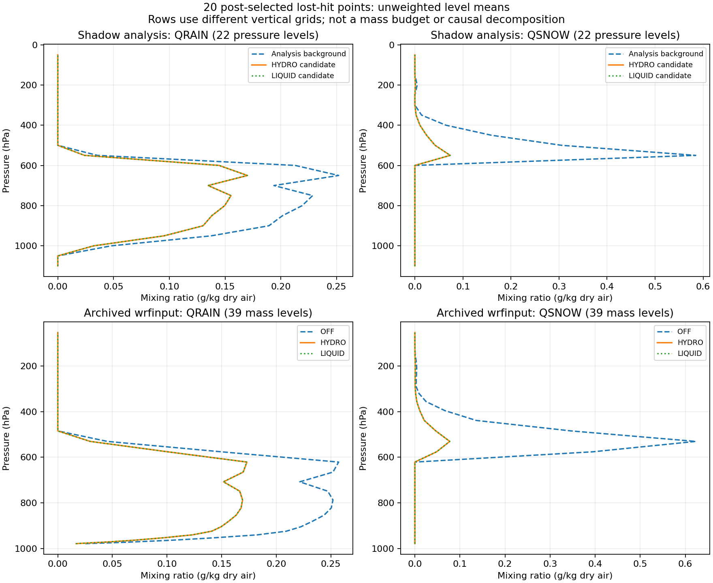

# CP02 초기 QR·QS 차이의 생성 단계 추적

**초기 QR·QS 차이는 첫 예보 시간에 생긴 것이 아니라, LAPSPREP의 shadow 분석 입력→후보 경계에서 이미 나타난다.** 실제 CP02 OFF가 사용한 WPS의 QR/QS는 shadow 배경장과 같고, HYDRO·LIQUID WPS의 QR/QS는 각각 shadow 후보장과 같다. 이로써 저장 상태의 차이를 예보 전 분석 단계까지 연결했다. 다만 그 내부에서 차이를 만든 첫 산술 연산과 물리적 타당성까지 확정한 것은 아니다.

대상은 **2026-08-16 12 UTC 시작의 과거 CP02 OFF/HYDRO/LIQUID**다. 첫 시간 ≥5 mm 적중 소실 합집합 20점을 사후 진단 표본으로 유지한다. 최신 C2 H/A/N, T39 수정 또는 새로운 예보 실험의 결과가 아니다.

## 실제 자료로 연결한 단계

| 단계 | 직접 확인한 내용 | 해석 범위 |
|---|---|---|
| 준비된 분석 `payload.nc` → shadow 배경 | 전체 rain/snow 배열이 정확히 같고 좌표도 일치 | 준비 입력과 분석 배경 연결 |
| 실제 OFF WPS → HYDRO shadow 배경 | QR·QS 각각 공통 20개 기압면의 전체 235×283 slab이 정확히 같음: **40/40** | 실제 OFF 경로의 수상체 필드 연결; 다른 모든 필드의 동일성 주장은 아님 |
| shadow 배경 → 후보 | 20개 같은 위경도·22개 기압층에서 두 후보의 QR·QS 평균이 감소 | **가장 앞서 확보한 분석 전·후 차이 경계** |
| HYDRO·LIQUID shadow 후보 → 각 WPS | 각각 QR·QS 40/40 slab 정확히 일치: **80/80** | 감소가 진단 파일에만 있는 현상이 아니라 WPS에도 전달됨 |
| WPS → `met_em` | 실제 변수명 `QR`, `QS`, 21개 metgrid 층을 확인. 20점의 보간 표본에서 후보 평균이 OFF보다 작음 | 좌표·층 구조가 달라 위 단계와 층별 동일성은 주장하지 않음 |
| `real.exe` 산출물 → 예보 `wrfinput` | 실제 세 arm의 초기 파일 경로·해시를 대조 | 같은 디렉터리의 별도 OFF 제어군과 실제 OFF를 구분 |
| `wrfinput` → 12 UTC history | 각 arm의 20점×39층에서 QRAIN·QSNOW를 포함한 8개 필드는 정확히 유지. 섭동압력 P는 최대 약 0.014 Pa 차이 | 초기 QR·QS 차이는 첫 예보 적분 전에 존재 |

WPS 비교는 **5,000–100,000 Pa의 공통 20개 기압면**을 사용한다. Shadow의 110,000·105,000 Pa와 WPS의 지표 record는 제외했다. 세 WPS 파일에서 비교한 projection record의 SHA-256도 동일하다. [WPS 직접 판독과 120개 slab 비교](evidence/cp02_initial_species_20261027/final/wps/readback.json).

## 감소량과 연직 구조

다음 값은 각 단계에서 같은 20점의 층별 값을 동일 가중한 평균이다. **단계마다 층 수와 연직 좌표가 다르므로 행 사이의 차이를 물수지로 계산하면 안 된다.** 질량·두께·면적 가중 평균이 아니다. Shadow는 지하층을 별도로 제외하지 않은 전체 22개 저장 기압층을 포함한다.

| 단계·종 | 배경 또는 OFF, g/kg | HYDRO, g/kg | LIQUID, g/kg |
|---|---:|---:|---:|
| Shadow 22층 rain | 0.078105 | 0.053395 | 0.053355 |
| Shadow 22층 snow | 0.051505 | 0.006996 | 0.006994 |
| Metgrid 21층 QR | 0.093267 | 0.062819 | 0.062771 |
| Metgrid 21층 QS | 0.069279 | 0.009070 | 0.009067 |
| WRF 입력 39층 QRAIN | 0.079558 | 0.053557 | 0.053518 |
| WRF 입력 39층 QSNOW | 0.041560 | 0.005472 | 0.005471 |

위 그림의 위·아래 행은 서로 다른 연직 격자다. 위 행은 원래 기압층, 아래 행은 각 native 층의 20점 평균 압력으로 표시했다. 분석에서 감소한 QR·QS의 연직 구조가 초기 WRF 입력에도 나타난다. **이 그림만으로 물 질량 손실, 증발량 또는 지상 강수 감소의 원인을 확정할 수 없다.** HYDRO의 초기 온위·QV·QC·QI·QG·PB가 OFF와 같은 보간 표본이라도 압력·바람 등의 차이는 남는다.

## 정확한 실험 계보와 남은 공백

실제 OFF 초기 입력은 `scratch/cp02_native_12_15.B4Lwmh/real/wrfinput_d01`이며, SHA-256은 `5d6b2bdce4121642dea994f3e953cca690ad7c9f52f6f8feb01bb6c2f0b9b6bc`다. `cp02_actual12_liquid_wps.HisIOM/real_OFF`는 다른 파일이므로 실제 6시간 OFF 대신 사용하지 않았다. HYDRO·LIQUID의 생성 파일은 각 6시간 입력과 동일하다. [준비 receipt·실행파일·소스 계보](evidence/cp02_initial_species_20261027/historical_lineage.json).

당시 로그에는 `CAP_POLICY=TRANSFER`, rain/snow fraction 1, `GRID_SCALE=NONE`이 기록돼 있다. 소스 이력에는 농도 유효성 처리, cloud→rain/ice→snow 전환, 건조공기 밀도로 혼합비 변환, 분석 후보를 WPS에 전달하는 경로가 있다. 그러나 **빌드가 기록한 LAPSPREP·column physics·pipeline 소스 해시는 조사한 Git 이력과 일치하지 않았다.** 현재 코드나 유사한 과거 commit을 당시 바이너리의 정확한 소스라고 대체하지 않았다.

따라서 이번 결론은 **분석 배경→후보 경계에서 QR·QS가 달라지고, 그 값이 실제 WPS와 하류 초기 입력으로 전달된다는 관측 사실**이다. 내부의 어느 수종 분배·수송·제한 연산이 처음 차이를 만들었는지는 `OPEN`이다. 다음은 당시 빌드 해시와 일치하는 소스 또는 보존된 중간 과정량을 확보해 이 경계를 국지 재생하는 것이다. 확보 전에는 첫 시간 강수를 5 mm 이상으로 되돌리기 위한 임의 QR/QS 조정이나 물리 변경을 하지 않는다.

## 자료와 재현 범위

- [WRF 입력·초기 history 프로파일](evidence/cp02_initial_species_20261027/final/wrf/initial_species_profiles.csv) · [판독·필드별 동일성](evidence/cp02_initial_species_20261027/final/wrf/extraction_receipt.json)
- [Shadow 분석 전·후 프로파일](evidence/cp02_initial_species_20261027/final/shadow/shadow_species_profiles.csv) · [입력 연결](evidence/cp02_initial_species_20261027/final/shadow/shadow_extraction_receipt.json)
- [Metgrid QR/QS 프로파일](evidence/cp02_initial_species_20261027/final/metgrid/metgrid_species_profiles.csv) · [요약](evidence/cp02_initial_species_20261027/final/metgrid/metgrid_species_summary.csv)
- [WRF 추출기](evidence/cp02_initial_species_20261027/extract_initial_species.py) · [Shadow 추출기](evidence/cp02_initial_species_20261027/extract_shadow_species.py) · [Metgrid 추출기](evidence/cp02_initial_species_20261027/extract_metgrid_species.py) · [WPS 판독 비교](evidence/cp02_initial_species_20261027/trace_wps_species.py)

보관 파일을 읽은 오프라인 조사이며, 새 모델 실행·Fortran 컴파일은 하지 않았다. 첫 미세물리 PRE/POST, 과정별 수송·증발·침강량, 전체 물수지, RN1 입력 최신성·coverage, C2의 T39 및 1시간 완료는 별도로 남는다. [무손실·무강수 분석 도구 수정](PRECIP_EMPTY_LOSS_20261027.md)은 이러한 과학적 공백과 구분한다.
