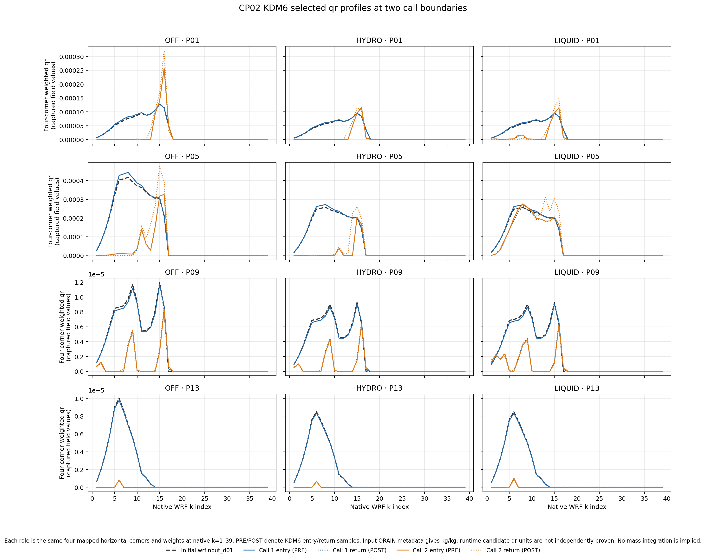

# CP02 OFF/HYDRO/LIQUID의 첫 두 KDM6 호출

과거 CP02 세 실험의 원래 실행파일·초기장·경계·설정을 새 scratch로 복사해,
각 실험의 8개 MPI rank에서 첫 두 KDM6 진입과 반환을 포착했다.
세 실험 모두 실제 인자 `itimestep`은 1, 2이고 `delt`는 각각 20초다.
이는 호출 인자 판독 결과이며, 직접 읽은 모델 시계나 RK 단계는 아니다.
두 번째 반환 후 의도적으로 중단했으므로 새 1시간·6시간 예보를 완료한 결과가 아니다.

## 실행과 자료 연결

- 실행파일 SHA-256: `de110a7f1d40143a74ffedbe64ed5b3717c413876093f56d200563e2f6b9c168`.
  원래 CP02 계보와 같으며 새 컴파일은 수행하지 않았다.
- `tests/intel_toolchain.sh`의 pinned Intel 환경, 실험당 8 MPI rank, OMP 1을 사용했다.
  세 실험을 순서대로 실행했다. [실행 환경](evidence/cp02_kdm6_controls_20261029/intel_environment.txt)
- 실험마다 88개 원본·복사 입력의 실행 후 해시와 크기가 준비된 목록과 같다.
  초기 12 UTC history도 각각의 과거 history와 바이트 동일하다.
- 같은 네 RN1 탐색 지점(P01 적중 소실, P05 적중 유지, P09 오경보 제거,
  P13 약한 관측 강수·세 예보 5 mm 미만)의 네 WRF 모서리와 39층을 사용했다.
  각 경계에 624개 고유 소유 표본이 있고 halo는 제외한다. 이는 독립 검증 사례 624개가 아니다.
- 인자 77개의 register/stack 포인터, 배열 offset과 tile 소유권을 검사한다.
  2차원 배열은 층별 중복을 확인한 뒤 16개 수평 기둥으로 집계한다.
- MPI 종료코드 255는 세 경우 모두 계측 후 GDB 종료에 따른 값이다.
  성공 판정은 종료코드만으로 하지 않고 8개 rank의 두 진입·반환, 실패 마커 부재,
  입력 해시와 출력 자료를 확인한다. 예보 상태는 `NOT_COMPLETED`다.

[입력 계보·복사 목록](evidence/cp02_kdm6_controls_20261029/inputs/README.md),
[OFF receipt](evidence/cp02_kdm6_controls_20261029/captures/OFF/receipt.json),
[HYDRO receipt](evidence/cp02_kdm6_controls_20261029/captures/HYDRO/receipt.json),
[LIQUID receipt](evidence/cp02_kdm6_controls_20261029/captures/LIQUID/receipt.json)에
실행파일·선택 표본·계측 코드·원시 캡처·초기 history를 연결했다.
삭제된 MPI 공유메모리 매핑은 파일 해시 대상에서 제외하고 별도 목록에 기록했다.
실행 중 매핑된 실행파일과 라이브러리 13개는 해시를 남겼다.

## 질량·보조 후보의 동시 변화

변수 이름은 DWARF가 없는 바이너리의 **후보 ABI 이름**이다.
`qc/nc`, `qr/nr`, `qi/ni`는 질량·입자수 후보를 짝지었다.
`bg`는 후보 소스상 부피 관련 상태이므로 입자수로 집계하지 않는다.
아래 조건은 엄격한 `질량 > 0`, `보조 == 0`이며 스킴의 활성 임계값을 적용한 판정이 아니다.

선택 초기 NetCDF의 `QNCLOUD`, `QNRAIN`, `QNICE`와 첫 KDM6 PRE의 `nc`, `nr`, `ni`는
세 실험 각각 624개 모두 0이다. 첫 POST에서는 세 실험 모두 양의 보조 후보가 나타난다.
따라서 HYDRO만의 현상으로 해석할 수 없다. 함수 내부의 어느 초기화·재구성 연산인지까지
확정한 결과는 아니다.

| 실험 | 첫 POST nc > 0 | nr > 0 | ni > 0 |
| --- | ---: | ---: | ---: |
| OFF | 64 | 21 | 122 |
| HYDRO | 32 | 19 | 122 |
| LIQUID | 101 | 19 | 124 |

아래 각 셀은 **양의 질량 후보 수 / 그중 보조 후보가 0인 수**다.

| 실험·호출 | qc/nc PRE → POST | qr/nr PRE → POST | qi/ni PRE → POST |
| --- | --- | --- | --- |
| OFF 1 | 440/440 → 201/137 | 273/273 → 47/26 | 416/416 → 122/0 |
| HYDRO 1 | 442/442 → 193/161 | 274/274 → 36/17 | 412/412 → 122/0 |
| LIQUID 1 | 437/437 → 198/97 | 274/274 → 96/77 | 413/413 → 124/0 |
| OFF 2 | 380/179 → 202/12 | 202/146 → 79/26 | 310/138 → 136/0 |
| HYDRO 2 | 379/186 → 196/15 | 199/144 → 71/25 | 309/136 → 139/0 |
| LIQUID 2 | 374/147 → 196/11 | 219/162 → 116/63 | 310/140 → 139/0 |

첫 POST와 두 번째 PRE의 수종·보조 값이 다르므로 그 구간을 별도로 집계한다.
이 차이는 KDM6 반환 이후부터 다음 진입까지의 변화이며, 수송·driver 처리 등
어느 과정의 기여인지 분해하지 않았다. 두 번째 POST에도 일부 양의 질량/0 보조 조합이
남는다. 그 자체를 오류·초기화 실패로 판정하거나 강수 소실의 원인으로 확정하지 않는다.

원시 음의 작은 값도 제거하지 않는다. 예를 들어 HYDRO 첫 PRE의 qc 10개·qi 6개,
두 번째 PRE의 qc 13개·qr 2개·qi 7개가 음수다. 단순 >0 집계의 제외 표본이며,
임의 clipping으로 수지나 계측 결과를 바꾸지 않았다.

[독립 원시 바이트 대조](evidence/cp02_kdm6_controls_20261029/independent_capture_review.json)와
[초기장 표본](evidence/cp02_kdm6_controls_20261029/inputs/selected_initial_fields.csv)에
집계와 입력 연결을 보존했다. 초기장과 첫 PRE 사이에는 다른 실행 구간이 있으므로
두 상태가 같다고 가정하지 않는다.

## 네 모서리 가중 연직 프로파일



각 행은 같은 RN1 지점이며 OFF/HYDRO/LIQUID의 세 패널은 같은 세로축 범위를 쓴다.
원래 네 모서리 가중치를 적용한 초기 QRAIN과 두 호출의 qr PRE/POST를 겹쳐 표시했다.
가로축은 native k 인덱스이고 층 두께·건조 질량 가중 적분은 아니다.
초기 NetCDF QRAIN의 단위 메타데이터는 kg/kg이며, runtime 후보 변수 의미·단위는
정확한 빌드 소스와 아직 독립적으로 연결되지 않았다.

[그림 입력 식별 정보](evidence/cp02_kdm6_controls_20261029/kdm6_qr_weighted_profiles.metadata.json),
[7,488개 경계 표본](evidence/cp02_kdm6_controls_20261029/analysis/selected_profiles.csv),
[36개 질량·보조 집계](evidence/cp02_kdm6_controls_20261029/analysis/mass_aux_ratios.csv),
[호출 내부·사이의 변화](evidence/cp02_kdm6_controls_20261029/analysis/field_deltas.csv)를 함께 보존했다.

## 재현과 실패 판정

```bash
python tools/cp02_kdm6_controls.py \
  --capture-dir docs/evidence/cp02_kdm6_controls_20261029/captures \
  --output-dir /var/tmp/cp02-kdm6-controls-analysis-new
```

새 분석기는 기존 PR125 분석기와 보관 결과를 수정하지 않는다.
출력은 전체 입력 검증 후 새 디렉터리로 원자적으로 게시하며 기존 결과를 덮어쓰지 않는다.
원시 REAL32 바이트·해석값·finite flag를 대조하고, 필수 상태의 비유한 값은 거부한다.
비활성 선택 진단값은 원시 바이트를 보존하되 물리량으로 해석하지 않는다.

추적 파일만 별도 디렉터리로 내보낸 환경에서 기존 141개와 신규 14개,
총 **155개 시험이 통과**했다. 같은 환경의 분석 CLI가 만든 summary와 네 CSV는
보관본과 바이트 동일하다. 유지 파일별 실행기도 새 분석기 시험 10개를 통과했다.
이 10개는 155개에 포함된다. 전체 portable suite는 실행하지 않았다.
[검증 명령·결과](evidence/cp02_kdm6_controls_20261029/clean_export.json)

## 해석 범위와 다음 작업

이번 비교는 초기 보조 상태 변화가 OFF·HYDRO·LIQUID에 공통으로 나타나는지 확인하는
단계다. 첫 호출 이후의 일반적인 예보 비간섭, 전체 물수지나 강수 개선을 입증하지 않는다.
새 HYDRO 첫 호출의 PRE/POST는 PR125와 17개 필수 3차원 후보 필드 각각
624/624개, 8개 2차원 필드 각각 16/16개에서 바이트 동일하다.
이 검사는 계측끼리의 재현성 검사이며, 비계측 실행과의 두 호출 이후 비교가 아니다.

정확한 compiled-source identity, driver 진입부터의 상태 전달, 보조 상태 생성 분기,
직접 읽은 모델 시계·RK 단계, 같은 호출 시점의 MU/MUB·hybrid 계수·격자 질량,
개별 미세물리·수송·침강 과정량은 아직 미확보다. 다음에는 보조 상태가 생성되거나
사용되는 조건과 호출 사이 변화를 이 자료에 연결해야 한다.

기존 3,688점·6시간·0.1/0.5/1/2.5/5/10 mm 검증은 유지한다.
RN1 상류 시각·coverage, C2 T39와 H/A/N 1시간 완료, 전체 물·에너지 수지도 별도로 남는다.
이 자료만으로 QR·QS 배율을 변경하거나 예측 성능 개선을 승인하지 않는다.

## 그래프 유지보수

Graphify 0.9.53으로 새 유지 Python 3개만 구조 추출했다. KLAPS50과 Cloud-BAL을
각각 `2026-10-29-cp02-kdm6-controls`로 보존했으며, 각각 노드 +46·연결 +101이다.
기존 날짜별 snapshot 192개는 유지했다. GDB·증거 추출·그림 스크립트는
구조 추출 대상이 아닌 해시 연결 대상이다. Fortran의 파일 간 CALL 추출 한계도 유지된다.

PR125의 두 Python 파일은 그래프에 이미 존재하지만 유지 manifest의 cache 행이
빠져 있어 이번에 해당 행만 복구했다. 기존 PR125 증거는 수정하지 않았다.
그래프 최신화는 모델 실행·과학 검증을 대신하지 않는다.
[갱신·검사 기록](evidence/cp02_kdm6_controls_20261029/kg/stage_validation.json)
