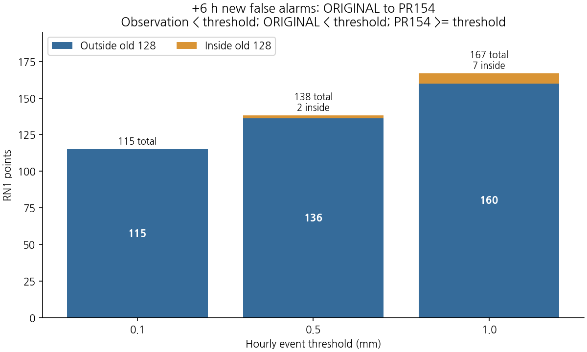
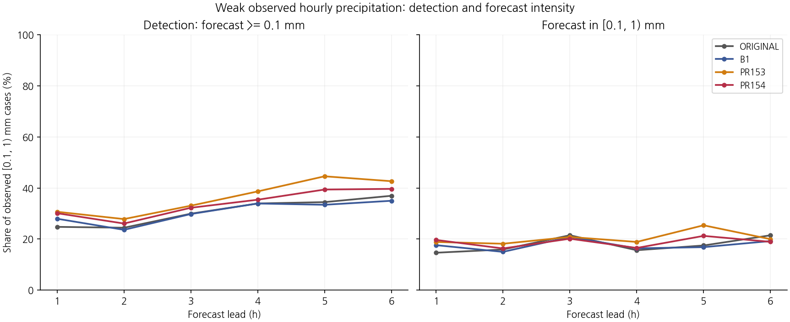
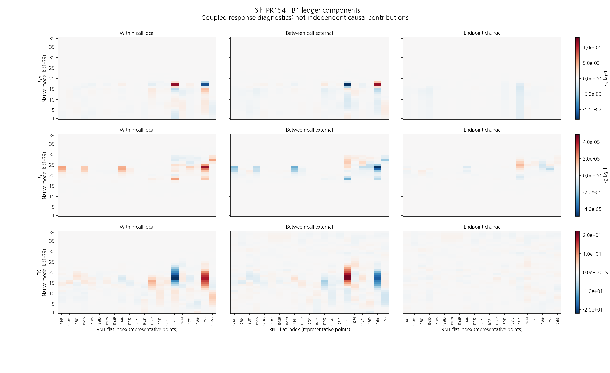
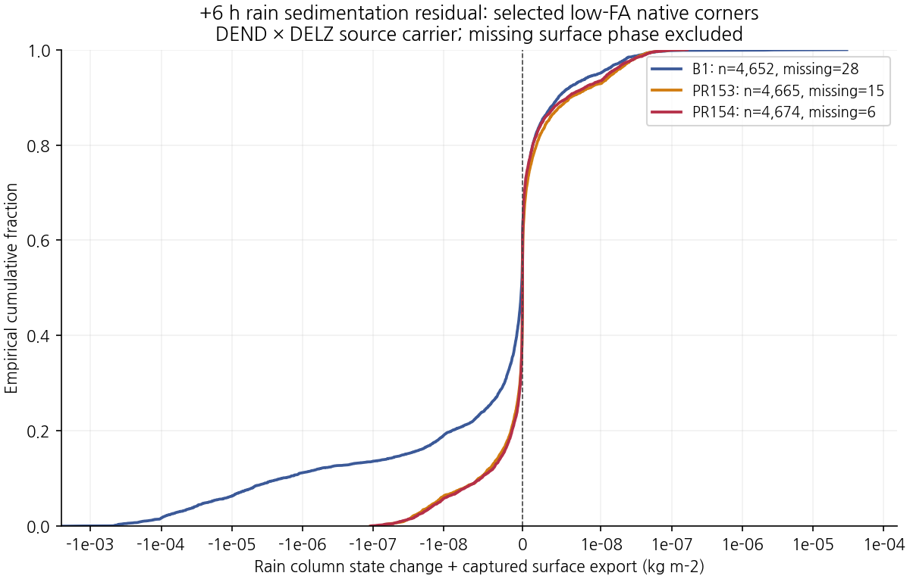
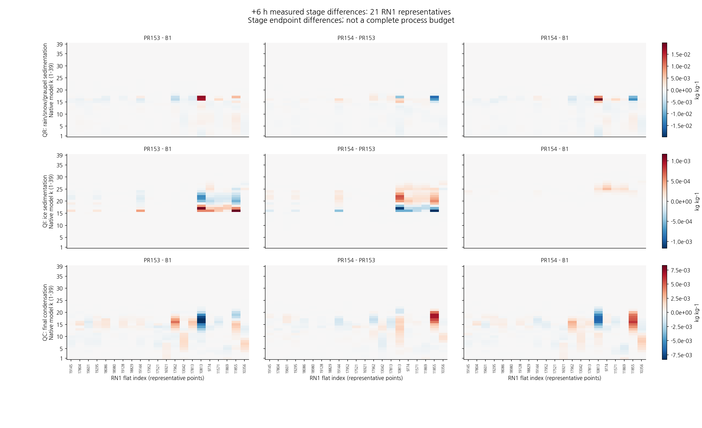

# 낮은 강수 임계값의 실패 지점에서 수행한 세 구성의 6시간 과정 대조

## 초록

PR154의 +6시간 낮은 임계값 회복 실패를 조사하기 위해 기존 5 mm 오경보 집단의 포괄 범위를 검산하고 진단 지점을 보강하였다. 규준실험 대비 0.5·1 mm 신규 오경보 합집합 233곳 중 226곳은 기존 128곳 밖이었다. 낮은 임계값 실패·해소·약한 강도 유지 사례, 기존 강수 대조 및 +1시간 지점을 포함한 21곳을 선정하고, 동일한 B1 초기장에서 B1·PR153·PR154를 각각 6시간 재적분하였다. 정시 history 21개는 각 기존 예보와 바이트 단위로 일치하였다. 77개 원래 격자 모서리·39층의 호출 전후와 실제 침강 하위단계를 연결해 상태 장부, 질량·입자수, 지상 누적을 대조하였다. B1의 선택 기둥에서는 지상 유출로 설명되지 않는 침강 상태 감소가 나타났고 보존 후보에서는 같은 범위의 잔차가 크게 작았다. 한편 지상 강수가 더 커져도 호출 말 비 혼합비가 작아지는 사례와 서로 다른 시간 분포가 함께 관측됐다. 이번 결과는 원인 연산의 범위를 좁힌 진단이며 새로운 수정 후보의 성능 개선은 아니다. PR154 21/26·미채택, 현재 B1 유지를 유지한다.

**핵심어:** 약한 강수, 오경보, 보존 침강, 빙정, 미세물리, 대응 과정 진단

## 1. 서론

같은 낮은 임계값의 CSI라도 강한 관측 강수의 검출과 강도 과잉을 함께 포함한다. 따라서 5 mm 보호 실패 지점만으로 +6시간 0.1·0.5·1 mm의 회복 실패를 설명하기 어렵다. 본 연구는 이 집단 공백을 먼저 보완하고 같은 격자·호출에서 실제로 적용된 계산을 대조한다.

비교 구성은 현재 B1(`FIX`, A), 보존 침강 PR153(`CONSERVATIVE`, C), 첫 빙정 단위 수정 PR154(`ICE_FIXED`, I)다. 규준실험 ORIGINAL(O)은 회복 판정과 실패 집단 선정의 기준으로 유지하며 이번 과정 재적분에는 포함하지 않는다. C−A는 보존 침강 구성 변경에 대한 예보 반응, I−C는 첫 빙정 속도 단위 수정에 대한 반응, I−A는 현재 남은 전체 차이다. 초기시각 이후의 상태가 서로 달라지므로 이 차이는 고정 상태에서의 개별 물리 과정 기여율이 아니다.

## 2. 자료 및 방법

### 2.1 낮은 임계값 집단 보강

문턱 $u$에서 규준실험 대비 신규 오경보는 $R_o<u$, $R_O<u$, $R_I\ge u$로 정의한다. 사건은 문턱을 포함하고 관측 강도 구간은 왼쪽 포함·오른쪽 제외다.

| +6시간 임계값 | 신규 오경보 | 기존 128곳에 포함 | 기존 집단 밖 | PR154 예측량<5 mm |
|---|---:|---:|---:|---:|
| 0.1 mm | 115 | 0 | 115 | 115 |
| 0.5 mm | 138 | 2 | 136 | 136 |
| 1 mm | 167 | 7 | 160 | 162 |

0.5·1 mm 합집합은 233곳, 그중 기존 집단 밖은 226곳이다. B1 대비 신규 오경보도 0.5 mm에서 110곳 중 106곳, 1 mm에서 134곳 중 125곳이 기존 집단 밖이다. 문턱별 집합은 겹치므로 행을 더해 독립 사례 수로 해석하지 않는다.

선정한 21곳은 낮은 임계값 신규 오경보 대표 7곳, 문턱별 해소 대조 3곳, 세 구성 모두 약한 강도 구간을 유지한 2곳, 기존 5 mm 집단 대표 3곳, +1시간 신규 오경보 3곳과 적중 유지 대조 3곳이다. 기존 예보·관측·위치만 사용해 사전에 정한 층화와 결정적 medoid·거리 규칙으로 골랐다. 이후 과정 결과로 지점을 다시 선택하지 않았다. 이들은 기술적 사례이며 전체 233곳의 통계적 표본이 아니다.

### 2.2 실제 재적분과 기록 범위

초기시각은 **2026년 8월 16일 12 UTC**다. +1시간은 12–13 UTC, +6시간은 17–18 UTC의 한 시간 강수이며 초기시각부터의 누적과 구분한다. +5·+6시간 합은 16–18 UTC 진단이다.

세 구성은 같은 초기장·경계장·시간간격 20초, 각각 8개 MPI rank·OpenMP 1개 스레드로 6시간을 적분하였다. 지정 Intel IFX 2026 프로파일을 사용해 소스 트리 밖의 새 scratch에서 빌드했다. 기존 물리 문장과 순서를 유지하고 진단 기록만 삽입했는지 소스·구문·실행으로 검토했다.

- 상태·과정 상세 기록: 실제 단계 1–180과 721–1080, 즉 0–1시간과 4–6시간.
- 지상 누적 기록: 단계 1–1080 전체, 20초 간격.
- 공간 범위: 평가점 21곳의 네 모서리를 77개 WRF 기둥으로 중복 제거, 각 39층.
- 검증: 구성별 정시 history 7개, 합계 **21개가 기존 예보와 바이트 동일**. 지상 source `rain`과 history `RAINNC`도 **3×7×77=1,617개** 종점에서 비트 단위로 같았다.

따라서 계측이 기존 예보를 바꾸지 않았다는 근거를 확보했다. 각 구성의 77×39×540 상세 표본은 독립 관측 사례 수가 아니다. 전체 원시 스트림은 외부에 보존하고 검증된 compact, 실행 근거 및 실제 첫 3단계의 대표 원시 프레임을 저장소에 제공한다. 전체 원시 자료의 재처리와 저장소 내 대표 표본 재생을 구분한다.

### 2.3 단위·정밀도·호출 대응

공유 경계 이동량은 원래 REAL64 그대로 보존한다. B1의 기존 국지 `falk`는 REAL32이며 동일한 공유 경계량으로 취급하지 않는다. 상태는 실제 REAL32 바이트를 유지하고, 진단 차이는 두 상태를 REAL64로 확장한 뒤 빼고 실제 하위단계를 시간 순서로 더했다.

구성별 실제 하위단계 수와 기간이 다를 수 있으므로 다른 구성의 같은 하위단계 번호를 곧바로 대응시키지 않는다. 각 구성 안의 전후·하위단계 완전성을 검사한 뒤 동일한 외부 20초 호출과 격자에서 비교한다. 직접 REAL64 경계량 비교의 완전한 키가 맞은 warm-sedimentation 기록은 2,300,454개이고 C에만 있는 기록 759,135개, I에만 있는 기록 728,286개는 제외·별도 집계됐다. 이 부분집합을 전체 침강 변화로 해석하지 않는다.

공개 입자수는 kg⁻¹, 내부 `nrs/nci`는 해당 source `DEN`을 곱한 수농도 m⁻³로 구분한다. 두 양은 같은 장부에 더하지 않는다. 내부 면적당 입자수는 $n\Delta z$이며 밀도를 다시 곱하지 않는다. 실제 공기 질량 기준과 영역 수지의 완결은 별도 과제다. 온도는 source `TK=REAL32(TH×PII)`와 온위·압력을 구분하며, KDM6 내부의 반환 변환과 반올림은 호출 내부에 포함한다.

### 2.4 상태 차이 장부

같은 격자·층·호출에서 두 구성의 차이를 $\delta x_n^-$, $\delta x_n^+$로 두면

$$L_n=\delta x_n^+-\delta x_n^-,\qquad E_n=\delta x_{n+1}^--\delta x_n^+$$

이고 연속된 창에서는

$$\delta x_N^+-\delta x_1^-=\sum L_n+\sum E_n$$

이다. $L$은 KDM6 호출 내부 차이, $E$는 반환부터 다음 진입까지의 전체 순변화 차이다. $E$를 순수 수송으로 부르지 않는다. 1–4시간의 상세 기록 공백을 건너 장부를 연결하지 않으며 각 시간창을 별도로 다룬다.

원래 네 모서리에서 차이를 계산한 뒤 고정 쌍선형 가중치를 적용했다. 지상 곡선의 RAINNC는 격자규모 강수 성분이며 RN1 총강수·전체 예측 강수는 별도 표로 제공한다. 시간합 혼합비는 고정 native k의 양으로, 층합 물 질량으로 환산하지 않는다.

## 3. 결과

### 3.1 비교할 예보와 약한 강도 구간

기존 26개 조건은 바꾸지 않았다. C는 19/26, I는 21/26으로 미채택이며 현재 B1 유지다. 이번 6시간 재적분은 같은 예보의 계측 대조이며 새로운 후보나 점수 개선이 아니다.

관측이 0.1≤RN1<1 mm인 곳의 +6시간 검출은 B1 233→I 264로 늘지만, 예측도 같은 0.1–1 mm 구간인 수는 128→126으로 줄었다. +3시간도 같은 구간의 수가 153→148로 줄었다. 검출 증가에는 과도한 강도도 포함되므로 다음 그림과 강도 교차표를 함께 해석한다.

### 3.2 새로 보강한 +6시간 대표점

단위는 해당 한 시간의 mm다. ORIGINAL은 선정·평가 기준이며 세 구성의 물리 대응 비교는 같은 B1 초기장으로 수행했다.

| 역할 | 평가점 ID | RN1 | 규준실험 | B1 | PR153 | PR154 |
|---|---:|---:|---:|---:|---:|---:|
| 낮은 임계값 신규 | 19145 | 0.000 | 0.249556 | 0.332683 | 0.415193 | 0.650119 |
| 낮은 임계값 신규 | 17804 | 0.000 | 0.760583 | 0.659275 | 1.578429 | 1.385960 |
| 낮은 임계값 신규 | 19601 | 0.000 | 0.777546 | 2.537148 | 2.928797 | 2.690996 |
| 낮은 임계값 신규 | 19295 | 0.000 | 0.220605 | 0.240990 | 0.962407 | 1.798062 |
| 낮은 임계값 신규 | 18086 | 0.000 | 0.273908 | 1.888151 | 3.563127 | 3.430139 |
| 낮은 임계값 신규 | 18980 | 0.000 | 0.039713 | 0.048977 | 0.138250 | 0.136767 |
| 낮은 임계값 신규 | 19128 | 0.000 | 0.040257 | 0.366901 | 0.964087 | 0.759359 |
| 문턱별 해소 | 18829 | 0.000 | 0.161336 | 0.012243 | 0.068517 | 0.046449 |
| 문턱별 해소 | 19144 | 0.000 | 1.503204 | 0.852318 | 1.606469 | 0.454294 |
| 문턱별 해소 | 17952 | 0.000 | 1.215222 | 1.188315 | 1.322378 | 0.796543 |
| 약한 강도 유지 | 17521 | 0.400 | 0.384060 | 0.355238 | 0.303813 | 0.308103 |
| 약한 강도 유지 | 16921 | 0.600 | 0.334020 | 0.345824 | 0.308662 | 0.406132 |
| 기존 5 mm 집단 | 17962 | 0.000 | 4.109112 | 3.012310 | 8.129383 | 6.560226 |
| 기존 5 mm 집단 | 13042 | 0.500 | 2.950962 | 2.554446 | 4.685472 | 5.031243 |
| 기존 5 mm 집단 | 17813 | 0.000 | 4.421347 | 2.909186 | 5.378117 | 4.275727 |

### 3.3 지상 강수가 많아도 마지막 비 혼합비는 작을 수 있음

19145의 B1→I 강수는 +5시간 **0.088913→5.286994 mm**, +6시간 **0.332683→0.650119 mm**다. +6시간만 늘어난 작은 비로 보면 앞선 강한 펄스와 잔존 상태를 놓친다. 반면 17804는 +5시간 **6.470891→4.499583 mm**, +6시간 **0.659275→1.385960 mm**로 서로 다른 시간 분포를 보인다.

다음은 +6시간 창의 호출 경계에서 I−B1, native k=1 비 혼합비 차이다. mg/kg이며 지상 강수 mm와 직접 더하지 않는다.

| 항목 | 19145 | 17804 | 18086 |
|---|---:|---:|---:|
| 첫 진입 차이 | +195.895851 | +15.454960 | +11.543975 |
| 호출 내부 차이 합 | -263.782634 | +74.391057 | -203.698932 |
| 호출 사이 차이 합 | +66.194517 | -90.291338 | +157.144613 |
| 창의 차이 변화량 | -197.588117 | -15.900280 | -46.554319 |
| 마지막 반환 차이 | -1.692266 | -0.445320 | -35.010344 |
| 비·눈·싸락눈 침강 상태 차이 합 | -313.693098 | +95.141919 | -199.823957 |
| 주 상태 갱신 차이 합 | +49.796151 | -20.741209 | -3.874975 |

19145에서는 첫 진입에 있던 양의 차이가 창 안에서 감소하고 마지막 반환 차이는 음수가 된다. 동시에 지상 강수는 더 크다. 단층 비 혼합비 감소를 곧바로 증발 증가나 지상 강수 감소로 설명할 수 없다. 17804의 호출 내부·호출 사이 항은 반대 방향이다. 이 장부 항은 독립 인과 기여율이 아니다.

최대 장부 산술 잔차는 질량 혼합비에서 약 10⁻¹⁷ kg/kg, 온도에서 2.13×10⁻¹⁴ K다. 장부가 닫힌다는 것은 상태 차이의 산술 재현이며 전체 과정·물·에너지 수지의 완결을 뜻하지 않는다. 마지막 반환 차이와 창 동안 그 차이가 얼마나 변했는지도 구분한다.

### 3.4 B1 침강의 source 기둥 잔차가 실제 낮은 임계값 대표점에서도 관측됨

source에서 사용하는 $\rho_k^{src}=DEND_k$, $\Delta z_k=DELZ_k$로 두고

$$\Delta M_s=\sum_{n,k}\rho_k^{src}\Delta z_k(q_{s,k}^{post}-q_{s,k}^{pre}),\qquad \mathcal R_s=\Delta M_s+E_s$$

를 계산했다. $E_s$는 실제 지상 누적 분기의 종별 `fall×DELZ×dtcld`다. 상·하층 상태와 실제 표면 분기가 관측된 호출에 한정하며, 분기가 기록되지 않으면 유출·잔차는 미확보로 남긴다. 이는 source 운반량 기준의 국지 진단이며 건조공기 기반 전 영역 물수지가 아니다.

일곱 낮은 임계값 신규 오경보 대표점의 26개 모서리에서 +6시간 비 기둥 호출은 구성별 4,680개다.

| 구성 | 실제 지상 분기 확보 | 미확보 | 최소 잔차 kg/m² | 최대 잔차 kg/m² |
|---|---:|---:|---:|---:|
| B1 | 4652 | 28 | -2.468998531e-03 | 3.012454007e-05 |
| PR153 | 4665 | 15 | -1.094351201e-07 | 1.473893304e-07 |
| PR154 | 4674 | 6 | -1.091372408e-07 | 1.652259123e-07 |

B1에서는 재구성한 상층 유입 재제한 차이가 10⁻⁶ kg/m²보다 큰 호출이 523개였다. 이 값은 기술적 집계 문턱으로, 보존 허용오차나 계측한 분기 flag가 아니다.

가장 음의 비 잔차는 대표점 19601의 모서리 `(i,j)=(157,137)`, 단계 980에서 나타났다. 상태 감소 **−0.0025298992 kg/m²**와 실제 유출 **+0.0000609006 kg/m²**를 합하면 **−0.0024689985 kg/m²**다. 모서리의 보간 가중치는 약 0.25346이며 평가점 전체와 동일시하지 않는다. C·I의 같은 범위 잔차는 약 10⁻⁷ kg/m² 수준으로 작았지만, 상태 저장 정밀도와 서로 다른 예보 상태도 비교에 관여한다.

실제 상태·유출 잔차는 선택 기둥에서 직접 확인되었다. 기록된 피연산자로 재구성한 재제한 차이는 소스의 손실 경로와 일치하지만, 분기 발동 자체를 직접 기록한 결과는 아니다. 그러나 후보의 오경보를 이 잔차로 직접 설명하거나 후보−B1 지상 강수 차이 전체를 잔차 합으로 환산할 수는 없다. 전역 수송과 다른 과정, 미확보 호출이 남아 있다.

### 3.5 과정 구간과 입자수의 분리

주 상태 갱신, 비·눈·싸락눈 침강, 빙정 침강, 최종 구름 응결의 실제 전후 차이를 같은 호출에서 비교했다. 공개 입자수 장부는 14,742행, 내부 수농도 변화표도 14,742행으로 별도 제공한다. 밀도 기준을 맞추지 않은 수량을 질량 혼합비나 서로 다른 수 모멘트에 더하지 않는다.

원시 프레임의 추가 전후 상태로 주 갱신 앞·뒤 구간의 차이도 추출했다. 이 구간들은 서로 겹치며, 물리 과정 이름을 붙이거나 단계 장부에 다시 더하지 않는다. 기록하지 않은 항을 0으로 채우지 않고 미확보와 source상 변화가 관측된 0을 구분한다. 잔여 내부 항에는 이 구간, 정리, 온위 반환 변환과 반올림 등이 포함된다.

## 4. 고찰

이번 대응 기록은 낮은 임계값 실패를 5 mm 집단의 설명으로 대신할 수 없다는 사실을 실행 대상으로 반영했다. 새 집단에서도 B1의 음의 국지 침강 잔차와 소스 손실 경로에 부합하는 재구성 차이가 관측됐으며, 보존식과 빙정 단위 수정 후의 예보는 서로 다른 강수 시간 분포와 유입 상태를 보인다. 물리·수치 정합성의 개선과 CSI의 개선을 각각 판단해야 한다.

다음 가설은 대표점의 시간 분포를 구분해 정해야 한다. 19145처럼 앞선 강한 강수와 진입 상태 차이가 큰 곳, 17804처럼 시간 배분이 다른 곳, 18086처럼 +6시간 창의 내부·외부 항이 상쇄하는 곳을 같은 증발계수나 비 입경 조정으로 일괄 설명할 근거는 없다. 실제 수송 증분·플럭스가 없는 외부 항에는 임의의 과정 이름을 붙이지 않는다.

확인된 보존식과 단위 수정은 유지한다. 이번 기록을 바탕으로 유효한 상태 차이가 유입되는 경계와 국지 과정 구간을 더 좁힌 뒤 한 수정 가설을 검증해야 한다. 그 후보도 기존 B1 보호 11개·ORIGINAL 회복 15개, 합계 26개 조건으로 평가하고 실제 약한 강도 유지·적중 획득과 소실·오경보 생성과 해소를 함께 본다. 이번 재적분의 목적은 새로운 점수 최적화나 관측으로 입자수를 복원하는 것이 아니다.

## 5. 결론

낮은 임계값 실패 대표점을 추가하고 같은 B1 초기장의 세 구성에서 실제 6시간 대응 기록을 확보했다. 기존 예보를 그대로 재현하면서 상태 차이의 유입·호출 내부 변화·지상 누적을 연결했고, 일부 낮은 임계값 기둥에서 음의 침강 상태·유출 잔차를 확인하고, 소스의 비보존 경로와 부합하는 재제한 차이를 재구성했다. 지상 강수의 증감은 단층 비의 마지막 양이나 단일 과정 항 하나로 설명되지 않았다. 새로운 물리 수정 후보나 예보 성능 개선을 추가한 것은 아니므로 **PR154 21/26·미채택·현재 B1 유지**를 유지한다.

전체 물·에너지 수지, 같은 시점 질량 기준과 영역 경계 플럭스, RN1 상류 시각·coverage/QC, 독립 기상 사례 및 별도 C2 T39는 미완료다. 그래프 갱신, 대표 원시 재생 또는 국지 장부 재현은 이 항목들의 완료 근거가 아니다.

## 자료 및 재현 근거

- [전체 그림 27장](evidence/cp02_low_threshold_process_20261110/FIGURES.md) · [모든 시간·임계값·실험의 기존 점수표](evidence/cp02_first_ice_velocity_20261109/evaluation/results/FULL_SCORES.md)
- [선정 지점과 네 모서리 가중치](evidence/cp02_low_threshold_process_20261110/cohorts/results/selected_points.csv) · [낮은 임계값 전체 분류](evidence/cp02_low_threshold_process_20261110/cohorts/results/classification.csv)
- [세 구성의 실제 호출 장부](evidence/cp02_low_threshold_process_20261110/analysis/paired_process_ledger.csv) · [지상 강수 대응표](evidence/cp02_low_threshold_process_20261110/analysis/point_surface_hourly.csv)
- [source 기둥 잔차와 원시 사건](evidence/cp02_low_threshold_process_20261110/science/h6_review/summary.json) · [최대 잔차 사건의 실제 기록](evidence/cp02_low_threshold_process_20261110/science/h6_review/raw_event.json)
- [실제 실행·history·원시 캡처 검증 연결](evidence/cp02_low_threshold_process_20261110/native/proof/comparability.json) · [대표 3단계 재생 검증](evidence/cp02_low_threshold_process_20261110/native/proof/provenance_verification.json)
