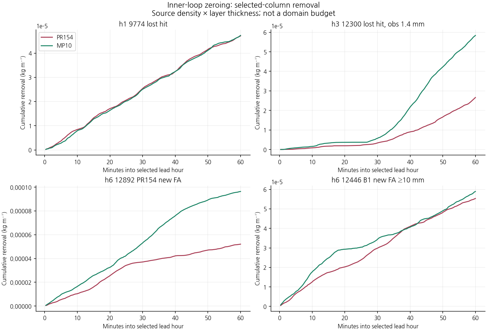
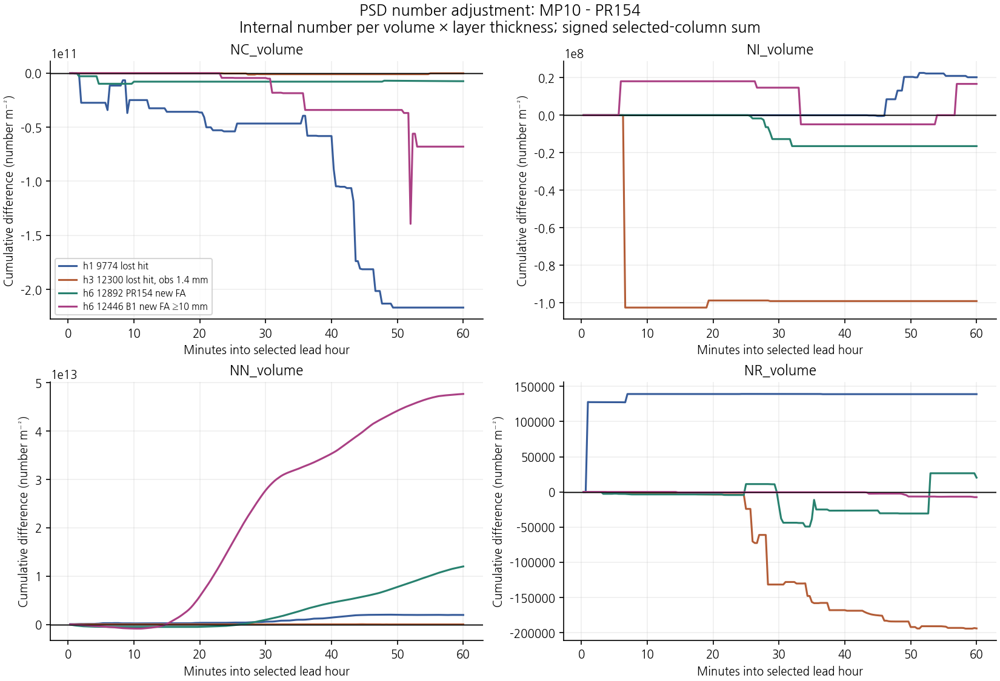
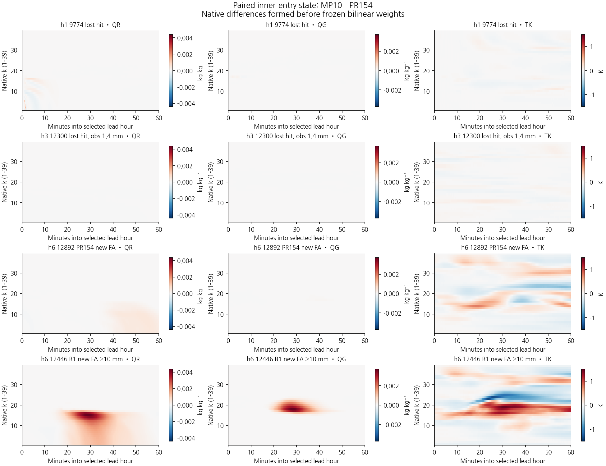
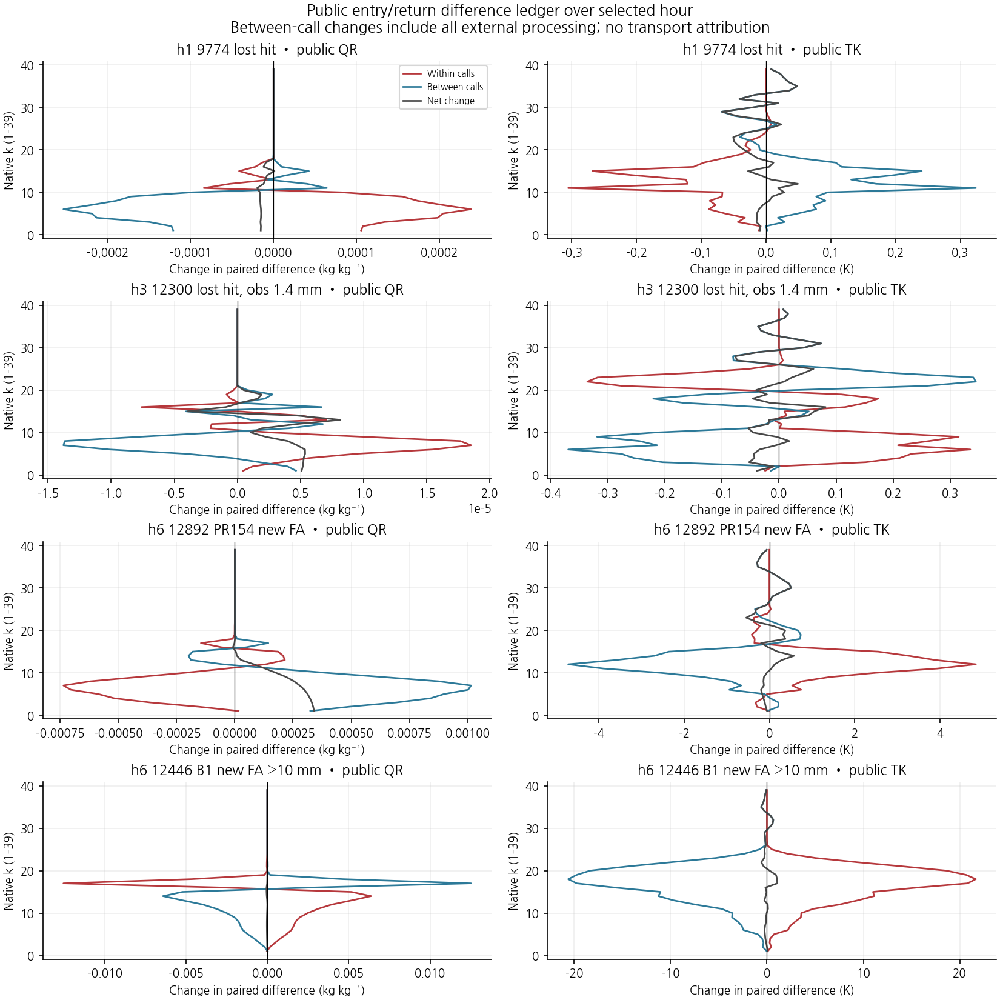
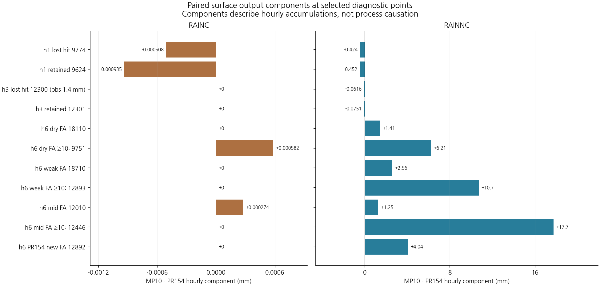
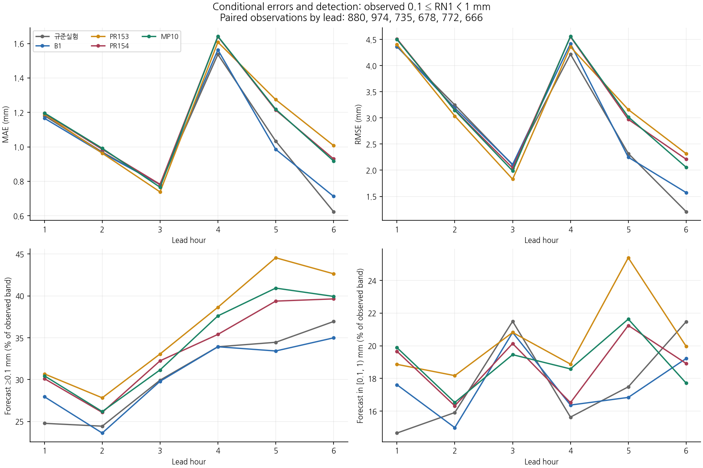

# 미세물리 내부 시간분할에 따른 강수 오경보와 과정 경계의 대응 분석

## 초록

동일한 B1 초기장과 보존 침강·첫 빙정 속도 단위 수정을 유지한 KDM6에서, 외부 20초 시간간격을 내부 20초 한 번(PR154) 또는 10초 두 번(MP10)으로 계산하는 두 구성을 비교하였다. 새로운 물리 후보를 도입하지 않고, 기존 예보를 과정 계측과 함께 6시간 재적분하였다. 각 구성의 초기 및 정시 history 7개씩, 총 14개가 대응하는 기존 예보와 바이트 단위로 일치하였다. 따라서 이번 실험은 기존 MP10 성능의 과정 진단이며 새로운 성능 개선 결과가 아니다. 채택 판정은 MP10 22/26·미채택, 현재 B1 유지이다.

## 1. 연구 목적과 비교 구성

낮은 임계값 CSI의 회복은 실제 약한 관측 강수의 검출·강도 개선과 구분해야 한다. 본 연구는 MP10에서 악화한 +3시간 0.1 mm 검출, +6시간 5 mm 오경보, +1시간 10 mm 적중을 같은 격자·시간의 과정 기록으로 비교한다. 사례 초기시각은 **2026년 8월 16일 12 UTC**이다. +3시간은 14–15 UTC, +6시간은 17–18 UTC의 한 시간 강수량이며 초기시각부터의 누적량이 아니다.

| 표기 | 용도 | 초기화·미세물리 |
|---|---|---|
| 규준실험(저장 배열 키 ORIGINAL) | 후반 낮은 임계값 회복 기준 | 기존 규준 구성 |
| 현재 B1 | 기존 성능 보호 기준·유지 구성 | 기존 B1 |
| PR154 / CONTROL | 이번 대응 진단의 대조 | B1 초기장, 보존 침강·첫 빙정 속도 단위 수정, 내부 20초 한 번 |
| MP10 | 이번 대응 진단의 대상·미채택 | CONTROL과 같고 내부 10초 두 번 |

CONTROL은 현재 B1과 다른 미채택 연구 구성이다. 두 구성 모두 0 과정률 처리, 보존 경계 이동량 및 첫 빙정 속도 단위를 유지한다. 이번에 모델 계산식을 추가로 변경하지 않았다. 지점은 진단을 위한 사후 선정이며 초기화 규칙이나 독립 검증 사례가 아니다.

## 2. 자료와 방법

### 2.1 대상과 관측 범위

기존 여섯 시간·여섯 임계값·3,688개 공통 평가점을 유지하였다. 상세 계측은 실패와 해소 대조, 실제 약한 강도 유지점, 강한 강수 보호 반례를 포함한 **30개 평가점·중복 제거한 111개 WRF 기둥·39층**에 한정하였다. 과정 기록은 외부 단계 1–180, 361–540, 901–1080, 즉 0–1·2–3·5–6시간이며 지상 누적은 전체 0–6시간이다. 계측 집단의 빈도는 전 영역 또는 독립 기상 사례의 빈도가 아니다.

+6시간 B1 대비 신규 5 mm 오경보는 관측 강도와 예측 10 mm 초과 여부로 나누고, 같은 관측 강도 구간의 해소 대조점을 연결하였다. +3시간 0.1 mm의 대표 적중 소실점 **12300(관측 1.4 mm)**과 대조점 **12301(관측 1.8 mm)**은 실제 약한 관측 구간에 속하지 않는다. **9774(관측 35.7 mm)**는 +1시간 강한 적중 소실 반례이다. 상세 선정값은 [선정표](evidence/cp02_mp10_process_20261110/cohorts/selected_points.csv)에 보존하였다.

### 2.2 실제 내부 반복과 연산 정밀도

각 내부 반복의 시작, 반복 말미의 미량 수상량 제거 전후(phase 32→33), 마지막 입도분포·수농도 조정 후(phase 33→34) 상태를 기록하였다. 외부 호출 초기에 수행하는 양수화·수농도 제한(phase 1→2)은 이 말미 조정과 별도이다. 반복 말미와 다음 반복 시작의 원래 REAL32 비트열을 직접 대조한다. 외부 20초 안에서 내부 반복 수가 다르므로 두 구성의 같은 반복 번호를 일대일로 비교하지 않고, 각 구성에서 실제 내부 반복·침강 하위단계를 먼저 합한 뒤 외부 호출 기준으로 차분한다.

한 내부 반복을 침강 \(\mathcal S\), 주 과정·후속 조정 \(\mathcal G\), 최종 구름 응결 \(\mathcal C\), 미량 제거 \(\mathcal Z\), PSD·수농도 조정 \(\mathcal P\)의 합성으로 쓰면

\[
\mathcal F_{\Delta t}=\mathcal P\circ\mathcal Z\circ\mathcal C\circ\mathcal G_{\Delta t}\circ\mathcal S_{\Delta t},
\qquad \mathcal F_{10}\circ\mathcal F_{10}\ne\mathcal F_{20}
\]

가 일반적이다. 특히 \(\mathcal Z\)·\(\mathcal P\)도 두 번 적용되므로 MP10은 연속 과정률만 절반 간격으로 계산하는 실험이 아니다. 과정의 순서와 비선형 문턱 처리를 함께 갖는 전체 계산 순서에 대한 민감도이다.

소스는 내부 반복 전에 열역학 계수 `cpm`, `xl`을 계산하고 반복 중 유지한다. 주 수증기·기온 갱신은 각 중간 연산의 REAL32 반올림을 유지하여 독립 재계산한다. 이것은 계측한 국지 산술의 검증이며 전체 물·에너지 수지의 완결을 뜻하지 않는다.

### 2.3 경계 장부와 단위

후보−대조의 상태 차이를 δ로 두고, 외부 KDM6 진입·반환을 각각 −·+로 쓰면

\[
L_n=\delta x_n^+-\delta x_n^-,\qquad
E_n=\delta x_{n+1}^--\delta x_n^+,
\]
\[
\delta x_N^+-\delta x_1^-=\sum_{n=1}^{N}L_n+\sum_{n=1}^{N-1}E_n.
\]

`E`는 호출 사이의 모든 처리에 따른 순변화이다. 실제 수송 증분·플럭스를 별도로 확보하지 않은 상태에서 이를 수송만의 효과로 부르지 않는다. 계측 시간창 사이의 미관측 구간을 연결해 합산하지 않는다. 온위–온도 변환과 반환 반올림은 공개 KDM6 반환 경계의 내부에 포함된다.

미량 제거의 기둥 진단은 소스의 밀도·층 두께로

\[
R_q=-\sum_{k,\ell}\rho_k\Delta z_k
\sum_{s\in\{c,i,r,s,g\}}(q_{s,k,\ell}^{\rm after}-q_{s,k,\ell}^{\rm before})
\]

를 계산한다. 단위는 kg m⁻²이며 전 영역 물수지가 아닌 **계측 기둥의 소스 밀도 기준 진단량**이다. 내부 수농도는 m⁻³이므로 PSD 조정의 면적당 입자수 변화는

\[
\Delta\mathcal N_s=\sum_{k,\ell}\Delta z_k(n_s^{\rm after}-n_s^{\rm before})
\]

로 계산하며 밀도를 다시 곱하지 않는다. 공개 NR·NI(kg⁻¹)와 내부 수농도(m⁻³)를 합산하지 않는다. 특히 `NN_volume=nci(:,:,3)`는 소스의 `ncact`가 구름방울 활성화에 사용하는 수 저장량이며, 비·눈의 질량이나 눈 입자수로 해석하지 않는다. 마지막 수농도 블록은 이 저장량의 10⁸–2×10¹⁰ m⁻³ 범위 제한도 포함하므로, 아래의 PSD·수농도 조정량은 비 PSD 하나만의 효과가 아니다. 모든 차이는 원래 격자의 값을 REAL64로 승격해 뺀 뒤 보간한다. 누락된 조건부 기록은 결측으로 남기며 0으로 채우지 않는다.

그림의 각 과정 증분은 해당 경계에서만 정의한다. 내부 반복의 끝에서 만든 비가 같은 반복의 앞선 침강으로 이미 지상에 도달했다고 해석하지 않는다. 강수 누적은 실제 조건부 유출과 REAL32 누적기의 전후를 대조하며, REAL64로 합한 과정 증분과 누적기 차분이 항상 비트 동일하다고 가정하지 않는다.

## 3. 결과

### 3.1 내부 반복의 이월과 지상 강수 누적

짧은 20초 실행에서 실제 CONTROL의 1×20초와 MP10의 2×10초를 관측하였다. 전체 6시간 실행에서도 각 내부 반복의 지상 누적 경계와 상태 이월을 검사하였다. 조건부로 실제 실행된 강수 누적은 CONTROL **104,241건**, MP10 **197,897건**이며, 원래 연산 순서의 REAL32 계산과 전후 누적기 비트가 모두 일치하였다. 미실행 분기는 강수량을 관측한 0으로 채워 넣지 않았다. 따라서 첫 10초 강수의 누락이나 외부 20초를 두 번 적용한 오류를 이번 기록의 차이 설명으로 삼을 근거는 없다.

### 3.2 미량 제거의 실제 크기와 수농도 조정

세 시간창 전체에서 CONTROL **2,337,660쌍**, MP10 **4,675,320쌍**의 주 수증기·기온 갱신을 REAL32 비트까지 재현하였다. 내부 반복 사이 18개 관측 필드의 이월과 `cpm`·`xl` 유지도 통과하였다. 반복 말미 미량 제거에서는 수증기와 기온의 직접 변화가 모두 0이었고, 다음 수농도 블록에서도 관측한 질량·기온은 변하지 않았다.

다음은 각 선정 기둥의 해당 한 시간 동안 합한 값이다. 제거 차이는 MP10−PR154이며, 양수는 미량 제거량이 더 크다는 뜻이다.

| 예보시간·지점 | PR154 제거량, kg m⁻² | MP10 제거량, kg m⁻² | 제거량 차이, kg m⁻² | 총강수 차이, mm |
|---|---:|---:|---:|---:|
| +1시간·9774 | 4.71167×10⁻⁵ | 4.73174×10⁻⁵ | +2.00685×10⁻⁷ | −0.424754 |
| +3시간·12300 | 2.66305×10⁻⁵ | 5.83757×10⁻⁵ | +3.17452×10⁻⁵ | −0.061637 |
| +6시간·12892 | 5.20687×10⁻⁵ | 9.63841×10⁻⁵ | +4.43154×10⁻⁵ | +4.039786 |
| +6시간·12446 | 5.53389×10⁻⁵ | 5.89316×10⁻⁵ | +3.59271×10⁻⁶ | +17.742776 |

물 1 kg m⁻²는 강수 1 mm에 해당한다. 위 **같은 시간창의 직접 미량 제거량 차이는 강수 차이보다 매우 작고**, 강수가 감소한 곳과 증가한 곳 모두에서 제거량 차이는 양수이다. 이 직접 제거량만으로 네 지점의 지상 강수 변화를 설명할 수 없다. 다만 비선형 후속 반응을 통한 영향이 없다는 뜻이나 인과 기여율의 상한을 뜻하지는 않는다. [전체 수치](evidence/cp02_mp10_process_20261110/science/results/target_operator_summary.csv)

수농도 변화는 별도로 남는다. 예를 들어 9774의 말미 블록에서 MP10−PR154의 시간합은 구름방울 NC **−2.16841×10¹¹**, 활성화 저장량 NN **+1.95657×10¹²**, 비 NR **+1.38921×10⁵ m⁻²**이다. 질량의 순간 변화가 0이어도 수 모멘트는 후속 활성화·성장·증발·낙하 계산에 영향을 줄 수 있다. 이 합은 같은 입자를 추적한 수가 아니며 반복된 조정량을 더한 값이다. 입자수 변화가 크다는 사실만으로 지상 강수의 원인을 확정하지 않는다.

### 3.3 진입 상태와 호출 내부·호출 사이 변화의 분리

+3시간 소실점 12300은 해당 시간창 첫 진입부터 k=2의 QR 차이가 **−4.3090×10⁻⁶ kg/kg**, 기온 차이가 **+0.03029 K**이다. 따라서 그 한 시간의 말미 제거만을 조사하면 이미 들어온 상태 차이를 놓친다.

아래는 공개 KDM6 경계의 k=2 비 혼합비 장부이다. 모든 값의 단위는 kg/kg이고 후보−대조 차이이다. `순변화`는 마지막 반환 차이에서 첫 진입 차이를 뺀 값이다.

| 시간·지점 | 첫 진입 차이 | 호출 내부 합 L | 호출 사이 합 E | 차이의 순변화 |
|---|---:|---:|---:|---:|
| +1시간·9774 | 0 | +1.07653×10⁻⁴ | −1.22808×10⁻⁴ | −1.51549×10⁻⁵ |
| +3시간·12300 | −4.30898×10⁻⁶ | +1.20057×10⁻⁶ | +3.97542×10⁻⁶ | +5.17599×10⁻⁶ |
| +6시간·12892 | +9.48427×10⁻⁶ | −1.55214×10⁻⁴ | +4.91615×10⁻⁴ | +3.36401×10⁻⁴ |
| +6시간·12446 | +8.53191×10⁻⁶ | +1.69016×10⁻⁴ | −1.71946×10⁻⁴ | −2.93013×10⁻⁶ |

12892는 호출 내부 QR 증분 차이의 합이 음수인데도 지상 강수가 약 4.04 mm 증가한다. 12446은 두 항이 상당 부분 상쇄되어 마지막 상태 차이의 순변화가 작지만 지상 강수는 약 17.74 mm 증가한다. 한 층의 최종 QR나 국지 증분의 부호가 기둥을 통과한 누적 강수의 증감과 같을 필요는 없다. **시간에 따른 공급·변환·침강과 지상 유출을 연결해야 하며**, 호출 사이 순변화를 곧바로 수송으로 명명해서는 안 된다. [k=2 장부](evidence/cp02_mp10_process_20261110/science/results/k2_public_ledger.csv), [39층 전체 장부](evidence/cp02_mp10_process_20261110/analysis/public_ledger.csv)

### 3.4 강수 성분과 강한 강수 반례

9774의 MP10−PR154는 RAINC **−0.000508 mm**, RAINNC **−0.424245 mm**로, 적중 소실에 대응하는 강수 감소는 주로 RAINNC에 나타난다. 12300의 **−0.061637 mm**, 12892의 **+4.039786 mm**, 12446의 **+17.742776 mm**도 이 시간창에서는 RAINNC 차이이다. 따라서 격자규모 강수 과정의 대응 기록을 살필 근거는 있지만, RAINNC 성분만으로 개별 미세물리 과정의 원인을 정할 수는 없다.

## 4. 예보 평가와 기상학적 해석

MP10은 **보호 9/11, 회복 13/15, 전체 22/26**으로 미채택이다. 조건 수는 평균 점수가 아니다. 보호 기준은 현재 B1의 +1시간 여섯 임계값과 각 시간 5 mm CSI, 회복 기준은 규준실험의 +2–+6시간 0.1·0.5·1 mm CSI로 고정한다.

| 미충족 조건 | 기준 | 기준 CSI | MP10 CSI |
|---|---|---:|---:|
| +1시간 ≥10 mm 보호 | 현재 B1 | 0.070423 | 0.062069 |
| +3시간 ≥0.1 mm 회복 | 규준실험 | 0.327637 | 0.317384 |
| +6시간 ≥1 mm 회복 | 규준실험 | 0.348998 | 0.336985 |
| +6시간 ≥5 mm 보호 | 현재 B1 | 0.292683 | 0.253870 |

+6시간 실제 약한 관측 구간(0.1≤RN1<1 mm, 666점)의 검출은 PR154 264→MP10 266으로 늘지만 같은 약한 예측 구간은 126→118로 줄고, 1 mm 이상 예측은 138→148로 늘어난다. 조건부 MAE/RMSE는 PR154보다 작지만 현재 B1보다 크다. 따라서 낮은 문턱 CSI 회복을 약한 강수의 강도 정확도 개선과 동일시하지 않는다. 강수량 오차는 보조 진단이며 채택 기준을 대체하지 않는다.

## 5. 검증 범위와 한계

진단 재적분의 history 동일성은 계측이 대응 예보를 바꾸지 않았다는 근거이다. 지상 성분 추출은 360개 구성·시간·선정점 조합 모두 기존 평가 강수와 비트 단위로 일치하며, 성분을 별도로 보간한 합과 총강수의 차이는 최대 2.84×10⁻¹⁴ mm이다. RAINNC 우세는 격자규모 강수 성분의 연결이며 특정 융해·증발·성장·침강 과정의 인과 기여율을 뜻하지 않는다.

이번 연구는 한 기상 사례의 대응 진단이다. 전 영역 물·에너지·경계 수송 수지, RN1 상류 coverage/QC 확정 및 독립 사례 성능 검증은 미완료이다. 최초의 비영 차이와 지상 강수 반응을 만드는 유효 과정도 구분해야 한다. Graphify 갱신은 유지 소스의 관계·해시를 갱신하는 절차이며 네이티브 실행 또는 과학적 검증의 대체물이 아니다.

## 6. 결론과 후속 검증

MP10의 실제 내부 반복에서 상태 이월·강수 누적의 누락은 확인되지 않았다. 네 대표점에서 말미 미량 제거량의 직접 차이는 지상 강수 차이를 설명하기에 작았으며, 수농도 조정과 진입 상태 차이는 분리해서 추적해야 한다. **이번에 확인한 것은 시간분할 반응의 계산 경계이며 새로운 예보 개선이나 단일 원인의 확정이 아니다.** MP10은 미채택으로 두고 현재 B1을 유지한다.

다음 제한 진단은 12892·12446의 과잉과 12300·9774의 적중 소실을 함께 대상으로 한다. 이미 존재하는 진입 차이가 커지기 시작한 앞선 호출을 찾고, 실제 침강 경계 이동량·지상 유출 및 주 과정 증분을 같은 시간에 연결한다. 수농도 경로는 구름방울 활성화의 `ncact`·`pcact`, 그 입력인 수증기·과포화·NC·NN과 말미 조정 전후를 먼저 확인할 구체적 대상이다. 반복 횟수만의 효과와 달라진 입력 상태의 효과를 구분하기 전에는 새 계수나 전역 문턱값을 선택하지 않는다. 실제 수송은 해당 증분 또는 플럭스가 확보된 뒤 분리하고, 후속 후보는 기존 26개 조건으로 판정한다.

## 7. 자료와 재현 근거

- [실험별·예보시간별·임계값별 전체 점수](evidence/cp02_pulse_path_20261110/evaluation/results/FULL_SCORES.md)
- [관측·예측 강도 전이](evidence/cp02_mp10_process_20261110/cohorts/transitions.csv)
- [실제 약한 관측 구간의 조건부 오차](evidence/cp02_mp10_process_20261110/cohorts/weak_conditional_errors.csv)
- [선정점 RAINC·RAINNC](evidence/cp02_mp10_process_20261110/surface/results/point_components.csv)

- [실제 내부 반복·원시 대조·Intel 실행 근거](evidence/cp02_mp10_process_20261110/native/README.md)
- [실행·이력·압축 자료 비교 증명](evidence/cp02_mp10_process_20261110/native/proof/comparability.json)
- [529개 시험의 새 추출 디렉터리 검증](evidence/cp02_mp10_process_20261110/validation/clean_export.json)
- [전체 그림 바로 보기](evidence/cp02_mp10_process_20261110/FIGURES.md)

원시 유지 기록의 IEEE 비트와 공개 압축 배열을 전량 대조하였고, 공개 배열·CSV·그림은 별도 Git 트리에서 재계산하여 바이트를 대조한다. 전체 외부 원시 스트림의 추출과 WRF 재빌드를 이 재생 절차에서 반복한 것은 아니다. 대용량 원시 기록·history는 해시와 외부 보관 경로를 남겼다. 새 유지 코드의 Graphify 갱신은 다섯 Python 경로의 구조만 추출하며 다른 증거는 해시로 고정한다. 두 저장소의 날짜별 스냅샷과 기존 자료 보존은 별도 검산한다.
