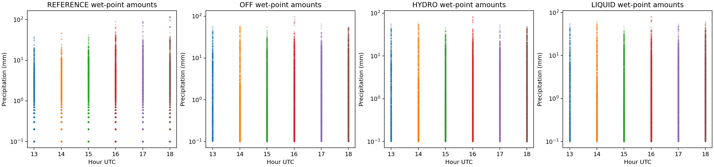
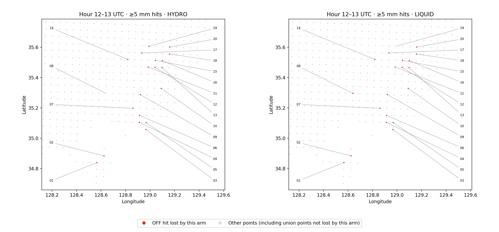
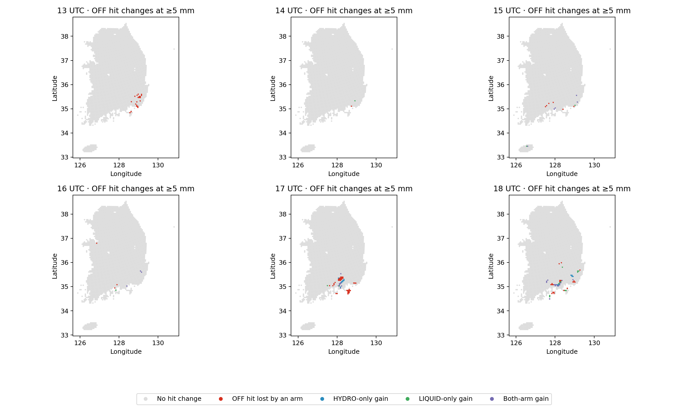
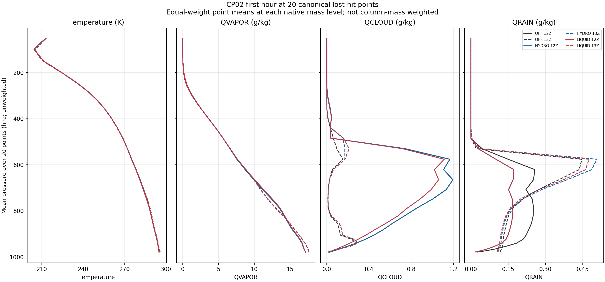

# CP02 첫 시간 강수 적중 소실과 RN1 대표성

2026-08-16 **12 UTC 시작 CP02 OFF/HYDRO/LIQUID**의 보존된 6시간 결과를 추가 분석했다. 첫 시간 ≥5 mm에서 두 후보는 각각 기존 적중 19개를 잃고 새 적중은 얻지 못했다. 소실 지점의 합집합은 동남부 20점이다. 기존 108개 점수와 전국 3,688점 평가 범위를 그대로 유지하고, 이 20점은 원인 추적을 위한 사후 선택 영역으로만 사용한다. 새 예보나 물리 수정은 수행하지 않았다.

최신 C2 H/A/N과는 다른 실험이다. 이 분석은 T39 해결, C2의 1시간 완주 또는 일반적인 예보 개선을 입증하지 않는다. T39 종료·국지 재생은 별도 PR114의 범위다.

## 첫 시간: 강수 지점 수와 강도를 분리

아래 값은 같은 3,688점의 비가중 통계이며 면적 적분 강수량이나 물수지가 아니다. 조건부 평균은 각 자료에서 **≥0.1 mm인 지점만** 사용하므로 자료별 조건부 표본은 다르다.

| 12–13 UTC | RN1 | OFF | HYDRO | LIQUID |
|---|---:|---:|---:|---:|
| 전체 지점 평균, mm | 0.8735 | 0.8832 | 0.8117 | 0.8046 |
| ≥0.1 mm 지점 수 | 1,593 | 696 | 669 | 666 |
| ≥0.1 mm 조건부 평균, mm | 2.0222 | 4.6587 | 4.4531 | 4.4331 |
| ≥10 mm 지점 수 | 59 | 90 | 85 | 85 |
| 최대, mm | 37.6000 | 56.4985 | 55.5355 | 55.2111 |
| RN1 대비 RMSE, mm | — | 4.0623 | 4.1103 | 4.0850 |

OFF의 전체 평균은 RN1과 가깝지만 강수 지점은 적고 조건부 강도는 크다. 후보에서는 강수 지점과 평균량이 함께 감소한다. 이 비교는 강수 범위·강도의 차이를 보여 주지만, RN1 최대값 집계와 모델 보간의 대표성 차이도 포함하므로 모델 물리만의 오류로 확정하지 않는다.



## 동일 위치의 분류 전이

사건은 모든 시간에 동일하게 `강수량 ≥ threshold`로 정의한다. 0.1, 0.5, 1, 2.5, 5, 10 mm의 여섯 임계값을 +1~+6시간에 적용했다. 후보의 적중 수 변화는 `새 적중 − 소실 적중`, 오경보 수 변화는 `새 오경보 − 제거 오경보`와 일치해야 한다.

| 12–13 UTC, ≥5 mm | OFF | HYDRO | LIQUID |
|---|---:|---:|---:|
| 적중 / 미탐지 / 오경보 | 74 / 80 / 115 | 55 / 99 / 103 | 55 / 99 / 99 |
| CSI | 0.2751 | 0.2140 | 0.2174 |
| POD | 0.4805 | 0.3571 | 0.3571 |
| FAR | 0.6085 | 0.6519 | 0.6429 |
| 빈도편향 | 1.2273 | 1.0260 | 1.0000 |
| OFF 대비 새 적중 / 소실 적중 | — | 0 / 19 | 0 / 19 |
| OFF 대비 제거 오경보 / 새 오경보 | — | 13 / 1 | 16 / 0 |

오경보 수가 줄어도 적중이 더 줄면 FAR가 높아질 수 있다. LIQUID의 빈도편향 1은 강수 위치가 맞는다는 뜻이 아니다. 두 후보의 소실 지점 18개가 공통이며 합집합 20점은 34.8394–35.6069°N, 128.5662–129.1609°E에 있다.



[20점의 좌표·원래 인덱스·RN1·세 예측값·분류 CSV](evidence/precip_transitions_20261027/transitions/hour_13_ge5mm_off_hit_lost_union.csv). `flat_index_yx`는 RN1의 253×149 crop에 대한 0-based 평탄 인덱스이며 native WRF 셀 번호가 아니다. 그림은 평가점 위치이며 관측 footprint의 크기를 나타내지 않는다.

후반 결과도 혼합적이다. ≥10 mm에서 +5시간 HYDRO는 적중 20개를 잃고 3개를 얻는다. +6시간 LIQUID는 5개를 잃고 12개를 얻으며 오경보는 순감 4개다. +5시간 HYDRO의 MAE는 2.1482→2.1364 mm로 낮아지지만 RMSE는 5.3715→5.6301 mm로 높아진다. 일부 시간·지표만 선택해 전반적인 개선이라고 판정하지 않는다.



[전체 임계값별 counts·전이 CSV](evidence/precip_transitions_20261027/transitions/threshold_counts_and_transitions.csv) · [시간별 연속형 통계](evidence/precip_transitions_20261027/transitions/continuous_metrics.csv) · [기존 시간별 스코어 표](PRECIP_HOURLY_VERIFICATION_20261027.md)

## RN1의 시간과 공간 대표성

여섯 canonical RN1 파일의 해시·시각·배열은 확인됐다. **점수표에 빈 시간은 없지만, 여섯 시간 모두 같은 시각의 상류 강수 분석을 사용했다는 뜻은 아니다.** 생산 wrapper에 이전 시간 입력 fallback이 있으며, 실제 실행 시각별 입력 receipt와 coverage/QC는 아직 연결되지 않았다. 파일별 판단은 [RN1 감사](CP02_RN1_REPRESENTATIVENESS_20261027.md)에 남긴다.

RN1은 1 km 강수장의 5×5 최대값과 AWS·구름·mask 처리를 거친 분석이다. 모델의 5 km 격자값 bilinear 보간과 동일한 물리적 footprint가 아니다. 이번에는 원래 점수를 변경하거나 5 km 모델에 5×5 최대값을 적용하지 않았다. 후자는 약 25 km 범위를 다루어 원래 관측 연산자를 재현하지 못한다. 원시 1 km 자료의 footprint·QC를 연결하거나 별도 우량계의 누적기간·위치·QC를 맞춘 비교가 필요하다.

육지 밖·coverage 미확인 영역을 0 mm로 채운 공간 점수는 계산하지 않았다. FSS와 강수 객체 검증은 필요한 전 영역 자료와 유효 mask, 사전 지정한 물리적 창 크기를 확보한 뒤 별도로 수행한다. 현재 3,688점과 여섯 시간을 독립 표본으로 취급한 유의성 주장은 하지 않는다.

## 초기 상태부터 첫 물리 호출까지의 연결 범위

[CP02 native 상태 추적](CP02_FIRST_HOUR_TRACE_SCOPE_20261027.md)은 같은 여섯 시간 실험의 실제 저장 상태를 사용한다. C1/PR101 또는 C2의 미세물리 진단을 CP02의 직접 근거로 대체하지 않는다. 12·13 UTC 상태 차이에는 수송·물리·역학이 함께 포함되므로 증발·침강·상변화의 개별 기여로 분해할 수 없다. 첫 미세물리 PRE/POST와 실제 과정량의 부재는 열린 항목으로 유지한다.

실제 여섯 history의 시각·격자·해시를 확인하고, 각 지점의 네 native 모서리와 보간 가중치를 보존했다. 이 연산으로 다시 계산한 20점×3실험의 첫 시간 강수량은 기존 정렬 배열과 **60/60 정확히 일치**한다. 같은 위치에서 39개 층의 온위·압력·수증기·다섯 수상체 상태를 연결한 4,680행을 저장했다. 아래 온도는 실제 저장된 섭동온위와 압력을 이용한 명시적 진단 변환이며, native 온도 연산의 비트 동일 재생은 아니다.



초기 비 혼합비의 arm 차이와 1시간 동안 구름물·비의 연직분포 변화가 보인다. 선은 각 native 층에서 20점을 동일 가중 평균한 것이며 질량 적분이나 물수지가 아니다. **저층 비의 감소, 중층 비의 증가, 구름물 변화 중 어느 과정이 지상 적중 소실을 만들었는지는 이 두 snapshot만으로 결정할 수 없다.** 다음 과정 계측의 위치를 이 표본과 실제 stencil에 고정할 수 있게 된 것이 이번 추적의 성과다.

## 재현과 판정

```bash
python tools/precipitation_transitions.py \
  --input-dir docs/evidence/precip_hourly_20261027/rn1_recovery \
  --output-dir /absolute/new/scratch/precip-transitions
python -m pytest -q tests/test_hourly_precip_scores.py tests/test_precipitation_transitions.py
```

출력 디렉터리는 새 경로여야 한다. 입력 배열·코드·산출물 해시와 실제 검사 범위는 이 보고서와 함께 보존한다. 기존 PR113 배열·CSV·그림은 변경하지 않는다. 현재 판정은 **동남부 적중 소실 위치와 저장 상태의 추적**, RN1 공간·시간 계약의 공백 확인이며, 물리 수정의 효과나 독립 관측 skill 승인이 아니다.
