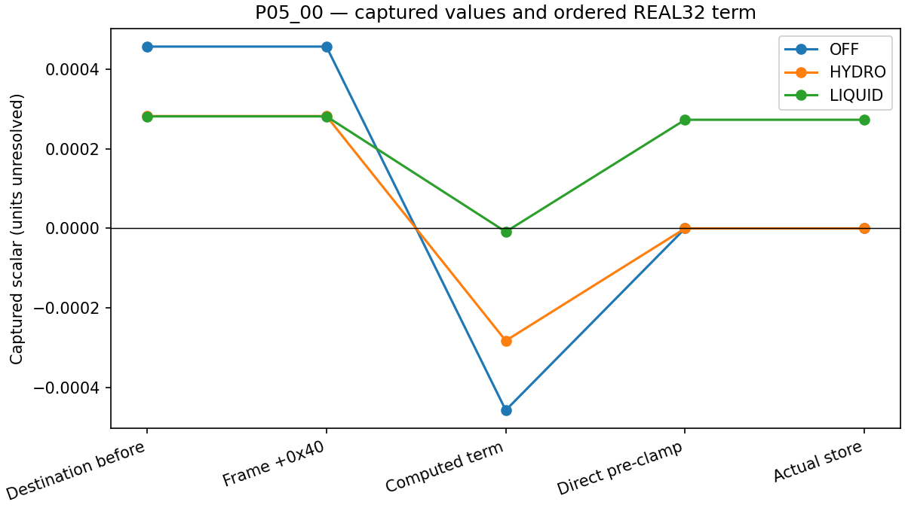
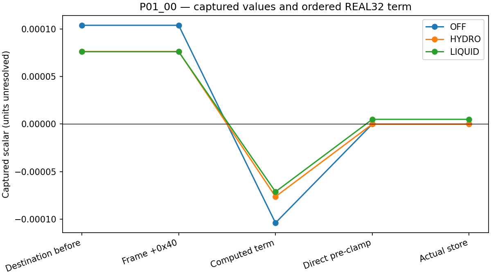

# CP02: 첫 내부 호출의 QR 저장 직전 값

## 범위와 결론

기존 CP02 OFF·HYDRO·LIQUID 첫 KDM62D 내부 호출에서 두 표본 P05_00과 P01_00의 후보 QR 작업 배열(`qrs`) 저장을 조사했다. 새 scratch에서 기존 실행파일과 원래 입력으로 각 arm을 재실행해 첫 호출을 진단했다. 각 arm에서 8개 rank가 기록을 마친 뒤 의도적으로 종료했으며 전체 예보 완주가 아니다. 첫 OFF 시도는 breakpoint 조건에도 Python callback이 실행돼 무효로 분리하고, 주소를 callback에서 검사하도록 수정해 재시도했다. [실패 기록](evidence/cp02_preclamp_20261029/failed_attempt1/README.md) · [캡처](evidence/cp02_preclamp_20261029/captures/) 각 표본은 네 RN1 탐색 지점의 모서리 중 하나이고 독립 관측이나 전체 격자 표본이 아니다. 배열 이름은 인접 보관 소스의 후보 명칭이며 실행파일의 소스 일치나 물리 단위를 확정하지 않는다. [기존 캡처와 범위](CP02_THERMO_RESPONSE_20261029.md)

여섯 사례에서 새 실행 중 clamp 직전 `xmm9`를 직접 읽은 값과 저장된 값은 아래와 같다. 네 명령어 위치에서 대상 주소와 레지스터를 포착했다. 각 arm의 외부 호출 PRE/POST 핵심 값 31,200개는 앞선 캡처와 일치하며 여섯 대상의 이전 저장 전·후 바이트도 일치한다. [분석 요약](evidence/cp02_preclamp_20261029/analysis/summary.json) · [값과 원시 바이트](evidence/cp02_preclamp_20261029/analysis/preclamp.csv)

이전 기록을 독립적으로 재계산한 값도 새 직접 관측과 여섯 사례 모두 바이트 일치한다. 캡처된 저장 전 `qrs`에 `xmm6 × 20`을 REAL32로 반올림해 더하고, 결과를 다시 REAL32로 반올림한 값이다. 여섯 경우 모두 이 곱은 저장 직후 기록된 `xmm2`와 정확히 같고, 0과의 `maxss` 결과는 실제 저장된 원시 값과 일치한다. 이전 자료만으로 한 이 계산은 보존된 레지스터와 명령어를 이용한 **재구성**이며 새 실행에서 직접 읽은 값과 구별한다. [독립 재계산과 원시 파일 해시](evidence/cp02_preclamp_20261029/science/independent_check.json) · [재계산 코드](evidence/cp02_preclamp_20261029/science/independent_check.py)

합산 직전의 `xmm2`, `xmm14`, `xmm9`, `xmm7`, `xmm10`은 여섯 사례 모두 0이고 `xmm15`는 20이다. 실제 명령 순서는 아래와 같으며 **각 덧셈·뺄셈·곱셈마다 REAL32로 반올림**한다. 여기서 레지스터 이름은 `0x25f4e24` 직전 값을 뜻한다.

```text
s = xmm2 + xmm14
s = s + xmm6
s = s + xmm9
s = s + xmm9
s = s - xmm7
s = s - xmm10
Delta = s * xmm15
preclamp = frame[rbx + 0x40] + Delta
stored = max(preclamp, 0)
```

직접 읽은 `frame[rbx + 0x40]`은 해당 시점 QR 대상 주소의 값과 같고, 합산 직전부터 제한 직전까지 유지된다. 따라서 이번 여섯 사례에서 증감값이 `REAL32(xmm6 × 20)`과 같다는 관계는 새로 읽은 모든 합산 항과도 맞는다. 이 구간에서 다른 항이 0이라는 사실을 다른 셀·호출로 일반화하지 않는다. [연산 순서와 검증 구현](../tools/cp02_preclamp_response.py)

| 표본 | OFF: clamp 전 → 저장 | HYDRO: clamp 전 → 저장 | LIQUID: clamp 전 → 저장 |
|---|---:|---:|---:|
| P05_00 | −5.8207661e−11 → 0 | 0 → 0 | 2.7311346e−4 → 2.7311346e−4 |
| P01_00 | 7.2759576e−12 → 7.2759576e−12 | −7.2759576e−12 → 0 | 5.0012022e−6 → 5.0012022e−6 |





P01_00 OFF의 작은 양수는 별도 후속 저장에서 0이 된다. 두 사례의 10⁻¹¹ 수준 부호 차이는 반올림에 민감하므로 물리적으로 의미 있는 음의 물질량으로 해석하지 않는다. LIQUID의 두 양수는 이 저장에서 남지만 다른 시각이나 지상 강수까지의 유지가 입증된 것은 아니다. `xmm6`의 원천이나 소스 수준 과정은 이 결과만으로 특정할 수 없다.

## 분기와 이전 기록 정정

세 arm이 같은 저장 PC에 도달했다는 사실만으로 같은 선행 분기를 입증할 수 없다. `0x25f4ae3`의 `je` 경로와 비영 경로가 `0x25f4dcd`에서 합류한다. 비교 대상 `xmm15`는 합류 직후 `0x25f4dd1`에서 `xmm10`으로 복사되고 저장까지 유지된다. 여섯 저장 이벤트에서 `xmm10`의 낮은 REAL32 lane이 모두 0이다. 이 레지스터 증거와 명령어를 함께 보면 여섯 사례에서 순서 있는 영 비교에 따른 `je`를 지지한다. 저장 시점의 `xmm15`는 이후 덮어쓴 20이므로 비교 당시 값으로 쓰지 않는다. [정정된 명령어 분석](evidence/cp02_thermo_response_20261029/binary/arm_qrs_branch_comparison.md)

선택된 성공 기록 12개에서 후보 `lat` 위치인 인자 32의 원시 슬롯은 `0x27`이며 null인 슬롯은 39–44다. `0x27`은 유효 포인터로 검증되지 않았고 역참조하지 않았다. j는 Q 슬라이스와 바깥 Q 기반 주소의 차이 및 행 간격으로 산출했다. 더 넓은 null 목록은 실패한 두 번째 진단 시도의 기록이다. 이전 설명 두 곳을 정정하기 전에 원본을 보존했다. 기존 378개 항목 manifest는 수정하지 않았다. 나머지 376개 항목은 기록된 해시와 일치하며, 정정한 두 경로의 당시 해시와 보존 원본 및 현재 해시를 [별도 대조표](evidence/cp02_preclamp_20261029/prior_versions/reconciliation.json)에 연결했다.

## 검증과 재현

추적 파일만 별도 디렉터리에 내보낸 집중 시험은 **182개 통과**(기존 172개 + 신규 10개, 46.82초)다. 기본 CLI 인자 경로도 실제 보관 캡처로 확인했다. 영수증 필드 누락, rank/PID와 파일명의 불일치, raw register·frame·주소 변조, 이벤트 누락·순서 오류와 기존 출력 보존을 검사한다. [시험 결과](evidence/cp02_preclamp_20261029/validation/clean_tests.txt) · [실행 범위](evidence/cp02_preclamp_20261029/validation/clean_export.json)

같은 별도 checkout에서 분석 요약·CSV·그림 2개·manifest 및 독립 재계산 JSON, 총 **6개 산출물을 바이트 동일하게 재생성**했다. [재생성 기록](evidence/cp02_preclamp_20261029/validation/reproduction.json) 과거 50·28·108·184개 증거 항목은 그대로 검증했다. PR127의 378개 항목 중 두 문서는 명시적으로 보존 원본을 대조하고 나머지 376개는 현재 경로에서 확인했다. [과거 증거 대조](evidence/cp02_preclamp_20261029/validation/historical_evidence.json)

실행은 pinned Intel 환경과 기존 실행파일을 사용했으며 Fortran 재빌드·전체 portable suite·새 완주 예보는 수행하지 않았다. 팀 검토와 별도로 날짜를 붙인 KLAPS50·Cloud-BAL Graphify/KG 기록은 [최종 증거 목록](evidence/cp02_preclamp_20261029/validation.json)에 연결한다. 그래프 갱신은 실행·과학 검증을 대신하지 않는다.

## 해석의 한계

선택적 `refl_10cm`은 이전 캡처와 진입·반환 각각 OFF 2개, HYDRO 4개, LIQUID 4개에서 다르며 핵심 25개 필드의 동일성과 구분한다. 다른 세 선택적 배열은 비교한 바이트가 같다. 전체 영역·적분의 비간섭 검증은 아니다.

이 결과는 한 호출 내부의 특정 저장과 제한된 여섯 사례를 설명한다. 원래 컴파일 소스의 정확한 동일성, 과정별 물·에너지 수지, 동일 시점 건조공기 질량, 지상 강수 변화의 원인 및 예보 개선은 입증하지 않는다. 기존 RN1 전체 3,688점·6시간 강수 검증이나 완주 예보를 대체하지 않는다.
