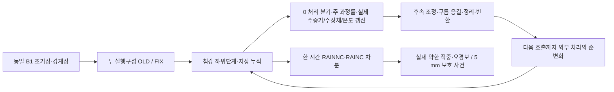
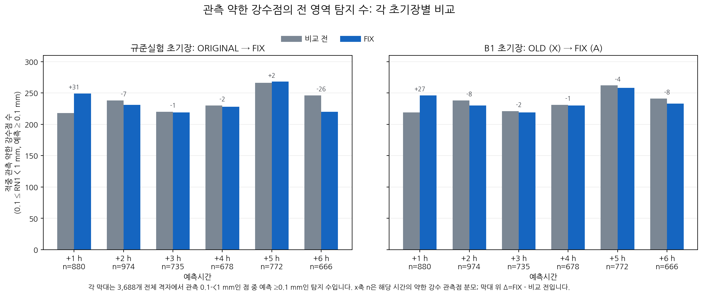
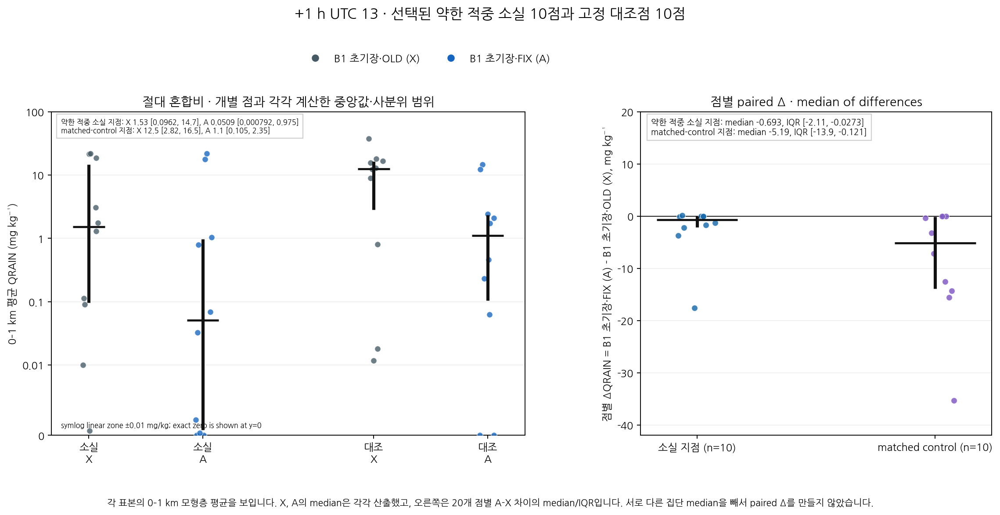
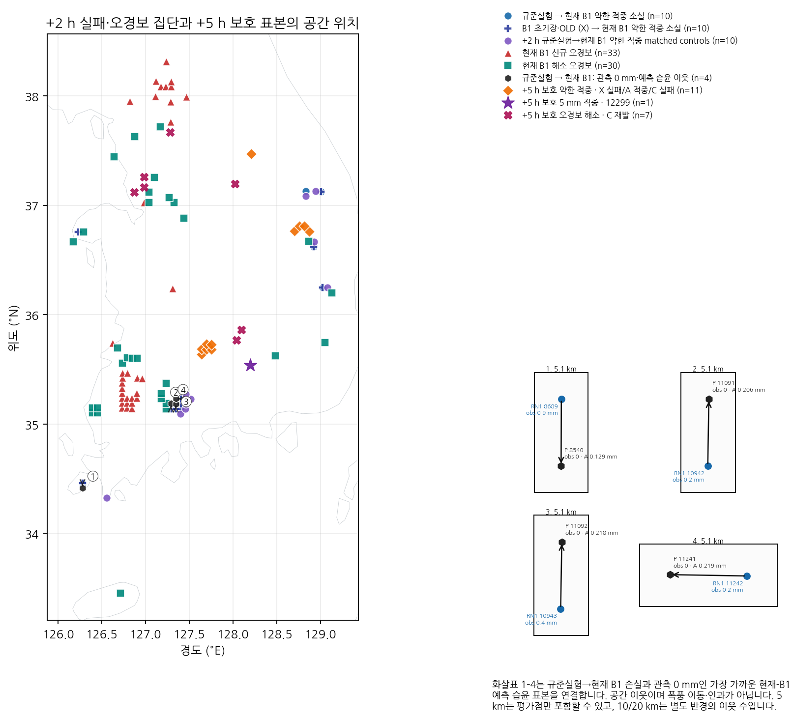
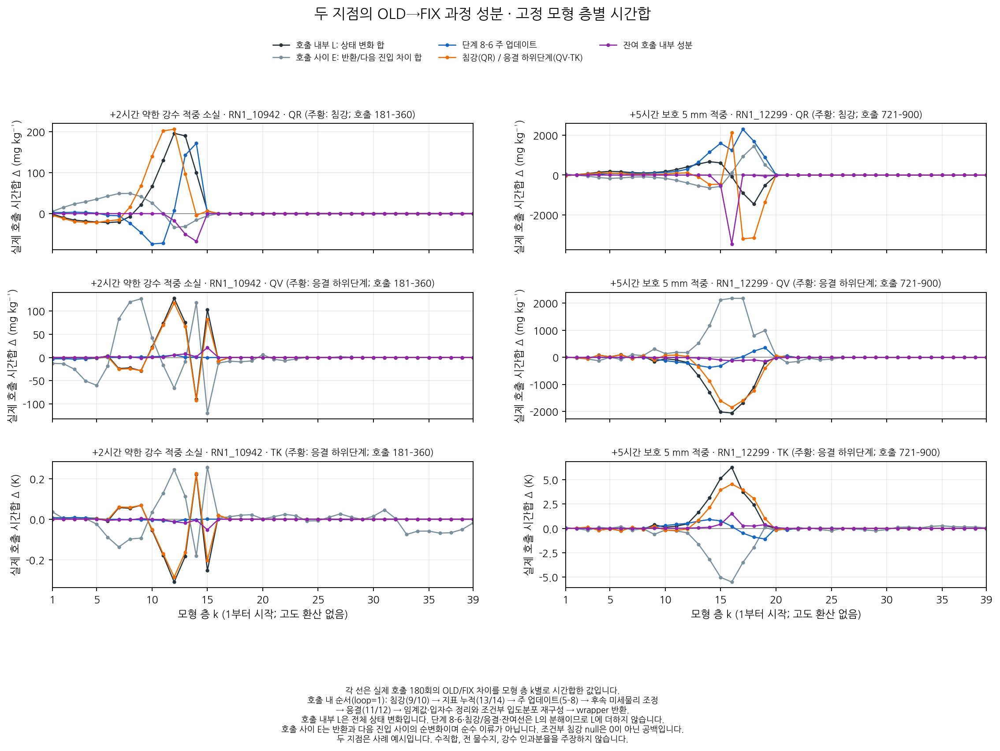

# 동일 B1 초기장의 시간별 강수 검출과 보호 성과의 과정 진단

## 초록

동일 B1 초기장에서 KDM6의 정확한 0 과정률 처리를 달리한 OLD/FIX를 5시간 재적분하여, +2시간 약한 강수 적중 소실과 +5시간 보호 성과를 함께 조사하였다. 150개 평가점에 대응하는 381개 원래 격자·39층에서 0–2시간과 4–5시간의 실제 과정 증분을 기록하고 지상 누적은 5시간 전체를 연결하였다. 두 구성의 정시 history 12개는 각각 기존 예보와 바이트 단위로 같았다. 첫 외부 KDM6 호출의 입력은 같고 반환 비·수증기·온도는 달라졌으나 지상 누적의 구성 간 차이는 두 번째 호출부터 나타났다. P01의 OLD 전환 190건에서 주 갱신의 실제 수증기·온도 증분은 0이었다. 한편 P01은 둘째 시간 지상 강수를 잃으면서도 제12층의 비 혼합비는 더 많이 남았고, 보호 지점의 온도 차이에는 호출 내부와 호출 사이 변화의 큰 상쇄가 있었다. 이는 단순 사건 수, 한 층의 비 감소, 한 과정률만으로 성능 변화를 설명하기 어렵다는 직접 근거다. 새 후보나 성능 개선을 주장하지 않으며 현재 B1과 기존 26개 판정 조건을 유지한다.

**핵심어:** 강수예측, 약한 강수 검출, 임계성공지수, 미세물리, 침강, 과정 증분

## 1. 서론

현재 B1은 첫 시간 및 일부 강한 강수 조건에서 규준실험보다 높은 CSI를 보이나 +2시간 이후 낮은 임계값 회복 목표는 미완료다. PH 차분별 합산 후보 C·D는 미채택 상태다. 본 연구는 현재 B1의 정확한 0 과정률 처리 수정(FIX)을 유지하면서, 동일 초기장의 OLD/FIX 반응이 실패와 성공을 만드는 경로를 함께 조사한다. 사후 관측 집단은 진단을 위한 선택이며 초기화 규칙에 사용하지 않는다.

## 2. 자료 및 방법

### 2.1 실험 축과 시간 정의

초기 시각은 2026년 8월 16일 12 UTC다. +2시간 강수는 13–14 UTC의 한 시간 구간량이며 초기부터 두 시간 누적량이 아니다. 규준실험 ORIGINAL과 현재 B1 A의 비교는 초기화와 실행파일이 함께 다르므로, 같은 B1 초기장의 X(OLD)와 A(FIX)를 별도로 비교한다. ORIGINAL 초기장에서도 OLD/FIX 점 자료를 대조한다.

| 초기장 | OLD | FIX | 비교 의미 |
|---|---|---|---|
| ORIGINAL | 규준실험 ORIGINAL | FIXED_ORIGINAL_100 | 같은 규준 초기장의 실행파일 반응 |
| B1 | X=ORIGINAL_B1_100 | A=현재 B1 | 같은 B1 초기장의 실행파일 반응 |

C는 A와 같은 초기장·FIX에 PH 차분별 합산만 적용한 미채택 구성이다. C가 잃은 사건 중 현재 A가 OLD 대비 확보한 성공 집단을 보호 대조로 사용한다. 새 후보의 성능 실험으로 세지 않는다.

### 2.2 사건·대조 집단

실제 약한 관측 강수는 $0.1\le RN1<1$ mm, 검출 조건은 예측 강수 $\ge0.1$ mm다. 5 mm 보호 사건은 관측·예측 각각 $\ge5$ mm로 정의한다. 집단은 전체 3,688개 공통 평가점에서 동일하게 계산한다.

| 진단 역할 | 지점 수 | 해석 |
|---|---:|---|
| +2시간 ORIGINAL→A 약한 적중 소실 | 10 | 기존 보고서의 OA 소실 집단 |
| +2시간 X→A 약한 적중 소실 | 10 | 동일 B1 초기장의 XA 소실 집단 |
| 두 소실 집단의 교집합 | 9 | OA만 17524, XA만 16138 |
| OA 소실에 대응한 적중 유지 | 10 | 관측 구간·거리 기준의 기존 대조군 |
| +2시간 X→A 신규·해소 오경보 | 33 / 30 | 전체 동일 초기장 반응 |
| +2시간 ORIGINAL→A 신규·해소 오경보 | 53 / 24 | 기존 사후 선택 집단 |
| +5시간 C 소실 17곳 중 X 미검출→A 적중 | 11 | 현재 FIX가 확보한 약한 적중의 보호 집단 |
| +5시간 관측 5 mm, ID 12299 | 1 | 현재 FIX가 확보한 5 mm 적중 |
| +5시간 C 신규 5 mm 오경보 12곳 중 X 오경보→A 해소 | 7 | 현재 FIX의 과잉 강수 해소 보호 집단 |

OA와 XA의 10곳을 서로 같은 집단으로 취급하지 않는다. 32/53은 ORIGINAL→A 신규 오경보 53곳 중 X에서 문턱 미만이던 조건부 수치다. 전체 X→A의 신규·해소 오경보 33/30과 구분한다. 인접 예측 강수 지점 중 RN1=0인 네 곳도 누락 지점과 함께 과정 계측에 포함한다.

### 2.3 점수 및 절대 비 혼합비

각 예보시간·임계값의 정수 사건 수로 $CSI=H/(H+M+F)$를 계산한다. 서로 다른 시간·임계값의 CSI를 평균하지 않는다. 기존 B1 보호 11개와 ORIGINAL 수준 회복 15개는 그대로 유지한다. 진단용 OLD와 C는 새 채택 후보가 아니다.

하층 QRAIN은 원래 모서리마다 지상 0–1 km에 속한 모형층을 산술평균한 뒤 기존 공간 가중치를 적용한다. 이는 질량 평균이나 기둥 수분량이 아니다. X의 원래 양, A의 남은 양, 같은 지점의 A−X 차이를 각각 보존한다. 일반적으로 $\mathrm{median}(A-X)\ne\mathrm{median}(A)-\mathrm{median}(X)$다.

### 2.4 실제 상태 증분과 과정률의 구분

과정률의 크기와 기록된 상태 변화는 같은 양이 아니다. $\mathrm f_{32}$를 REAL32 반올림이라 하면, 주 과정 갱신의 수증기 증분은

$$
\Delta q_v^{\rm main}
=\mathrm f_{32}\!\left(q_v+\mathrm f_{32}(w_2\Delta t)\right)-q_v
$$

이다. $w_2\Delta t$가 0이 아니어도 더해지는 상태의 단정도 해상도보다 작으면 실제 증분은 0일 수 있다. $w_2$는 여러 수증기 과정률을 합한 항이므로 QR 과정률 합과 구분한다. PREVP·PRAUT·PRACW의 시간 적분은 각 원래 격자에서 REAL32 곱셈을 수행한 뒤 보간하여 별도 보존하며, 이를 실제 순증분이나 강수 변화의 인과 기여율로 대신하지 않는다.

같은 주 갱신에서 온도는 $T^+=\mathrm f_{32}[T^- -\mathrm f_{32}((\mathcal H/c_{pm})\Delta t)]$로 기록된다. $\mathcal H$는 포착한 잠열 관련 합산 항이다. 후반 구름 응결 하위단계는 수증기·구름물·온도를 함께 바꾸지만 이후 임계값 정리·입도분포 재구성과 온위 반환이 남는다. 이 경계를 전체 미세물리 반환과 동일시하지 않는다.

도식은 같은 호출에서 계측한 순서를 요약한다. 반환 후 만들어진 비를 그 호출 앞부분의 침강이 이미 지상으로 보냈다고 해석하지 않는다. 지상 RAINNC에는 비 외의 고체 수종 침강도 포함될 수 있으므로 QR 한 층의 변화와 동일시하지 않는다.

### 2.5 제한 과정 재적분과 상태 장부

두 구성은 각각 MPI 8개 rank, OpenMP 1개 thread, 시간간격 20초로 900단계를 정상 완료하였다. 지정 Intel 프로파일에서 두 계측 모듈을 새 scratch 디렉터리에 빌드하였고, 각 구성의 기존 물리식은 그대로 두었다. +0·+1·+2·+3·+4·+5시간의 history 6개씩은 각 기준 예보와 파일 해시까지 같았다.

상세 기록은 외부 KDM6의 실제 `itimestep` 1–360 및 721–900의 540단계다. 선별된 내부 행 기록의 식별자를 전체 내부 함수의 호출 순번으로 해석하지 않는다. 각 구성에서 격자·층·호출 조합 8,023,860개를 진입·반환과 내부 경계에 연결하였다. 지상 누적은 1–900단계의 342,900개 격자·호출 기록을 별도로 보존하였다. 이 개수는 독립 관측 사례 수가 아니다. 중간 361–720단계의 상세 상태·과정은 없으며 그 구간의 미세물리 기여를 보간하지 않는다.

수증기·온도 주 갱신, 응결 하위단계, 수증기 과정률 합 및 비 갱신의 REAL32 연산은 포착값과 대조한다. 원시 수상체 배열의 성분 번호를 결과 이름에 유지하고 중복 이름을 거부하여, 비·눈·싸락눈 성분을 혼동하지 않는다. 지상 누적과 정시 RAINNC는 5개 종점·381개 격자·두 구성에서 비트 단위로 같았으며, 평가점의 시간별 RAINNC+RAINC 1,500개는 기존 점수 배열과 최대 $5.8\times10^{-15}$ mm 이내로 일치하였다.

두 구성의 같은 변수 차이를 $\delta x_n^-=x_{A,n}^- -x_{X,n}^-$, $\delta x_n^+=x_{A,n}^+ -x_{X,n}^+$로 두면

$$
L_n=\delta x_n^+-\delta x_n^-,\qquad
E_n=\delta x_{n+1}^- -\delta x_n^+.
$$

연속 관측 구간에서는

$$
\delta x_b^+-\delta x_a^-=\sum_{n=a}^{b}L_n+\sum_{n=a}^{b-1}E_n.
$$

$L_n$은 같은 미세물리 호출의 증분 차이이며 $E_n$은 다음 호출까지 모든 외부 처리의 순변화 차이다. 실제 수송 증분이나 플럭스가 없는 항을 순수 수송으로 부르지 않는다. 기록하지 않은 시간 구간을 건너뛰어 인접 호출로 연결하거나 0으로 채우지 않는다. 국지 장부가 닫혀도 전 영역 물·에너지 수지가 닫힌 것은 아니다.

각 시간창의 장부는 첫 호출 진입부터 마지막 호출 반환까지를 기준으로 한다. 정시 history의 상태 차분과 동일한 기록 경계가 아니며, 별도로 정의한 시간창의 합에 창 사이 호출 간 항이 자동으로 포함되는 것도 아니다.

## 3. 결과

### 3.1 두 초기장에서 재현되는 시간별 반응

| 초기장 | +1시간 실제 약한 강수 검출 OLD→FIX | +2시간 OLD→FIX |
|---|---:|---:|
| ORIGINAL | 218→249 (+31) | 238→231 (−7) |
| B1 | 219→246 (+27) | 238→230 (−8) |

시간·임계값별 전체 점수는 [부속 표](evidence/cp02_protected_process_20261106/tables/FULL_SCORES.md)에 OLD와 FIX의 H/M/F·CSI를 나란히 제시한다. 이는 기존 6시간 예보 자료의 평가이며, 아래 제한 과정 재적분의 기간과 구분한다.

같은 사례에서 두 초기장 모두 첫 시간 검출이 늘고 둘째 시간에는 줄었다. B1의 +2시간 전체 반응은 약한 적중 획득 2·소실 10, 신규 오경보 33·해소 30이다. 초기 수상체 분포만으로 모든 반응을 설명하기 어렵지만, 이 점수 대조만으로 특정 미세물리 과정에 원인을 귀속하지 않는다.

### 3.2 보호할 +5시간 성공과 전체 변화의 구분

C가 잃은 약한 적중 17곳 중 11곳은 X에서는 미검출이었고 A에서 적중했다. 그러나 +5시간 전체 실제 약한 강수 검출은 X 262→A 258로 줄었다. 11곳은 전체 개선의 증거가 아니라 전체 변화 안의 조건부 성공 집단이다.

관측 5 mm인 12299는 X 2.1621→A 5.1092→C 4.8839 mm다. 또한 C의 신규 5 mm 오경보 12곳 중 7곳은 X에서 오경보였으나 A에서 해소됐다가 C에서 재발했다. 따라서 +2시간 약한 적중을 회복하는 후속 수정은 이 성공 집단도 보호해야 한다.

### 3.3 감소량과 잔존량을 함께 본 하층 비

| 다음 시간의 OA 집단 | X QRAIN 중앙값, mg/kg | A QRAIN 중앙값, mg/kg | 지점별 A−X 중앙값, mg/kg |
|---|---:|---:|---:|
| 적중 소실 10곳 | 1.529214 | 0.050878 | −0.692740 |
| 대응 적중 유지 10곳 | 12.516974 | 1.098743 | −5.192486 |

유지 집단은 더 많이 감소해도 원래 양과 남은 양이 더 크다. A의 잔존량 중앙값은 소실 집단보다 약 21.6배다. 감소 부호·절대 감소량만으로 실패를 구분할 수 없으며, 남은 비의 생성·제거·침강 및 지상 도달을 함께 확인해야 한다. 이 표는 공급 부족이나 증발 과다의 인과 판정이 아니다.

### 3.4 누락과 인접 오경보

OA 소실 10곳의 최근접 A≥0.1 mm 지점 중 네 곳은 RN1=0이다: 8689→8540, 10942→11091, 10943→11092, 11242→11241. 10942의 이웃 11091은 약 5.095 km 떨어져 있고 A는 0.2058 mm를 예측한다. 이 대응은 물리 반응을 비교할 위치를 정하는 진단이며 강수계 이동 궤적이 아니다.

기존 공간 표의 5 km 반경 1,620행은 모두 질의점 하나만 포함한다. 약 5.1 km의 최근접 결과는 전체 평가점 검색이며 5 km 반경 이웃의 결과가 아니다. 실제 주변점 통계는 10·20 km 반경과 구분해 제시한다.

### 3.5 같은 호출 기준의 실패·보호 과정 비교

**첫 반응과 지상 강수의 시간 순서.** 첫 외부 KDM6 호출의 공개 입력 16필드는 두 구성에서 비트 단위로 같았다. 선택된 14,859개 격자·층 중 반환 QR은 2,428개, QV는 2,461개, TK는 2,247개에서 달라졌다. 이때 선택된 381개 격자의 지상 누적은 같았다. 두 구성 모두 첫 호출부터 지상 누적의 증가가 있었으며, 구성 간 누적 차이가 처음 나타난 것은 두 번째 외부 호출이다. 이는 침강·지상 누적 이후에 수행되는 과정률 갱신의 반환 차이를 같은 호출의 선행 유출로 해석할 수 없음을 보여준다. 중간 단계의 값은 원래 호출의 누적 기록이며 매 단계의 별도 history가 아니다.

**P01의 사건 수와 실제 상태.** RN1_10942의 OLD에서는 명목 과정률 0이 음의 제한 후 값으로 바뀐 모서리·층 사건이 첫 시간 143건, 둘째 시간 47건이었다. 190건 모두 같은 주 갱신의 실제 QV·T 변화는 0이었다. 명목 PREVP 시간 항의 최대 절댓값은 각각 $4.35\times10^{-12}$, $7.38\times10^{-12}$ kg/kg였다. 따라서 이 지점의 전환 건수 자체를 유의한 국지 수증기 공급·냉각으로 해석하지 않는다.

**같은 창의 상태 장부.** 다음은 FIX−OLD 차이에 대한 시간합이며, 수직합을 하지 않았다. 마지막 열은 최종 상태 차이 자체가 아니라 **창 처음부터 끝까지 상태 차이가 변한 양**이다.

| 지점·창·모형층 | 변수·단위 | 호출 내부 합 $\sum L$ | 호출 사이 합 $\sum E$ | 상태 차이의 변화 $\Delta\delta x$ |
|---|---|---:|---:|---:|
| P01 · +2시간 · k=12 | QR, mg/kg | +195.7592 | −33.8633 | +161.8959 |
| P01 · +2시간 · k=9 | QV, mg/kg | −28.5646 | +126.4168 | +97.8523 |
| 12299 · +5시간 · k=16 | TK, K | +6.2662 | −5.5098 | +0.7564 |

P01 k=12의 호출 내부 QR 차이는 주 갱신 +7.1068, 침강 순증분 +205.6472, 나머지 내부 구간 −16.9948 mg/kg로 분해된다. 침강 순증분은 해당 층의 상하 유입·유출과 제한 처리가 반영된 상태 변화이며 지상 유출량 자체가 아니다. 나머지 내부 구간에는 별도로 분리하지 않은 상변화·조정·정리 등이 포함되므로 단순 반올림 오차로 부르지 않는다.

12299 k=16에서는 호출 내부 온도 차이의 합 중 응결 하위단계가 +4.5527 K였으나 호출 사이 변화가 큰 반대 방향으로 작용했다. 실제 온도는 OLD 275.4078→274.5032 K, FIX 275.0175→274.8693 K였다. 따라서 +6.2662 K를 이 층의 실제 순가열량으로 해석할 수 없다.

### 3.6 지상 도달과 층별 비 잔존량의 구분

P01의 둘째 시간 RAINNC는 OLD **0.333770→FIX 0.080582 mm**로 감소하여 RN1 기준량 0.2 mm의 적중을 잃었다. 그러나 같은 창의 마지막 미세물리 반환에서 제12층 QR은 OLD **45.5362→FIX 207.4314 mg/kg**였다. 해당 층에 비가 더 남는 것과 지상 한 시간 강수의 감소가 동시에 나타난다. 이를 기둥 전체 물의 증감이나 증발 하나의 효과로 해석하지 않는다.

다음 한 시간의 지상량은 OLD 0.082762→FIX 0.148093 mm로 늘었지만, +2∼+3시간 두 구간의 합은 OLD 0.416532, FIX 0.228675 mm였다. 따라서 이번 차이를 단순한 한 시간 지연만으로 설명할 수도 없다. +3시간의 상세 내부 과정은 이번 기록 범위 밖이다.

보호 지점 12299의 +5시간은 관측 기준량 5 mm에 대해 OLD **2.1621→FIX 5.1092 mm**로 적중을 확보했다. 이 지점·구간과 P01의 둘째 시간에서 RAINC 증분은 0이므로 위 두 강수 비교는 RAINNC에 연결된다. 다른 지점·시각까지 대류성 강수가 없다고 일반화하지 않는다. 전체 집단의 39층별 분위수와 실제 점별 장부는 부속 CSV에 보존하였다.

## 4. 고찰

수학적으로 과정률의 시간 적분, 기록된 상태의 실제 증분, 상태 차이의 변화, 지상 한 시간 강수는 서로 다른 양이다. 특히 호출 내부 합과 호출 사이 합이 상쇄되므로 최종 상태 차이만으로 큰 내부 반응을 배제할 수 없다. 시간합 장부가 닫힌다는 사실도 전 영역의 물·에너지 보존을 증명하지 않는다. 두 적분에서 이미 달라진 진입 상태에 대한 증분 차이이므로, 각 항을 수정 분기의 독립적인 직접 인과 기여량으로 해석하지 않는다.

기상학적으로 비의 지상 도달은 각 층의 생성·제거뿐 아니라 수직 분포와 낙하, 그 사이 갱신되는 환경의 영향을 함께 받는다. P01은 관측 구간의 지상 강수를 잃었지만 선택층 QR은 증가하였다. 이는 균일한 비 증량이나 증발률 감소를 바로 처방하기보다 **해당 층부터 하부·지상까지 실제 침강 경로와 입자수 상태, 이후 시간의 강수 분포를 함께 확인해야 한다**는 근거다. 현재 자료만으로 순수 이류, 한 상변화 또는 낙하속도 하나를 원인으로 확정하지 않는다.

현재 FIX는 둘째 시간의 손실과 함께 다섯째 시간 일부 지점의 적중·과잉 강수 해소도 만든다. 따라서 올바르게 수정한 0 과정률 분기를 전체 되돌리는 것은 이 진단에서 도출되는 개선안이 아니다. 관측 구간·사후 사건 집단은 진단에만 사용하며 초기화 규칙에 넣지 않는다. 다음 수정은 실제 플럭스·입자수·소스 조건으로 확인된 한 가지 가정에 한정해야 한다.

## 5. 결론 및 한계

동일 초기장의 실제 5시간 대조에서 실패와 보호 성과를 같은 호출 기준으로 연결하였다. 첫 입력의 동일성, 첫 반환의 상태 차이, 다음 호출부터의 지상 누적 차이, P01의 미량 사건에서 주 갱신의 실제 무변화, 보호 지점의 내부·외부 상쇄가 함께 확인됐다. P01의 선택층 비 잔존량 증가와 지상 강수 감소의 공존은 다음 분석을 층별 침강·도달 시각·입자수 사용 조건으로 좁힌다.

본 연구는 기존 두 예보의 과정 진단이다. 새로운 초기화 후보나 +2시간 이후 약한 강수 성능 개선을 추가하지 않았다. 후속 후보는 현재 B1의 +1시간 여섯 임계값과 각 시간의 5 mm CSI를 보호하고, 규준실험 대비 +2∼+6시간의 0.1·0.5·1 mm 조건을 각각 회복하는 기존 26개 기준으로 평가한다. 실제 약한 관측 구간의 적중 획득·소실과 오경보 생성·해소도 함께 제시한다.

현재 B1 유지와 C·D 미채택 판정은 유지한다. 같은 처리 변경의 지역·시간별 반응을 설명하기 전에 0 과정률 수정의 단순 복귀나 전역 입경·습도 문턱·증발계수 조정을 채택하지 않는다. 단일 사례·사후 집단의 진단이다. RN1 상류 시각·coverage·QC, 독립 사례 검증, 실제 시점의 건조공기 질량 및 전체 물·에너지 수지, 별도 C2 T39/H/A/N 완료는 여전히 미완료다.

## 부록: 검증 요약 기록의 정정

강수 요약 최대 잔차는 각 구성·시각 270점을 처리한 뒤 현재 집단에서만 계산하도록 고쳤다. 직접 점수 대조가 없는 X는 `null`을 기록한다. 새 회귀시험과 24개 집계의 독립 재계산이 통과했고, 물리 자료 CSV 다섯 개는 이전 파일과 바이트 단위로 동일하다. 이 정정에는 WRF 재적분이나 history 재추출이 필요하지 않았다. 본문의 제한 과정 재적분은 별도의 새로운 원인 진단이다. 기존 잘못된 영수증·이전 소스는 보존하고 정정본을 연결한다.

## 재현 자료

- [예보시간·임계값별 전체 H/M/F·CSI 표](evidence/cp02_protected_process_20261106/tables/FULL_SCORES.md)
- [그림 모음: 페이지에서 바로 보기](evidence/cp02_protected_process_20261106/FIGURES.md)
- [그림 묶음](evidence/cp02_protected_process_20261106/all_figures.zip)
- [고정 분석 계획](evidence/cp02_protected_process_20261106/analysis_plan.json)
- [실패·보호 집단의 원래 격자 연결](evidence/cp02_protected_process_20261106/cohorts/receipt.json)

## 근거 자료

- [기존 실패 집단과 상태 문맥](CP02_B1_FAILURE_FOCUS_20261105.md)
- [합산식 후보의 6시간 미채택 평가](CP02_GROUPED_FORECAST_20261105.md)
- [실제 OLD/FIX 실행·history 동일성](evidence/cp02_protected_process_20261106/native/provenance/full_run/full_run_receipt.json)
- [점별·모형층별 과정 장부](evidence/cp02_protected_process_20261106/native/analysis/summary/summary_receipt.json)
- [지상 성분과 기존 점수 배열의 대조](evidence/cp02_protected_process_20261106/science/surface/validated/surface_reconciliation_receipt.json)
