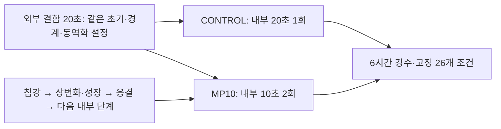
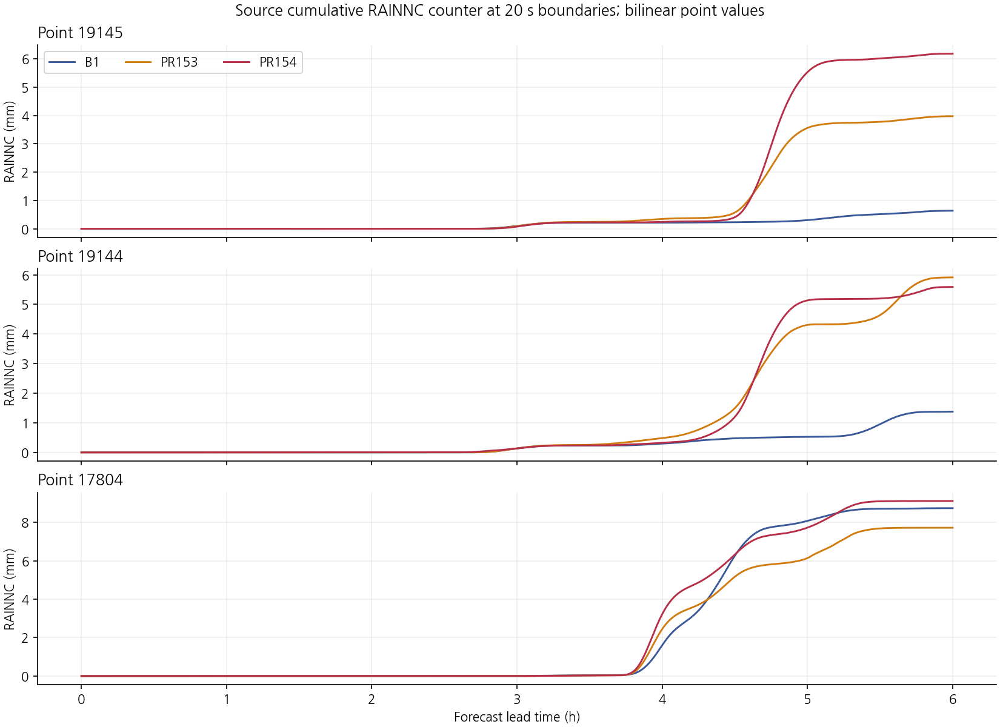
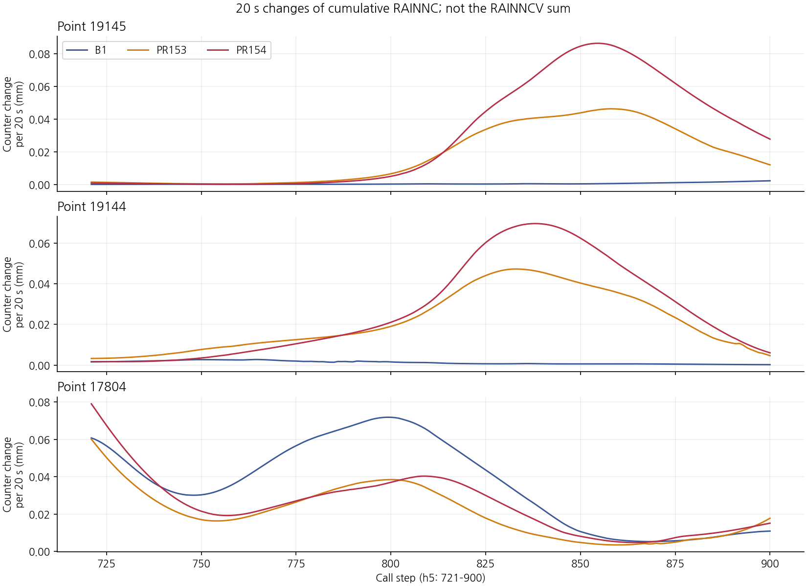
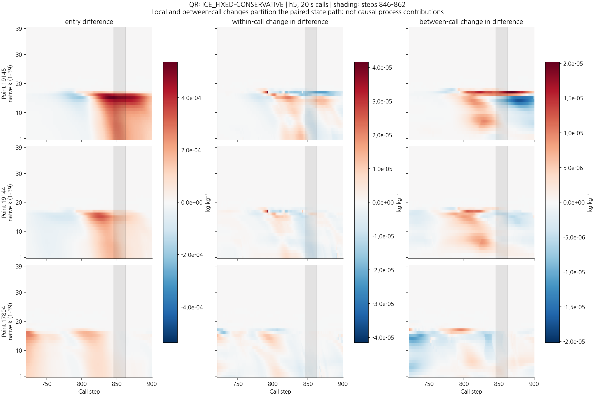
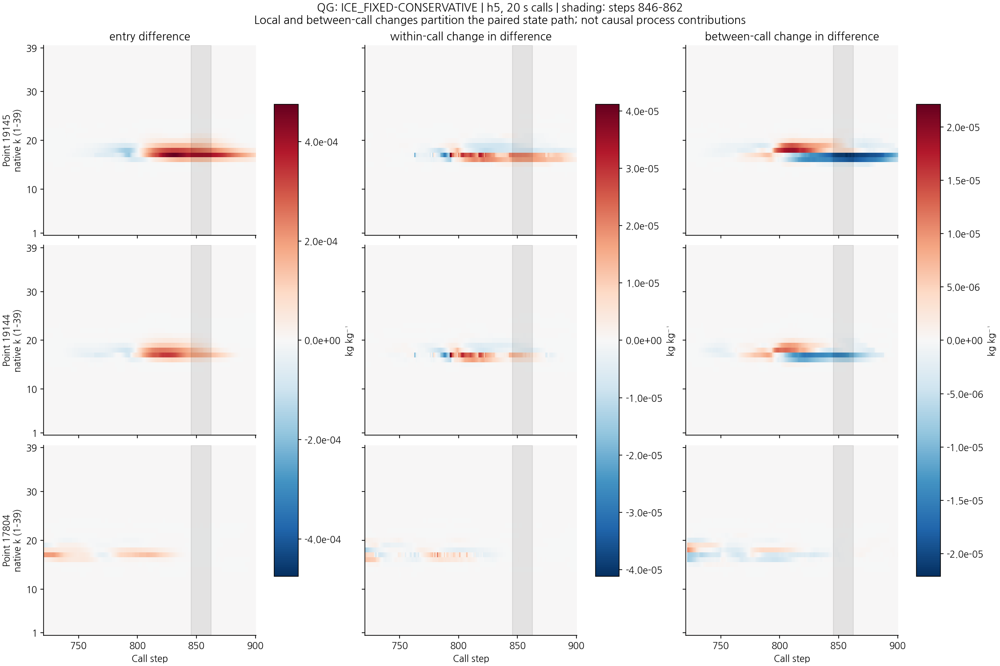
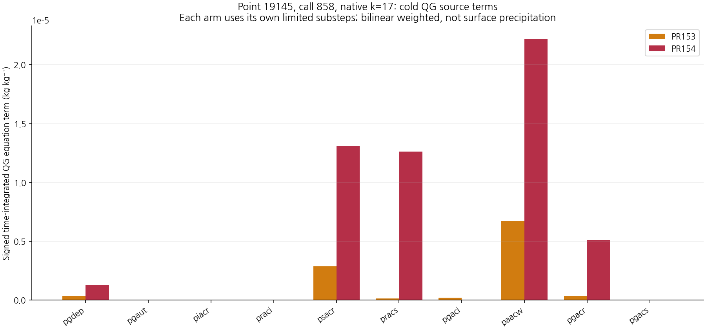
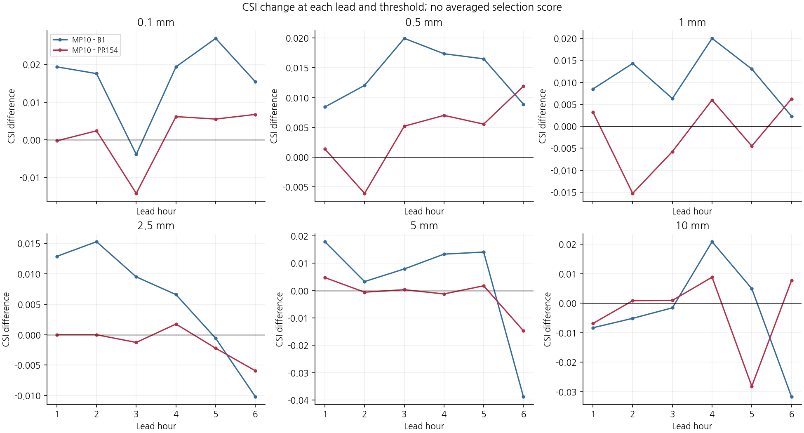
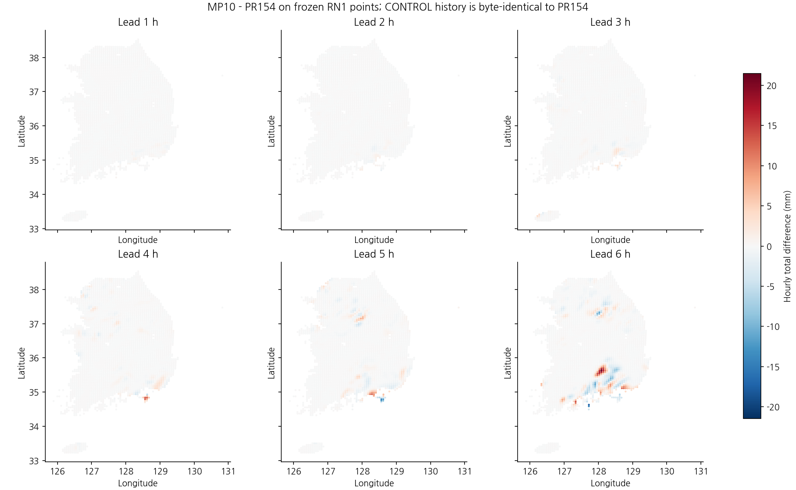

# 강수 급증의 과정 분해와 미세물리 내부 시간분할의 6시간 대조 실험

## 초록

낮은 임계값의 오경보를 줄이면서 기존 강수 검출 성능을 보호하기 위해, 대표점 19145의 선행 강수 급증과 인접 해소 대조 19144 및 시간 분포가 다른 17804를 분석하였다. 같은 B1 초기장의 B1·보존 침강 PR153·첫 빙정 단위 수정 PR154의 기존 20초 기록을 대응시켰다. 19145의 PR154 최대 5분 RAINNC는 16:42:20–16:47:20 UTC의 1.270700 mm였다. 급증 전부터 비·싸락눈 진입 상태가 달랐으며, 실제 경계 이동량과 국지 싸락눈 성장 항을 연결하였다. 이 차이는 국지 생성 오류나 단일 계수의 인과 기여율을 뜻하지 않는다. 다음 가설로 보존식·단위·물리 계수를 유지한 내부 시간분할 민감도를 선택하였다. 외부 20초 결합은 유지하고 내부 계산을 한 번의 20초에서 두 번의 10초로 나눈 구성과 재빌드 대조를 각각 6시간 적분하여 기존 B1 보호 11개·규준실험 회복 15개 조건으로 판정하였다. MP10은 22/26으로 두 회복 조건을 새로 충족했으나 한 조건을 잃고 강한 강수 보호에도 실패하여 미채택했다. 현재 B1을 유지한다.

**핵심어:** 약한 강수, 오경보, 싸락눈 성장, 침강 경계량, 수치 시간분할, CSI

## 1. 서론

PR154는 +2–+5시간의 낮은 세 임계값을 회복했으나 +6시간의 오경보와 +1시간 10 mm 보호 실패가 남아 21/26으로 미채택이다. 현재 유지 구성은 B1이며 규준실험은 ORIGINAL이다. PR156에서 낮은 임계값 실패를 포함한 21개 평가점·77개 WRF 기둥의 대응 기록을 확보했다. 본 연구는 그중 강수 급증의 시간·수직·연산 경계를 좁히고, 임의의 입경·충돌·증발 계수 조정에 앞서 한 가지 수치 민감도 가설을 검증한다.

기존 과정 기록의 세 구성과 새로운 시간분할 후보를 구분한다. 기존 PR154 기록에서 찾은 과정 차이를 새 후보의 실행 중 과정으로 대신 해석하지 않는다.

| 구성 | 초기장 | 침강·빙정 처리 | 소스 스케줄로 계산한 내부 단계 | 역할 |
|---|---|---|---|---|
| ORIGINAL | 규준 초기장 | 기존 처리 | 기존 | 규준실험, 회복 판정 기준 |
| B1 | B1 | 기존 침강·0 과정률 수정 | 20초 | 현재 유지, 보호 판정 기준 |
| PR153 | B1 | 공유 경계 보존 침강 | 20초 | 기존 과정 대조 |
| PR154 / CONTROL | B1 | 보존 침강·첫 빙정 속도 단위 수정 | 20초 | 시간분할의 대응 대조 |
| MP10 | B1 | PR154와 같음 | 10초 × 2 | 새 수치 민감도 후보 |

## 2. 자료 및 방법

### 2.1 사례와 시간창

초기시각은 **2026년 8월 16일 12 UTC**, 적분 끝은 18 UTC다. +5시간 강수는 16–17 UTC, +6시간 강수는 17–18 UTC의 한 시간 강수이며 초기부터의 누적과 구분한다. 평가 대상은 기존 RN1 공통 3,688점이며 같은 가중치·관측·여섯 문턱을 유지한다.

세 대표점의 기존 상세 기록은 단계 721–1080, 즉 16–18 UTC에 있다. 지상 누적은 초기부터 모든 20초 경계에 존재한다. 단계 경계 $a$와 $b$의 5분 강수는

$$P_{a\to b}=R_{NC}(b)-R_{NC}(a),\qquad b-a=15$$

로 정의한다. 포함되는 갱신은 $a+1,\ldots,b$의 **15회**다. `rainncv`의 20초 증분 합과 저장 누적값의 차분은 REAL32 누적 반올림 때문에 소량 다를 수 있으므로 별도 양으로 다룬다. 본문의 5분 값은 누적 RAINNC 차분이다. RAINNC는 격자규모 강수 성분이며 RN1 총강수와 동일한 정의가 아니다.

### 2.2 같은 지점의 상태·과정 대조

PR153−B1과 PR154−PR153을 각각 계산하였다. 원래 모서리의 REAL32 값을 REAL64로 확장한 뒤 차이를 계산하고 쌍선형 가중치를 적용한다. native k=1–39는 모형층 번호이며 고도나 층합 물 질량으로 바꾸지 않는다.

호출 $n$의 진입·반환 차이를 $\delta x_n^-,\delta x_n^+$로 두면

$$L_n=\delta x_n^+-\delta x_n^-,\qquad E_n=\delta x_{n+1}^--\delta x_n^+$$

이다. $L$은 호출 내부 증분 차이, $E$는 호출 사이의 전체 순변화 차이이며 수송만의 항이 아니다. 연속 창에서

$$\delta x_N^+-\delta x_1^-=\sum_nL_n+\sum_{n=1}^{N-1}E_n$$

를 확인한다. 최종 반환 차이와 그 창 동안 차이가 변한 양을 구분한다. 과정 경계 합은 부분 진단으로 남기고 미확보를 0으로 채우지 않는다.

원시 확인은 세 점의 중복 제거한 **10개 기둥**, 단계 831·839와 844–862의 **21개 단계**에 한정했다. 원시 inventory를 추출 전후 확인하고, 모서리의 Fortran 1기준 좌표와 양의 보간 가중치를 대조하였다. 구성별 침강 하위단계 수가 다를 수 있으므로 각 구성 안의 실제 하위단계를 먼저 합친다. 서로 다른 구성의 같은 하위단계 번호를 물리적으로 같은 시간으로 간주하지 않는다.

### 2.3 경계 이동량과 국지 성장식

보존 침강의 질량은 source 운반량 기준 $M_k=\rho_k^{src}\Delta z_kq_k$이며 공유 이동량 $T_k$는 상층 차감과 하층 증가에 같이 쓰인다.

$$M_k^{post}-M_k^{pre}=-T_k+T_{k+1}$$

실제 REAL64 경계량으로 국지 상태 변화를 계산하고 REAL32 저장값과 대조한다. 내부 입자수는 수농도, 공개 입자수는 공기 질량당 수로 구분하며 질량 항에 더하지 않는다.

차가운 분기의 싸락눈 증분은 캡처된 제한 후 과정률에 소스의 선택 계수 $\delta_2,\delta_3$를 적용해 재계산했다. 예를 들어 비–눈 교환의 싸락눈 항은

$$[p_{sacr}(1-\delta_2)+p_{racs}(1-\delta_2)]\Delta t_{mp}$$

이다. 국지의 명목 과정률 합과 실제 `max(...,0)` 및 REAL32 갱신 결과를 따로 확인한다. 특정 층·호출의 항 분해를 지상 강수 변화의 인과 비중으로 환산하지 않는다.

### 2.4 검증할 시간분할 가설

관측된 급증 전부터 입력 상태가 달랐고 주 상태 갱신의 총 수분 차이는 단정도 반올림 규모였다. 따라서 특정 충돌률을 오류로 판정하거나 계수를 바로 낮추지 않았다. **침강 → 후속 상변화 → 주 성장·증발 갱신 → 최종 응결의 순차 계산이 내부 시간간격에 민감한가**를 한 가지 가설로 정했다.

실제 소스 변경은 PR154 부모의 `dtcldcr=120.`을 `10.`으로 바꾸는 한 문장이다. 기존 외부 `delt=20`에서는

$$N_{mp}=\max(\mathrm{nint}(delt/dtcldcr),1),\qquad\Delta t_{mp}=delt/N_{mp}$$

이므로 CONTROL은 1×20초, MP10은 2×10초다. 물리 계수, 초기 입자수, 공유 경계 보존식과 첫 빙정 단위 변환은 유지한다. 이는 **전체 미세물리 순차 적분의 민감도 실험**이며 특정 과정의 결함 수정이나 동역학 시간간격 수렴 시험이 아니다.

소스에서 수상체·온도는 내부 단계 사이에 이어지고 지상 누적의 초기화는 내부 루프 밖에 있다. 한편 `cpm`과 `xl`은 루프 전에 계산되어 두 내부 단계에서 고정되며 압력·밀도·층 두께도 외부 결합 상태를 따른다. 따라서 두 내부 단계는 두 번의 독립적인 공개 KDM6 호출과 같지 않다.

지정 Intel IFX 프로파일과 새 외부 scratch를 사용해 두 구성을 빌드했다. 소스에서 추출한 스케줄의 컴파일 시험은 1×20초와 2×10초, 각각 20초 합을 확인한다. 이 시험은 전체 KDM6 호출의 상태·누적 이월 시험이 아니다. 예보 실행파일에 해당 지역 변수의 DWARF 정보가 없어 실제 내부 루프의 시간·이월을 별도로 직접 관측하지 못했으며 이 항목은 미완료로 남긴다. 실제 6시간 적분·대조 재현·강수 평가와 이 관측 공백을 구분한다.

### 2.5 채택 기준

[사전 고정한 실험 정책](evidence/cp02_pulse_path_20261110/experiment_policy.json)을 사용한다. **B1의 +1시간 여섯 문턱과 각 시간 5 mm CSI 보호 11개**, **ORIGINAL 대비 +2–+6시간 0.1·0.5·1 mm 회복 15개**를 유지한다. 동일 조건의 중복은 한 번 세어 합계 26개다.

$$CSI=\frac{H}{H+M+F}$$

의 정확한 분수 비교로 모두 충족할 때만 사례 내 적격 후보로 판정한다. 시간·문턱 평균이나 강우량 오차로 선택 기준을 바꾸지 않는다. 실제 약한 관측 $0.1\le RN1<1$ mm의 적중 획득·소실, 같은 약한 강도 유지와 신규·해소 오경보를 보조 진단으로 제시한다. 단일 사례 통과도 전체 물·에너지 수지와 독립 기상 사례 검증을 대신하지 않는다.

## 3. 기존 기록에서 확인한 강수 급증 경로

### 3.1 19145의 급증과 두 대조의 시간 분포

19145의 +5·+6시간 강수는 B1 0.421596 mm, PR153 3.629172 mm, PR154 5.937113 mm다. 두 시간의 관측 RN1은 모두 0이다. PR154의 최대 5분 RAINNC는 **단계 847→862, 16:42:20–16:47:20 UTC, 1.2706998 mm**다. 같은 창의 PR153은 0.6781501 mm이며 PR154−PR153은 0.5925497 mm다. 차이가 최대인 별도 창은 **845→860, 16:41:40–16:46:40 UTC, +0.5965816 mm**다.

19144의 PR154 자체 최대 창은 830→845로 더 이르다. PR153→PR154에서 이 점의 +6시간 강수는 1.606469→0.454294 mm로 줄지만, +5시간은 3.820885→4.809459 mm로 커진다. 두 시간 합은 5.427355→5.263753 mm여서 문턱 해소를 강수량 오차 해결로 해석하지 않는다. 17804는 PR154의 +6시간 강수가 늘어도 두 시간 합은 B1보다 작다. 같은 강수량 증감 조정으로 세 반응을 일괄 설명할 근거는 없다.

### 3.2 급증 전에 들어온 상태와 실제 경계 이동량

19145의 PR154−PR153 진입 QR 차이는 단계 842·k15에서 약 **+5.36734×10⁻⁴ kg/kg**, 진입 QG 차이는 더 이른 단계 831·k17에서 약 **+4.75008×10⁻⁴ kg/kg**였다. 5분 지상 창이 최초 차이 발생 구간은 아니다.

같은 지점 k16의 경계 이동량에서 계산한 운반량 정규화 기여는 다음과 같다. 원래 REAL64 경계량은 kg/m²다. 이를 각 구성·하위단계·모서리의 $\rho^{src}\Delta z$로 나눈 뒤 공간 가중하고 시간 합산한 표의 단위는 kg/kg이다. 원시 경계 질량, 지상 강수 mm 및 층합 질량과 구분한다.

| 단계·수종·경계 | PR153 | PR154 |
|---|---:|---:|
| 831 QG 상부 경계 유입 | 6.20142×10⁻⁵ | 1.22122×10⁻⁴ |
| 831 QG 하부 경계 유출 | 3.01799×10⁻⁵ | 4.66690×10⁻⁵ |
| 839 QR 상부 경계 유입 | 4.36308×10⁻⁶ | 2.12579×10⁻⁵ |
| 839 QR 하부 경계 유출 | 7.77550×10⁻⁵ | 1.51015×10⁻⁴ |

기록된 전후 상태에서 QG 침강 증분 차이는 831·k16에서 **+4.36189×10⁻⁵ kg/kg**, QR 침강 증분 차이는 839·k16에서 **−5.63655×10⁻⁵ kg/kg**다. 각 구성의 REAL64 공유 이동량으로 재구성한 국지 상태 변화와 REAL32 저장값의 최대 차이는 약 4.70×10⁻¹¹ kg/kg였다. 더 많은 유입·더 많은 하부 유출을 실제 경계량으로 구분한 결과이며, 이것만으로 비의 전 기둥 경로나 지상 강수의 원인 비율을 확정하지 않는다.

### 3.3 단계 858·k17의 국지 싸락눈 성장

19145의 주 갱신 직전 QG는 PR153 약 1.47242×10⁻⁴, PR154 약 5.25549×10⁻⁴ kg/kg다. 이미 **+3.78307×10⁻⁴ kg/kg** 차이가 들어온 상태에서 실제 QG 증가량은 각각 1.06025×10⁻⁵, 5.43898×10⁻⁵ kg/kg였다. 증가량 차이는 **+4.37874×10⁻⁵ kg/kg**다.

| 캡처된 소스 식의 항 | PR154−PR153 적분 차이, kg/kg |
|---|---:|
| `paacw` | +1.54819×10⁻⁵ |
| `pracs×(1−delta2)` | +1.24890×10⁻⁵ |
| `psacr×(1−delta2)` | +1.02738×10⁻⁵ |
| `pgacr` | +4.79595×10⁻⁶ |
| `pgdep` | +9.3971×10⁻⁷ |
| `pgaci` | −1.9333×10⁻⁷ |

그 밖의 항을 포함한 명목 합은 실제 QG 증분 차이와 약 3.4×10⁻¹² kg/kg 이내로 일치한다. 소스상 구름물 포착, 비–눈 교환의 싸락눈 전환, 비 포착 및 침적 등이 함께 관여한다. 선행 상태가 달라 충돌·성장률도 달라진 결과이며 각 항을 첫 빙정 수정의 독립적인 인과 기여율로 해석하지 않는다. 같은 갱신의 수증기와 다섯 응결 수종을 합한 실제 차이는 반올림 규모였다. 국지의 큰 QG 증분을 물의 순생성 오류로 확정할 근거는 없다.

## 4. 내부 10초 후보의 6시간 평가

MP10은 보호 **9/11**, 회복 **13/15**, 합계 **22/26으로 미채택**이다. PR154는 9/11·12/15·21/26이다. 현재 B1 유지 판단은 바꾸지 않는다. 두 구성 모두 6시간을 정상 완료했고 재빌드 CONTROL의 정시 history 7개는 기존 PR154와 바이트 동일하며 MP10의 초기 history도 같다.

PR154가 미달하던 **+6시간 0.1·0.5 mm를 새로 회복**했지만, 통과하던 **+3시간 0.1 mm를 잃었다**. 21→22는 이 순변화이며 모든 항목이 함께 좋아진 결과가 아니다. 보호 실패는 +1시간 10 mm와 +6시간 5 mm로 유지됐다.

### 4.1 시간·임계값별 CSI 변화

다음은 **MP10 CSI − PR154 CSI**다. 각 한 시간·문턱의 차이를 따로 제시하며 평균값으로 순위를 정하지 않는다. 모든 다섯 구성의 정수 H/M/F·CSI는 [전체 180행 점수표](evidence/cp02_pulse_path_20261110/evaluation/results/FULL_SCORES.md)에 제공한다.

| 예보시간 | 0.1 mm | 0.5 mm | 1 mm | 2.5 mm | 5 mm | 10 mm |
|---|---:|---:|---:|---:|---:|---:|
| +1시간 | -0.000266 | +0.001360 | +0.003224 | +0.000000 | +0.004767 | -0.006897 |
| +2시간 | +0.002388 | -0.006105 | -0.015268 | +0.000000 | -0.000569 | +0.000830 |
| +3시간 | -0.014216 | +0.005189 | -0.005756 | -0.001266 | +0.000338 | +0.000928 |
| +4시간 | +0.006159 | +0.007004 | +0.005966 | +0.001758 | -0.001210 | +0.008798 |
| +5시간 | +0.005511 | +0.005533 | -0.004498 | -0.002216 | +0.001761 | -0.028202 |
| +6시간 | +0.006737 | +0.011899 | +0.006240 | -0.005925 | -0.014692 | +0.007652 |

### 4.2 남은 네 조건은 강수 발생·강도 오류를 함께 포함함

| 미달 조건 | 공식 기준 | H 기준→MP10 | F 기준→MP10 | CSI 기준→MP10 |
|---|---|---:|---:|---:|
| +1시간 ≥10 mm | B1 | 10→9 | 83→86 | 0.070423→0.062069 |
| +3시간 ≥0.1 mm | 규준실험 | 786→796 | 817→926 | 0.327637→0.317384 |
| +6시간 ≥1 mm | 규준실험 | 505→523 | 479→584 | 0.348998→0.336985 |
| +6시간 ≥5 mm | B1 | 168→164 | 226→298 | 0.292683→0.253870 |

+6시간 5 mm를 PR154와 비교해도 적중은 **170→164**, 오경보는 **285→298**로 악화했다. +6시간 0.1·0.5 mm의 회복을 강한 강수 보호까지 해결한 결과로 확대할 수 없다.

### 4.3 실제 약한 강수의 검출과 같은 강도 구간

관측 $0.1\le RN1<1$ mm에서 검출은 예측 ≥0.1 mm, 같은 강도 구간은 예측도 0.1–1 mm 미만인 경우다.

| 예보시간 | PR154 검출 | MP10 검출 | PR154 같은 약한 강도 | MP10 같은 약한 강도 |
|---|---:|---:|---:|---:|
| +1시간 | 265 | 268 | 173 | 175 |
| +2시간 | 254 | 255 | 159 | 161 |
| +3시간 | 237 | 229 | 148 | 143 |
| +4시간 | 240 | 255 | 112 | 126 |
| +5시간 | 304 | 316 | 164 | 167 |
| +6시간 | 264 | 266 | 126 | 118 |

+6시간의 검출은 264→266으로 늘어도 같은 약한 강도 예측은 **126→118**로 줄었다. 따라서 검출 증가를 강도까지 적절해진 개선으로 부르지 않는다. +3시간에는 검출과 같은 약한 강도 예측이 모두 감소했다.

### 4.4 대표점의 한 시간 반응과 해석 범위

단위는 mm이며 세 점의 두 시간 관측은 모두 0이다.

| 지점 | +5시간 PR154→MP10 | +6시간 PR154→MP10 | 두 시간 합 PR154→MP10 |
|---|---:|---:|---:|
| 19145 | 5.286994→3.221540 | 0.650119→0.752233 | 5.937113→3.973773 |
| 19144 | 4.809459→3.484518 | 0.454294→0.956710 | 5.263753→4.441229 |
| 17804 | 4.499583→4.795506 | 1.385960→3.497618 | 5.885543→8.293123 |

19145는 +5시간 과잉과 두 시간 합이 줄어도 +6시간 0.5 mm 오경보는 남는다. 인접 19144는 두 시간 합이 줄어도 +6시간 0.5 mm 오경보가 재발했다. 17804는 두 시간 합도 증가했다. 같은 수치 변경의 반응이 장소·시간별로 갈린다.

**새 MP10은 표준 정시 history로 평가했다.** 기존 PR154의 5분 급증이 MP10에서 어떻게 바뀌었는지 직접 관측하지 않았으며, 한 시간 감소를 특정 5분 펄스나 싸락눈 항 하나의 변화로 설명할 수 없다.

각 시간의 관측과 다섯 예보 분포는 [전체 그림 모음](evidence/cp02_pulse_path_20261110/FIGURES.md)에 같은 색상 구간으로 제공한다.

## 5. 고찰

보존식과 빙정 속도 단위 수정을 되돌리지 않고도, 선행 상태·수직 경계 이동·국지 성장·지상 누적을 나누어 읽을 수 있었다. 19145에서는 지상 급증 이전에 QG 유입과 QR 유출 차이가 커졌고 그 뒤의 국지 성장도 달랐다. 이 순서는 강수 창만 보고 증발계수나 입경 하나를 바꾸는 설명보다 조사 범위를 구체화한다. 다만 계측 공백인 1–4시간의 변화나 실제 전 영역 수송 플럭스를 모두 복원한 것은 아니다.

MP10은 이 경로의 전체 내부 시간 적분에 대한 수치 민감도를 평가한다. 점수 변화가 생겨도 국지 싸락눈 항 하나를 수정한 결과나 특정 과정의 원인 입증으로 해석해서는 안 된다. 더 짧은 내부 단계의 예보가 관측에 가까워지는지와, 엄밀한 시간 수렴·전체 보존·물리 정합성은 각각 확인해야 한다. 특히 `cpm/xl`을 외부 단계에서 고정하는 현재 구현의 성격을 유지한다.

이번 대표점은 사후 진단 사례이며 실제 무강수의 오경보 경로에 주로 해당한다. 이 결과를 실제 약한 비가 관측된 전체 집단이나 독립 기상 사례로 일반화하지 않는다. 평가에서는 전체 3,688점의 CSI와 실제 약한 강수의 강도 분포를 함께 본다.

## 6. 결론

기존 원시 기록에서 강수 급증 전의 상태 차이와 실제 수직 경계 이동·국지 성장 연산을 연결하였다. 이를 바탕으로 물리 계수와 보존식을 유지한 내부 시간분할 민감도를 실제 6시간 예보로 시험했다. MP10은 22/26으로 일부 후반 낮은 임계값을 회복했지만 +3시간 0.1 mm 회복과 +1시간 10 mm·+6시간 5 mm 보호를 함께 만족하지 못했다. **MP10 미채택·현재 B1 유지**이며, 10초 결과를 시간 수렴이나 물리 개선의 완성으로 해석하지 않는다.

전체 물·에너지·영역 경계 수지, 실제 내부 루프 시간과 독립적인 전체 KDM6 이월 시험, RN1 상류 시각·coverage/QC, 독립 기상 사례 및 별도 C2 T39는 남아 있다. 그래프 갱신과 보존 표본의 재생도 이 항목들의 완료를 대신하지 않는다.

## 자료 및 재현 근거

- [전체 그림·보고서·표 묶음](evidence/cp02_pulse_path_20261110/FIGURES.md)
- [20초 대응 장부](evidence/cp02_pulse_path_20261110/analysis/calls.csv.gz) · [5분 창별 39층 장부](evidence/cp02_pulse_path_20261110/analysis/window_levels.csv)
- [선택된 원시 프레임의 추출·해시 근거](evidence/cp02_pulse_path_20261110/native/extract_receipt.json) · [국지 성장 재계산](evidence/cp02_pulse_path_20261110/native/recount_receipt.json)
- [사전 실험 정책](evidence/cp02_pulse_path_20261110/experiment_policy.json) · [두 예보의 고정 실행 계획](evidence/cp02_pulse_path_20261110/forecast/launch_plan.json)

