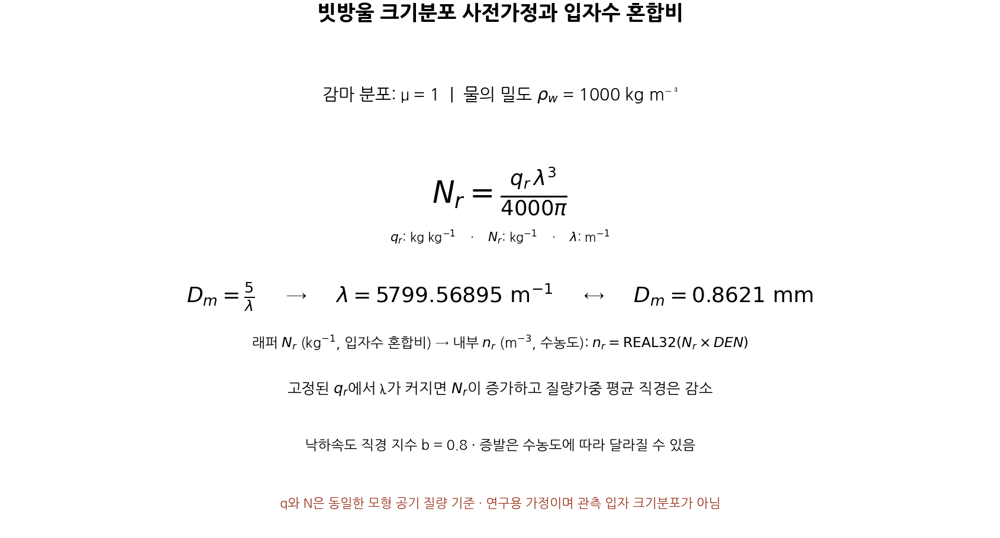
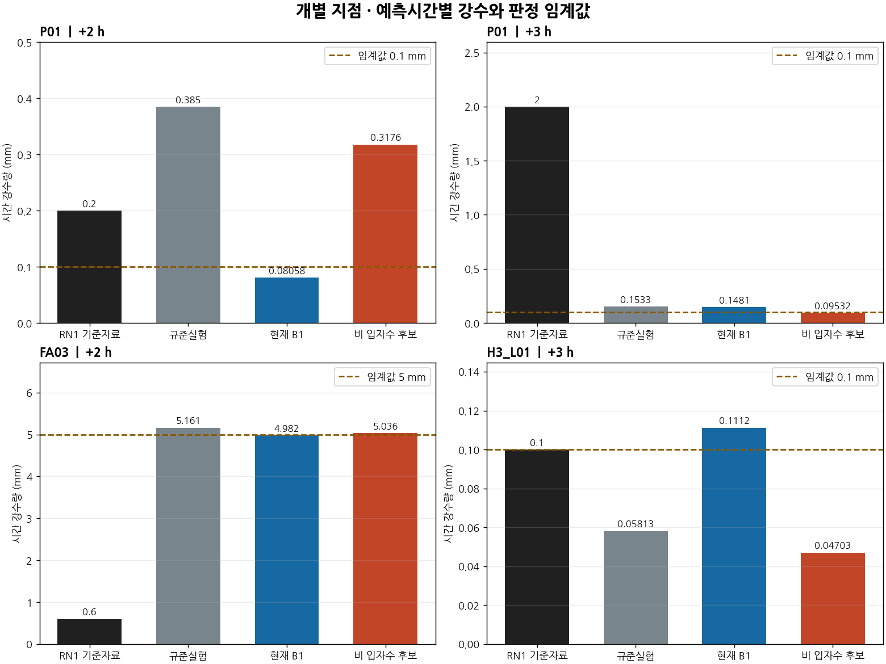
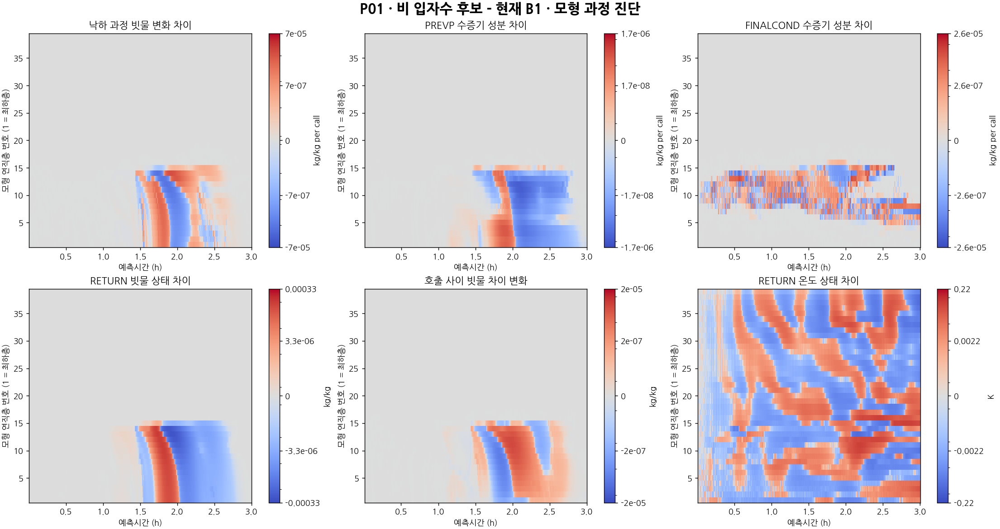
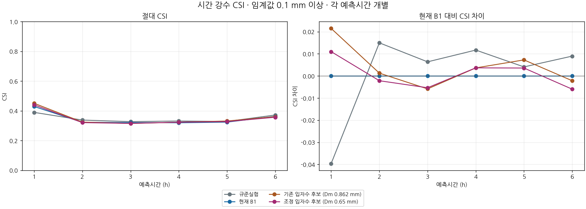
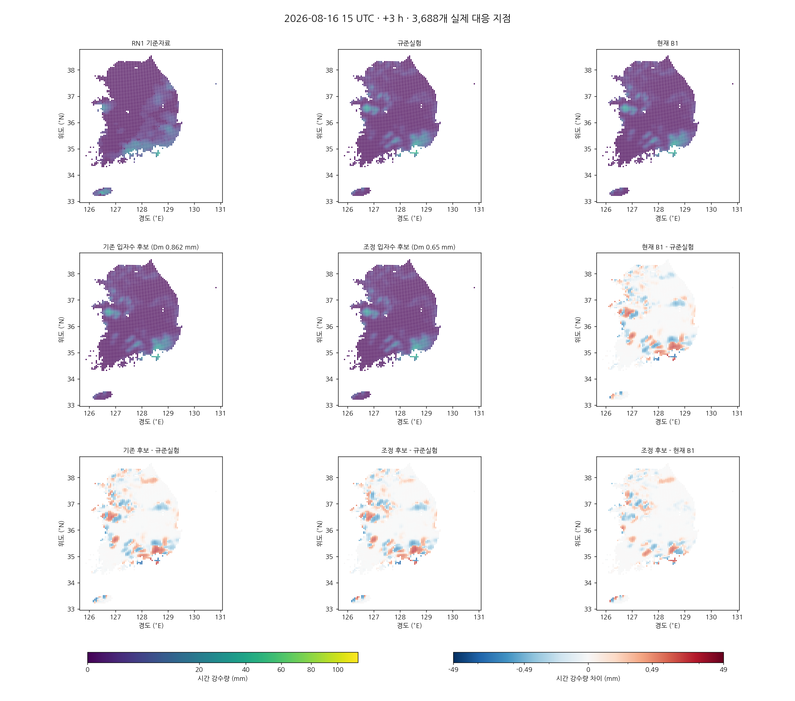

# 비 입자수 초기화의 과정 반응과 강수의 시간 분배: CP02 단일 사례의 3시간 진단 및 6시간 대조

## 초록

CP02 단일 사례에서 현재 B1과 기존 비 입자수 후보의 0–3시간 미세물리 반응을 동일 실행 계열로 비교하고, 입력 질량가중 평균입경만 조정한 한 가지 후속 후보를 6시간 평가하였다. 9개 평가점의 36개 WRF 모서리·39층·540단계를 연결했으며, 각 구성의 전체 시간별 출력은 기존 예보와 바이트 단위로 일치하였다. 기존 후보는 P01의 +2시간 적중을 회복했으나 +3시간에는 같은 지점의 적중을 잃었고, 다른 지점에서는 반대 방향의 시간 변화가 나타났다. 침강·비 증발·최종 구름 응결과 호출 사이 순변화가 함께 달라져 한 과정 또는 일률적인 강수 지연으로 설명되지 않았다. 감마 분포의 형상과 비 질량을 유지하고 입력 평균입경을 약 0.862 mm에서 0.65 mm로 줄인 대조는 3,688개 공통 평가점의 6개 시간·6개 임계값에서 평가하였다. 사전 고정한 현재 B1 보호 11조건 중 8개, 낮은 임계값 회복 15조건 중 2개만 충족해 후보를 채택하지 않았다. 공통 입경 감소만으로 후반 약한 강수와 기존 강수 이득을 함께 회복하지 못했으며 현재 B1을 유지한다. 이 결과는 단일 사례의 과정 진단과 민감도이며 전체 물·에너지 보존 또는 독립 사례 성능 검증을 뜻하지 않는다.

**핵심어:** 강수 초기화, 입자수 혼합비, 감마 입도분포, 침강, 증발, 시간강수, 임계성공지수

## 1. 서론

질량과 입자수를 각각 예측하는 미세물리에서는 같은 비 질량도 서로 다른 입도분포를 가질 수 있다. 따라서 초기 수상체 질량이 같다는 사실만으로 침강·증발과 이후 강수 반응이 같아지지는 않는다. 이 연구의 이론적 배경은 이중 모멘트 모형의 분포 표현이며, 실제 연산과 상수의 근거는 보관한 KDM6 소스·객체·실행파일의 동일성과 실행 중 값의 연결이다. WDM6 문헌을 현재 실행파일의 소스 동일성 증거로 사용하지 않는다. [Lim and Hong, 2010](https://www2.mmm.ucar.edu/wrf/site_linked_files/phys_refs/micro_phys/WDM5_6.pdf), [Park et al., 2024, Appendix A](https://gmd.copernicus.org/articles/17/7199/2024/).

앞선 비 입자수 후보는 P01의 +2시간 적중을 회복했지만 +3시간의 낮은 세 임계값 CSI를 모두 악화시켰다. 본 연구는 **현재 B1과 그 후보 사이**의 과정 차이를 조사한다. 과거 OLD/FIX의 0 과정률 분기 비교와 구분하며, 그 분기 자체는 이번 두 구성에서 동일하게 유지한다. 상세 과정 추적으로 어떤 변화가 실제 상태와 지상 강수에 연결되는지 확인한 뒤, 공통 입력 입경 한 가지만 바꾼 후속 민감도 실험을 수행한다.

## 2. 자료 및 방법

### 2.1 사례, 실험 및 평가량

초기시각은 **2026년 8월 16일 12 UTC(21 KST)**, 격자 간격은 5 km, 시간간격은 20초다. WRF 질량 격자의 크기는 `(south_north, west_east, bottom_top)=(282,234,39)`이며 실제 KDM6 내부 호출 영역은 2,533,440개 격자·층 셀이다. 3,688개 RN1 평가점은 공통 공간 표본이며 독립적인 기상 사례 수가 아니다.

| 표시명 | 코드 식별자 | 역할 |
|---|---|---|
| 규준실험 | `ORIGINAL` | 기존 강수검증의 기준 |
| 현재 B1 | `IMPROVED_BG_FIXED` / 과정 `B1` | 유지 중인 구성 |
| 기존 입자수 후보 | `B1_RAIN_NUMBER_PRIOR` / 과정 `NR_PRIOR` | 입력 질량가중 평균입경 약 0.862 mm, 이전 미채택 후보 |
| 조정 입자수 후보 | `B1_RAIN_NUMBER_DM065` | 입력 질량가중 평균입경 0.65 mm의 단일 후속 대조 |

과정 진단은 현재 B1과 **기존 입자수 후보**를 같은 FIX 실행 계열로 0–3시간 적분한 자료다. 실행 종료 후 0·1·2·3시간의 전체 history 8개가 각각의 기존 6시간 예보와 바이트 단위로 같았다. 이는 해당 진단 구간에서 출력이 재현됐다는 뜻이며, 물·에너지 수지 검증을 대신하지 않는다. 조정 후보의 6시간 예보는 비계측 표준 FIX 실행파일을 사용한다.

평가량은 연속 두 시각의 `RAINC+RAINNC` 차이인 **한 시간 강수량**이다. +2시간은 13–14 UTC, +3시간은 14–15 UTC이며 초기시각부터의 누적량이 아니다. `RAINC`는 모수화 대류 강수, `RAINNC`는 격자규모 미세물리 강수로 구분한다. 이번 KDM6의 지상 유출 기록은 RAINNC에 연결되므로 이를 총강수와 혼용하지 않는다. RN1은 기존 처리 기준자료로 사용하며 상류 시간 구간·coverage·QC의 미확정 부분은 유지한다.

### 2.2 상세 진단 지점과 과정 경계

P01·P02·FA03의 기존 식별자를 유지하고, 기존 후보에서 +3시간 적중 소실·신규 오경보·적중 유지가 나타나는 대조 지점을 추가했다. 새 표본은 관측 강도 구간과 임계값 전이를 구분한 뒤 강수 변화량, RN1 격자 번호 순으로 선택하고, 이미 선택한 WRF 네 모서리와 겹치는 후보를 제외했다. 이는 **사후 선정한 설명용 표본**이며 전체 점수 계산이나 후보 선정에는 사용하지 않는다.

9개 평가점의 WRF 모서리 36개와 39층을 540단계 동안 연결했다. 진입·반환과 필수 국지 갱신은 구성마다 **758,160개 셀·단계**다. 실제 rank 소유권·호출·층·하위 침강 단계와 원시 REAL32 값을 연결하고, 하위 단계 누락 및 같은 값의 중복 기록을 검사했다. 부호만 다른 0과 수치 차이를 구분한다.

포착한 경계는 공개 KDM6 진입·반환, 비·눈·싸락눈의 침강 전후, 주 과정률의 상태 갱신 전후, 최종 구름 응결 전후, 지상 강수 누적 전후다. 별도의 구름얼음 침강과 그 밖의 상태 조정을 모두 독립 분해한 것은 아니다. 실제 조건 분기를 타지 않은 지상 유출 기록의 부재를 0으로 채우지 않는다. 선택된 36개 모서리의 세 정시 누적 RAINNC는 두 구성 합계 **216개 모두** 보관 history의 REAL32 값과 비트 단위로 같았다.

### 2.3 질량·수 모멘트와 단위 변환

입경 D에 대한 감마 분포를

$$
n(D)=N_0D^\mu e^{-\lambda D},\qquad
M_j=\int_0^\infty D^j n(D)\,dD
   =N_0\frac{\Gamma(\mu+j+1)}{\lambda^{\mu+j+1}}
$$

로 두면, 구형 빗방울의 질량과 수가 같은 모형 공기질량 기준일 때

$$
\frac{q_r}{N_r}=\frac{\pi\rho_w}{6}
\frac{\Gamma(\mu+4)}{\Gamma(\mu+1)}\lambda^{-3}.
$$

실제 상수 $\mu=1$, $\rho_w=1000\,\mathrm{kg\,m^{-3}}$에서는

$$
N_r=\frac{q_r\lambda^3}{4000\pi},\qquad
D_m=\frac{M_4}{M_3}=\frac{5}{\lambda}.
$$

$D_m$은 **질량가중 평균입경**이다. 수가중 평균입경 $M_1/M_0=2/\lambda$ 및 평균 입자 질량을 구의 지름으로 바꾼 값과 다르다. 기존 후보의 $\lambda=5799.56895\,\mathrm{m^{-1}}$는 입력 단계의 $D_m\simeq0.862133$ mm를 뜻한다. 관측으로 복원한 분포가 아니며, 시작 연산·수송·모형의 기존 PSD 제한기를 거친 실제 상태가 그 값을 계속 유지한다는 뜻도 아니다.

WRF 공개 배열의 $N_r\,[\mathrm{kg^{-1}}]$와 내부 수농도 $n_r\,[\mathrm{m^{-3}}]$는

$$
n_r=\operatorname{REAL32}(N_r\,\mathrm{DEN})
$$

로 연결되고 반환에서는 DEN으로 나눈다. NC·NI·NN에도 같은 단위 변환을 직접 확인했다. 따라서 공개 값과 내부 값을 그대로 빼서 초기화 증감이라고 해석하지 않는다. 이 수치 연결이 DEN의 건조·습윤 공기 기준을 별도로 확정하지는 않는다.

*그림 1. 질량을 유지한 감마 분포 가정, 질량가중 입경과 입자수 혼합비·내부 수농도의 구분.*

### 2.4 과정항과 호출 사이 변화의 구분

같은 위치에서 기존 입자수 후보와 현재 B1의 상태 차이를 $D$로 쓰면

$$
D_{\rm out}(t)=D_{\rm in}(t)+
\{[X_{\rm out}-X_{\rm in}]_{\rm NR}-[X_{\rm out}-X_{\rm in}]_{\rm B1}\},
$$
$$
D_{\rm between}(t)=D_{\rm in}(t+1)-D_{\rm out}(t).
$$

호출 사이 항은 KDM6 밖의 **전체 순변화**다. 이를 수송만의 효과로 부르지 않는다. 모서리 가중값은 평가점 연결을 위한 공간 진단이며 층별 질량으로 가중한 총수종량이 아니다.

비 질량에 대한 과정률 PREVP가 음수이면 증발 방향이다. 해당 수증기·온도 과정항의 연속식 해석은

$$
\delta q_v=-\mathrm{PREVP}\,\Delta t,
\qquad \delta T=-\frac{L_v}{c_{pm}}\,\delta q_v
$$

이며, 최종 구름 응결의 pcond 항도 같은 수분·잠열 부호 관계를 가진다. 실제 검산은 보관한 피연산자와 **각 연산의 REAL32 반올림 순서**로 수행했다. 과정항의 시간 합을 실제 한 시간 온도 변화로 읽지 않는다. 다른 과정과 호출 사이 연산, 저장 반올림이 함께 작용하기 때문이다.

지상 RAINNC의 국지 누적에는 기록한 바닥층 침강률 합 S에 대해

$$
\delta P_{\rm NC}=10^3\frac{S\,\Delta z_{\rm bottom}}{\rho_w}\Delta t
$$

가 사용된다. 원시 S·층두께·물 밀도·시간간격과 실제 누적 전후 값을 연결했다. 포착한 최종 응결 및 지상 누적 연산의 최대 재현 잔차는 두 구성 모두 0이었다. 이는 **국지 연산의 재현**이며 전체 영역의 물·에너지 수지가 닫혔다는 뜻이 아니다.

## 3. 기존 후보의 3시간 과정 결과

### 3.1 같은 지점에서도 예측시간에 따라 효과가 바뀐다

| 지점 | 예측시간 | 현재 B1, mm | 기존 입자수 후보, mm | 후보−B1, mm |
|---|---:|---:|---:|---:|
| P01 | +2 h | 0.080582 | 0.317623 | +0.237041 |
| P01 | +3 h | 0.148093 | 0.095318 | −0.052775 |
| H3_L05 | +2 h | 0.219070 | 0.340405 | +0.121335 |
| H3_L05 | +3 h | 0.830568 | 0.422257 | −0.408311 |
| FA03 | +2 h | 4.981936 | 5.036231 | +0.054295 |
| H3_FA01 | +2 h | 0.766209 | 0.335614 | −0.430595 |
| H3_FA01 | +3 h | 0.087920 | 0.233751 | +0.145830 |

P01에서는 +2시간의 0.1 mm 적중이 회복되는 반면 +3시간에는 적중을 잃었다. +3시간 RN1 기준량은 2 mm이므로, 이 낮은 임계값의 적중 소실을 “실제 약한 강수만의 손실”로 해석하지 않는다. H3_L05도 +2시간 증가·+3시간 감소를 보이지만 H3_FA01은 반대 방향이다. 모든 지점을 일률적인 앞당김·지연으로 설명할 수 없으며, 표의 증감도 물의 양이 같은 시간 이동을 뜻하지 않는다.

*그림 2. P01의 +2/+3시간, FA03의 +2시간과 선정 대조군의 임계값 통과. RN1은 처리 기준자료다.*

### 3.2 침강과 수증기·열 과정은 구분해서 추적한다

P01의 모형 제12층·+2시간 구간에서 네 모서리를 연결한 침강 QR 증분 차이의 시간 합은 $-2.23975\times10^{-4}$ kg/kg, 공개 호출 전체의 QR 증분 차이는 $-2.45799\times10^{-4}$ kg/kg였다. 같은 위치·층·시간 구간에서 침강 반응이 크게 다름을 보여주지만, 그 비율을 지상 강수 손실에 대한 인과 기여율로 사용하지 않는다. 층으로 들어오는 수종량, 다른 과정, 호출 사이 변화를 함께 살펴야 한다.

같은 층의 PREVP 수증기 항 차이는 $-4.17006\times10^{-6}$ kg/kg, 잠열 온도 항 차이는 $+0.0101445$ K였다. 기존 후보의 후반 증발·냉각이 모두 한 방향으로 증가한다고 할 수 없다. 초기 입자수를 늘린 조작과 시간이 지난 뒤의 과정률 증가라는 결과는 서로 다르다.

*그림 3. 같은 평가점의 침강, PREVP, 최종 응결, 수종 상태와 호출 사이 차이. 각 층·호출을 유지하고 서로 다른 과정량과 상태량을 구분한다.*

## 4. 단일 입력 입경 대조와 6시간 평가

### 4.1 사전에 고정한 조정

과정 결과를 바탕으로 공통 입력 질량가중 평균입경만 **0.862133 mm에서 0.65 mm**로 바꾸는 한 가지 탐색 대조를 선언했다. 초기 QRAIN이 $10^{-9}$ kg/kg보다 크고 QNRAIN이 0이며 실제 호출 영역에 속하는 기존 적용 조건을 유지해 200,182개 셀의 QNRAIN만 바꾼다. 나머지 207개 변수·전체 메타데이터·차원은 원래 B1과 같다. 임의의 입자수 하한이나 새로운 잘라내기 규칙을 추가하지 않는다.

같은 공기 상태·분포 형상에서 $v(D)=aD^{0.8}$이라면 명목 질량가중 낙하속도 비는

$$
\frac{\overline v_{\rm new}}{\overline v_{\rm prior}}
=\left(\frac{0.65}{0.862133}\right)^{0.8}\simeq0.79776,
\qquad \frac{N_{r,\rm new}}{N_{r,\rm prior}}\simeq2.33337.
$$

이다. 약 20% 느린 명목 침강을 조사하는 대조이며 관측한 최적 입경이 아니다. 같은 열역학 조건으로 고정한 확산·통풍 증발 계수도 달라지므로 실제 WRF 낙하속도나 약한 강수 회복을 이 비율만으로 예측하지 않는다. 정책·입력·소스와 동일한 26개 조건을 6시간 예보 전에 고정했다.

### 4.2 평가 기준

$\mathrm{CSI}=H/(H+M+F)$를 각 시간·임계값에서 따로 계산한다. 현재 B1의 +1시간 여섯 임계값과 각 시간의 5 mm를 보호하는 11조건, +2∼+6시간의 0.1·0.5·1 mm를 규준실험 이상으로 회복하는 15조건의 **26개 모두**를 요구한다. 시간·임계값·실험을 평균하지 않는다. RMSE는 보조 진단이며 채택 지표가 아니다.

### 4.3 6시간 결과: 조정 후보 미채택

8개 MPI rank의 표준 FIX 예보가 6시간을 정상 완료했다. 실행 전후 89개 입력의 동일성과 7개 정시 history의 시각·형태·유한값을 검사했다. 독립적인 지점별 재계산에서 범주형 144행, 연속형 24행과 26개 채택 조건이 모두 일치했다.

| 후보 | 현재 B1 보호 | 낮은 임계값 회복 | 합계 | 채택 |
|---|---:|---:|---:|---|
| 기존 입자수 후보, 입력 $D_m$ 약 0.862 mm | 9/11 | 3/15 | 12/26 | 미채택 |
| 조정 입자수 후보, 입력 $D_m$ 0.65 mm | 8/11 | 2/15 | 10/26 | 미채택 |

아래는 **조정 입자수 후보 CSI − 현재 B1 CSI**다. 양수는 개선, 음수는 악화다. 모든 개별 H/M/F·CSI는 [144행 전체 표](evidence/cp02_rain_number_process_20261104/followup/figures/FULLSCORES.md)에 표시한다.

| 예측시간 | ≥0.1 mm | ≥0.5 mm | ≥1 mm | ≥2.5 mm | ≥5 mm | ≥10 mm |
|---|---:|---:|---:|---:|---:|---:|
| +1 h | +0.011005 | +0.009768 | +0.006468 | -0.001606 | +0.006381 | -0.000492 |
| +2 h | -0.002152 | -0.001180 | +0.002835 | -0.001464 | +0.000000 | +0.000866 |
| +3 h | -0.005330 | -0.000511 | -0.002416 | -0.001353 | +0.001317 | +0.001660 |
| +4 h | +0.003678 | +0.000511 | +0.005136 | +0.003462 | +0.015349 | +0.007654 |
| +5 h | +0.003585 | -0.006249 | -0.002281 | -0.016935 | -0.002585 | -0.013053 |
| +6 h | -0.005972 | -0.003358 | +0.005651 | +0.007905 | +0.000511 | -0.028305 |

보호 조건의 실패는 +1시간 2.5 mm, +1시간 10 mm, +5시간 5 mm다. +1시간 2.5 mm는 적중 167개가 같지만 오경보가 104→106개, 10 mm는 적중 10개가 같지만 오경보가 83→84개로 늘었다. +5시간 5 mm는 오경보가 223→215개로 줄어도 적중이 110→107개로 감소해 CSI가 0.198915→0.196330으로 낮아졌다. 적중과 오경보를 함께 봐야 하는 이유다.

회복 조건을 통과한 것은 +5시간 0.5·1 mm뿐이다. +2시간 0.1 mm에서 현재 B1의 적중/오경보 686/456개는 조정 후보에서 684/464개가 되었고 CSI는 0.323128→0.320976으로 낮아졌다. +3시간 0.1 mm도 0.321250→0.315920으로 악화했다. 입경을 줄인 조작이 전 영역의 약한 강수 검출을 회복했다고 판단할 수 없다.

*그림 4. 네 실험의 시간별 0.1 mm CSI와 현재 B1 대비 차이. 나머지 다섯 임계값도 각각 독립 그림으로 보존한다.*

*그림 5. +3시간 한 시간 강수량과 실험 간 차이. 공통 RN1 평가점의 실제 좌표에 표시한 점 분포이며 영역 전체의 연속 강수장을 복원한 그림은 아니다. 여섯 시간에 같은 강수량·차이 척도를 사용한다.*

## 5. 고찰

### 5.1 입경 가정의 기상학적 의미와 한계

고정된 비 질량에서 입경을 줄이면 입자수가 증가하고 명목 침강속도가 낮아진다. 동시에 비의 표면적과 통풍에 따른 증발 반응도 달라지므로, 지상 도달의 지연과 증발·수증기·잠열 변화가 경쟁한다. 실제 연산에서는 이후 입자수 생성·소멸, 입도분포 제한, 구름 응결 및 외부 순변화가 함께 작용한다. 따라서 초기 입경의 단조 변화가 지상 강수나 CSI의 단조 변화로 이어지지 않는다.

이번의 명목 속도 비는 동일한 공기 상태와 분포 형상을 고정한 식의 결과다. 0.65 mm 후보의 6시간 결과 자체에 대한 상세 과정 추적은 수행하지 않았으므로 그 후보의 점수 악화를 특정 증발 또는 침강 항으로 확정하지 않는다. 0–3시간 과정 기록은 **현재 B1–기존 0.862 mm 후보**의 비교이며 후속 0.65 mm 후보와 혼용하지 않는다.

### 5.2 다음 검증의 초점

기존 후보에서 P01의 +2시간 회복과 +3시간 손실이 공존하며, FA03에서는 5 mm 오경보가 재발했다. 0.65 mm 대조 역시 공통 입경 하나로 이 상충을 해소하지 못했다. 다음 작업은 실패 시간·관측 강도 구간을 유지한 채, 수정 후보의 실제 침강·증발·최종 응결 및 외부 순변화를 같은 경계에서 대조하는 것이다. 비 질량과 입자수뿐 아니라 상대습도·온도·상·입경분포의 공간 차이를 근거로 가정을 정해야 하며 추가 배율 탐색만으로 채택을 주장하지 않는다.

지상 총강수는 RAINC와 RAINNC를 함께 평가한다. 기둥 수종 질량은 호출 시점의 건조공기 질량·hybrid 좌표와 연결하고, 수증기·잠열·경계 수송·지상 유출을 함께 검증해야 한다. 현재의 층별 과정항 합이나 국지 연산 재현 잔차 0은 그 완료 조건을 대신하지 않는다.

## 6. 결론

현재 B1과 기존 입자수 후보의 같은 FIX 계열 3시간 진단에서 침강·비 증발·최종 응결·호출 사이 상태 차이를 연결했다. 질량 혼합비가 같더라도 수 모멘트 가정에 따라 지점·시간별 강수와 임계값 전이가 달라지며, 약한 강수 회복과 오경보 증가는 함께 나타날 수 있다.

과정 진단에 근거해 입력 질량가중 평균입경만 0.65 mm로 줄인 한 가지 대조를 6시간 적분했으나 26개 사전 조건 중 10개만 충족했다. **후보를 미채택하고 현재 B1을 유지한다. +2시간 이후 낮은 임계값 회복 목표는 아직 달성되지 않았다.** 이 결론은 개별 시간·임계값의 CSI와 H/M/F에 근거하며 시간·임계값·후보 평균이나 강우량 오차로 대체하지 않았다.

## 자료와 재현성

[증거 자료 안내](evidence/cp02_rain_number_process_20261104/README.md)와 [그림 모음](evidence/cp02_rain_number_process_20261104/FIGURES.md)에 원시 기록, 한정된 실행 범위, 코드와 검증 기록을 구분해 보존한다. RN1 상류 시각·coverage/QC, real 내부 작성 분기의 정확한 소스 대응, 독립 기상 사례, 전체 물·에너지 수지, 별도 계열 C2의 T39는 미완료다.

## 참고문헌

- Lim, K.-S. S., and Hong, S.-Y., 2010: Development of an Effective Double-Moment Cloud Microphysics Scheme with Prognostic Cloud Condensation Nuclei (CCN) for Weather and Climate Models. *Monthly Weather Review*, 138, 1587–1612. [doi:10.1175/2009MWR2968.1](https://doi.org/10.1175/2009MWR2968.1).
- Park, S.-Y., et al., 2024: Introducing graupel density prediction in Weather Research and Forecasting (WRF) double-moment 6-class (WDM6) microphysics and evaluation of the modified scheme during the ICE-POP field campaign. *Geoscientific Model Development*, 17, 7199–7218. [doi:10.5194/gmd-17-7199-2024](https://doi.org/10.5194/gmd-17-7199-2024).
