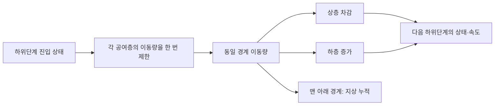
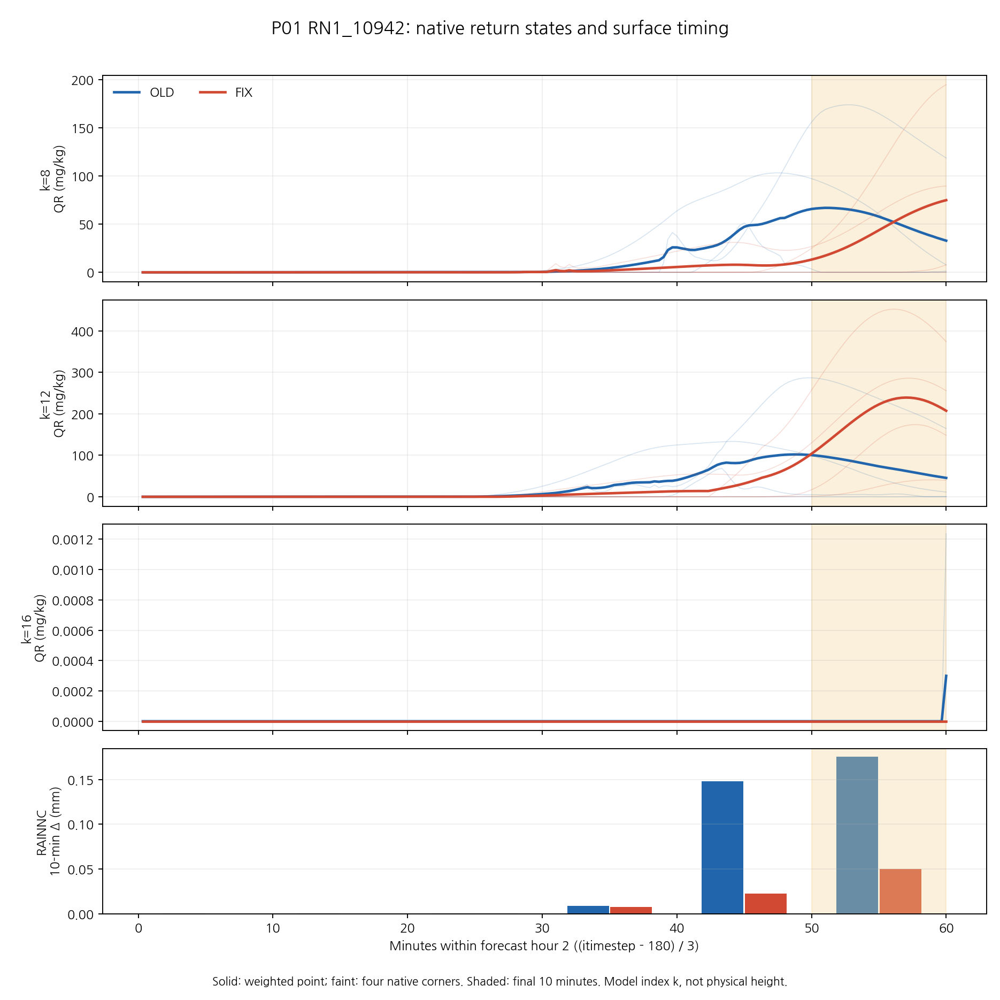

# KDM6 침강의 공유 경계 이동량과 시간별 강수 예측 반응

## 초록

현재 B1의 약한 강수 손실을 조사하는 과정에서, 기존 KDM6 침강식이 상층에서 이미 제거한 양을 하층 전달 시 갱신된 상층 잔존량으로 다시 제한하는 경계를 검증하였다. 동일한 경계를 통과하는 제거량과 수령량이 다를 수 있으며, 낙하 Courant 수 0.75의 두 층 사례에서 지상 유출 없이 기둥 비의 약 절반이 소실된다. 본 연구는 보존된 OLD/FIX 과정 기록의 실제 제한 발동을 조사하고, 갱신 전 상태에서 경계 이동량을 한 번 정해 공유하는 수정 후보를 시험한다. P01의 큰 비 잔존량은 둘째 시간 후반에 국한되며, 그 구간의 비보존 크기만으로 FIX의 지상 강수 감소를 설명하지 않는다. 공유 경계 후보의 실제 6시간 예보는 기존 B1 보호 9/11, 규준실험 수준 회복 10/15로 26개 중 19개를 통과하였다. 회복 조건 8개가 새로 충족됐지만 +4·+6시간의 5 mm 성능을 보호하지 못해 미채택하며 현재 B1을 유지한다. 국지 수치 보존과 관측 예측성능은 별도 기준으로 판단한다.

**핵심어:** 미세물리, 침강, 유한체적 교환, 비 입자수, 약한 강수, 임계성공지수

## 1. 서론

현재 B1은 규준실험보다 일부 예측시간·강수 강도에서 개선됐으나 +2시간 이후 낮은 임계값의 성능 회복 목표는 달성하지 못했다. 기존 보고서는 같은 B1 초기장의 OLD/FIX에서 P01의 지상 강수 감소와 특정 모형층의 비 잔존량 증가가 공존함을 보였다. 마지막 반환값을 한 시간 전체로 확대하거나 이를 곧바로 증발·낙하의 단일 원인으로 설명할 수는 없다.

이번 연구는 기존 침강식의 경계 교환을 직접 검산한다. 수정의 목적은 비를 임의로 늘리거나 올바른 0 과정률 처리를 되돌리는 것이 아니라, 동일한 경계를 넘는 양의 수치적 일관성을 회복하는 것이다. 물리적으로 더 정합한 국지 계산이 관측 강수 점수를 반드시 높인다고 가정하지 않는다.

## 2. 자료 및 방법

### 2.1 사례와 비교 구성

초기시각은 **2026년 8월 16일 12 UTC**다. +2시간은 13–14 UTC의 한 시간 강수이며 초기부터의 누적량이 아니다. 규준실험은 ORIGINAL이다. 기존 과정 기록의 OLD(X)와 FIX(A)는 같은 B1 초기장을 사용하며, A는 현재 B1이다. 새 전방 실험은 A의 초기장·경계장·시간간격·물리표를 유지하고 침강 경계 계산만 바꾼다.

| 구성 | 초기장 | KDM6 | 역할 |
|---|---|---|---|
| ORIGINAL | 규준실험 초기장 | 기존 규준 코드 | 후반 낮은 임계값 회복 기준 |
| 현재 B1(A) | 배경 강수 보존 B1 | 정확한 0 과정률 처리 수정 | 보호 기준 |
| CONTROL | A와 동일 | 표준 FIX 재빌드 | 빌드·실행 동등성 대조 |
| 보존 침강 후보 | A와 동일 | FIX＋공유 경계 이동량 | 독립 평가 대상 |

입자수 초기화·입경·습도 문턱·증발계수는 바꾸지 않는다. 기존 DM065와 PH 합산식 C·D를 새 후보의 기준으로 삼지 않는다.

### 2.2 기존 침강식의 비보존 경계

모형층 번호는 아래에서 위로 증가한다. 같은 밀도·두께의 두 층에서 상층 초기 비를 $q$, 낙하 Courant 수를 $C=v\Delta t_{\rm sub}/\Delta z$라 하자. 기존 계산은 상층을 먼저 $(1-C)q$로 만든 뒤 하층 수령량을

$$
\min(Cq,(1-C)q)
$$

로 제한한다. $0\le C\le1$인 이상화 조건에서 경계 교환의 차이는

$$
q_{\rm removed}-q_{\rm received}=\max(2C-1,0)q
$$

다. 따라서 $C>0.5$이면 시간간격 조건을 위반하지 않아도 유입 재제한이 생길 수 있다. 서로 다른 밀도·층 두께에서는 목적층 혼합비와 공여층 잔존 혼합비의 직접 비교도 동일한 면적당 이동량 제한이 아니다. 실제 재현에서는 위 요약식 대신 원래 명령 순서의 REAL32 연산을 유지한다.

최소 사례는 상층 $q=0.001$ kg/kg, 하층 0, 밀도 1 kg/m³, 두께 100 m, 시간간격 20초, 낙하속도 3.75 m/s다. 기존 하위단계 수는 1이다. 상층에서 75%를 제거하지만 하층에는 25%만 전달하여 초기 약 0.10000000475 kg/m²가 약 0.05000000820 kg/m²로 감소한다. 이 단계의 지상 유출은 0이다.

### 2.3 공유 경계 이동량

기존 침강식의 밀도 `dend`와 층 두께를 그대로 사용하여 비·눈·싸락눈·빙정의 층별 면적당 양을

$$
M_k=\rho_k\Delta z_k q_k
$$

로 정의한다. 갱신 전 공여층에서 아래로 이동할 양을 한 번만 제한한다.

$$
T_k=\min(M_k^{\rm pre},\rho_kq_k^{\rm pre}v_{m,k}\Delta t_{\rm sub}),\qquad
M_k^{\rm post}=M_k^{\rm pre}-T_k+T_{k+1}.
$$

모형 꼭대기의 외부 유입은 0이며 맨 아래의 $T_1$을 지상 유출과 연결한다. 같은 $T_k$를 공여층 차감·수령층 증가·누적 `fall`에 사용한다. 원래 질량 가중 낙하속도와 하위단계 수 계산·속도 재계산 순서는 유지한다.

내부 비·빙정 입자수는 수농도이므로 면적당 입자수는

$$
\mathcal N_k=n_k\Delta z_k,\qquad
T_{N,k}=\min(\mathcal N_k^{\rm pre},n_k^{\rm pre}v_{N,k}\Delta t_{\rm sub})
$$

다. 여기에 밀도를 다시 곱하지 않으며 수 가중 속도를 질량 가중 속도로 대체하지 않는다. 관련 부피 상태 `brs`도 기존 소스의 밀도 변환에 맞춘 대응 교환을 사용하며 이를 물 질량이라고 부르지 않는다.

이 식은 같은 시점의 실제 건조공기 질량이나 영역 전체 물수지의 완결을 새로 확정하지 않는다. 기존 침강식이 사용하는 밀도·기하에 대한 국지 경계 보존을 검사한다.

### 2.4 정밀도와 원시 기록 검산

단정도로 제한한 플럭스를 다시 혼합비로 환산하면 반올림 때문에 공여량을 미세하게 초과할 수 있다. Intel O0/O2에서 그 음의 잔여를 재현하였다. 수정 후보는 경계 이동량과 해당 국지 갱신만 REAL64로 계산하며, 저장 상태와 기존 누적 배열은 REAL32를 유지한다. 전 모델 정밀도를 바꾸거나 사후 0 제한으로 손실을 숨기지 않는다. 최종 저장 반올림 때문에 비트 단위의 정확한 보존을 주장하지 않고 규모에 따른 잔차를 검사한다.

보존된 CP05 phase 9/10의 전후 상태·`dend`·층 두께·시간간격·`falk`·`fall`을 결합한다. 같은 호출·격자·층·하위단계를 연결하고 실제 POST 상태를 REAL32로 재현한다. 유입 제한 차이, 누적 `fall`의 경계량과 실제 바닥 제거량의 차이, 상태 저장 반올림을 별도로 기록한다. 이를 하나의 원인량으로 합쳐 지상 강수 오차라고 부르지 않는다.

자료는 150개 평가점의 중복 제거된 원래 격자 381개·39층이다. 상세 기록은 1–360과 721–900단계이며 중간 361–720단계는 없다. 같은 격자의 여러 평가점·역할 참조는 원래 격자 합에서 중복 제거하고, 점별 진단에는 보존된 네 모서리 가중치를 적용한다. 역할 집단은 중첩되므로 집단 합을 다시 더해 영역 합으로 만들지 않는다.

### 2.5 예측 성능 판정

6개 한 시간 구간과 6개 임계값(0.1·0.5·1·2.5·5·10 mm)을 각각 유지한다. $CSI=H/(H+M+F)$는 정수 사건 수의 정확한 분수로 비교하며 시간·임계값·실험을 평균하여 후보를 고르지 않는다.

채택 조건은 현재 B1의 +1시간 여섯 임계값과 모든 예측시간의 5 mm CSI를 보호하는 11개, 규준실험 대비 +2–+6시간의 0.1·0.5·1 mm CSI를 회복하는 15개다. **26개 전부를 충족해야 한다.** 실제 약한 관측 구간 $0.1\le RN1<1$ mm의 적중 획득·소실과 관측 음성 $RN1<0.1$ mm의 신규·해소 오경보도 별도로 제시한다.

## 3. P01의 시간 분포

FIX의 k=12 반환 비 혼합비가 OLD보다 큰 것은 둘째 시간 180개 호출 중 `itimestep=330–360`의 31개뿐이다. 앞선 149개에서는 FIX≤OLD다. 이 구간과 마지막 10분의 30개 호출을 구분한다.

| 둘째 시간의 구간 | 반환 호출 | OLD QR 평균, mg/kg | FIX QR 평균, mg/kg | OLD RAINNC, mm | FIX RAINNC, mm |
|---|---|---:|---:|---:|---:|
| 40–50분 | 301–330 | 82.7982 | 41.5773 | 0.1481668 | 0.0225705 |
| 50–60분 | 331–360 | 72.9392 | 200.0177 | 0.1756597 | 0.0498594 |

각 강수 구간의 기저 누적은 각각 300·330단계다. QR은 해당 반환 상태의 평균이며 기둥 질량이 아니다. k는 고도로 환산하지 않은 모형층이다. 마지막 반환의 큰 QR을 둘째 시간 내내 큰 비 잔존량으로 해석하지 않는다.

## 4. 실제 원시 기록의 제한 발동과 보존 검산

### 4.1 전체 선택 격자와 시간창의 구분

정확한 실행 소스를 고정한 최종 재처리에서 각 구성 33,480개 frame과 3,431개 스트림을 검사하였다. 기록된 비·눈·싸락눈·비 입자수의 POST 및 `fall` 갱신은 소스 순서의 REAL32 연산과 비트 단위로 일치했다. 아래 집계는 선택된 원래 격자와 포착한 하위단계의 합이며 독립 기상 사례 수가 아니다.

| 기록 구성 | 기둥·하위단계 수 | 비 유입 재제한 | 비 입자수 유입 재제한 | 비 경계량 차이의 단순합† |
|---|---:|---:|---:|---:|
| OLD | 273,183 | 24,109 | 236 | +2.250810 |
| FIX | 297,275 | 33,693 | 479 | +4.142312 |

†각 기둥의 면적당 양(kg/m²)을 기둥·하위단계에 걸쳐 더한 기술 통계다. 영역 면적을 곱한 질량이나 평가점 강수량이 아니며, 이 합을 지상 mm와 직접 비교하지 않는다. 눈·싸락눈 유입 재제한은 이 포착 집합에서 0건이었다. 별도 빙정 침강과 부피 상태의 전체 원시 보존은 이 phase 9/10 검산에 포함되지 않는다.

제한 발동한 비 경계의 양·음 차이 합은 OLD +2.268202/−0.004653, FIX +4.143151/−0.000100 kg/m² 수치였다. 재제한이 없던 경계의 순차이는 각각 −0.012740/−0.000739였다. 후자를 전부 반올림으로 이름 붙이지 않는다. 기록된 하위단계 표에서는 개별 비제한 경계의 양·음 분해를 복원할 수 없어 그 순합만 보고한다.

명목 바닥 플럭스와 실제 제한된 바닥 제거량 차이의 단순합은 OLD +0.138831, FIX +0.090127이었다. 누적 `fall` 차분 자체의 반올림 및 기둥 상태 저장 잔차와도 구분한다. 상태 저장 잔차의 절댓값 합은 약 0.000678/0.000648, 개별 기둥·하위단계 최대 절댓값은 약 2.89×10⁻⁷/2.45×10⁻⁷ kg/m²였다. 서로 다른 경계량을 합쳐 강수 오차의 단일 원인량으로 해석하지 않는다.

### 4.2 P01 마지막 10분

`331–360`의 30개 호출에서 P01의 네 모서리 가중 비 경계량 순차이는 OLD **2.23766665×10⁻⁴**, FIX **2.66757968×10⁻⁶ kg/m²**였다. 재제한 발동은 원래 격자 기준 40건과 28건이었다. 이 구간에서는 OLD의 차이가 더 컸지만 전체 선택 격자의 단순합에서는 FIX가 더 크다. 시간·공간·가중 기준을 바꾼 결과를 같은 물리량으로 대체하지 않는다.

이 국지 방향은 “FIX의 P01 지상 강수 감소가 더 큰 해당 구간의 비 소실 때문”이라는 설명을 뒷받침하지 않는다. 앞선 시각·다른 위치에서 들어온 변화와 이후 낙하·수종 교환은 별도로 추적해야 한다. 해당 포착만으로 전체 예보에서 침강 문제가 무관하다고 결론낼 수도 없다.

### 4.3 수정 후보의 검증 범위

실제 표준 FIX 소스에 패치를 적용해 바이트를 대조하고, 해당 갱신문을 추출한 Intel O0/O2 실행으로 두 층 최소 사례를 검증하였다. 밀도·층 두께 차이, 서로 다른 수·질량 속도, 0·미량 상태, 다중 하위단계 및 바닥 유출 제한도 시험했다. 일곱 상태에 대한 시험의 최대 상대 잔차는 약 **3.214×10⁻⁸**이었다. 이는 추출한 국지 커널의 시험 결과이며 실제 전체 대기·물·에너지 수지의 폐합 검증은 아니다.

## 5. 실제 6시간 예보와 관측 평가

### 5.1 실행 대조와 채택 판정

CONTROL과 후보 모두 8 MPI rank·20초 시간간격으로 6시간을 정상 완료했다. 동일 입력의 CONTROL 정시 history 7개는 기존 B1과 바이트 단위로 같았고, 후보의 초기 history도 같았다. 따라서 이 사례의 후보–B1 비교는 재빌드 대조의 변동과 구분된다.

| 평가 조건 | 현재 B1 | 보존 침강 후보 | 판정 |
|---|---:|---:|---|
| B1 보호 | 11/11 | 9/11 | +4·+6시간 5 mm 실패 |
| 규준실험 수준의 낮은 임계값 회복 | 2/15 | 10/15 | 새 회복 8개, 기존 회복 소실 0개 |
| 후보의 전체 조건 | 기준 구성 | 19/26 | **미채택·현재 B1 유지** |

회복 실패는 +3시간 0.1·0.5·1 mm와 +6시간 0.5·1 mm다. 충족 개수는 평균 점수나 최적 모형 순위가 아니다. 기존 26개 전부 충족이라는 판정 규약을 유지한다.

### 5.2 +2시간 회복과 실제 약한 관측 강수

| +2시간 임계값 | 규준실험 CSI | 현재 B1 CSI | 후보 CSI |
|---|---:|---:|---:|
| 0.1 mm | 0.338109 | 0.323128 | 0.348294 |
| 0.5 mm | 0.299623 | 0.289139 | 0.302602 |
| 1 mm | 0.293286 | 0.283879 | 0.306987 |

관측 0.1≤RN1<1 mm인 +2시간 표본에서 현재 B1 대비 적중 획득 44개·소실 3개로 검출이 순 41개 늘었다. 관측 RN1<0.1 mm에서는 신규 오경보 30개·해소 14개로 순 16개 늘었다. 따라서 실제 약한 강수 검출의 회복과 오경보 증가가 동시에 나타난다. 낮은 임계값 CSI에는 더 강한 관측 강수의 적중도 포함되므로 두 결과를 구분한다.

### 5.3 보호 실패의 적중·오경보 분해

| 예측시간·5 mm | 구성 | H | M | F | CSI |
|---|---|---:|---:|---:|---:|
| +4시간 | 현재 B1 | 67 | 277 | 225 | 0.117750 |
| +4시간 | 후보 | 63 | 281 | 247 | 0.106599 |
| +6시간 | 현재 B1 | 168 | 180 | 226 | 0.292683 |
| +6시간 | 후보 | 163 | 185 | 287 | 0.256693 |

+4시간의 5 mm 사건은 적중 획득 4·소실 8, 오경보 생성 43·해소 21이다. +6시간은 적중 획득 13·소실 18, 오경보 생성 102·해소 41이다. 순변화는 각각 H−4/F+22와 H−5/F+61이다. 이 후보에서는 강한 강수의 적중이 줄고 오경보가 늘어 기존 성능을 보호하지 못했다.

### 5.4 모든 시간·임계값 비교

다음은 후보 CSI−현재 B1 CSI다. 양수는 개선, 음수는 악화이며 각 칸을 독립적으로 읽는다. [전체 절대 H/M/F·CSI 표](evidence/cp02_sedimentation_conservation_20261109/evaluation/results/FULL_SCORES.md)는 규준실험·현재 B1·후보의 108개 조합을 보존한다.

| 예측시간 | 0.1 mm | 0.5 mm | 1 mm | 2.5 mm | 5 mm | 10 mm |
|---|---:|---:|---:|---:|---:|---:|
| +1시간 | +0.018365 | +0.012189 | +0.002859 | +0.017750 | +0.042505 | +0.004920 |
| +2시간 | +0.025166 | +0.013464 | +0.023109 | +0.033862 | +0.013599 | +0.012914 |
| +3시간 | +0.003451 | +0.002459 | -0.004898 | -0.000232 | +0.011741 | +0.006033 |
| +4시간 | +0.021997 | +0.015463 | +0.007554 | -0.006758 | -0.011151 | +0.003155 |
| +5시간 | +0.024329 | +0.010758 | -0.000206 | +0.002378 | +0.007166 | +0.002714 |
| +6시간 | +0.023226 | +0.005100 | -0.001139 | +0.003742 | -0.035990 | -0.043376 |

[임계값별 그림과 시간별 분포도 모음](evidence/cp02_sedimentation_conservation_20261109/FIGURES.md)에서 각 임계값의 곡선과 모든 시간의 강수량·차이를 각각 확인할 수 있다.

## 6. 고찰과 결론

수학적으로 동일 경계 이동량의 공유는 갱신 전 상태의 비음성과 국지 보존을 함께 다루는 수정이다. 혼합비를 갱신한 뒤 상층 잔존량으로 하층 유입을 다시 제한하는 기존 식과 다르다. 다만 최종 REAL32 저장과 누적의 반올림은 남으며, 소스가 사용하는 밀도 기준의 국지 보존과 실제 대기의 건조공기 질량·수증기·잠열·영역 경계 수송까지 포함한 수지는 별도 과제다.

기상학적으로 이 후보는 +2시간 약한 강수 검출과 8개 후반 회복 조건에 진전을 보였다. 동시에 +4·+6시간 5 mm 적중을 잃고 오경보를 늘렸다. 수치적 비보존 개선과 강수 예측 개선은 같은 판정이 아니다. 후보는 공유 교환과 해당 국지 REAL64 연산을 함께 바꾸므로 그 두 효과를 이번 실험만으로 개별 귀속하지 않는다. 누락된 물을 임의로 제거하여 점수를 맞추거나 입경·습도·증발계수를 새로 조정하지 않는다.

다음 비교는 후보가 새로 만든 5 mm 오경보와 잃은 적중을 같은 시간창의 지상 유출·입자수·수분/잠열 상태와 연결하는 것이다. 현재의 사후 사건 분류를 초기화 규칙에 넣지 않는다. 보존 침강 후보는 19/26으로 미채택하며 현재 B1을 유지한다. 이 유지 판정이 기존 침강식의 비보존을 물리적으로 타당하다고 승인하는 뜻은 아니다.

단일 사례와 공간적으로 연관된 3,688개 표본의 결과다. RN1 상류 시간·coverage·QC, 조정에 사용하지 않은 별도 기상 사례, 같은 시각 건조공기 질량 및 전체 물·에너지 수지, 별도 C2 T39/H/A/N 완료는 여전히 남아 있다.

## 근거 자료

- [이전 과정 진단](CP02_PROTECTED_PROCESS_20261106.md)
- [실제 침강 수정 패치](../patches/kdm6_conservative_sedimentation.patch)
- [정확한 소스 추출 및 Intel 시험](evidence/cp02_sedimentation_conservation_20261109/native/README.md)
- [P01 시계열의 경계·재현 규약](evidence/cp02_sedimentation_conservation_20261109/science/P01_TIMING.md)
- [정확한 실행 소스의 전체 원시 기록 검산](evidence/cp02_sedimentation_conservation_20261109/audit/full/receipt.json)
- [양·음 경계 차이와 바닥 항의 구분](evidence/cp02_sedimentation_conservation_20261109/audit/signed_gaps/README.md)
- [실제 실행·빌드 대조](evidence/cp02_sedimentation_conservation_20261109/forecast/proof/comparability.json)
- [26개 조건과 채택 판정](evidence/cp02_sedimentation_conservation_20261109/evaluation/results/admission_constraints.csv)
- [독립 점수 재계산](evidence/cp02_sedimentation_conservation_20261109/review/independent_forecast_score_recount.json)
