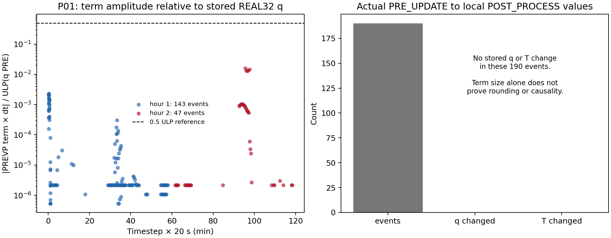
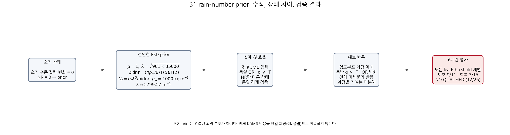
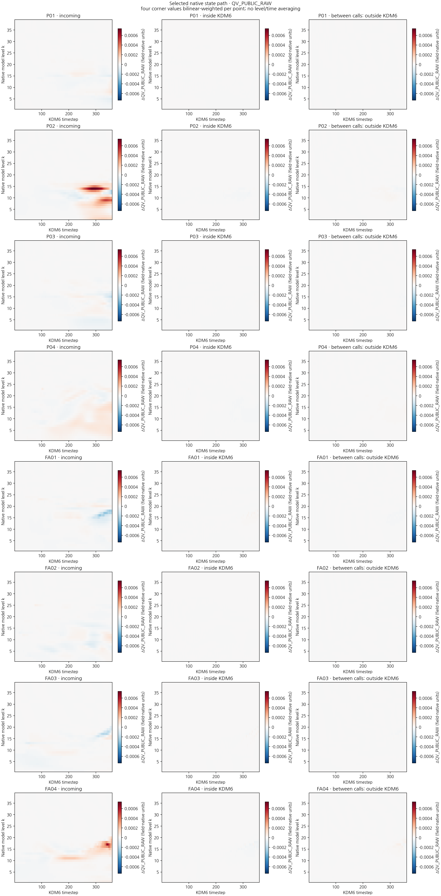
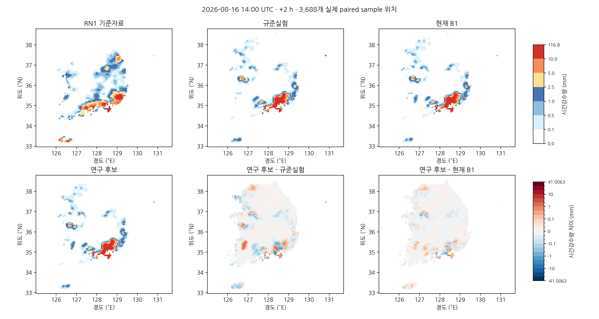
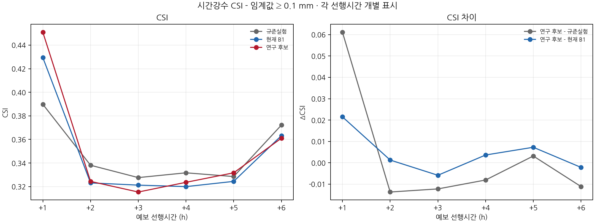
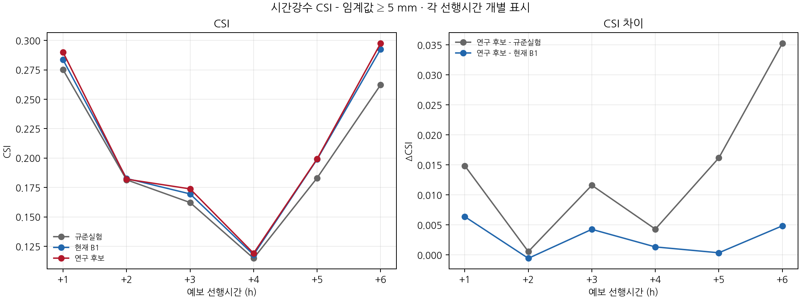

# 비 입자수 초기화에 따른 초기 미세물리 반응과 6시간 강수예측: CP02 단일 사례 연구

## 초록

초기 수상체 변화와 강수예측의 관계를 조사하기 위해 동일 B1 초기장을 사용하는 KDM6 기존·수정 실행의 첫 두 시간을 비교하고, 질량을 유지한 비 입자수 초기화 후보를 6시간 적분하였다. P01의 정확한 0 과정률 관련 사건 190건에서는 국지 수증기·온도 저장값이 바뀌지 않았으나, 공개 미세물리 호출 사이의 상태 분해에서는 두 번째 진입부터 실제 수증기 차이가 관측되었다. 따라서 사건 수를 직접적인 냉각이나 강수 소실로 해석할 수 없다. 비 입자수 후보는 KDM6의 감마 입도분포 관계를 이용해 200,182개 초기 셀의 QNRAIN만 변경하였다. 첫 호출의 실제 입력·내부 상태와 수 상한을 검증했고, 6시간 예보가 완료되었다. 후보는 P01의 +2시간 0.1 mm 적중을 회복했지만, 전체 평가의 사전 고정 조건 26개 중 12개만 충족하였다. +2시간 5 mm 오경보가 FA03에서 다시 발생해 현재 B1의 이득 일부가 소실되었다. 후보를 채택하지 않고 현재 B1을 유지한다. 결과는 초기 질량만이 아니라 수 모멘트와 이후 과정 반응을 함께 검토해야 함을 보여주며, 독립 사례의 예측 개선이나 전체 물·에너지 수지의 완성을 입증하지 않는다.

**핵심어:** 강수 초기화, 비 입자수, 감마 입도분포, KDM6, 시간강수, 임계성공지수

## 1. 서론

기존 CP02 연구에서 초기 강수 수종 보존과 정확한 0 과정률 처리 수정은 첫 시간 및 일부 높은 강수 임계값의 CSI를 높였다. 그러나 +2시간 이후 낮은 임계값의 악화가 남았다. 동일 B1 초기장에서도 실행파일 수정만으로 유사한 경향이 나타나므로, 초기 비 혼합비 감소량 하나보다 미세물리 전후 상태와 호출 사이의 변화를 구분할 필요가 있다.

본 연구의 질문은 두 가지다. 첫째, 약한 강수 적중이 소실된 지점에서 실제 상태 차이는 어느 경계에 먼저 나타나는가? 둘째, 양의 비 질량과 0인 비 입자수를 가진 초기장에 명시적인 입도분포 가정을 부여하면, 낮은 임계값을 회복하면서 현재 B1의 이득을 유지할 수 있는가? P01–P04와 실제 5 mm 오경보 전이 지점 FA01–FA04를 상세 진단에 사용하고, 성능 판정은 전체 3,688개 평가점에 유지하였다.

## 2. 자료 및 방법

### 2.1 실험과 평가 범위

초기시각은 **2026년 8월 16일 12 UTC(한국시간 21시)**다. 모형 출력은 수평 234×282, 연직 39층, 격자 간격 5 km, 시간간격 20초다. KDM6 호출의 실제 내부 영역은 2,533,440개 격자·층 셀이다. 이는 3,688개의 강수 평가점이나 독립적인 기상 사례 수와 다른 개수다.

| 표시명 | 코드 식별자 | 초기장 | KDM6 |
|---|---|---|---|
| 규준실험 | `ORIGINAL` | 규준 초기장 | 기존 실행파일 |
| B1 OLD | `ORIGINAL_B1_100` / 진단 `OLD` | B1 초기장 | 기존 실행파일 |
| 현재 B1 | `IMPROVED_BG_FIXED` / 진단 `FIX` | 동일 B1 초기장 | 정확한 0 과정률 처리 수정 |
| 비 입자수 후보 | `B1_RAIN_NUMBER_PRIOR` | B1에서 QNRAIN만 변경 | 현재 B1과 같은 수정 실행파일 |

OLD/FIX의 0·1·2시간 전체 history는 각각의 보관 예보와 바이트 단위로 같았다. 이 검사는 계측 실행의 해당 출력 재현을 확인하며 모든 과정의 보존 검증을 대신하지 않는다. 후보의 6시간 예보는 비계측 수정 실행파일을 사용했다. 초기장·경계장·설정·실행파일과 7개 시간별 출력은 실행 기록으로 연결하였다.

검증량은 `RAINC+RAINNC`의 연속 두 시각 차이를 기존 WRF bilinear 연산자로 평가점에 연결한 **한 시간 강수량**이다. 예를 들어 +2시간은 13–14 UTC 구간이다. 임계값은 0.1, 0.5, 1, 2.5, 5, 10 mm다. RN1은 보존된 처리 기준자료이며, 상류 시간 구간·coverage·QC의 미확정 부분을 남긴다.

### 2.2 사건 수와 실제 상태 변화의 분리

P01의 OLD 기록에는 정확한 0 과정률에서 음의 최종률로 바뀌는 사건이 190건 있었다. 그 갱신의 수증기·온도 저장값은 모두 수치적으로 같았다. 개별 과정항의 최대 크기는 약 $7.38\times10^{-12}$이며, 해당 REAL32 수증기 값 간격의 최대 0.0159배다. 이 크기 비교는 전체 연산의 반올림이나 이후 영향에 대한 증명이 아니며, 실제 상태 비교와 함께 해석한다.

*그림 1. P01의 190개 관련 사건과 국지 상태 변화. 과정항의 존재를 수증기 증가·냉각의 발생으로 직접 바꾸어 해석하지 않는다.*

### 2.3 미세물리 경계의 상태 차이 분해

첫 호출에서는 공개 진입, 내부 첫 갱신 전·후, 내부 함수 반환, 공개 반환을 연결했다. 32개 모서리와 39층은 360단계 동안 공개 진입·반환을 보존했다. halo와 실제 소유 격자를 구분하고, 같은 셀·필드·호출의 값을 비교하였다. 비트 차이와 수치 차이, 부호만 다른 0을 분리한다. 호출인자 `TH`와 KDM6의 $T_{\rm mp}=\mathrm{TH}\times\mathrm{PII}$도 별도 필드다.

현재 B1(FIX)과 OLD의 상태를 각각 $X_F,X_O$라고 하면,

$$
D_{\rm in}(t)=X_{F,\rm in}(t)-X_{O,\rm in}(t),
$$
$$
D_{\rm mp}(t)=[X_{F,\rm out}-X_{F,\rm in}]-[X_{O,\rm out}-X_{O,\rm in}],
$$
$$
D_{\rm out}(t)=D_{\rm in}(t)+D_{\rm mp}(t),\qquad
D_{\rm between}(t)=D_{\rm in}(t+1)-D_{\rm out}(t).
$$

마지막 항은 **KDM6 밖의 모든 연산이 만든 순변화**다. 수송만의 기여나 개별 물리 과정의 인과 기여율이 아니다. 네 모서리 가중 프로파일은 공간 진단량이며 층별 건조공기 질량으로 가중한 총수종량이 아니다. 연직·시간·실험을 평균해 점수로 사용하지 않았다.

### 2.4 비 입자수 후보의 수학적 정의

보관 metgrid에는 QR이 있지만 QNR은 없었다. 같은 metgrid→real 실행을 재생한 B1 초기장은 보관본과 같았고, 양의 QRAIN을 가진 202,569개 초기 셀을 포함해 전체 QNRAIN이 0이었다. 이 사실은 작성 결과의 재현이며, `real.exe` 내부 작성 분기의 정확한 소스 대응까지 닫힌 것은 아니다. KDM6의 질량·수 변환 관계와 상수는 동일한 객체·실행파일을 재생산한 소스에 연결하였다.

질량만으로 입자수는 유일하게 결정되지 않는다. 다음 감마 분포를 **관측으로 복원한 분포가 아니라 명시적인 사전 가정**으로 둔다.

$$
n(D)=N_0D^\mu e^{-\lambda D},\qquad
\frac{q_r}{N_r}=\frac{\pi\rho_w}{6}
\frac{\Gamma(\mu+4)}{\Gamma(\mu+1)}\lambda^{-3}.
$$

여기서 D는 입경이며, 질량·수 모멘트는 같은 모형 공기질량 기준으로 표현한다. 실제 구현의 $n_{rs}=N_r\,\mathrm{DEN}$와 역산식에서는 같은 DEN 인자가 소거된다. 이 대수 관계가 DEN의 건조·습윤 공기 기준이나 전체 질량 수지를 별도로 입증하지는 않는다.

KDM6의 $\mu=1$, $\rho_w=1000\,\mathrm{kg\,m^{-3}}$, 경계 $961\le\lambda\le35000\,\mathrm{m^{-1}}$를 사용하고, 한 후보를 다음처럼 정의했다.

$$
\lambda_c=\sqrt{961\times35000}=5799.56895\,\mathrm{m^{-1}},\qquad
N_r=q_r\,\frac{\lambda_c^3}{(\pi\rho_w/6)\Gamma(5)/\Gamma(2)}.
$$

초기 QRAIN>$10^{-9}$, QNRAIN=0이며 실제 미세물리 호출 영역에 속한 200,182개 셀만 채웠다. QRAIN·수증기·온도와 나머지 모든 변수는 유지했다. 수 하한을 일괄 주입하거나 상한 초과를 잘라내지 않았다. 입력 물질량을 바꾸지 않는다는 사실과 이후 물·에너지 수지가 닫혔다는 주장은 구분한다.

후보의 실제 첫 호출에서 나타난 작은 음수 QR·NR은 기존 소스의 0 하한 처리 전 값이었다. 공개 진입에서 내부 갱신 전으로 가는 $\max(QR,0)$, $\max(\mathrm{REAL32}(NR\times DEN),0)$ 관계를 전체 호출 영역에서 확인했다. 수 상한 초과는 없었다. 이후의 입경 기울기 값은 계산으로 재구성한 값이며 직접 포착한 소스 변수로 표기하지 않았다.

*그림 2. 질량을 유지한 수 모멘트 가정과 실제 모형 반응·강수 검증의 연결. 사전분포 가정, 포착한 상태 변화, 점수 판정을 분리한다.*

### 2.5 사전 고정한 CSI 판정

적중 H, 누락 M, 오경보 F에 대해 $\mathrm{CSI}=H/(H+M+F)$를 사용했다. 후보 예보 전에 [평가 계획](evidence/cp02_state_path_20261104/candidate/evaluation_plan.json)과 계산 소스를 고정했다.

- **현재 B1 보호:** +1시간의 여섯 임계값 및 여섯 예측시간의 5 mm CSI가 각각 B1 이상이어야 한다. 중복을 제거하면 11조건이다.
- **낮은 임계값 회복:** +2∼+6시간 × 0.1·0.5·1 mm의 15개 CSI가 각각 규준실험 이상이어야 한다.

26개 모두 만족할 때만 후보를 채택한다. 서로 다른 시간·임계값의 점수를 평균하거나 높은 임계값 이득으로 낮은 임계값 손실을 상쇄하지 않는다. RMSE는 선택 지표가 아니다. 이는 과거 PR142의 선택 규칙을 사후 변경한 것이 아니라 이번 후보의 별도 사전 조건이다.

## 3. 결과

### 3.1 P01의 차이는 두 번째 미세물리 진입 전에 나타난다

전체 첫 호출에서 정렬상 처음 나타나는 실제 수치 차이는 내부 갱신 후의 QV, t=1, k=1, j=2, i=101이다. OLD 0.02087217942와 FIX 0.02087217756의 차이는 약 $1.86\times10^{-9}$다. 이는 기록 경계·필드·셀 순서의 첫 차이이며, 전체 영역의 유일한 발생원이나 P01로 전달된 원천 셀을 뜻하지 않는다.

P01의 수증기는 첫 공개 진입·반환에서 차이가 없었다. 두 번째 진입의 k=1 네 모서리 가중 프로파일에는 $-4.7238\times10^{-10}$의 FIX−OLD 차이가 나타났다. 따라서 이 부분은 첫 반환과 두 번째 진입 사이의 KDM6 외부 순변화에 해당한다. 같은 지점의 KDM6 온도 계산 필드 $T_{\rm mp}=\mathrm{TH}\times\mathrm{PII}$는 첫 진입 차이가 t=2, k=5이고, 이 필드의 호출 내부 증분 차이는 t=4, k=27에서 처음 나타났다. 공개 TH의 호출 내부 첫 차이 t=2, k=9와 구분한다. 국지 0 과정률 사건의 개수만으로 직접 냉각을 원인으로 삼을 수 없다는 해석을 뒷받침한다.

반면 P02와 FA01–FA04에는 첫 호출 내부부터 실제 상태 차이가 있었다. 현재 자료는 지점별 경로가 다름을 보여주며, 수송·동역학·다른 물리의 개별 기여나 지상 강수까지의 완전한 인과 경로는 아직 분해하지 않았다.

*그림 3. 진입·호출 내부·호출 사이의 차이. k는 모형 층 번호다. 호출 사이 항을 순수 수송으로 해석하지 않는다. 모든 모서리 원시값·소유권은 별도 보존했다.*

### 3.2 수 모멘트만 바꾸어도 첫 호출의 상태 반응은 달라진다

비 입자수 후보와 현재 B1의 20초 진단은 같은 실행파일과 설정을 사용했고 입력 차이는 QNRAIN뿐이다. 실제 첫 진입 및 내부 갱신 전의 수증기·온도·비 혼합비는 비트 단위로 같았다. 내부 갱신 후에는 아래 차이가 나타났다.

| 내부 갱신 후 비교 필드 | 수치 차이가 있는 셀 | 최대 절대 차이 |
|---|---:|---:|
| 수증기 | 241,712 | 5.6861×10⁻⁵ kg/kg 규약 |
| 온도 | 199,042 | 0.13797 K |
| 비 혼합비 | 361,137 | 5.2244×10⁻⁴ kg/kg 규약 |

이는 입자수 가정이 이후 미세물리 상태를 바꾼 직접 관찰이다. KDM6 전체 반응에는 증발·응결·수종 교환·낙하 등이 함께 포함되므로, 표의 차이를 증발만의 기여로 환산하지 않는다. 비 증발을 E≥0로 표현할 때의 $\Delta q_v=E\Delta t$, $\Delta q_r=-E\Delta t$, $\Delta T=-L_vE\Delta t/c_p$ 관계는 수분·잠열을 함께 추적해야 하는 이유를 설명하며, 전체 호출의 수지가 이 세 항만으로 닫힌다는 뜻은 아니다.

### 3.3 P01의 적중 회복과 FA03의 재오경보가 함께 나타난다

| +2시간 지점 | RN1 기준량 | 현재 B1 | 비 입자수 후보 | 사건 변화 |
|---|---:|---:|---:|---|
| P01 | 0.200000 | 0.080582 | 0.317623 | 0.1 mm 적중 회복 |
| FA01 | 1.400000 | 4.678401 | 4.769898 | 5 mm 오경보 제거 유지 |
| FA02 | 0.600000 | 4.879735 | 4.738232 | 5 mm 오경보 제거 유지 |
| FA03 | 0.600000 | 4.981936 | 5.036231 | 5 mm 오경보 재발 |
| FA04 | 0.300000 | 5.948182 | 5.962334 | 5 mm 오경보 유지 |

단위는 한 시간 강수량 mm다. 전체 +2시간 0.1 mm 평가에서 B1 대비 적중 회복 12·소실 7, 신규 오경보 21·제거 14로 H가 686→691, F가 456→463이 되었다. CSI는 0.323128→0.324413으로 높아졌지만 규준실험 0.338109에 미달했다. 관측 기준량 0.1∼1 mm인 974점만 보면 발생 검출은 230→232점이다. 낮은 임계값의 적중 증가 전체를 약한 강수만의 회복으로 해석하지 않는다.

5 mm에서는 적중·누락이 59·159로 같고 FA03 한 곳의 재오경보로 F가 105→106이 되었다. CSI는 0.182663→0.182099로 낮아졌다. 이러한 문턱값 통과가 보호 조건에 반영된다.

*그림 4. 동일 평가점의 기준자료·규준실험·현재 B1·후보 및 후보의 강수량 차이. 점 사이를 보간한 전체 coverage나 독립 관측 사례를 뜻하지 않는다.*

### 3.4 6시간 전체 판정

다음은 **후보 CSI−현재 B1 CSI**다. 모든 시간·임계값을 별도로 표시한다.

| 예측시간 | ≥0.1 mm | ≥0.5 mm | ≥1 mm | ≥2.5 mm | ≥5 mm | ≥10 mm |
|---|---:|---:|---:|---:|---:|---:|
| +1 h | +0.02150 | +0.00842 | +0.00728 | -0.00080 | +0.00638 | +0.00000 |
| +2 h | +0.00129 | -0.00257 | +0.00350 | +0.00156 | -0.00056 | +0.00599 |
| +3 h | -0.00585 | -0.00208 | -0.00385 | -0.00559 | +0.00427 | +0.00000 |
| +4 h | +0.00364 | +0.00248 | +0.00363 | -0.00257 | +0.00134 | +0.00026 |
| +5 h | +0.00726 | +0.00588 | +0.00473 | -0.00717 | +0.00036 | -0.00631 |
| +6 h | -0.00215 | +0.00698 | +0.01266 | +0.01915 | +0.00485 | +0.02009 |

보호 11조건 중 9개, 회복 15조건 중 3개를 충족해 **12/26, NO_QUALIFIED_CANDIDATE**로 판정했다. 보호 조건의 두 실패는 +1시간 2.5 mm와 +2시간 5 mm에서 각각 오경보가 한 곳 늘어난 결과다. 후보는 현재 B1을 대체하지 않는다. [모든 실험의 시간·임계값별 H/M/F·CSI 표](evidence/cp02_state_path_20261104/candidate/FULL_SCORES.md)와 [개별 판정표](evidence/cp02_state_path_20261104/candidate/analysis/admission_constraints.csv)를 함께 제공한다.

*그림 5–6. 각각의 예측시간에서 계산한 CSI와 후보의 차이. 다른 네 임계값 및 여섯 시간의 지도는 그림 모음에 모두 포함한다.*

## 4. 고찰

본 결과는 두 가지 단순화를 피해야 함을 보여준다. 첫째, 과정률이 0에서 음수로 바뀐 건수는 실제 저장된 수증기·냉각의 크기와 같지 않다. P01에서는 호출 사이 변화가 먼저 나타났고, P02·오경보 전이 지점에서는 첫 호출 내부의 변화가 나타났다. 전 영역 정렬상의 첫 셀을 P01의 발생원으로 연결하거나 호출 사이 항을 수송만으로 부르는 근거는 없다.

둘째, 질량을 보존한 수 모멘트 초기화도 강수 CSI의 공동 개선을 보장하지 않는다. 같은 비 질량이라도 입자수·입경분포는 증발과 수종 교환·낙하 반응을 바꿀 수 있다. 후보의 첫 호출 반응과 P01의 회복은 이 경로를 조사할 근거지만, 전체 점수와 FA03의 반대 반응을 함께 평가해야 한다. QNRAIN=0을 곧바로 오류로 확정하거나, 선택한 기울기 값을 관측된 최적 입도분포로 해석하지 않는다.

다음 개선은 오경보 위치를 사후적으로 제외하는 마스크보다, 실제 입도분포·밀도 기준과 다른 수 모멘트의 작성·소비 규약을 검증하는 방향이 적절하다. P01과 FA03을 함께 유지하고 첫 두 시간의 수분·잠열·낙하·모형 외부 변화를 분해해야 한다. 별도 사례에서 검증하기 전에는 이번 사례에 맞춘 기울기 조정의 일반 성능을 주장할 수 없다.

## 5. 결론

동일 B1의 상태 경계 진단은 P01의 약한 강수 소실을 국지 0 과정률 사건 수만으로 설명할 수 없음을 확인했다. 명시적 비 입자수 사전분포는 실제 첫 미세물리 상태와 +2시간 강수 사건을 바꾸었으나, 사전 조건을 충족하지 못해 미채택했다. 현재 B1을 유지하면서 수·질량 모멘트의 규약과 과정 반응을 함께 추적한다.

결과는 단일 CP02 사례와 보존된 RN1 비교 규약의 범위다. RN1 상류 시간·coverage/QC, 정확한 real 내부 작성 소스 대응, 같은 시점의 질량 기준·강수 flux를 포함한 전체 물·에너지 수지, 독립 사례, 별도 C2 T39 및 H/A/N 1시간 완료는 미해결이다. CP02 6시간 완주는 C2 안정성 문제의 해결을 뜻하지 않는다.

## 참고 자료

1. Cloud-BAL 개발 기록. 2026. [동일 B1 초기장의 두 시간 과정 진단](CP02_B1_TWO_HOUR_PROCESS_20261103.md).
2. Cloud-BAL 실행 소스. [KDM6 기존 소스](evidence/cp02_state_path_20261104/lineage/sourcepins/module_mp_kdm6_BASE.f90) 및 [객체·실행파일 재생 기록](evidence/cp02_state_path_20261104/lineage/sourcepins/build_receipt.json).
3. Cloud-BAL 실험 자료. [여섯 시간 강수 검증과 해석 범위](SIX_HOUR_IMPROVEMENT_20261030.md).
4. 본 연구. [사전 고정 비 입자수 정책](evidence/cp02_state_path_20261104/lineage/B1_RAIN_PSD_PRIOR_POLICY_20261104.json) 및 [예보 전 평가 조건](evidence/cp02_state_path_20261104/candidate/evaluation_plan.json).

## 자료 및 재현

- [비 질량·입자수 작성 경로와 실행 추가기록](evidence/cp02_state_path_20261104/lineage/execution_addendum.md)
- [상태 차이 분해 자료](evidence/cp02_state_path_20261104/cli/final_analysis/receipt.json) 및 [원시 캡처 목록](evidence/cp02_state_path_20261104/native/capture/capture_archive_manifest.json)
- [비 입자수 사전분포 정책](evidence/cp02_state_path_20261104/lineage/B1_RAIN_PSD_PRIOR_POLICY_20261104.json), [첫 호출 비교](evidence/cp02_state_path_20261104/candidate/first_call_comparison.json), [6시간 실행 기록](evidence/cp02_state_path_20261104/candidate/runtime_gate.json)
- [전체 강수 점수](evidence/cp02_state_path_20261104/candidate/FULL_SCORES.md), [점수 입력·산출물 연결](evidence/cp02_state_path_20261104/candidate/analysis/receipt.json)

세부 컴파일·실패 시도·검사 명령은 증거 디렉터리에 분리했다. 본문에는 실험 정의, 수학적 관계, 포착한 기상 상태와 강수 점수의 해석을 중심으로 기술했다.
