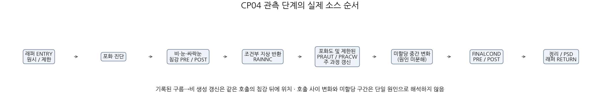
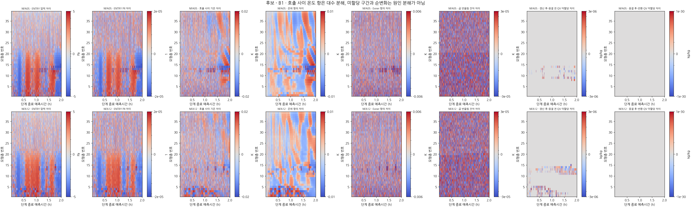
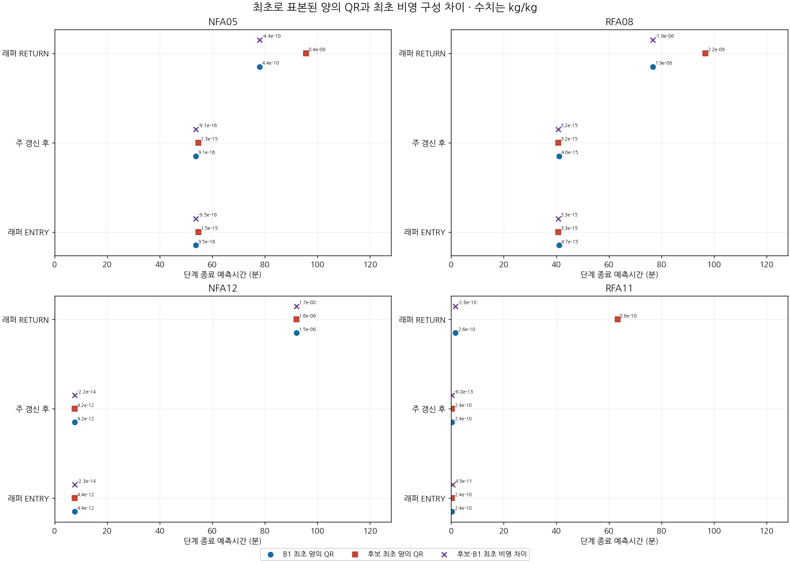
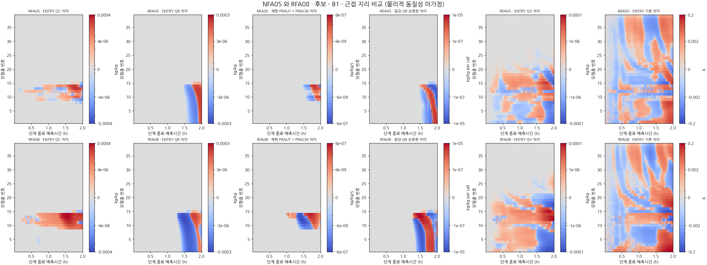
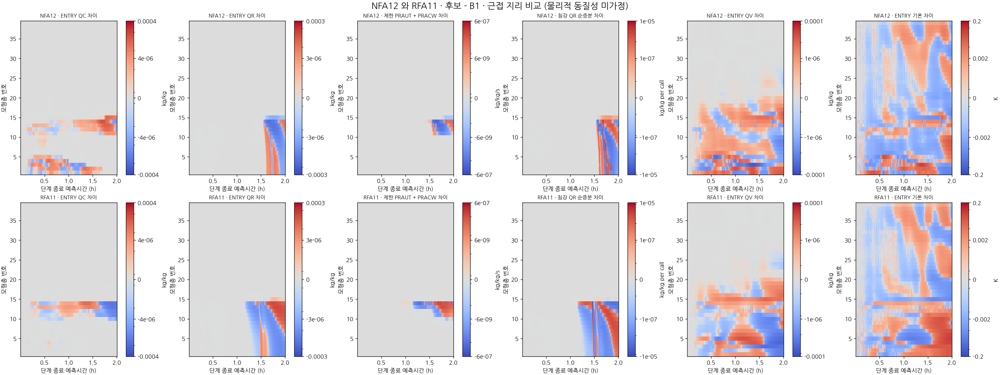
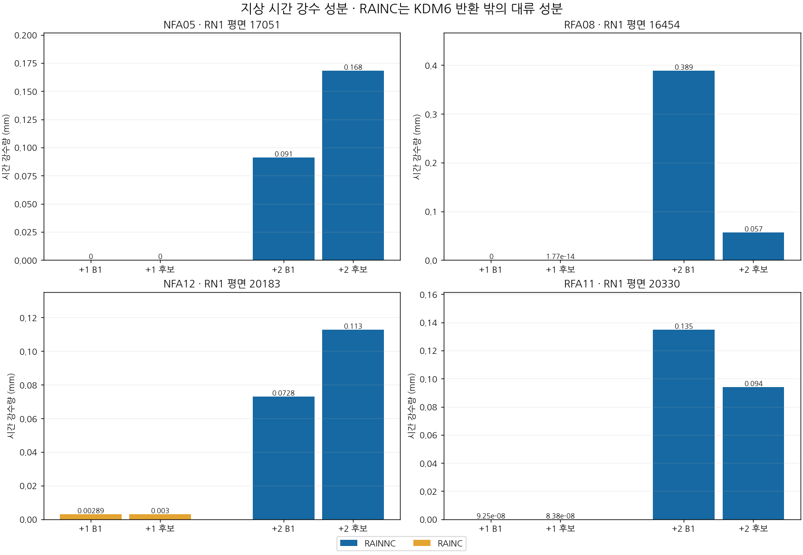
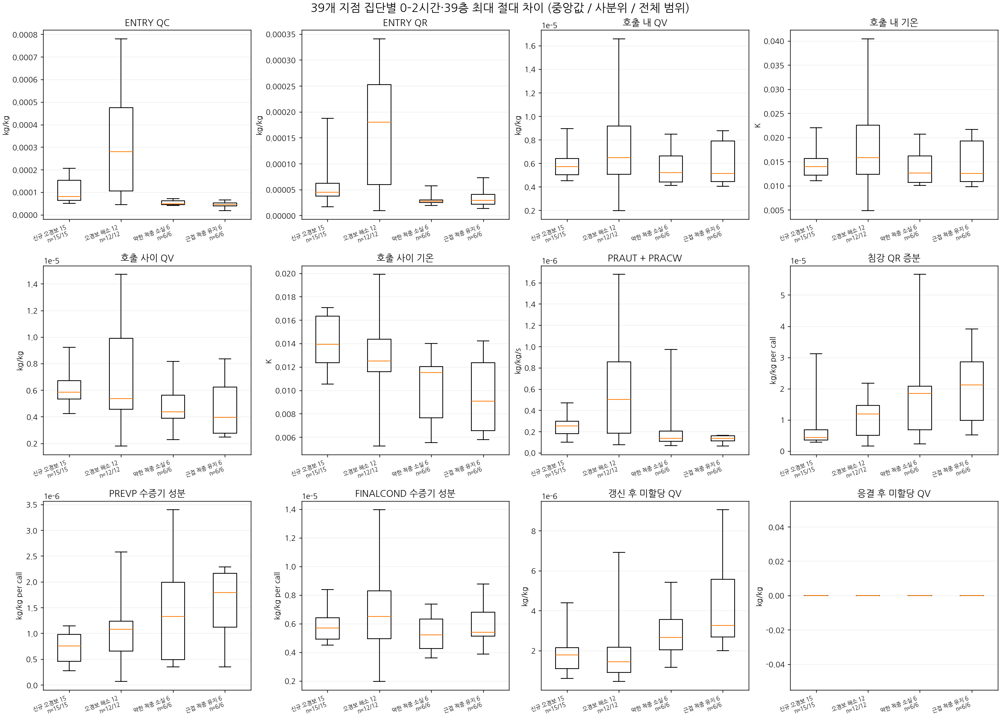

# 비 입자수 초기화에 따른 열역학–구름–강수 반응의 2시간 대조 진단

## 초록

현재 B1과 질량가중 평균입경 0.65 mm를 가정한 비 입자수 후보(DM065)의 후반 약한 강수 차이를 조사하였다. 국지 초기 비 입자수가 동일한 신규 오경보 15곳과 해소 오경보 12곳, 실제 약한 강수 적중 소실 6곳과 지리적으로 가까운 유지 대조 6곳을 선택하였다. 39개 평가점의 보간 모서리를 123개 원래 격자로 중복 제거하고, 동일한 FIX 물리 코드에서 39층·360단계의 실제 과정 경계를 기록하였다. 두 구성의 +0·+1·+2시간 전체 history 6개가 각각 기존 6시간 예보의 해당 출력과 바이트 단위로 일치하였다. 각 구성의 1,726,920개 격자·층·단계와 246개 지상 누적강수 원시 값을 검증하였다.

정시 비 질량·입자수가 0인 지점에서도 호출 진입의 열역학 차이가 먼저 관측되지만, 정시 사이에는 극미량의 비가 일시적으로 나타날 수 있었다. 따라서 정시의 0을 이전 한 시간 전체의 비 부재로 해석할 수 없다. 국지 과정 증분과 호출 사이 순변화, 구름 응결과 강수 누적을 구분하여 추적하였다. 이 실험은 기존 후보의 반응을 설명하기 위한 재적분이며 새 초기화 후보나 성능 개선을 추가하지 않는다. DM065는 기존 26개 조건 중 10개를 충족한 미채택 후보이며 현재 B1을 유지한다.

**주요어:** 강수 초기화, 비 입자수, KDM6, 임계성공지수, 구름 응결, 과정 진단

## 1. 서론

기존 B1은 규준실험 대비 첫 시간과 일부 강한 강수 임계값에서 이득을 보였으나, +2시간 이후 낮은 임계값의 적중 소실과 신규 오경보를 함께 남겼다. 공통 입경을 0.65 mm로 줄인 후보도 이 문제를 해결하지 못했다. [PR147 실패 유형 분석](CP02_FAILURE_REGIMES_20261104.md)은 신규 오경보 25곳 중 15곳의 국지 초기 QNRAIN이 변하지 않았음을 확인했다. 해소 오경보에서도 17곳 중 12곳이 같은 조건이므로, 이후 상태 차이의 존재 자체를 악화 원인으로 사용할 수 없다.

본 연구의 질문은 **같은 국지 초기 비 상태에서 들어온 차이와 국지 구름·비 과정의 차이가 어떻게 구분되며, 서로 반대인 강수 문턱 전이와 어떻게 연결되는가**이다. 사후 관측 분류는 진단 집단 선정에만 사용하고 초기화 규칙에 넣지 않는다.

## 2. 자료와 실험 방법

### 2.1 대조 구성과 표본

| 항목 | 구성·범위 |
| --- | --- |
| 현재 B1 | 배경 강수 수종 보존 및 정확한 0 과정률 처리 수정, 기존 초기 QNRAIN |
| DM065 | 같은 FIX 물리, 비 질량은 유지하고 감마 입경분포의 평균입경 0.65 mm로 QNRAIN 초기화 |
| 사례 초기시각 | 2026년 8월 16일 12 UTC; 문서 날짜는 진단 작업일 |
| 시간 | 실제 0–2시간 재적분, 시간간격 20초, 360단계 |
| 진단 집단 | 신규 오경보 15, 해소 오경보 12, 실제 약한 강수 적중 소실 6, 유지 대조 6 |
| 공간 표본 | 평가점 39, 모서리 참조 156, 원래 수평 격자 123, 질량층 39 |
| 성능 평가 | 기존 공통 3,688점·6시간·6임계값을 유지; 진단 표본으로 대체하지 않음 |

신규·해소 오경보는 +2시간 예측 0.1 mm 문턱의 전이이며, 두 집단은 양의 보간 가중치를 가진 모든 모서리·층에서 초기 QNRAIN이 같은 곳이다. 실제 약한 강수는 0.1≤RN1<1 mm, 검출은 예측 ≥0.1 mm이다. 유지 대조는 각 소실 지점에서 가장 가까운 미사용 지점을 순서대로 선택하였다. 거리는 약 5.1–22.9 km이며 물리 조건이 일치한 대조군은 아니다. [고정 선정 규약과 모서리표](evidence/cp02_thermo_cloud_path_20261105/cohorts/README.md)를 보존하였다.

### 2.2 실행 계보와 계측 검증

DM065의 기존 초기화 가정은 \(n(D)=N_0D^\mu e^{-\lambda D}\), \(\mu=1\), 물 밀도 \(\rho_w=1000\,\mathrm{kg\,m^{-3}}\)에서 \(D_m=5/\lambda\), \(N_r=q_r\lambda^3/(4000\pi)\)이다. 질량과 입자수가 같은 공기질량 기준일 때의 모멘트 관계이며, 관측으로 입경을 복원한 값은 아니다. 질량을 고정해도 입경 가정은 낙하와 증발·수종 교환을 함께 바꾸므로, 한 과정의 명목 비율만으로 지상 약한 강수의 증가를 예상할 수 없다. 이번 재적분은 이 기존 가정을 유지한다.

고정된 Intel 프로파일로 새로운 scratch에서 KDM6 모듈을 컴파일하고 기존 WRF와 다시 링크하였다. 전체 WRF의 모든 모듈을 새로 컴파일한 것은 아니다. 두 구성은 같은 진단 실행파일을 사용하며 각각의 기존 초기장·경계장 계보를 유지하였다. 첫 호출 전역 진입·반환 80개 스트림, 정시 전체 history 6개, 실행 전후 입력 89개씩의 일치를 확인하였다. 계측 바이너리 SHA-256은 `50bfde246d05d9fe62f494403d5feec969e17512a5688deb3060cb7e72c658ee`이다.

각 구성의 1,726,920개 필수 격자·층·단계가 누락·중복 없이 연결되었다. 실제 침강 분할 단계의 진입·반환은 B1 2,373,150쌍, DM065 2,274,558쌍이다. 조건부 지상 유출 경계는 각각 30,885쌍과 28,572쌍이며, 조건이 성립하지 않아 없는 기록을 0으로 채우지 않았다. [전체 분석 영수증](evidence/cp02_thermo_cloud_path_20261105/analysis/full_capture_receipt.json)과 [원시 스트림 복원 방법](evidence/cp02_thermo_cloud_path_20261105/native/archive/README.md)을 제공한다.

### 2.3 수학적 진단과 해석 단위

변수 \(x\)의 단계 \(n\) 진입·반환을 \(x_n^-,x_n^+\), 후보−B1 차이를 \(\delta x\)라 두면,

\[
L_n=\delta x_n^+-\delta x_n^-,\qquad
E_n=\delta x_{n+1}^--\delta x_n^+
\]

\[
\delta x_N^+-\delta x_1^-
=\sum_{n=1}^{N}L_n+\sum_{n=1}^{N-1}E_n .
\]

\(L_n\)은 같은 KDM6 호출 내부의 두 구성 간 순증분 차이이고, \(E_n\)은 반환 이후 다음 진입까지의 전체 순변화 차이이다. 후자는 동역학·다른 물리·갱신·변환을 포함하며 **순수 수송량이 아니다**. 이 항등식은 상태 변화의 장부이며 물리적 인과 분해나 전체 보존 수지가 아니다. 혼합비를 시간에 따라 더한 값은 해당 위치의 누적 과정 증분이며 기둥 수분 질량이 아니다.

실제 온도는 \(T=\operatorname{f32}(\theta\Pi)\)로 연결하였다. 호출 사이 곱의 변화는

\[
\theta'\Pi'-\theta\Pi
=\Pi'(\theta'-\theta)+\theta(\Pi'-\Pi)
\]

와 REAL32 곱의 반올림 항으로 나누었다. 이 대수 분해를 응결 가열·증발 냉각·압축 가열의 기여율로 해석하지 않는다. 호출 내부 압력과 Exner 값은 변하지 않았으나 호출 사이에는 변할 수 있다. 모든 비선형 진단과 과정 차이는 원래 모서리에서 계산한 뒤 기존 가중치를 적용한다.

**그림 1.** 관측 경계의 실제 순서. 비·눈·싸락눈 침강은 제한 후 주 과정 갱신보다 앞에 있다.

**그림 2.** 압력·Exner 차이와 호출 사이 온도 곱의 대수 분해. 온위 항·Exner 항은 물리적 열원별 기여가 아니며 미할당 구간은 별도로 남긴다.

## 3. 결과

### 3.1 정시 비 부재와 호출별 비 부재는 다르다

17051(NFA05)과 20183(NFA12)은 +1시간 원래 모서리의 QRAIN·QNRAIN이 두 구성 모두 0임을 다시 확인하였다. 그러나 다음과 같은 호출 진입의 극미량 값이 관측되었다.

| 지점 | 첫 양의 진입 QR: B1 / DM065 | 첫 양의 반환 QR: B1 / DM065 | 첫 진입 열역학 차이 단계 |
| --- | --- | --- | --- |
| 17051 | 161 / 164 | 234 / 287 | QV 4, 실제 온도 3, 압력 3 |
| 20183 | 23 / 23 | 276 / 276 | QV·실제 온도·압력 모두 2 |

단계는 같은 20초 시간격자의 호출 식별자이며 표본 경계가 다르므로 단계말 시각을 실제 내부 사건의 정확한 시각으로 치환하지 않는다. 20183의 단계 23 진입 QR은 B1 약 \(4.415\times10^{-12}\), DM065 약 \(4.392\times10^{-12}\) kg/kg이다. 이처럼 극미량의 양수 출현과 두 구성 사이 최초 차이, 의미 있는 지상 강수 발생을 구분해야 한다. [전체 39점·경계별 비 존재표](evidence/cp02_thermo_cloud_path_20261105/analysis/rain_presence_recount.csv)를 함께 제공한다.

소스의 비 정리 조건은 **원래 격자별** `qcrmin=1e-9 kg/kg`에 적용된다. 보간 혼합비 하나가 이 값보다 작다는 이유로 네 모서리가 모두 정리 조건을 만족했다고 단정할 수 없다. +1시간 0이라는 정시 값도 그 이전 한 시간 전체의 비 부재를 입증하지 않는다.

**그림 3.** 경계별 최초 양수와 최초 비영 차이는 서로 다른 사건이다. 극미량 수치 표본의 출현을 지상 강수 발생 시각으로 해석하지 않는다.

### 3.2 열역학 차이와 국지 구름·비 반응의 순서를 구분한다

20183에서 단계 2의 진입 차이는 QV 최대 약 \(4.70\times10^{-10}\) kg/kg, 실제 온도 약 \(-3.02\times10^{-5}\) K, 압력 약 \(-0.03287\) Pa이다. 이 값들은 각 변수의 해당 단계 최대 절대차가 나타난 층의 부호 있는 값으로, 동일한 층을 뜻하지 않는다. 기존 +1시간 보간 프로파일의 QV·실제 온도 최대 절대차가 모두 제2층이라는 관찰과도 구분한다.

계측한 제한 후 `praut`·`pracw`의 두 구성 간 차이는 20183에서 각각 단계 244·276부터, 17051에서 304·234부터 보간값에 나타났다. 이는 저장한 경계에서의 수치적 선후관계이다. 보간은 모서리별 차이를 상쇄할 수 있으므로, 이 순서만으로 원래 격자의 최초 원인이나 특정 과정의 인과 우선순위를 확정하지 않는다.

실제 호출 순서는 **진입·상태 정리 → 침강과 조건부 지상 누적 → 제한 후 과정률·수분/온도 갱신 → 후속 조정 → 최종 구름 응결 → 정리·반환**이다. 따라서 뒤쪽에서 생성된 비를 같은 호출의 앞선 침강이 지상으로 내보냈다고 설명할 수 없다. 주 갱신과 최종 응결 사이에는 CCN 활성화 등을 포함한 비분해 구간이 있고, 얼음 침강도 별도로 완전히 분해하지 않았다. 기록하지 않은 구간은 원인 이름을 붙이지 않고 순변화로 남긴다.

**그림 4–5.** 후보−B1의 시간·층별 차이. 가까운 해소 지점은 각각 16454와 20330이며 물리적 동질성을 가정하지 않는다. 같은 물리량의 비교 행은 공통 척도를 사용한다.

### 3.3 지상 총강수와 KDM6 지상 누적을 분리한다

+2시간 강수는 초기부터 2시간 누적이 아니라 예측 1–2시간 구간의 한 시간 강수량이다. 지상 검증은 \(\Delta(\mathrm{RAINNC}+\mathrm{RAINC})\)이며, KDM6 지상 반환은 이 가운데 RAINNC에 연결한다. 123개 원래 격자의 +1·+2시간 누적값, 두 구성 합계 **492개 REAL32 원시 값**이 history와 정확히 일치하였다. 별도 모서리 보간 재계산도 기존 총강수 배열과 최대 \(2.22\times10^{-16}\) mm 차이로 일치하였다. 이는 배정밀도 합산의 반올림 범위이지 물수지 허용오차가 아니다.

| 지점·시간 | 성분 | B1, mm | DM065, mm |
| --- | --- | ---: | ---: |
| 20183, +1시간 | RAINC 구간 강수 | 0.002894857 | 0.003000828 |
| 20183, +1시간 | RAINNC 구간 강수 | 2.459e−9 | 2.959e−9 |
| 20183, +2시간 | 총강수 | 0.072846 | 0.112620 |
| 17051, +2시간 | 총강수 | 0.090960 | 0.168162 |

+2시간에는 선택한 39점 모두 RAINC 구간 증분이 0이어서 표의 +2시간 차이는 RAINNC에서 나온다. 반면 20183의 +1시간 총강수를 KDM6 비 낙하만으로 설명하면 성분을 잘못 연결하게 된다. RAINC의 존재 자체가 선행 열역학 차이의 원인임을 입증하지는 않는다. [성분별 전 지점 표](evidence/cp02_thermo_cloud_path_20261105/science/surface_reference/point_components.csv)를 제공한다.

**그림 6.** 같은 구간의 RAINNC와 RAINC를 분리한 지상 강수 대조.

### 3.4 악화·해소 집단 모두에서 상태 차이가 나타난다

+1–+2시간 동안 지점별로 시간·39층 최대 절대차를 구한 뒤 집단 중앙값을 비교하였다. 진입 QV는 신규 오경보 15곳에서 약 \(4.75\times10^{-5}\), 해소 오경보 12곳에서 \(7.07\times10^{-5}\) kg/kg이고, 실제 온도는 각각 0.0839 K와 0.1502 K이다. 반면 같은 구간의 부호 있는 지점별 RAINNC 차이 중앙값은 +0.0398 mm와 −0.1121 mm로 방향이 반대이다. **더 큰 상태 차이가 곧 더 나쁜 강수라는 관계는 이 집단 비교에서 성립하지 않는다.** 집단 크기와 환경은 다르며 이 값은 기술 통계이다.

[전 39점 과정 요약·집단 분위수·상태 장부](evidence/cp02_thermo_cloud_path_20261105/science/process_groups/results/receipt.json)는 0–1시간과 1–2시간을 구분한다. 17051·20183 및 가까운 해소 지점 16454·20330의 제2층, 두 종료 시각, QV·실제 온도에 대한 16개 장부가 위 망원합 항등식과 이번 계산에서 잔차 0으로 일치했다. 이는 동일 경계 상태의 대수적 폐합이며 원인별 물·에너지 폐합이 아니다.

**그림 7.** 전 0–2시간·39층 지점별 최대 절대차의 집단 분포. 중앙값·사분위·전체 범위를 표시하며, 앞의 1–2시간 요약과 집계 구간이 다르다. 최대 진폭은 부호 있는 순변화나 기여율이 아니다.

## 4. 고찰: 다음 수정 가정의 조건

초기 국지 비 상태가 같은 악화·해소 집단을 함께 추적함으로써, 단순한 국지 입자수 유무나 정시 온습도 차이의 부호만으로 강수 전이를 설명하기 어렵다는 점을 확인하였다. 다만 고정 위치의 기록은 공기 궤적이 아니다. 진입 차이를 공급한 인접 격자·과정의 작성자와 실제 수송 플럭스까지 연결하지 않았으므로, 차이가 어디에서 만들어져 이동했는지는 미확정이다.

다음 초기화 가정은 열역학·구름 상태에 따라 달라지는 실제 생성·소멸·낙하의 조합을 근거로 정해야 한다. 이번 표본만으로 상대습도 문턱이나 공통 입경을 새로 선택하지 않는다. 후속 계측은 반응이 갈라지는 단계 전후의 원래 모서리와 비분해 구간을 좁혀야 하며, 추가 기록이 필요한 목적과 새 성능 평가를 구분한다.

## 5. 성능 판정과 검증 한계

새로운 6시간 예보나 새로운 수정 후보를 추가하지 않았으므로 기존 [시간·임계값별 전체 H/M/F·CSI 표](evidence/cp02_rain_number_process_20261104/followup/figures/FULLSCORES.md)를 유지한다. ORIGINAL 표기는 **규준실험**, 비교 축은 예측시간과 임계값을 각각 유지하며 평균 CSI로 단일 개선을 주장하지 않는다.

| DM065의 기존 사전 조건 | 충족 / 전체 | 현재 판정 |
| --- | ---: | --- |
| B1 보호: +1시간 여섯 임계값 및 각 시간 5 mm CSI | 8 / 11 | 미달 |
| +2–+6시간 0.1·0.5·1 mm CSI의 규준실험 수준 회복 | 2 / 15 | 미달, B1 미달 조건의 새 회복 0개 |
| 전체 | 10 / 26 | **미채택·현재 B1 유지** |

이는 조건 충족 수이며 평균 점수나 확률이 아니다. 두 기존 구성의 정시 전체 파일 일치는 이번 진단 적분이 해당 예보 경로를 재현했다는 근거이다. 국지 REAL32 연산의 잔차 0이나 상태 장부의 일치는 전체 물·에너지 수지 완결을 뜻하지 않는다. 같은 시점의 건조공기 질량, 전체 경계 수송·강수 유출, 정확한 real 내부 작성 정책, RN1 상류 시각·coverage/QC, 조정하지 않은 독립 사례는 여전히 필요하다. 별도 C2 T39와 H/A/N 1시간 완료도 본 CP02 재적분으로 해결되지 않는다.

## 6. 재현 자료

[그림 7장 모음](evidence/cp02_thermo_cloud_path_20261105/figures/gallery.md)과 [오프라인 그림 묶음](evidence/cp02_thermo_cloud_path_20261105/figures/offline_gallery.zip)을 제공한다. ZIP을 풀고 `index.html`을 열면 네트워크 없이 볼 수 있다.

[분석 설명과 배열 순서](evidence/cp02_thermo_cloud_path_20261105/analysis/README.md), [원시 기록 보존](evidence/cp02_thermo_cloud_path_20261105/native/archive/README.md), [배열 손실 없는 분할 검증](evidence/cp02_thermo_cloud_path_20261105/validation/array_parts_review.json), [독립 분석기 검토](evidence/cp02_thermo_cloud_path_20261105/validation/native_analyzer_team_review.json)를 연결하였다. 이전 PR147의 161개 산출물과 최종 manifest·검토 기록은 변경하지 않았고, 갱신한 상태 문서와 그래프는 보존본으로 대조한다.

관련 추적 파일을 별도 디렉터리로 내보낸 시험에서 **51개 시험 파일의 327개 시험이 모두 통과**하였다. 그림 7장과 표·metadata의 재생성이 바이트 단위로 일치했고, 독립 계산으로 그림용 진폭 468개를 대조하였다. 이는 관련 Python 시험 범위이며 전체 portable suite 실행을 뜻하지 않는다. 실제 WRF 2시간 대조와 정시 출력 일치는 별도의 native 실행 근거다. [시험 영수증](evidence/cp02_thermo_cloud_path_20261105/validation/clean_export_suite.json)을 연결한다.

## 참고자료

1. Cloud-BAL, [실패 유형별 전이와 정시 상태 진단](CP02_FAILURE_REGIMES_20261104.md), PR147 보관 연구 기록.
2. Cloud-BAL, [비 입자수 과정 진단과 0.65 mm 후보의 6시간 대조](CP02_RAIN_NUMBER_PROCESS_20261104.md), PR146 보관 연구 기록.
3. [이번 실행의 계측 KDM6 소스](evidence/cp02_thermo_cloud_path_20261105/native/source/module_mp_kdm6_FIX.f90), [고정 소스 해시](evidence/cp02_thermo_cloud_path_20261105/native/source/source_freeze.json), [기록 단계와 필드 규약](evidence/cp02_thermo_cloud_path_20261105/native/schema/cp04_schema.json).
