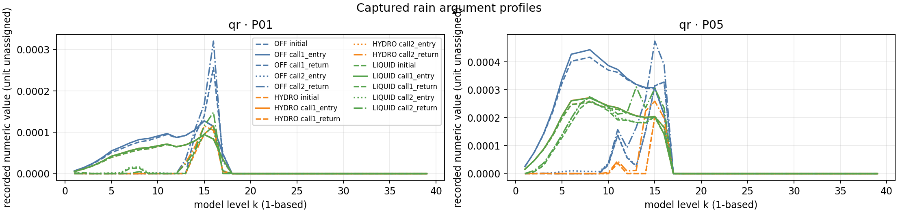
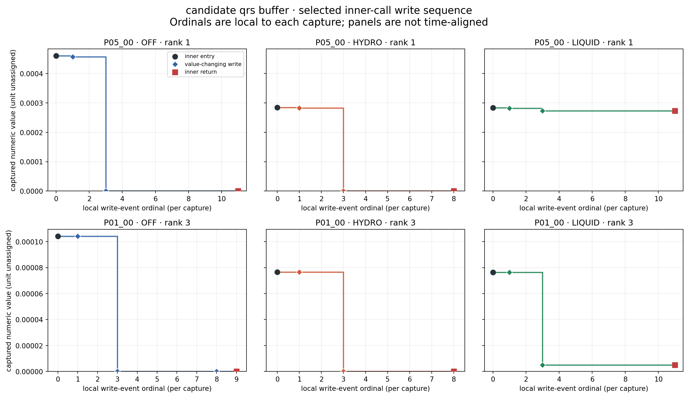

# CP02 초기 열역학 상태와 첫 KDM6 반응

기준은 PR126의 `8fc72694412e39453dd35574ccfc96c8c6632d4c`이며, 과거 CP02 OFF/HYDRO/LIQUID를 조사한다. 최신 C2 H/A/N 실험과 구분한다. 생산용 Fortran, 초기장, 경계조건과 수종 보정계수는 변경하지 않았다.

## 초기 상태와 호출 경계

[새 초기장 추출](evidence/cp02_thermo_response_20261029/binary/initial_thermo_receipt.json)은 원래 세 `wrfinput_d01`의 해시를 PR126과 대조하고, 3실험 × 624개 표본을 같은 격자·층·가중치로 읽는다. QVAPOR/QCLOUD/QRAIN 외에 `T`, `THM`, `P`, `PB`의 원시 REAL32 값을 보존한다. `T`는 입력 파일 설명의 섭동온위이며 실제 온도로 바꾸지 않는다. `T00=290`을 `T`에 더해 호출의 `th`로 간주하지 않는다.

[재현 분석](evidence/cp02_thermo_response_20261029/analysis/thermo_response/summary.json)은 PR126 원시 캡처를 기존 엄격 검증기로 다시 검사한 뒤 초기장과 좌표로 연결한다. 초기장과 driver 사이의 모든 변환을 연속 포착한 것은 아니다. 런타임 `q/qc/qr/th` 등은 바이너리와 인접 소스에서 유래한 후보 이름이며, 입력 변수의 단위를 자동으로 부여하지 않는다.

P05, native k=8의 네 모서리 가중값은 다음과 같다. P05는 적중 유지 지점이다.

| 후보 상태 | HYDRO | LIQUID |
|---|---:|---:|
| 첫 PRE qr | 2.718877195e-4 | 2.710022856e-4 |
| 첫 PRE q | 0.015360400 | 0.015865936 |
| 첫 PRE qc | 6.026059e-4 | 9.948435e-5 |
| 첫 PRE th | 302.669608 | 301.366774 |
| 첫 POST qr | 0 | 2.615345799e-4 |

첫 호출 PRE QR가 비슷해도 다른 입력 상태와 전체 호출의 반응이 다르다. OFF에서도 이 층의 첫 POST qr는 0이다. 한 층의 QR 감소를 적중 소실의 판정 기준으로 사용하지 않는다.

[초기·호출 상태 전체 그림](evidence/cp02_thermo_response_20261029/analysis/thermo_response/thermodynamic_state_profiles.png)은 `T/THM/P/PB`를 별도 패널로 유지한다. 분석 CSV와 입력 해시를 확인한 뒤 그림을 생성한다.

## 호출 사이 작은 양수 값

같은 624개 격자·층에서 첫 반환 `qr<=0`, 두 번째 진입 `qr>0`을 새 양수로 정의했다. 물리적 활성 임계값은 적용하지 않았다.

| 실험 | 새 양수 개수 | 중앙값 | 최댓값 |
|---|---:|---:|---:|
| OFF | 155 | 2.252763531e-9 | 3.082904004e-5 |
| HYDRO | 163 | 1.319625742e-9 | 3.684843477e-6 |
| LIQUID | 123 | 3.790206760e-10 | 9.458055501e-6 |

양수 개수 증가를 수종 질량이나 지상 강수의 회복으로 해석하지 않는다. 별도로 LIQUID **두 번째 반환**의 `qr>0, nr==0`은 63개이며 최댓값은 `4.488841805e-4`이다. 두 번째 **진입**에서는 162개, 최댓값 `4.505567485e-4`이다. 경계가 다르므로 합쳐 집계하지 않는다.

## 내부 계측과 검증

같은 과거 실행파일 SHA-256 `de110a7f…c168`과 pinned Intel 환경을 사용해 새 scratch에서 세 실험을 실행했다. 각 실행은 첫 KDM6 반환 뒤 의도적으로 종료했으며 MPI 종료 코드 255는 예보 완료가 아니다. 각 arm의 원래 입력 88개와 복사본의 실행 후 해시, 초기 history와 보존 history의 바이트 동일성을 확인했다. [실행 준비](evidence/cp02_thermo_response_20261029/runtime/prepare_v6.json)와 [HYDRO](evidence/cp02_thermo_response_20261029/captures/HYDRO/receipt.json)·[OFF](evidence/cp02_thermo_response_20261029/captures/OFF/receipt.json)·[LIQUID](evidence/cp02_thermo_response_20261029/captures/LIQUID/receipt.json) receipt에 연결한다.

내부 함수 진입은 `0x25e2490`, 호출자 반환은 `0x25e0fe9`이다. 선택 기둥의 작업 배열 QR/QC/Q는 바깥 인자의 원시 바이트와 대조했다. 내부 t는 REAL32(th×pii)와 1 ULP 이내인지 확인했다. 단위나 물리적 의미를 확정하는 검사는 아니다. 선택된 성공 기록 12개에서 후보 `lat` 인자 32의 원시 슬롯은 `0x27`이다. 0이 아니지만 유효한 포인터로 검증된 값은 아니며 역참조하지 않았다. Q 슬라이스 주소의 행 간격으로 j를 재계산해 바깥 격자 소유권과 대조했다. 성공 기록에서 null인 슬롯은 39–44이며 미확보로 보존했다. 더 넓은 null 목록은 실패한 두 번째 계측 시도의 기록이다. [정정 근거](evidence/cp02_preclamp_20261029/science/independent_check.json)

각 실험에서 P01/P05 네 모서리·k=8의 내부 진입/반환 8개 표본을 확보했다. 그중 P01_00 `(163,73,8)`, P05_00 `(163,70,8)`에서는 내부 qrs/qci/q/t 네 주소의 하드웨어 감시점을 사용했다. 감시 사건의 순번은 물리적 시간축이 아니며, 같은 값을 다시 저장한 명령을 모두 열거하는 것도 아니다.

P05_00의 두 번째 QR 변경 저장 명령은 세 실험 모두 `0x25f4e58`이다. 감시점에 기록된 **저장 다음 PC**는 `0x25f4e5e`로 구분한다. 해당 구간은 계산된 값을 0과 비교하는 clamp를 거쳐 저장한다.

| P05_00 | 해당 QR 쓰기 직전 | 쓰기 직후 | 직전 Q 쓰기의 증가량 |
|---|---:|---:|---:|
| OFF | 약 4.570045e-4 | 0 | 약 4.570037e-4 |
| HYDRO | 약 2.823228e-4 | 0 | 약 2.823230e-4 |
| LIQUID | 약 2.816220e-4 | 약 2.731135e-4 | 약 8.508563e-6 |

값은 후보 배열의 REAL32 수치다. Q 증가와 QR 감소의 크기가 가깝지만, 이를 격자 물질량·물수지 검증으로 바꾸지 않는다. 각 실험이 다른 저장 명령을 거친다는 설명보다 **같은 갱신 구간에서 계산된 잔여 QR가 달라진다**는 관찰이 맞다. HYDRO에서는 이후 Q 증가, QC 감소, t 감소도 포착됐다. OFF·LIQUID의 뒤쪽 Q/QC 변화 방향은 해당 P05 표본에서 HYDRO와 다르다.

[기계 명령 연결](evidence/cp02_thermo_response_20261029/binary/qrs_write_instruction_map.md)과 [실험별 쓰기 비교](evidence/cp02_thermo_response_20261029/binary/arm_qrs_branch_comparison.md)는 원시 이벤트와 disassembly를 연결한다. 해당 분기의 검사 피연산자는 컴파일러의 국지 작업 배열까지 추적됐으나 정확한 빌드 소스와 물리적 과정 이름은 아직 연결되지 않았다. 증발량·응결량·상변환량으로 단정하지 않는다. P01 OFF에서는 이 저장 직후 작은 양수 약 7.28e-12가 남았다가 다른 저장 명령에서 0이 된다.

## 실패 시도와 재현 범위

성공 자료 이전의 다섯 진단 시도도 별도 보존했다. 인자의 null 여부를 과도하게 가정한 두 시도, GDB 표현식 언어 오류, 반복 반환 중단점 오류, rank 저장 완료 확인의 경쟁 상태를 각각 수정했다. 이들은 계측기 문제이며 과학적 PASS 결과에 포함하지 않는다. [시도 1](evidence/cp02_thermo_response_20261029/failed_attempt1/receipt.json), [2](evidence/cp02_thermo_response_20261029/failed_attempt2/receipt.json), [3](evidence/cp02_thermo_response_20261029/failed_attempt3/receipt.json), [4](evidence/cp02_thermo_response_20261029/failed_attempt4/receipt.json), [5](evidence/cp02_thermo_response_20261029/failed_attempt5/receipt.json).

[내부 후처리](../tools/cp02_kdm6_inner_response.py)의 세 실험 결과는 모두 `PASS_SCOPED_CAPTURE_CONTINUITY`다. 각 실험에서 624개 표본 × 진입/반환 × 핵심 25개 필드, **31,200개 값**이 PR126과 바이트 동일하다. 선택적 `refl_10cm`은 진입과 반환 각각 OFF 2개, HYDRO 4개, LIQUID 4개에서 다르며 별도 집계한다. 다른 세 선택적 배열은 비교한 바이트가 같다. 이 검사는 선택 핵심 필드의 첫 호출 재현이며, 전체 영역·전체 적분의 비간섭 검증이 아니다. 내부 표본은 실험당 8개 위치의 진입/반환 16행, 하드웨어 값 변경 사건은 OFF 18개·HYDRO 14개·LIQUID 20개다. [OFF 분석](evidence/cp02_thermo_response_20261029/analysis/inner/OFF/summary.json) · [HYDRO 분석](evidence/cp02_thermo_response_20261029/analysis/inner/HYDRO/summary.json) · [LIQUID 분석](evidence/cp02_thermo_response_20261029/analysis/inner/LIQUID/summary.json).

최종 계측기는 한 개의 내부 반환 중단점과 두 단계 rank 완료 확인을 사용한다. 모든 rank의 저장 완료 확인 뒤에만 종료한다. 입력·capture hash, 실제 ABI 포인터·주소·stride, 전역 표본 소유권, 이전 첫 호출과의 바이트 비교, 감시 사건의 연결은 후처리 검증에서도 다시 검사한다. 추적 파일만 별도 디렉터리에 내보낸 집중 시험은 **172개 통과**다. 새 시험은 열역학 연결 7개와 내부 capture 검증 10개이며 기존 155개에 포함되지 않는 추가 시험이다. 세 내부 분석의 JSON·CSV·manifest, 열역학 분석·그림, 내부 쓰기 그림 및 수치 비교의 **24개 산출물을 바이트 동일하게 재생성**했다. 과거 PR123·124·125·126의 50·28·108·184개 증거 항목도 모두 크기·해시가 유지된다. 전체 portable suite나 새 Fortran 빌드는 실행하지 않았다.

별도 checkout 시험에서 발견한 분석기 프로파일 경로 결합은 수정했다. 실행 당시 프로파일 경로는 그대로 남기고, 현재 프로파일과의 동일성은 내용 SHA-256으로 검사한다. 동일한 바이트의 다른 경로를 허용하고 변조를 거부하는 시험을 추가했다. 이 수정으로 세 실험의 분석 CSV는 바이트 그대로이며 summary의 분석기 해시만 바뀌었다. [수정 전 시험](evidence/cp02_thermo_response_20261029/clean_export_before_portability_fix.json) · [최종 시험](evidence/cp02_thermo_response_20261029/clean_export.json) · [재생성](evidence/cp02_thermo_response_20261029/clean_reproduction.json) · [과거 증거 확인](evidence/cp02_thermo_response_20261029/historical_evidence_check.json).

[내부 QC 그림](evidence/cp02_thermo_response_20261029/analysis/inner_write_events/qci_inner_write_events.png), [Q 그림](evidence/cp02_thermo_response_20261029/analysis/inner_write_events/q_inner_write_events.png), [t 그림](evidence/cp02_thermo_response_20261029/analysis/inner_write_events/t_inner_write_events.png)은 같은 표본의 상태 변화도 보여준다. 각 표본 행에서 실험 간 y축 범위는 공통이며, x축 사건 순번은 실험마다 독립적이다.

최종 시험·독립 검토·KG 기록은 [validation](evidence/cp02_thermo_response_20261029/validation.json)에 묶는다.

## 남은 범위

초기 입력→driver 변환의 연속 추적, 정확한 빌드 소스 연결, 변수별 물리적 사용 조건, 직접 판독한 모델 시각·RK 단계, 같은 호출 시점의 MU/MUB·hybrid 질량 기준, 과정별 수지와 강수 flux는 별도 검증 대상이다. 초기 파일의 계수만으로 호출 시점의 물수지를 닫았다고 주장하지 않는다.

이번의 소수 탐색 지점과 짧은 진단 실행은 3,688점·6시간·6임계값의 강수 성능 검증을 대체하지 않는다. RN1 실제 상류 시각·coverage, C2 T39와 H/A/N 1시간 완료, 전체 물·에너지 수지와 새 예보 개선 판단은 미완료로 유지한다. 과거 증거 manifest에 묶인 `CURRENT_RESEARCH_STATUS.md`는 변경하지 않고 이번 진행과 제한을 이 문서에 기록한다.
