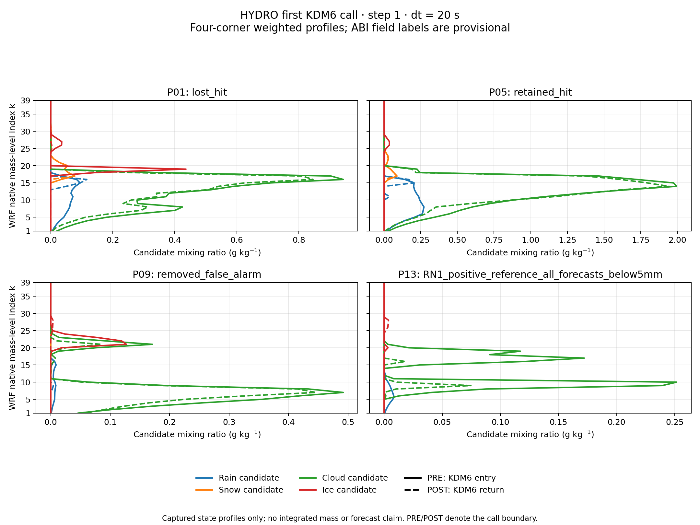

# CP02 HYDRO: 첫 WRF KDM6 호출의 PRE/POST

## 확인한 실행 범위

PR124의 `89484dc`를 기준으로, 과거 CP02 HYDRO 실행파일을 재빌드하지 않고 새 scratch에서 실행했다. 실행파일 SHA-256은 `de110a7f1d40143a74ffedbe64ed5b3717c413876093f56d200563e2f6b9c168`이며 과거 CP02 계보와 같다. 원래 namelist, 8 MPI rank, OMP 1을 유지하고 pinned Intel profile을 사용했다. 입력 88개는 복사 전후 및 실행 후 원본·복사본 해시가 모두 같다.

**8개 rank의 첫 KDM6 진입과 반환을 모두 포착했다.** 마지막 반환 기록을 확보한 뒤 GDB가 inferior를 종료하도록 설계했으며 MPI launcher 종료 코드는 255다. 이는 의도한 진단 중단이며 예보 성공·1시간 또는 6시간 완주가 아니다. OFF·LIQUID를 이번에 실행하지 않았다. GDB 종료와 MPI 정리 때문에 console의 RETURN 문구는 일부 rank에서만 flush됐다. 8개 완료 판정은 모두 디스크에 저장된 PRE/POST JSON을 기준으로 한다. [실행 영수증](evidence/cp02_wrf_first_call_20261029/capture/receipt.json)

최초 시도는 GDB의 startup shell 경로에서 중단점 삽입에 실패하여 모델 캡처가 없었다. `startup-with-shell off`로 실행한 두 번째 시도의 결과를 사용한다. 실패 로그와 당시 스크립트도 [별도 보존](evidence/cp02_wrf_first_call_20261029/attempts/startup_shell/receipt.json)했다.

## 주소·격자·시간 연결

실행파일에는 함수 심볼이 있지만 DWARF는 없다. 실제 driver call의 기계어는 6개 register pointer와 71개 stack pointer, 총 77개 인자를 전달한다. 정확한 KDM6 시작 주소 `0x25df680`에서 읽고, 동일 호출자의 반환 주소 `0x20c3722`에서 같은 buffer 주소를 다시 읽었다. 원시 register·stack, scalar bytes, 메모리와 tile 범위, 각 표본 offset, 호출 스택, runtime library mapping을 보존했다. 선택 배열의 전체 주소 범위가 실제 읽기·쓰기 가능한 mapping 안에 있음을 독립 검토했다. [ABI 자료](evidence/cp02_wrf_first_call_20261029/abi/README.md)

| 항목 | 이번 확인 |
|---|---|
| 선택 대상 | 기존 P01 적중 소실 / P05 적중 유지 / P09 오경보 제거 / P13 약한 강수: 각 RN1 지점의 네 WRF 모서리 |
| 수직 표본 | 16개 모서리 × native k=1..39 = 624개 |
| 실제 소유 rank | rank 1: 390개, rank 3: 234개 |
| halo 처리 | 메모리 안에 있어도 tile 밖이면 비교에서 제외 |
| 각 rank tile 수 | 새 rsl 기록에서 1개 |
| 호출의 시간 인자 | `itimestep=1`, `delt=20 s`, 8개 rank 동일 |
| RK 단계 | 직접 인자가 없으며 미확정 |
| 유효시각 | 시작 12:00 UTC와 위 인자로 계산한 명목 시각은 12:00:20; 모델 clock 직접 판독 아님 |

**배열 이름은 인접 보관 소스의 signature로 부여한 후보 이름이다.** 그 소스가 실제 컴파일 입력이었다는 연결은 아직 없다. 이번 검증은 기계어 ABI, live 범위·상수, 원시 바이트와 동일 buffer PRE/POST에 근거하며, 소스 전체 복원이나 모든 인자의 물리 의미를 입증한 것은 아니다. 실제 REAL32 접근은 Fortran `(i,k,j)` 순서의 offset으로 기록한다. 자료를 바탕으로 변수별 의미를 더 검증할 수 있도록 원시 정보를 유지했다.

새 12 UTC 초기 history는 과거 HYDRO 초기 history와 **파일 전체가 바이트 동일**하다. 이 결과는 시작 상태의 재현을 지지하지만 첫 호출의 PRE가 t0와 같다는 뜻은 아니다. 첫 호출 이후 전체 적분의 진단 비간섭 검사를 대신하지도 않는다. 초기장·hybrid 계수는 [별도 기준 자료](evidence/cp02_wrf_first_call_20261029/inputs/README.md)로 보존한다.

## 첫 호출의 변화

다음은 624개 소유 표본에서 원시 REAL32가 달라진 개수다. 후보 변수 이름을 사용하며, 전체 영역·독립 관측 표본 수가 아니다.

| 후보 필드 | PRE→POST 변경 수 |
|---|---:|
| 수증기 q | 426 |
| 구름물 qc | 452 |
| 비 qr | 274 |
| 구름얼음 qi | 426 |
| 눈 qs | 173 |
| 싸락눈 qg | 24 |
| QNCCN에 대응하는 nn | 519 |
| QNCLOUD에 대응하는 nc | 32 |
| QNICE에 대응하는 ni | 122 |
| QNRAIN에 대응하는 nr | 19 |
| QIB에 대응하는 bg | 56 |

입자수와 부피 관련 buffer도 함께 바뀌므로, 이후 실험에서는 수종 질량만 비교해서는 첫 반응을 설명하기 어렵다. `bg`는 후보 소스·Registry에서 부피 혼합비이며 입자수가 아니다. KDM6 PRE의 `qc`, `qi`에는 작은 음수도 있으므로 PRE를 임의로 clipping하지 않았다.

반사도 진단은 `do_radar_ref=0`이다. 그 buffer에는 매우 큰 값이 있지만 활성 반사도 결과로 해석하지 않는다. 원시 자료는 보존하되 과학 비교에서는 제외한다. 강수 등 2차원 변수는 같은 기둥의 39개 층에 반복되므로 16개 모서리로 중복을 제거해야 한다.

이번 PRE/POST는 KDM6 전체 호출 경계다. 증발·응결·상변환·낙하를 분해한 과정량이 아니며, QR 감소를 특정 과정이나 지상 강수 손실로 귀속하지 않는다. 같은 호출 시점의 MU와 실제 hybrid mass carrier는 아직 포착하지 못했다. 보관 초기 hybrid 계수나 순간 density만으로 전체 물·에너지 수지를 닫지 않는다.

그림은 기존 bilinear 네 모서리 가중치로 계산한 프로파일이며 세로축은 native 층 번호다. 같은 질량이나 고도 간격으로 적분한 수종량이 아니다. [독립 캡처 검토](evidence/cp02_wrf_first_call_20261029/independent_capture_review.json)

## 다음 범위

OFF와 LIQUID의 동일 경계 비교, ABI 변수 의미의 추가 확인, 실제 과정량 및 동일 시점의 건조공기 질량 연결이 남아 있다. 현재 네 RN1 지점은 탐색 표본이며 3,688점·6시간·6임계값 강수 검증을 대신하지 않는다. RN1 상류 시각·coverage, C2 T39/H/A/N 완료, 전체 수지는 별도 미완료 항목이다. 이번 실행으로 강수예측 개선을 승인하지 않는다.

## 검증과 재현

추적할 파일만 `git archive`로 내보낸 별도 checkout에서 **기존 115개 + 신규 26개 = 141개 시험이 통과**했다. 신규 시험은 유지 중인 파일별 runner에서도 26개 통과·0개 skip이며 위 합계에 포함된다. 캡처 CLI의 summary·13,232행 profiles·manifest와 그림 PNG·metadata를 재생성해 보관본과 바이트 동일함을 확인했다. 전체 portable suite는 실행하지 않았다. [clean export](evidence/cp02_wrf_first_call_20261029/clean_export.json) · [시험 로그](evidence/cp02_wrf_first_call_20261029/clean_focused_tests.txt) · [재분석 결과](evidence/cp02_wrf_first_call_20261029/analysis/final/summary.json)

분석기는 rank·호출 반환·정수 표본 키·실제 배열 offset·원시 값·단일 소유권과 함께, 실행 영수증의 실행파일·runtime mapping·입력 목록·선정 표본·캡처 해시를 대조한다. 모순된 입력 보존 수, 초기 history 동일성, 종료 코드도 거부한다. 팀 검토에서 발견한 영수증 일관성 누락을 보강한 뒤 재검증했다. 출력은 새 디렉터리에만 생성하며 실패 시 새 산출물을 정리한다. [팀 검토](evidence/cp02_wrf_first_call_20261029/team_review.json) · [최종 자료 목록](evidence/cp02_wrf_first_call_20261029/validation.json)

Graphify는 새 분석기와 시험 두 파일만 유지 corpus에 반영한다. ABI·캡처·그림·보고서는 별도 hash 증거이며 그래프 추출로 검증한 결과가 아니다. KLAPS50과 Cloud-BAL의 날짜별 snapshot을 구분하고 기존 190개 snapshot을 보존한다. 작업용 checkout의 의도치 않은 전체 Graphify 갱신은 감사 후 원복했으며 이번 PR에 포함하지 않는다. [KG 기록](evidence/cp02_wrf_first_call_20261029/kg/graphify_full_update_audit.json)
