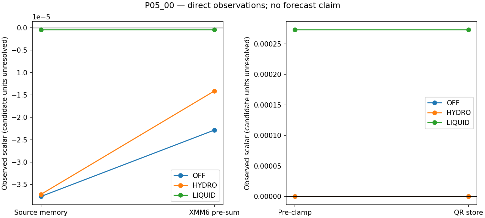
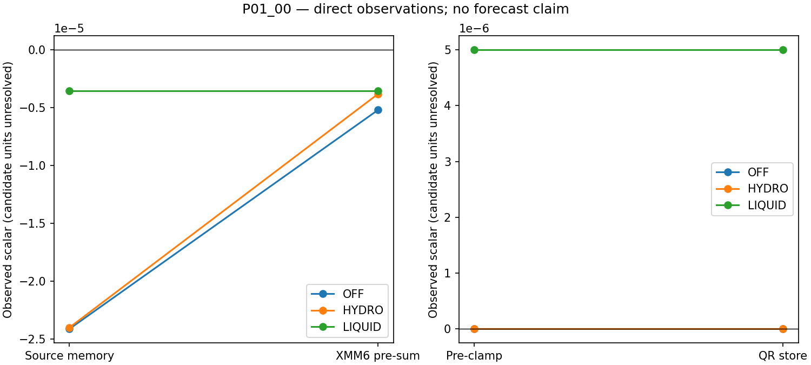

# CP02의 QR 합산에 사용된 `xmm6` 생성 명령 추적

이 자료는 과거 CP02 원본 실행 파일의 첫 내부 KDM6 호출에서 P01_00 `(163,73,8)`, rank 3과 P05_00 `(163,70,8)`, rank 1의 QR 저장에 사용된 `xmm6` 값을 명령 수준에서 추적한다. OFF, HYDRO, LIQUID 각 사례의 결과는 해당 셀과 호출에 한정된다. 원본 실행 파일은 SHA-256 `de110a7f1d40143a74ffedbe64ed5b3717c413876093f56d200563e2f6b9c168`이고 새로 빌드하지 않았다.

[앞선 관측](CP02_PRECLAMP_RESPONSE_20261029.md)은 여섯 저장에서 `xmm6 × 20`이 QR 합산의 증감항과 일치함을 보여 주었지만 `xmm6`의 생성 명령은 특정하지 않았다. 이번 추적은 저장 전 해당 셀의 인덱스와 주소를 이용하여 `xmm6`의 로드, 조건부 곱셈, 분기 합류와 합산을 연결한다. 로드 원천은 바이너리 프레임의 포인터가 가리키는 배열이며, 이 관측만으로 소스 변수나 물리 과정의 이름을 부여하지 않는다.

[연속 디스어셈블리와 제어 흐름 분석](evidence/cp02_xmm6_producer_20261029/binary/analysis.md)은 누락되었던 `0x25f4680–0x25f49ef`를 포함한다. 관측된 합산 경로에서 `0x25f4492`가 `xmm6`을 `[*(rbx+0xc0)+4*r8]`에서 로드한다. 이후 비교에 따라 `0x25f44be`가 `xmm6`을 `xmm3`으로 곱할 수도 있다. 해당 배열 위치는 곱셈 후 `0x25f44c2`에서 갱신되므로, 곱셈 입력은 저장 전 값을 사용해야 한다. `0x25f4dcd`에서야 QR 대상 포인터가 `r12`에 로드되므로, 그 전의 셀 조건은 `[rbx+0x18]+4*r8`로 확인하고 후속 저장 대상과 대조한다. `r12`는 중간에 다른 용도로 재사용된다.

| 실험 | 셀 / rank | 로드 값 | 곱셈 직전 `xmm3` | 합산에 전달된 `xmm6` | 마지막 쓰기 |
|---|---|---:|---:|---:|---|
| OFF | P05_00 / 1 | -3.76811731e-5 | 0.606409669 | -2.28502286e-5 | `0x25f44be` 곱셈 |
| OFF | P01_00 / 3 | -2.41430935e-5 | 0.215588346 | -5.20496951e-6 | `0x25f44be` 곱셈 |
| HYDRO | P05_00 / 1 | -3.72083377e-5 | 0.379381090 | -1.41161399e-5 | `0x25f44be` 곱셈 |
| HYDRO | P01_00 / 3 | -2.40234895e-5 | 0.159119725 | -3.82261123e-6 | `0x25f44be` 곱셈 |
| LIQUID | P05_00 / 1 | -4.25428141e-7 | — | -4.25428141e-7 | `0x25f4492` 로드 |
| LIQUID | P01_00 / 3 | -3.56514943e-6 | — | -3.56514943e-6 | `0x25f4492` 로드 |

표의 값은 직접 캡처한 REAL32 레지스터 값이다. 네 OFF/HYDRO 사례는 곱셈 전후의 중단점을 모두 통과했고, 두 LIQUID 사례는 비교 후 곱셈 중단점을 통과하지 않고 분기 합류점에 도달했다. 합류점부터 합산점까지의 명령과 캡처된 값이 함께 마지막 쓰기를 뒷받침한다. 이 차이는 이 여섯 사례의 분기와 값에 관한 관찰이며, 다른 셀이나 시각에 대한 일반적인 물리적 인과관계를 뜻하지 않는다. [원시 캡처](evidence/cp02_xmm6_producer_20261029/captures/).

비교 직전의 `xmm4`와 `xmm3`도 직접 기록했다. OFF/HYDRO에서는 `xmm4 > xmm3`이어서 곱셈 경로에 들어갔고, LIQUID에서는 `xmm4 ≤ xmm3`이어서 곱셈을 건너뛰었다. 각 이벤트의 로드 입력, 분기 비교, 곱셈 결과와 저장 전 값은 [분석 표](evidence/cp02_xmm6_producer_20261029/analysis/producer.csv)에 있으며, 직접 관측과 REAL32 순서에 따른 재계산은 구분했다. [분석 요약](evidence/cp02_xmm6_producer_20261029/analysis/summary.json)에는 실행별 범위와 해시가 기록되어 있다. 이번 중단점 실행은 예보 완료나 강수 결과의 검증이 아니며, 로드 입력의 단위와 물리적 출처도 해결하지 않는다.

`0x25f44a4`의 비교 피연산자와 관측된 분기 결과는 다음과 같다. 숫자는 비교 직전의 REAL32 값이다.

| 실험 / 셀 | `xmm4` | `xmm3` | 비교 및 경로 |
|---|---:|---:|---|
| OFF / P05_00 | 7.53623433e-4 | 4.57004528e-4 | `xmm4 > xmm3`, 곱셈 |
| OFF / P01_00 | 4.82861884e-4 | 1.04099396e-4 | `xmm4 > xmm3`, 곱셈 |
| HYDRO / P05_00 | 7.44166784e-4 | 2.82322813e-4 | `xmm4 > xmm3`, 곱셈 |
| HYDRO / P01_00 | 4.80469782e-4 | 7.64522192e-5 | `xmm4 > xmm3`, 곱셈 |
| LIQUID / P05_00 | 8.50856304e-6 | 2.81622022e-4 | `xmm4 < xmm3`, 건너뜀 |
| LIQUID / P01_00 | 7.13029876e-5 | 7.63041899e-5 | `xmm4 < xmm3`, 건너뜀 |

네 곱셈 사례에서 비교 당시 `xmm3 / xmm4`를 REAL32로 반올림한 값은 곱셈 직전 직접 읽은 `xmm3`과 모두 일치한다. 곱셈은 OFF/HYDRO의 로드 값을 변경하지만 LIQUID에서는 실행되지 않는다. HYDRO와 LIQUID는 이미 로드 **전의 배열 값**이 두 셀 모두 서로 다르다. 따라서 이번에 관측한 구간에서는 분기와 곱셈보다 앞서 입력 차이가 존재한다. 이것이 전체 실행에서 최초의 차이나 원인이라는 뜻은 아니다. 그 배열 값을 앞서 생성한 명령과 물리적 의미는 아직 확인되지 않았다.

캡처 파일은 생성 명령과 합산 명령 이벤트를 별도 목록에 보존하며 두 목록을 가로지르는 공통 순번은 없다. 두 목록은 같은 선택된 내부 호출의 프로세스와 셀 주소, 제어 흐름 및 일치하는 레지스터 값으로 연결한다. 따라서 목록 간의 직접적인 시간 순서를 별도 순번으로 증명한 것은 아니다.

## 그림과 재현 검증

왼쪽은 원천 배열 값과 합산에 전달되는 `xmm6`, 오른쪽은 QR 제한 전·후 값이다. 성격이 다른 값을 한 곡선으로 연결하지 않고 패널별 축을 사용했다. 물리 단위를 확정한 그림이나 시간 적분 곡선이 아니다.

최종 추적 파일만 별도 checkout에 내보낸 집중 시험은 **185개 통과**(기존 182개 + 신규 3개, 50.94초)다. 신규 시험은 실제 보관 캡처의 기본 CLI를 실행하며, 이벤트 누락·순서·원천 바이트·레지스터·frame·파일명·해시 변형을 하위 사례로 검사한다. 필수 보관 캡처가 없을 때 건너뛰지 않는다. [시험 기록](evidence/cp02_xmm6_producer_20261029/validation/clean_tests.txt) · [명령과 범위](evidence/cp02_xmm6_producer_20261029/validation/clean_export.json)

같은 checkout에서 분석 요약·CSV·그림 2개·manifest와 독립 원시 재계산 결과, **6개 산출물을 바이트 동일하게 재생성**했다. [재현 기록](evidence/cp02_xmm6_producer_20261029/validation/reproduction.json) · [분석기를 사용하지 않은 원시 재계산](evidence/cp02_xmm6_producer_20261029/review/independent_raw.py)

각 arm의 외부 첫 호출 핵심 25개 필드·624개 표본·진입/반환, **31,200개 값**은 PR126과 바이트 동일하다. 2차원 변수의 층별 반복을 포함하며 독립 표본 수가 아니다. 선택적 `refl_10cm`은 진입·반환 각각 OFF 2개, HYDRO 4개, LIQUID 4개에서 다르고 다른 세 선택적 필드는 비교 바이트가 같다. [별도 비교 범위](evidence/cp02_xmm6_producer_20261029/validation/outer_scope.json) 전체 영역·적분의 비간섭 검증으로 확대하지 않는다.

과거 추적 파일은 변경하지 않았다. 50·28·108·184·136개 증거 항목은 현재 파일과, PR127의 378개 항목은 PR128이 이미 보존한 원본 2개와 현재 파일 376개로 대조했다. [과거 증거 검사](evidence/cp02_xmm6_producer_20261029/validation/historical_evidence.json) 원래 실행파일의 해시와 연속 명령어 추출 명령·버전·종료 코드도 [별도 기록](evidence/cp02_xmm6_producer_20261029/binary/extraction_receipt.json)에 보존했다.

새 scratch의 실행은 pinned Intel 환경과 원래 바이너리·입력을 사용했으며 첫 호출 뒤 의도적으로 종료했다. Fortran 재빌드, 전체 portable suite, 1시간·6시간 예보 완주와 강수 성능 평가는 수행하지 않았다. 정확한 빌드 소스·변수 의미, 원천 배열의 상류 생성, 동일 시점 질량 기준·과정별 수지·강수 flux, RN1 시각·coverage 및 C2 T39는 별도 미완료 범위다. 팀 검토와 KLAPS50·Cloud-BAL의 별도 날짜 KG 기록은 [최종 증거 목록](evidence/cp02_xmm6_producer_20261029/validation.json)에 연결한다. 그래프의 최신성은 실행·과학 검증을 대신하지 않는다.
