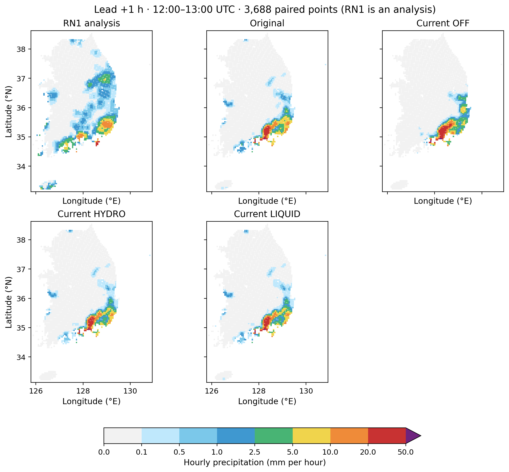
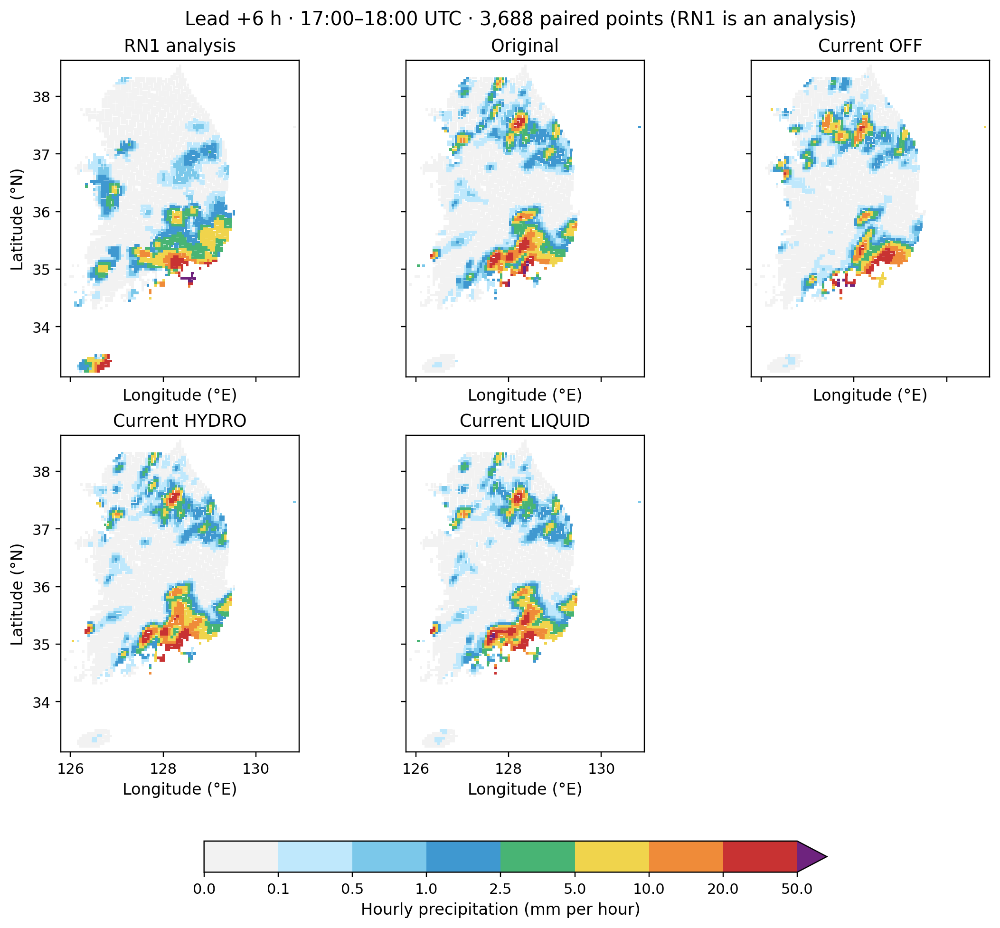
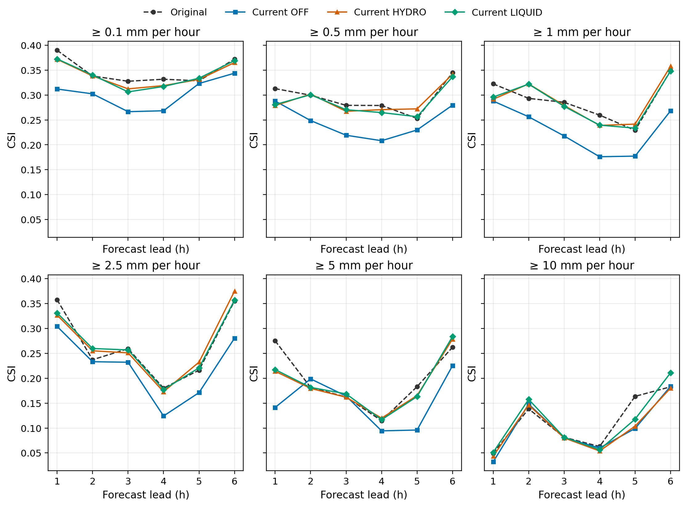

# 현행 Cloud-BAL과 원본 초기장의 단일 사례 6시간 재예보: 시간별 강수 검증과 과정 추적

**학술대회 논문 초안 · 2026-10-29**  
연구 보고서 / 저자 미기재

## 국문 초록

2026년 8월 16일 단일 사례의 6시간 재예보(hindcast)로 현행 레이더 기반 Cloud-BAL 초기장과 원본 초기장을 같은 보관 WRF 실행파일에서 비교한다. 원본 초기장의 ORIGINAL과 현행 소스로 생성한 CURRENT_OFF, CURRENT_HYDRO, CURRENT_LIQUID를 같은 WRF 실행파일, 경계장, 시간 간격 및 병렬 설정으로 6시간 적분하여 시간별 강수를 검증한다. 네 실험은 6시간을 완주했고 공통 3,688개 평가점에서 첫 시간 5 mm CSI는 ORIGINAL 0.2751, CURRENT_OFF 0.1414, CURRENT_HYDRO 0.2140, CURRENT_LIQUID 0.2174였다. 현행 후보는 CURRENT_OFF보다 높지만 ORIGINAL보다 낮았으며, 시간과 임계값에 따라 결과는 달랐다. 레이더 반사도의 비선형 수상체 진단과 건조공기 질량 및 입자수 상태의 일관성을 해석하고, 보관 CP02의 선택 지점 진단은 별도 배경 근거로 사용한다. 단일 사례, RN1의 시공간 대표성과 미확인 수지 때문에 결과의 인과 해석과 일반화에는 한계가 있다.

## Abstract

We compare current radar-based Cloud-BAL initialization with the original initial state in a single-case six-hour hindcast using the same archived WRF executable. ORIGINAL uses the archived original initial state; CURRENT_OFF, CURRENT_HYDRO, and CURRENT_LIQUID use states generated by the current source. The four six-hour integrations use the same WRF executable, boundary state, time step, and parallel configuration, and are evaluated using hourly precipitation. All four integrations completed six hours. At 3,688 common evaluation points, first-hour CSI at 5 mm was 0.2751, 0.1414, 0.2140, and 0.2174, respectively. The current candidates scored higher than CURRENT_OFF but lower than ORIGINAL, with mixed results across lead times and thresholds. We interpret the nonlinear reflectivity-to-hydrometeor diagnosis and the consistency of dry-air mass and number states; archived CP02 diagnostics are presented separately as contextual evidence. A single case, the spatiotemporal representativeness of RN1, and unresolved budgets limit causal interpretation and generalization.

## 1. 서론

초기 구름과 강수의 위치·강도는 단시간 강수예측에 영향을 줄 수 있다. 레이더 반사도는 강수 입자 분포에 민감하나 곧바로 지상 강수량 또는 유일한 수상체 혼합비를 제공하지 않는다. 반사도 관측연산자는 입자 크기 분포와 수상체 분류의 가정에 의존한다 [1]. 따라서 레이더 진단을 모델 초기장에 반영하는 효과는 이후 미세물리, 수송, 열역학 및 강수 검증을 통해 함께 평가해야 한다. WRF-ARW의 역학·물리 및 초기화 체계는 기술문서 [2]를 따른다.

이 연구의 목적은 Cloud-BAL의 계산상 관계를 물리 단위와 연결하고, 실제 예측 비교에서 강수 적중과 오경보가 어떻게 바뀌는지 설명하는 것이다. 보관된 CP02 결과를 현행 소스의 새 실행과 구별하며, 진단적으로 관측한 연관성과 물리 과정의 인과 증명을 구분한다.

## 2. 자료 및 방법

### 2.1 레이더 수상체와 질량 기준

관측 반사도 \(D\)가 dBZ일 때 선형 반사도 인자 \(Z=10^{D/10}\)이며 단위는 mm⁶ m⁻³이다. 현재 진단 코드에서 사용 가능한 지상 위 레이더 셀의 총 강수성 수상체 혼합비는 수송·publish·배경장 병합 이전의 순간 작업 진단값으로 다음과 같다. 이후 모델 초기장 값이 이 진단식과 같다고 가정하지 않는다.

\[
q_t=\frac{\min\{0.02,\,10^{-4}(Z/1000)^{0.55}\}}{\rho_d},\qquad q_t=q_r+q_s+q_g .
\]

식 (1).

dBZ는 로그 척도이므로 같은 dBZ 차이라도 선형 반사도의 가법 차이는 반사도 수준에 따라 달라진다. 따라서 평균 dBZ를 선형 단위로 변환한 값은 일반적으로 개별 선형 반사도의 평균과 같지 않다. 식 (1)의 거듭제곱과 상한도 반응을 비선형으로 만든다.

여기서 \(1000\)은 mm⁶ m⁻³의 기준 반사도, \(10^{-4}\)와 상한 0.02는 kg m⁻³의 질량농도, \(\rho_d\)는 kg m⁻³의 건조공기 밀도, \(q_t,q_r,q_s,q_g\)는 건조공기 질량당 비·눈·싸락눈 혼합비(kg kg⁻¹)이다. 식 (1)은 현재 설정의 경험적 진단 관계와 상한을 기술하며 레이더의 보편적인 역변환식이 아니다. 상정보가 유효하면 이를 사용하고, 유효하지 않으면 온도에 따른 불확실한 분할을 사용한다. 관측의 유효성·품질과 상분할 불확실성은 서로 다른 계약이다. [현재 진단 구현](../src/common/cloud_bal_column_physics.f90)

건조공기 밀도는 현재 코드에서 이상기체 관계 \(p=\rho_d R_d T(1+q_v/\epsilon)\)로 계산한다. \(p\)는 Pa, \(T\)는 K, \(R_d\)는 J kg⁻¹ K⁻¹, \(q_v\)는 건조공기 질량당 수증기 혼합비, \(\epsilon\)은 수증기와 건조공기의 분자량 비다. 이 기체 상태식에서 응결물은 기체 압력에 더하지 않는다. [밀도 구현](../src/common/cloud_bal_state.f90)

질량 농도 \(\rho_d q\)와 혼합비 \(q\)를 혼동하면 동일한 반사도에 대응하는 초기 수분량이 달라진다. 격자 전체의 물수지는 예컨대 건조공기 질량 \(m_{d,i}\)에 대하여 \(M_w=\sum_i m_{d,i}\sum_s q_{s,i}\)로 정의하며, 시간 변화는 경계 수송·침강·지표 강수와 외부 원천을 함께 포함해야 한다. 단순한 격자 혼합비 평균이나 두 시각의 상태 차이는 이 수지가 아니다. 일반적인 이중 모멘트 미세물리에서는 질량과 수농도가 입자 크기 분포의 서로 다른 모멘트이므로 하나만 조정해 다른 하나를 임의로 확정할 수 없다 [4]. 문헌 [4]는 개념적 근거이며 보관 KDM6 실행파일의 정확한 소스를 입증하지 않는다. 각 상태의 단위와 실제 저장 경로는 실행별로 확인해야 한다.

### 2.2 실험과 시간별 검증

보관 CP02 실험은 2026년 8월 16일 12 UTC에 초기화된 OFF 대조군과 HYDRO·LIQUID 후보군이다. 세 실험의 변경에는 여러 초기장 성분이 포함되므로 특정 성분의 단독 효과로 해석하지 않는다. 서로 같은 3,688개 지리 평가점에서 모델 강수 누적치 \(P_c=\mathrm{RAINC}+\mathrm{RAINNC}\)의 인접 시각 차이 \(P_h=P_c(t_h)-P_c(t_{h-1})\)를 RN1의 해당 1시간 분석과 비교했다. 누적 초기화·reset·단위와 시간은 기존 검증에서 검사했다. RN1은 레이더·AWS 및 추가 처리를 거친 분석장이다. 0.1, 0.5, 1, 2.5, 5, 10 mm의 문턱값 이상을 사건으로 정의하고 +1~+6시간을 각각 평가했다. 6시간 누적 검증과는 다른 지표다. [자료·계산](PRECIP_HOURLY_VERIFICATION_20261027.md)

모델 값을 평가점 \(x\)로 옮기는 네 모서리 bilinear 연산은 \(P(x)=\sum_{j=1}^{4}w_jP_j\), \(w_j\ge0\), \(\sum_jw_j=1\)이다. 고정된 유효 stencil과 가중치를 쓰면 누적 강수의 보간과 시간 차분은 순서를 바꾸어도 같지만, 임계값 분류는 평균과 교환할 수 없어 보간 후에 수행한다. RN1의 5×5 최댓값 연산도 비선형이며 모델 보간과 공간 대표 범위가 다르다.

적중 \(H\), 미탐지 \(M\), 오경보 \(F\)를 사용하면

\[
\mathrm{CSI}=\frac{H}{H+M+F},\quad
\mathrm{POD}=\frac{H}{H+M},\quad
\mathrm{FAR}=\frac{F}{H+F},\quad
\mathrm{Bias}=\frac{H+F}{H+M}.
\]

식 (2).

전체 공통 유효 표본을 \(N\)이라 하면 우연 적중 기대수와 ETS는

\[
H_{\mathrm{rand}}=\frac{(H+M)(H+F)}{N},\qquad
\mathrm{ETS}=\frac{H-H_{\mathrm{rand}}}{H+M+F-H_{\mathrm{rand}}}.
\]

식 (3).

연속 강수량에 대해서 모델 예측 \(f_i\), RN1 참조 \(o_i\)의 오차 \(e_i=f_i-o_i\)를 사용한다. 평균오차 ME, 평균절대오차 MAE, 평균제곱근오차 RMSE는

\[
\mathrm{ME}=\frac1N\sum_i e_i,\quad
\mathrm{MAE}=\frac1N\sum_i \sqrt{e_i^2},\quad
\mathrm{RMSE}=\sqrt{\frac1N\sum_i e_i^2}.
\]

식 (4).

이들은 1시간 누적 강수량의 오차이므로 단위는 mm이며, 1시간 평균 강수율로 환산하면 수치상 mm h⁻¹와 같다. 양의 ME는 평균 과대예측이다. 동일 평가점에서 후보의 적중 수 변화는 새 적중 수에서 소실 적중 수를 뺀 값, 오경보 수 변화는 새 오경보 수에서 제거 오경보 수를 뺀 값이다. 분모가 0이면 해당 지표는 미정의다. CSI는 사건의 위치 일치를 평가하고, POD와 FAR는 각각 관측 사건의 탐지 비율과 예측 사건 중 오경보 비율을 보여준다. 빈도편향이 1이어도 위치가 맞는다는 뜻은 아니다. POD·FAR·빈도편향의 병행은 WGNE의 추가 진단 권고 [3]와 부합한다. 다만 그 권고의 관측 지원 영역과 신뢰구간 요건은 이 사례에서 아직 충족되지 않았다.

**주 실험인 신규 네 예측:** ORIGINAL은 보관된 실제 OFF 초기장(초기장 SHA-256 접두 `5d6b`)을 사용한다. CURRENT_OFF, CURRENT_HYDRO, CURRENT_LIQUID는 현행 `main` revision `a63a802`에서 pinned Intel O2 LAPSPREP으로 새 초기장을 생성한다. 네 적분은 동일한 보관 WRF 실행파일(SHA-256 접두 `de110a`), 경계장, 20초 시간 간격, MPI 8 ranks 및 OpenMP 1 thread로 수행한다. 각 실험의 전체 해시, 입력 동일성, 실행 receipt 및 시간별 완주 상태는 실제 기록으로 확인한다. 동일한 WRF 실행 조건이라도 초기장의 작성 경로와 값은 실험 정의에 따라 다르므로 이 네 군의 비교는 각 변경의 단독 효과를 자동으로 분리하지 않는다. 네 예측은 18 UTC까지 완주했다. CURRENT_OFF의 첫 시도는 실행 중 wrapper 변경으로 WRF 반환 코드가 포착되지 않아 실패 시도로 보존하고, 고정 wrapper와 별도 staging의 OFF_RETRY를 정식 결과로 사용했다. [실행 계보](evidence/current_forecast_paper_20261029/runtime/README.md). 과거 CP02와 미완료 C2는 별도다.

네 적분의 고정 namelist는 수평 격자 간격 5 km, mass 격자 234 × 282 × 39층 (`e_we=235`, `e_sn=283`, `e_vert=40`), 시간 간격 20초다. 물리 옵션의 코드 값은 `mp_physics=37`, `cu_physics=37`, 장파·단파 복사 각각 4, `sf_sfclay_physics=1`, `sf_surface_physics=2`, `bl_pbl_physics=11`, `shcu_physics=0`이다. 이 값에 공식 배포판의 스킴 이름을 임의로 결부하지 않는다. 검증 강수 `RAINC+RAINNC`는 적운 모수화와 격자 규모 강수의 누적을 함께 포함하므로 KDM6 단독 강수 flux가 아니다. [실행 계보](evidence/current_forecast_paper_20261029/runtime/README.md).

| 새 예측 | 초기장 계보 | 비교의 의미 |
|---|---|---|
| ORIGINAL | 보관 전체 235개 레코드 OFF WPS (`3c82af`)와 `real.exe` (`5e94804f`)로 생성한 실제 초기장 | 현행 전처리와 원본 초기장의 전체 차이를 포함하는 기준 |
| CURRENT_OFF | 현행 소스의 적은 레코드 vapor/OFF WPS (`2d52d`)와 `real.exe` (`58118b30`)로 새로 생성 | 현행 HYDRO·LIQUID 분기 비교의 대응 대조군 |
| CURRENT_HYDRO | 현행 HYDRO WPS 및 같은 현행 `real.exe` (`58118b30`)로 새로 생성 | CURRENT_OFF 대비 후보 모드 비교 |
| CURRENT_LIQUID | 현행 LIQUID WPS 및 같은 현행 `real.exe` (`58118b30`)로 새로 생성 | CURRENT_OFF 대비 후보 모드 비교 |

ORIGINAL과 CURRENT_OFF의 비교에서는 수증기, 구름물, 비, 압력, 온위, MU 및 수평 바람 등 주요 초기장 값이 서로 다르며, 공통 격자 보조장과 명시적으로 확인한 수농도 필드는 일치한다. 따라서 ORIGINAL 대비 차이는 WPS writer와 `real.exe`를 포함한 전처리 전체 변화의 결합 효과다. 현행 HYDRO 또는 LIQUID는 대응 기준 CURRENT_OFF와 비교하지만, 모드별 writer의 수상체 레코드 차이도 포함하므로 개별 물리 매개변수만의 효과로 분리하지 않는다. 소스만 바꾸는 별도의 절제 실험은 없다. 세 CURRENT 초기장은 각각 과거에 보관된 대응 후보 초기장과 바이트 동일하다. 이는 최신 PR이 이 초기장에 새로운 물리적 차이를 만들었다는 증거가 아니며, 그 PR들의 진단 기능이나 예측의 일반 성능을 독립적으로 평가한 결과도 아니다. [초기장 비교](evidence/current_forecast_paper_20261029/initial_original_vs_current_off.json).

전처리의 실행 전후 입력 목록은 사설 복사본의 `static/`과 `lapsprd/`에 한정되며 `payload.nc`, `cdl/`, `time/` 등을 포함한 전처리 입력 전체의 실행 전 봉인을 입증하지 않는다. WRF 후보 예측의 별도 실행 전 목록과 혼동하지 않는다. 최종 실행 및 입력 영수증에서 확인된 범위만 재현성 근거로 사용한다.

### 2.3 선택 지점의 물리 진단

첫 시간 5 mm 사건에서 사후 선택한 적중 소실·유지, 오경보 제거 및 약한 강수 지점의 네 모델 모서리와 39층을 사용하여 초기 상태와 보관 KDM6 실행파일의 호출 경계를 추적했다. 이들은 탐색 표본으로, 독립적인 전체 예측 검증 표본이 아니다. 두 호출의 실제 인자는 \(itimestep=1,2\), \(delt=20\) s이나 직접 판독한 모델 시계 또는 RK 단계는 아니다. 디버그 정보가 없는 바이너리에서 인접 소스 기반 배열 이름은 후보 이름으로 취급한다. [호출 비교](CP02_KDM6_CONTROLS_20261029.md)

## 3. 결과

### 3.1 신규 현행 대 원본 예측

ORIGINAL과 CURRENT_OFF 초기장의 전체 격자·층 비가중 평균 혼합비를 표 1에 제시한다. 다섯 수상체가 CURRENT_OFF에서도 모두 양의 값을 가진 격자를 포함한다. 서로 다른 수종의 변화 방향은 일정하지 않으며 이 값은 건조공기 질량이나 격자 부피로 가중한 총 물량이 아니다. WPS 레코드가 생략되었다는 사실만으로 native 초기 수상체가 0이라고 판단할 수 없다. [원시 초기장 비교](evidence/current_forecast_paper_20261029/initial_original_vs_current_off.json)

**표 1. 초기 수상체 격자·층 비가중 평균 혼합비 (kg kg⁻¹).**

| 수종 | ORIGINAL | CURRENT_OFF |
|---|---:|---:|
| 구름물 QC | 7.1654×10⁻⁵ | 8.4663×10⁻⁶ |
| 비 QR | 5.9637×10⁻⁶ | 9.8534×10⁻⁶ |
| 구름얼음 QI | 4.0671×10⁻⁵ | 1.9392×10⁻⁸ |
| 눈 QS | 1.5128×10⁻⁵ | 1.1385×10⁻⁵ |
| 싸락눈 QG | 6.4173×10⁻⁷ | 8.3992×10⁻⁷ |

**표 2. 신규 네 재예보의 1시간 누적 5 mm 이상 CSI. OFF·HYDRO·LIQUID는 모두 CURRENT 군이다.**

| 예보시간 (h) | ORIGINAL | OFF | HYDRO | LIQUID |
|---:|---:|---:|---:|---:|
| 1 | 0.2751 | 0.1414 | 0.2140 | 0.2174 |
| 2 | 0.1815 | 0.1987 | 0.1796 | 0.1815 |
| 3 | 0.1622 | 0.1643 | 0.1618 | 0.1686 |
| 4 | 0.1148 | 0.0944 | 0.1199 | 0.1167 |
| 5 | 0.1831 | 0.0960 | 0.1652 | 0.1632 |
| 6 | 0.2623 | 0.2253 | 0.2786 | 0.2838 |

**표 3. 신규 네 재예보의 1시간 누적 강수량 MAE / RMSE (mm). OFF·HYDRO·LIQUID는 모두 CURRENT 군이다.**

| 예보시간 (h) | ORIGINAL | OFF | HYDRO | LIQUID |
|---:|---:|---:|---:|---:|
| 1 | 1.114 / 4.062 | 1.380 / 4.910 | 1.133 / 4.110 | 1.127 / 4.085 |
| 2 | 1.423 / 4.674 | 1.368 / 4.353 | 1.402 / 4.620 | 1.393 / 4.575 |
| 3 | 1.788 / 4.126 | 1.730 / 4.157 | 1.793 / 4.115 | 1.790 / 4.109 |
| 4 | 2.372 / 5.972 | 2.436 / 6.233 | 2.342 / 5.923 | 2.376 / 5.986 |
| 5 | 2.148 / 5.371 | 2.071 / 5.347 | 2.136 / 5.630 | 2.203 / 5.766 |
| 6 | 2.366 / 7.106 | 2.404 / 7.041 | 2.297 / 6.973 | 2.335 / 7.011 |

**표 4. 첫 시간 5 mm 이상, CURRENT_OFF와의 대응 전이. 후보는 CURRENT 군이다.**

| 후보 | 새 적중 | 소실 적중 | 새 오경보 | 제거 오경보 |
|---|---:|---:|---:|---:|
| HYDRO | 30 | 16 | 8 | 41 |
| LIQUID | 31 | 17 | 7 | 44 |

첫 시간의 CURRENT_OFF 적중/미탐지/오경보는 41/113/136이고 HYDRO는 55/99/103, LIQUID는 55/99/99다. 두 후보가 현행 OFF에 비해 적중을 순 14개 늘리고 오경보를 각각 순 33개와 37개 줄였지만, ORIGINAL의 74/80/115와 비교하면 적중은 두 후보 모두 19개 적다. 비교 기준이 다르면 해석도 달라진다. +6시간의 CSI는 ORIGINAL 0.2623, CURRENT_OFF 0.2253, HYDRO 0.2786, LIQUID 0.2838이다. 전 예보시간·임계값에서 지속적인 우위는 주장할 수 없다.

[전체 144개 범주 점수와 counts](evidence/current_forecast_paper_20261029/scores/categorical_scores.csv) · [24개 연속 점수](evidence/current_forecast_paper_20261029/scores/continuous_scores.csv) · [180개 대응 전이](evidence/current_forecast_paper_20261029/scores/transitions.csv) · [독립 스칼라 검산](evidence/current_forecast_paper_20261029/validation/independent_scores.json) · [실행과 점수 자료의 해시 연결](evidence/current_forecast_paper_20261029/validation/forecast_score_binding.json).

그림 1. 12–13 UTC 1시간 누적 강수량(mm). 참조와 네 재예보는 같은 색 구간으로 표시한다. 점은 평가점이며 관측 footprint를 뜻하지 않는다.

그림 2. 17–18 UTC 1시간 누적 강수량(mm). 그림 1과 같은 해석상 제약이 적용된다.

그림 3. 여섯 임계값에서의 시간별 CSI. [ETS](evidence/current_forecast_paper_20261029/figures/hourly_ets.png), [연속형 점수](evidence/current_forecast_paper_20261029/figures/hourly_continuous.png), [5 mm 대응 전이](evidence/current_forecast_paper_20261029/figures/hourly_transitions_ge5.png)도 함께 보존한다.

### 3.2 보관 CP02와의 재현성 대조

이번 ORIGINAL·CURRENT_HYDRO·CURRENT_LIQUID의 각 +1~+6시간 평가점 예측 배열은 각각의 보관 CP02 OFF·HYDRO·LIQUID 배열과 66,384개 값 모두 비트 단위로 같다. 이는 이 표본 예측값의 재현이며 모든 모델 상태나 독립적 새 기상 사례의 증거는 아니다. CURRENT_OFF는 새 대응 대조군이고 과거 OFF와 같은 것으로 취급하지 않는다. [비교 기록](evidence/current_forecast_paper_20261029/validation/fresh_vs_archived.json)

### 3.3 보관 CP02의 초기 수상체와 첫 호출 관측

사후 선정한 20점 × 22개 저장 기압층 중 레이더 진단 관측 마스크가 참인 190개 위치에서 선형 반사도와 진단 수종을 추적했다. rain+snow+graupel은 포착된 총량과 일치했다. 이 선택 표본의 일치는 전 영역 물수지나 강수 결과의 원인 증명이 아니다. [반사도 입력 추적](CP02_RADAR_INPUTS_20261028.md)

선택된 624개 모델 소유 표본에서 첫 KDM6 호출 전 nc·nr·ni 보조 후보는 세 실험 각각 624개 모두 0이고, 호출 후 양의 값이 나타났다. 이 공통 변화는 HYDRO만의 현상으로 볼 수 없다. 후보 배열의 정확한 빌드 소스와 단위, 호출 내부 생성 과정 및 호출 사이 수송·물리 기여는 미확정이다. [동일 경계 비교](CP02_KDM6_CONTROLS_20261029.md)

또 다른 선택 셀의 보관 바이너리 분석은 유한 후보 \(C\)가 양수 또는 부호 있는 0이면 `min` 경로, 음수이면 `max` 경로를 따름을 보여준다. 해당 여섯 포착 사례의 \(C\)는 음의 0이었다. 이것은 기계어 수준의 조건부 분기 관찰이며, 인접 소스의 물리 변수와 일치한다고 입증되지 않았다. 특히 동적 배열 B의 물리 의미·단위는 미확인이다. 0 입력의 생성 원인과 분기 변화가 지상 강수에 미치는 영향도 미확인이다. [원시 비트와 분기](CP02_ZERO_CANDIDATE_20261029.md)

## 4. 토의

보관 CP02 첫 시간의 근접한 전체 평균 강수량은 공간적 일치와 다르다. RN1과 보관 OFF의 평균은 각각 0.8735와 0.8832 mm였으나 0.1 mm 이상 지점은 각각 1,593개와 696개였다. 모델의 강수 면적과 강도 분포 및 위치 차이를 함께 보아야 한다. RN1은 상류 1 km 강수장의 5×5 최대값 집계와 AWS·구름·mask 처리를 포함하며, 보간된 모델 격자값과 관측 footprint가 같지 않다. 상류 입력의 시간별 최신성 및 coverage/QC는 미확인이고 유한한 0을 관측 가능 영역의 확정적 무강수로 단정할 수 없다. [RN1 평가](CP02_RN1_REPRESENTATIVENESS_20261027.md)

본 결과는 한 초기화 사례이며 3,688개 지점과 시간은 공간·시간적으로 상관된다. 이 점들을 독립 사례로 취급한 유의성이나 다른 강수 체계에 대한 일반화를 주장하지 않는다. 사후 선택된 소실 지점은 가설 생성에 유용하나 편향이 있으므로 적중 유지·오경보 제거 지점과 사전 지정된 다수 사례를 함께 비교해야 한다. 관측과 모델의 대응 규모 및 자료 계보가 확인된 독립 관측으로 재검증할 필요가 있다.

초기 구름과 강수의 재조정은 응결·증발·상변화에 수반되는 잠열 교환을 통해 온도와 수증기를 바꾸고, 이후 포화도와 부력 및 강수 발달에 영향을 줄 수 있다. 첫 시간은 초기 수상체와 모델 물리의 조정이 특히 눈에 띌 수 있지만, 관측된 차이만으로 이 가능성의 크기나 방향을 확정할 수 없다. WRF 호출의 PRE/POST 차이는 여러 미세물리 과정의 합이며, 지상 강수의 변화에는 수송·역학도 기여할 수 있다. 같은 시점의 건조공기 질량과 과정별 물·에너지 수지, 강수 flux가 확보되기 전에는 특정 증발·상변화·침강 또는 바이너리 분기 하나를 원인으로 지정할 수 없다. 보관 CP02 진단 실행은 의도적으로 중단된 호출 계측이다. 별도의 최신 C2 T39 및 H/A/N 1시간 완료 여부는 이 결과로 대신할 수 없다.

## 5. 결론

네 단일 사례 재예보는 6시간을 완주했다. 첫 시간 5 mm CSI에서 현행 후보는 CURRENT_OFF보다 높았으나 ORIGINAL보다 낮았고, 후속 시간과 임계값의 결과는 혼합적이었다. 기준군과 전처리 계보를 명시해야 하며 일반적인 성능 향상은 입증되지 않았다. 레이더 수상체 진단의 농도–건조공기 밀도 변환과 질량·입자수 상태의 동시 추적은 물리적 해석에 필수적이다. 기존 경계 계측은 가설을 좁히지만 전체 수지와 강수 변화의 인과관계를 닫지 못한다.

## 참고문헌

1. Sun, J., and H. Wang (2013), “WRF-ARW Variational Storm-Scale Data Assimilation: Current Capabilities and Future Developments,” *Advances in Meteorology*, 2013, 815910. https://doi.org/10.1155/2013/815910
2. National Center for Atmospheric Research, *Technical Description of the Advanced Research WRF Model (WRF-ARW)*. https://www2.mmm.ucar.edu/wrf/site/documentation/technote.html (확인: 2026-10-29).
3. Working Group on Numerical Experimentation (WGNE), *Suggested methods for the verification of precipitation forecasts against high resolution limited area observations*. https://wgne.net/publications/suggested-methods-for-precipitation-verification/ (확인: 2026-10-29).

4. Morrison, H., J. A. Curry, and V. I. Khvorostyanov (2005), “A New Double-Moment Microphysics Parameterization for Application in Cloud and Climate Models. Part I: Description,” *Journal of the Atmospheric Sciences*, 62, 1665–1677. https://doi.org/10.1175/JAS3446.1
