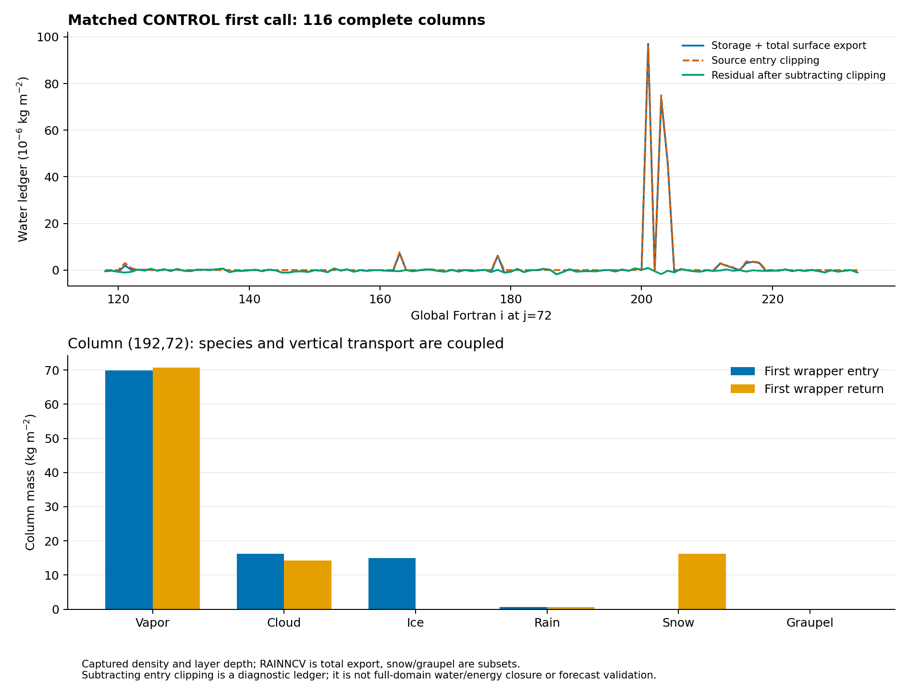
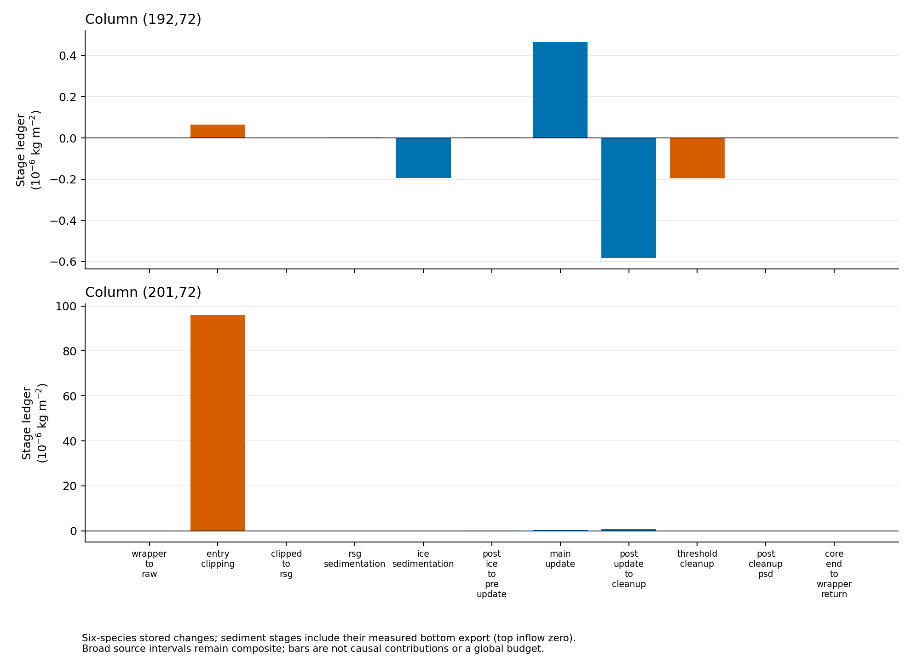

# 같은 CONTROL 물리의 실제 첫 호출 기둥 수지

## 초록

이전 다섯 셀의 역사적 B1 기록과 물리 구현이 다른 국지 실험을 섞지 않고, **보존 침강·첫 빙정 속도 단위 수정이 포함된 CONTROL 한 소스**를 평가 대상으로 고정했다. 실제 WRF 첫 호출에서 한 행의 116개 기둥·39층 전체 상태와 호출 상수·옵션을 확보했다. 같은 소스의 전체 행 재생은 Intel O0·O2에서 각각 **95,932개 반환 REAL32 단어**와 일치했고, 관측 구문을 추가한 재생도 원본과 최종 바이트가 같았다.

대표 최대 빙정 기둥 (192,72)의 총수분 저장량 변화와 지상 유출 합은 −4.389×10⁻⁷ kg/m²였다. QI 감소 −14.9781 kg/m²와 QS 증가 +16.1183 kg/m²는 다른 수종·수증기 변화와 함께 나타났다. 가장 큰 원시 잔차의 기둥 (201,72)은 진입 음수 수상량의 정리 +9.6144×10⁻⁵ kg/m²가 대부분을 설명했다. **국지 QI 감소를 기둥의 설명되지 않는 손실로 환산할 근거는 없으며, 잔차를 0으로 숨기지도 않았다.** 새 초기화 제안·6시간 예보·채택 판정은 추가하지 않았다.

## 1. 대상 물리와 재생 조건

| 경계 | 이번 실험 |
|---|---|
| 목표 소스 | CONTROL SHA-256 `f391b211c6e111f92a7213cc5a651606ec6b5826a47063e3057ab2d819e9a595` |
| 실제 실행파일 | `3a286f6691fa94c2dccf55b14e4cbf609b8c9540c2caf83556969932ca9854ea` |
| 초기 입력 | 기존 B1 `9f8b494dbf5ce765e4320701475d6a65be1f591d72a4f9bf5e929c208be563e5` |
| 사례·시간 | 2026-08-16 12 UTC 시작, 실제 ITIMESTEP=1, DELT=20초 |
| 공간 | rank 3의 i=118…233, j=72, k=1…39: 116개 완전한 기둥 |
| 실제 대조 | 8 ranks·80초의 일반 실행과 두 읽기 전용 GDB 실행 |

이 CONTROL은 이전 PR154 계열의 보존 침강·첫 빙정 깊이 변환을 포함한다. PR164에서 관측했던 역사적 B1 실행파일 `68ed…1c1f`와 다르다. 같은 입력과 같은 표적 이름이라는 이유로 두 물리의 반환값을 초기 NI 하나의 효과로 해석하지 않는다. 이번 첫 호출 진단은 해당 CONTROL의 기존 6시간 성능 판정을 바꾸지 않는다.

실제 세 실행의 초기·80초 history가 바이트 단위로 일치했다. 새로 기록한 옵션을 제외한 두 캡처의 공유 필드도 모두 일치했다. [실제 실행과 캡처](evidence/first_call_water_budget_20261112/native/README.md), [실행 근거](evidence/first_call_water_budget_20261112/native/receipt.json)

### 전체 행을 보존한 이유

침강 하위단계 수는 수직 상태뿐 아니라 해당 KDM62D 행의 최댓값에도 의존할 수 있다. 따라서 한 기둥만 잘라 새 스케줄로 재생하지 않았다. 활성 행 전체를 보존하고 사용하지 않는 메모리 halo만 재배치했다. 수상량 여섯 종, NC·NI·NR·NN·BG, DEN·DELZ·P·TH·PII, 지면 조건, 강수 누적과 실제 상수·옵션의 IEEE 단어를 입력으로 사용했다.

`kdm6init`의 host 호출·상수와 누락된 hail 옵션의 Registry 기본값도 확인했다. 이 초기화 가정과 실제 입력이 이 호출에서 일치하는지는 전체 반환 단어 비교로 추가 확인했다. 다른 사례나 다른 옵션까지 검증됐다는 뜻은 아니다.

- 21개 3차원 필드 × 4,524셀 + 8개 지상 필드 × 116기둥 = **95,932단어/최적화 수준**.
- O0·O2 각각 native 반환값과 전부 일치했다.
- 두 수준의 원본/관측 재생 최종 stream 4개가 같은 SHA `2227c804…b81`을 가졌다.
- phase 9/10·18은 비·눈·싸락눈, phase 20/21·22는 빙정 침강이며, phase 32/33은 미량 제거 직전/직후이다.

[재생 방법·범위](evidence/first_call_water_budget_20261112/replay/README.md), [원본/관측/native 비교](evidence/first_call_water_budget_20261112/replay/receipt.json)

## 2. 기둥 장부와 지상 강수의 의미

동일 호출의 고정된 DEN·DELZ를 사용해 여섯 종을 모두 합산했다.

\[
M=\sum_k\rho_k\Delta z_k(q_v+q_c+q_i+q_r+q_s+q_g)_k,
\qquad R_{raw}=M^+-M^-+E_{ground}.
\]

`dend=den`은 이 소스에서 명시적으로 설정된다. **RAINNCV는 비·눈·싸락눈·빙정의 총 지상 강수**이며 SNOWNCV·GRAUPELNCV는 그 부분집합이다. 따라서 이들을 총강수에 다시 더하지 않았다. 소스의 단위 변환에 맞춰 `E_ground = RAINNCV_mm × DENR / 1000`으로 환산했다. 내부 침강 장부에서는 실제 공유 경계 이동량을 사용하며, 맨 위 유입은 0이었다.

그림의 원시 잔차는 물리 손실률이나 강수 오차가 아니다. 진입 clipping·미량 제거 및 저장 반올림이 포함된 장부이며, 원인을 분리하지 않은 채 엄밀한 전체 모형 물·에너지 폐합으로 부르지 않는다.

[전체 116기둥 CSV](evidence/first_call_water_budget_20261112/analysis/column_ledger.csv)

## 3. 최대 빙정 기둥의 물은 어디로 갔는가

### 같은 목표 물리에서의 셀과 기둥

CONTROL의 (192,72,26) 첫 진입 총수분은 **10.311597 g/kg**, 반환은 **10.173157 g/kg**였다. QI는 10.067691→0, QS는 0.000058→9.978270 g/kg였다. 이 셀 차이만으로 층간 운반이나 수종 전환의 기여를 나누지 않는다. 역사적 B1의 0.243905 g/kg 반환값과도 같은 물리의 결과로 혼동하지 않는다.

전체 기둥을 합하면 다음과 같다.

| (192,72)의 저장 수분·유출 | kg/m² |
|---|---:|
| 진입 총수분 | 101.817600952 |
| 반환 총수분 | 101.817086356 |
| 지상 총 유출 | 0.000514157 |
| 저장 변화 + 유출 | **−0.000000439** |

| 종별 저장 변화 | kg/m² |
|---|---:|
| QV | +0.835328 |
| QC | −1.976083 |
| QI | **−14.978116** |
| QR | −0.000781 |
| QS | **+16.118348** |
| QG | +0.000790 |

따라서 QI 감소 전체가 같은 셀의 QS로만 남아야 한다는 해석은 맞지 않는다. 이번 기둥에서는 큰 얼음/눈 분배 변화가 관측되며 수증기·구름물·수직 이동도 함께 발생했다.

### 관측된 과정 경계

두 기둥의 실제 REAL64 침강 이동량에서 **모든 인접 경계의 상층 유출과 하층 수령이 정확히 같고, 상단 유입이 0**임을 확인했다. 저장 상태는 REAL32이므로 저장 변화와 실제 이동량의 합에는 작은 반올림 잔차가 남는다. 기둥 192에서 비의 실제 바닥 이동량은 0.000514156649 kg/m², RAINNCV 환산은 0.000514156709 kg/m²였다. 빙정의 바닥 유출은 0이었다.

주 갱신 후→미량 제거 전의 복합 구간에서는 기둥 192의 QI가 −15.432821, QS가 +15.432821 kg/m² 변했다. 기둥 201에서도 각각 −13.857656, +13.857656 kg/m²였다. 차가운 층에서 소스의 `avedia>=200 μm` 조건으로 QI를 QS에 더하고 QI·NI를 0으로 하는 분기가 이 구간에 있다. **이 구간에는 다른 응결·활성화 처리도 있으므로 전체 증분을 그 한 분기의 순수 기여로 부르지 않는다.**

[실제 경계 장부](evidence/first_call_water_budget_20261112/science/sediment_ledger.json), [종별 과정 CSV](evidence/first_call_water_budget_20261112/science/stage_telescope.csv)

## 4. 가장 큰 원시 잔차는 진입 clipping을 먼저 분리해야 한다

실제 진입에는 음수 QC 65셀, QI 36셀, QR 4셀, QS 6셀이 있었다. 반환 수상량은 비음수였다. 이는 입력파일의 음수 개수가 아니라 첫 호출의 원시 진입값이다. 관측 자료에서 이를 임의로 0으로 바꾼 뒤 장부를 시작하지 않았다.

| 장부, kg/m² | 최대 빙정 기둥 192 | 최대 원시 잔차 기둥 201 |
|---|---:|---:|
| 원시 저장 변화 + 지상 총 유출 | −4.38858×10⁻⁷ | +9.70638×10⁻⁵ |
| 진입 수상량 clipping 증분 | +6.55316×10⁻⁸ | **+9.61440×10⁻⁵** |
| 관측한 미량 제거 증분 | −1.97044×10⁻⁷ | −1.36033×10⁻⁷ |
| 두 처리를 분리한 나머지 합산 잔차 | −3.07346×10⁻⁷ | +1.05587×10⁻⁶ |

나머지는 다른 과정 구간과 저장 반올림을 포함한다. 이 크기가 작다는 사실만으로 모든 개별 과정이나 전체 영역의 수지가 완결됐다고 일반화하지 않는다. source 단계별 6종 장부는 wrapper 진입·반환 차이와 연결되며, 원시 값을 무강수/비음수 가정으로 덮지 않는다.

침강 막대는 저장 변화에 해당 단계의 실제 바닥 유출을 더한 값이며, clipping과 제거를 분리해 표시했다. 막대들은 인과 기여율이 아니다.

## 5. 초기화 제안에 대한 결정

이번 수지는 **같은 목표 물리에서 첫 호출의 큰 QI 감소가 무엇과 연결되는지**를 확인한 결과다. 올바른 초기 입자수나 분배율을 역으로 관측한 결과는 아니다.

- 반환 QS나 NI를 곧바로 분석 시각의 초기값으로 가져오지 않는다. 반환에는 20초의 성장·증발·침강·분류가 포함되어 있다.
- source의 얼음 생성 목표 수농도와 생성 입자질량은 새 수증기→빙정 생성률에 묶여 있다. 이를 기존의 큰 분석 QI 전체에 대한 입자수 사전값으로 독립 적용할 근거는 이번 자료에 없다.
- 차가운 큰 입자의 QI→QS 분기도 이미 달라진 NI·QI·PSD에서 평가된다. 초기 NI=0이라는 사실만으로 분석 수종의 재분배율을 정할 수 없다.
- 출처가 있는 분배·입자수만 받는 PR164의 결합 경로와 엄격한 파일 검사는 유지한다. **수지를 닫기 위한 임의의 QI→QS 이동이나 입경 조정은 추가하지 않았다.**

따라서 다음 후보의 `f_i`와 평균 입자질량을 정할 관측·독립 배경 PSD·검증된 물리 사전모형은 여전히 필요하다. 현재 B1 자료의 CICE/SNO 라벨만으로는 충분하지 않다. 첫 호출 수지의 일관성과 초기화 정보의 타당성은 각각의 검증 대상이다.

## 6. 검증·공간 정리와 남은 범위

[최종 검증](evidence/first_call_water_budget_20261112/validation/receipt.json)은 소스를 동결한 뒤 체크아웃 밖의 새 scratch에서 Intel O0·O2 전체 행 재생, 다섯 Python 시험, 독립 장부와 두 PNG 재생을 확인했다. 초기 두 검증의 결과는 같았지만 빌드 위치가 원래 체크아웃 아래여서, 해당 사본을 밖으로 옮기고 위치 규약에 맞춰 최종 재실행했다. 과거 빌드 위치는 최종 통과 근거와 구분했다.

도구는 완전한 열뿐 아니라 **요청한 행 전체**의 누락·중복, rank/bounds/options 불일치, 정확하지 않은 REAL32 decimal/hex, 다른 소스·캡처 혼용을 거부한다. 공유경계와 복합 단계 해석은 독립 검토로 대조했다. Graphify는 영향 코드만 증분 갱신하며 Fortran 교차 파일 호출 추출의 한계와 별도 KLAPS50/Cloud-BAL snapshot을 남긴다. 그래프 최신성은 실행·과학 검증이 아니다.

사용자 요청으로 완료된 과거 SHADOW 시험 26개와 중복 KG stage 3개를 정리해 `/var/tmp` 약 **44.8 GiB**, 작업 공간 약 **0.9 GiB**를 확보했다. 필요한 원본·실행파일·현재 캡처·정식 graph snapshot은 보존했고 로그·삭제 목록을 남겼다. [정리 기록](evidence/first_call_water_budget_20261112/cleanup/receipt.json)

새 초기화 입력의 실제 첫 사용, 운영 상변화 연결, 독립 기상 사건, 새 예보 성능은 미완료다. **B1 유지 및 기존 26개 조건은 그대로이며, 이번 결과를 성능 개선으로 계산하지 않는다.**

[그림·수치·보고서 묶음](evidence/first_call_water_budget_20261112/FIGURES.md)
