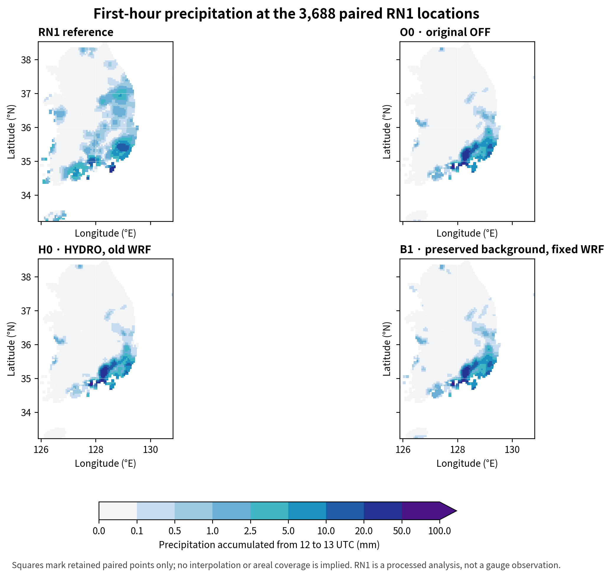
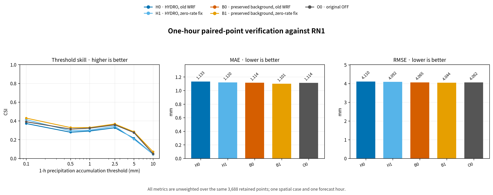
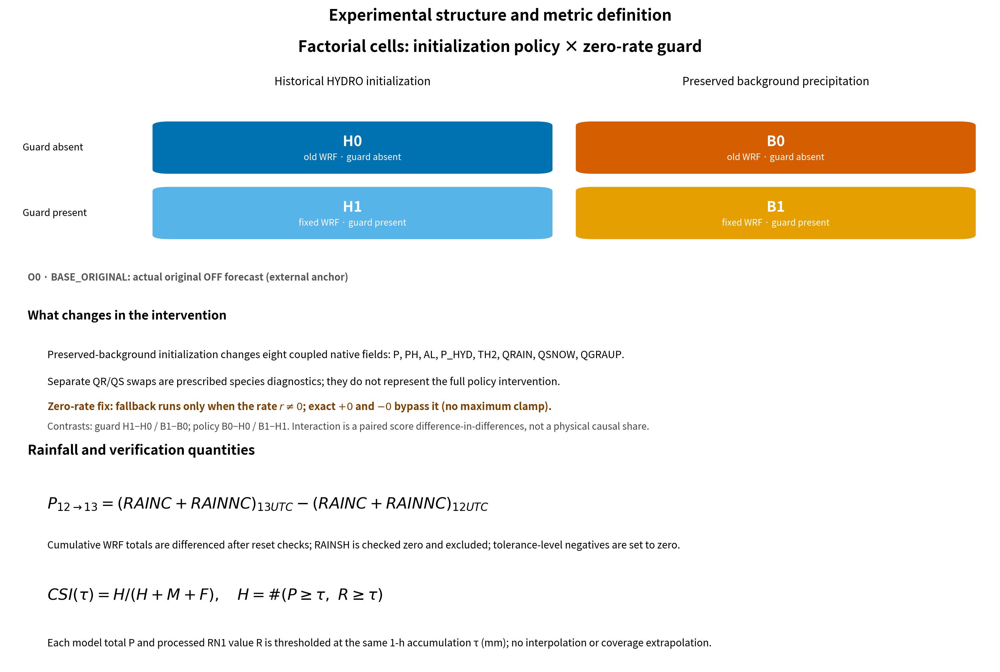

# 배경 강수 초기화와 KDM6 영 전환항 처리의 1시간 예보 민감도: 단일 사례 요인 실험

**학술대회 논문 · 2026-10-30**

## 국문 초록

2026년 8월 16일 12 UTC 초기화 사례의 +1시간 강수예보에서 배경 강수 수종 보존과 KDM6 정확한 영 계산항 처리를 분리하기 위해 2×2 요인 실험을 수행했다. 동일한 3,688개 처리 RN1 점에서 기존 HYDRO(H0)와 배경 보존 초기장(B0)의 5 mm CSI는 각각 0.214008과 0.278810이었다. 영 처리 수정은 H0에서 CSI를 0.204724로 낮췄지만, B0에서는 B1의 0.283582로 높였다. 차이의 차이는 +0.014055로, 점수 척도에서 실행파일 효과가 초기화에 따라 달라졌다. B1은 O0보다 여섯 CSI가 높고 MAE/RMSE가 조금 낮았지만 이는 정책 단독 효과가 아니다. 한 사례·한 시간 결과이며 RN1 자료 대표성, 전체 수지 및 과정별 귀속이 미확정이므로 일반 성능 향상이나 운영 적용의 증거로 해석하지 않는다.

## Abstract

We completed a 2×2 factorial experiment separating background-hydrometeor preservation from a KDM6 exact-zero transfer guard for the first forecast hour of a case initialized at 1200 UTC 16 August 2026. At the same 3,688 processed RN1 points, the 5 mm CSI was 0.214008 for historical HYDRO (H0) and 0.278810 for preserved background with the historical executable (B0). The guard lowered CSI to 0.204724 in HYDRO (H1) but raised it to 0.283582 in the preserved-background state (B1). The difference of differences was +0.014055, indicating initialization-dependent change on the score scale. B1 had higher CSI at all six thresholds and slightly lower MAE and RMSE than original OFF (O0), but this combined comparison does not isolate the policy effect. This one-event, one-hour sensitivity result does not establish general skill or operational readiness; RN1 representativeness, full budgets, and process attribution remain unresolved.

## 1. 서론

단시간 강수예보의 첫 시간은 초기 수상체와 모델의 미세물리·수송이 함께 작용하는 구간이다. 배경장의 rain·snow·graupel을 유지하는 초기화는 레이더 강수 역산·수송·강수 하중을 포함하는 기존 HYDRO 경로와 다른 초기 상태를 만든다. 별도로 KDM6 계산에서 정확한 0에 적용되던 제한 경계 처리를 바꾸면 실행 중 강수 전환항이 달라질 수 있다. 두 변경을 함께 적용한 점수만으로 각 변경의 효과나 결합 효과를 구분할 수 없으므로, 동일한 초기화에서 실행파일을 바꾸고 동일한 실행파일에서 초기화를 바꾸는 요인 대조가 필요하다.

기존 HYDRO와 배경 보존 정책의 각 두 실행파일 실험을 연결해 +1시간의 강수 민감도를 비교한다. 주요 질문은 (1) 정확한 영 처리 수정의 점수가 초기화 정책에 따라 달라지는가, (2) 정책과 수정의 점수 상호작용이 어떤 임계값에서 나타나는가이다. KDM6와 WRF 설정의 출처는 이 실험의 코드·입력 receipt와 KDM6 관련 학회 초록을 구분해 기록하며, KDM6를 WDM6와 같은 구현으로 취급하지 않는다 [1, 2].

## 2. 자료 및 방법

### 2.1 실험 설계와 사례

사례는 2026년 8월 16일 12 UTC 초기화다. 모든 예측은 동일한 보관 WRF 실행환경, 경계자료, 격자와 시간간격을 사용하며 비교 대상은 12–13 UTC의 한 시간 누적 강수다. 요인 A는 초기화 상태, 요인 B는 실행파일의 영 전환항 처리다. H0와 H1은 동일한 기존 HYDRO 초기장을 각각 기존 및 수정 실행파일로 적분한다. B0와 B1은 동일한 생산자 단계 배경 강수 보존 초기장을 각각 기존 및 수정 실행파일로 적분한다. O0는 실제 원본 OFF 초기장을 기존 실행파일로 적분한 외부 기준이다. 실험 receipt는 실행입력, 완료상태, 점수·그림 결속을 기록한다: [실행 receipt](evidence/first_hour_factorial_20261030/runtime/receipt.json), [실행 입력 manifest](evidence/first_hour_factorial_20261030/runtime/inputs.json), [분석 receipt](evidence/first_hour_factorial_20261030/analysis/receipt.json).

**표 1. 초기화 정책과 실행파일의 요인 실험 설계.**

| ID | 초기장 | 실행파일 | 상태 |
|---|---|---|---|
| H0 | 기존 HYDRO | 기존 | 완료 |
| H1 | 기존 HYDRO | 정확한 영 처리 수정 | 완료 |
| B0 | 생산자 단계 배경 강수 보존 | 기존 | 완료 |
| B1 | 생산자 단계 배경 강수 보존 | 정확한 영 처리 수정 | 완료 |
| O0 | 실제 원본 OFF | 기존 | 완료, 외부 기준 |

요인 실험의 배경 보존 정책은 기존 유효성·권한·실패 복원 검사를 거치는 연구 경로다. 레이더 강수 역산·수송·강수 하중을 생략하고 배경 rain·snow·graupel과 상·품질·출처를 보존한다. 생산자에서 실제 변경이 확인된 native 초기장 변수는 208개 중 8개로, 수상체 세 성분과 PH, P, P_HYD, AL, TH2이다. 따라서 이는 QR·QS만 바꾼 실험이 아니며 물리적으로 균형 잡힌 동화 효과나 전체 보존성의 증거도 아니다. 정책은 기본 HYDRO 동작을 바꾸지 않으며 운영 승인 또는 기본값 승격 상태가 아니다.

실행파일 수정은 정확히 0인 `prevp` 계산항에서 음의 전환항을 만들 수 있는 경계 분기를 막고, 비영 계산항 제한은 유지한다. 이는 한 변수의 국지 처리 변경이다. H1은 H0보다 낮은 임계값 CSI와 MAE/RMSE가 개선됐지만 ≥5 mm CSI는 낮았다. B1−B0와 H1−H0의 비교로 이 수정의 CSI 변화가 초기화 정책에 따라 임계값별로 어떻게 달라지는지 계산한다.

### 2.2 강수 검증 및 통계량

모델 1시간 강수량은 WRF 누적 대류성·격자규모 강수의 시각 간 차다.

\[
P_{1h}=C(13\,\mathrm{UTC})-C(12\,\mathrm{UTC}),\qquad C(t)=RAINC(t)+RAINNC(t) .
\]

검증 계약상 모든 history에 `RAINSH`가 있어야 하며, 이 값은 0인지 별도로 검사하고 총량에서는 제외한다. 허용 오차 안의 아주 작은 음의 누적 차는 점수 계산 전에 0으로 조정한다.

모델 격자에서 평가점으로 옮기는 고정 네 모서리 bilinear 연산은 다음과 같다.

\[
P(x)=\sum_{j=1}^{4}w_jP_j,\qquad w_j\ge0,\qquad \sum_{j=1}^{4}w_j=1 .
\]

누적량 차분과 고정 선형 보간은 순서를 바꾸어도 같지만, 문턱값 사건 판정은 비선형이므로 보간 이후 수행한다. 참조 RN1은 처리된 분석장으로, 이 평가에 고정된 3,688개 점을 사용한다. RN1의 입력 시각 최신성·coverage/QC 및 점별 관측 대표성은 확인되지 않았다. 점들은 한 폭풍 사례 안에서 공간적으로 상관되므로 독립 표본이나 별도 사례 수로 해석하지 않는다.

관측과 예보의 임계값 이상 여부로 적중 $H$, 누락 $M$, 오경보 $F$를 세고 임계값별 CSI를 계산한다.

\[
\mathrm{CSI}=\frac{H}{H+M+F} .
\]

동일 표본에서 두 실험 $X,Y$의 짝지은 점수 차는 임계값별로 $\Delta_{Y-X}=\mathrm{CSI}_Y-\mathrm{CSI}_X$다. 요인 상호작용은 다음 차이의 차이다.

\[
I=\bigl(\mathrm{CSI}_{B1}-\mathrm{CSI}_{B0}\bigr)-\bigl(\mathrm{CSI}_{H1}-\mathrm{CSI}_{H0}\bigr) .
\]

$I$는 해당 임계값 점수 척도에서의 비가법 상호작용이다. 강수 질량의 상호작용이나 인과 기여율, 퍼센트 물리량이 아니다. $I$를 계산하려면 B0와 네 점수 전부의 동일한 평가 표본이 필요하다. 연속 강수 오차를 $e_i=f_i-o_i$로 둔다. 절댓값 오차 $a_i$는 `abs(e_i)`로 계산한다.

\[
\mathrm{MAE}=\frac{1}{N}\sum_{i=1}^{N}a_i,\qquad
\mathrm{RMSE}=\sqrt{\frac{1}{N}\sum_{i=1}^{N}e_i^2},\qquad
\mathrm{ME}=\frac{1}{N}\sum_{i=1}^{N}e_i .
\]

이들만으로 강수 위치의 일치나 원인을 판정하지 않는다.

### 2.3 기상학적 해석의 범위

비·눈·싸락눈 혼합비는 초기 수상체 저장량을 나타내며 이후 응결·증발·상변화, 혼합, 이류 및 침강을 통해 지상 강수에 연결될 수 있다. 상변화에는 잠열 교환이 수반되며 열역학 상태와 후속 미세물리 진화에 영향을 줄 가능성이 있다. 본 분석은 이 과정별 항, 입자 분포, 같은 시점의 총 물·에너지 예산을 계산하지 않았으므로, 점수 변화가 눈의 용융·승화·낙하, rain의 증발 또는 어떤 KDM6 전환항에서 기인했다고 귀속하지 않는다. 해당 과정은 후속 검증 가설이다. KDM6의 scheme identity와 레이더 시뮬레이터 기반 검증 맥락은 해당 학회 초록에 기술되어 있으나, 본문은 그 초록의 과정 결과를 이번 사례의 수치 근거로 사용하지 않는다 [2].

## 3. 결과

### 3.1 임계값별 CSI

표 2는 네 요인 셀과 원본 외부 기준의 점수다. 모든 점수는 동일한 3,688개 처리 RN1 평가점의 +1시간 강수에서 계산했다.

| 임계값 | H0 | H1 | B0 | B1 | O0 |
|---:|---:|---:|---:|---:|---:|
| 0.1 | 0.371740 | 0.412642 | 0.390777 | 0.429422 | 0.389800 |
| 0.5 | 0.278783 | 0.294166 | 0.312039 | 0.328443 | 0.312858 |
| 1.0 | 0.291513 | 0.300983 | 0.322384 | 0.328883 | 0.322384 |
| 2.5 | 0.326711 | 0.342984 | 0.358242 | 0.367033 | 0.357456 |
| 5.0 | 0.214008 | 0.204724 | 0.278810 | 0.283582 | 0.275093 |
| 10.0 | 0.043478 | 0.044118 | 0.049296 | 0.070423 | 0.049296 |

**표 2. 12–13 UTC 1시간 누적 강수 CSI (mm/1 h 임계값 이상).**

기존 실행파일에서 배경 보존은 5 mm CSI를 H0의 0.214008에서 B0의 0.278810으로 높였다. 수정 실행파일은 H0에서는 CSI를 0.204724로 낮췄지만, 같은 배경 보존 초기장에서는 B0의 0.278810에서 B1의 0.283582로 높였다. 이 두 변화의 차이는 +0.014055다. 별도 외부 비교로, B1은 O0보다 여섯 임계값 모두 CSI가 0.00650–0.03962 높았지만 이는 정책과 수정 실행파일을 함께 적용한 결과다.

그림 1. 처리 RN1, 원본 O0, 기존 HYDRO H0, 배경 보존·수정 실행파일 B1의 1시간 누적 강수량. 지도 점은 3,688개 평가점이며 독립 관측 footprint나 관측 coverage를 뜻하지 않는다.

그림 2. 다섯 예측의 여섯 임계값 CSI와 요인 대조. 모든 요인 셀은 완료됐으며 O0는 외부 맥락 기준이다. 수치 전체는 [범주 점수 CSV](evidence/first_hour_factorial_20261030/analysis/categorical_scores.csv)에 보존한다.

### 3.2 연속 점수와 요인 상호작용

**표 3. 연속형 점수 (mm).**

| ID | MAE | RMSE | 평균 오차 ME |
|---|---:|---:|---:|
| H0 | 1.132930 | 4.110292 | −0.061773 |
| H1 | 1.120419 | 4.091692 | −0.053134 |
| B0 | 1.114495 | 4.064666 | +0.010506 |
| B1 | 1.100693 | 4.044107 | +0.024583 |
| O0 | 1.114200 | 4.062290 | +0.009707 |

B1은 O0 대비 MAE 0.013507 mm, RMSE 0.018183 mm 낮지만 평균 양의 오차는 0.014876 mm 컸다. H1은 H0보다 MAE/RMSE가 낮아졌으나 ≥5 mm CSI는 낮았다. 지표 간 trade-off를 고려해 한 가지 점수로 종합하지 않는다.

**표 4. 동일 임계값에서 CSI 차이의 차이 \((B1-B0)-(H1-H0)\).**

| 임계값 (mm/1 h) | CSI 상호작용 |
|---:|---:|
| 0.1 | −0.002256 |
| 0.5 | +0.001021 |
| 1.0 | −0.002971 |
| 2.5 | −0.007482 |
| 5.0 | +0.014055 |
| 10.0 | +0.020487 |

연속 점수의 상호작용은 MAE −0.001291 mm, RMSE −0.001959 mm, ME +0.005437 mm다. 이 차이들은 해당 통계량 척도의 표본 내 차이의 차이이며 물리량의 보존·생성이나 인과 기여율이 아니다. CSI 상호작용은 0.1, 1, 2.5 mm에서 음수, 0.5 mm에서 +0.001021, 5–10 mm에서 양수였다. 핵심은 배경 보존에서 5 mm CSI가 높아졌고, 영 처리 수정의 5 mm CSI 변화가 H0→H1에서는 음수, B0→B1에서는 양수였다는 점이다. 전체 점수는 [범주 점수](evidence/first_hour_factorial_20261030/analysis/categorical_scores.csv), [연속 점수](evidence/first_hour_factorial_20261030/analysis/continuous_scores.csv), [점수 대비와 상호작용](evidence/first_hour_factorial_20261030/analysis/score_contrasts.csv)에 있다.

그림 3. 완성된 네 요인 셀과 차이의 차 정의. 별도로 표기한 O0는 요인 설계 외부의 원본 초기장 기준이다.

### 3.3 강수 임계값별 사건 수와 trade-off

B1의 적중/누락/오경보는 0.1 mm에서 721/872/86, 0.5 mm에서 403/733/91, 1 mm에서 271/442/111, 2.5 mm에서 167/184/104, 5 mm에서 76/78/114, 10 mm에서 10/49/83이다. O0 대비 5 mm에서는 적중 2개 추가, 누락 2개 감소, 오경보 1개 감소다. 반면 0.1 mm에서는 B1의 오경보가 O0보다 32개 많다. 표본이 한 사례에 제한되므로 이를 유의한 우위 또는 검증된 운영 개선으로 확대 해석하지 않는다. 전체 H/M/F/ETS는 [범주 점수](evidence/first_hour_factorial_20261030/analysis/categorical_scores.csv), 연속 점수는 [연속 점수](evidence/first_hour_factorial_20261030/analysis/continuous_scores.csv), [점수 대비](evidence/first_hour_factorial_20261030/analysis/score_contrasts.csv), [점별 강수 대비](evidence/first_hour_factorial_20261030/analysis/pointwise_precipitation_contrasts.csv), 해시 결속 정보는 [분석 receipt](evidence/first_hour_factorial_20261030/analysis/receipt.json)에 보존한다.

## 4. 토의

요인 실험에서 5 mm CSI는 배경 보존 초기장 B0에서 H0보다 0.064803 높았고, 영 처리 수정은 HYDRO H0에서는 0.009283 낮추고 배경 보존 B0에서는 0.004772 높였다. 상호작용 +0.014055는 이 점수 차이의 차이다. 이는 한 임계값·한 사례의 표본 내 점수 관계이지 수상체 저장량의 변화, 물리 기여율 또는 원인 분해가 아니다. B1−O0가 보여주는 외부 비교도 두 초기장 계보와 수정 실행파일이 결합된 값이므로 정책 단독의 동화 이득으로 해석할 수 없다.

배경 강수 수종을 보존하면 이후 상태변화와 수송의 출발점이 바뀔 수 있고, 열역학 변수까지 동반 변경된 생산자 초기장은 수종 두 개만 교환한 처치와 다르다. 강수 검증에서 낮은 임계값의 오경보, 평균 편향, 높은 임계값의 적중은 서로 다른 성능 특성을 나타낸다. 한 개 분석장에서 각 픽셀 수를 세는 것은 사례 반복을 제공하지 않는다. 이 수치만으로 레이더 동화량, 물리적 원인, 다른 폭풍의 기대성능을 추정하지 않는다.

RN1 처리 분석의 upstream 입력 coverage와 매 시각 자료 최신성은 미해결이다. 처리된 공간 점의 고정 마스크는 시간별 신뢰 영역을 보증하지 않는다. 전체 건조공기 질량 가중 물수지, 경계 유입, 강수 flux, 과정별 열·수분 예산 및 8개 변경 변수의 균형은 아직 입증되지 않았다. 별도 최신 C2 H/A/N 1시간 검증과 T39 문제도 이 한 시간 사례로 판정할 수 없다. WGNE 검증 가이드의 반복 사례·지원 영역·불확실성 요구에 비추어도 이 결과는 탐색 단계다 [3].

## 5. 결론

2026년 8월 16일 사례의 첫 시간 강수예보에 대해 배경 수종 보존 정책과 KDM6 정확한 영 계산항 처리 수정의 2×2 요인 실험을 완료했다. 기존 HYDRO 대비 배경 보존 초기장의 5 mm CSI는 구 실행파일에서 0.214008에서 0.278810으로 높아졌다. 정확한 영 처리 수정은 기존 HYDRO에서 0.204724로 점수를 낮추고 배경 보존 초기장에서 0.283582로 높였으며, 차이의 차이는 +0.014055였다. 이는 5 mm CSI의 초기화 의존성을 보이는 점수 통계이며 수상체 물리 과정의 인과 분해가 아니다.

이는 한 사례·한 시간 민감도 결과이며 운영 기본값 변경의 근거가 아니다. 후속 검증에서는 초기 snow/rain/graupel의 수송·상변화·침강 및 지상 강수 flux를 같은 시간 간격의 예산과 연결하고, 입력 coverage/QC가 확인된 다수 독립 사례에서 평가해야 한다.

## 참고문헌

1. Skamarock, W. C., J. B. Klemp, J. Dudhia, D. O. Gill, Z. Liu, J. Berner, W. Wang, J. G. Powers, M. G. Duda, D. M. Barker, and X.-Y. Huang (2019), *A Description of the Advanced Research WRF Version 4*, NCAR Technical Note NCAR/TN-556+STR. [doi:10.5065/1dfh-6p97](https://doi.org/10.5065/1dfh-6p97).
2. 박선영, 임교선, Mariko Oue, 방원배, 이규원, 이용희 (2025), “Cloud-resolving model Radar SIMulator(CR-SIM)을 활용한 구름 미세물리 모수화 방안의 미세물리 과정 비교 및 검증,” *2025 한국기상학회 정기총회 및 가을학술대회 초록집*, 59. [KMS proceedings PDF](https://komes2025.co.kr/default/img/hblock/content/pdf/atmospheric01.pdf). This is a conference abstract, not a journal article or validation of the implementation examined here.
3. Joint Working Group on Forecast Verification Research (JWGFVR) (2013), *Suggested methods for the verification of precipitation forecasts against high resolution limited area observations*, second draft, November 2013. Hosted by WGNE. [PDF](https://wgne.net/wp-content/uploads/2018/03/WGNE_precip_verif_document_2_FINAL.pdf).
