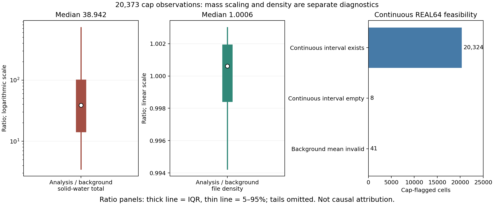

# QI·NI의 호스트 저장 경계와 분석 총량 확대

**같은 CONTROL의 실제 마지막 호출에서, 선택한 불일치 5셀의 양수 QI가 호스트 `zero_outa`에서 0이 되는 경로를 관측했다. 원래 KDM6 NI 주소의 값은 그 경계에서 유지됐고, 최종 history의 QNICE도 같은 값이었다.** 전체 12 UTC history는 기존 배경과 바이트 단위로 같다. 이는 rank 3의 선택한 9셀에 대한 결과이며 44,889셀 전체의 원인·빈도 추정이 아니다. 초기화 규칙·마스크·수농도 상한을 바꾸지 않았고, PR167의 전체 제안 거부 129,878/294,792셀과 현재 B1·26개 조건을 유지한다.

## 1. 이번 질문과 동일 물리의 비교

PR167은 실제 06→12 UTC CONTROL 예보에서 QI·QS·NI 배경을 확보했지만, 고정 영역 전체의 초기화 제안을 생성하지 못했다. 이번에는 그 배경의 `QI=0, NI>0` 저장 상태를 KDM6의 직접 반환과 구분하고, 분석 총량 확대에 따른 상한 충돌을 별도로 재계산한다. 새 초기화 후보나 PSD 선택 규칙을 추가하는 실험이 아니다.

동일한 CONTROL 소스·실행파일과 06 UTC 입력·경계장을 사용한다. 목표는 기존 12 UTC 배경을 재현하면서 마지막 단계의 상태를 읽는 것이다. 기존 실행에는 restart가 없고 내장 과정 기록은 step 540까지여서, 마지막 단계 1080을 보기 위해 06→12 UTC를 재생한다. 이전 12 UTC 분석장을 변경해 실행하는 예보와는 다르다.

| 고정 항목 | 값 |
|---|---|
| CONTROL 물리 SHA-256 | `f391b211c6e111f92a7213cc5a651606ec6b5826a47063e3057ab2d819e9a595` |
| 실제 WRF 실행파일 SHA-256 | `3a286f6691fa94c2dccf55b14e4cbf609b8c9540c2caf83556969932ca9854ea` |
| 배경 주기 / 유효 시각 | 2026-08-16 06 / 12 UTC |
| 실제 설정 기록 | MP_ZERO_OUT=2, MP_ZERO_OUT_ALL=0, MP_ZERO_OUT_THRESH≈10⁻⁸ kg/kg |
| 계산 설정 | 외부 20초, MPI 8개, CONTROL 내부 설정 유지 |

## 2. 보관 소스와 실제 실행 명령의 관계

보관 solve_em 계보에서는 QICE를 `moist`, QNICE를 `scalar`에서 미세물리로 전달한다. 미세물리 반환 뒤 moist의 경계 정리 `zero_outb`와 내부 정리 `zero_outa`를 호출한다. 같은 scalar 처리는 `mp_zero_out_all>0` 조건에 있다. KDM6 내부의 작은 QI·NI 동시 제거와 이 호스트 처리는 서로 다른 경계다.

실행파일에는 source DWARF가 없어, 보관 Fortran의 줄 번호만으로 breakpoint를 정하지 않았다. 실제 실행파일의 심볼·명령과 ABI를 확인했다. CONTROL 라이브러리의 zero-out 객체 `.text` 6,951바이트를 실행파일 대응 영역과 비교하면, 명시한 재배치·링커 완화 영역 36바이트를 제외한 **6,915바이트가 일치**한다. 이 객체는 이전 FIX archive의 같은 멤버와도 같다.

8개 재배치 필드와 두 GOTPCRELX opcode 완화 영역은 바이트 검증에서 제외했다. 따라서 마스크 영역까지 같다고 주장하지 않는다. 보관 solve/driver 소스와 실제 객체 사이의 완전한 source-to-object 생산 이력도 아직 입증하지 않았다. **객체→실행파일의 확인, 소스 계보, 실제 상태 관측의 역할을 구분한다.** 실제 명령에는 mode 2의 유한 값에 대한 엄격한 `< threshold` 비교와 0 저장 경로가 있다. [소스·명령 조사](evidence/ice_history_boundary_20261113/source_audit/README.md), [독립 바이트 비교](evidence/ice_history_boundary_20261113/source_audit/zeroout_section_manifest.json)

```bash
python3 docs/evidence/ice_history_boundary_20261113/source_audit/compare_text.py \
  --receipt /absolute/scratch/zeroout-section-comparison.json
```

이 명령은 작은 보존 section 두 개를 비교한다. WRF 실행이나 보관 소스의 재컴파일을 대신하지 않는다.

## 3. 실제 마지막 호출의 대응 상태

두 번째 전체 재생은 exit 0, MPI 8개 rank가 모두 정상 완료했다. 단계 1080에서 여섯 이벤트가 순서대로 기록됐고, 이벤트마다 같은 9개 셀이 있었다. 대응되지 않는 zero-out 호출이나 ABI 오류 기록은 없었다. 실행 중 P_QI=5, P_QNI=4였고, zero-out b/a의 caller return 주소는 각각 `0x13fe83b`, `0x13feb58`이었다. 실제 mode 2와 REAL32 threshold `9.99999993922529×10⁻⁹`도 읽었다. 중간 config word는 0이며, 그 의미는 소스 계보·설정과 함께 해석한다.

KDM6 반환 → b 진입, b 반환 → a 진입의 QI·NI 저장 단어가 모두 같았다. b 경계에서는 선택한 9셀의 값이 변하지 않았다. 아래 다섯 셀은 a에서 QI만 0이 됐고, 나머지 네 셀의 QI는 threshold 이상으로 그대로였다.

| 셀 `(i,j,k)`, Fortran 1기준 | KDM6 반환 = zero-a 진입 QI, kg/kg | zero-a 반환 = history QI | KDM6 반환 = history NI, kg⁻¹ |
|---|---:|---:|---:|
| `(138, 72, 17)` | 5.93713811e-15 | 0.0 | 8.60265845e-06 |
| `(205, 102, 17)` | 1.09610543e-09 | 0.0 | 1.42137651e+01 |
| `(193, 97, 18)` | 6.85913459e-09 | 0.0 | 1.51211987e+01 |
| `(153, 115, 22)` | 5.70808185e-14 | 0.0 | 6.30740309e-04 |
| `(167, 73, 31)` | 5.24745339e-15 | 0.0 | 1.87138052e-04 |

KDM6에서 읽은 메모리 경계 여섯 값은 호스트 moist의 범위와 같고 QI 주소도 직접 대응했다. NI는 KDM6에서 얻은 원래 주소를 유지해 읽었다. 다만 tile 끝점의 표현은 같지 않다. 예를 들어 b의 ite는 234이고 KDM6의 ite는 233이며, zero-out의 kte는 40이고 KDM6는 39다. 모든 관측점은 각 이벤트의 실제 범위 안에 있었다. 범위의 모든 숫자가 같다고 검사하는 대신 할당 메모리·주소·관측점 포함 여부를 구분했다.

9셀의 a 반환 QI·NI 18개 단어는 기존 및 재생 12 UTC history와 비트 단위로 같다. 전체 파일 SHA-256도 `1da306199931df895a959b1746b570ee13724e86d8f6684694e00ad65c55d840`로 같고, 89개 실행 입력의 해시도 보존됐다. history 저장 함수 자체를 계측한 결과는 아니며, 다른 후속 연산의 일시적인 변화와 상쇄까지 배제하지 않는다. [원시 기록·검증 범위](evidence/ice_history_boundary_20261113/native/README.md), [실행 장부](evidence/ice_history_boundary_20261113/native/replay_v2/native_validation.json)

특히 `(193,97,18)`은 KDM6 진입 QI가 0인데 반환 때 `6.8591×10⁻⁹ kg/kg`가 생기고, a 반환과 history에서 다시 0이 됐다. history QI=0만으로 그 호출에서 얼음이 만들어지지 않았다고 판단할 수 없다. 반대로 양의 쌍 대조 `(190,103,23)`의 QI는 이 경계에서 유지되지만, 기존 제안에서는 분석/배경 총량비 약 459.15와 계산 수농도 약 `1.1788×10⁷ m⁻³`로 상한을 넘는다. **호스트 저장 경계 문제와 분석 질량 확대의 제약 충돌은 같은 해결책으로 묶을 수 없다.**


계측 대상은 rank 3의 사전 선언한 9셀이다. 기존 12 UTC 출력에서 불일치 5개와 양의 쌍 4개를 골라 경로를 조사한다. 무작위 표본이나 영역 전체의 빈도 추정이 아니다. 모든 셀은 원래 고정 영역 안에 있으며, 양의 쌍 네 개 중 세 개만 기존 제안의 수용 셀이다. `(190,103,23)`은 양의 QI·NI를 가졌어도 제안은 거부됐다.

보완 probe는 실제 실행파일 SHA와 wrapper 인수, 실행 중 P_QI/P_QNI 인덱스, 배열 경계 및 moist QI 주소 대응을 검사한다. 원시 값은 REAL32 바이트를 함께 기록한다. 목표 단계의 KDM6 호출부터 다음 단계가 시작되기 전까지 대응/비대응 zero-out 호출을 구분하며, 다른 rank나 관측 범위 밖의 tile까지 검증했다고 하지 않는다.

**계측 한계:** NN·NC·NI 등을 독립적인 scalar base에서 다시 찾는 probe가 아니다. NI는 KDM6에서 얻은 원래 주소를 유지해 읽으며, 별도의 scalar base/P_QNI 주소 대응은 직접 검증하지 않았다. mode·threshold와 인접 config word는 실제 메모리에서 기록한다. 물리 시계는 직접 캡처하지 않으므로 단계 번호·실행 설정·시간 로그·history와의 값 대응을 별도로 검증해야 한다. 관측하지 않은 중간 처리의 부재나 44,889셀 전체의 원인을 선언할 수 없다.

### 계측 실패와 보완 검증

첫 6시간 재생은 8개 rank가 정상 종료했고 12 UTC history도 원본과 같았지만, 계측 파일은 비어 있었다. 이를 과정 경로의 검증 성공으로 사용하지 않는다. 함수 이름 breakpoint가 실제 함수 시작 `0x2283ac0`이 아니라 `0x2283ac4`에 잡혔다. 그 앞의 `push rbp; mov rsp,rbp`가 스택을 8바이트 바꾸므로, 진입점용 인수 해석이 다른 인수를 읽었다. 짧은 재현에서 단계 번호로 읽은 값은 0이었다. [breakpoint 해석](evidence/ice_history_boundary_20261113/source_audit/breakpoint_resolution.txt), [실제 prologue](evidence/ice_history_boundary_20261113/source_audit/kdm_entry_prologue.asm)

명령 진입점 주소를 직접 지정한 보완 probe를 짧은 실행에서 먼저 검증했다. 실제 step 1의 KDM6 진입·반환, zero-out b 진입·반환, a 진입·반환과 9셀의 주소/경계를 확인했다. 실제 config의 mode는 2, threshold는 REAL32 `9.999999939×10⁻⁹`였고 다음 단계에서 기록 범위를 닫았다. 전체 재생에는 **같은 probe 바이트**를 사용하고 TARGET_STEP 환경값만 1→1080으로 바꾼다. 실제 마지막 호출의 결과는 이 pilot로 대신하지 않는다.

실제 driver 명령에서는 driver 인수 125의 포인터를 KDM6의 NI 인수 10으로 직접 넘기는 경로도 확인했다. 보관 소스 계보는 인수 125를 qni_curr로 명명한다. 다만 최적화된 solver의 그 인수 구성과 live scalar base의 독립 검증까지 완료한 것은 아니다.

## 4. 상한 충돌은 밀도보다 총질량 확대와 연결된다

기존 공개 배열과 고정 정책을 그대로 사용했다. 배경 평균질량을 유지하는 규칙은 이상적인 산술에서 다음 관계다.

\[
\alpha=\frac{q_i^a+q_s^a}{q_i^b+q_s^b},\qquad
N_i^{new}=\alpha N_i^b,\qquad
n_i^{new}=\alpha\frac{\rho_a}{\rho_b}n_i^b.
\]

실제 재계산은 기존 저장 순서를 따른다. REAL64에서 분율×분석 총량을 계산하고 QI를 REAL32로 저장한 뒤, 그 QI를 배경 평균질량으로 나눠 NI를 REAL32로 저장하고 분석 밀도와 REAL32로 곱한다. 밀도는 파일의 `1/(AL+ALB)` proxy이며 새 초기장의 실제 첫 사용 밀도가 아니다.

| 고정된 상한 초과 관찰군 | 결과 |
|---|---:|
| 셀 수 | 20,373 |
| 분석/배경 총질량비 α 중앙값 | 38.9423 |
| α 25·75백분위 | 14.0638 / 101.9989 |
| 분석/배경 밀도비 중앙값 | 1.000611 |
| 제안 NI 고정, 배경 밀도로 바꿔도 상한 초과 | 20,363 |
| 그 밀도 대체로 상한 이내 | 10 |

이는 저장 상태에서의 대수적 민감도다. 밀도 차이의 예보 인과 기여량이나 변경 예보 결과가 아니다. 배경 자체 수농도가 상한을 넘은 그룹도 아니다. 큰 분석 총량 확대에서 배경 평균질량을 정확히 유지한다는 가정이 현재 정책과 충돌한 결과다.

## 5. 평균질량 유지 실패와 허용구간 공집합은 다르다

현재 분율에서 정한 저장 QI를 고정하고 평균질량이 정책 범위 안에서 달라질 수 있다고 가정하면, 연속 REAL64 산술의 가능한 범위는 다음과 같다.

\[
m\in\left[\max\left(m_{\min},\frac{\rho_a q_i^{new}}{N_{cap}}\right),m_{\max}\right].
\]

| 상한 초과 관찰군의 구분 | 셀 수 |
|---|---:|
| 배경 평균질량부터 정책 밖 | 41 |
| 배경 평균질량은 정책 안 | 20,332 |
| 위 20,332개 중 연속 허용구간 공집합 | 8 |
| 구간은 있지만 배경 평균질량 유지와 충돌 | 20,324 |

8셀의 필요한 평균질량은 정책 상한보다 약 0.679∼234.2% 크다. 20,324셀에 연속 산술상의 여지가 있다는 것이 다른 입경을 과학적 근거 없이 선택해도 된다는 뜻은 아니다. 또한 이 계산은 이산 REAL32 저장값의 모든 조합을 검사하거나 native 분기의 수용을 재생한 결과가 아니다. 마스크·상한·분율·사전값을 바꾸지 않았다.



비율 그림의 굵은 선은 IQR, 얇은 선은 5–95%이고 꼬리는 생략했다. 셀은 독립 기상 사건이 아니며, 세 번째 패널의 구간 존재는 수용된 새 초기화가 아니다. [재계산 원자료와 식](evidence/ice_history_boundary_20261113/science/recount.json)

## 6. 저장 경계를 확인해도 별도 정보가 필요한 상태

기존 QI=0·NI>0인 44,889셀은 QS=0인 16,748셀과 QS>0인 28,141셀로 나뉜다. 잔류 NI를 어떻게 해석할지 정하더라도 배경 고체수분이 없는 문제를 모두 해결하지는 못한다. 배경 QI+QS=0인 전체 81,215셀에는 현재 history 배경의 분율·평균질량을 정의할 정보가 없다.

상태를 추출할 경계를 정하는 결정, 새 고체수분의 사전정보를 정하는 결정, 큰 질량 증분에서 배경 입자 특성을 얼마나 유지할지 정하는 결정은 각각 필요하다. host threshold를 바꾸거나 NI를 일괄 삭제하고 제안을 다시 통과시키지 않는다. history NI만으로 제거됐을 수 있는 QI를 복원하지도 않는다.

모멘트 쌍이 같은 단계에서 의미를 갖는 배경을 확보하더라도, 현재 분석 총량에 그대로 비례 확대하면 상한 문제는 남을 수 있다. 이번 경계 진단만으로 새 초기장이 수용됐거나 초기 충격·약한 강수·일반화가 개선됐다고 결론내릴 수 없다.

## 7. 재현 범위와 현재 결정

작은 공개 word 검증은 보존된 54개 이벤트·셀 기록과 각 history의 9셀 QI·NI 표만 검사한다. 원본 NetCDF·실행 설정·포인터·전체 history 해시는 별도의 실제 파일 검사와 독립 검토로 확인한 범위다. 작은 word 검증만으로 그 전체 검증을 재현했다고 하지 않는다.

새 공통 물리 연산이나 일반 단위시험 registry를 추가하지 않았다. 공개 재계산은 기존 PR167 입력과 정책, 작은 객체/실행파일 section, 이번 제한 계측 기록에 한정된다. 실제 실행은 보존된 Intel CONTROL 바이너리를 사용하며 GNU/gfortran 또는 ifort로 대체하지 않는다.

```bash
python3 docs/evidence/ice_history_boundary_20261113/science/recount.py \
  --diagnostic docs/evidence/prior_cycle_application_20261112/coverage/diagnostic_only.npz \
  --policy docs/evidence/prior_cycle_application_20261112/frozen_application/policy.json \
  --out /absolute/scratch/history-boundary-recount
python3 docs/evidence/ice_history_boundary_20261113/figures/plot_constraints.py \
  --out /absolute/scratch/history-boundary-figures
```

새 분석 초기장·그 첫 이류/미세물리·예보 성능·독립 기상 사건 검증은 아직 없다. 현재 B1과 기존 26개 조건을 유지한다.
