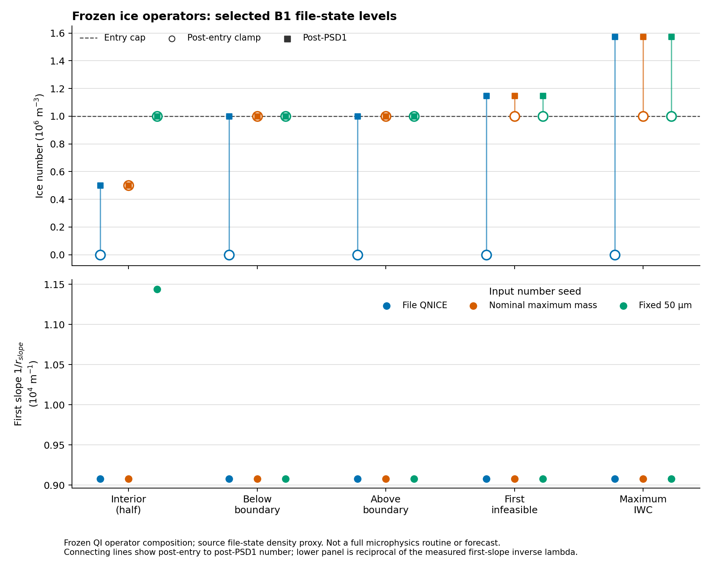
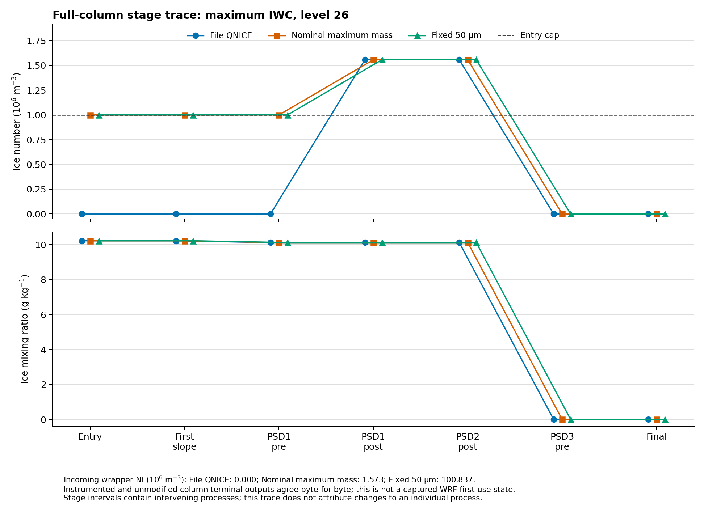

# 빙정 입자수의 단계별 제한과 PSD 소비 규약

## 초록

NI 진입 상한과 PSD 재구성을 서로 다른 시점의 조건으로 명시하였다. **초기화 출력의 기존 cap·평균 입자질량 동시 검사는 유지**하고, 별도의 읽기 전용 진단에서는 `NI≤10⁶ m⁻³`를 진입 제한 직후의 조건으로 검사한다. 이후 PSD 단계에 같은 상한을 다시 강제하지 않는다. 고정 상태의 연산 합성과, 중간 침강·상변화를 포함하는 전체 KDM6 국지 기둥 호출을 구분하였다. 실제 B1 파일에서 정한 다섯 기둥·세 NI 입력에 대해 전체 고정 소스를 실행하고 계측 전후 최종 배열의 바이트 일치를 확인하였다. 이번 실험의 첫 PSD 직후에는 상한 초과가 나타났으나 최종 반환 시에는 모두 상한 이하였으며, 이 결과를 전 단계의 불변조건으로 일반화하지 않는다. **모형 입력 게시나 새로운 WRF 예보·성능 판정은 추가하지 않았다.**

## 1. 결정한 규약과 적용 범위

규약 v1은 두 책임을 분리한다.

| 경계 | 이번에 고정한 조건 |
|---|---|
| 초기화 파일 게시 | 기존의 엄격한 동시 허용 검사 유지. 공집합을 사전 입경 변경·질량 삭제·수종 재분배로 우회하지 않음 |
| native 진입 제한 직후 | 실제 source `min(max(NI,0),10⁶)`과 저장 상태가 일치해야 함 |
| 첫 slope 소비 | 실제 제한 후 NI를 읽으며, λ를 제한해도 NI 자체를 복구하지 않음 |
| PSD1·PSD2·PSD3 | 각 단계의 활성 조건과 source 재구성 결과를 검사. 진입 상한을 전역 조건으로 재적용하지 않음 |
| wrapper 반환 | 제공한 DEN으로 나눈 공개 NI가 일치해야 함. 진입 상한 이하라고 사전에 가정하지 않음 |

[기계 판독 규약](evidence/ice_stage_contract_20261111/contract/policy.json)은 진단 전용이며 `scientific_admission=false`, `modified_input_publication=false`이다. 실제 native 조정량은 모두 기록하되, 큰 조정량을 과학적으로 허용한다는 새 기준은 만들지 않았다. 따라서 **단계별 source 정합성 통과와 초기화 파일 채택은 다른 판정**이다.

이 결정은 현재 빙정 질량을 바꾸지 않은 채 어떤 입력도 허용하자는 변경이 아니다. B1의 해석적 공집합 1,362개에 적용할 수종·질량 분석 정책은 여전히 필요하다.

## 2. 소스·단위·정밀도

대상은 기존 초기화가 참조하는 CONTROL 소스 SHA-256 `f391b211c6e111f92a7213cc5a651606ec6b5826a47063e3057ab2d819e9a595`이다. 전체 WRF 실행파일의 연산을 새로 관측한 것이 아니라, 이 고정 소스를 Intel 프로파일로 별도 컴파일한 실험이다.

공개 NI는 파일의 kg⁻¹ 값이며 wrapper에서 제공된 DEN을 곱해 m⁻³로 바뀌고 반환 때 같은 DEN으로 나눈다. 공통 초기화의 건조공기 기준 계약과 실제 모형 전체의 질량 기준 폐합을 이번 실험만으로 추가 확정하지 않는다. 밀도는 파일의 REAL32 `1/(AL+ALB)` 추정값을 공급한다. 실제 첫 이류·첫 미세물리 DEN의 관측값은 아니다.

고정 source의 실제 REAL32 초기화 결과는 `pi=3.1415927410125732`, `cmi=261.79940795898438`, `g1pmi=1`, `g1pdimi=6`, `pidni=1570.79638671875`였다. 공칭 실수식의 `500π`를 그대로 대입한 계산과 구분한다. [계수·연산 합성 자료](evidence/ice_stage_contract_20261111/native/README.md)

기존 국지 예제의 `QMIN=10⁻¹²`를 실제 호출자의 값으로 취급하지 않았다. 보존 host의 `module_microphysics_driver`는 `QMIN=epsilon`을 전달하고, 동일한 `module_model_constants`는 `epsilon=10⁻¹⁵`를 정의한다. 이번 주 실험은 이 값을 사용한다. `10⁻¹²` 가정의 이전 국지 결과는 별도 이력으로 보존했다. [호출자 소스 관계](evidence/ice_stage_contract_20261111/caller/source_context.json)

### 활성 조건은 단계마다 다르다

| 단계 | 고정 소스의 조건 |
|---|---|
| 첫 ice slope | QI≤QMIN이면 기본 λmax; QI>QMIN이고 NI=0이면 λmin; 그 외 질량·수로 계산한 slope를 제한 |
| PSD1·PSD2 | QI≥10⁻¹⁴이면 NI=0도 포함하여 λ 검사; 경계에 닿거나 벗어나면 NI 재구성 |
| PSD3 | 앞선 미량 제거 후 QI≥QMIN, NI≥NCMIN을 함께 만족할 때 λ 검사; 경계에 닿거나 벗어나면 NI 재구성 |

λ 제한의 `≤`, `≥`와 활성 경계의 같음·바로 아래·바로 위 REAL32 값을 소스 추출 시험으로 확인하였다. 직접 λ를 공급하는 limiter 시험은 `exp(log())`가 그 경계로 정확히 반올림된다는 가정을 사용하지 않으며, 전체 기둥 실험과 별개다. [경계 시험](evidence/ice_stage_contract_20261111/native/boundary/README.md)

## 3. 대표 상태와 두 실험

실제 B1 입력 SHA-256 `9f8b494dbf5ce765e4320701475d6a65be1f591d72a4f9bf5e929c208be563e5`에서 공칭 정책의 질량농도 경계 비율을 기준으로 대표점을 정했다. 분석 반응을 본 뒤 가장 잘 맞는 지점을 고른 것이 아니다.

| 역할 | Fortran i,j,k | 경계 대비 질량농도 비율 |
|---|---|---:|
| 내부: 경계의 약 절반 | 212,84,20 | 0.5000066 |
| 가장 가까운 경계 아래 | 199,111,22 | 0.9998496 |
| 가장 가까운 경계 위 | 219,236,17 | 1.0000820 |
| 순서상 첫 공집합 | 209,94,17 | 1.1483133 |
| 최대 IWC | 192,72,26 | 1.5726583 |

각 기둥의 39층을 그대로 보존했다. NI만 파일의 QNICE, 공칭 최대 평균질량에 맞춘 값, 기존 50 μm 사전값의 세 입력으로 분리하였다. 후자의 두 값은 관측으로 복원한 수농도가 아니며, 엄격한 초기화 검사를 통과한 예보 후보라고 주장하지 않는다. [선정과 원래 프로파일](evidence/ice_stage_contract_20261111/cases/README.md)

### 3.1 고정 상태 연산 합성

QI·DEN을 고정하고 실제 source에서 추출한 wrapper 변환·진입 제한·첫 slope·PSD1을 합성하였다. 최적화 수준별 585행에서 진입 직후 상한 초과는 0행, PSD1 직후 초과는 33행이었다. 이 계산에는 침강·상변화가 없다.

이 그림의 첫 slope λ는 기록된 reciprocal slope의 역수로 만든 진단값이다. 실제 PSD의 `lamdi_tmp`와 같다고 가정하지 않는다.

### 3.2 전체 국지 기둥 호출

같은 고정 CONTROL 전체 루틴에 다섯 기둥×세 NI 입력을 전달하였다. 제공된 파일 추정 온도·압력·밀도·층 두께와 선택한 국지 호출 인수를 사용한다. 초기 이류·경계 처리·역학과의 결합은 포함하지 않는다.

| 호출 인수·경계 | 의미 |
|---|---|
| DT=20초, ITIMESTEP=2 | 명시한 국지 실험 인수. 실제 첫 WRF 호출 상태가 아님 |
| QMIN=epsilon=10⁻¹⁵, NCMIN=10 | 고정 source 상수와 선언한 국지 조건 |
| CCN0=2×10⁸, SCALE_H=0, land/sea 배수=1 | 실험에서 고정한 인수이며 관측 검증값이 아님 |
| radar off, hail option=0 | 진단·초기화 선택을 고정 |
| TH=Tfile+300, PII=TK/TH | 파일 건조온위에서 계산한 TK를 재현하는 추정값. 압력으로 계산한 PII 및 실제 runtime PII와의 일치를 주장하지 않음 |

원본과 계측 소스는 각 최적화 수준에서 같은 입력을 받았다. **15개 조합×O0/O2, 총 30쌍의 최종 3,308바이트 배열이 바이트 단위로 일치**했다. 별도 새 실행에서 기록과 최종 배열도 재현했다. 이 비교는 계측이 해당 국지 계산을 바꾸지 않았다는 근거이며, 입력 추정값의 관측적 타당성이나 WRF 첫 사용을 입증하지 않는다. [전체 호출·바이너리 스키마](evidence/ice_stage_contract_20261111/native/full/README.md)

## 4. 단계별 실제 반응

아래는 각 최적화 수준의 585개 층·NI 입력 조합이다. 같은 물리 격자를 세 입력으로 반복하므로 독립 기상 사건 수나 서로 다른 관측 표본 수로 해석하지 않는다.

| 기록 경계 | NI>10⁶ m⁻³인 조합 |
|---|---:|
| wrapper 변환 직후 | 60 |
| 진입 제한 직후 | 0 |
| 첫 slope | 0 |
| PSD1 직전 | 31 |
| PSD1 직후 | 49 |
| PSD2 직후 | 49 |
| PSD3 직후 | 0 |
| 최종 반환 | 0 |

실제 NI 저장값이 바뀐 조합은 진입 제한 60개, PSD1 85개였고 PSD2·PSD3은 0개였다. PSD 활성 조건을 통과한 것과 NI가 실제 변경된 것은 다르다. [연산별 저장값 증분](evidence/ice_stage_contract_20261111/analysis/operator_adjustments.csv)은 REAL32 상태값의 차이를 REAL64로 계산한 장부이며 과정률이 아니다.

PSD1 이전에도 차이가 생겼다. 따라서 고정 상태 합성의 33행과 전체 호출의 49행을 같은 집합이나 같은 조정량으로 볼 수 없다. 첫 slope와 PSD1 사이에는 침강·상변화 등 여러 계산이 포함되므로, 이 두 경계의 차이를 단일 과정의 인과 기여량으로 부르지 않는다.

### 최대 IWC 지점의 예

최대 IWC 기둥의 제26층에서 실제 내부 체적 수농도는 다음과 같았다.

| 경계 | 파일 NI=0 | 공칭 최대 평균질량 입력 | 50 μm 입력 |
|---|---:|---:|---:|
| wrapper 변환 | 0 | 1,572,658.375 | 100,836,576 |
| 진입 제한·첫 slope | 0 | 1,000,000 | 1,000,000 |
| PSD1 직전 | 0 | 1,000,707.9375 | 1,000,707.9375 |
| PSD1 직후 | 1,557,009.125 | 1,557,009.125 | 1,557,009.125 |
| PSD2 직후 | 1,557,009.125 | 1,557,009.125 | 1,557,009.125 |
| PSD3 직전·최종 | 0 | 0 | 0 |

첫 slope는 세 입력 모두 λmin에 대응하는 reciprocal slope를 사용했지만 NI는 각각 그대로였다. QI는 첫 slope의 **0.0102224583**에서 PSD1 직전 **0.0101207374 kg/kg**로 달라졌고, PSD3 직전에는 0이었다. 최종 QI=NI=0을 보고 처음부터 ice가 없었다거나 NI 입력의 영향이 없었다고 해석하면 안 된다. 다른 층의 최종 배열도 세 입력에서 같다고 주장하지 않는다.

## 5. 검증과 해석의 경계

진단기는 wrapper 입력의 REAL32 곱셈, 진입 제한, 단계별 활성 조건, PSD 내부 QI·온도 불변, 최종 공개 NI의 REAL32 나눗셈을 확인한다. 범위 검사만으로 PSD 재구성을 검증했다고 하지 않는다. **전체 호출에서 얻은 slope·PSD1·PSD2·PSD3 총 4,680행을 같은 최적화 수준의 소스 추출 oracle로 다시 계산하여 NI·slope/λ의 REAL32 단어와 활성 여부가 모두 일치함을 확인**했다. [Oracle](evidence/ice_stage_contract_20261111/native/oracle/README.md), [12,338개 기록의 진단](evidence/ice_stage_contract_20261111/analysis/summary.json)

[최종 검증 기록](evidence/ice_stage_contract_20261111/validation/receipt.json)은 입력·코드·생성 자료의 해시와 재현 범위를 결속한다. 기존 PR162의 완료된 NC·BG 조건은 변경하지 않았다. 그래프는 두 유지 corpus의 선택 코드만 증분 갱신하고 추출 한계를 기록한다. 그래프의 최신성은 실행·과학 검증을 대신하지 않는다.

## 6. 일반화 초기화에 대한 결론

규약 v1에서는 **진입 제한과 실제 PSD 소비 상태를 분리하여 검사**한다. NI가 상한을 넘은 모든 중간 상태를 오류로 처리하거나 PSD 뒤에 임의의 재상한을 추가하지 않는다. 동시에 native의 나중 복구를 근거로 첫 소비 전의 미완성 초기 모멘트를 허용하지도 않는다. 첫 slope는 복구 전의 NI를 이미 사용한다.

현재 초기화 출력은 기존 엄격한 조건을 유지하므로 공집합 1,362개를 게시할 수 없다. 다음 물리 결정은 QI의 정보 출처, 목표 모형의 ice·snow·graupel 구분, 관측·배경 PSD를 확인하고 그 근거에 따라 정해야 한다. source의 순차 제한을 물리적으로 허용할 경우에도 첫 소비 전후 조정량의 허용 기준을 별도로 고정해야 한다. 이번 실험은 그 기준을 임의로 정하지 않았다.

실제 파일→첫 이류→첫 미세물리 전달, 운영 상변화 연결, 전체 영역 물·에너지 수지, 독립 사건 성능은 미완료다. **새로운 6시간 예보·채택 결과 없이 현재 B1과 기존 보호 11개·규준실험 회복 15개 조건을 유지한다.**

[그림·수치·보고서 묶음](evidence/ice_stage_contract_20261111/FIGURES.md)
