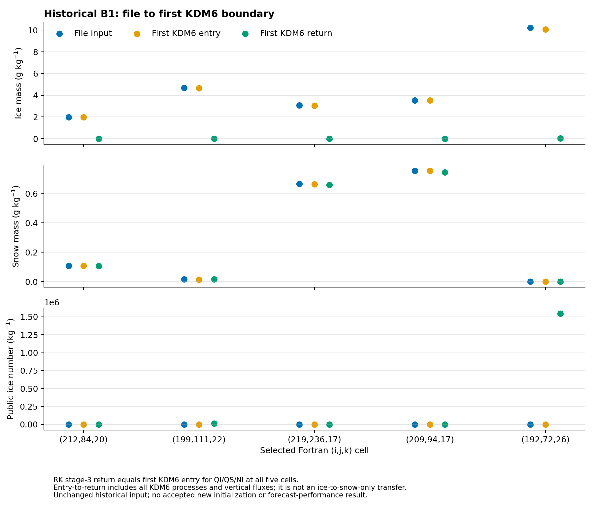

# QI·QS·NI 결합 초기화와 실제 첫 전달 경계

## 초록

빙정 질량을 그대로 두고 NI만 채우는 경우의 제약 충돌을, 임의의 QI→QS 변환으로 우회하지 않는 결합 경로를 구현했다. 호출자는 **출처를 명시한 QI·QS 분배와 NI를 함께** 제공한다. 공통 연산은 같은 마스크·시각·단위, 저장 후 얼음 총량, 기존의 엄격한 NI cap·평균 입자질량 범위를 검사하고, 다른 모멘트까지 완성된 `STATUS_OK`에서만 전체 상태를 반영한다. 최종 파일 도구도 같은 연산을 사용하며, 반환된 QI·QS·NI와 출처가 제안과 일치하는지 확인한다.

별도로 기존 B1의 8-rank·80초 실제 WRF 실행을 대조/읽기 전용 계측 두 구성에서 수행했다. 다섯 지점의 QI·QS·NI는 세 RK 단계와 첫 KDM6 wrapper의 포인터로 연결되었고, 마지막 RK 반환과 첫 KDM6 진입의 15개 REAL32 단어가 일치했다. 두 실행의 초기·80초 history도 바이트 단위로 같았다. **이 추적은 기존의 미완성 B1 입력에 대한 것이며, 새 결합 제안의 실제 첫 사용이나 예보 개선을 입증하지 않는다.**

## 1. 고정한 정책과 물리적 근거

### 1.1 제약 때문에 수종을 자동으로 바꾸지 않는다

KDM6의 빙정→눈 자동변환은 온도·현재 QI·NI·시간간격에 의존한다. 고정 CONTROL의 `psaut`·`nsaut`는 다른 과정의 제한을 거친 후 질량·입자수를 갱신한다. 이를 NI 상한을 맞추기 위한 시간 없는 즉시 변환으로 대체할 근거는 없다. 현재 배경 QI를 전부 다른 수종으로 재분류하거나, 평균 입경을 다시 골라 공집합을 숨기지 않는다.

[기계 판독 정책 v1](evidence/ice_partition_policy_20261111/contract/policy.json)은 다음 책임을 고정한다.

| 항목 | 처리 |
|---|---|
| QI·QS 분배 | 관측·배경 또는 명시한 사전정보에 근거한 외부 제안. 이 연산이 분배율을 추정하지 않음 |
| NI | 같은 제안의 권위 있는 입력. 부적합하면 다른 관측·배경·사전값으로 조용히 대체하지 않음 |
| 출처 | 비어 있지 않은 source와 관측/배경/명시적 prior 분류. 호출자 진술이며 관측적 타당성의 자동 증명이 아님 |
| 총량 | 동일 건조공기 질량에서 QI+QS를 유지하는 분배만 지원 |
| 열역학 | 공통 엔탈피 정의에서 ice와 snow의 열용량·기준 엔탈피가 같으므로 T·QV 유지 |
| 미완성 또는 실패 | 원래 output 전체 유지. `DEGRADED`도 게시하지 않음 |

관측 분석이 얼음 총량까지 바꾸는 경우는 이 경로의 대상이 아니다. 그 증분은 기존 물·열 분석 단계에서 먼저 설명해야 한다. 눈의 입자수는 이 KDM6가 예측하는 독립 모멘트가 아니므로 새 눈 입자수를 만들지 않았다. 이 분배 규약을 다른 미세물리 방식의 눈 상태에 그대로 적용해서도 안 된다.

### 1.2 저장 상태의 수용 조건

제안된 저장값을 (q_i^a,q_s^a,N_i^a), 기존 값을 (q_i^b,q_s^b)라 하면 다음을 요구한다.

\[
\left|(q_i^a+q_s^a)-(q_i^b+q_s^b)\right|
\le \epsilon_{32}\max(q_i^a+q_s^a,q_i^b+q_s^b).
\]

합과 잔차는 저장된 REAL32 성분을 REAL64로 올려 계산한다. 이는 저장 반올림 허용오차이며 물리적 분석증분을 허용하는 문턱이 아니다. 동일 상태에 같은 제안을 다시 적용할 때 추가 변화가 없는지 시험했다.

양의 QI에 대한 기존 평균 입자질량 범위와 실제 저장 NI·제공된 DEN의 REAL32 곱에 대한 수농도 상한을 유지한다. **평균질량 검사는 공칭 정책의 해석적 envelope이며, KDM6가 REAL32 계수·`exp(log())`·포함 경계로 λ를 계산할 때 전혀 조정하지 않는다는 보장은 아니다.** 이전 단계별 진단과 이번 일반 완성기의 역할을 혼동하지 않는다. 첫 사용 시 정확한 PSD 소비 여부는 새 입력별로 확인해야 한다.

## 2. 구현과 최종 파일 경로

`cloud_bal_microphysics_initialization`에 `ice_snow_partition`과 `complete_ice_snow_initialization`을 추가했다. 세 field의 유효 마스크는 같아야 하며, 활성 셀의 값·quality·source와 모든 field의 배열·시각·단위를 검사한다. NI 제안을 먼저 엄격히 검사하고 candidate 전체 상태에 반영한다. 다른 모멘트는 기존 완성기로 처리하며, 활성 NI 이외의 관측 우선순위를 유지한다. 완료 전에는 호출자의 output을 바꾸지 않는다. 기존 `complete_initialization_state`의 기본 동작과 기존 단계별 NI 진단은 변경하지 않았다.

최종 파일 도구의 선택적 `ice_snow_partition` manifest 항목은 NPZ의 경로와 SHA-256을 결속한다. NPZ도 정확한 producer 출력 해시를 지정한다. 기본 모드는 기존과 같이 모멘트만 쓰고, 새 모드에서는 QICE·QSNOW와 모멘트를 함께 쓰며 T·QV·다른 수상량·바람·압력은 유지한다. source bit는 출력 어댑터 경로를 뜻하고, 관측 지원을 임의로 부여하지 않는다.

게시 전에는 driver가 반환한 QICE·QSNOW가 활성 마스크에서 제안과, 밖에서 원래 값과 정확히 같은지 검사한다. 활성 QNICE와 NI provenance도 제안과 일치해야 한다. 보존합을 유지하면서 다른 분배로 바꾼 응답, 음수 QI와 보상 QS, 바뀐 NI·허위 관측 provenance를 반환하는 합성 변조 시험은 모두 게시 전에 거부한다. 출력/receipt 게시 실패 시 기존의 철회 경로도 유지한다.

[입력 형식과 사용 범위](MODEL_MOMENT_HANDOFF.md#joint-ice-snow-number-proposal)

## 3. 실제 WRF 시작 구간의 관측

### 3.1 실행의 범위와 동일성

기존 B1 입력 SHA-256 `9f8b494dbf5ce765e4320701475d6a65be1f591d72a4f9bf5e929c208be563e5`, 기존 WRF executable SHA-256 `68ed2833b5f207d037949c9b20c7c2f800500e632f911a4acf1eb09d13bf1c1f`를 그대로 사용했다. 새 컴파일의 source-to-binary 증명이 아니라 역사적 실행파일의 실제 경계를 읽은 실험이다. 고정 Intel 환경·Intel MPI·무제한 stack·8 ranks·1 OpenMP thread로 새 scratch에서 실행했다.

원래 history 간격의 첫 실행과 별도로, 대조/계측 모두 history 간격만 80초로 맞춘 쌍을 실행해 진전된 상태를 비교했다. 각 구성의 89개 staged 입력 해시는 실행 뒤 유지됐고, 8개 rank 모두 성공 종료했다.

| history | 대조/계측 공통 SHA-256 |
|---|---|
| 12:00:00 UTC | `b637f559e5e5e633916b6bcd35e16424c8f3f1f3ef5309ca1ac554a6edd09ef6` |
| 12:01:20 UTC | `89e00f9a4dec052dfb8f228cf55d3e83c8f7cc60ef9f9f96e140303278b85161` |

GDB는 읽기와 breakpoint만 사용하며 모델 상태를 대입하지 않았다. 초기 8 MB stack의 실패와 실행 전 wrapper 경로 오류는 별도 실패 기록으로 보존했고 통과에 포함하지 않았다. [원시 기록·검증·한계](evidence/ice_partition_policy_20261111/native/README.md)

### 3.2 파일 상태와 첫 사용 상태는 다르다

기존 단계별 실험의 다섯 표적을 그대로 선택했다. 이 표본은 새로운 독립 기상 사건이 아니다. 실제 species index는 moist의 QI=5·QS=6, scalar의 NI=4였다. species 숫자만으로 서로 다른 배열을 혼동하지 않도록 실제 base pointer와 각 셀의 유일한 rank 소유권을 확인했다. 290개 기록에는 세 RK 단계의 tendency/update, 전처리, KDM6 진입·반환이 포함된다.

| Fortran i,j,k | 파일 QI | 첫 KDM6 QI | 파일 QS | 첫 KDM6 QS |
|---|---:|---:|---:|---:|
| 212,84,20 | 1.984952 | 1.987137 | 0.108524 | 0.107991 |
| 199,111,22 | 4.695878 | 4.667005 | 0.015650 | 0.014613 |
| 219,236,17 | 3.064370 | 3.054227 | 0.666077 | 0.665562 |
| 209,94,17 | 3.532349 | 3.522785 | 0.757377 | 0.756936 |
| 192,72,26 | 10.222458 | 10.067691 | 0 | 0.000058 |

표의 질량은 g/kg이다. 다섯 셀 모두 파일과 첫 KDM6 진입의 공개 NI는 0이었다. 마지막 RK stage 3의 반환 QI·QS·NI는 각각 첫 KDM6 진입과 REAL32 단어까지 같았다. 실제 전처리 DEN·TH·PII·P의 포인터도 wrapper 입력과 연결했다. TK는 기록된 TH×PII의 REAL32 곱을 오프라인 계산한 값이며 직접 캡처한 TK가 아니다.

파일 밀도 추정값과 실제 진입 DEN도 구분한다. 예를 들어 (209,94,17)은 각각 0.68211734, 0.68137163 kg/m³였다. 차이의 존재만으로 밀도 기준 오류나 특정 연산의 원인을 단정하지 않는다.

[그림의 전체 수치](evidence/ice_partition_policy_20261111/figures/native_handoff.csv)는 KDM6 반환도 함께 제공한다. QI·QS·NI는 한 호출 안에서 다시 달라지며, 반환 공개 NI는 체적 수농도가 아니다. 그림의 QI 감소를 전부 QS 증가로 환산할 수 없다. 그 사이에는 전체 미세물리, 수직 유출과 다른 수종·수증기 변환이 포함되므로 이 자료만으로 국지 물수지나 한 과정의 인과 기여를 계산하지 않는다.

## 4. 검증과 일반화 판정

[검증 기록](evidence/ice_partition_policy_20261111/validation/receipt.json)은 고정 Intel O0/O2의 공통 결합 연산·파일 어댑터 시험 및 전체 unit suite, source/log 해시를 제공한다. 독립 검토에서 발견한 반환 분배·NI·provenance 검증 공백은 게시 전 대조와 변조 시험으로 보완했다. 그래프는 영향 소스만 증분 갱신하고 KLAPS50/Cloud-BAL의 별도 날짜별 snapshot과 추출 한계를 남긴다. 그래프 최신성은 실행·과학 검증이 아니다.

| 질문 | 현재 상태 |
|---|---|
| 명시적 QI·QS·NI를 공통 연산과 최종 파일 도구가 함께 처리하는가 | 구현·합성 결합 시험 |
| 기존 B1의 실제 RK→첫 KDM6 경계를 읽었는가 | 다섯 셀·80초 역사적 실행에서 확인 |
| 새 결합 초기화 입력을 실제 WRF가 사용했는가 | 미확인. 위 실행은 기존 B1 입력 |
| B1 공집합 1,362개의 물리적 분배가 결정됐는가 | 미결정. 정보 없는 자동 재분배는 거부 |
| 새 예보 성능과 독립 사건 일반화가 확인됐는가 | 새 예보·판정 없음 |

현재 B1과 기존 보호 11개·규준실험 회복 15개 조건을 유지한다. 다음 실험에 사용할 QI·QS 분배와 NI의 정보 출처를 고정한 뒤 이 결합 경로에 입력하고, 그 **새 입력 자체**의 첫 사용을 확인해야 한다. 이번 경로가 주는 것은 그 결정을 함께 검증·전달할 구현과 기존 전달 경계의 관측이며, 특정 분배율이나 사전 입경이 일반적으로 옳다는 결론은 아니다.

[그림·자료 ZIP 안내](evidence/ice_partition_policy_20261111/FIGURES.md)
