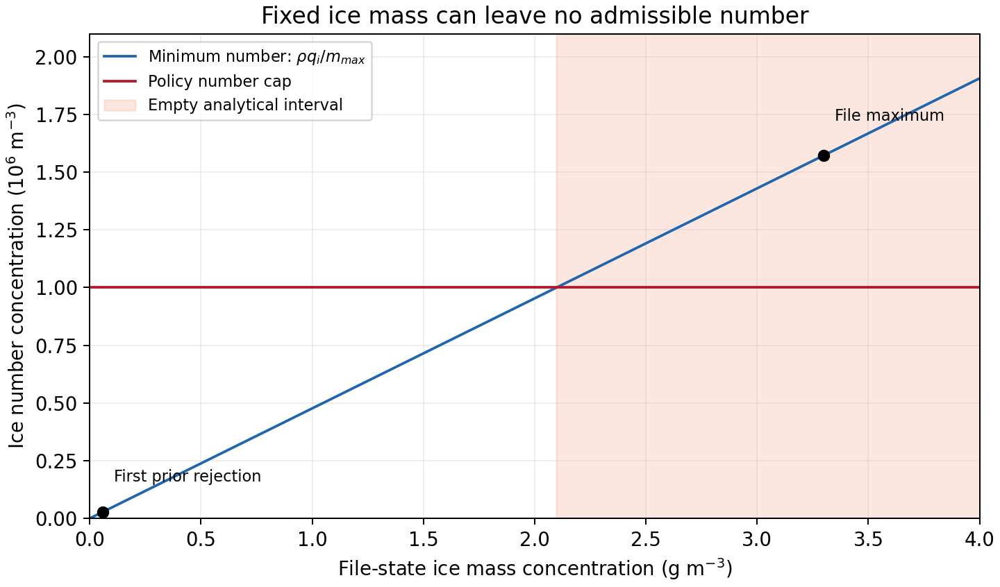

# 물리 모멘트 초기화의 온도 해석과 고정 질량 실현 가능성

## 초록

최종 모형 파일의 건조온위 변수를 습윤온위로 다시 보정하던 오류를 수정하였다. 모멘트 완성에서는 고정 질량과 평균 입자질량 범위, 수농도 상한이 만드는 해석적 허용구간을 계산하여 후보 부적합과 구간 공집합을 구분한다. 기존 B1 입력의 독립 재집계와 함께, 닫힌 완전 구름 증발의 NC→NN 반환 및 선택한 싸락눈 융해의 부피 교환을 기존 물·엔탈피 보존 연산과 결합한다. 실제 소스에서 추출한 비 slope 계산은 저장 가능한 모멘트라도 활성 조건 때문에 기본 입경을 사용할 수 있음을 확인한다. **이번 변경은 초기화 구현과 국지 검증이며 새 예보나 성능 개선 결과가 아니다. 현재 B1과 기존 26개 평가 조건은 유지한다.**

## 1. 파일 온도의 해석

NetCDF의 `T`는 건조온위의 섭동값이다. `THM`의 의미가 설정에 따라 바뀌는 것과 구분해야 한다. 현재 도구가 읽는 `T`에 대해

$$\theta_d=T_{file}+300,\quad \Pi=(p/10^5)^{287/1004.5},\quad T_K=\theta_d\Pi$$

를 사용한다. `use_theta_m`은 모형 설정의 일치 검사에 남기되 이 식에 수증기 나눗셈을 추가하지 않는다. 파일의 `T`나 수상량을 수정하는 연산도 아니다.

$p=100000$ Pa, $T_{file}=0$, $q_v=0.02$이면 실제 온도는 300 K이다. 이전 식은 설정 1에서 약 290.6506 K를 만들었다. 새 시험은 같은 물리 상태의 `T`·`THM` 쌍을 구성하고 두 설정에서 **실제 Fortran 드라이버가 반환한 온도 범위**를 확인한다. 파일 기록식도 같은 건조온위 식으로 고쳤다. 이는 파일 경계의 온도 복원 검증이며 모형 첫 사용의 온도 관측은 아니다.

## 2. 질량을 고정했을 때 가능한 모멘트

### 2.1 후보 선택 이전의 해석적 구간

같은 공기 질량 기준의 수상량 $q$, 입자수 $N$, 밀도 $\rho$에서

$$m_{min}\le q/N\le m_{max},\qquad \rho N\le n_{max}$$

를 동시에 요구하면

$$N\in\left[q/m_{max},\ \min(q/m_{min},n_{max}/\rho)\right]$$

이다. 이 구간이 비면 사전 입경을 다시 선택하는 것만으로 이상적인 동시 제약을 만족할 수 없다. 수종 분석 또는 제한 적용 정책에 대한 별도의 물리 결정이 필요하다. 완성 함수는 질량 삭제·수종 재분배·임의의 입경 탐색을 수행하지 않는다.

새 진단은 이 구간과 실패 위치·종류를 함께 반환한다. 유효한 관측·배경·사전정보의 기존 선택 순서와 실제 REAL32 저장값 검사는 유지한다. **해석적 구간은 REAL32 곱셈의 허용 경계와 완전히 같지 않다.** 경계 반올림 때문에 기존 검사에서 허용되는 후보를 이 진단만으로 거부하지 않는다. 또한 해석적 비공집합만으로 저장 가능한 모든 모멘트나 실제 PSD 소비를 보장하지 않는다.

### 2.2 실제 B1의 범위

기존 고정 정책에서 빙정의 최대 평균질량은 $500\pi/9080^3=2.09827464\times10^{-9}$ kg이고 수농도 상한은 $10^6$ m⁻³이다. 따라서 허용 질량농도 상한은 **2.09827 g/m³**이다. 보존된 입력의 최대값 **3.29987 g/m³**는 이를 넘는다. 필요한 최소 수농도는 약 $1.57266\times10^6$ m⁻³이므로 반올림 경계 문제가 아니다.

첫 고정 사전값 거부 셀의 질량농도는 약 **0.05904 g/m³**로, 해석적 구간이 존재한다. 반면 최대 질량농도 셀은 그 구간이 없다. 기존 **106,128개**는 50 μm 사전값이 NI 상한을 넘는 셀 수이며 구간 공집합 개수와 다르다. 이번 전체 입력 재집계에서는 **NI 1,362개**가 해석적 공집합이었고 NC·NR은 0개였다. 첫 공집합은 Fortran 좌표 `(209,94,17)`이다. 50 μm 상한 초과 집합 중 나머지 **104,766개**는 해석적 구간이 존재했다. 이 개수는 특정 사전값을 모두 바꾸면 통과한다는 보장이 아니다. 정의·해시·개수는 [별도 결과](evidence/moment_feasibility_20261111/science/feasibility_recount.json)에 제시한다. 밀도는 파일의 REAL32 `1/(AL+ALB)` 추정값이며 실제 첫 이류·미세물리 DEN의 관측값이 아니다.

## 3. 내부 상변화와 최종 상태 완성의 책임

최종 모멘트 검사는 과정의 이력을 복원하지 않는다. 다음 역할을 분리한다.

| 단계 | 책임 |
|---|---|
| 관측 분석 | 외부 물·열·모멘트 증분의 출처와 의미 |
| 명시한 내부 상변화 호출자 | 질량·엔탈피와 해당 과정의 모멘트 교환 |
| 모멘트 완성 | 남은 결측을 명시한 정보로 채우고 최종 상태 검사 |

`cloud_bal_phase_moments`는 기존 `apply_water_phase_transfer`를 사용하는 두 명시적 국지 연산을 제공한다. 완전 구름 증발에서는 기존 NC를 NN에 더하고 NC를 0으로 만든다. 선택한 비례 융해에서는

$$BG^{post}=BG^{pre}\frac{QG^{post}}{QG^{pre}}$$

로 남은 싸락눈 부피를 정한다. 이는 native 밀도 제한이 작동하지 않아 $\rho_g=QG/BG$인 선택한 규칙이다. 밀도가 제한되는 모든 융해 경로, 비 입자수 생성률이나 모든 상변화의 수 보존을 대신하지 않는다. 융해로 늘어난 QR의 NR은 호출자가 별도로 구성·검사해야 한다.

국지 시험은 이 연산의 물·열·모멘트 반환을 공통 상태에 반영한 뒤 완성 연산에 넘긴다. 실패 시 입력 전체를 유지한다. 이 경로는 합성 상태의 결합 시험이며 운영 상변화 호출부에 자동으로 적용되거나 예보 성능이 검증된 것은 아니다. 세부 내용은 [과정·소비 분기 검증](evidence/moment_feasibility_20261111/science/phase_consumer.md)에 기록한다.

## 4. 저장·허용범위·실제 소비는 다른 조건이다

비의 의도한 $D_m=1$ mm는 $\lambda=5000$ m⁻¹에 해당한다. $q_r=\operatorname{f32}(1.1\times10^{-9})$, $\rho=\operatorname{f32}(0.8)$이면 이 PSD의 체적 수농도는 약 **0.00875352 m⁻³**이다. 이는 양수지만 native `nrmin=0.01`보다 작다. 추출한 실제 `slope_rain`은 이 입력에서 $\lambda=35000$ m⁻¹의 기본값을 사용한다.

시험은 수농도·질량 임계값의 같음과 바로 위 REAL32 값을 모두 확인한다. slope 서브루틴은 고정 소스에서 그대로 추출하고 필요한 상수는 국지 하네스에서 제공한다. 속도 계수는 이 분기 검증의 대상이 아니며 전체 KDM6 초기화·실제 첫 호출을 재생한 시험도 아니다. **입자수를 강제로 올리는 처방 대신 실제로 선택되는 분기를 명시한다.**

## 5. 검증 범위와 다음 경계

고정 Intel 프로파일로 별도의 새 scratch에서 파일 경계 15개 시험과 공통 연산·상변화·소비 분기의 O0/O2 시험을 검증한다. 정확한 소스 해시, 명령, 종료값과 로그는 [검증 영수증](evidence/moment_feasibility_20261111/validation/validation_receipt.json)에 모은다. 구조 그래프는 KLAPS50과 Cloud-BAL을 별도 날짜로 증분 갱신하며 Fortran의 부분적인 교차 파일 호출 추출 한계를 기록한다. 그래프 갱신은 물리 검증을 뜻하지 않는다.

실제 B1에는 고정 질량의 해석적 허용구간이 비는 상태가 있으므로, 이 초기화 정책으로 전체 수정 파일을 게시하고 첫 모형 사용을 시험할 조건은 아직 갖춰지지 않았다. 이번에는 새 WRF 예보나 첫 이류·첫 KDM6 검증을 실행하지 않았다. 질량·수종 분석과 native 제한의 순차 적용을 어떤 물리 정책으로 연결할지 먼저 결정해야 한다. 그 뒤 허용 가능한 실제 입력에서 파일→첫 이류→첫 미세물리 경계를 확인하고 독립 기상 사건으로 일반성을 평가한다.

**기존 보존 침강과 빙정 속도 단위 수정, 현재 B1 보호 11개 및 규준실험 회복 15개의 기준을 유지한다. 이번 진단으로 기존 점수와 채택 판정은 바뀌지 않는다.**

## 자료

- [최종 파일 사용법](MODEL_MOMENT_HANDOFF.md)
- [그림·자료 묶음](evidence/moment_feasibility_20261111/FIGURES.md)
- [국지 과정·소비 검증](evidence/moment_feasibility_20261111/science/phase_consumer.md)
- [실제 입력 해석적 구간 재집계](evidence/moment_feasibility_20261111/science/feasibility_recount.json)
