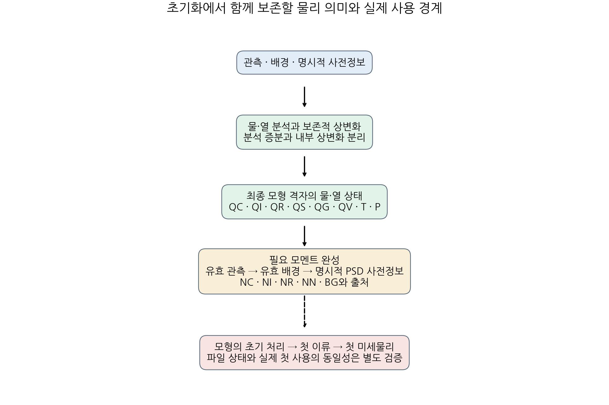
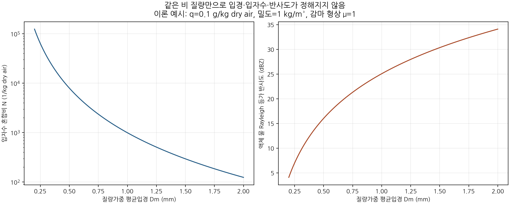

# 물·열 상태와 미세물리 모멘트를 결합하는 초기화 경로

## 초록

질량 혼합비만 전달하던 공통 상태에 구름방울·빙정·비의 입자수, 활성화 수 저장량, 싸락눈 부피를 함께 표현하는 선택적 모멘트 묶음을 추가하였다. 초기화는 유효한 관측 모멘트, 유효한 배경 모멘트, 명시적 사전정보 순서로 상태를 완성하며, 물·열 분석과 수종 간 상변화는 기존 보존 연산에 맡긴다. 같은 공통 Fortran 연산을 사용하는 최종 모형 입력 어댑터는 새 생산 실행의 출력만 복사하여 수정하고, 미완성 상태나 실패 결과를 게시하지 않는다. 여섯 합성 물리 상태에서 기존 포화조정·상변화 결과와 모멘트 완성을 결합하여 시험하였다. 실제 B1 입력을 새 `real.exe` 실행으로 재현한 뒤 고정된 빙정 사전값을 적용한 결과는 입자수 상한 위반으로 거부되었다. **초기화의 공통 구현과 실패 경계는 보강했지만, 실제 첫 이류·미세물리 전달과 독립 기상 사건의 성능 검증은 아직 완료하지 않았다.**

## 1. 연구 목적과 범위

PR159의 NN 하한 시점 실험은 예보 적분 중 수치 처리의 민감도였다. 본 연구는 초기 상태의 구성 책임을 분리한다. 관측으로 만든 물·열 상태를 먼저 정합화하고, 최종 격자에서 필요한 모멘트를 완성하여 전달하는 경로를 구현한다. **새 6시간 예보나 성능 후보를 추가한 연구가 아니다.** 기존 `MP10_NN_END`의 21/26·미채택과 현재 B1 유지 판정은 변하지 않는다.

다사례 일반성을 한 사건의 점수나 합성 기둥 시험으로 대신하지 않는다. 구현의 범위는 다음 세 가지이다.

1. 공통 상태가 물·열과 모멘트를 함께 보유하고, 부적합한 자료를 조용히 누락하지 않는다.
2. 모멘트를 정하는 정보와 단위를 명시하고, 질량·열을 바꾸지 않는 완성 연산을 제공한다.
3. 최종 모형 파일에 같은 연산을 적용하고, 그 뒤 실제 모형 사용까지 남은 검증을 분리한다.

## 2. 물·열 분석과 모멘트 완성의 수학적 구분

### 2.1 관측 분석과 내부 상변화

건조공기 질량 기준의 총수분을

$$
q_t=q_v+q_c+q_i+q_r+q_s+q_g
$$

로 둔다. 관측 분석은 외부 증분을 허용한다.

$$q_t^a=q_t^b+\Delta q_t^{analysis},\qquad
h^a=h^b+\Delta h^{analysis}.$$

그 뒤 닫힌 내부 상변화에는 $\Delta q_t^{phase}=0$, $\Delta h^{phase}\simeq0$을 요구한다. 여기서 $h$는 기존 `moist_species_enthalpy`의 혼합물 엔탈피이며 전체 WRF 에너지가 아니다. 관측으로 추가한 응결물을 모두 현지 응결로 해석하여 수증기를 차감하고 잠열을 다시 더하지 않는다.

새 모멘트 연산 $\mathcal C$는 이렇게 정한 질량·열 상태 $x$에 대해

$$\mathcal C(x,N^{obs},N^{bg},\mathcal P)=(x,N^a)$$

를 계산한다. 이 연산 자체는 수종 질량, 수증기, 온도, 압력이나 바람을 바꾸지 않는다. 따라서 **입자수만 바꾸는 시험에 추가 잠열을 부여하지 않는다.** 정적인 입력과 정보에 같은 연산을 반복했을 때 결과가 더 누적되지 않는지도 검사한다.

초기 물·얼음과 수직운동을 질량·운동량 제약에 연결한 접근은 LAPS 연구의 맥락과도 맞는다. 다만 본 구현은 해당 역학 결합이나 그 연구의 예보 성능을 재현한 것이 아니다. [McGinley·Smart, 2001](https://ams.confex.com/ams/WAF-NWP-MESO/techprogram/paper_23058.htm)

### 2.2 질량 하나로 입자수가 결정되지는 않는다

같은 공기 질량 기준에서 평균 입자 질량은 $\bar m=q/N$이다. KDM6의 비 감마분포에서 형상 $\mu_r=1$이면

$$N_r=\frac{q_r\lambda_r^3}{4000\pi},\qquad D_m=\frac{5}{\lambda_r}.$$

같은 $q_r$에서도 $D_m$을 바꾸면 입자수, 표면적, 낙하·증발 반응이 달라진다. 구름방울의 일반화 감마분포와 빙정의 질량–크기 관계에는 각각 해당 소스 식을 사용해야 한다. 비의 식을 다른 수종에 그대로 적용하지 않는다.

아래 그림은 관측이나 최적 사전값이 아니라 **미정인 자유도를 보여 주는 이론 예시**이다. 액체 물 Rayleigh 근사에서 비의 반사도는

$$Z=10^{18}\rho N_r\frac{\Gamma(8)}{\Gamma(2)}\lambda_r^{-6}$$

이다. 고정 질량에서 입자수와 반사도가 모두 유일하지 않다. 이 식을 실제 혼합상 레이더 관측의 검증으로 사용하지 않았다.

## 3. 공통 초기화 계약

### 3.1 상태와 출처

`cloud_bal_state_type%moments`는 선택적 묶음이다. 기존 질량 전용 상태에는 추가 배열을 자동 할당하지 않으며, 초기화할 때 필요한 경우에만 만든다.

| 슬롯 | 공개 의미 | 공통 단위 | 질량과의 관계 |
|---|---|---|---|
| NC | 구름방울 수 | kg dry air⁻¹ | QC/NC는 평균 구름방울 질량 |
| NI | 빙정 수 | kg dry air⁻¹ | QI/NI는 평균 빙정 질량 |
| NR | 비 입자수 | kg dry air⁻¹ | QR/NR는 평균 빗방울 질량 |
| NN | 활성화에 사용할 수 저장량 | kg dry air⁻¹ | NC와 구분하며 새 하한을 만들지 않음 |
| BG | 싸락눈 부피 | m³/kg dry air | QG/BG는 체적 밀도 |

초기 NN 설정과 예보 중 NN 공급·제한은 별도의 정책이다. 이 초기화는 새 NN 하한을 만들거나 기존 KDM6의 진입·말미 제한을 바꾸지 않는다. NC+NN의 무조건적 보존이나 외부 시간간격 독립성도 주장하지 않는다.

각 값에는 유효성 및 관측·배경·사전정보·알려진 질량 0의 출처를 남긴다. 전부 없는 묶음은 결측 후보로 처리하지만, 일부 배열만 있는 잘못된 묶음은 거부한다. 관측이 미정이라는 사실을 맑음이나 질량 0으로 바꾸지 않는다.

후보는 실제 모형의 REAL32 저장값으로 표현 가능한지, 그 저장값의 평균 입자 질량·싸락눈 밀도가 정책 범위에 있는지, 선언한 밀도로 변환한 수농도가 상한을 넘는지 확인한다. 사용하지 않는 사전값 때문에 유효한 배경을 바꾸지 않는다. 의미 있는 질량에 필요한 모멘트를 얻지 못하면 실패하고, 기존 출력은 유지한다. 미량 양수 질량의 미완성 상태는 별도로 표시하며 최종 파일 게시에는 허용하지 않는다.

KDM6 경계의 범위 검사는 고정한 소스의 공칭 λ·형상에서 유도한 **해석적 허용 포락선**이다. 실제 KDM6는 REAL32 상수와 지정된 연산 순서를 사용하므로, 이 검사가 경계값에서 실제 PSD 보정이 비트 단위로 발생하지 않음을 증명하지는 않는다. 계수·PSD 경계의 네이티브 재생은 남은 검증이다.

공통 연산은 방식별 정책을 인수로 받는다. 최종 KDM6 파일 경로에서는 해당 방식의 소스 허용범위도 검사한다. **소스가 허용하는 범위는 관측오차나 통계적 신뢰구간이 아니다.** 사전정보의 관측적 타당성은 별도 판단이다.

### 3.2 기존 보존 연산과의 결합

기존 `saturation_adjust_cell`과 `apply_water_phase_transfer`의 반환 온도 및 여섯 수종을 공통 상태에 반영한 뒤 모멘트를 완성한다. 모멘트 초기화는 포화조정을 다시 수행하지 않는다. 특히 구름 아래 비가 존재하는 불포화층을 포화시키지 않는다.

QC가 포화조정에서 생성됐다면 그 뒤 과포화가 남지 않을 수 있다. `sw>0`일 때 작동하는 예보 중 활성화가 NC를 자동 보완할 것이라고 가정하지 않고, QC를 넘기는 초기화 단계에서 NC의 출처도 결정한다.

기존 WPS와 SHADOW 파일은 모멘트를 보존하는 형식이 아니다. 이번에는 모멘트를 가진 상태를 그 경로로 보내면 실패하도록 하여 조용한 소실을 막았다. 최종 모멘트 완성은 질량 전용 전달·`real.exe` 처리 뒤의 모형 격자에서 수행한다. 관측 입경 정보를 상류에서 얻었다면 이를 버리지 말고 해당 최종 격자로 옮길 별도 모멘트 재격자화가 필요하다. 그 재격자화는 이번에 구현하지 않았다.

## 4. 최종 파일 경계와 단위

Python 도구는 파일·출처 검증과 게시를 담당하고, 수치 계산은 공통 Fortran 연산에 연결한 드라이버가 담당한다. 이 어댑터는 계산에 쓰는 물·열·모멘트 부분상태를 매핑한다. 기존 압력좌표 격자의 전체 건조질량·바람 균형 계약을 native 격자로 재구성한 것은 아니다. 고정된 2026년 사례의 해시나 격자 크기를 일반 도구에 넣지 않았다.

새 작업 디렉터리에서 명시된 생산 실행을 수행하고 생성된 `wrfinput_d01`만 처리한다. 이전 모델 입력·restart·history를 생산 입력으로 넣는 것을 거부한다. 관측·배경·사전정보 배열은 실제 생성 파일 해시에 묶으며, 기존 모든 비모멘트 변수의 바이트가 수정 전후 동일한지 다시 읽어 확인한다. 두 최종 경로는 새 파일이어야 하고, 파일·영수증 게시 실패 시 자신이 만든 결과를 철회한다.

KDM6 설정, `use_theta_m`, 단위, 결측값·스케일 및 모형 필드의 형상을 검사한다. 온도 진단은 소스의 압력·Exner·건조/습윤 온위 분기를 구분한다. 이 진단으로 파일의 온도 변수를 다시 쓰지는 않는다.

### 4.1 파일 밀도와 실제 첫 사용은 다르다

이번 소스 추적에서 `solve_em → moist_physics_prep_em → microphysics_driver → KDM6` 경로의 수농도 변환 밀도는 당시의

$$\rho_{mp}=\operatorname{f32}\left[1/\operatorname{f32}(AL+ALB)\right]$$

로 확인된다. 다른 전처리 구간의 $(1+QV)/(AL+ALB)$와 혼동하지 않는다. KDM6는 공개 입자수에 이 DEN을 곱하고 반환할 때 나눈다. BG에는 밀도를 다시 곱하지 않는다.

그러나 입력 파일의 AL은 `start_em`과 RK 처리에서 다시 계산될 수 있다. 따라서 파일에서 계산한 같은 형태의 값은 **파일 상태의 밀도 추정값**이며 첫 이류나 첫 미세물리의 DEN과 같다고 주장하지 않는다. 현재 파일 영수증의 `native_first_use_verified`는 false다. 생성 실행과 소스·빌드의 관계도 해시만으로 증명되는 것은 아니므로, 실제 실행 증거와 운영자가 제공한 식별 주장을 구분한다.

## 5. 검증 결과

### 5.1 서로 다른 물리 상태의 구성 시험

아래는 독립 기상 사건이 아니라 합성 국지 상태의 조합 시험이다. 두 최적화 수준은 서로 다른 새 작업 디렉터리에서 고정 Intel 프로파일로 실행했다.

| 상태 | 실제 결합한 처리 | 확인한 범위 | O0/O2 |
|---|---|---|---|
| 유효 배경·관측 없음 | 배경 모멘트 유지 | 물·열과 모멘트의 불필요한 변화 없음 | 통과 |
| 따뜻한 구름 | 포화조정 → 반환 물·열 → NC 완성 | 총수분·혼합물 엔탈피와 양의 QC–NC | 통과 |
| 불포화층의 비 | NR 완성 → 명시적 증발 전환 → 재완성 | 포화 강제 없음, 증발·냉각 허용 | 통과 |
| 질량 양수·수 없음 | 사전정보 없음/있음 | 거부·롤백 및 명시적 PSD로 완성 | 통과 |
| 혼합상·융해 | 보존 융해 → 반환 물·열 → 모멘트 | 수종·엔탈피·QG/BG 관계 | 통과 |
| 관측 미정/명시적 맑음 | 배경 유지/별도 명시적 상전환 | 미정을 맑음으로 바꾸지 않음 | 통과 |

보존 전환의 합성 증발·융해는 실제 KDM6가 그 과정률을 계산했다는 뜻이 아니다. 별도로 소스에서 추출한 비의 절편·raw PREVP 계산은 같은 양의 비 질량에서 NR=0이면 0, NR>0이고 불포화이면 음의 증발률이 되는 부호를 확인했다. 이 시험의 주어진 중간계수로 실제 증발량이나 예보 강수를 예측하지 않았다.

### 5.2 실제 입력에서 고정 사전값이 거부된 결과

2026년 8월 16일 12 UTC B1 입력을 새 `real.exe` 실행으로 재현했고 보관된 입력과 파일 해시가 일치했다. 소스–바이너리 빌드 폐합까지 입증한 재생은 아니다. 예시 사전정보는 실행 전에 구름방울 반지름 10 μm, 빙정 질량등가 지름 50 μm, 비 $D_m=1$ mm, 싸락눈 밀도 400 kg/m³, NN 100 cm⁻³으로 고정했다. 관측으로 복원하거나 최적화한 값이 아니다.

| 첫 거부 위치 | 값 |
|---|---:|
| Fortran 좌표 | i=1, j=228, k=13, NI |
| QI | 7.27795559×10⁻⁵ kg/kg dry air |
| 파일 상태 밀도 | 0.81121838 kg/m³ |
| 50 μm 빙정의 평균 질량 | 3.27249×10⁻¹¹ kg |
| 그 사전값이 암시하는 수농도 | 약 1.80413×10⁶ m⁻³ |
| 비교한 NI 상한 | 1×10⁶ m⁻³ |

이 고정 빙정 사전값만 적용하면 파일 상태에서 수농도 상한을 넘는 셀은 106,128개였다. 이는 배경 선택까지 수행한 뒤의 최종 실패 셀 개수나 실제 첫 미세물리에서의 수가 아니다. **수정 입력은 게시하지 않았고, 첫 사용 시험이나 새 예보를 실행하지 않았다.** 결과를 보고 입경을 다시 고르지 않았다.

이 거부는 모든 PSD 초기화가 불가능하다는 뜻이 아니다. 예시 사전값이 전체 질량·밀도 상태와 함께 허용되는지를 확인해야 한다는 결과다. 숫자를 양수로 채우는 것과 물리 상태를 완성하는 것은 다르다. 상한을 맞추려고 관측 질량을 조용히 삭제하지 않는다.

### 5.3 구현 검증과 재현 범위

변경을 고정한 별도 소스 추출본에서 기존 단위 검증 묶음이 통과했다. 공통 상태·WPS·SHADOW의 모멘트 누락 거부와 새 초기화 코어의 O0/O2 시험을 포함한다. 최신 파일 경계는 별도 동결 추출본의 **11개 시험**이 통과했고, 여섯 결합 물리 사례는 O0/O2에서 모두 통과했다. 그림 두 장과 이론 자료 CSV도 바이트 단위로 재현했다.

[단위 검증](evidence/physical_moment_handoff_20261110/validation/unit_receipt.json), [별도 경계·물리·그림 재현](evidence/physical_moment_handoff_20261110/validation/focused_receipt.json)의 범위를 구분한다. 실패 원자성, 출처 우선순위, 미정·부분 배열, 비유한 값, REAL32 저장과 상한, 잘못된 단위·방식·정책 및 게시 실패를 검사했다. 이 검증은 관측 동화·전체 영역 수지나 실제 첫 모형 사용의 성공 판정을 대체하지 않는다.

## 6. 고찰과 남은 검증

이번 구현은 기존 물·열 보존 연산과 공통 모멘트 상태, 최종 파일 경계를 연결할 수 있는 경로를 제공했다. 그러나 실제 B1의 선택한 사전정보는 거부되었으므로 이 사례의 물리 초기화가 완성됐다는 판정은 하지 않는다. 첫 이류 이전의 상태와 이후 첫 KDM6 진입을 연결하는 실제 실행 검증도 남아 있다.

다음 정책에서는 입경 관측이 있으면 그 오차와 함께 사용하고, 없으면 유효한 배경 PSD를 우선하며, 부족한 자유도만 명시적 사전정보로 정해야 한다. 최종 질량·수 모멘트가 레이더 등 관측량을 설명하는지 되계산하는 경로, 관측 모멘트의 재격자화와 실제 생산 실행의 빌드 계보는 별도로 닫아야 한다.

사전정보를 바꾼 후 한 사례에서 가장 좋은 값을 다시 찾는 것으로 일반성을 판단하지 않는다. 규칙을 먼저 고정한 뒤 따뜻한 비·층운성·대류성·혼합상·무강수의 독립 사건에 적용해야 한다. 기존 26개 CSI 조건은 현재 사례의 회귀 기준으로 유지하되 사건별 개선·악화와 실제 약한 강수의 검출·강도, 오경보를 함께 평가해야 한다. C2 T39, RN1 상류 시각·coverage/QC와 전체 영역 물·에너지 수지도 이번 시험으로 해결되지 않았다.

## 7. 자료

- [최종 모형 입력 사용법과 파일 계약](MODEL_MOMENT_HANDOFF.md)
- [수종별 소스 관계와 밀도 경계](evidence/physical_moment_handoff_20261110/science/native_moments.md)
- [여섯 구성 시험](evidence/physical_moment_handoff_20261110/science/integration_cases.f90)
- [실제 생산 재생과 초기화 거부 기록](evidence/physical_moment_handoff_20261110/native/actual_real/README.md)
