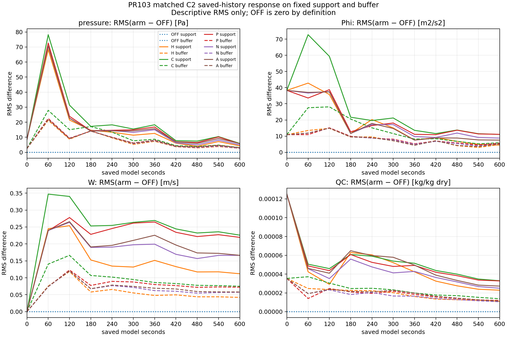

# PR103: matched-amplitude wind control

The single AMPLITUDE control A completed 640 seconds and 32 KDM6 calls on the
unchanged C2 executable. Existing O/H/C/P/N controls, including STRUCTURED N,
were preserved. The comparison separates a uniform reduction of PROJECTED P's
increment from N's change in spatial structure, under the declared equal-face
L2 norm. It does not establish observation or forecast skill.

## Frozen input and native response

The builder applies one global scale, `s = 0.7428606748807538`, to the stored
P−HYDRO increment. After one REAL32 cast, A's norm is 75.135312434 m/s and N's
is 75.135312854 m/s; their difference is inside the pre-write storage budget.
This is an aggregate component norm, not mean wind speed or kinetic energy.
All non-U/V values, metadata, exterior increments, and the inherited change
budget pass their existing checks. The archived native mass consumer passes
both its reference-constraint and source-arithmetic gates.

On the fixed native support, first assembled source-array norms are:

| Field | HYDRO | P | A | N | N/A − 1 |
|---|---:|---:|---:|---:|---:|
| RU | 24,361.966 | 37,999.028 | 32,517.726 | 30,302.067 | −6.814% |
| RV | 23,908.715 | 33,199.724 | 29,072.197 | 28,311.700 | −2.616% |

These are unweighted norms in the original source-array units, not physical
accelerations or energy. The dry-column rate's absolute norm is slightly
larger for N than A, while its vector distance from the nonzero HYDRO rate is
smaller. Smaller absolute tendency is therefore not a general acceptance rule.
The same-input 20-second base/diagnostic comparison and the 20-to-640-second
bridge pass 30 T0 fields, the first POST_KDM6 record, and 18 T1 fields.

## All saved times give a mixed result

For each field and fixed mask, `E_X(t) = RMS(X − OFF)` and
`I_X = trapezoid(E_X², t) / 600 s`. All eleven common saved times are used on
the original 613-cell support and the fixed 196-column, 39-level buffer.
I retains the field's squared units (Pa, m²/s², m/s, and kg/kg dry before
squaring). OFF is a reference, not truth.

| Field | Mask | I_A / I_P | I_N / I_A | 600s E_N / E_A |
|---|---|---:|---:|---:|
| Pressure | 613-cell support | 0.936099 | 0.984140 | 0.852510 |
| Pressure | Fixed buffer | 0.963920 | 0.985005 | 0.862966 |
| Phi | Support | 0.943358 | **1.038871** | **1.167606** |
| Phi | Buffer | 0.959228 | **1.023762** | 0.975807 |
| W | Support | 0.727316 | 0.907306 | 0.999456 |
| W | Buffer | 0.801587 | 0.936341 | 0.985752 |
| QC | Support | **1.028112** | 0.809463 | 0.917811 |
| QC | Buffer | **1.093939** | 0.830886 | 0.936085 |

Uniform amplitude reduction lowers the pressure, Phi, and W integrals relative
to P, but increases the QC integral. At matched amplitude, N lowers pressure,
W, and QC integrals relative to A, but increases Phi. The support's 600-second
W values are almost equal although their time integrals differ. Buffer QC is
also slightly larger for N in the first 0–60-second mean-square segment.
Thus neither the endpoint nor an aggregate input norm supplies a general arm
ordering. The 0–60-second segment contains only two snapshots and resolves no
high-frequency peak.

The [full summary](evidence/pr103_time_response_20261026/postclosure_A640_20261026/allsavedtime_summary.md)
and its JSON retain maxima and times, 0/60/600-second values, both masks, and
direct paired-array A−P/N/H metrics. Those pair metrics are not reconstructed
by subtracting separate arm−OFF RMS values. Nonlinear interactions preclude
an additive causal partition of forecast response.

## Scope of completion

The [execution record](PR103_EXECUTION_20261026.md) distinguishes procedural
completion, exact source endpoint PASS, active-ice policy PASS, and generic
Q/N/B FAIL (173 state-level findings among 192 retained states; not unique
cells). All 1,349 launch-time pins are unchanged. The six-arm history readback
has 656 unchanged source/data pins and preserves the earlier five-arm metrics.

Actual 13Z LSO air temperatures are connected to source-mapped T2 in the
[observation comparison](PR103_OBSERVATION_CONNECTION_20261026.md). All six
arms' T0 T2 arrays are identical, giving the same 765 raw station residuals. This is a
null same-cycle input-consistency result. No exact 13:10 LSO reports are
available in the known case files; independent skill remains NOT_EVALUATED.

Physical approval remains FAIL_OPEN. These partial-host results do not close
the full host water/energy budget, establish a clean WRF/library rebuild, or
validate another case or a longer forecast. The earlier T1 accounting and
STRUCTURED solver are preserved without further tuning.
