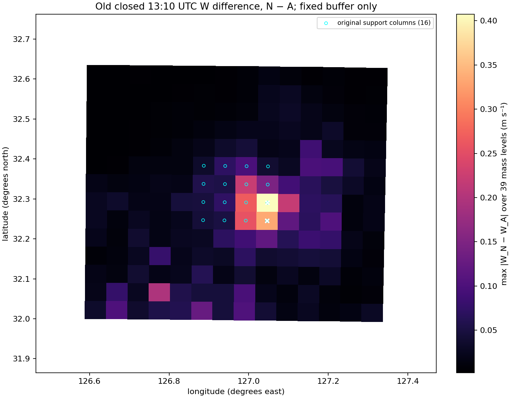

# PR104 spatial diagnostic: old closed N−A maps at 13:10 UTC

This is a descriptive analysis of the already closed PR102 STRUCTURED640 (N) and PR103 AMPLITUDE640 (A) runs at the exact stored `2026-08-16 13:10:00` record (elapsed 600 s). It reads no live PR104 forecasts. The comparison is direct `N − A` on each field at that same time.

The original source-composed support (613 mass-level cells in 16 columns) and its pre-existing 5-cell Chebyshev buffer (7,644 cells in 196 columns) were reconstructed from the pinned composition file. Neither mask depends on the output differences. W is destaggered vertically by averaging adjacent W interfaces, as in the existing PR86 comparison reader. `T` is perturbation potential temperature (K); moisture is kg/kg dry; pressure is `P+PB` (Pa); geopotential is mass-level destaggered `PH+PHB` (m²/s²). Native height is geopotential divided by the pinned WRF gravity and AGL height subtracts common `HGT`. Grid coordinates, terrain, and spacing match bitwise between arms.

## Same-mask W differences

| Fixed region | Cells | Mean signed (m/s) | Mean absolute (m/s) | RMS (m/s) | 95th percentile absolute (m/s) | Maximum absolute (m/s) |
|---|---:|---:|---:|---:|---:|---:|
| Original support | 613 | −0.02668 | 0.03752 | 0.06803 | 0.16399 | 0.40730 |
| 5-cell buffer | 7,644 | −0.00197 | 0.00951 | 0.02416 | 0.03723 | 0.40730 |

For context, same-mask support mean-absolute differences are 0.04673 K in perturbation potential temperature, 1.281e−5 kg/kg in QVAPOR, 2.390e−6 kg/kg in QCLOUD, 1.316 Pa in pressure, and 2.742 m²/s² in geopotential. Buffer values are 0.01069 K, 2.534e−6 kg/kg, 8.974e−7 kg/kg, 0.646 Pa, and 0.830 m²/s², respectively. Full signed mean, RMS, p95, and maximum summaries for every field and region are in the JSON evidence.

The maximum support `|W_N−W_A|` is 0.40730 m/s at WRF mass-grid `(i=137,j=17)`, native eta level 19 (1-based), 32.29047°N, 127.04709°E. It is 80 km from the nearest outer mass-grid cell by the stated index-distance convention, over 0 m terrain; N native height is about 6,845 m MSL/AGL. At this location W is −0.45987 m/s (N) versus −0.05257 m/s (A). Co-located N−A values are −0.49762 K for perturbation potential temperature, +1.5171e−4 kg/kg QVAPOR, zero QCLOUD, +5.3125 Pa pressure, and −6.6356 m²/s² geopotential. The adjacent eta-level-20 cell has the second-largest absolute W difference (0.37088 m/s). These locations were selected by the W difference and are included as diagnostic locations only; they do not establish a mechanism or causal chain.

## Evidence and limits

The complete metric definitions, per-field summaries, top 12 diagnostic cells in each fixed region, exact input/history/receipt/source hashes, unchanged-before/after pins, map hash, and mask contract are recorded in [spatial_diagnostic_1310.json](evidence/pr104_spatial_diagnostic_20261026/spatial_diagnostic_1310.json). The selected histories are bound to COMPLETE receipts and their pinned initial inputs and common boundary file. Only same-time stored records are compared; no time interpolation or candidate selection score is used.

This is field association only. It makes no claim about causality, forecast skill, observation scores, or independence from boundary/initial-condition ancestry. Top cells are selected by the same W differences being inspected, so only the full fixed-mask summaries support quantitative region-wide comparisons. No observations were filtered, no QC threshold was introduced, and no solver or source code was changed.
