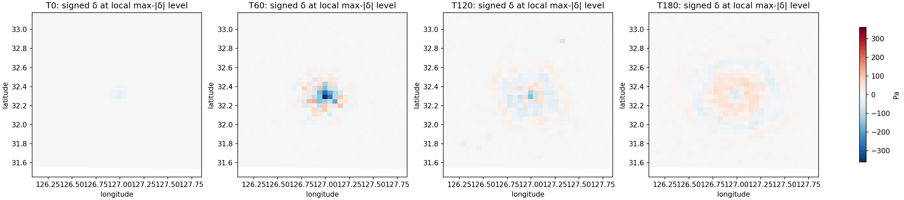
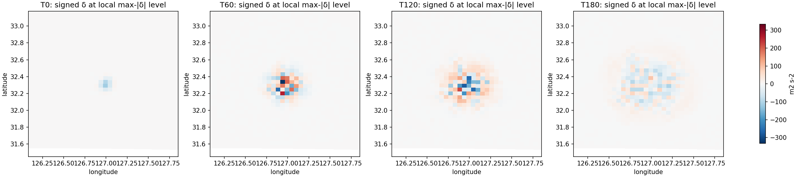
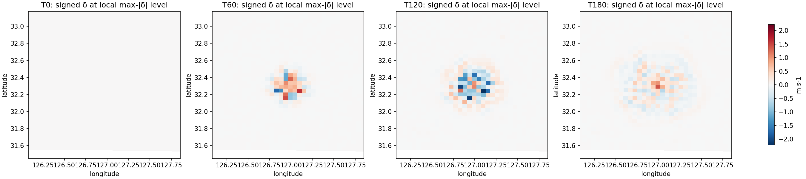

# PR91 preserved-history response diagnostics

This diagnostic reuses the completed C5 120-second and C7 180-second history pairs. It starts no new native run. C7 transient maps and maxima cover T0/T60/T120/T180; the C5–C7 interaction remains on common T0/T60/T120. Receipt-bound native arrays share a 282×234 mass grid with 5 km spacing. The analysis checks grid dimensions and DX/DY, exact within-case OFF/COUPLED static geometry, and each arm's cross-case static coordinates and geometry fields, including XLAT/XLONG. C5 and C7 have matching candidate initial input hashes by arm and matching boundary input hashes. OFF and COUPLED have distinct candidate initial inputs, preserved as part of the paired treatment identity. Each receipt arm label is checked against the requested arm before arrays are analyzed.

## C7 pressure, geopotential, and native W maxima

The maxima below are absolute COUPLED−OFF differences over native vertical levels, separately summarized for each fixed horizontal scope. The C7 T0 water-difference support contains 27 columns; its one-cell neighbor scope excludes those 27 columns. The interior excludes the outer boundary ring. T180 is retained from the receipt-bound C7 180-second histories.

| Field | Scope | T0 | T60 | T120 | T180 |
|---|---|---:|---:|---:|---:|
| P+PB (Pa) | Whole grid | 33.6094 | 360.5703 | 155.7266 | 76.9844 |
|  | Interior | 33.6094 | 360.5703 | 155.7266 | 76.9844 |
|  | C7 T0 support | 33.6094 | 360.5703 | 155.7266 | 76.9844 |
|  | One-cell neighbor | 0.0781 | 114.9063 | 56.2744 | 62.4375 |
| PH+PHB (m² s⁻²) | Whole grid | 116.0469 | 332.8838 | 276.7461 | 102.3730 |
|  | Interior | 116.0469 | 332.8838 | 276.7461 | 102.3730 |
|  | C7 T0 support | 116.0469 | 332.8838 | 276.7461 | 93.5928 |
|  | One-cell neighbor | 0.8555 | 124.2920 | 125.9746 | 92.4307 |
| W (m s⁻¹) | Whole grid | 0 | 1.7285 | 2.2215 | 1.4051 |
|  | Interior | 0 | 1.7285 | 2.2215 | 1.4051 |
|  | C7 T0 support | 0 | 1.6167 | 2.2215 | 1.4051 |
|  | One-cell neighbor | 0 | 1.7285 | 2.0999 | 0.5270 |

The reported W statistic uses all 40 native vertically staggered W faces at each horizontal location. In particular, whole-grid T60 W reaches 1.7285 m s⁻¹ while the fixed 27-column support reaches 1.6167 m s⁻¹. At T0 W differences are zero throughout, so every selected location ties at zero and no unique maximum location exists. The previously published PR90 W values use mass-point averaged W (39 levels); that metric is distinct and its peaks should not be read as these native-face maxima.

Whole-grid maximum locations move as follows. Indices are zero-based; the signed value is the COUPLED−OFF value at the time-specific maximum location. The T0 W location is omitted because the entire selected field is zero.

| Field | Time | `(k,j,i)` | Latitude, longitude | Signed maximum |
|---|---:|---|---|---:|
| P+PB | T0 | `(0,16,135)` | 32.29106°N, 126.99341°E | −33.6094 Pa |
| P+PB | T60 | `(10,16,135)` | 32.29106°N, 126.99341°E | −360.5703 Pa |
| P+PB | T120 | `(6,16,135)` | 32.29106°N, 126.99341°E | −155.7266 Pa |
| P+PB | T180 | `(5,19,137)` | 32.42606°N, 127.10300°E | 76.9844 Pa |
| PH+PHB | T0 | `(25,16,135)` | 32.29106°N, 126.99341°E | −116.0469 m² s⁻² |
| PH+PHB | T60 | `(39,17,134)` | 32.33699°N, 126.94034°E | −332.8838 m² s⁻² |
| PH+PHB | T120 | `(39,16,134)` | 32.29160°N, 126.93970°E | −276.7461 m² s⁻² |
| PH+PHB | T180 | `(22,16,139)` | 32.28854°N, 127.20816°E | −102.3730 m² s⁻² |
| W | T60 | `(39,15,132)` | 32.24722°N, 126.83176°E | −1.7285 m s⁻¹ |
| W | T120 | `(39,15,137)` | 32.24448°N, 127.10004°E | −2.2215 m s⁻¹ |
| W | T180 | `(13,16,135)` | 32.29106°N, 126.99341°E | 1.4051 m s⁻¹ |

The same-location trajectories use one grid point per field, selected by the largest absolute C7 COUPLED−OFF value over all four times, levels, and columns. These trajectories show the T180 recovery from the earlier peak at that selected location.

| Field | Fixed `(k,j,i)` | T0 | T60 | T120 | T180 |
|---|---|---:|---:|---:|---:|
| P+PB (Pa) | `(10,16,135)` | −28.1875 | −360.5703 | −85.1641 | −15.9453 |
| PH+PHB (m² s⁻²) | `(39,17,134)` | −34.1250 | −332.8838 | 78.5488 | −52.5010 |
| W native faces (m s⁻¹) | `(39,15,137)` | 0 | 1.6167 | −2.2215 | 0.0949 |

Each map plots signed C7 difference at the native vertical level with largest absolute difference in that column. The four panels share a color scale per field and use the fixed C7 T0 support bounding box plus a 0.75° margin.

## C5–C7 interaction contrast

At common T0/T60/T120, the tool computes `Δd(t) = [d_C7(t) − d_C5(t)]`, where each `d` is the paired COUPLED−OFF field difference. For P+PB, PH+PHB, and W, Δd is exactly zero at every stored native value on the whole grid at all three common times. This is a descriptive contrast between configurations; the cases have different namelist hashes and executed executable hashes, so it does not isolate a pure single-physics effect.

## Identity and limits

The receipts bind each analyzed history file by SHA-256 and validate the elapsed times through C5 T120 and C7 T180. C5/C7 share the frozen source executable, boundary input, and arm-matched initial input hashes. Their candidate namelist hashes and executed executable hashes differ. The receipt, history, input, and build identities, native scopes, maxima, interaction summaries, and plot hashes are recorded in [response.json](evidence/pr91_history_response_20261020/response.json); the evidence files and checksums are listed in [the evidence directory](evidence/pr91_history_response_20261020/README.md).

## Native continuity feasibility

The C7 T0/T60/T120/T180 histories retain the native C-grid U/V arrays and the MAPFAC, C1H/C2H, MU/MUB, and DNW fields needed to describe endpoint states. The frozen C7 linked archive contains `module_small_step_em.o`, but its receipt does not bind that object's source to the currently checked-out `module_small_step_em.F`; the checked-out source and its hash are recorded separately in [the feasibility record](evidence/pr91_history_response_20261020/native_continuity_feasibility.json). That source's `advance_mu_t` mass tendency uses the coupled U/V and previous-stage U_1/V_1 terms, face mass MUU/MUV, map factors, DNW vertical integration, and MU_TEND. The history files do not contain U_1, V_1, MUU, MUV, or MU_TEND, nor the 20-second fast/RK states. Exact native endpoint flux/tendency reconstruction is therefore unavailable from these records. The saved endpoint fields support no full continuity closure claim; no proxy flux values are computed here.

WRF `T` is perturbation potential temperature, not absolute air temperature, and is not interpreted as air temperature here. P+PB uses the mass grid; PH+PHB and W retain their native vertical staggering. No remapping, observation fit, continuity claim, initial-shock approval, or physical closure is made. The 27-column support is selected from the C7 T0 arm difference and is descriptive; it is not the earlier 162-pressure-cell footprint. Graph freshness does not establish runtime or scientific validation. The focused arithmetic and scope checks are in `tests/test_pr91_history_response.py`.
