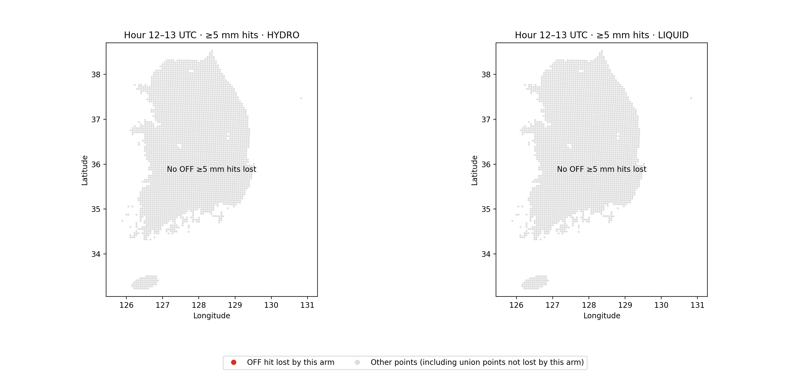

# 무손실·무강수 강수 분석 정상 처리

검토 기준 `a777d395d7c6beed3546cad094f376301ffaf74a`에서 첫 시간 ≥5 mm 적중 소실 집합이 비면 지도 범위의 `min/max`가 실패했다. 새 출력 디렉터리를 정리하는 기존 실패 처리 때문에 같은 실행의 통계도 남지 않았다. 현재 공개 사례의 소실 20점이나 기존 점수의 오류는 아니다.

소실 지점이 없을 때는 전체 공통 평가점의 좌표 범위를 사용하고 두 지도 패널에 **No OFF ≥5 mm hits lost**를 표시한다. 요약의 소실 개수는 0이며, 지점 CSV는 열 이름만 기록한다. 실제 실패의 출력 정리 및 기존 출력 덮어쓰기 거부는 유지한다.

| 실제 CLI 입력 | 이전 코드 | 수정 코드 |
|---|---|---|
| 여섯 시간 HYDRO·LIQUID를 OFF와 같게 설정, 관측·OFF 강수 유지 | 빈 배열 범위 계산 실패 | 정상 종료, 8개 산출물, 첫 시간 각 arm 적중 74개·소실 0개 |
| 관측·세 모델 강수를 모두 0으로 설정 | 같은 실패 | 정상 종료, 8개 산출물, 소실 0개 |
| 기존 원본 여섯 시간 배열 | 정상 | CSV 3개와 요약 JSON 바이트 동일 |

위 두 변형은 회귀 검사용이며 새로운 예보 결과가 아니다. 좌표·인덱스는 그대로 두었고 변형 NPZ는 저장소 밖 임시 경로에서만 만들었다. 새 회귀시험은 그림 생성을 mock하지 않고 실제 `run()` 경로를 실행한다. 기존 점수 시험과 합쳐 **28개가 통과**했다. 전체 portable suite·모델 빌드·예보는 이 수정에서 실행하지 않았다.

[실행·입력 해시·이전 실패와 수정 결과](evidence/precip_empty_loss_20261027/regression_receipt.json) · [재현 변형 설명](evidence/precip_empty_loss_20261027/commands_and_transformations.md)
