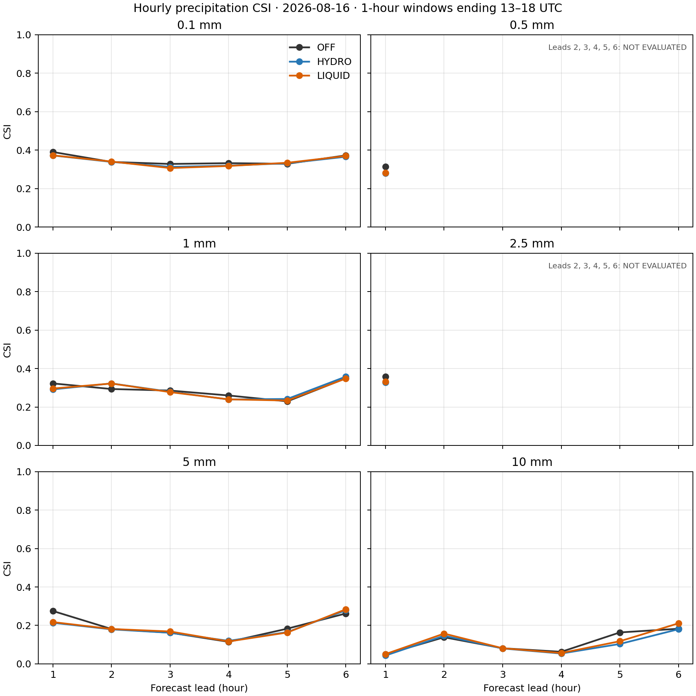
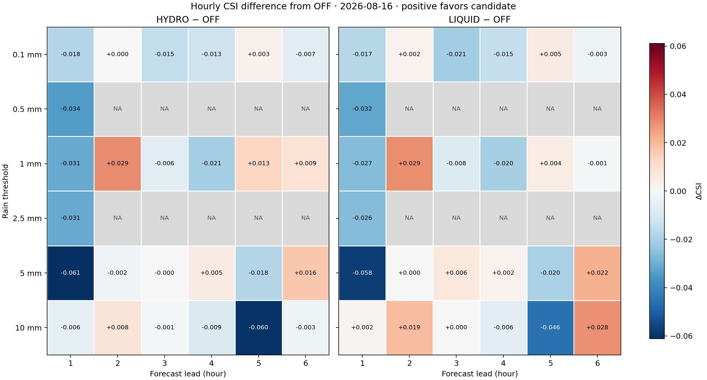
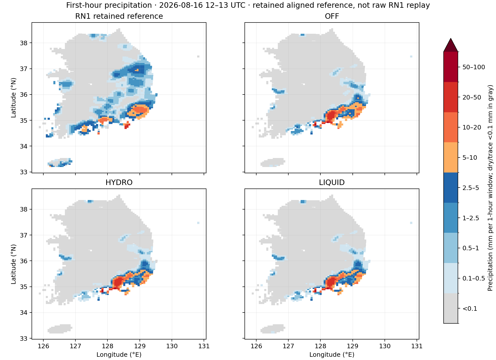

# 기존 실험의 시간별 강수 점수 — 2026-10-27

이 보고서는 2026-08-16 12 UTC에 초기화한 기존 CP02 OFF/HYDRO/LIQUID 세 실험의 시간별 강수 CSI를 정리합니다. 각 lead는 바로 앞 시각부터의 한 시간량입니다. 최신 C2 실험은 분석 대상이 아니며, 새 예보를 실행하지 않았습니다.

## 사건 임계값

아래 값은 누적시간이 1시간인 RN1/예측 강수량의 이진 사건 기준입니다. 임계값 이상이면 강수 사건으로 분류합니다. 명칭을 별도 기상 강도 등급으로 해석하지 않습니다.

| 임계값 | 사건 정의 |
|---:|---|
| 0.1 mm / 1 h | 한 시간 강수량 ≥ 0.1 mm |
| 0.5 mm / 1 h | 한 시간 강수량 ≥ 0.5 mm |
| 1 mm / 1 h | 한 시간 강수량 ≥ 1 mm |
| 2.5 mm / 1 h | 한 시간 강수량 ≥ 2.5 mm |
| 5 mm / 1 h | 한 시간 강수량 ≥ 5 mm |
| 10 mm / 1 h | 한 시간 강수량 ≥ 10 mm |

원자료 기반 6시간 분할표에는 0.1, 1, 5, 10 mm 기준만 보존되어 있습니다. 0.5 및 2.5 mm 기준은 보존된 12–13 UTC 정렬 배열에서만 추가 계산했습니다. 두 기준의 lead 2–6은 자료가 없어 **미평가**이며, 다른 임계값의 결과를 보간하거나 추정하지 않습니다.

## 시간별 CSI

모델 한 시간량은 인접 시각의 누적 `RAINC + RAINNC` 차이로 계산합니다. 공통의 고정 지리 mask 3,688점을 사용했습니다. 시간 창과 점수는 다음 여섯 임계값 각각에 대해 독립적으로 표시합니다.

### 0.1 mm / 1 h

| Lead | 시간 창 UTC | OFF | HYDRO | LIQUID |
|---:|---|---:|---:|---:|
| 1 | 12:00–13:00 | 0.3898 | 0.3717 | 0.3724 |
| 2 | 13:00–14:00 | 0.3381 | 0.3383 | 0.3401 |
| 3 | 14:00–15:00 | 0.3276 | 0.3124 | 0.3063 |
| 4 | 15:00–16:00 | 0.3317 | 0.3189 | 0.3172 |
| 5 | 16:00–17:00 | 0.3285 | 0.3313 | 0.3337 |
| 6 | 17:00–18:00 | 0.3722 | 0.3651 | 0.3690 |

### 0.5 mm / 1 h

| Lead | 시간 창 UTC | OFF | HYDRO | LIQUID |
|---:|---|---:|---:|---:|
| 1 | 12:00–13:00 | 0.3129 | 0.2788 | 0.2809 |
| 2 | 13:00–14:00 | 미평가 | 미평가 | 미평가 |
| 3 | 14:00–15:00 | 미평가 | 미평가 | 미평가 |
| 4 | 15:00–16:00 | 미평가 | 미평가 | 미평가 |
| 5 | 16:00–17:00 | 미평가 | 미평가 | 미평가 |
| 6 | 17:00–18:00 | 미평가 | 미평가 | 미평가 |

### 1 mm / 1 h

| Lead | 시간 창 UTC | OFF | HYDRO | LIQUID |
|---:|---|---:|---:|---:|
| 1 | 12:00–13:00 | 0.3224 | 0.2915 | 0.2958 |
| 2 | 13:00–14:00 | 0.2933 | 0.3223 | 0.3219 |
| 3 | 14:00–15:00 | 0.2853 | 0.2790 | 0.2772 |
| 4 | 15:00–16:00 | 0.2597 | 0.2390 | 0.2396 |
| 5 | 16:00–17:00 | 0.2291 | 0.2416 | 0.2335 |
| 6 | 17:00–18:00 | 0.3490 | 0.3577 | 0.3480 |

### 2.5 mm / 1 h

| Lead | 시간 창 UTC | OFF | HYDRO | LIQUID |
|---:|---|---:|---:|---:|
| 1 | 12:00–13:00 | 0.3575 | 0.3267 | 0.3311 |
| 2 | 13:00–14:00 | 미평가 | 미평가 | 미평가 |
| 3 | 14:00–15:00 | 미평가 | 미평가 | 미평가 |
| 4 | 15:00–16:00 | 미평가 | 미평가 | 미평가 |
| 5 | 16:00–17:00 | 미평가 | 미평가 | 미평가 |
| 6 | 17:00–18:00 | 미평가 | 미평가 | 미평가 |

### 5 mm / 1 h

| Lead | 시간 창 UTC | OFF | HYDRO | LIQUID |
|---:|---|---:|---:|---:|
| 1 | 12:00–13:00 | 0.2751 | 0.2140 | 0.2174 |
| 2 | 13:00–14:00 | 0.1815 | 0.1796 | 0.1815 |
| 3 | 14:00–15:00 | 0.1622 | 0.1618 | 0.1686 |
| 4 | 15:00–16:00 | 0.1148 | 0.1199 | 0.1167 |
| 5 | 16:00–17:00 | 0.1831 | 0.1652 | 0.1632 |
| 6 | 17:00–18:00 | 0.2623 | 0.2786 | 0.2838 |

### 10 mm / 1 h

| Lead | 시간 창 UTC | OFF | HYDRO | LIQUID |
|---:|---|---:|---:|---:|
| 1 | 12:00–13:00 | 0.0493 | 0.0435 | 0.0511 |
| 2 | 13:00–14:00 | 0.1386 | 0.1463 | 0.1576 |
| 3 | 14:00–15:00 | 0.0814 | 0.0802 | 0.0814 |
| 4 | 15:00–16:00 | 0.0629 | 0.0540 | 0.0565 |
| 5 | 16:00–17:00 | 0.1636 | 0.1037 | 0.1179 |
| 6 | 17:00–18:00 | 0.1828 | 0.1802 | 0.2109 |

## 그림에서 보이는 변화

CSI는 `H/(H+M+F)`, POD는 `H/(H+M)`, FAR는 `F/(H+F)`, 빈도편향은 `(H+F)/(H+M)`입니다. CSI와 POD는 높을수록, FAR는 낮을수록 낫습니다. 빈도편향은 1일 때 예측 사건 빈도가 관측 사건 빈도와 같다는 뜻이며, 위치 일치도를 나타내지는 않습니다. 세 보조 지표의 lead·임계값별 값은 아래 전체 scores CSV에 포함했습니다.

차이 그림은 각 시간·임계값에서 HYDRO 또는 LIQUID CSI에서 OFF CSI를 뺍니다. 양수는 해당 표본의 CSI가 OFF보다 높고, 음수는 낮음을 나타냅니다. 0.1 mm에서 HYDRO와 LIQUID는 lead 2·5에만 OFF보다 높습니다. 1 mm에서는 HYDRO가 lead 2·5·6에서 높고, LIQUID는 lead 2·5에서 높습니다.

강한 강수 임계값도 시간에 따라 방향이 달라집니다. 5 mm lead 1에서 HYDRO/LIQUID CSI는 OFF보다 각각 0.0611/0.0577 낮고, lead 6에서는 0.0164/0.0215 높습니다. lead 1의 OFF는 H/M/F=74/80/115, HYDRO는 55/99/103, LIQUID는 55/99/99입니다. 두 처리에서 오경보가 줄었지만 적중도 19개 줄어 CSI가 하락했습니다. 따라서 오경보 감소만으로 더 나은 강수 점수라고 볼 수 없습니다. 5 mm lead 6에서는 HYDRO/LIQUID의 POD가 0.4684/0.4828로 OFF의 0.4454보다 높고, FAR는 0.5925/0.5922로 OFF의 0.6106보다 낮아 이 시간에는 두 지표가 함께 개선됐습니다. 반면 10 mm lead 5의 CSI 차이는 HYDRO −0.0599, LIQUID −0.0458이고, lead 6은 HYDRO −0.0026, LIQUID +0.0281입니다.

따라서 이 사례에서 특정 임계값·시간에는 상대적 개선이 있지만 시간·임계값 전반의 일관된 우위는 없습니다. 한 사례만으로 통계적 유의성이나 일반적 우위를 주장하지 않습니다. 여섯 시간 contingency counts를 합산한 점수나 6시간 누적강수 임계값 점수는 여기서 제시하지 않습니다.

## 그림과 세부 표

### 임계값별 CSI 시간 변화



[CSI 벡터 PDF](evidence/precip_hourly_20261027/derived/hourly_csi.pdf)

### OFF 대비 CSI 차이



[CSI 차이 벡터 PDF](evidence/precip_hourly_20261027/derived/hourly_csi_delta_vs_off.pdf)

### 첫 1시간 강수 공간분포



[첫 시간 공간분포 벡터 PDF](evidence/precip_hourly_20261027/derived/first_hour_precipitation.pdf)

- [시간별 모든 counts와 점수 CSV](evidence/precip_hourly_20261027/derived/hourly_scores.csv)
- [입력 contingency CSV 원본 사본](evidence/precip_hourly_20261027/input_hourly_csi.csv)
- [입력·영역·검증 범위 manifest](evidence/precip_hourly_20261027/source_manifest.json)
- [추가 12–13 UTC 임계값 계산 receipt](evidence/precip_hourly_20261027/first_hour_pairs_receipt.json)
- [첫 1시간 강수 공간분포 비교](evidence/precip_hourly_20261027/derived/first_hour_precipitation.png) · [벡터 PDF](evidence/precip_hourly_20261027/derived/first_hour_precipitation.pdf)

시간별 CSI 그림은 여섯 임계값의 lead별 변화를 보여주며, 차이 그림은 HYDRO−OFF와 LIQUID−OFF를 각각 6×6 행렬로 표시합니다. 두 그림 모두 색과 수치 부호를 같은 기준으로 읽습니다. 첫 1시간 공간도는 **보존된 정렬 참조 배열**과 세 예측장을 같은 mask와 색 범위에 놓은 것입니다. 이 그림은 12–13 UTC 한 시간에만 해당하며 원본 RN1 재판독 결과가 아닙니다.

공간도에서 보존된 RN1 참조는 36–37°N 동쪽·중부의 강수와 남부·제주 부근의 분포를 보이고, 세 예측장은 남부에서 남동쪽으로 이어지는 띠에 더 집중되어 보입니다. 이 차이는 첫 시간 분포의 정성적 관찰이며 새 공간 점수, 관측 coverage 진단, 또는 원인 설명으로 사용하지 않습니다. 평균량이나 CSI 하나만으로 위치 오차를 설명할 수 없다는 점을 함께 보여줍니다.

재생성 도구는 저장소의 `tools/plot_hourly_precip_scores.py`입니다. 저장소 루트에서 빈 출력 디렉터리를 지정해 다음과 같이 실행합니다.

```sh
python3 tools/plot_hourly_precip_scores.py \
  docs/evidence/precip_hourly_20261027/input_hourly_csi.csv \
  --first-hour-pairs docs/evidence/precip_hourly_20261027/first_hour_pairs.npz \
  --start-time 2026-08-16T12:00:00Z \
  --output-dir /tmp/precip-hourly-reproduction
```

## 검증 범위와 한계

세부 CSV는 보존된 72개 contingency table과 정렬된 첫 시간 배열에서 추가 계산한 6개 표를 포함합니다. 0.5 및 2.5 mm의 lead 2–6, 총 30개 조합은 `미평가`로 표시합니다. 평가된 모든 분할표의 공간 표본은 3,688점이고 `H+M+F+D=3688`; CSI, POD, FAR, 빈도편향은 저장 counts에서 다시 산출했습니다. 이 검산은 원시 RN1 배열을 다시 읽고 보간해 6시간 점수를 재생성한 검증은 아닙니다.

재생성 도구의 제한 검증은 [validation.json](evidence/precip_hourly_20261027/validation.json)에 기록했습니다. scorer 집중 회귀시험 13개가 통과했고, CSV/JSON과 세 PNG 출력은 새 scratch 경로에서 재생성한 출력과 byte-match했습니다. 기존 출력 디렉터리 재사용 거부도 확인했습니다. 실행 환경은 Python 3.12.3, NumPy 1.26.4, Matplotlib 3.10.8입니다. 전체 portable/native 제품군, 모델 예보 재실행, 원시 RN1 재검증은 수행하지 않았습니다.

기록된 RN1 원문 13–18 UTC 파일 여섯 개가 현재 원래 경로에 없습니다. 다른 위치에서 찾은 대체 파일은 보존된 해시와 파싱 통계가 맞지 않아 사용하지 않았습니다. 따라서 전체 6시간의 원자료 재판독·보간·점수 재실행은 미완료입니다. 남아 있는 첫 시간 정렬 배열로는 12–13 UTC에 대해 별도 연속 오차와 0.5/2.5 mm CSI를 산출했고, 이는 원문을 다시 판독한 결과가 아닙니다.

RN1은 레이더/AWS 기반 가공 분석장으로, 관측과 예측의 계통 독립성은 보장되지 않습니다. 별도 레이더 coverage/QC mask도 보존되지 않아 3,688점은 지리적 평가 영역이지 관측 coverage가 확인된 점 집합이 아닙니다. 명목상 0 값을 모두 관측된 무강수라고 볼 수 없습니다. 제품의 전달된 1시간/mm convention을 사용했지만, 확인한 ODAM 출력 코드만으로는 상류 누적 창의 시작·종료 시각을 독립 확정하지 못했습니다. 이 점수는 독립 관측 skill의 판정이 아닙니다.

비교군은 같은 초기화 민감도 실험의 OFF/HYDRO/LIQUID입니다. 초기 U/V/온도/수분이 함께 달라지므로 강수 차이를 omega 단독 효과로 분리하지 않습니다. 고정 mask의 국가 해석도 source code selection과 `lnd=1` 교차 검토에 근거한 기존 해석이며, 코드 전체의 문자 범례는 없습니다.
