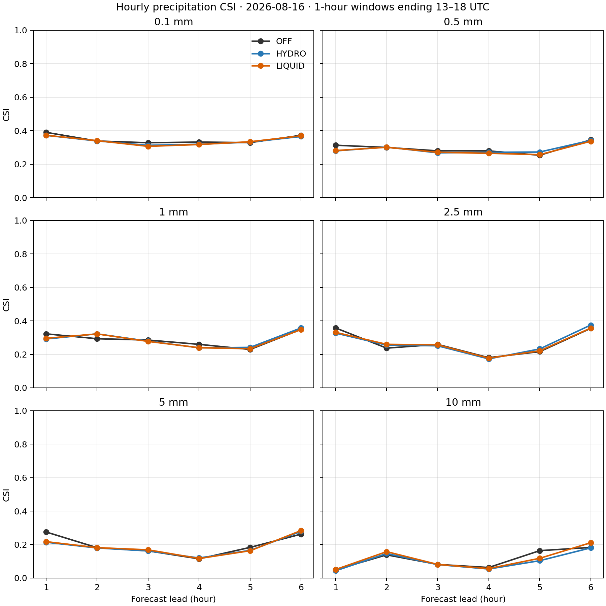
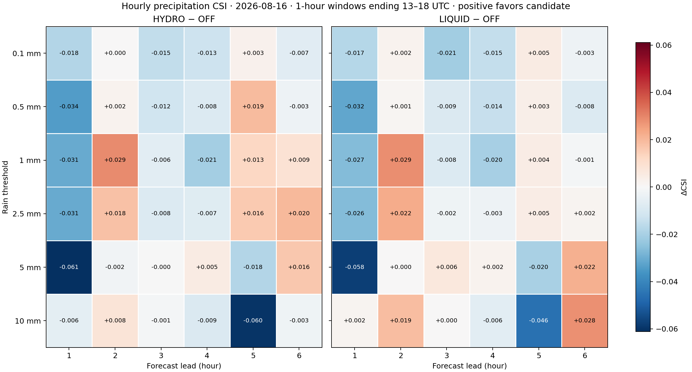
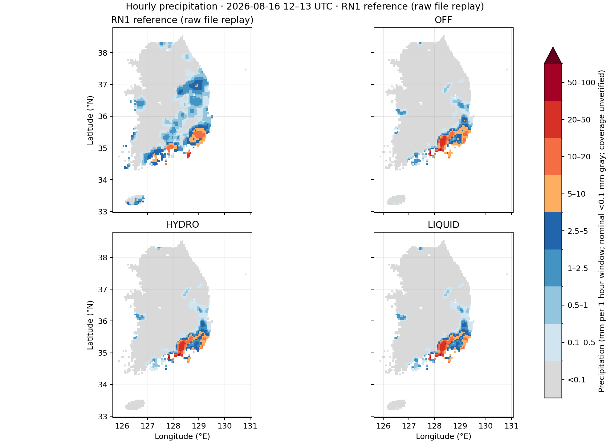

# 기존 실험의 시간별 강수 검증 — RN1 원본 재확인 (2026-10-27)

**RN1 원본 6개를 DATA 보관 경로에서 찾았습니다.** `/NHNHOME/DATA/yhlee_data/ODAM/20260816/`의 13–18 UTC 파일은 기존 inventory의 SHA-256과 6/6 일치합니다. 기존 WORKSPACE 경로 부재를 자료 전체의 부재로 확대했던 판단을 정정합니다. 앞서 찾은 `aroma37/.../PRCP_DATA`의 다른 해시 버전은 사용하지 않았습니다.

기존 CP02 OFF/HYDRO/LIQUID의 2026-08-16 12 UTC 초기 실험을 대상으로, **직전 1시간 누적량으로 +1~+6시간을 검증**했습니다. 최신 C2의 640초·미완료 1시간 실험과 구분하며 새 예보는 실행하지 않았습니다. 이번 원자료 재판독·보간·계산은 108개 조합을 모두 채웁니다. 기존 72개 분할표의 모든 counts가 정확히 일치했고, 첫 시간의 추가 6개 표도 보존 배열과 일치합니다.

## 임계값과 계산 정의

| 임계값 (mm / 1 h) | 사건 정의 | 평가 시간 |
|---:|---|---|
| 0.1 | 한 시간 강수량 ≥ 0.1 mm | +1~+6시간 모두 |
| 0.5 | 한 시간 강수량 ≥ 0.5 mm | +1~+6시간 모두 |
| 1 | 한 시간 강수량 ≥ 1 mm | +1~+6시간 모두 |
| 2.5 | 한 시간 강수량 ≥ 2.5 mm | +1~+6시간 모두 |
| 5 | 한 시간 강수량 ≥ 5 mm | +1~+6시간 모두 |
| 10 | 한 시간 강수량 ≥ 10 mm | +1~+6시간 모두 |

모델량은 인접 시각의 `RAINC + RAINNC` 누적 차이이며, `RAINSH=0`·bucket 설정·누적 reset·시각·단위를 기존 비교기로 검사했습니다. 고정 지리 mask 3,688점과 기존 curvilinear bilinear 보간을 그대로 사용합니다. 각 시간의 세 실험은 같은 참조와 유효점 집합으로 비교합니다. 6시간 누적강수 임계값 점수나 여러 시간의 pooled 점수로 대체하지 않습니다.

CSI=`H/(H+M+F)`, POD=`H/(H+M)`, FAR=`F/(H+F)`, 빈도편향=`(H+F)/(H+M)`입니다. H/M/F는 적중/미탐지/오경보입니다. 분모가 0이면 미정의로 표시하며, 빈도편향 1은 사건 빈도가 같다는 뜻이지 위치가 맞는다는 뜻은 아닙니다.

## 시간별 CSI

### 0.1 mm / 1 h

| Lead | 시간 창 UTC | OFF | HYDRO | LIQUID |
|---:|---|---:|---:|---:|
| 1 | 12:00–13:00 | 0.3898 | 0.3717 | 0.3724 |
| 2 | 13:00–14:00 | 0.3381 | 0.3383 | 0.3401 |
| 3 | 14:00–15:00 | 0.3276 | 0.3124 | 0.3063 |
| 4 | 15:00–16:00 | 0.3317 | 0.3189 | 0.3172 |
| 5 | 16:00–17:00 | 0.3285 | 0.3313 | 0.3337 |
| 6 | 17:00–18:00 | 0.3722 | 0.3651 | 0.3690 |

### 0.5 mm / 1 h

| Lead | 시간 창 UTC | OFF | HYDRO | LIQUID |
|---:|---|---:|---:|---:|
| 1 | 12:00–13:00 | 0.3129 | 0.2788 | 0.2809 |
| 2 | 13:00–14:00 | 0.2996 | 0.3019 | 0.3006 |
| 3 | 14:00–15:00 | 0.2793 | 0.2673 | 0.2705 |
| 4 | 15:00–16:00 | 0.2790 | 0.2706 | 0.2648 |
| 5 | 16:00–17:00 | 0.2531 | 0.2722 | 0.2565 |
| 6 | 17:00–18:00 | 0.3449 | 0.3417 | 0.3366 |

### 1 mm / 1 h

| Lead | 시간 창 UTC | OFF | HYDRO | LIQUID |
|---:|---|---:|---:|---:|
| 1 | 12:00–13:00 | 0.3224 | 0.2915 | 0.2958 |
| 2 | 13:00–14:00 | 0.2933 | 0.3223 | 0.3219 |
| 3 | 14:00–15:00 | 0.2853 | 0.2790 | 0.2772 |
| 4 | 15:00–16:00 | 0.2597 | 0.2390 | 0.2396 |
| 5 | 16:00–17:00 | 0.2291 | 0.2416 | 0.2335 |
| 6 | 17:00–18:00 | 0.3490 | 0.3577 | 0.3480 |

### 2.5 mm / 1 h

| Lead | 시간 창 UTC | OFF | HYDRO | LIQUID |
|---:|---|---:|---:|---:|
| 1 | 12:00–13:00 | 0.3575 | 0.3267 | 0.3311 |
| 2 | 13:00–14:00 | 0.2372 | 0.2551 | 0.2597 |
| 3 | 14:00–15:00 | 0.2593 | 0.2510 | 0.2568 |
| 4 | 15:00–16:00 | 0.1802 | 0.1729 | 0.1772 |
| 5 | 16:00–17:00 | 0.2162 | 0.2323 | 0.2209 |
| 6 | 17:00–18:00 | 0.3552 | 0.3749 | 0.3568 |

### 5 mm / 1 h

| Lead | 시간 창 UTC | OFF | HYDRO | LIQUID |
|---:|---|---:|---:|---:|
| 1 | 12:00–13:00 | 0.2751 | 0.2140 | 0.2174 |
| 2 | 13:00–14:00 | 0.1815 | 0.1796 | 0.1815 |
| 3 | 14:00–15:00 | 0.1622 | 0.1618 | 0.1686 |
| 4 | 15:00–16:00 | 0.1148 | 0.1199 | 0.1167 |
| 5 | 16:00–17:00 | 0.1831 | 0.1652 | 0.1632 |
| 6 | 17:00–18:00 | 0.2623 | 0.2786 | 0.2838 |

### 10 mm / 1 h

| Lead | 시간 창 UTC | OFF | HYDRO | LIQUID |
|---:|---|---:|---:|---:|
| 1 | 12:00–13:00 | 0.0493 | 0.0435 | 0.0511 |
| 2 | 13:00–14:00 | 0.1386 | 0.1463 | 0.1576 |
| 3 | 14:00–15:00 | 0.0814 | 0.0802 | 0.0814 |
| 4 | 15:00–16:00 | 0.0629 | 0.0540 | 0.0565 |
| 5 | 16:00–17:00 | 0.1636 | 0.1037 | 0.1179 |
| 6 | 17:00–18:00 | 0.1828 | 0.1802 | 0.2109 |

## 시간·임계값별 해석

새로 채운 0.5 mm에서 HYDRO와 LIQUID는 OFF보다 lead 2·5에서 높고 다른 네 시간에는 낮습니다. 2.5 mm에서는 두 후보 모두 lead 2·5·6에서 높고 lead 1·3·4에서 낮습니다. **미평가였던 구간을 채워도 시간 전반의 일관된 우위는 없습니다.**

기존 5 mm 결과에서도 lead 1은 HYDRO/LIQUID의 CSI가 OFF보다 0.0611/0.0577 낮고 lead 6은 0.0164/0.0215 높습니다. 첫 시간 OFF의 H/M/F=74/80/115에서 후보는 55/99/103 및 55/99/99로 변합니다. 오경보 감소와 함께 적중도 19건 줄었습니다. 10 mm lead 5에서는 후보 모두 악화하지만 lead 6에서는 LIQUID만 개선됩니다. 한 사례의 혼합 결과를 일반적인 예보 개선으로 해석하지 않습니다.

[전체 점수 CSV — counts·CSI·POD·FAR·빈도편향](evidence/precip_hourly_20261027/rn1_recovery/derived/hourly_scores.csv) · [CSI PDF](evidence/precip_hourly_20261027/rn1_recovery/derived/hourly_csi.pdf) · [차이 PDF](evidence/precip_hourly_20261027/rn1_recovery/derived/hourly_csi_delta_vs_off.pdf)

## 강수 그림과 정상성 확인

첫 그림의 경위도 종횡비 오류는 `1/cos(평균 위도)`로 수정했습니다. 실제 native 누적강수와 정렬 배열을 대조하여 1시간량임을 확인했고, 이번에는 회수한 원본 RN1에서 각 시간 참조를 다시 읽었습니다. 각 지도는 같은 색 구간·mask를 사용합니다. 점 표시는 격자점 값이며 실제 관측 footprint를 그린 것이 아닙니다.

| Lead | 시간 창 UTC | 강수분포 PNG | 벡터 PDF |
|---:|---|---|---|
| 1 | 12–13 | [지도](evidence/precip_hourly_20261027/rn1_recovery/maps/hour_13/first_hour_precipitation.png) | [PDF](evidence/precip_hourly_20261027/rn1_recovery/maps/hour_13/first_hour_precipitation.pdf) |
| 2 | 13–14 | [지도](evidence/precip_hourly_20261027/rn1_recovery/maps/hour_14/first_hour_precipitation.png) | [PDF](evidence/precip_hourly_20261027/rn1_recovery/maps/hour_14/first_hour_precipitation.pdf) |
| 3 | 14–15 | [지도](evidence/precip_hourly_20261027/rn1_recovery/maps/hour_15/first_hour_precipitation.png) | [PDF](evidence/precip_hourly_20261027/rn1_recovery/maps/hour_15/first_hour_precipitation.pdf) |
| 4 | 15–16 | [지도](evidence/precip_hourly_20261027/rn1_recovery/maps/hour_16/first_hour_precipitation.png) | [PDF](evidence/precip_hourly_20261027/rn1_recovery/maps/hour_16/first_hour_precipitation.pdf) |
| 5 | 16–17 | [지도](evidence/precip_hourly_20261027/rn1_recovery/maps/hour_17/first_hour_precipitation.png) | [PDF](evidence/precip_hourly_20261027/rn1_recovery/maps/hour_17/first_hour_precipitation.pdf) |
| 6 | 17–18 | [지도](evidence/precip_hourly_20261027/rn1_recovery/maps/hour_18/first_hour_precipitation.png) | [PDF](evidence/precip_hourly_20261027/rn1_recovery/maps/hour_18/first_hour_precipitation.pdf) |

첫 시간 공통 3,688점에서 RN1과 OFF의 평균은 0.8735/0.8832 mm로 비슷하지만 최대는 37.6/56.50 mm, ≥0.1 mm 지점은 1,593/696개입니다. OFF의 10 mm H/M/F=7/52/83, POD=0.1186, FAR=0.9222입니다. 세 예측은 참조의 중부 강수보다 남부·남동부 강수에 집중됩니다. **자료와 그림이 올바르게 연결됐다는 확인은 관측과 잘 맞는 정상적인 강수 예측이라는 승인이 아닙니다.**

마지막 17–18 UTC 지도에서는 참조에 남부·제주 강수가 보이는 반면, 예측에는 중북부 강수대가 추가로 나타나고 제주 강수는 약합니다. 마지막 시간 일부 임계값의 CSI 개선도 이러한 공간 차이가 모두 해소됐다는 뜻은 아닙니다.

## RN1의 정의와 남은 범위

- 파일명 13–18시는 UTC이며 헤더의 22–다음 날 03시는 +9시간 LST입니다. 형식은 149×253, `10F7.1`, x 방향 우선입니다. 모든 파일이 267,686바이트이며 기존 해시와 일치합니다.
- RN1은 레이더·AWS를 조합한 가공 분석장입니다. ODAM은 상류 강수장의 **5×5 최대값 집계**, AWS 조정, 구름·mask 조건 등을 사용합니다. 따라서 보간한 모델 격자값과 관측 분석장의 공간 규모 차이가 점수에 영향을 줄 수 있습니다. 원시 우량계 독립 검증으로 부르지 않습니다.
- 생산 wrapper에는 현재 시간 `anal_rain`이 없으면 이전 시간 입력을 연결하는 경로가 있습니다. 이것이 이번 여섯 파일에서 실행됐다는 증거는 없지만, 헤더만으로 매 시각 입력의 최신성을 증명할 수도 없습니다. 당시 실행·입력 기록 확인은 남아 있습니다.
- 텍스트의 유한한 0은 센서 coverage가 확인된 무강수와 같지 않습니다. 별도 coverage/QC bitmap은 확보되지 않았습니다. 3,688점은 지리적 평가 영역입니다.
- 전달된 RN1의 1시간/mm 계약으로 비교했습니다. 상류 누적 창·센서 불확실도·자료 계통 독립성을 모두 검증한 것은 아닙니다. U/V·온도·수분이 함께 바뀐 실험으로 omega 단독 효과를 분리하지 않습니다.

## 재현과 검증 자료

[원본 회수·해시 확인](evidence/precip_hourly_20261027/rn1_recovery/relocation_receipt.json) · [source 정의·시각·fallback 확인](evidence/precip_hourly_20261027/rn1_recovery/source_findings.md) · [재계산 검증](evidence/precip_hourly_20261027/rn1_recovery/validation.json) · [재계산 입력·출력 manifest](evidence/precip_hourly_20261027/rn1_recovery/manifest.json)

과거 `derived/`, `validation.json`, `source_manifest.json`은 원자료 회수 전의 제한된 계산 근거로 보존합니다. 새 계산과 그림은 별도의 `rn1_recovery/`에 기록하며, 기존 미평가 30개를 이번 108개 완전 계산으로 대체합니다. 이전 그림 표시 수정과 native 첫 시간 검산 근거도 그대로 유지합니다.

집중 Python 회귀시험 17개가 통과했습니다. 이번 검증은 저장된 모델 출력 후처리이며, 전체 portable/native 시험이나 모델 적분을 다시 수행하지 않았습니다. 그래프 갱신 역시 과학적 승인과 구분합니다.
