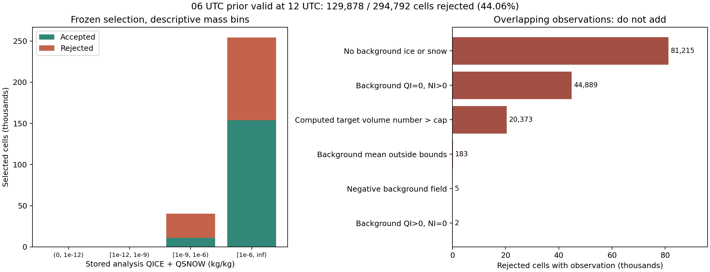
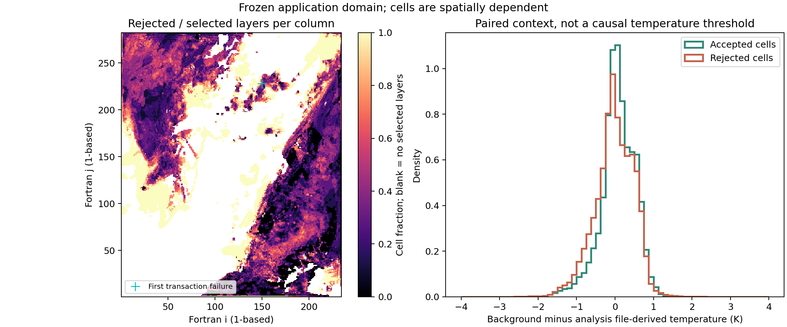

# 실제 이전 주기 배경의 QI·QS·NI 적용 결과

**06 UTC에서 출발해 12 UTC에 유효한 CONTROL 배경 예보를 실제로 확보했다. 그러나 PR166의 규칙과 사전에 고정한 적용 영역으로 제안을 생성하면 294,792셀 중 129,878셀(44.0575%)이 거부된다. 전체 제안은 실패이며, 새 분석 초기장과 그 첫 WRF 사용은 수행하지 않았다. 현재 B1과 기존 26개 평가 기준을 유지한다.**

이 결과는 배경 NI가 없는 자료 목록을 반복 조사한 결과가 아니다. 실제 이전 주기 강제자료로 REAL을 실행하고, 고정 CONTROL의 6시간 예보에서 NI를 얻어 기존 공통 생성기에 넣은 결과다. 반대로 이 06→12 UTC 실행을 새 초기화된 12 UTC 분석의 예보 성능 검증이나 독립 기상 사건으로 해석해서도 안 된다.

## 1. 바꾸지 않은 규칙과 적용 영역

PR166의 공통 생성기와 파일 생성 도구를 그대로 사용했다. 배경 분율과 평균 빙정 질량을 유지하므로, 이상적인 산술에서는 분석/배경 고체수분 총량비 α에 대해 QI_new=α QI_b, QS_new=α QS_b, NI_new=α NI_b다. 저장 REAL32 값의 질량 보존과 엄격한 모멘트 수용 조건도 유지했다.

12 UTC 배경 결과를 검사하기 전에 **분석 파일의 저장 QICE와 QSNOW를 REAL64로 승격해 합한 값이 양수인 모든 셀**을 선택했다. 배경의 존재 여부나 통과 여부로 마스크를 고르지 않았다.

| 항목 | 고정 값 |
|---|---|
| 사례 유효 시각 | 2026-08-16 12 UTC |
| 배경 시작 주기 | 2026-08-16 06 UTC |
| 고정 시각 | 2026-11-12 11:17:21 UTC |
| 전체 격자 | 39 × 282 × 234 = 2,573,532셀 |
| 선택 / 영역 밖 | 294,792 / 2,278,740셀 |
| 마스크 SHA-256 | `2c10a85057cc959559badbd1eb9d10bde759490ad441d168e92034d9ad0192f1` |
| 정책 SHA-256 | `647126e5215acbb985d39d56564898f7c6f82adb85d05266bf0d2c4ba008a00e` |

정책은 기존 source-bound 정책 파일을 그대로 복사했다. 모든 질량 문턱은 0이며, 빙정 평균질량 범위와 10⁶ m⁻³ 수농도 상한도 바꾸지 않았다. 이전 50 μm 사전값을 적용한 실험은 아니다. [고정 정의·마스크·정책](evidence/prior_cycle_application_20261112/frozen_application/definition.json)

## 2. 실제 배경을 만든 경로

새 REAL 실행에는 보관된 06 UTC 주기의 06·09·12 UTC met_em을 사용했다. KIM GRIB은 별도로 계보를 조사했으며 새 REAL의 직접 입력은 아니다. GRIB 헤더에서 시작 시각 06 UTC와 예보시간 0·3·6시간을 확인했다. GRIB의 12 UTC 유효 필드는 06 UTC 주기의 +6시간 예보로 기록돼 있다. 보관 met_em은 설정된 생산 경로와 일치하지만, 당시 ungrib·metgrid 실행 로그가 없어 이 GRIB의 각 필드와 보조 입력이 met_em에 들어간 전체 역사적 경로까지 입증하지는 못했다. 이번 새 실행에는 12 UTC Cloud-BAL 분석장을 기상 강제자료로 주입하지 않았다. 배경은 현재 과제에서 새로 생성한 회고 실행이다. 이전 주기 시각만으로 과학적 독립성이나 당시 운영 가용성을 주장하지 않는다. [자료 계보 조사](evidence/prior_cycle_application_20261112/science/fua_lineage/lineage.md)

보관된 원래 06 UTC wrfinput은 B1의 ZNU·ZNW와 일부 단어가 달랐다. 값을 덮어쓰거나 격자 검사를 느슨하게 하지 않고, 같은 REAL producer와 B1의 목표 격자 설정으로 06 UTC 입력을 새로 만들었다. 첫 REAL 실행은 metgrid 입력층을 21로 지정해 실패했다. 원자료의 25층을 확인한 뒤 별도 디렉토리에서 재실행했다. **25는 입력 metgrid 층수이며, 목표 WRF는 기존 39개 질량층 그대로다.**

새 06 UTC 입력과 12 UTC 배경은 기존 격자 검사에서 B1과 정확히 같은 지문 `97956ad9…f7a80d7d`를 보였다. 새 REAL 입력과 경계, 85개 staged runtime 파일은 예보 전후 해시가 같았다. wrfchainp는 이 실행에 없고 관련 갱신은 비활성이다. [REAL·예보 기록과 한계](evidence/prior_cycle_application_20261112/native/README.md)

| 항목 | 실제 실행 근거 |
|---|---|
| 물리 소스 | CONTROL `f391b211c6e111f92a7213cc5a651606ec6b5826a47063e3057ab2d819e9a595` |
| WRF 실행파일 | `3a286f6691fa94c2dccf55b14e4cbf609b8c9540c2caf83556969932ca9854ea` |
| 설정 | MPI 8개, 외부 20초, CONTROL 내부 설정 유지 |
| 실행 | 06→12 UTC 완료, exit 0, 8개 rank 모두 성공 기록 |
| 새 06 UTC 입력 | `222bf0ea976a87c75cae3b9dad79909d00334c159f662d5ab7b2aa99b47dbc76` |
| 새 12 UTC 배경 | `1da306199931df895a959b1746b570ee13724e86d8f6684694e00ad65c55d840` |
| B1 분석 입력 | `9f8b494dbf5ce765e4320701475d6a65be1f591d72a4f9bf5e929c208be563e5` |

전체 배경에서 QNICE 양수 셀은 330,196개다. 하지만 QICE 양수·QNICE 비양수 셀도 610개이며, 작은 음수 QNICE도 157개다. **실제 NI 출력이 있다는 것과 모든 출력이 초기화 정책에 적합하다는 것은 다르다.** 이 전 영역 수치를 아래 선택 영역 집계와 섞지 않는다. [출력 조사](evidence/prior_cycle_application_20261112/native/prior_forecast/output_inspection.json)

계보에는 한 가지 메타데이터 정정이 있다. 성공한 REAL 실행의 입력 목록이 처음에는 실패한 실행 디렉토리의 staged 경로를 가리켰다. 실제 입력 해시는 같았고, 경로를 고쳤으며 잘못된 목록도 보존했다. 예보 staging 기록에는 정정 전 validation 해시가 남아 있다. 정정 전 validation 파일 자체는 한정된 검색에서 찾지 못했으므로 두 기록의 바이트 동일성을 주장하지 않는다. [사후 연결 기록](evidence/prior_cycle_application_20261112/native/prior_forecast/postrun_metadata_links.json)은 기존 해시, 현재 정정본, 실제 기상 입력이 바뀌지 않았다는 재검사를 연결한다. 원 보관자료 전체의 서명된 생산 이력도 확보하지 못했다.

## 3. 전체 적용은 거부됐다

실제 공개 producer를 같은 파일·마스크·정책으로 실행했다. 첫 실패는 Fortran 1기준 `(i,j,k)=(150,228,11)`, 모멘트 slot 2다. 이 셀은 분석 QS가 2.3267883×10⁻⁵ kg/kg인데 배경 QI·QS·NI는 모두 0이다. **첫 실패는 NI 상한이 아니라 배경 고체수분 부재 조건이다.** 분석 온도는 약 278.185 K다. 따뜻한 공기에서 낙하 중인 눈이 존재할 수 있으므로 이 온도만으로 눈이 잘못됐다고 판단하지 않는다.

| 실제 공통 연산 결과 | 셀 수 |
|---|---:|
| 사전 고정 선택 영역 | 294,792 |
| 개별 셀 진단에서 수용 | 164,914 |
| 개별 셀 진단에서 거부 | **129,878** |
| 전체 producer | **거부, 제안 파일 미게시** |

공통 연산은 전체 실패를 반환하므로 성공 셀만 초기장에 부분 반영하지 않았다. 기존 initializer도 호출하지 않았고 새 12 UTC WRF 예보도 시작하지 않았다. [실제 생성 시도](evidence/prior_cycle_application_20261112/production_attempt/attempt.json), [전체 영역 진단](evidence/prior_cycle_application_20261112/coverage/coverage.json)

다음 항목들은 **중복 가능한 입력·계산값의 관찰**이다. 코드의 독점적인 실패 원인 개수나 강수의 인과 기여량이 아니다.

| 관찰 | 해당 선택 셀 | 그중 거부 |
|---|---:|---:|
| 배경 QI+QS=0 | 81,215 | 81,215 |
| 배경 QI=0, NI>0 | 44,889 | 44,889 |
| 계산한 새 NI×분석 밀도가 상한 초과 | 20,373 | 20,373 |
| 배경 평균 입자질량이 정책 범위 밖 | 183 | 183 |
| 배경에 음수 값 존재 | 5 | 5 |
| 배경 QI>0, NI=0 | 2 | 2 |
| 배경 눈만 존재, NI=0 | 18,456 | 0 |

예를 들어 배경 총량 0과 QI=0·NI>0은 16,748셀에서 겹치고, 평균질량 범위 밖과 새 수농도 상한 초과는 41셀에서 겹친다. 실패 관찰의 합집합은 전체 거부 129,878셀을 덮지만 각 행을 더하면 안 된다.



### 실제 자료에서 드러난 세 경계

**배경에 없는 고체수분을 분석이 가진 영역**에서는 배경 분율과 평균질량만으로 제안을 정할 수 없다. 이는 현재 방법의 미지원 상태다. 그 영역을 사후 마스크에서 빼면 이번에 고정한 전 영역 적용과 다른 실험이 된다.

**질량과 입자수의 native 반환 상태**도 현재 엄격한 초기화 계약과 다를 수 있다. QI=0·NI>0인 44,889셀의 배경 체적 입자수 중앙값은 약 9.84 m⁻³이며 모두 계산 잡음이라고 할 수 없다. 평균질량 범위를 벗어난 183셀 중 133셀은 배경 QI<10⁻¹² kg/kg다. 모형의 미량·기본 PSD 분기를 거친 저장 모멘트를 유효한 배경 PSD라고 자동 해석해서는 안 된다. 반대로 이 차이를 새로운 native 물리 오류라고 확정하지도 않는다.

**현재 분석 총량으로 확대할 때의 수농도 제약**은 별도 문제다. 상한 초과 20,373셀은 모두 배경 밀도로 계산한 배경 수농도에서는 상한 이하였다. 배경 자체가 cap을 초과해서 발생한 집계가 아니다. 총질량 비례 조정과 분석 밀도로의 변환 후에 현재 초기화 정책과 충돌한 것이다. 자동으로 NI를 자르거나 QI를 QS로 옮겨 통과시키지 않았다. [독립 보완 계산](evidence/prior_cycle_application_20261112/science/supplemental_recount/findings.json)

### 실패 전체를 미량 값으로 해석할 수 없다

| 분석 QI+QS 구간, kg/kg | 선택 | 수용 | 거부 |
|---|---:|---:|---:|
| (0, 10⁻¹²) | 0 | 0 | 0 |
| [10⁻¹², 10⁻⁹) | 122 | 27 | 95 |
| [10⁻⁹, 10⁻⁶) | 40,432 | 11,170 | 29,262 |
| ≥10⁻⁶ | 254,238 | 153,717 | **100,521** |

이는 저장 분석 총량의 기술적 구간 구분이다. 새로운 활성 조건이나 마스크가 아니며, 셀 개수를 물량 비율·독립 표본 수·강수 영향으로 바꾸어 읽지 않는다. [구간별 원자료 계산](evidence/prior_cycle_application_20261112/science/supplemental_recount/significance.json)

## 4. 같은 격자의 물리 상태도 함께 기록했다

선택 영역의 분석 온도 중앙값은 250.442 K, 배경−분석 온도차 중앙값은 +0.0406 K다. 수용·거부 집단의 온도차 분포는 겹친다. 평균 온도차가 작다는 사실만으로 배경 PSD의 적합성을 판단하지 않는다. 값은 파일 T의 건조온위와 P+PB로 복원한 온도이며 첫 KDM6 실제 온도나 잠열 가열량이 아니다. 밀도는 현재 파일 어댑터의 REAL32 `1/(AL+ALB)` proxy를 유지했다. 실제 새 입력의 첫 사용 밀도는 아직 없다.



공간 그림은 각 기둥의 선택 층 중 거부된 층의 비율이다. 위·아래층을 독립 사례로 취급하지 않는다. 좌표는 Fortran 1기준이며, 청색 표식은 첫 실패 기둥이다. 그림에서 특정 온도·영역을 골라 정책을 바꾸지 않았다.

## 5. 검증과 재현 범위

실제 파일에서 만든 전체 고정 입력 stream을 공개하고, 원래 공통 Fortran 및 bulk adapter를 **소스 밖 새 디렉토리에서 pinned Intel IFX 2026 O0**로 재컴파일했다. 294,792개 선택 셀의 반환 상태와 성공 셀 QI·QS·NI 저장값을 다시 확인했다. 전체 bulk 결과도 `[-10,150,228,11,2]`로 재현됐다. 이는 **재생 PASS와 초기화 적용 REJECTED를 구분한 검증**이다. 실제 자료에 대한 O2 실행을 주장하지 않는다.

성공 셀만 따로 호출한 bulk 비교도 값 일치를 확인하는 진단이다. 그 부분집합을 새 적용 마스크로 사용하거나 게시하지 않았다. 공개 `diagnostic_only.npz`는 분석용 결과이며 WRF 초기장이 아니다. per-cell 재생은 국지적인 공통 초기화 함수의 재생으로, WRF 기둥 미세물리 재생이 아니다.

```bash
python3 docs/evidence/prior_cycle_application_20261112/validation/replay.py \
  --repo-root "$PWD" --work-root /absolute/fresh/scratch/prior-application-replay
python3 docs/evidence/prior_cycle_application_20261112/figures/plot.py \
  --out /absolute/scratch/prior-application-figures
```

원본 348.8 MB NetCDF, WRF 실행파일과 전체 과정 스트림은 Git에 중복 저장하지 않았다. 공개 압축 stream(해제 72,059,388 bytes)은 공통 초기화에 실제 전달한 입력 전체를 재현하며, diagnostic NPZ에는 선택된 대응 상태와 결과가 있다. 파일 추출·WRF 재적분은 원본 경로와 작은 실행 기록에 의존하므로 공개 stream의 재생과 같은 검증 범위가 아니다. [재생 기록](evidence/prior_cycle_application_20261112/validation/receipt.json), [번들 설명](evidence/prior_cycle_application_20261112/README.md)

## 6. 현재 결정과 남은 물리 선택

이번 배경은 **실제 이전 주기 자료로 NI를 생성할 수 있음**을 입증했다. 그러나 이전 주기이고 격자가 같다는 사실만으로 현재 분석 영역 전체에 규칙을 적용할 수는 없었다. 실패를 숨기거나 규칙을 바꾸어 새 입력의 첫 사용까지 진행하지 않았다.

다음 단계에서 정할 것은 배경이 없는 새 고체수분의 PSD 정보, native 반환 모멘트를 초기화 사전정보로 사용할 때의 단계별 의미, 분석 총량 확대와 cap이 충돌할 때의 물리적 수용 정책이다. 이 결정에는 관측 또는 독립적으로 정한 사전모형의 근거가 필요하다. 이번 점수나 실패 좌표에 맞춘 입경·분율 탐색은 하지 않는다. 결정을 고정한 다음 전체 제안을 다시 생성하고, 수용 가능한 입력에 대해서만 동일 CONTROL의 파일→첫 이류→첫 KDM6 경계를 확인한다.

현재 12 UTC 초기화 후보의 성능 변화는 없다. 기존 26개 조건과 B1을 유지하며, +2시간 이후 약한 강수의 검출·강도·오경보 및 기존 강한 강수 보호의 일반화 판단도 열려 있다. 새 이전 주기 자료 사용과 독립 기상 사건 검증은 서로 다른 과제다.
