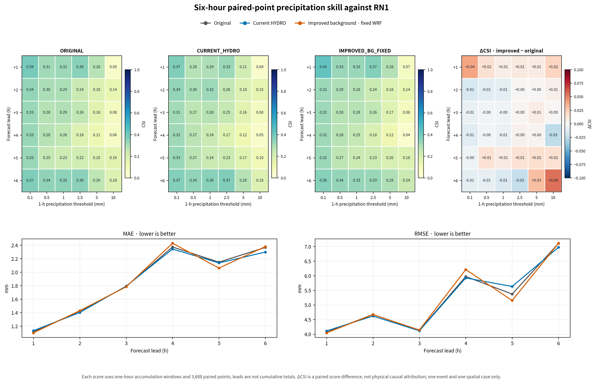
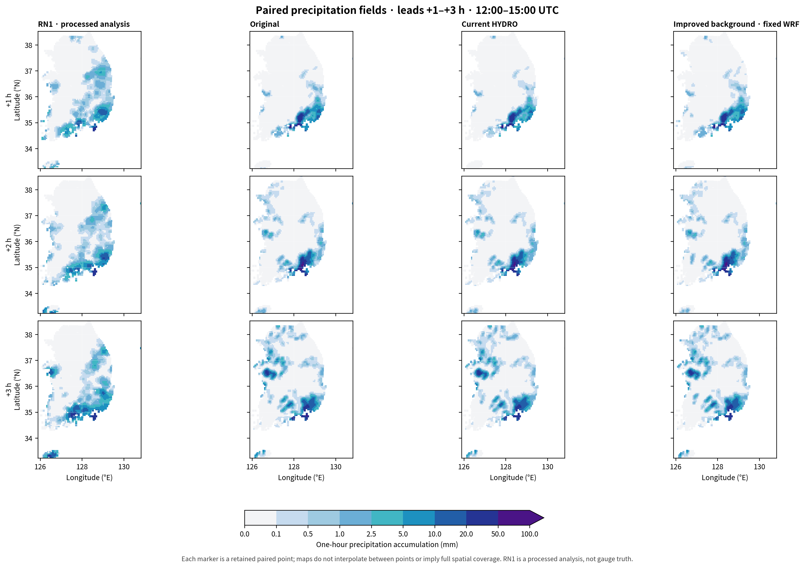
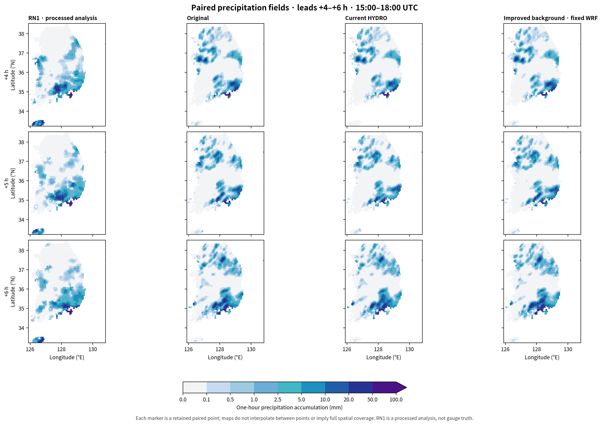

# 배경 강수 보존·영 전환항 수정의 +1~+6시간 강수예보 비교

**2026-10-30 · 단일 사례의 시간대별 검증**

## 1. 실험 및 검증 구간

2026년 8월 16일 12 UTC 초기화 사례에서 기존 개선안(B1)을 18 UTC까지 확장했다. 새 예보 실행은 1회이며 원본 OFF와 기존 HYDRO는 완료·보존된 6시간 대조군이다. 개선안은 생산자 단계 배경 강수 수종 보존과 KDM6 정확한 영 전환항 처리를 결합한다. 원본과의 차이는 결합 변경의 비교이며 정책과 실행파일 수정의 독립적인 인과효과가 아니다. 실행파일·초기장·경계자료는 기존 1시간 개선안과 같고 예보·history 종료 시각만 변경했다. 새 13 UTC history는 이전 1시간 실행과 바이트 단위로 동일하다.

| 표기 | 실험 ID | 설정 |
| --- | --- | --- |
| 원본 OFF | ORIGINAL | 실제 원본 초기장·기존 WRF |
| 기존 HYDRO | CURRENT_HYDRO | 기존 HYDRO 초기화·기존 WRF |
| 개선안 | IMPROVED_BG_FIXED | 배경 강수 보존 초기화·수정 WRF |

각 점수는 공통 3,688개 처리 RN1 평가점의 해당 **한 시간 강수량**을 비교한다. +6 h는 17–18 UTC이며 12–18 UTC 누적량이 아니다. 임계값은 mm 단위이고 사건은 강수량 ≥ 임계값이다.

| 예측시간 | 검증 구간 (UTC) | 검증 구간 (KST) |
| --- | --- | --- |
| +1 h | 8월 16일 12–13시 | 8월 16일 21–22시 |
| +2 h | 8월 16일 13–14시 | 8월 16일 22–23시 |
| +3 h | 8월 16일 14–15시 | 8월 16일 23시–17일 00시 |
| +4 h | 8월 16일 15–16시 | 8월 17일 00–01시 |
| +5 h | 8월 16일 16–17시 | 8월 17일 01–02시 |
| +6 h | 8월 16일 17–18시 | 8월 17일 02–03시 |

## 2. 수학적 정의

누적 강수 $C(t)=RAINC(t)+RAINNC(t)$에서 $P_h=C(t_0+h)-C(t_0+h-1)$를 계산한다. RAINSH는 0인지 별도로 검사하고 합에서 제외한다. 고정된 WRF 네 모서리 bilinear 보간 뒤 임계값을 적용한다. 적중 H, 누락 M, 오경보 F, 전체 점 수 N에 대해 다음 점수를 사용한다.

\[CSI=\frac{H}{H+M+F},\quad POD=\frac{H}{H+M},\quad FAR=\frac{F}{H+F},\quad Bias=\frac{H+F}{H+M}.\]

\[H_r=\frac{(H+M)(H+F)}{N},\qquad ETS=\frac{H-H_r}{H+M+F-H_r}.\]

오차 $e_i=f_i-o_i$에 대해 $MAE=N^{-1}\sum_i|e_i|$, $RMSE=\sqrt{N^{-1}\sum_i e_i^2}$, $ME=N^{-1}\sum_i e_i$다. CSI·ETS·POD는 클수록, FAR·MAE·RMSE는 작을수록 좋다. 빈도 Bias는 1, ME는 0이 기준이다. POD 증가만으로 개선이라고 판정하지 않고 오경보와 함께 본다.

## 3. 예측시간·임계값별 CSI

| 예측시간 | 실험 | ≥0.1 mm | ≥0.5 mm | ≥1 mm | ≥2.5 mm | ≥5 mm | ≥10 mm |
| --- | --- | --- | --- | --- | --- | --- | --- |
| +1 h | 원본 OFF | 0.3898 | 0.3129 | 0.3224 | 0.3575 | 0.2751 | 0.0493 |
| +1 h | 기존 HYDRO | 0.3717 | 0.2788 | 0.2915 | 0.3267 | 0.2140 | 0.0435 |
| +1 h | 개선안 | 0.4294 | 0.3284 | 0.3289 | 0.3670 | 0.2836 | 0.0704 |
| +2 h | 원본 OFF | 0.3381 | 0.2996 | 0.2933 | 0.2372 | 0.1815 | 0.1386 |
| +2 h | 기존 HYDRO | 0.3383 | 0.3019 | 0.3223 | 0.2551 | 0.1796 | 0.1463 |
| +2 h | 개선안 | 0.3231 | 0.2891 | 0.2839 | 0.2387 | 0.1827 | 0.1437 |
| +3 h | 원본 OFF | 0.3276 | 0.2793 | 0.2853 | 0.2593 | 0.1622 | 0.0814 |
| +3 h | 기존 HYDRO | 0.3124 | 0.2673 | 0.2790 | 0.2510 | 0.1618 | 0.0802 |
| +3 h | 개선안 | 0.3212 | 0.2765 | 0.2810 | 0.2614 | 0.1696 | 0.0827 |
| +4 h | 원본 OFF | 0.3317 | 0.2790 | 0.2597 | 0.1802 | 0.1148 | 0.0629 |
| +4 h | 기존 HYDRO | 0.3189 | 0.2706 | 0.2390 | 0.1729 | 0.1199 | 0.0540 |
| +4 h | 개선안 | 0.3200 | 0.2762 | 0.2527 | 0.1846 | 0.1178 | 0.0378 |
| +5 h | 원본 OFF | 0.3285 | 0.2531 | 0.2291 | 0.2162 | 0.1831 | 0.1636 |
| +5 h | 기존 HYDRO | 0.3313 | 0.2722 | 0.2416 | 0.2323 | 0.1652 | 0.1037 |
| +5 h | 개선안 | 0.3244 | 0.2674 | 0.2372 | 0.2306 | 0.1989 | 0.1791 |
| +6 h | 원본 OFF | 0.3722 | 0.3449 | 0.3490 | 0.3552 | 0.2623 | 0.1828 |
| +6 h | 기존 HYDRO | 0.3651 | 0.3417 | 0.3577 | 0.3749 | 0.2786 | 0.1802 |
| +6 h | 개선안 | 0.3632 | 0.3367 | 0.3347 | 0.3319 | 0.2927 | 0.2381 |

## 4. 원본 대비 개선안의 CSI 차이

ΔCSI = 개선안 − 원본이다. 양수는 해당 시간·임계값의 개선, 음수는 악화다. 표는 소수 넷째 자리 반올림이며 개선 판정에는 반올림 전 수치를 사용했다.

| 예측시간 | ≥0.1 mm | ≥0.5 mm | ≥1 mm | ≥2.5 mm | ≥5 mm | ≥10 mm |
| --- | --- | --- | --- | --- | --- | --- |
| +1 h | +0.0396 | +0.0156 | +0.0065 | +0.0096 | +0.0085 | +0.0211 |
| +2 h | -0.0150 | -0.0105 | -0.0094 | +0.0015 | +0.0011 | +0.0052 |
| +3 h | -0.0064 | -0.0027 | -0.0043 | +0.0021 | +0.0073 | +0.0013 |
| +4 h | -0.0117 | -0.0028 | -0.0070 | +0.0044 | +0.0030 | -0.0251 |
| +5 h | -0.0041 | +0.0143 | +0.0081 | +0.0144 | +0.0158 | +0.0155 |
| +6 h | -0.0090 | -0.0082 | -0.0143 | -0.0233 | +0.0304 | +0.0553 |

## 5. 시간별 강수량 오차 (mm)

| 예측시간 | 실험 | MAE | RMSE | ME |
| --- | --- | --- | --- | --- |
| +1 h | 원본 OFF | 1.1142 | 4.0623 | 0.0097 |
| +1 h | 기존 HYDRO | 1.1329 | 4.1103 | -0.0618 |
| +1 h | 개선안 | 1.1007 | 4.0441 | 0.0246 |
| +2 h | 원본 OFF | 1.4227 | 4.6739 | 0.0513 |
| +2 h | 기존 HYDRO | 1.4022 | 4.6197 | 0.0511 |
| +2 h | 개선안 | 1.4294 | 4.6698 | 0.0511 |
| +3 h | 원본 OFF | 1.7876 | 4.1263 | -0.1279 |
| +3 h | 기존 HYDRO | 1.7931 | 4.1150 | -0.1388 |
| +3 h | 개선안 | 1.7828 | 4.1417 | -0.1321 |
| +4 h | 원본 OFF | 2.3724 | 5.9718 | -0.2319 |
| +4 h | 기존 HYDRO | 2.3420 | 5.9234 | -0.3007 |
| +4 h | 개선안 | 2.4279 | 6.2090 | -0.2477 |
| +5 h | 원본 OFF | 2.1482 | 5.3715 | -0.2500 |
| +5 h | 기존 HYDRO | 2.1364 | 5.6301 | -0.3539 |
| +5 h | 개선안 | 2.0606 | 5.1513 | -0.2728 |
| +6 h | 원본 OFF | 2.3661 | 7.1064 | 0.2695 |
| +6 h | 기존 HYDRO | 2.2971 | 6.9725 | 0.1990 |
| +6 h | 개선안 | 2.3785 | 7.1093 | 0.3210 |

원본 OFF 대비 CSI 36개 시간·임계값 조합 중 개선 21개, 동일 0개, 악화 15개다. 36개 조합은 독립적인 36개 기상 사례를 뜻하지 않는다.

기존 HYDRO 대비 CSI 36개 시간·임계값 조합 중 개선 21개, 동일 0개, 악화 15개다. 36개 조합은 독립적인 36개 기상 사례를 뜻하지 않는다.

원본 대비 임계값별 개선·악화 시간 수는 다음과 같다.

| 임계값 | 개선 시간 수 | 동일 시간 수 | 악화 시간 수 |
| --- | --- | --- | --- |
| ≥0.1 mm | 1 | 0 | 5 |
| ≥0.5 mm | 2 | 0 | 4 |
| ≥1 mm | 2 | 0 | 4 |
| ≥2.5 mm | 5 | 0 | 1 |
| ≥5 mm | 6 | 0 | 0 |
| ≥10 mm | 5 | 0 | 1 |

## 6. 시간별 분포와 기상학적 해석

5 mm CSI는 원본보다 여섯 시간 모두 높다. 그러나 약한 강수 임계값의 CSI는 첫 시간 이후 다수 구간에서 낮아진다. 특히 +4시간은 MAE·RMSE와 10 mm CSI가 함께 악화된다. +5시간은 MAE·RMSE와 0.5 mm 이상 다섯 CSI가 함께 개선된다. +6시간은 5·10 mm CSI가 높지만 낮은 네 임계값 CSI와 MAE·RMSE는 악화된다. 따라서 강한 강수 사건의 겹침 개선을 전체 강수량·위치 오차의 일관된 개선으로 확대해서는 안 된다.

강수 분포도는 같은 평가점과 색 구간을 사용한다. 점 사이를 공간 보간하거나 RN1 coverage를 확정적으로 표현하지 않는다. 초기 수상체와 열역학 상태의 차이는 이후 미세물리·수송·낙하와 상호작용한다. 시간별 점수만으로 과정별 기여를 분해할 수 없으며, 첫 시간 개선의 지속 여부는 각 시간의 실제 점수와 적중·오경보 전이로 판단한다. 강한 강수의 적중 회복과 오경보 증가를 함께 검토해야 한다.

## 7. 범위와 제한

한 기상 사례의 +1~+6시간 연구 비교다. RN1 상류 입력 최신성·coverage/QC·공간 대표성은 미확정이다. 배경 보존 정책은 8개 native 초기장 필드를 함께 바꾸므로 QR·QS만의 효과가 아니다. 전체 물·에너지 수지와 과정별 강수 flux, 다른 사례의 일반화 성능, 별도 C2 안정성 및 운영 승인은 이 검증으로 완료되지 않는다. 기존 1시간 요인 실험의 독립 효과와 상호작용을 이번 6시간 결합 실험의 각 시간으로 외삽하지 않는다.

[전체 점수 CSV](evidence/six_hour_improvement_20261030/analysis/categorical_scores.csv) · [연속 점수](evidence/six_hour_improvement_20261030/analysis/continuous_scores.csv) · [적중·오경보 전이](evidence/six_hour_improvement_20261030/analysis/transitions.csv) · [분석 영수증](evidence/six_hour_improvement_20261030/analysis/receipt.json)

## 부록. ETS

| 예측시간 | 실험 | ≥0.1 mm | ≥0.5 mm | ≥1 mm | ≥2.5 mm | ≥5 mm | ≥10 mm |
| --- | --- | --- | --- | --- | --- | --- | --- |
| +1 h | 원본 OFF | 0.2535 | 0.2211 | 0.2570 | 0.3194 | 0.2532 | 0.0396 |
| +1 h | 기존 HYDRO | 0.2383 | 0.1931 | 0.2298 | 0.2894 | 0.1933 | 0.0340 |
| +1 h | 개선안 | 0.2799 | 0.2334 | 0.2628 | 0.3290 | 0.2617 | 0.0606 |
| +2 h | 원본 OFF | 0.1233 | 0.1868 | 0.2237 | 0.1995 | 0.1561 | 0.1262 |
| +2 h | 기존 HYDRO | 0.1255 | 0.1888 | 0.2514 | 0.2166 | 0.1543 | 0.1340 |
| +2 h | 개선안 | 0.1057 | 0.1759 | 0.2138 | 0.2013 | 0.1574 | 0.1312 |
| +3 h | 원본 OFF | 0.0575 | 0.1237 | 0.1828 | 0.1936 | 0.1208 | 0.0623 |
| +3 h | 기존 HYDRO | 0.0396 | 0.1119 | 0.1759 | 0.1870 | 0.1210 | 0.0608 |
| +3 h | 개선안 | 0.0520 | 0.1216 | 0.1778 | 0.1969 | 0.1284 | 0.0638 |
| +4 h | 원본 OFF | 0.0540 | 0.1057 | 0.1304 | 0.1021 | 0.0700 | 0.0421 |
| +4 h | 기존 HYDRO | 0.0468 | 0.0986 | 0.1128 | 0.0967 | 0.0757 | 0.0341 |
| +4 h | 개선안 | 0.0436 | 0.1049 | 0.1268 | 0.1069 | 0.0734 | 0.0171 |
| +5 h | 원본 OFF | 0.0555 | 0.0798 | 0.0997 | 0.1384 | 0.1366 | 0.1420 |
| +5 h | 기존 HYDRO | 0.0597 | 0.0975 | 0.1124 | 0.1550 | 0.1201 | 0.0836 |
| +5 h | 개선안 | 0.0507 | 0.0909 | 0.1057 | 0.1509 | 0.1533 | 0.1579 |
| +6 h | 원본 OFF | 0.0754 | 0.1496 | 0.2076 | 0.2723 | 0.2122 | 0.1620 |
| +6 h | 기존 HYDRO | 0.0766 | 0.1531 | 0.2188 | 0.2935 | 0.2289 | 0.1592 |
| +6 h | 개선안 | 0.0712 | 0.1403 | 0.1904 | 0.2477 | 0.2437 | 0.2175 |

## 부록. 적중률 POD

| 예측시간 | 실험 | ≥0.1 mm | ≥0.5 mm | ≥1 mm | ≥2.5 mm | ≥5 mm | ≥10 mm |
| --- | --- | --- | --- | --- | --- | --- | --- |
| +1 h | 원본 OFF | 0.4030 | 0.3363 | 0.3717 | 0.4644 | 0.4805 | 0.1186 |
| +1 h | 기존 HYDRO | 0.3848 | 0.2984 | 0.3324 | 0.4217 | 0.3571 | 0.1017 |
| +1 h | 개선안 | 0.4526 | 0.3548 | 0.3801 | 0.4758 | 0.4935 | 0.1695 |
| +2 h | 원본 OFF | 0.4247 | 0.3567 | 0.3593 | 0.3029 | 0.2706 | 0.2911 |
| +2 h | 기존 HYDRO | 0.4229 | 0.3594 | 0.3939 | 0.3264 | 0.2661 | 0.3038 |
| +2 h | 개선안 | 0.4115 | 0.3468 | 0.3506 | 0.3029 | 0.2706 | 0.3038 |
| +3 h | 원본 OFF | 0.4968 | 0.3912 | 0.3861 | 0.3531 | 0.2464 | 0.1591 |
| +3 h | 기존 HYDRO | 0.4804 | 0.3765 | 0.3802 | 0.3374 | 0.2435 | 0.1591 |
| +3 h | 개선안 | 0.4874 | 0.3869 | 0.3825 | 0.3514 | 0.2551 | 0.1591 |
| +4 h | 원본 OFF | 0.5000 | 0.4018 | 0.3832 | 0.2826 | 0.1919 | 0.1091 |
| +4 h | 기존 HYDRO | 0.4765 | 0.3895 | 0.3503 | 0.2673 | 0.1977 | 0.0909 |
| +4 h | 개선안 | 0.4833 | 0.3953 | 0.3673 | 0.2876 | 0.1948 | 0.0667 |
| +5 h | 원본 OFF | 0.4691 | 0.3678 | 0.3492 | 0.3403 | 0.3152 | 0.2679 |
| +5 h | 기존 HYDRO | 0.4708 | 0.3938 | 0.3654 | 0.3613 | 0.2788 | 0.1667 |
| +5 h | 개선안 | 0.4649 | 0.3906 | 0.3643 | 0.3682 | 0.3333 | 0.2857 |
| +6 h | 원본 OFF | 0.5747 | 0.5172 | 0.5217 | 0.5319 | 0.4454 | 0.4113 |
| +6 h | 기존 HYDRO | 0.5532 | 0.4996 | 0.5258 | 0.5516 | 0.4684 | 0.4113 |
| +6 h | 개선안 | 0.5557 | 0.5084 | 0.5103 | 0.5057 | 0.4828 | 0.5242 |

## 부록. 오경보율 FAR

| 예측시간 | 실험 | ≥0.1 mm | ≥0.5 mm | ≥1 mm | ≥2.5 mm | ≥5 mm | ≥10 mm |
| --- | --- | --- | --- | --- | --- | --- | --- |
| +1 h | 원본 OFF | 0.0776 | 0.1820 | 0.2914 | 0.3918 | 0.6085 | 0.9222 |
| +1 h | 기존 HYDRO | 0.0837 | 0.1909 | 0.2967 | 0.4080 | 0.6519 | 0.9294 |
| +1 h | 개선안 | 0.1066 | 0.1842 | 0.2906 | 0.3838 | 0.6000 | 0.8925 |
| +2 h | 원본 OFF | 0.3762 | 0.3481 | 0.3852 | 0.4775 | 0.6446 | 0.7909 |
| +2 h | 기존 HYDRO | 0.3717 | 0.3464 | 0.3607 | 0.4612 | 0.6442 | 0.7798 |
| +2 h | 개선안 | 0.3993 | 0.3651 | 0.4015 | 0.4703 | 0.6402 | 0.7857 |
| +3 h | 원본 OFF | 0.5097 | 0.5060 | 0.4776 | 0.5061 | 0.6780 | 0.8571 |
| +3 h | 기존 HYDRO | 0.5282 | 0.5204 | 0.4881 | 0.5051 | 0.6744 | 0.8609 |
| +3 h | 개선안 | 0.5148 | 0.5077 | 0.4857 | 0.4950 | 0.6641 | 0.8531 |
| +4 h | 원본 OFF | 0.5037 | 0.5228 | 0.5538 | 0.6680 | 0.7778 | 0.8705 |
| +4 h | 기존 HYDRO | 0.5092 | 0.5301 | 0.5709 | 0.6715 | 0.7663 | 0.8828 |
| +4 h | 개선안 | 0.5137 | 0.5218 | 0.5524 | 0.6600 | 0.7705 | 0.9197 |
| +5 h | 원본 OFF | 0.4770 | 0.5520 | 0.6002 | 0.6279 | 0.6959 | 0.7039 |
| +5 h | 기존 HYDRO | 0.4723 | 0.5315 | 0.5837 | 0.6057 | 0.7116 | 0.7846 |
| +5 h | 개선안 | 0.4823 | 0.5411 | 0.5954 | 0.6184 | 0.6697 | 0.6757 |
| +6 h | 원본 OFF | 0.4863 | 0.4913 | 0.4868 | 0.4833 | 0.6106 | 0.7524 |
| +6 h | 기존 HYDRO | 0.4822 | 0.4804 | 0.4720 | 0.4608 | 0.5925 | 0.7571 |
| +6 h | 개선안 | 0.4882 | 0.5008 | 0.5070 | 0.5087 | 0.5736 | 0.6963 |

## 부록. 강수 빈도 Bias

| 예측시간 | 실험 | ≥0.1 mm | ≥0.5 mm | ≥1 mm | ≥2.5 mm | ≥5 mm | ≥10 mm |
| --- | --- | --- | --- | --- | --- | --- | --- |
| +1 h | 원본 OFF | 0.4369 | 0.4111 | 0.5245 | 0.7635 | 1.2273 | 1.5254 |
| +1 h | 기존 HYDRO | 0.4200 | 0.3688 | 0.4727 | 0.7123 | 1.0260 | 1.4407 |
| +1 h | 개선안 | 0.5066 | 0.4349 | 0.5358 | 0.7721 | 1.2338 | 1.5763 |
| +2 h | 원본 OFF | 0.6809 | 0.5472 | 0.5844 | 0.5796 | 0.7615 | 1.3924 |
| +2 h | 기존 HYDRO | 0.6731 | 0.5499 | 0.6162 | 0.6057 | 0.7477 | 1.3797 |
| +2 h | 개선안 | 0.6851 | 0.5463 | 0.5859 | 0.5718 | 0.7523 | 1.4177 |
| +3 h | 원본 OFF | 1.0133 | 0.7919 | 0.7391 | 0.7150 | 0.7652 | 1.1136 |
| +3 h | 기존 HYDRO | 1.0183 | 0.7850 | 0.7426 | 0.6818 | 0.7478 | 1.1439 |
| +3 h | 개선안 | 1.0044 | 0.7858 | 0.7438 | 0.6958 | 0.7594 | 1.0833 |
| +4 h | 원본 OFF | 1.0074 | 0.8421 | 0.8588 | 0.8511 | 0.8634 | 0.8424 |
| +4 h | 기존 HYDRO | 0.9710 | 0.8290 | 0.8163 | 0.8139 | 0.8459 | 0.7758 |
| +4 h | 개선안 | 0.9938 | 0.8265 | 0.8206 | 0.8460 | 0.8488 | 0.8303 |
| +5 h | 원본 OFF | 0.8969 | 0.8210 | 0.8735 | 0.9145 | 1.0364 | 0.9048 |
| +5 h | 기존 HYDRO | 0.8922 | 0.8405 | 0.8778 | 0.9162 | 0.9667 | 0.7738 |
| +5 h | 개선안 | 0.8981 | 0.8511 | 0.9005 | 0.9651 | 1.0091 | 0.8810 |
| +6 h | 원본 OFF | 1.1187 | 1.0168 | 1.0165 | 1.0295 | 1.1437 | 1.6613 |
| +6 h | 기존 HYDRO | 1.0685 | 0.9616 | 0.9959 | 1.0229 | 1.1494 | 1.6935 |
| +6 h | 개선안 | 1.0857 | 1.0184 | 1.0351 | 1.0295 | 1.1322 | 1.7258 |
