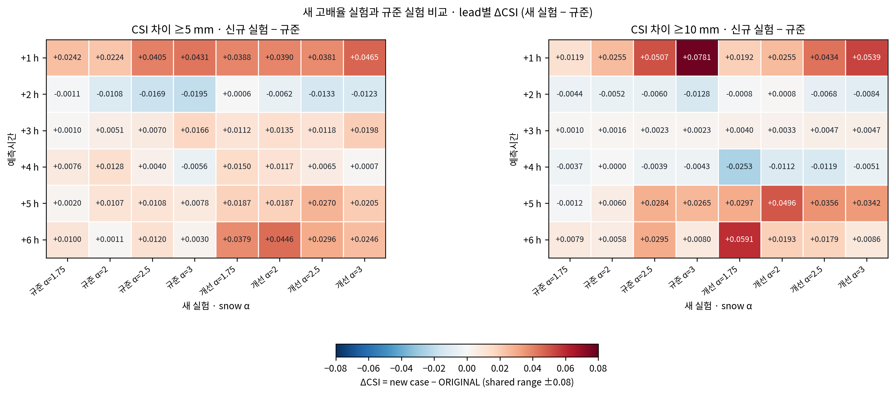
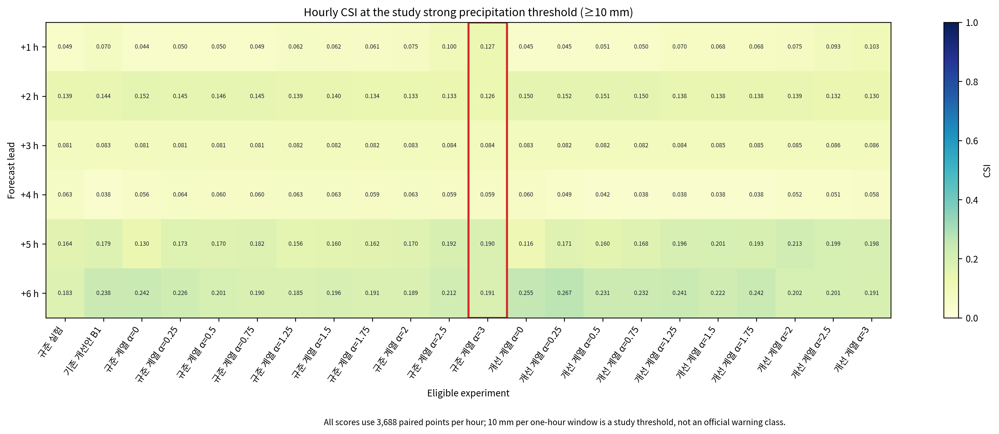
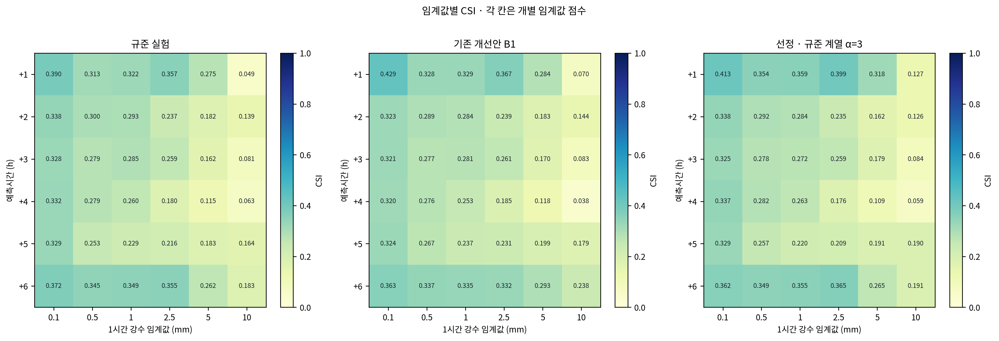
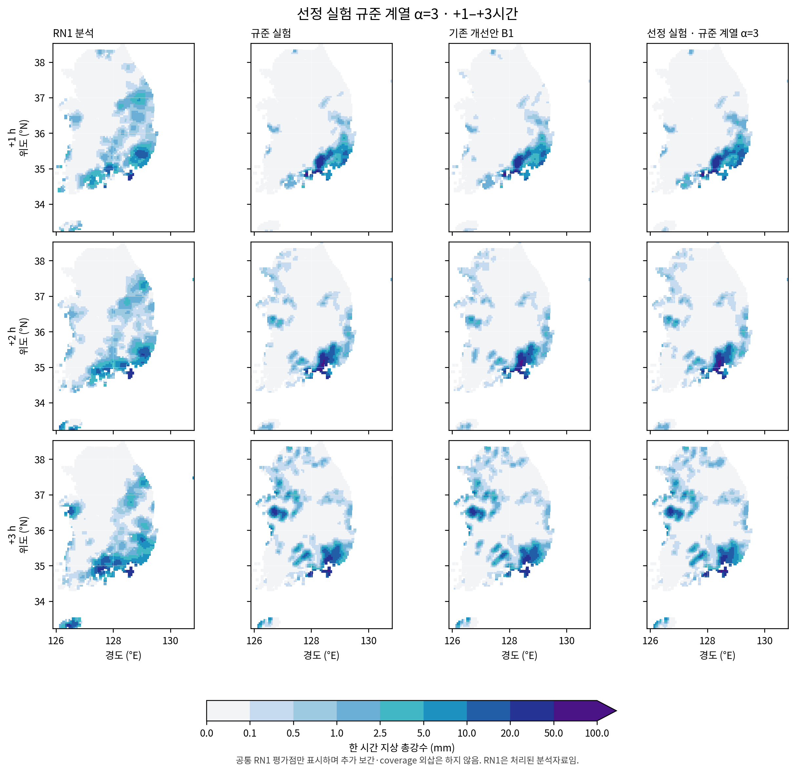
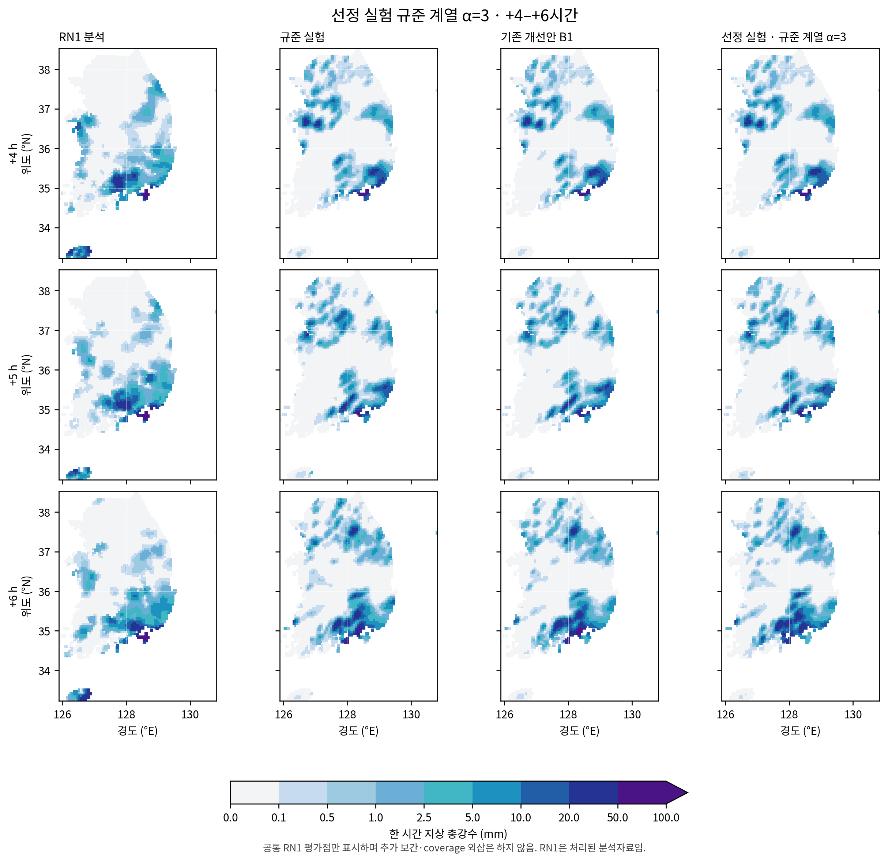

# 고강수 임계값 중심 초기 눈 혼합비 민감도 확장

## 요약

2026년 8월 16일 12 UTC 사례에서 기존 14개 적격 실험에 CONTROL·IMPROVED 두 계열의 α=1.75, 2.0, 2.5, 3.0 예보 8개를 추가 편성했다. 완료 사례의 공통 RN1 분석점 3,688개에서 한 시간 지상 총강수를 검증했다. 완료된 22개 적격 실험 중 **규준 계열 α=3**가 사전 지정 순위 1위다. +1시간 CSI@10 mm=0.1274, CSI@5 mm=0.3182, FAR@10 mm=0.8305다. 동일 사례에서 설정을 고른 탐색 결과이며 독립 검증 성능을 뜻하지 않는다.

## 1. 목적과 설계

기존 배율 상단 α=1.5를 넘어 초기 눈 양의 고배율 반응을 비교한다. CONTROL은 규준 초기장과 기존 WRF 실행파일, IMPROVED는 기존 개선안 B1 초기장과 수정 WRF 실행파일을 사용한다. 계열 안에서 native 초기 QSNOW만 float64 곱셈 후 native float32로 변환하고 다른 207개 변수와 전체 변수 메타데이터는 기준과 동일하게 유지했다. 두 계열의 차이는 초기장과 실행파일 변경을 함께 포함한다. 기존 12개 배율 실험과 신규 8개, 기준 2개를 합쳐 22개를 선정 대상으로 삼으며 기존 HYDRO는 참고 점수만 제공한다.

| 계열 | 기준 | 확장 배율 | 실행파일 |
| --- | --- | --- | --- |
| 규준 계열 | 규준 실험 | 1.75, 2.0, 2.5, 3.0 | 기존 WRF |
| 개선 계열 | 기존 개선안 B1 | 1.75, 2.0, 2.5, 3.0 | 수정 WRF |

초기 조작은 $q_s^{(\alpha)}=\operatorname{REAL32}[\alpha\operatorname{REAL64}(q_s^{(1)})]$이다. QSNOW 이외 변수는 유지하므로 초기 물 변화량은 $\Delta q_{water}=q_s^{(\alpha)}-q_s^{(1)}\simeq(\alpha-1)q_s^{(1)}$ (float32 반올림 차이 제외)다. 다른 수종·열역학 변수를 보상하지 않는 진단 개입이며 보존적 물·에너지 초기화가 아니다.

검증량은 지상 강설이 아닌 누적 총강수 $C=RAINC+RAINNC$의 연속 시각 간 한 시간 증가량 $P_h=C(t_0+h)-C(t_0+h-1)$이다. +6시간은 17–18 UTC 강수이며 0–6시간 누적강수는 아니다. CSI=$H/(H+M+F)$, FAR=$F/(H+F)$다. H/M/F는 적중/누락/오경보 개수다. [NCEP/EMC 강수 검증 점수 설명](https://www.emc.ncep.noaa.gov/mmb/SREF/pcpverif/scores/docs/QandA.html) (2026-10-30 확인).

## 2. 사전 지정 선정 기준

22개 적격 후보 가운데 완료된 6시간 예보만 +1시간 CSI@10 mm 내림차순, CSI@5 mm 내림차순, FAR@10 mm 오름차순, RMSE 오름차순, |α−1| 오름차순, 실험 ID 오름차순으로 순위화한다. 미완료 사례는 점수와 순위에서 제외하고 상태를 별도 표기한다. 수치 허용오차는 0이다. 미정의 CSI는 정의된 점수 아래, 미정의 FAR는 정의된 FAR 뒤에 둔다. 선정의 우선 기준은 강한 강수 CSI이며 RMSE는 앞선 CSI/FAR가 모두 동률일 때에만 순위 동점 처리 기준이다. 10 mm h⁻¹는 본 연구의 고강수 임계값이지 공식 특보 구간은 아니다.

## 3. 결과

### 3.1 강한 강수 점수 및 선정

**규준 계열 α=3**가 선정되었다. B1과 비교하면 CSI@10 변화 +0.0570, CSI@5 변화 +0.0346, FAR@10 변화 -0.0620다. 선정은 사전 지정한 강수 사건 점수와 동점 처리 순서에 따랐다. +1시간 RMSE는 4.1406 mm로 B1보다 +0.0965 mm이며 연속 오차 맥락으로 함께 보고한다. RMSE는 CSI@10, CSI@5, FAR@10이 모두 동률일 때만 뒤따르는 순위 기준이다. 선정 배율은 시험한 최댓값 α=3.0이다. 더 높은 배율은 시험하지 않아 이 결과로 반응 정점이나 고배율 이후 단조성을 주장할 수 없다.

+1시간 ≥10 mm에서 공통 관측 사건 수 $O=H+M$는 59개다. 규준 계열 α=3의 CSI는 $H/(O+FA)=20/(59+98)=0.1274$, 규준 실험은 $7/(59+83)=0.0493$다. 총 적중 수 변화는 +13개, 오경보 수 변화는 +15개다. 이는 임계값 점수식의 산술 비교이며, 새 적중 전이 수나 미세물리 과정의 인과 귀속을 뜻하지 않는다.

격자별 전이 집계에서 +1시간 ≥10 mm의 규준 대비 적중 변화는 새 적중 13·적중 소실 0, 오경보 변화는 새 오경보 15·제거 0이다. B1 대비 각각 10·0 및 15·0이다. 이는 점수 차이를 설명하는 격자별 전이 집계다. 자세한 행은 [격자별 전이표](evidence/snow_extension_20261030/review/independent_transitions.csv)에 있다.

고정한 +1시간 CSI@10 기준이 모든 예측시간의 승자를 뜻하지 않는다. +2시간 CSI@10은 선정 실험 0.1257, 규준 0.1386, B1 0.1437이고, +6시간은 각각 0.1908, 0.1828, 0.2381다. 각 lead의 점수는 개별로 해석하며 시간 평균으로 합치지 않는다.

### 3.2 신규 고배율 실험과 규준 실험 비교

다음 표는 규준 실험과 새로 편성한 α=1.75, 2.0, 2.5, 3.0의 두 계열 8개 실험을 비교한다. 각 lead의 CSI@10을 별도로 보여주며 시간이나 임계값에 걸친 평균 점수는 사용하지 않는다. 미완료 실험은 점수 없이 상태를 표시한다.

| 실험 | α | 상태 | +1 h CSI@10 | +2 h CSI@10 | +3 h CSI@10 | +4 h CSI@10 | +5 h CSI@10 | +6 h CSI@10 |
| --- | --- | --- | --- | --- | --- | --- | --- | --- |
| 규준 실험 | 1 | 완료 | 0.0493 | 0.1386 | 0.0814 | 0.0629 | 0.1636 | 0.1828 |
| 규준 계열 α=1.75 | 1.75 | 완료 | 0.0612 | 0.1341 | 0.0824 | 0.0592 | 0.1625 | 0.1906 |
| 규준 계열 α=2 | 2 | 완료 | 0.0748 | 0.1333 | 0.0830 | 0.0629 | 0.1697 | 0.1886 |
| 규준 계열 α=2.5 | 2.5 | 완료 | 0.1000 | 0.1325 | 0.0837 | 0.0590 | 0.1920 | 0.2123 |
| 규준 계열 α=3 | 3 | 완료 | 0.1274 | 0.1257 | 0.0837 | 0.0586 | 0.1901 | 0.1908 |
| 개선 계열 α=1.75 | 1.75 | 완료 | 0.0685 | 0.1377 | 0.0854 | 0.0377 | 0.1933 | 0.2419 |
| 개선 계열 α=2 | 2 | 완료 | 0.0748 | 0.1394 | 0.0847 | 0.0517 | 0.2132 | 0.2021 |
| 개선 계열 α=2.5 | 2.5 | 완료 | 0.0927 | 0.1317 | 0.0861 | 0.0510 | 0.1993 | 0.2007 |
| 개선 계열 α=3 | 3 | 완료 | 0.1032 | 0.1302 | 0.0861 | 0.0578 | 0.1978 | 0.1914 |

### 3.3 시각 자료

전체 적격 사례의 고강수 CSI@10 시간별 분포와 기준·선정 실험의 임계값별 CSI를 보인다. 시간별 총강수 지도는 RN1 분석, 규준 실험, 기존 개선안 B1, 선정 실험을 공통 색 구간으로 비교한다.

## 4. 기상학적 해석 및 한계

초기 QSNOW 증가는 얼음상 수상체 저장량을 바꾸며, 가능한 후속 융해·승화·낙하·수송 및 수증기·온도 반응은 지상 총강수에 영향을 줄 수 있다. WRF의 일반 미세물리 문서는 열·수분 경향과 지상 강수 및 관련 상변화 과정을 설명한다 ([WRF Physics](https://www2.mmm.ucar.edu/wrf/site/documentation/users_guide/physics.html), [NCAR WRF Physics tutorial](https://www2.mmm.ucar.edu/wrf/wrf_tutorial_linked_files/Overview_of_Physics.pdf); 2026-10-30 확인). 이 일반 문헌은 해당 문서 사례의 KDM6 처리 코드나 점수 변화의 과정별 원인을 입증하지 않는다. 과정별 기여는 분리 측정하지 않았다. CSI와 FAR는 사건 위치 및 빈도를 반영하므로 한 지표의 개선이 다른 임계값·예측시간의 개선을 보장하지 않는다. RN1은 처리된 분석자료이지 관측 진실값이 아니다. 동일 사례에서 설정을 골라 선택 편향이 있고, 보존량·운영 적합성을 입증하지 않는다.

## 5. 참고 문헌 및 자료

- [NCEP/EMC 강수 검증 점수 설명](https://www.emc.ncep.noaa.gov/mmb/SREF/pcpverif/scores/docs/QandA.html) (2026-10-30 확인).

- [WRF Physics 사용자 안내서](https://www2.mmm.ucar.edu/wrf/site/documentation/users_guide/physics.html) (2026-10-30 확인).

- [NCAR WRF Overview of Physics tutorial, February 2025](https://www2.mmm.ucar.edu/wrf/wrf_tutorial_linked_files/Overview_of_Physics.pdf) (2026-10-30 확인).

[고정 선정 계획](evidence/snow_extension_20261030/selection_plan.json) SHA-256 `36e094ac84d698351cdc477ec0bb58fd7580e0676e9ed830236a7d52b0818642` · [전체 임계값×lead 점수 36표 및 시간별 오차 부록](SNOW_EXTENSION_FULL_SCORES_20261030.md) · [분석 영수증](evidence/snow_extension_20261030/analysis/receipt.json) · [전체 순위표](evidence/snow_extension_20261030/analysis/selection_scores.csv) · [격자별 전이표](evidence/snow_extension_20261030/review/independent_transitions.csv) · [그림 영수증](evidence/snow_extension_20261030/figures/figure_manifest.json). 점수는 23개 완료 사례, 여섯 1시간 창, 여섯 임계값, 시간당 3,688개 paired point를 포함한다. 지도는 공통 점만 표시하며 추가 보간하지 않는다.

## 부록 A. 전체 시간·임계값별 CSI와 혼동계수

아래에는 점수화된 모든 사례(기존 HYDRO 참고 사례 포함)를 시간·임계값별로 제시한다. 각 셀은 CSI와 적중/누락/오경보 수(H/M/FA)이며, 각 시간은 3,688개 paired point를 사용한다. 임계값별 결과는 개별로 해석하며 평균하지 않는다. —는 미정의 점수다.

### +1시간 · 12–13 UTC

| 실험 | ≥0.1 mm: CSI (H/M/FA) | ≥0.5 mm: CSI (H/M/FA) | ≥1 mm: CSI (H/M/FA) | ≥2.5 mm: CSI (H/M/FA) | ≥5 mm: CSI (H/M/FA) | ≥10 mm: CSI (H/M/FA) |
| --- | --- | --- | --- | --- | --- | --- |
| 규준 실험 | 0.3898 (642/951/54) | 0.3129 (382/754/85) | 0.3224 (265/448/109) | 0.3575 (163/188/105) | 0.2751 (74/80/115) | 0.0493 (7/52/83) |
| 기존 HYDRO (참고) | 0.3717 (613/980/56) | 0.2788 (339/797/80) | 0.2915 (237/476/100) | 0.3267 (148/203/102) | 0.2140 (55/99/103) | 0.0435 (6/53/79) |
| 기존 개선안 B1 | 0.4294 (721/872/86) | 0.3284 (403/733/91) | 0.3289 (271/442/111) | 0.3670 (167/184/104) | 0.2836 (76/78/114) | 0.0704 (10/49/83) |
| 규준 계열 α=0 | 0.3345 (551/1042/54) | 0.2671 (324/812/77) | 0.2924 (238/475/101) | 0.3259 (147/204/100) | 0.2078 (53/101/101) | 0.0438 (6/53/78) |
| 규준 계열 α=0.25 | 0.3837 (632/961/54) | 0.2895 (352/784/80) | 0.2989 (243/470/100) | 0.3451 (157/194/104) | 0.2252 (59/95/108) | 0.0500 (7/52/81) |
| 규준 계열 α=0.5 | 0.3836 (633/960/57) | 0.2961 (361/775/83) | 0.3141 (256/457/102) | 0.3510 (159/192/102) | 0.2471 (65/89/109) | 0.0500 (7/52/81) |
| 규준 계열 α=0.75 | 0.3857 (636/957/56) | 0.3022 (369/767/85) | 0.3167 (260/453/108) | 0.3546 (161/190/103) | 0.2734 (73/81/113) | 0.0493 (7/52/83) |
| 규준 계열 α=1.25 | 0.3953 (651/942/54) | 0.3175 (388/748/86) | 0.3281 (270/443/110) | 0.3632 (166/185/106) | 0.2878 (78/76/117) | 0.0625 (9/50/85) |
| 규준 계열 α=1.5 | 0.3999 (659/934/55) | 0.3224 (394/742/86) | 0.3329 (275/438/113) | 0.3704 (170/181/108) | 0.2978 (81/73/118) | 0.0616 (9/50/87) |
| 규준 계열 α=1.75 | 0.4026 (663/930/54) | 0.3268 (400/736/88) | 0.3378 (280/433/116) | 0.3774 (174/177/110) | 0.2993 (82/72/120) | 0.0612 (9/50/88) |
| 규준 계열 α=2 | 0.4050 (667/926/54) | 0.3355 (411/725/89) | 0.3413 (284/429/119) | 0.3839 (177/174/110) | 0.2975 (83/71/125) | 0.0748 (11/48/88) |
| 규준 계열 α=2.5 | 0.4103 (677/916/57) | 0.3472 (426/710/91) | 0.3504 (294/419/126) | 0.3914 (182/169/114) | 0.3156 (89/65/128) | 0.1000 (15/44/91) |
| 규준 계열 α=3 | 0.4134 (683/910/59) | 0.3542 (435/701/92) | 0.3589 (304/409/134) | 0.3991 (186/165/115) | 0.3182 (91/63/132) | 0.1274 (20/39/98) |
| 개선 계열 α=0 | 0.4331 (725/868/81) | 0.3013 (367/769/82) | 0.3182 (259/454/101) | 0.3512 (157/194/96) | 0.2151 (54/100/97) | 0.0451 (6/53/74) |
| 개선 계열 α=0.25 | 0.4261 (715/878/85) | 0.3109 (379/757/83) | 0.3211 (262/451/103) | 0.3518 (159/192/101) | 0.2355 (61/93/105) | 0.0448 (6/53/75) |
| 개선 계열 α=0.5 | 0.4264 (716/877/86) | 0.3178 (389/747/88) | 0.3248 (266/447/106) | 0.3590 (163/188/103) | 0.2481 (65/89/108) | 0.0511 (7/52/78) |
| 개선 계열 α=0.75 | 0.4287 (719/874/84) | 0.3233 (396/740/89) | 0.3252 (268/445/111) | 0.3604 (164/187/104) | 0.2765 (73/81/110) | 0.0500 (7/52/81) |
| 개선 계열 α=1.25 | 0.4318 (725/868/86) | 0.3366 (413/723/91) | 0.3394 (280/433/112) | 0.3750 (171/180/105) | 0.2889 (78/76/116) | 0.0699 (10/49/84) |
| 개선 계열 α=1.5 | 0.4327 (727/866/87) | 0.3393 (417/719/93) | 0.3426 (284/429/116) | 0.3799 (174/177/107) | 0.3000 (81/73/116) | 0.0685 (10/49/87) |
| 개선 계열 α=1.75 | 0.4358 (733/860/89) | 0.3447 (424/712/94) | 0.3469 (289/424/120) | 0.3856 (177/174/108) | 0.3139 (86/68/120) | 0.0685 (10/49/87) |
| 개선 계열 α=2 | 0.4393 (738/855/87) | 0.3504 (431/705/94) | 0.3536 (296/417/124) | 0.3891 (179/172/109) | 0.3141 (87/67/123) | 0.0748 (11/48/88) |
| 개선 계열 α=2.5 | 0.4435 (745/848/87) | 0.3560 (439/697/97) | 0.3602 (304/409/131) | 0.3974 (184/167/112) | 0.3132 (88/66/127) | 0.0927 (14/45/92) |
| 개선 계열 α=3 | 0.4460 (751/842/91) | 0.3628 (448/688/99) | 0.3651 (310/403/136) | 0.4099 (191/160/115) | 0.3216 (91/63/129) | 0.1032 (16/43/96) |

### +2시간 · 13–14 UTC

| 실험 | ≥0.1 mm: CSI (H/M/FA) | ≥0.5 mm: CSI (H/M/FA) | ≥1 mm: CSI (H/M/FA) | ≥2.5 mm: CSI (H/M/FA) | ≥5 mm: CSI (H/M/FA) | ≥10 mm: CSI (H/M/FA) |
| --- | --- | --- | --- | --- | --- | --- |
| 규준 실험 | 0.3381 (708/959/427) | 0.2996 (397/716/212) | 0.2933 (249/444/156) | 0.2372 (116/267/106) | 0.1815 (59/159/107) | 0.1386 (23/56/87) |
| 기존 HYDRO (참고) | 0.3383 (705/962/417) | 0.3019 (400/713/212) | 0.3223 (273/420/154) | 0.2551 (125/258/107) | 0.1796 (58/160/105) | 0.1463 (24/55/85) |
| 기존 개선안 B1 | 0.3231 (686/981/456) | 0.2891 (386/727/222) | 0.2839 (243/450/163) | 0.2387 (116/267/103) | 0.1827 (59/159/105) | 0.1437 (24/55/88) |
| 규준 계열 α=0 | 0.3479 (731/936/434) | 0.3080 (410/703/218) | 0.3224 (274/419/157) | 0.2669 (130/253/104) | 0.1920 (62/156/105) | 0.1524 (25/54/85) |
| 규준 계열 α=0.25 | 0.3407 (712/955/423) | 0.3064 (406/707/212) | 0.3180 (270/423/156) | 0.2541 (125/258/109) | 0.1815 (59/159/107) | 0.1455 (24/55/86) |
| 규준 계열 α=0.5 | 0.3376 (706/961/424) | 0.3000 (399/714/217) | 0.3060 (261/432/160) | 0.2439 (120/263/109) | 0.1821 (59/159/106) | 0.1463 (24/55/85) |
| 규준 계열 α=0.75 | 0.3362 (709/958/442) | 0.2976 (397/716/221) | 0.2968 (252/441/156) | 0.2429 (119/264/107) | 0.1815 (59/159/107) | 0.1455 (24/55/86) |
| 규준 계열 α=1.25 | 0.3371 (713/954/448) | 0.2956 (394/719/220) | 0.2909 (247/446/156) | 0.2367 (116/267/107) | 0.1821 (59/159/106) | 0.1394 (23/56/86) |
| 규준 계열 α=1.5 | 0.3400 (719/948/448) | 0.2975 (396/717/218) | 0.2866 (243/450/155) | 0.2342 (115/268/108) | 0.1815 (59/159/107) | 0.1402 (23/56/85) |
| 규준 계열 α=1.75 | 0.3381 (715/952/448) | 0.2938 (391/722/218) | 0.2859 (243/450/157) | 0.2322 (114/269/108) | 0.1804 (59/159/109) | 0.1341 (22/57/85) |
| 규준 계열 α=2 | 0.3373 (715/952/453) | 0.2971 (394/719/213) | 0.2847 (242/451/157) | 0.2373 (117/266/110) | 0.1707 (56/162/110) | 0.1333 (22/57/86) |
| 규준 계열 α=2.5 | 0.3370 (713/954/449) | 0.2912 (387/726/216) | 0.2845 (243/450/161) | 0.2374 (118/265/114) | 0.1646 (54/164/110) | 0.1325 (22/57/87) |
| 규준 계열 α=3 | 0.3383 (720/947/461) | 0.2916 (389/724/221) | 0.2837 (242/451/160) | 0.2353 (116/267/110) | 0.1621 (53/165/109) | 0.1257 (21/58/88) |
| 개선 계열 α=0 | 0.3145 (672/995/470) | 0.2884 (387/726/229) | 0.3118 (266/427/160) | 0.2722 (132/251/102) | 0.1920 (62/156/105) | 0.1497 (25/54/88) |
| 개선 계열 α=0.25 | 0.3250 (691/976/459) | 0.2948 (393/720/220) | 0.3072 (263/430/163) | 0.2515 (122/261/102) | 0.1796 (58/160/105) | 0.1515 (25/54/86) |
| 개선 계열 α=0.5 | 0.3253 (691/976/457) | 0.2931 (391/722/221) | 0.2974 (254/439/161) | 0.2449 (119/264/103) | 0.1827 (59/159/105) | 0.1506 (25/54/87) |
| 개선 계열 α=0.75 | 0.3266 (692/975/452) | 0.2897 (387/726/223) | 0.2916 (249/444/161) | 0.2423 (118/265/104) | 0.1827 (59/159/105) | 0.1497 (25/54/88) |
| 개선 계열 α=1.25 | 0.3249 (693/974/466) | 0.2882 (385/728/223) | 0.2789 (239/454/164) | 0.2357 (115/268/105) | 0.1827 (59/159/105) | 0.1377 (23/56/88) |
| 개선 계열 α=1.5 | 0.3239 (689/978/460) | 0.2869 (383/730/222) | 0.2812 (241/452/164) | 0.2336 (114/269/105) | 0.1827 (59/159/105) | 0.1377 (23/56/88) |
| 개선 계열 α=1.75 | 0.3272 (693/974/451) | 0.2838 (380/733/226) | 0.2747 (236/457/166) | 0.2352 (115/268/106) | 0.1821 (59/159/106) | 0.1377 (23/56/88) |
| 개선 계열 α=2 | 0.3266 (693/974/455) | 0.2837 (379/734/223) | 0.2760 (236/457/162) | 0.2367 (116/267/107) | 0.1754 (57/161/107) | 0.1394 (23/56/86) |
| 개선 계열 α=2.5 | 0.3262 (697/970/470) | 0.2831 (378/735/222) | 0.2741 (236/457/168) | 0.2373 (117/266/110) | 0.1682 (55/163/109) | 0.1317 (22/57/88) |
| 개선 계열 α=3 | 0.3282 (703/964/475) | 0.2836 (378/735/220) | 0.2698 (232/461/167) | 0.2368 (117/266/111) | 0.1692 (55/163/107) | 0.1302 (22/57/90) |

### +3시간 · 14–15 UTC

| 실험 | ≥0.1 mm: CSI (H/M/FA) | ≥0.5 mm: CSI (H/M/FA) | ≥1 mm: CSI (H/M/FA) | ≥2.5 mm: CSI (H/M/FA) | ≥5 mm: CSI (H/M/FA) | ≥10 mm: CSI (H/M/FA) |
| --- | --- | --- | --- | --- | --- | --- |
| 규준 실험 | 0.3276 (786/796/817) | 0.2793 (453/705/464) | 0.2853 (327/520/299) | 0.2593 (202/370/207) | 0.1622 (85/260/179) | 0.0814 (21/111/126) |
| 기존 HYDRO (참고) | 0.3124 (760/822/851) | 0.2673 (436/722/473) | 0.2790 (322/525/307) | 0.2510 (193/379/197) | 0.1618 (84/261/174) | 0.0802 (21/111/130) |
| 기존 개선안 B1 | 0.3212 (771/811/818) | 0.2765 (448/710/462) | 0.2810 (324/523/306) | 0.2614 (201/371/197) | 0.1696 (88/257/174) | 0.0827 (21/111/122) |
| 규준 계열 α=0 | 0.3092 (755/827/860) | 0.2667 (435/723/473) | 0.2783 (320/527/303) | 0.2542 (195/377/195) | 0.1598 (82/263/168) | 0.0811 (21/111/127) |
| 규준 계열 α=0.25 | 0.3116 (760/822/857) | 0.2706 (437/721/457) | 0.2818 (323/524/299) | 0.2591 (200/372/200) | 0.1565 (82/263/179) | 0.0814 (21/111/126) |
| 규준 계열 α=0.5 | 0.3183 (770/812/837) | 0.2723 (437/721/447) | 0.2830 (324/523/298) | 0.2610 (201/371/198) | 0.1574 (82/263/176) | 0.0811 (21/111/127) |
| 규준 계열 α=0.75 | 0.3172 (768/814/839) | 0.2731 (440/718/453) | 0.2810 (322/525/299) | 0.2613 (203/369/205) | 0.1619 (85/260/180) | 0.0808 (21/111/128) |
| 규준 계열 α=1.25 | 0.3253 (784/798/828) | 0.2814 (459/699/473) | 0.2826 (327/520/310) | 0.2580 (201/371/207) | 0.1635 (86/259/181) | 0.0820 (21/111/124) |
| 규준 계열 α=1.5 | 0.3286 (792/790/828) | 0.2795 (455/703/470) | 0.2839 (327/520/305) | 0.2574 (201/371/209) | 0.1660 (87/258/179) | 0.0824 (21/111/123) |
| 규준 계열 α=1.75 | 0.3292 (796/786/836) | 0.2816 (459/699/472) | 0.2815 (326/521/311) | 0.2532 (198/374/210) | 0.1632 (86/259/182) | 0.0824 (21/111/123) |
| 규준 계열 α=2 | 0.3281 (790/792/826) | 0.2816 (457/701/465) | 0.2806 (326/521/315) | 0.2554 (200/372/211) | 0.1673 (88/257/181) | 0.0830 (21/111/121) |
| 규준 계열 α=2.5 | 0.3249 (786/796/837) | 0.2822 (460/698/472) | 0.2772 (324/523/322) | 0.2583 (202/370/210) | 0.1692 (89/256/181) | 0.0837 (21/111/119) |
| 규준 계열 α=3 | 0.3255 (789/793/842) | 0.2777 (454/704/477) | 0.2721 (320/527/329) | 0.2586 (203/369/213) | 0.1788 (93/252/175) | 0.0837 (21/111/119) |
| 개선 계열 α=0 | 0.3159 (761/821/827) | 0.2685 (435/723/462) | 0.2699 (312/535/309) | 0.2438 (186/386/191) | 0.1693 (87/258/169) | 0.0830 (21/111/121) |
| 개선 계열 α=0.25 | 0.3182 (770/812/838) | 0.2708 (439/719/463) | 0.2751 (318/529/309) | 0.2448 (189/383/200) | 0.1641 (85/260/173) | 0.0824 (21/111/123) |
| 개선 계열 α=0.5 | 0.3183 (767/815/828) | 0.2751 (444/714/456) | 0.2784 (319/528/299) | 0.2497 (193/379/201) | 0.1709 (88/257/170) | 0.0820 (21/111/124) |
| 개선 계열 α=0.75 | 0.3205 (773/809/830) | 0.2781 (448/710/453) | 0.2742 (317/530/309) | 0.2529 (196/376/203) | 0.1663 (86/259/172) | 0.0824 (21/111/123) |
| 개선 계열 α=1.25 | 0.3241 (780/802/825) | 0.2771 (450/708/466) | 0.2767 (324/523/324) | 0.2578 (199/373/200) | 0.1641 (85/260/173) | 0.0837 (21/111/119) |
| 개선 계열 α=1.5 | 0.3277 (788/794/823) | 0.2862 (468/690/477) | 0.2830 (330/517/319) | 0.2539 (196/376/200) | 0.1686 (87/258/171) | 0.0850 (21/111/115) |
| 개선 계열 α=1.75 | 0.3227 (780/802/835) | 0.2866 (464/694/461) | 0.2804 (327/520/319) | 0.2561 (199/373/205) | 0.1734 (90/255/174) | 0.0854 (21/111/114) |
| 개선 계열 α=2 | 0.3260 (787/795/832) | 0.2855 (467/691/478) | 0.2760 (324/523/327) | 0.2594 (201/371/203) | 0.1757 (91/254/173) | 0.0847 (21/111/116) |
| 개선 계열 α=2.5 | 0.3254 (783/799/824) | 0.2752 (448/710/470) | 0.2715 (319/528/328) | 0.2610 (202/370/202) | 0.1740 (91/254/178) | 0.0861 (21/111/112) |
| 개선 계열 α=3 | 0.3223 (780/802/838) | 0.2765 (451/707/473) | 0.2725 (321/526/331) | 0.2605 (204/368/211) | 0.1820 (95/250/177) | 0.0861 (21/111/112) |

### +4시간 · 15–16 UTC

| 실험 | ≥0.1 mm: CSI (H/M/FA) | ≥0.5 mm: CSI (H/M/FA) | ≥1 mm: CSI (H/M/FA) | ≥2.5 mm: CSI (H/M/FA) | ≥5 mm: CSI (H/M/FA) | ≥10 mm: CSI (H/M/FA) |
| --- | --- | --- | --- | --- | --- | --- |
| 규준 실험 | 0.3317 (810/810/822) | 0.2790 (491/731/538) | 0.2597 (361/581/448) | 0.1802 (167/424/336) | 0.1148 (66/278/231) | 0.0629 (18/147/121) |
| 기존 HYDRO (참고) | 0.3189 (772/848/801) | 0.2706 (476/746/537) | 0.2390 (330/612/439) | 0.1729 (158/433/323) | 0.1199 (68/276/223) | 0.0540 (15/150/113) |
| 기존 개선안 B1 | 0.3200 (783/837/827) | 0.2762 (483/739/527) | 0.2527 (346/596/427) | 0.1846 (170/421/330) | 0.1178 (67/277/225) | 0.0378 (11/154/126) |
| 규준 계열 α=0 | 0.3271 (791/829/798) | 0.2793 (484/738/511) | 0.2546 (346/596/417) | 0.1828 (166/425/317) | 0.1168 (66/278/221) | 0.0563 (16/149/119) |
| 규준 계열 α=0.25 | 0.3233 (785/835/808) | 0.2721 (478/744/535) | 0.2531 (346/596/425) | 0.1795 (163/428/317) | 0.1135 (64/280/220) | 0.0638 (18/147/117) |
| 규준 계열 α=0.5 | 0.3343 (810/810/803) | 0.2787 (490/732/536) | 0.2598 (357/585/432) | 0.1801 (165/426/325) | 0.1103 (63/281/227) | 0.0601 (17/148/118) |
| 규준 계열 α=0.75 | 0.3369 (818/802/808) | 0.2857 (504/718/542) | 0.2592 (359/583/443) | 0.1857 (171/420/330) | 0.1132 (65/279/230) | 0.0601 (17/148/118) |
| 규준 계열 α=1.25 | 0.3314 (811/809/827) | 0.2868 (503/719/532) | 0.2603 (361/581/445) | 0.1846 (170/421/330) | 0.1206 (69/275/228) | 0.0634 (18/147/119) |
| 규준 계열 α=1.5 | 0.3332 (816/804/829) | 0.2878 (506/716/536) | 0.2640 (367/575/448) | 0.1860 (173/418/339) | 0.1196 (69/275/233) | 0.0634 (18/147/119) |
| 규준 계열 α=1.75 | 0.3332 (813/807/820) | 0.2883 (506/716/533) | 0.2607 (364/578/454) | 0.1877 (174/417/336) | 0.1224 (71/273/236) | 0.0592 (17/148/122) |
| 규준 계열 α=2 | 0.3323 (818/802/842) | 0.2895 (507/715/529) | 0.2613 (365/577/455) | 0.1906 (178/413/343) | 0.1276 (74/270/236) | 0.0629 (18/147/121) |
| 규준 계열 α=2.5 | 0.3270 (811/809/860) | 0.2854 (504/718/544) | 0.2627 (367/575/455) | 0.1809 (169/422/343) | 0.1188 (69/275/237) | 0.0590 (17/148/123) |
| 규준 계열 α=3 | 0.3366 (825/795/831) | 0.2816 (499/723/550) | 0.2631 (371/571/468) | 0.1758 (166/425/353) | 0.1092 (64/280/242) | 0.0586 (17/148/125) |
| 개선 계열 α=0 | 0.3021 (733/887/806) | 0.2529 (438/784/510) | 0.2269 (310/632/424) | 0.1679 (154/437/326) | 0.1154 (66/278/228) | 0.0599 (17/148/119) |
| 개선 계열 α=0.25 | 0.3183 (778/842/824) | 0.2701 (468/754/511) | 0.2406 (327/615/417) | 0.1687 (154/437/322) | 0.1148 (65/279/222) | 0.0490 (14/151/121) |
| 개선 계열 α=0.5 | 0.3166 (775/845/828) | 0.2705 (469/753/512) | 0.2524 (343/599/417) | 0.1740 (159/432/323) | 0.1111 (63/281/223) | 0.0418 (12/153/122) |
| 개선 계열 α=0.75 | 0.3216 (786/834/824) | 0.2713 (471/751/514) | 0.2504 (342/600/424) | 0.1786 (164/427/327) | 0.1138 (65/279/227) | 0.0377 (11/154/127) |
| 개선 계열 α=1.25 | 0.3184 (781/839/833) | 0.2771 (485/737/528) | 0.2578 (354/588/431) | 0.1834 (170/421/336) | 0.1171 (67/277/228) | 0.0382 (11/154/123) |
| 개선 계열 α=1.5 | 0.3206 (786/834/832) | 0.2732 (480/742/535) | 0.2551 (350/592/430) | 0.1814 (168/423/335) | 0.1200 (69/275/231) | 0.0382 (11/154/123) |
| 개선 계열 α=1.75 | 0.3242 (793/827/826) | 0.2724 (477/745/529) | 0.2567 (355/587/441) | 0.1909 (177/414/336) | 0.1298 (75/269/234) | 0.0377 (11/154/127) |
| 개선 계열 α=2 | 0.3302 (809/811/830) | 0.2743 (482/740/535) | 0.2511 (348/594/444) | 0.1839 (171/420/339) | 0.1265 (73/271/233) | 0.0517 (15/150/125) |
| 개선 계열 α=2.5 | 0.3293 (808/812/834) | 0.2818 (501/721/556) | 0.2525 (353/589/456) | 0.1862 (175/416/349) | 0.1213 (70/274/233) | 0.0510 (15/150/129) |
| 개선 계열 α=3 | 0.3244 (798/822/840) | 0.2756 (490/732/556) | 0.2539 (356/586/460) | 0.1716 (162/429/353) | 0.1155 (67/277/236) | 0.0578 (17/148/129) |

### +5시간 · 16–17 UTC

| 실험 | ≥0.1 mm: CSI (H/M/FA) | ≥0.5 mm: CSI (H/M/FA) | ≥1 mm: CSI (H/M/FA) | ≥2.5 mm: CSI (H/M/FA) | ≥5 mm: CSI (H/M/FA) | ≥10 mm: CSI (H/M/FA) |
| --- | --- | --- | --- | --- | --- | --- |
| 규준 실험 | 0.3285 (796/901/726) | 0.2531 (452/777/557) | 0.2291 (323/602/485) | 0.2162 (195/378/329) | 0.1831 (104/226/238) | 0.1636 (45/123/107) |
| 기존 HYDRO (참고) | 0.3313 (799/898/715) | 0.2722 (484/745/549) | 0.2416 (338/587/474) | 0.2323 (207/366/318) | 0.1652 (92/238/227) | 0.1037 (28/140/102) |
| 기존 개선안 B1 | 0.3244 (789/908/735) | 0.2674 (480/749/566) | 0.2372 (337/588/496) | 0.2306 (211/362/342) | 0.1989 (110/220/223) | 0.1791 (48/120/100) |
| 규준 계열 α=0 | 0.3253 (781/916/704) | 0.2612 (460/769/532) | 0.2356 (328/597/467) | 0.2293 (205/368/321) | 0.1694 (94/236/225) | 0.1304 (36/132/108) |
| 규준 계열 α=0.25 | 0.3220 (783/914/735) | 0.2592 (463/766/557) | 0.2356 (331/594/480) | 0.2248 (201/372/321) | 0.1774 (99/231/228) | 0.1734 (47/121/103) |
| 규준 계열 α=0.5 | 0.3320 (804/893/725) | 0.2571 (460/769/560) | 0.2309 (323/602/474) | 0.2237 (202/371/330) | 0.1804 (101/229/230) | 0.1697 (46/122/103) |
| 규준 계열 α=0.75 | 0.3289 (795/902/720) | 0.2569 (456/773/546) | 0.2295 (322/603/478) | 0.2220 (200/373/328) | 0.1821 (102/228/230) | 0.1818 (50/118/107) |
| 규준 계열 α=1.25 | 0.3296 (797/900/721) | 0.2587 (460/769/549) | 0.2246 (316/609/482) | 0.2139 (194/379/334) | 0.1934 (106/224/218) | 0.1558 (43/125/108) |
| 규준 계열 α=1.5 | 0.3237 (788/909/737) | 0.2552 (457/772/562) | 0.2226 (315/610/490) | 0.2102 (189/384/326) | 0.1851 (102/228/221) | 0.1600 (44/124/107) |
| 규준 계열 α=1.75 | 0.3272 (799/898/745) | 0.2582 (462/767/560) | 0.2307 (323/602/475) | 0.2120 (191/382/328) | 0.1851 (102/228/221) | 0.1625 (45/123/109) |
| 규준 계열 α=2 | 0.3314 (811/886/750) | 0.2612 (474/755/586) | 0.2384 (338/587/493) | 0.2177 (197/376/332) | 0.1938 (107/223/222) | 0.1697 (47/121/109) |
| 규준 계열 α=2.5 | 0.3291 (801/896/737) | 0.2601 (470/759/578) | 0.2314 (332/593/510) | 0.2223 (201/372/331) | 0.1939 (108/222/227) | 0.1920 (53/115/108) |
| 규준 계열 α=3 | 0.3294 (808/889/756) | 0.2566 (469/760/599) | 0.2197 (317/608/518) | 0.2093 (190/383/335) | 0.1909 (105/225/220) | 0.1901 (54/114/116) |
| 개선 계열 α=0 | 0.3099 (748/949/717) | 0.2576 (458/771/549) | 0.2338 (329/596/482) | 0.2178 (196/377/327) | 0.1788 (98/232/218) | 0.1161 (31/137/99) |
| 개선 계열 α=0.25 | 0.3274 (792/905/722) | 0.2595 (463/766/555) | 0.2327 (329/596/489) | 0.2281 (206/367/330) | 0.1817 (99/231/215) | 0.1710 (46/122/101) |
| 개선 계열 α=0.5 | 0.3315 (801/896/719) | 0.2615 (468/761/561) | 0.2390 (338/587/489) | 0.2290 (207/366/331) | 0.1818 (100/230/220) | 0.1599 (43/125/101) |
| 개선 계열 α=0.75 | 0.3374 (823/874/742) | 0.2691 (482/747/562) | 0.2424 (343/582/490) | 0.2364 (213/360/328) | 0.1908 (104/226/215) | 0.1685 (46/122/105) |
| 개선 계열 α=1.25 | 0.3265 (800/897/753) | 0.2658 (479/750/573) | 0.2352 (337/588/508) | 0.2250 (207/366/347) | 0.1989 (111/219/228) | 0.1963 (53/115/102) |
| 개선 계열 α=1.5 | 0.3246 (792/905/743) | 0.2723 (489/740/567) | 0.2404 (343/582/502) | 0.2278 (210/363/349) | 0.2004 (112/218/229) | 0.2015 (54/114/100) |
| 개선 계열 α=1.75 | 0.3268 (803/894/760) | 0.2675 (482/747/573) | 0.2423 (346/579/503) | 0.2308 (210/363/337) | 0.2018 (113/217/230) | 0.1933 (52/116/101) |
| 개선 계열 α=2 | 0.3250 (794/903/746) | 0.2689 (487/742/582) | 0.2409 (344/581/503) | 0.2275 (207/366/337) | 0.2018 (114/216/235) | 0.2132 (58/110/104) |
| 개선 계열 α=2.5 | 0.3299 (812/885/764) | 0.2711 (492/737/586) | 0.2417 (349/576/519) | 0.2284 (211/362/351) | 0.2101 (117/213/227) | 0.1993 (55/113/108) |
| 개선 계열 α=3 | 0.3293 (810/887/763) | 0.2663 (490/739/611) | 0.2386 (345/580/521) | 0.2228 (205/368/347) | 0.2036 (114/216/230) | 0.1978 (54/114/105) |

### +6시간 · 17–18 UTC

| 실험 | ≥0.1 mm: CSI (H/M/FA) | ≥0.5 mm: CSI (H/M/FA) | ≥1 mm: CSI (H/M/FA) | ≥2.5 mm: CSI (H/M/FA) | ≥5 mm: CSI (H/M/FA) | ≥10 mm: CSI (H/M/FA) |
| --- | --- | --- | --- | --- | --- | --- |
| 규준 실험 | 0.3722 (939/695/889) | 0.3449 (646/603/624) | 0.3490 (505/463/479) | 0.3552 (325/286/304) | 0.2623 (155/193/243) | 0.1828 (51/73/155) |
| 기존 HYDRO (참고) | 0.3651 (904/730/842) | 0.3417 (624/625/577) | 0.3577 (509/459/455) | 0.3749 (337/274/288) | 0.2786 (163/185/237) | 0.1802 (51/73/159) |
| 기존 개선안 B1 | 0.3632 (908/726/866) | 0.3367 (635/614/637) | 0.3347 (494/474/508) | 0.3319 (309/302/320) | 0.2927 (168/180/226) | 0.2381 (65/59/149) |
| 규준 계열 α=0 | 0.3702 (911/723/827) | 0.3401 (624/625/586) | 0.3530 (503/465/457) | 0.3667 (330/281/289) | 0.2943 (171/177/233) | 0.2415 (64/60/141) |
| 규준 계열 α=0.25 | 0.3643 (913/721/872) | 0.3355 (629/620/626) | 0.3370 (494/474/498) | 0.3564 (324/287/298) | 0.2840 (165/183/233) | 0.2256 (60/64/142) |
| 규준 계열 α=0.5 | 0.3754 (935/699/857) | 0.3455 (646/603/621) | 0.3471 (506/462/490) | 0.3450 (324/287/328) | 0.2651 (154/194/233) | 0.2014 (56/68/154) |
| 규준 계열 α=0.75 | 0.3716 (929/705/866) | 0.3488 (648/601/609) | 0.3617 (518/450/464) | 0.3529 (324/287/307) | 0.2669 (158/190/244) | 0.1903 (55/69/165) |
| 규준 계열 α=1.25 | 0.3724 (931/703/866) | 0.3453 (647/602/625) | 0.3548 (512/456/475) | 0.3527 (321/290/299) | 0.2818 (164/184/234) | 0.1851 (52/72/157) |
| 규준 계열 α=1.5 | 0.3687 (928/706/883) | 0.3454 (651/598/636) | 0.3591 (520/448/480) | 0.3477 (315/296/295) | 0.2743 (161/187/239) | 0.1957 (55/69/157) |
| 규준 계열 α=1.75 | 0.3663 (927/707/897) | 0.3439 (651/598/644) | 0.3573 (526/442/504) | 0.3576 (329/282/309) | 0.2723 (162/186/247) | 0.1906 (53/71/154) |
| 규준 계열 α=2 | 0.3643 (932/702/924) | 0.3458 (655/594/645) | 0.3565 (524/444/502) | 0.3445 (319/292/315) | 0.2633 (158/190/252) | 0.1886 (53/71/157) |
| 규준 계열 α=2.5 | 0.3593 (928/706/949) | 0.3448 (662/587/671) | 0.3512 (524/444/524) | 0.3442 (317/294/310) | 0.2742 (167/181/261) | 0.2123 (62/62/168) |
| 규준 계열 α=3 | 0.3618 (933/701/945) | 0.3495 (671/578/671) | 0.3547 (525/443/512) | 0.3650 (338/273/315) | 0.2653 (165/183/274) | 0.1908 (58/66/180) |
| 개선 계열 α=0 | 0.3517 (869/765/837) | 0.3304 (608/641/591) | 0.3432 (487/481/451) | 0.3580 (319/292/280) | 0.3145 (178/170/218) | 0.2555 (70/54/150) |
| 개선 계열 α=0.25 | 0.3575 (888/746/850) | 0.3240 (611/638/637) | 0.3255 (473/495/485) | 0.3279 (302/309/310) | 0.2957 (165/183/210) | 0.2667 (72/52/146) |
| 개선 계열 α=0.5 | 0.3566 (888/746/856) | 0.3328 (621/628/617) | 0.3400 (492/476/479) | 0.3573 (323/288/293) | 0.2899 (169/179/235) | 0.2308 (63/61/149) |
| 개선 계열 α=0.75 | 0.3635 (907/727/861) | 0.3319 (624/625/631) | 0.3329 (491/477/507) | 0.3330 (314/297/332) | 0.2811 (167/181/246) | 0.2316 (63/61/148) |
| 개선 계열 α=1.25 | 0.3624 (911/723/880) | 0.3417 (643/606/633) | 0.3392 (500/468/506) | 0.3355 (312/299/319) | 0.3000 (171/177/222) | 0.2407 (65/59/146) |
| 개선 계열 α=1.5 | 0.3633 (918/716/893) | 0.3441 (650/599/640) | 0.3407 (511/457/532) | 0.3355 (314/297/325) | 0.3004 (170/178/218) | 0.2218 (63/61/160) |
| 개선 계열 α=1.75 | 0.3627 (923/711/911) | 0.3430 (651/598/649) | 0.3470 (516/452/519) | 0.3480 (317/294/300) | 0.3002 (169/179/215) | 0.2419 (67/57/153) |
| 개선 계열 α=2 | 0.3658 (923/711/889) | 0.3454 (656/593/650) | 0.3511 (526/442/530) | 0.3565 (333/278/323) | 0.3069 (178/170/232) | 0.2021 (59/65/168) |
| 개선 계열 α=2.5 | 0.3713 (943/691/906) | 0.3491 (671/578/673) | 0.3526 (532/436/541) | 0.3577 (342/269/345) | 0.2919 (176/172/255) | 0.2007 (60/64/175) |
| 개선 계열 α=3 | 0.3695 (953/681/945) | 0.3460 (675/574/702) | 0.3547 (542/426/560) | 0.3578 (341/270/342) | 0.2869 (175/173/262) | 0.1914 (58/66/179) |

## 부록 B. 시간별 강수량 오차

| 시간 | 실험 | MAE (mm) | RMSE (mm) |
| --- | --- | --- | --- |
| +1 h | 규준 실험 | 1.1142 | 4.0623 |
| +1 h | 기존 HYDRO (참고) | 1.1329 | 4.1103 |
| +1 h | 기존 개선안 B1 | 1.1007 | 4.0441 |
| +1 h | 규준 계열 α=0 | 1.1332 | 4.1072 |
| +1 h | 규준 계열 α=0.25 | 1.1203 | 4.0817 |
| +1 h | 규준 계열 α=0.5 | 1.1171 | 4.0662 |
| +1 h | 규준 계열 α=0.75 | 1.1154 | 4.0630 |
| +1 h | 규준 계열 α=1.25 | 1.1153 | 4.0772 |
| +1 h | 규준 계열 α=1.5 | 1.1171 | 4.0869 |
| +1 h | 규준 계열 α=1.75 | 1.1191 | 4.0925 |
| +1 h | 규준 계열 α=2 | 1.1213 | 4.1017 |
| +1 h | 규준 계열 α=2.5 | 1.1271 | 4.1156 |
| +1 h | 규준 계열 α=3 | 1.1351 | 4.1406 |
| +1 h | 개선 계열 α=0 | 1.1060 | 4.0681 |
| +1 h | 개선 계열 α=0.25 | 1.1053 | 4.0617 |
| +1 h | 개선 계열 α=0.5 | 1.1034 | 4.0536 |
| +1 h | 개선 계열 α=0.75 | 1.1015 | 4.0435 |
| +1 h | 개선 계열 α=1.25 | 1.1017 | 4.0508 |
| +1 h | 개선 계열 α=1.5 | 1.1038 | 4.0579 |
| +1 h | 개선 계열 α=1.75 | 1.1063 | 4.0678 |
| +1 h | 개선 계열 α=2 | 1.1096 | 4.0769 |
| +1 h | 개선 계열 α=2.5 | 1.1155 | 4.0920 |
| +1 h | 개선 계열 α=3 | 1.1245 | 4.1153 |
| +2 h | 규준 실험 | 1.4227 | 4.6739 |
| +2 h | 기존 HYDRO (참고) | 1.4022 | 4.6197 |
| +2 h | 기존 개선안 B1 | 1.4294 | 4.6698 |
| +2 h | 규준 계열 α=0 | 1.3923 | 4.5949 |
| +2 h | 규준 계열 α=0.25 | 1.4039 | 4.6245 |
| +2 h | 규준 계열 α=0.5 | 1.4127 | 4.6496 |
| +2 h | 규준 계열 α=0.75 | 1.4199 | 4.6609 |
| +2 h | 규준 계열 α=1.25 | 1.4275 | 4.6839 |
| +2 h | 규준 계열 α=1.5 | 1.4316 | 4.7021 |
| +2 h | 규준 계열 α=1.75 | 1.4336 | 4.7052 |
| +2 h | 규준 계열 α=2 | 1.4369 | 4.7179 |
| +2 h | 규준 계열 α=2.5 | 1.4419 | 4.7411 |
| +2 h | 규준 계열 α=3 | 1.4473 | 4.7638 |
| +2 h | 개선 계열 α=0 | 1.4000 | 4.5681 |
| +2 h | 개선 계열 α=0.25 | 1.4112 | 4.6132 |
| +2 h | 개선 계열 α=0.5 | 1.4190 | 4.6378 |
| +2 h | 개선 계열 α=0.75 | 1.4248 | 4.6496 |
| +2 h | 개선 계열 α=1.25 | 1.4333 | 4.6764 |
| +2 h | 개선 계열 α=1.5 | 1.4338 | 4.6856 |
| +2 h | 개선 계열 α=1.75 | 1.4385 | 4.6977 |
| +2 h | 개선 계열 α=2 | 1.4403 | 4.7083 |
| +2 h | 개선 계열 α=2.5 | 1.4467 | 4.7269 |
| +2 h | 개선 계열 α=3 | 1.4524 | 4.7503 |
| +3 h | 규준 실험 | 1.7876 | 4.1263 |
| +3 h | 기존 HYDRO (참고) | 1.7931 | 4.1150 |
| +3 h | 기존 개선안 B1 | 1.7828 | 4.1417 |
| +3 h | 규준 계열 α=0 | 1.7955 | 4.1241 |
| +3 h | 규준 계열 α=0.25 | 1.7968 | 4.1343 |
| +3 h | 규준 계열 α=0.5 | 1.7938 | 4.1314 |
| +3 h | 규준 계열 α=0.75 | 1.7904 | 4.1303 |
| +3 h | 규준 계열 α=1.25 | 1.7907 | 4.1341 |
| +3 h | 규준 계열 α=1.5 | 1.7938 | 4.1530 |
| +3 h | 규준 계열 α=1.75 | 1.7917 | 4.1454 |
| +3 h | 규준 계열 α=2 | 1.7914 | 4.1579 |
| +3 h | 규준 계열 α=2.5 | 1.7990 | 4.1845 |
| +3 h | 규준 계열 α=3 | 1.7949 | 4.1938 |
| +3 h | 개선 계열 α=0 | 1.7938 | 4.1750 |
| +3 h | 개선 계열 α=0.25 | 1.7899 | 4.1498 |
| +3 h | 개선 계열 α=0.5 | 1.7861 | 4.1475 |
| +3 h | 개선 계열 α=0.75 | 1.7853 | 4.1390 |
| +3 h | 개선 계열 α=1.25 | 1.7810 | 4.1347 |
| +3 h | 개선 계열 α=1.5 | 1.7768 | 4.1308 |
| +3 h | 개선 계열 α=1.75 | 1.7754 | 4.1245 |
| +3 h | 개선 계열 α=2 | 1.7749 | 4.1232 |
| +3 h | 개선 계열 α=2.5 | 1.7837 | 4.1451 |
| +3 h | 개선 계열 α=3 | 1.7868 | 4.1606 |
| +4 h | 규준 실험 | 2.3724 | 5.9718 |
| +4 h | 기존 HYDRO (참고) | 2.3420 | 5.9234 |
| +4 h | 기존 개선안 B1 | 2.4279 | 6.2090 |
| +4 h | 규준 계열 α=0 | 2.3038 | 5.8136 |
| +4 h | 규준 계열 α=0.25 | 2.3352 | 5.9134 |
| +4 h | 규준 계열 α=0.5 | 2.3527 | 5.9409 |
| +4 h | 규준 계열 α=0.75 | 2.3581 | 5.9702 |
| +4 h | 규준 계열 α=1.25 | 2.3663 | 5.9899 |
| +4 h | 규준 계열 α=1.5 | 2.3772 | 6.0199 |
| +4 h | 규준 계열 α=1.75 | 2.3722 | 6.0184 |
| +4 h | 규준 계열 α=2 | 2.3762 | 6.0317 |
| +4 h | 규준 계열 α=2.5 | 2.3979 | 6.1017 |
| +4 h | 규준 계열 α=3 | 2.4194 | 6.1486 |
| +4 h | 개선 계열 α=0 | 2.3731 | 5.9820 |
| +4 h | 개선 계열 α=0.25 | 2.3881 | 6.0561 |
| +4 h | 개선 계열 α=0.5 | 2.4100 | 6.1436 |
| +4 h | 개선 계열 α=0.75 | 2.4251 | 6.1926 |
| +4 h | 개선 계열 α=1.25 | 2.4281 | 6.2400 |
| +4 h | 개선 계열 α=1.5 | 2.4277 | 6.2381 |
| +4 h | 개선 계열 α=1.75 | 2.4264 | 6.2078 |
| +4 h | 개선 계열 α=2 | 2.4177 | 6.1621 |
| +4 h | 개선 계열 α=2.5 | 2.4354 | 6.1556 |
| +4 h | 개선 계열 α=3 | 2.4593 | 6.2193 |
| +5 h | 규준 실험 | 2.1482 | 5.3715 |
| +5 h | 기존 HYDRO (참고) | 2.1364 | 5.6301 |
| +5 h | 기존 개선안 B1 | 2.0606 | 5.1513 |
| +5 h | 규준 계열 α=0 | 2.1205 | 5.5630 |
| +5 h | 규준 계열 α=0.25 | 2.0882 | 5.2051 |
| +5 h | 규준 계열 α=0.5 | 2.1225 | 5.3238 |
| +5 h | 규준 계열 α=0.75 | 2.1252 | 5.3153 |
| +5 h | 규준 계열 α=1.25 | 2.1194 | 5.3465 |
| +5 h | 규준 계열 α=1.5 | 2.1248 | 5.3878 |
| +5 h | 규준 계열 α=1.75 | 2.1239 | 5.3392 |
| +5 h | 규준 계열 α=2 | 2.0937 | 5.2214 |
| +5 h | 규준 계열 α=2.5 | 2.0824 | 5.1638 |
| +5 h | 규준 계열 α=3 | 2.1544 | 5.4230 |
| +5 h | 개선 계열 α=0 | 2.1313 | 5.4184 |
| +5 h | 개선 계열 α=0.25 | 2.0576 | 5.1780 |
| +5 h | 개선 계열 α=0.5 | 2.0482 | 5.1763 |
| +5 h | 개선 계열 α=0.75 | 2.0377 | 5.1222 |
| +5 h | 개선 계열 α=1.25 | 2.0750 | 5.1374 |
| +5 h | 개선 계열 α=1.5 | 2.0577 | 5.0602 |
| +5 h | 개선 계열 α=1.75 | 2.0862 | 5.2353 |
| +5 h | 개선 계열 α=2 | 2.1028 | 5.2615 |
| +5 h | 개선 계열 α=2.5 | 2.0670 | 5.1025 |
| +5 h | 개선 계열 α=3 | 2.0775 | 5.1168 |
| +6 h | 규준 실험 | 2.3661 | 7.1064 |
| +6 h | 기존 HYDRO (참고) | 2.2971 | 6.9725 |
| +6 h | 기존 개선안 B1 | 2.3785 | 7.1093 |
| +6 h | 규준 계열 α=0 | 2.2582 | 6.9218 |
| +6 h | 규준 계열 α=0.25 | 2.3438 | 7.2219 |
| +6 h | 규준 계열 α=0.5 | 2.3640 | 7.1950 |
| +6 h | 규준 계열 α=0.75 | 2.4113 | 7.3450 |
| +6 h | 규준 계열 α=1.25 | 2.3396 | 6.9969 |
| +6 h | 규준 계열 α=1.5 | 2.3628 | 7.0716 |
| +6 h | 규준 계열 α=1.75 | 2.3682 | 6.9692 |
| +6 h | 규준 계열 α=2 | 2.4325 | 7.1915 |
| +6 h | 규준 계열 α=2.5 | 2.4288 | 7.0880 |
| +6 h | 규준 계열 α=3 | 2.4569 | 7.0832 |
| +6 h | 개선 계열 α=0 | 2.2352 | 6.7822 |
| +6 h | 개선 계열 α=0.25 | 2.3021 | 6.8956 |
| +6 h | 개선 계열 α=0.5 | 2.2823 | 6.7275 |
| +6 h | 개선 계열 α=0.75 | 2.3608 | 6.8782 |
| +6 h | 개선 계열 α=1.25 | 2.3394 | 7.0078 |
| +6 h | 개선 계열 α=1.5 | 2.3585 | 7.0796 |
| +6 h | 개선 계열 α=1.75 | 2.3251 | 7.0117 |
| +6 h | 개선 계열 α=2 | 2.4430 | 7.0776 |
| +6 h | 개선 계열 α=2.5 | 2.5355 | 7.2371 |
| +6 h | 개선 계열 α=3 | 2.5484 | 7.2661 |

## 부록 C. 전체 적격 사례 선정 순위

아래 22개 후보는 결과 확인 전에 고정한 +1시간 CSI@10, CSI@5, FAR@10 순서와 동점 기준으로 순위를 매겼다. 본문은 규준 실험과 신규 8개 확장 사례의 직접 비교를 앞세우며, 전체 기존 사례 순위는 이 부록에 보존한다.

| 순위 | 상태 | α | 실험 | CSI@10 | 적중 H | 누락 M | 오경보 F | CSI@5 | RMSE (mm) |
| --- | --- | --- | --- | --- | --- | --- | --- | --- | --- |
| 1 | RANKED_COMPLETE | 3 | 규준 계열 α=3 | 0.1274 | 20 | 39 | 98 | 0.3182 | 4.1405787569149215 |
| 2 | RANKED_COMPLETE | 3 | 개선 계열 α=3 | 0.1032 | 16 | 43 | 96 | 0.3216 | 4.115306658163488 |
| 3 | RANKED_COMPLETE | 2.5 | 규준 계열 α=2.5 | 0.1000 | 15 | 44 | 91 | 0.3156 | 4.115587861551017 |
| 4 | RANKED_COMPLETE | 2.5 | 개선 계열 α=2.5 | 0.0927 | 14 | 45 | 92 | 0.3132 | 4.091956695101047 |
| 5 | RANKED_COMPLETE | 2 | 개선 계열 α=2 | 0.0748 | 11 | 48 | 88 | 0.3141 | 4.076853798517943 |
| 6 | RANKED_COMPLETE | 2 | 규준 계열 α=2 | 0.0748 | 11 | 48 | 88 | 0.2975 | 4.101708750997318 |
| 7 | RANKED_COMPLETE | 1 | 기존 개선안 B1 | 0.0704 | 10 | 49 | 83 | 0.2836 | 4.044106686375486 |
| 8 | RANKED_COMPLETE | 1.25 | 개선 계열 α=1.25 | 0.0699 | 10 | 49 | 84 | 0.2889 | 4.050767907103443 |
| 9 | RANKED_COMPLETE | 1.75 | 개선 계열 α=1.75 | 0.0685 | 10 | 49 | 87 | 0.3139 | 4.067803740802431 |
| 10 | RANKED_COMPLETE | 1.5 | 개선 계열 α=1.5 | 0.0685 | 10 | 49 | 87 | 0.3000 | 4.057877076721084 |
| 11 | RANKED_COMPLETE | 1.25 | 규준 계열 α=1.25 | 0.0625 | 9 | 50 | 85 | 0.2878 | 4.077244989470192 |
| 12 | RANKED_COMPLETE | 1.5 | 규준 계열 α=1.5 | 0.0616 | 9 | 50 | 87 | 0.2978 | 4.086853810901671 |
| 13 | RANKED_COMPLETE | 1.75 | 규준 계열 α=1.75 | 0.0612 | 9 | 50 | 88 | 0.2993 | 4.09249562127051 |
| 14 | RANKED_COMPLETE | 0.5 | 개선 계열 α=0.5 | 0.0511 | 7 | 52 | 78 | 0.2481 | 4.053618337525283 |
| 15 | RANKED_COMPLETE | 0.75 | 개선 계열 α=0.75 | 0.0500 | 7 | 52 | 81 | 0.2765 | 4.043525310743883 |
| 16 | RANKED_COMPLETE | 0.5 | 규준 계열 α=0.5 | 0.0500 | 7 | 52 | 81 | 0.2471 | 4.066220440323297 |
| 17 | RANKED_COMPLETE | 0.25 | 규준 계열 α=0.25 | 0.0500 | 7 | 52 | 81 | 0.2252 | 4.081687953059206 |
| 18 | RANKED_COMPLETE | 1 | 규준 실험 | 0.0493 | 7 | 52 | 83 | 0.2751 | 4.062289589272635 |
| 19 | RANKED_COMPLETE | 0.75 | 규준 계열 α=0.75 | 0.0493 | 7 | 52 | 83 | 0.2734 | 4.0630464553784895 |
| 20 | RANKED_COMPLETE | 0 | 개선 계열 α=0 | 0.0451 | 6 | 53 | 74 | 0.2151 | 4.068107847104938 |
| 21 | RANKED_COMPLETE | 0.25 | 개선 계열 α=0.25 | 0.0448 | 6 | 53 | 75 | 0.2355 | 4.061652595610574 |
| 22 | RANKED_COMPLETE | 0 | 규준 계열 α=0 | 0.0438 | 6 | 53 | 78 | 0.2078 | 4.10717218269139 |
