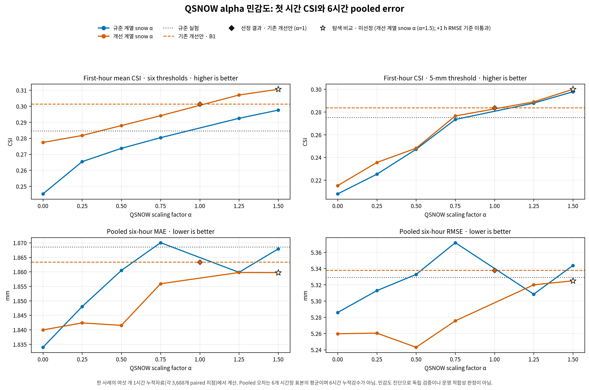
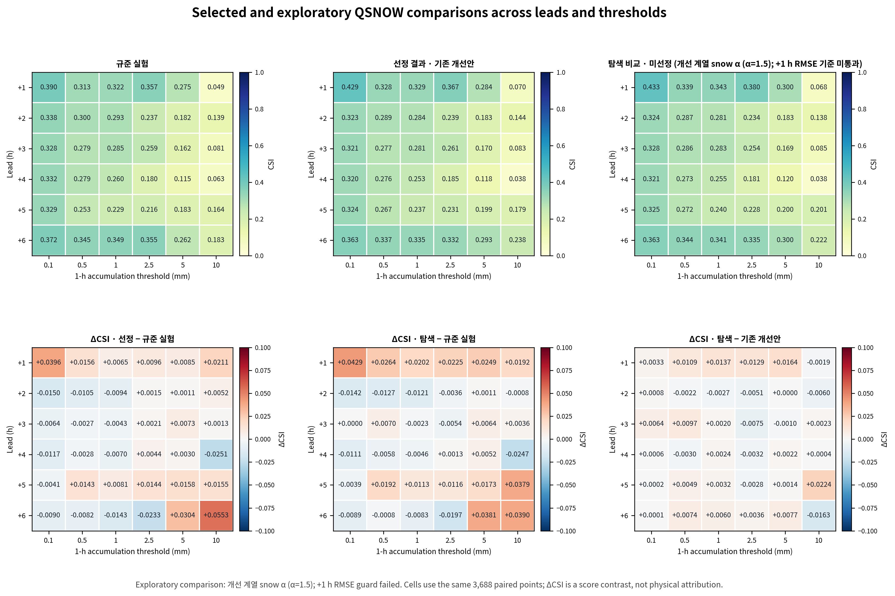
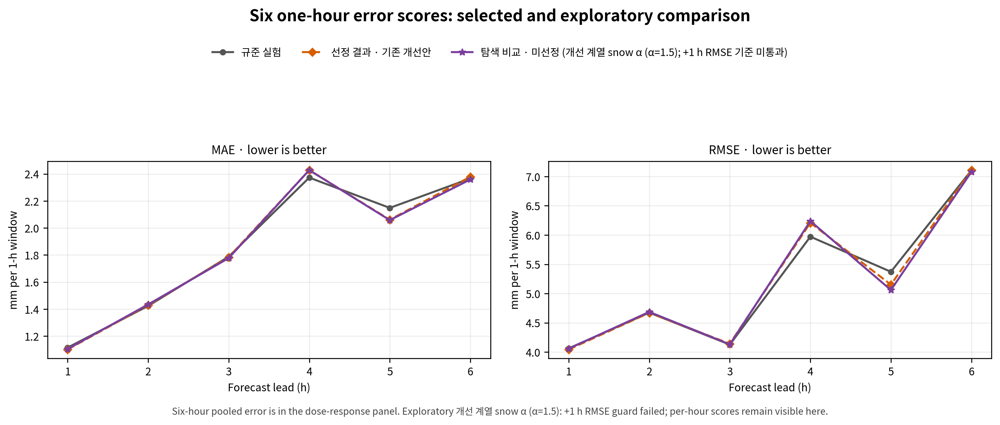
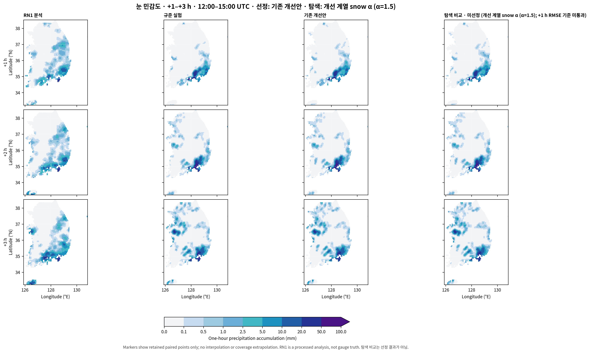
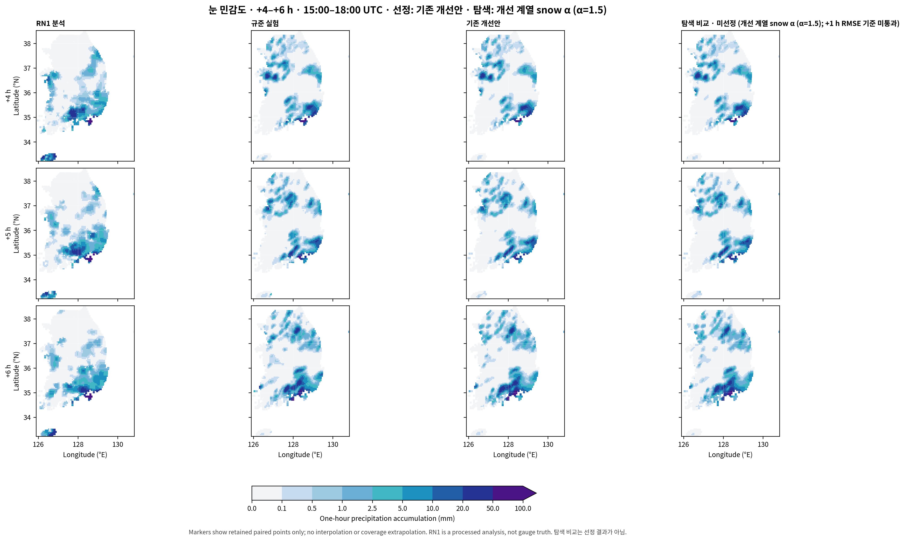

# 초기 눈 혼합비 민감도에 따른 1–6시간 강수예보 반응

## 초록

2026년 8월 16일 12 UTC 사례에서 규준 실험과 기존 개선안 B1 각각의 초기 눈 혼합비를 여섯 배율로 변화시켜 12개의 6시간 예보를 수행했다. 각 계열의 배율 1 대조군은 동일 입력 계보의 완료된 예보를 사용했다. 공통 RN1 평가점 3,688개에서 예측시간별 한 시간 강수량을 여섯 임계값으로 검증했다. 새 민감도 설정을 채택하지 않고 기존 개선안 B1을 유지한다. 해당 실험의 +1시간 여섯 임계값 평균 CSI는 0.3013, 6시간 전체 표본 RMSE는 5.3377 mm이다. 결과는 같은 사례에서 선정한 탐색적 민감도이며 독립 사례의 예측 성능을 입증하지 않는다.

## 1. 연구 목적

첫 시간 강수 악화의 원인을 좁히기 위해, 기존 개선안에도 눈 수종 민감도를 적용하고 규준 실험의 반응과 비교한다. 앞선 연구는 초기 수종 감소와 첫 미세물리 반응의 차이를 확인했으나, 초기 눈 양의 변화만으로 지상 강수 변화의 방향을 결정할 수 없었다. 본 실험은 눈 초기량에 대한 수치적 반응을 분리해 비교한다.

## 2. 실험 설계 및 수학적 정의

| 계열 | 배율 1의 대조군 | 실행파일 | 추가 배율 α |
| --- | --- | --- | --- |
| 규준 기반 | 규준 실험 (ORIGINAL) | 과거 CP02 WRF | 0, 0.25, 0.5, 0.75, 1.25, 1.5 |
| 개선본 기반 | 기존 개선안 B1 (IMPROVED_BG_FIXED) | 영 전환항 처리 수정 WRF | 0, 0.25, 0.5, 0.75, 1.25, 1.5 |

B1은 생산자 단계의 배경 강수 수종 보존과 WRF의 정확한 영 전환항 처리 수정을 결합한다. 따라서 두 계열 사이의 차이는 눈 배율 하나의 독립 효과가 아니다. 같은 계열 안에서 배율만 바꾼 비교가 눈 초기량 민감도에 해당한다. 기존 HYDRO는 참고 점수로 보존하되 최적 실험 선정에서는 제외한다.

초기장 조작은 $q_s^{(\alpha)}=\operatorname{REAL32}[\alpha\operatorname{REAL64}(q_s^{(1)})]$이다. QSNOW 이외 207개 변수와 메타데이터는 유지한다. 따라서 반올림 전 관계는 $\Delta q_{\mathrm{water}}=(\alpha-1)q_s^{(1)}$이며, 수증기·온도 등을 보상 조정하지 않는다. 이는 물과 에너지를 보존하는 초기화 정책이 아니라 초기 눈 양을 직접 증감하는 진단 실험이다.

검증량은 지상 눈 강수만이 아니라 누적 총강수 $C=RAINC+RAINNC$의 한 시간 증가량 $P_h=C(t_0+h)-C(t_0+h-1)$이다. +6시간 점수는 17–18 UTC 강수이며 6시간 누적강수 점수가 아니다. 기존과 동일한 네 모서리 보간·공통 지점·관측 자료를 사용한다.

적중 $H$, 누락 $M$, 오경보 $F$, 전체 지점 수 $N$에 대해 $CSI=H/(H+M+F)$, $POD=H/(H+M)$, $FAR=F/(H+F)$, $Bias=(H+F)/(H+M)$이다. 우연 적중 $H_r=(H+M)(H+F)/N$을 사용해 $ETS=(H-H_r)/(H+M+F-H_r)$를 계산한다.

오차 $e_i=f_i-o_i$에 대해 $MAE=N^{-1}\sum|e_i|$, $RMSE=\sqrt{N^{-1}\sum e_i^2}$이다. 6시간 전체 표본의 오차는 $MAE_{pool}=\sum_hN_hMAE_h/\sum_hN_h$, $RMSE_{pool}=\sqrt{\sum_hN_hRMSE_h^2/\sum_hN_h}$이다. 시간별 RMSE의 단순 평균을 사용하지 않는다.

### 2.1 결과 확인 전 고정한 선정 기준

기존 개선안 B1보다 +1시간 5 mm CSI가 낮지 않고, +1시간 RMSE와 6시간 전체 표본 MAE·RMSE가 높지 않은 실험만 선정 가능하다(비교 허용오차 10⁻¹²). 그중 +1시간 여섯 임계값 평균 CSI, +1시간 MAE, +1시간 RMSE, |α−1|, 실험 ID 순으로 결정한다. B1보다 높은 순위의 실험이 없으면 B1을 유지한다. 임계값 평균은 상관된 여섯 점수의 설계상 요약이며 독립적인 여섯 검증 사례가 아니다.

## 3. 결과

### 3.1 모든 민감도 실험의 비교

| 실험 | +1 h 평균 CSI | +1 h CSI ≥5 | +1 h MAE | +1 h RMSE | 전체 MAE | 전체 RMSE | 선정 조건 충족 |
| --- | --- | --- | --- | --- | --- | --- | --- |
| 규준 기반 α=0 | 0.2453 | 0.2078 | 1.1332 | 4.1072 | 1.8339 | 5.2859 | 아니오 |
| 규준 기반 α=0.25 | 0.2654 | 0.2252 | 1.1203 | 4.0817 | 1.8480 | 5.3128 | 아니오 |
| 규준 기반 α=0.5 | 0.2737 | 0.2471 | 1.1171 | 4.0662 | 1.8605 | 5.3327 | 아니오 |
| 규준 기반 α=0.75 | 0.2803 | 0.2734 | 1.1154 | 4.0630 | 1.8700 | 5.3718 | 아니오 |
| 규준 실험 | 0.2845 | 0.2751 | 1.1142 | 4.0623 | 1.8685 | 5.3290 | 아니오 |
| 규준 기반 α=1.25 | 0.2924 | 0.2878 | 1.1153 | 4.0772 | 1.8598 | 5.3084 | 아니오 |
| 규준 기반 α=1.5 | 0.2975 | 0.2978 | 1.1171 | 4.0869 | 1.8679 | 5.3438 | 아니오 |
| 개선본 기반 α=0 | 0.2773 | 0.2151 | 1.1060 | 4.0681 | 1.8399 | 5.2597 | 아니오 |
| 개선본 기반 α=0.25 | 0.2817 | 0.2355 | 1.1053 | 4.0617 | 1.8424 | 5.2605 | 아니오 |
| 개선본 기반 α=0.5 | 0.2879 | 0.2481 | 1.1034 | 4.0536 | 1.8415 | 5.2431 | 아니오 |
| 개선본 기반 α=0.75 | 0.2940 | 0.2765 | 1.1015 | 4.0435 | 1.8559 | 5.2757 | 아니오 |
| 기존 개선안 B1 | 0.3013 | 0.2836 | 1.1007 | 4.0441 | 1.8633 | 5.3377 | 예 |
| 개선본 기반 α=1.25 | 0.3069 | 0.2889 | 1.1017 | 4.0508 | 1.8597 | 5.3200 | 아니오 |
| 개선본 기반 α=1.5 | 0.3105 | 0.3000 | 1.1038 | 4.0579 | 1.8597 | 5.3249 | 아니오 |

새 민감도 설정을 채택하지 않고 기존 개선안 B1을 유지한다. 개선본 계열 내 최상위는 **기존 개선안 B1**이다. 각 배율의 전체 순위와 탈락 조건은 [선정 기록](evidence/snow_sensitivity_20261030/analysis/selection.json)에 공개한다.

조건 충족 여부를 무시한 +1시간 평균 CSI 최상위는 **개선본 기반 α=1.5 (탐색·미선정)**이다. 평균 CSI는 B1의 0.3013에서 0.3105, +1시간 RMSE는 4.0441에서 4.0579 mm로 변했다. 아래 시간별 표와 분포도에는 이 탐색 비교도 포함하지만 공식 선정 결과와 구분한다. **미충족 조건: +1시간 RMSE ≤ B1.** +1시간 5 mm에서 B1 대비 새 적중 5개, 적중 소실 0개, 새 오경보 2개, 오경보 제거 0개다.

6시간 전체 표본 RMSE만 최소화하면 개선본 기반 α=0.5가 5.2431 mm로 가장 작다. 그러나 해당 실험의 +1시간 5 mm CSI는 0.2481이다. 첫 시간 사건 검출과 전체 강수량 오차의 최적 설정은 같지 않으며, 한 지표의 최솟값을 사전 선정 기준과 혼동하지 않는다.

### 3.2 예측시간·임계값별 CSI

| 예측시간 | 실험 | ≥0.1 mm | ≥0.5 mm | ≥1 mm | ≥2.5 mm | ≥5 mm | ≥10 mm |
| --- | --- | --- | --- | --- | --- | --- | --- |
| +1 h | 규준 실험 | 0.3898 | 0.3129 | 0.3224 | 0.3575 | 0.2751 | 0.0493 |
| +1 h | 기존 개선안 B1 | 0.4294 | 0.3284 | 0.3289 | 0.3670 | 0.2836 | 0.0704 |
| +1 h | 개선본 기반 α=1.5 (탐색·미선정) | 0.4327 | 0.3393 | 0.3426 | 0.3799 | 0.3000 | 0.0685 |
| +2 h | 규준 실험 | 0.3381 | 0.2996 | 0.2933 | 0.2372 | 0.1815 | 0.1386 |
| +2 h | 기존 개선안 B1 | 0.3231 | 0.2891 | 0.2839 | 0.2387 | 0.1827 | 0.1437 |
| +2 h | 개선본 기반 α=1.5 (탐색·미선정) | 0.3239 | 0.2869 | 0.2812 | 0.2336 | 0.1827 | 0.1377 |
| +3 h | 규준 실험 | 0.3276 | 0.2793 | 0.2853 | 0.2593 | 0.1622 | 0.0814 |
| +3 h | 기존 개선안 B1 | 0.3212 | 0.2765 | 0.2810 | 0.2614 | 0.1696 | 0.0827 |
| +3 h | 개선본 기반 α=1.5 (탐색·미선정) | 0.3277 | 0.2862 | 0.2830 | 0.2539 | 0.1686 | 0.0850 |
| +4 h | 규준 실험 | 0.3317 | 0.2790 | 0.2597 | 0.1802 | 0.1148 | 0.0629 |
| +4 h | 기존 개선안 B1 | 0.3200 | 0.2762 | 0.2527 | 0.1846 | 0.1178 | 0.0378 |
| +4 h | 개선본 기반 α=1.5 (탐색·미선정) | 0.3206 | 0.2732 | 0.2551 | 0.1814 | 0.1200 | 0.0382 |
| +5 h | 규준 실험 | 0.3285 | 0.2531 | 0.2291 | 0.2162 | 0.1831 | 0.1636 |
| +5 h | 기존 개선안 B1 | 0.3244 | 0.2674 | 0.2372 | 0.2306 | 0.1989 | 0.1791 |
| +5 h | 개선본 기반 α=1.5 (탐색·미선정) | 0.3246 | 0.2723 | 0.2404 | 0.2278 | 0.2004 | 0.2015 |
| +6 h | 규준 실험 | 0.3722 | 0.3449 | 0.3490 | 0.3552 | 0.2623 | 0.1828 |
| +6 h | 기존 개선안 B1 | 0.3632 | 0.3367 | 0.3347 | 0.3319 | 0.2927 | 0.2381 |
| +6 h | 개선본 기반 α=1.5 (탐색·미선정) | 0.3633 | 0.3441 | 0.3407 | 0.3355 | 0.3004 | 0.2218 |

### 3.3 예측시간별 강수량 오차 (mm)

| 예측시간 | 실험 | MAE | RMSE | 평균오차 |
| --- | --- | --- | --- | --- |
| +1 h | 규준 실험 | 1.1142 | 4.0623 | 0.0097 |
| +1 h | 기존 개선안 B1 | 1.1007 | 4.0441 | 0.0246 |
| +1 h | 개선본 기반 α=1.5 (탐색·미선정) | 1.1038 | 4.0579 | 0.0605 |
| +2 h | 규준 실험 | 1.4227 | 4.6739 | 0.0513 |
| +2 h | 기존 개선안 B1 | 1.4294 | 4.6698 | 0.0511 |
| +2 h | 개선본 기반 α=1.5 (탐색·미선정) | 1.4338 | 4.6856 | 0.0480 |
| +3 h | 규준 실험 | 1.7876 | 4.1263 | -0.1279 |
| +3 h | 기존 개선안 B1 | 1.7828 | 4.1417 | -0.1321 |
| +3 h | 개선본 기반 α=1.5 (탐색·미선정) | 1.7768 | 4.1308 | -0.1268 |
| +4 h | 규준 실험 | 2.3724 | 5.9718 | -0.2319 |
| +4 h | 기존 개선안 B1 | 2.4279 | 6.2090 | -0.2477 |
| +4 h | 개선본 기반 α=1.5 (탐색·미선정) | 2.4277 | 6.2381 | -0.2550 |
| +5 h | 규준 실험 | 2.1482 | 5.3715 | -0.2500 |
| +5 h | 기존 개선안 B1 | 2.0606 | 5.1513 | -0.2728 |
| +5 h | 개선본 기반 α=1.5 (탐색·미선정) | 2.0577 | 5.0602 | -0.2389 |
| +6 h | 규준 실험 | 2.3661 | 7.1064 | 0.2695 |
| +6 h | 기존 개선안 B1 | 2.3785 | 7.1093 | 0.3210 |
| +6 h | 개선본 기반 α=1.5 (탐색·미선정) | 2.3585 | 7.0796 | 0.3178 |

기존 개선안 B1: 규준 실험 대비 CSI 36개 조합 중 21개 개선, 0개 동일, 15개 악화다. MAE 악화 예측시간은 2, 4, 6, RMSE 악화 예측시간은 3, 4, 6이다(시간 단위).

개선본 기반 α=1.5 (탐색·미선정): 규준 실험 대비 CSI 36개 조합 중 20개 개선, 0개 동일, 16개 악화다. MAE 악화 예측시간은 2, 4, RMSE 악화 예측시간은 2, 3, 4이다(시간 단위).

개선본 기반 α=1.5 (탐색·미선정): 기존 개선안 B1 대비 CSI 36개 조합 중 24개 개선, 1개 동일, 11개 악화다. MAE 악화 예측시간은 1, 2, RMSE 악화 예측시간은 1, 2, 4이다(시간 단위).

### 3.4 시간별 강수 분포

공통 평가점과 같은 색 구간으로 비교한다. RN1 지점 사이를 추가 보간하지 않으며 자료 coverage를 확정한 지도로 해석하지 않는다.

## 4. 기상학적 의미 및 논의

초기 눈 혼합비 변화는 얼음상 수상체의 저장량을 바꾼다. 이후 융해·승화·낙하·수송 및 열역학 반응이 지상 총강수에 영향을 줄 수 있으나, 본 실험의 점수와 분포만으로 개별 과정의 기여를 분리할 수 없다. 눈을 줄이면 지상 강수가 반드시 줄거나 예측이 반드시 개선된다는 단조 관계를 가정하지 않는다. 계열별 배율 반응과 적중·오경보 전이를 함께 판단해야 한다.

다음 개념도는 가능한 반응 경로를 정리한 것으로, 이번 실험에서 과정별 기여를 직접 계측했다는 뜻이 아니다.

같은 배율도 두 계열의 절대 초기 눈 양과 다른 초기 상태가 달라 같은 질량 변화가 아니다. 단순 격자 혼합비 합은 층별 건조 질량·면적을 가중한 눈 질량이 아니다. 정확한 물·에너지 수지와 강수 flux를 확보하기 전에는 이 진단 설정을 보존적인 물리 수정으로 채택할 수 없다.

전체 표본 오차 조건을 충족해도 모든 시간·임계값이 좋아지는 것은 아니다. 동일 사례에서 배율을 선택했으므로 선택 편향이 있으며, 독립 사례와 다른 계절·강수계에서의 검증이 필요하다. RN1 상류 시각·coverage·QC의 미확정 범위와 C2 안정성 과제도 별도로 남는다.

## 5. 결론

새 민감도 설정을 채택하지 않고 기존 개선안 B1을 유지한다. 개선본 계열의 우선 비교 대상도 기존 개선안 B1이다. 이 결과를 토대로 과정별 반응과 보존적인 초기화 구현을 검증한 뒤 독립 강수 사례로 평가해야 한다.

## 자료 및 재현성

[사전 선정 계획](evidence/snow_sensitivity_20261030/selection_plan.json) · [전체 시간·임계값 점수](evidence/snow_sensitivity_20261030/analysis/categorical_scores.csv) · [시간별 오차](evidence/snow_sensitivity_20261030/analysis/continuous_scores.csv) · [적중·오경보 전이](evidence/snow_sensitivity_20261030/analysis/transitions.csv) · [분석 영수증](evidence/snow_sensitivity_20261030/analysis/receipt.json)

## 부록. ETS

| 예측시간 | 실험 | ≥0.1 mm | ≥0.5 mm | ≥1 mm | ≥2.5 mm | ≥5 mm | ≥10 mm |
| --- | --- | --- | --- | --- | --- | --- | --- |
| +1 h | 규준 실험 | 0.2535 | 0.2211 | 0.2570 | 0.3194 | 0.2532 | 0.0396 |
| +1 h | 기존 개선안 B1 | 0.2799 | 0.2334 | 0.2628 | 0.3290 | 0.2617 | 0.0606 |
| +1 h | 개선본 기반 α=1.5 (탐색·미선정) | 0.2826 | 0.2425 | 0.2749 | 0.3415 | 0.2780 | 0.0585 |
| +2 h | 규준 실험 | 0.1233 | 0.1868 | 0.2237 | 0.1995 | 0.1561 | 0.1262 |
| +2 h | 기존 개선안 B1 | 0.1057 | 0.1759 | 0.2138 | 0.2013 | 0.1574 | 0.1312 |
| +2 h | 개선본 기반 α=1.5 (탐색·미선정) | 0.1055 | 0.1739 | 0.2112 | 0.1961 | 0.1574 | 0.1253 |
| +3 h | 규준 실험 | 0.0575 | 0.1237 | 0.1828 | 0.1936 | 0.1208 | 0.0623 |
| +3 h | 기존 개선안 B1 | 0.0520 | 0.1216 | 0.1778 | 0.1969 | 0.1284 | 0.0638 |
| +3 h | 개선본 기반 α=1.5 (탐색·미선정) | 0.0566 | 0.1280 | 0.1779 | 0.1894 | 0.1278 | 0.0666 |
| +4 h | 규준 실험 | 0.0540 | 0.1057 | 0.1304 | 0.1021 | 0.0700 | 0.0421 |
| +4 h | 기존 개선안 B1 | 0.0436 | 0.1049 | 0.1268 | 0.1069 | 0.0734 | 0.0171 |
| +4 h | 개선본 기반 α=1.5 (탐색·미선정) | 0.0432 | 0.1011 | 0.1286 | 0.1034 | 0.0750 | 0.0177 |
| +5 h | 규준 실험 | 0.0555 | 0.0798 | 0.0997 | 0.1384 | 0.1366 | 0.1420 |
| +5 h | 기존 개선안 B1 | 0.0507 | 0.0909 | 0.1057 | 0.1509 | 0.1533 | 0.1579 |
| +5 h | 개선본 기반 α=1.5 (탐색·미선정) | 0.0494 | 0.0949 | 0.1079 | 0.1475 | 0.1542 | 0.1800 |
| +6 h | 규준 실험 | 0.0754 | 0.1496 | 0.2076 | 0.2723 | 0.2122 | 0.1620 |
| +6 h | 기존 개선안 B1 | 0.0712 | 0.1403 | 0.1904 | 0.2477 | 0.2437 | 0.2175 |
| +6 h | 개선본 기반 α=1.5 (탐색·미선정) | 0.0670 | 0.1468 | 0.1935 | 0.2507 | 0.2520 | 0.2007 |

## 부록. POD

| 예측시간 | 실험 | ≥0.1 mm | ≥0.5 mm | ≥1 mm | ≥2.5 mm | ≥5 mm | ≥10 mm |
| --- | --- | --- | --- | --- | --- | --- | --- |
| +1 h | 규준 실험 | 0.4030 | 0.3363 | 0.3717 | 0.4644 | 0.4805 | 0.1186 |
| +1 h | 기존 개선안 B1 | 0.4526 | 0.3548 | 0.3801 | 0.4758 | 0.4935 | 0.1695 |
| +1 h | 개선본 기반 α=1.5 (탐색·미선정) | 0.4564 | 0.3671 | 0.3983 | 0.4957 | 0.5260 | 0.1695 |
| +2 h | 규준 실험 | 0.4247 | 0.3567 | 0.3593 | 0.3029 | 0.2706 | 0.2911 |
| +2 h | 기존 개선안 B1 | 0.4115 | 0.3468 | 0.3506 | 0.3029 | 0.2706 | 0.3038 |
| +2 h | 개선본 기반 α=1.5 (탐색·미선정) | 0.4133 | 0.3441 | 0.3478 | 0.2977 | 0.2706 | 0.2911 |
| +3 h | 규준 실험 | 0.4968 | 0.3912 | 0.3861 | 0.3531 | 0.2464 | 0.1591 |
| +3 h | 기존 개선안 B1 | 0.4874 | 0.3869 | 0.3825 | 0.3514 | 0.2551 | 0.1591 |
| +3 h | 개선본 기반 α=1.5 (탐색·미선정) | 0.4981 | 0.4041 | 0.3896 | 0.3427 | 0.2522 | 0.1591 |
| +4 h | 규준 실험 | 0.5000 | 0.4018 | 0.3832 | 0.2826 | 0.1919 | 0.1091 |
| +4 h | 기존 개선안 B1 | 0.4833 | 0.3953 | 0.3673 | 0.2876 | 0.1948 | 0.0667 |
| +4 h | 개선본 기반 α=1.5 (탐색·미선정) | 0.4852 | 0.3928 | 0.3715 | 0.2843 | 0.2006 | 0.0667 |
| +5 h | 규준 실험 | 0.4691 | 0.3678 | 0.3492 | 0.3403 | 0.3152 | 0.2679 |
| +5 h | 기존 개선안 B1 | 0.4649 | 0.3906 | 0.3643 | 0.3682 | 0.3333 | 0.2857 |
| +5 h | 개선본 기반 α=1.5 (탐색·미선정) | 0.4667 | 0.3979 | 0.3708 | 0.3665 | 0.3394 | 0.3214 |
| +6 h | 규준 실험 | 0.5747 | 0.5172 | 0.5217 | 0.5319 | 0.4454 | 0.4113 |
| +6 h | 기존 개선안 B1 | 0.5557 | 0.5084 | 0.5103 | 0.5057 | 0.4828 | 0.5242 |
| +6 h | 개선본 기반 α=1.5 (탐색·미선정) | 0.5618 | 0.5204 | 0.5279 | 0.5139 | 0.4885 | 0.5081 |

## 부록. FAR

| 예측시간 | 실험 | ≥0.1 mm | ≥0.5 mm | ≥1 mm | ≥2.5 mm | ≥5 mm | ≥10 mm |
| --- | --- | --- | --- | --- | --- | --- | --- |
| +1 h | 규준 실험 | 0.0776 | 0.1820 | 0.2914 | 0.3918 | 0.6085 | 0.9222 |
| +1 h | 기존 개선안 B1 | 0.1066 | 0.1842 | 0.2906 | 0.3838 | 0.6000 | 0.8925 |
| +1 h | 개선본 기반 α=1.5 (탐색·미선정) | 0.1069 | 0.1824 | 0.2900 | 0.3808 | 0.5888 | 0.8969 |
| +2 h | 규준 실험 | 0.3762 | 0.3481 | 0.3852 | 0.4775 | 0.6446 | 0.7909 |
| +2 h | 기존 개선안 B1 | 0.3993 | 0.3651 | 0.4015 | 0.4703 | 0.6402 | 0.7857 |
| +2 h | 개선본 기반 α=1.5 (탐색·미선정) | 0.4003 | 0.3669 | 0.4049 | 0.4795 | 0.6402 | 0.7928 |
| +3 h | 규준 실험 | 0.5097 | 0.5060 | 0.4776 | 0.5061 | 0.6780 | 0.8571 |
| +3 h | 기존 개선안 B1 | 0.5148 | 0.5077 | 0.4857 | 0.4950 | 0.6641 | 0.8531 |
| +3 h | 개선본 기반 α=1.5 (탐색·미선정) | 0.5109 | 0.5048 | 0.4915 | 0.5051 | 0.6628 | 0.8456 |
| +4 h | 규준 실험 | 0.5037 | 0.5228 | 0.5538 | 0.6680 | 0.7778 | 0.8705 |
| +4 h | 기존 개선안 B1 | 0.5137 | 0.5218 | 0.5524 | 0.6600 | 0.7705 | 0.9197 |
| +4 h | 개선본 기반 α=1.5 (탐색·미선정) | 0.5142 | 0.5271 | 0.5513 | 0.6660 | 0.7700 | 0.9179 |
| +5 h | 규준 실험 | 0.4770 | 0.5520 | 0.6002 | 0.6279 | 0.6959 | 0.7039 |
| +5 h | 기존 개선안 B1 | 0.4823 | 0.5411 | 0.5954 | 0.6184 | 0.6697 | 0.6757 |
| +5 h | 개선본 기반 α=1.5 (탐색·미선정) | 0.4840 | 0.5369 | 0.5941 | 0.6243 | 0.6716 | 0.6494 |
| +6 h | 규준 실험 | 0.4863 | 0.4913 | 0.4868 | 0.4833 | 0.6106 | 0.7524 |
| +6 h | 기존 개선안 B1 | 0.4882 | 0.5008 | 0.5070 | 0.5087 | 0.5736 | 0.6963 |
| +6 h | 개선본 기반 α=1.5 (탐색·미선정) | 0.4931 | 0.4961 | 0.5101 | 0.5086 | 0.5619 | 0.7175 |

## 부록. frequency_bias

| 예측시간 | 실험 | ≥0.1 mm | ≥0.5 mm | ≥1 mm | ≥2.5 mm | ≥5 mm | ≥10 mm |
| --- | --- | --- | --- | --- | --- | --- | --- |
| +1 h | 규준 실험 | 0.4369 | 0.4111 | 0.5245 | 0.7635 | 1.2273 | 1.5254 |
| +1 h | 기존 개선안 B1 | 0.5066 | 0.4349 | 0.5358 | 0.7721 | 1.2338 | 1.5763 |
| +1 h | 개선본 기반 α=1.5 (탐색·미선정) | 0.5110 | 0.4489 | 0.5610 | 0.8006 | 1.2792 | 1.6441 |
| +2 h | 규준 실험 | 0.6809 | 0.5472 | 0.5844 | 0.5796 | 0.7615 | 1.3924 |
| +2 h | 기존 개선안 B1 | 0.6851 | 0.5463 | 0.5859 | 0.5718 | 0.7523 | 1.4177 |
| +2 h | 개선본 기반 α=1.5 (탐색·미선정) | 0.6893 | 0.5436 | 0.5844 | 0.5718 | 0.7523 | 1.4051 |
| +3 h | 규준 실험 | 1.0133 | 0.7919 | 0.7391 | 0.7150 | 0.7652 | 1.1136 |
| +3 h | 기존 개선안 B1 | 1.0044 | 0.7858 | 0.7438 | 0.6958 | 0.7594 | 1.0833 |
| +3 h | 개선본 기반 α=1.5 (탐색·미선정) | 1.0183 | 0.8161 | 0.7662 | 0.6923 | 0.7478 | 1.0303 |
| +4 h | 규준 실험 | 1.0074 | 0.8421 | 0.8588 | 0.8511 | 0.8634 | 0.8424 |
| +4 h | 기존 개선안 B1 | 0.9938 | 0.8265 | 0.8206 | 0.8460 | 0.8488 | 0.8303 |
| +4 h | 개선본 기반 α=1.5 (탐색·미선정) | 0.9988 | 0.8306 | 0.8280 | 0.8511 | 0.8721 | 0.8121 |
| +5 h | 규준 실험 | 0.8969 | 0.8210 | 0.8735 | 0.9145 | 1.0364 | 0.9048 |
| +5 h | 기존 개선안 B1 | 0.8981 | 0.8511 | 0.9005 | 0.9651 | 1.0091 | 0.8810 |
| +5 h | 개선본 기반 α=1.5 (탐색·미선정) | 0.9045 | 0.8592 | 0.9135 | 0.9756 | 1.0333 | 0.9167 |
| +6 h | 규준 실험 | 1.1187 | 1.0168 | 1.0165 | 1.0295 | 1.1437 | 1.6613 |
| +6 h | 기존 개선안 B1 | 1.0857 | 1.0184 | 1.0351 | 1.0295 | 1.1322 | 1.7258 |
| +6 h | 개선본 기반 α=1.5 (탐색·미선정) | 1.1083 | 1.0328 | 1.0775 | 1.0458 | 1.1149 | 1.7984 |
