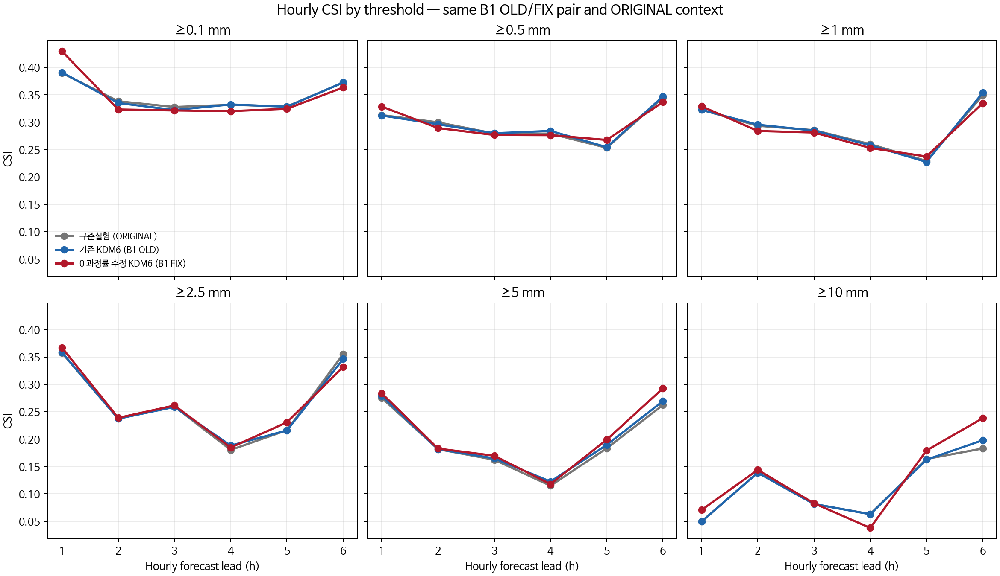
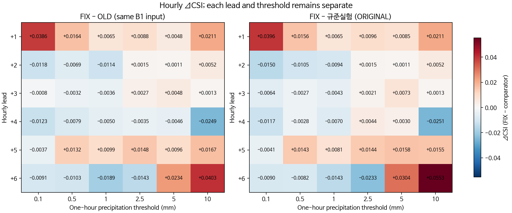
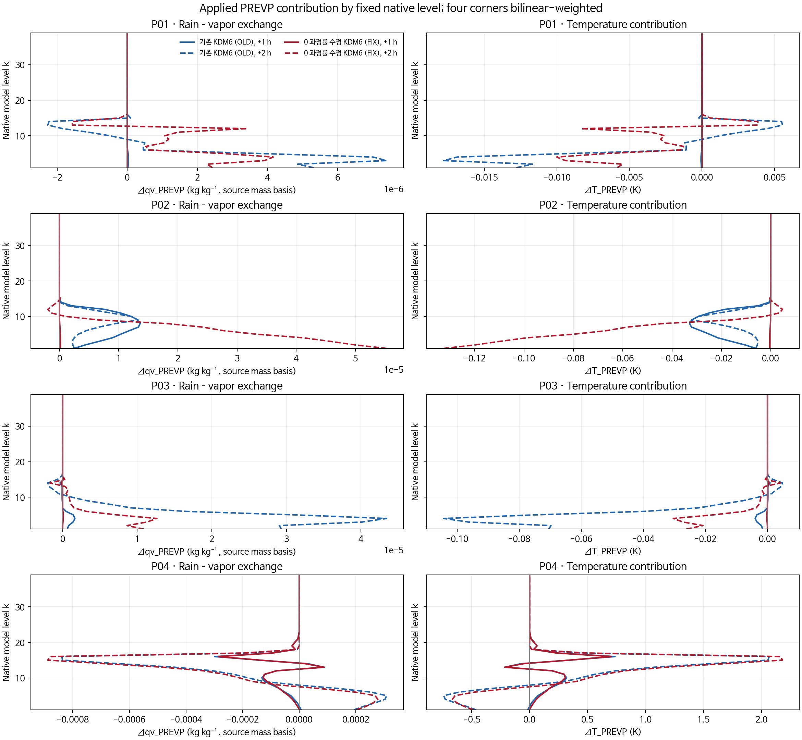
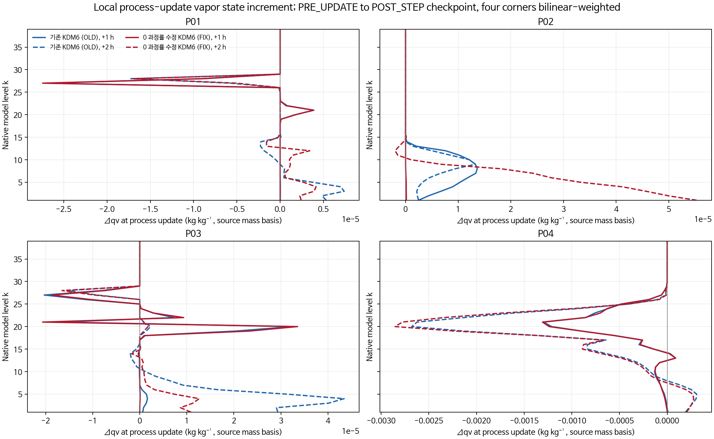
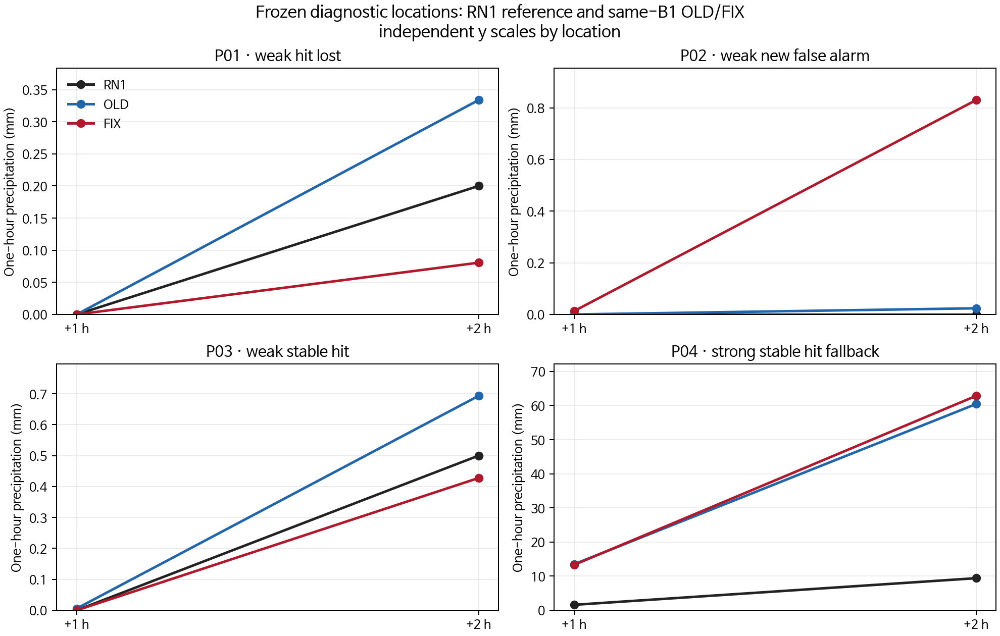
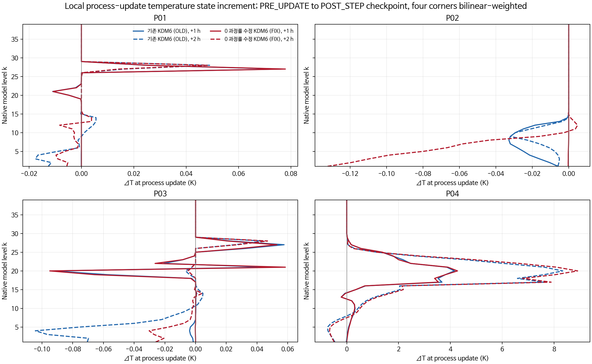
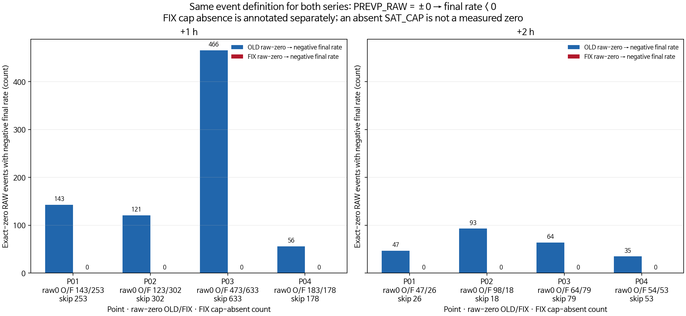
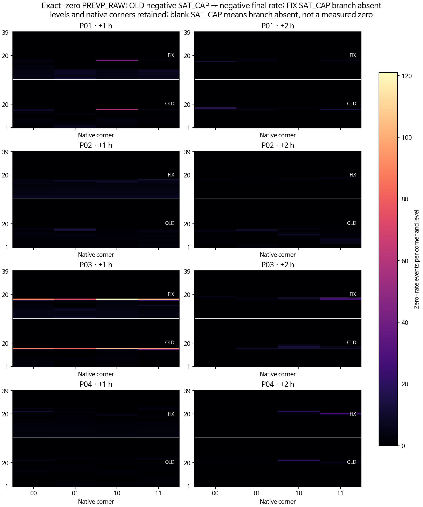

# B1 0–2시간 진단 그림 모음

모든 그림을 이 페이지에 직접 표시한다. 시간별 강수는 각 1시간 구간의 양이며, 과정 프로파일은 각 격자·층의 국지 진단이다. 새 개선 후보의 성능 판정 자료는 아니다.

[학회논문 형식 보고서](../../CP02_B1_TWO_HOUR_PROCESS_20261103.md) · [시간·임계값별 전체 표](tables/CSI_BY_LEAD_THRESHOLD.md)

## 예측시간·임계값별 절대 CSI

## 예측시간·임계값별 CSI 차이

## 비–수증기 교환 및 잠열 온도 기여

## 국지 수증기 과정 갱신량의 시간합

## 선택 지점 시간별 강수량

## 국지 온도 과정 갱신량의 시간합

## 동일 사건 정의의 0 과정률 전환 빈도

## 모서리·층별 영 과정률 사건 분포

