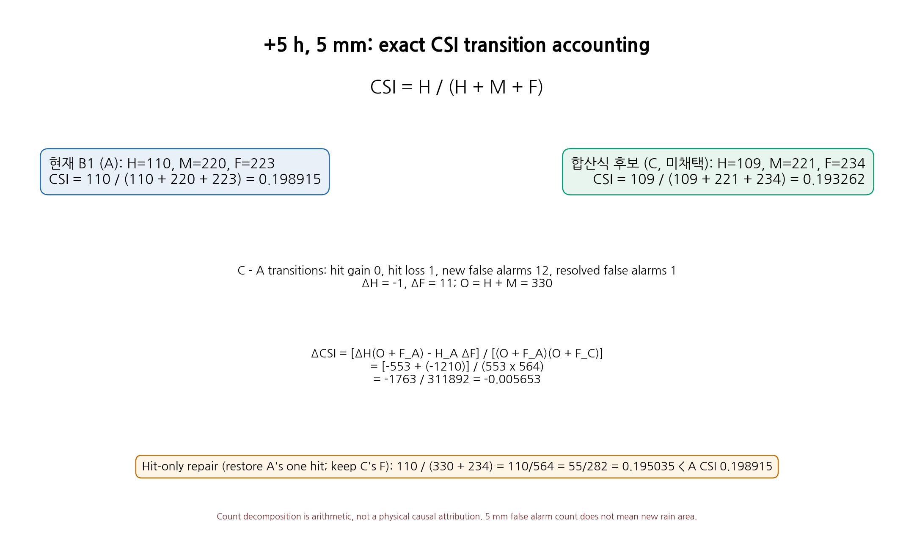
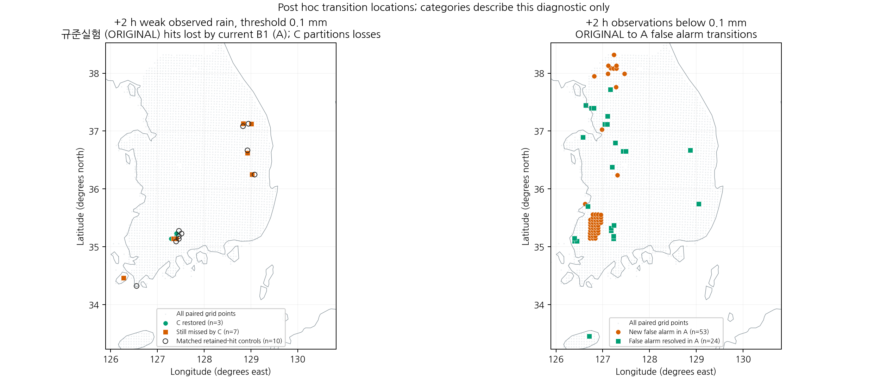
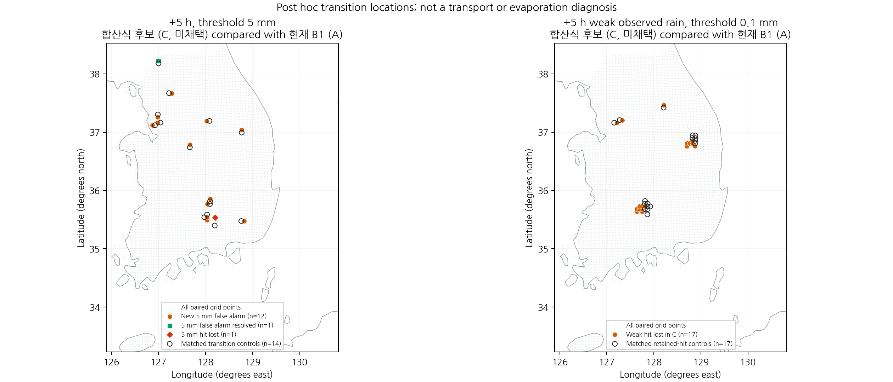
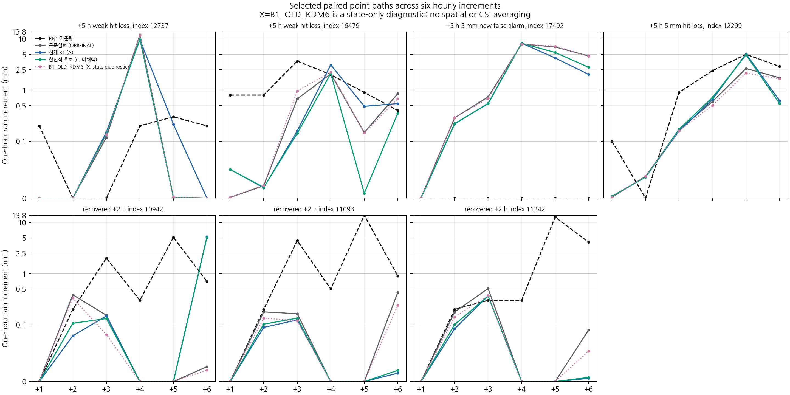
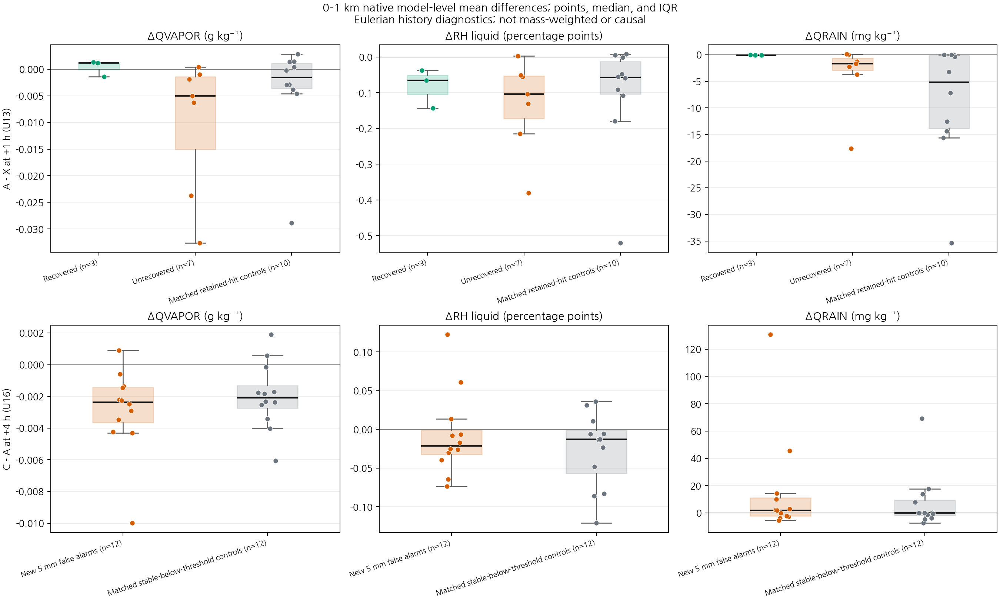

# CP02 failure-focus figures

All maps and point paths are post hoc diagnostics for the 2026-08-16 12 UTC initialization. Rain amounts are one-hour increments, not cumulative lead totals. Transition labels are not model initialization rules.

## Exact +5 h, 5 mm CSI and transition-count algebra.

## +2 h weak-hit and false-alarm transition locations.

## +5 h 5 mm and weak-hit transition locations.

## Selected paired-point one-hour precipitation paths from +1 through +6 h.

## 0–1 km native model-level moisture and rain mixing-ratio contrasts for frozen event groups and their matched controls.

