# 첫 빙정 단위 수정 후보: 전체 그림과 점수

초기시각 2026-08-16 12 UTC. 규준실험 ORIGINAL, 현재 B1, PR153 보존 침강 및 첫 빙정 단위 수정 후보를 비교합니다. RN1 공통 평가점 3,688개. 고정된 쌍선형 가중치로 WRF 네 모서리를 RN1 평가점에 대응하며, 그림에서 평가점 사이를 추가로 공간보간하지 않습니다. CSI 그림의 세로축 범위는 임계값마다 다릅니다. 첫 빙정 단위 수정 후보 21/26 조건 충족, 미채택 · 현재 B1 유지.

[전체 점수표](evaluation/results/FULL_SCORES.md)

## 0.1 mm 이상 시간별 CSI

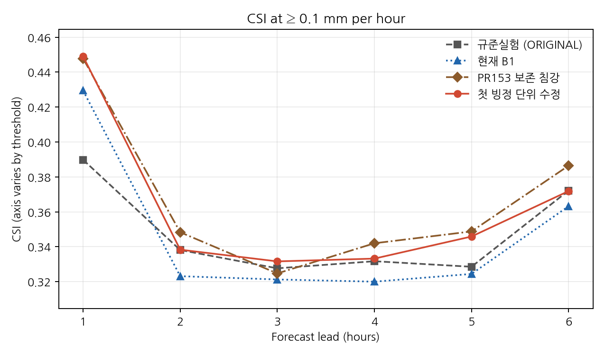

## 0.5 mm 이상 시간별 CSI

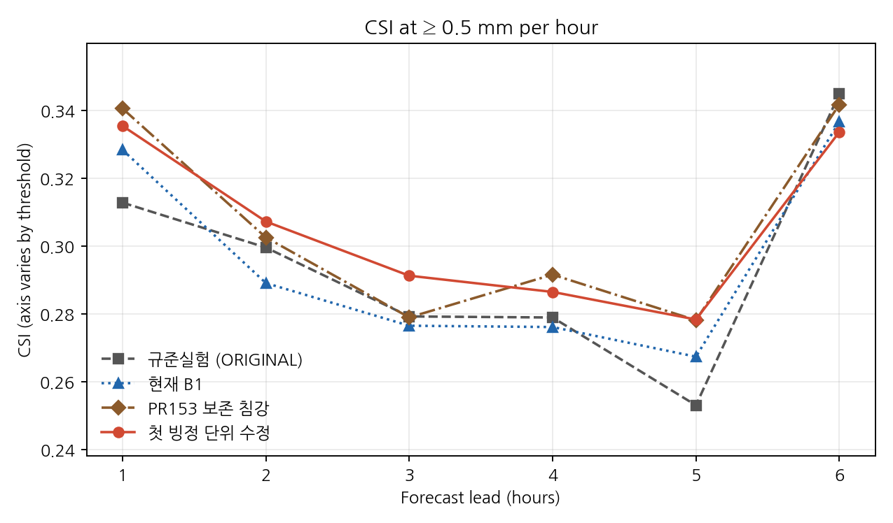

## 1 mm 이상 시간별 CSI

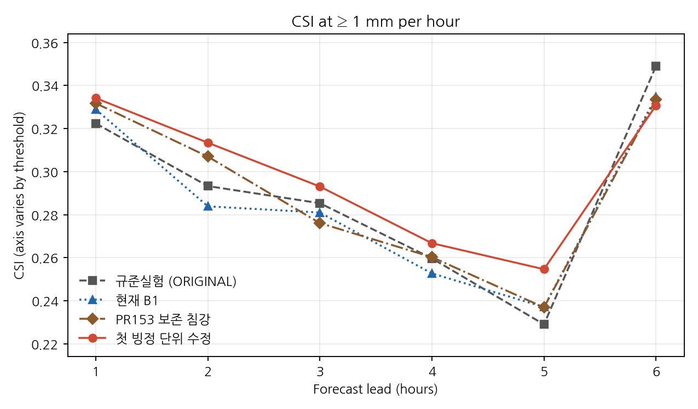

## 2.5 mm 이상 시간별 CSI

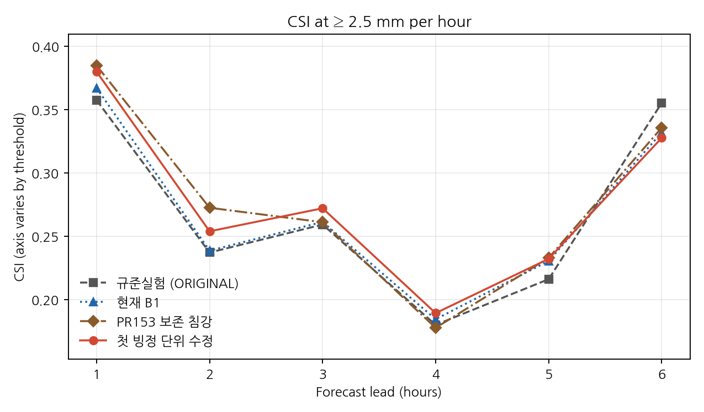

## 5 mm 이상 시간별 CSI

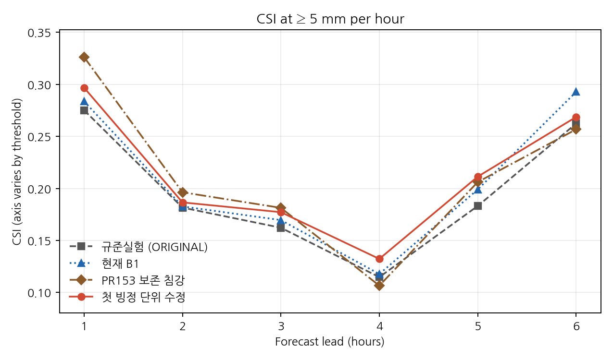

## 10 mm 이상 시간별 CSI

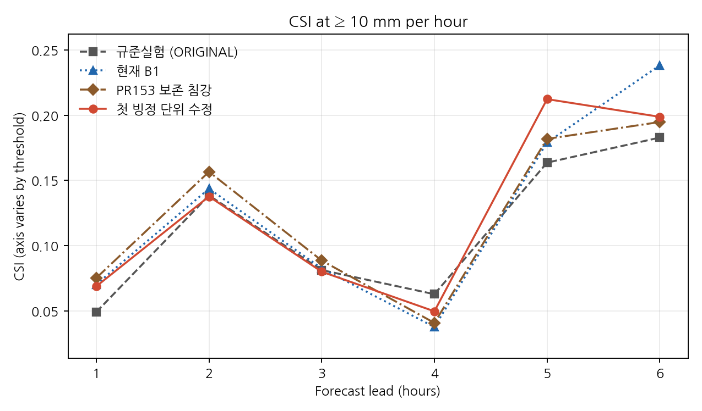

## +1시간: 12–13 UTC 한 시간 강수

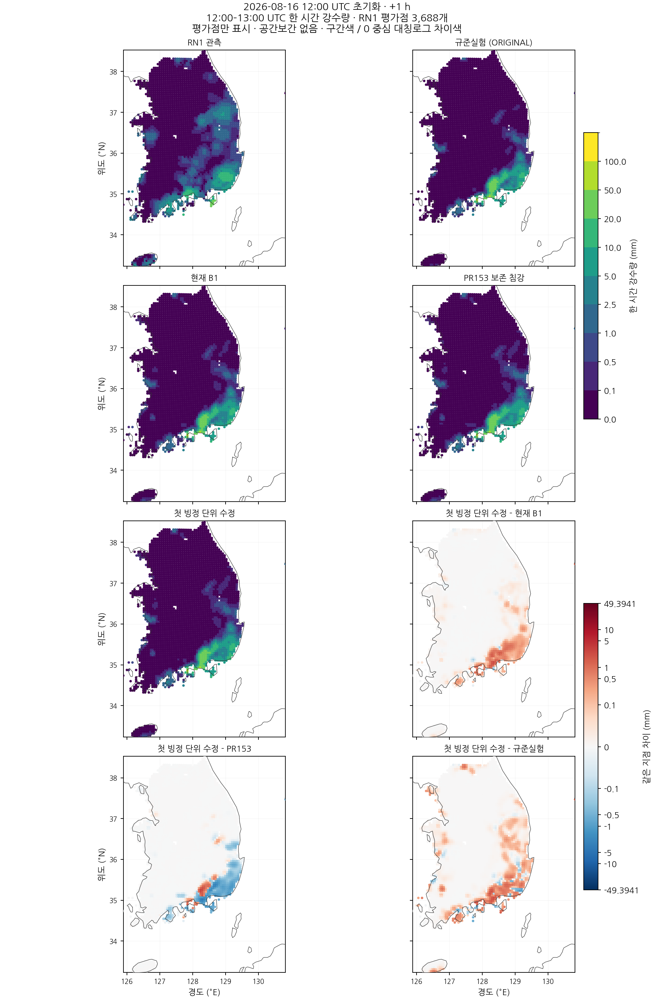

## +2시간: 13–14 UTC 한 시간 강수

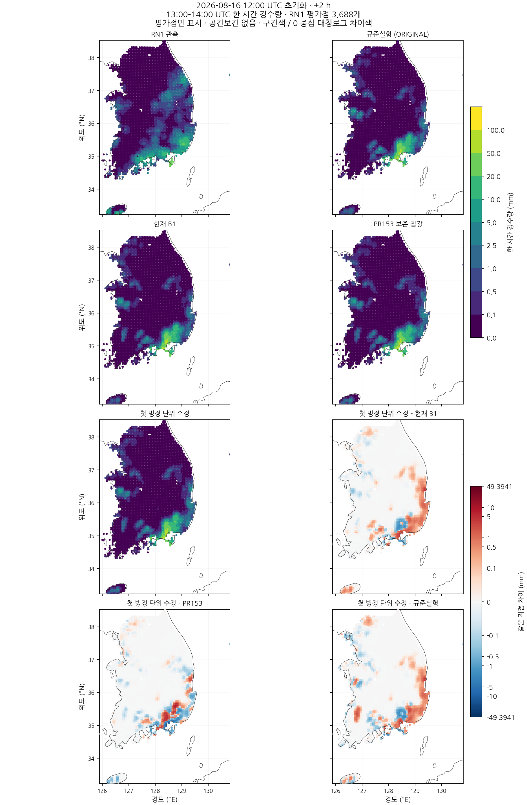

## +3시간: 14–15 UTC 한 시간 강수

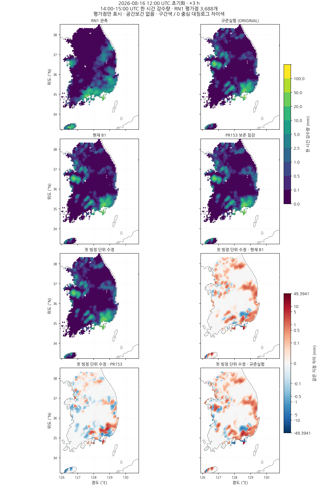

## +4시간: 15–16 UTC 한 시간 강수

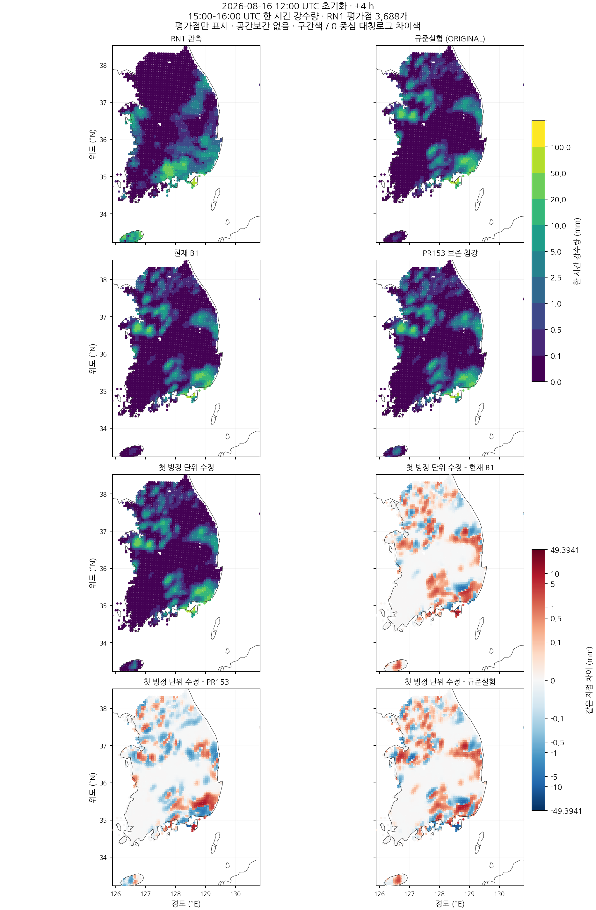

## +5시간: 16–17 UTC 한 시간 강수

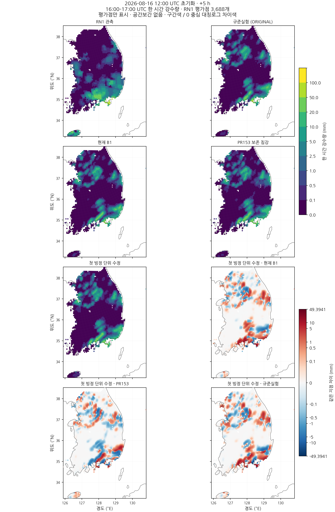

## +6시간: 17–18 UTC 한 시간 강수

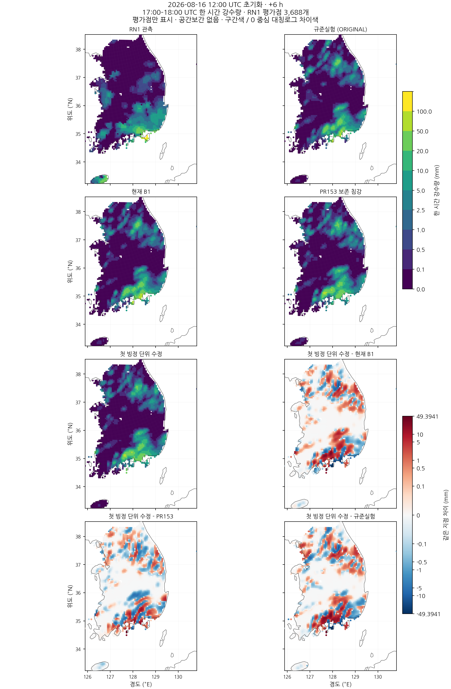

## categorical_scores.csv

[CSV 다운로드](evaluation/results/categorical_scores.csv)

| lead_hour | threshold_mm | case | points | hit | miss | false_alarm | CSI |
| --- | --- | --- | --- | --- | --- | --- | --- |
| 1 | 0.1 | ORIGINAL | 3688 | 642 | 951 | 54 | 0.38979963570127507 |
| 1 | 0.5 | ORIGINAL | 3688 | 382 | 754 | 85 | 0.31285831285831284 |
| 1 | 1.0 | ORIGINAL | 3688 | 265 | 448 | 109 | 0.3223844282238443 |
| 1 | 2.5 | ORIGINAL | 3688 | 163 | 188 | 105 | 0.3574561403508772 |
| 1 | 5.0 | ORIGINAL | 3688 | 74 | 80 | 115 | 0.275092936802974 |
| 1 | 10.0 | ORIGINAL | 3688 | 7 | 52 | 83 | 0.04929577464788732 |
| 1 | 0.1 | IMPROVED_BG_FIXED | 3688 | 721 | 872 | 86 | 0.42942227516378795 |
| 1 | 0.5 | IMPROVED_BG_FIXED | 3688 | 403 | 733 | 91 | 0.3284433577832111 |
| 1 | 1.0 | IMPROVED_BG_FIXED | 3688 | 271 | 442 | 111 | 0.3288834951456311 |
| 1 | 2.5 | IMPROVED_BG_FIXED | 3688 | 167 | 184 | 104 | 0.367032967032967 |
| 1 | 5.0 | IMPROVED_BG_FIXED | 3688 | 76 | 78 | 114 | 0.2835820895522388 |
| 1 | 10.0 | IMPROVED_BG_FIXED | 3688 | 10 | 49 | 83 | 0.07042253521126761 |
| 1 | 0.1 | CONSERVATIVE_SEDIMENTATION | 3688 | 759 | 834 | 102 | 0.44778761061946903 |
| 1 | 0.5 | CONSERVATIVE_SEDIMENTATION | 3688 | 420 | 716 | 97 | 0.340632603406326 |
| 1 | 1.0 | CONSERVATIVE_SEDIMENTATION | 3688 | 278 | 435 | 125 | 0.3317422434367542 |
| 1 | 2.5 | CONSERVATIVE_SEDIMENTATION | 3688 | 177 | 174 | 109 | 0.3847826086956522 |
| 1 | 5.0 | CONSERVATIVE_SEDIMENTATION | 3688 | 90 | 64 | 122 | 0.32608695652173914 |
| 1 | 10.0 | CONSERVATIVE_SEDIMENTATION | 3688 | 11 | 48 | 87 | 0.07534246575342465 |
| 1 | 0.1 | FIRST_ICE_VELOCITY | 3688 | 758 | 835 | 95 | 0.4490521327014218 |
| 1 | 0.5 | FIRST_ICE_VELOCITY | 3688 | 413 | 723 | 95 | 0.33549959382615757 |
| 1 | 1.0 | FIRST_ICE_VELOCITY | 3688 | 276 | 437 | 113 | 0.3341404358353511 |
| 1 | 2.5 | FIRST_ICE_VELOCITY | 3688 | 174 | 177 | 107 | 0.3799126637554585 |
| 1 | 5.0 | FIRST_ICE_VELOCITY | 3688 | 81 | 73 | 119 | 0.2967032967032967 |
| 1 | 10.0 | FIRST_ICE_VELOCITY | 3688 | 10 | 49 | 86 | 0.06896551724137931 |
| 2 | 0.1 | ORIGINAL | 3688 | 708 | 959 | 427 | 0.33810888252148996 |
| 2 | 0.5 | ORIGINAL | 3688 | 397 | 716 | 212 | 0.29962264150943396 |
| 2 | 1.0 | ORIGINAL | 3688 | 249 | 444 | 156 | 0.29328621908127206 |
| 2 | 2.5 | ORIGINAL | 3688 | 116 | 267 | 106 | 0.23721881390593047 |
| 2 | 5.0 | ORIGINAL | 3688 | 59 | 159 | 107 | 0.18153846153846154 |
| 2 | 10.0 | ORIGINAL | 3688 | 23 | 56 | 87 | 0.13855421686746988 |
| 2 | 0.1 | IMPROVED_BG_FIXED | 3688 | 686 | 981 | 456 | 0.32312764955252005 |
| 2 | 0.5 | IMPROVED_BG_FIXED | 3688 | 386 | 727 | 222 | 0.2891385767790262 |
| 2 | 1.0 | IMPROVED_BG_FIXED | 3688 | 243 | 450 | 163 | 0.2838785046728972 |
| 2 | 2.5 | IMPROVED_BG_FIXED | 3688 | 116 | 267 | 103 | 0.23868312757201646 |
| 2 | 5.0 | IMPROVED_BG_FIXED | 3688 | 59 | 159 | 105 | 0.1826625386996904 |
| 2 | 10.0 | IMPROVED_BG_FIXED | 3688 | 24 | 55 | 88 | 0.1437125748502994 |
| 2 | 0.1 | CONSERVATIVE_SEDIMENTATION | 3688 | 745 | 922 | 472 | 0.3482935951379149 |
| 2 | 0.5 | CONSERVATIVE_SEDIMENTATION | 3688 | 407 | 706 | 232 | 0.3026022304832714 |
| 2 | 1.0 | CONSERVATIVE_SEDIMENTATION | 3688 | 268 | 425 | 180 | 0.30698739977090495 |
| 2 | 2.5 | CONSERVATIVE_SEDIMENTATION | 3688 | 136 | 247 | 116 | 0.2725450901803607 |
| 2 | 5.0 | CONSERVATIVE_SEDIMENTATION | 3688 | 63 | 155 | 103 | 0.19626168224299065 |
| 2 | 10.0 | CONSERVATIVE_SEDIMENTATION | 3688 | 26 | 53 | 87 | 0.1566265060240964 |
| 2 | 0.1 | FIRST_ICE_VELOCITY | 3688 | 724 | 943 | 473 | 0.3383177570093458 |
| 2 | 0.5 | FIRST_ICE_VELOCITY | 3688 | 413 | 700 | 231 | 0.3072916666666667 |
| 2 | 1.0 | FIRST_ICE_VELOCITY | 3688 | 273 | 420 | 178 | 0.31343283582089554 |
| 2 | 2.5 | FIRST_ICE_VELOCITY | 3688 | 128 | 255 | 121 | 0.25396825396825395 |
| 2 | 5.0 | FIRST_ICE_VELOCITY | 3688 | 61 | 157 | 109 | 0.18654434250764526 |
| 2 | 10.0 | FIRST_ICE_VELOCITY | 3688 | 23 | 56 | 88 | 0.1377245508982036 |
| 3 | 0.1 | ORIGINAL | 3688 | 786 | 796 | 817 | 0.3276365152146728 |
| 3 | 0.5 | ORIGINAL | 3688 | 453 | 705 | 464 | 0.2792848335388409 |
| 3 | 1.0 | ORIGINAL | 3688 | 327 | 520 | 299 | 0.28534031413612565 |
| 3 | 2.5 | ORIGINAL | 3688 | 202 | 370 | 207 | 0.2593068035943517 |
| 3 | 5.0 | ORIGINAL | 3688 | 85 | 260 | 179 | 0.16221374045801526 |
| 3 | 10.0 | ORIGINAL | 3688 | 21 | 111 | 126 | 0.08139534883720931 |
| 3 | 0.1 | IMPROVED_BG_FIXED | 3688 | 771 | 811 | 818 | 0.32125 |
| 3 | 0.5 | IMPROVED_BG_FIXED | 3688 | 448 | 710 | 462 | 0.2765432098765432 |
| 3 | 1.0 | IMPROVED_BG_FIXED | 3688 | 324 | 523 | 306 | 0.2810060711188205 |
| 3 | 2.5 | IMPROVED_BG_FIXED | 3688 | 201 | 371 | 197 | 0.2613784135240572 |
| 3 | 5.0 | IMPROVED_BG_FIXED | 3688 | 88 | 257 | 174 | 0.16955684007707128 |
| 3 | 10.0 | IMPROVED_BG_FIXED | 3688 | 21 | 111 | 122 | 0.08267716535433071 |
| 3 | 0.1 | CONSERVATIVE_SEDIMENTATION | 3688 | 815 | 767 | 928 | 0.3247011952191235 |
| 3 | 0.5 | CONSERVATIVE_SEDIMENTATION | 3688 | 481 | 677 | 566 | 0.2790023201856148 |
| 3 | 1.0 | CONSERVATIVE_SEDIMENTATION | 3688 | 349 | 498 | 417 | 0.27610759493670883 |
| 3 | 2.5 | CONSERVATIVE_SEDIMENTATION | 3688 | 205 | 367 | 213 | 0.2611464968152866 |
| 3 | 5.0 | CONSERVATIVE_SEDIMENTATION | 3688 | 95 | 250 | 179 | 0.18129770992366412 |
| 3 | 10.0 | CONSERVATIVE_SEDIMENTATION | 3688 | 22 | 110 | 116 | 0.08870967741935484 |
| 3 | 0.1 | FIRST_ICE_VELOCITY | 3688 | 829 | 753 | 918 | 0.3316 |
| 3 | 0.5 | FIRST_ICE_VELOCITY | 3688 | 499 | 659 | 555 | 0.29130180969060127 |
| 3 | 1.0 | FIRST_ICE_VELOCITY | 3688 | 364 | 483 | 395 | 0.29307568438003223 |
| 3 | 2.5 | FIRST_ICE_VELOCITY | 3688 | 215 | 357 | 218 | 0.2721518987341772 |
| 3 | 5.0 | FIRST_ICE_VELOCITY | 3688 | 93 | 252 | 180 | 0.17714285714285713 |
| 3 | 10.0 | FIRST_ICE_VELOCITY | 3688 | 21 | 111 | 130 | 0.08015267175572519 |
| 4 | 0.1 | ORIGINAL | 3688 | 810 | 810 | 822 | 0.3316953316953317 |
| 4 | 0.5 | ORIGINAL | 3688 | 491 | 731 | 538 | 0.27897727272727274 |
| 4 | 1.0 | ORIGINAL | 3688 | 361 | 581 | 448 | 0.25971223021582734 |
| 4 | 2.5 | ORIGINAL | 3688 | 167 | 424 | 336 | 0.18015102481121897 |
| 4 | 5.0 | ORIGINAL | 3688 | 66 | 278 | 231 | 0.11478260869565217 |
| 4 | 10.0 | ORIGINAL | 3688 | 18 | 147 | 121 | 0.06293706293706294 |
| 4 | 0.1 | IMPROVED_BG_FIXED | 3688 | 783 | 837 | 827 | 0.319983653453208 |
| 4 | 0.5 | IMPROVED_BG_FIXED | 3688 | 483 | 739 | 527 | 0.27615780445969124 |
| 4 | 1.0 | IMPROVED_BG_FIXED | 3688 | 346 | 596 | 427 | 0.2527392257121987 |
| 4 | 2.5 | IMPROVED_BG_FIXED | 3688 | 170 | 421 | 330 | 0.18458197611292074 |
| 4 | 5.0 | IMPROVED_BG_FIXED | 3688 | 67 | 277 | 225 | 0.11775043936731107 |
| 4 | 10.0 | IMPROVED_BG_FIXED | 3688 | 11 | 154 | 126 | 0.037800687285223365 |
| 4 | 0.1 | CONSERVATIVE_SEDIMENTATION | 3688 | 870 | 750 | 924 | 0.3419811320754717 |
| 4 | 0.5 | CONSERVATIVE_SEDIMENTATION | 3688 | 529 | 693 | 592 | 0.2916207276736494 |
| 4 | 1.0 | CONSERVATIVE_SEDIMENTATION | 3688 | 373 | 569 | 491 | 0.2602930914166085 |
| 4 | 2.5 | CONSERVATIVE_SEDIMENTATION | 3688 | 170 | 421 | 365 | 0.17782426778242677 |
| 4 | 5.0 | CONSERVATIVE_SEDIMENTATION | 3688 | 63 | 281 | 247 | 0.1065989847715736 |
| 4 | 10.0 | CONSERVATIVE_SEDIMENTATION | 3688 | 12 | 153 | 128 | 0.040955631399317405 |
| 4 | 0.1 | FIRST_ICE_VELOCITY | 3688 | 823 | 797 | 850 | 0.3331983805668016 |
| 4 | 0.5 | FIRST_ICE_VELOCITY | 3688 | 510 | 712 | 558 | 0.28651685393258425 |
| 4 | 1.0 | FIRST_ICE_VELOCITY | 3688 | 374 | 568 | 460 | 0.26676176890156916 |
| 4 | 2.5 | FIRST_ICE_VELOCITY | 3688 | 179 | 412 | 354 | 0.18941798941798943 |
| 4 | 5.0 | FIRST_ICE_VELOCITY | 3688 | 77 | 267 | 238 | 0.1323024054982818 |
| 4 | 10.0 | FIRST_ICE_VELOCITY | 3688 | 15 | 150 | 136 | 0.04983388704318937 |
| 5 | 0.1 | ORIGINAL | 3688 | 796 | 901 | 726 | 0.328518365662402 |
| 5 | 0.5 | ORIGINAL | 3688 | 452 | 777 | 557 | 0.2530795072788354 |
| 5 | 1.0 | ORIGINAL | 3688 | 323 | 602 | 485 | 0.22907801418439716 |
| 5 | 2.5 | ORIGINAL | 3688 | 195 | 378 | 329 | 0.21618625277161863 |
| 5 | 5.0 | ORIGINAL | 3688 | 104 | 226 | 238 | 0.18309859154929578 |
| 5 | 10.0 | ORIGINAL | 3688 | 45 | 123 | 107 | 0.16363636363636364 |
| 5 | 0.1 | IMPROVED_BG_FIXED | 3688 | 789 | 908 | 735 | 0.32442434210526316 |
| 5 | 0.5 | IMPROVED_BG_FIXED | 3688 | 480 | 749 | 566 | 0.26740947075208915 |
| 5 | 1.0 | IMPROVED_BG_FIXED | 3688 | 337 | 588 | 496 | 0.23715693173821253 |
| 5 | 2.5 | IMPROVED_BG_FIXED | 3688 | 211 | 362 | 342 | 0.23060109289617486 |
| 5 | 5.0 | IMPROVED_BG_FIXED | 3688 | 110 | 220 | 223 | 0.19891500904159132 |
| 5 | 10.0 | IMPROVED_BG_FIXED | 3688 | 48 | 120 | 100 | 0.1791044776119403 |
| 5 | 0.1 | CONSERVATIVE_SEDIMENTATION | 3688 | 867 | 830 | 789 | 0.3487530168946098 |
| 5 | 0.5 | CONSERVATIVE_SEDIMENTATION | 3688 | 516 | 713 | 626 | 0.27816711590296495 |
| 5 | 1.0 | CONSERVATIVE_SEDIMENTATION | 3688 | 345 | 580 | 531 | 0.23695054945054944 |
| 5 | 2.5 | CONSERVATIVE_SEDIMENTATION | 3688 | 219 | 354 | 367 | 0.23297872340425532 |
| 5 | 5.0 | CONSERVATIVE_SEDIMENTATION | 3688 | 122 | 208 | 262 | 0.20608108108108109 |
| 5 | 10.0 | CONSERVATIVE_SEDIMENTATION | 3688 | 54 | 114 | 129 | 0.18181818181818182 |
| 5 | 0.1 | FIRST_ICE_VELOCITY | 3688 | 848 | 849 | 755 | 0.3458401305057096 |
| 5 | 0.5 | FIRST_ICE_VELOCITY | 3688 | 510 | 719 | 603 | 0.27838427947598254 |
| 5 | 1.0 | FIRST_ICE_VELOCITY | 3688 | 368 | 557 | 520 | 0.2546712802768166 |
| 5 | 2.5 | FIRST_ICE_VELOCITY | 3688 | 219 | 354 | 370 | 0.23223753976670203 |
| 5 | 5.0 | FIRST_ICE_VELOCITY | 3688 | 120 | 210 | 238 | 0.2112676056338028 |
| 5 | 10.0 | FIRST_ICE_VELOCITY | 3688 | 59 | 109 | 110 | 0.21223021582733814 |
| 6 | 0.1 | ORIGINAL | 3688 | 939 | 695 | 889 | 0.37217598097502974 |
| 6 | 0.5 | ORIGINAL | 3688 | 646 | 603 | 624 | 0.3449012279765083 |
| 6 | 1.0 | ORIGINAL | 3688 | 505 | 463 | 479 | 0.34899792674498964 |
| 6 | 2.5 | ORIGINAL | 3688 | 325 | 286 | 304 | 0.3551912568306011 |
| 6 | 5.0 | ORIGINAL | 3688 | 155 | 193 | 243 | 0.2622673434856176 |
| 6 | 10.0 | ORIGINAL | 3688 | 51 | 73 | 155 | 0.1827956989247312 |
| 6 | 0.1 | IMPROVED_BG_FIXED | 3688 | 908 | 726 | 866 | 0.3632 |
| 6 | 0.5 | IMPROVED_BG_FIXED | 3688 | 635 | 614 | 637 | 0.3366914103923648 |
| 6 | 1.0 | IMPROVED_BG_FIXED | 3688 | 494 | 474 | 508 | 0.3346883468834688 |
| 6 | 2.5 | IMPROVED_BG_FIXED | 3688 | 309 | 302 | 320 | 0.3319011815252417 |
| 6 | 5.0 | IMPROVED_BG_FIXED | 3688 | 168 | 180 | 226 | 0.2926829268292683 |
| 6 | 10.0 | IMPROVED_BG_FIXED | 3688 | 65 | 59 | 149 | 0.23809523809523808 |
| 6 | 0.1 | CONSERVATIVE_SEDIMENTATION | 3688 | 985 | 649 | 915 | 0.38642604943114944 |
| 6 | 0.5 | CONSERVATIVE_SEDIMENTATION | 3688 | 660 | 589 | 682 | 0.34179181771103057 |
| 6 | 1.0 | CONSERVATIVE_SEDIMENTATION | 3688 | 515 | 453 | 576 | 0.3335492227979275 |
| 6 | 2.5 | CONSERVATIVE_SEDIMENTATION | 3688 | 339 | 272 | 399 | 0.33564356435643566 |
| 6 | 5.0 | CONSERVATIVE_SEDIMENTATION | 3688 | 163 | 185 | 287 | 0.2566929133858268 |
| 6 | 10.0 | CONSERVATIVE_SEDIMENTATION | 3688 | 59 | 65 | 179 | 0.19471947194719472 |
| 6 | 0.1 | FIRST_ICE_VELOCITY | 3688 | 949 | 685 | 918 | 0.37186520376175547 |
| 6 | 0.5 | FIRST_ICE_VELOCITY | 3688 | 645 | 604 | 684 | 0.33367822038282463 |
| 6 | 1.0 | FIRST_ICE_VELOCITY | 3688 | 511 | 457 | 577 | 0.3307443365695793 |
| 6 | 2.5 | FIRST_ICE_VELOCITY | 3688 | 326 | 285 | 384 | 0.32763819095477387 |
| 6 | 5.0 | FIRST_ICE_VELOCITY | 3688 | 170 | 178 | 285 | 0.2685624012638231 |
| 6 | 10.0 | FIRST_ICE_VELOCITY | 3688 | 61 | 63 | 183 | 0.1986970684039088 |

## continuous_scores.csv

[CSV 다운로드](evaluation/results/continuous_scores.csv)

| lead_hour | case | MAE_mm | RMSE_mm |
| --- | --- | --- | --- |
| 1 | ORIGINAL | 1.1141998160538178 | 4.062289589272635 |
| 1 | IMPROVED_BG_FIXED | 1.1006930134140327 | 4.044106686375486 |
| 1 | CONSERVATIVE_SEDIMENTATION | 1.123314216626089 | 4.112423096908668 |
| 1 | FIRST_ICE_VELOCITY | 1.113476359440903 | 4.125783802997576 |
| 2 | ORIGINAL | 1.4226971548730987 | 4.673886048950949 |
| 2 | IMPROVED_BG_FIXED | 1.4294375799600838 | 4.669777651214649 |
| 2 | CONSERVATIVE_SEDIMENTATION | 1.4014597976193026 | 4.6071559112963225 |
| 2 | FIRST_ICE_VELOCITY | 1.4336569485635655 | 4.698290554491545 |
| 3 | ORIGINAL | 1.7875725656724382 | 4.126258445210346 |
| 3 | IMPROVED_BG_FIXED | 1.7827851831612003 | 4.141657464651995 |
| 3 | CONSERVATIVE_SEDIMENTATION | 1.8192843023727487 | 4.179875822772423 |
| 3 | FIRST_ICE_VELOCITY | 1.8261059226440273 | 4.2033260012810665 |
| 4 | ORIGINAL | 2.3723711366901052 | 5.971780286311566 |
| 4 | IMPROVED_BG_FIXED | 2.427927494110796 | 6.2089882452428675 |
| 4 | CONSERVATIVE_SEDIMENTATION | 2.465628251935899 | 6.213074983784274 |
| 4 | FIRST_ICE_VELOCITY | 2.4476500882193304 | 6.144360441526454 |
| 5 | ORIGINAL | 2.148211869629976 | 5.371469940468436 |
| 5 | IMPROVED_BG_FIXED | 2.0605584319300325 | 5.151252973993867 |
| 5 | CONSERVATIVE_SEDIMENTATION | 2.1561908084562726 | 5.12869589247741 |
| 5 | FIRST_ICE_VELOCITY | 2.0922360558133883 | 5.061458935944391 |
| 6 | ORIGINAL | 2.366093208563318 | 7.106392092494659 |
| 6 | IMPROVED_BG_FIXED | 2.378502714070326 | 7.109332526254627 |
| 6 | CONSERVATIVE_SEDIMENTATION | 2.5445371788542093 | 7.300393177745788 |
| 6 | FIRST_ICE_VELOCITY | 2.5846598785851405 | 7.367016913446993 |

## admission_constraints.csv

[CSV 다운로드](evaluation/results/admission_constraints.csv)

| candidate | goal | lead_hour | threshold_mm | baseline | candidate_CSI | baseline_CSI | satisfied |
| --- | --- | --- | --- | --- | --- | --- | --- |
| FIRST_ICE_VELOCITY | preserve_current_B1 | 1 | 0.1 | IMPROVED_BG_FIXED | 0.4490521327014218 | 0.42942227516378795 | True |
| CONSERVATIVE_SEDIMENTATION | preserve_current_B1 | 1 | 0.1 | IMPROVED_BG_FIXED | 0.44778761061946903 | 0.42942227516378795 | True |
| FIRST_ICE_VELOCITY | preserve_current_B1 | 1 | 0.5 | IMPROVED_BG_FIXED | 0.33549959382615757 | 0.3284433577832111 | True |
| CONSERVATIVE_SEDIMENTATION | preserve_current_B1 | 1 | 0.5 | IMPROVED_BG_FIXED | 0.340632603406326 | 0.3284433577832111 | True |
| FIRST_ICE_VELOCITY | preserve_current_B1 | 1 | 1.0 | IMPROVED_BG_FIXED | 0.3341404358353511 | 0.3288834951456311 | True |
| CONSERVATIVE_SEDIMENTATION | preserve_current_B1 | 1 | 1.0 | IMPROVED_BG_FIXED | 0.3317422434367542 | 0.3288834951456311 | True |
| FIRST_ICE_VELOCITY | preserve_current_B1 | 1 | 2.5 | IMPROVED_BG_FIXED | 0.3799126637554585 | 0.367032967032967 | True |
| CONSERVATIVE_SEDIMENTATION | preserve_current_B1 | 1 | 2.5 | IMPROVED_BG_FIXED | 0.3847826086956522 | 0.367032967032967 | True |
| FIRST_ICE_VELOCITY | preserve_current_B1 | 1 | 5.0 | IMPROVED_BG_FIXED | 0.2967032967032967 | 0.2835820895522388 | True |
| CONSERVATIVE_SEDIMENTATION | preserve_current_B1 | 1 | 5.0 | IMPROVED_BG_FIXED | 0.32608695652173914 | 0.2835820895522388 | True |
| FIRST_ICE_VELOCITY | preserve_current_B1 | 1 | 10.0 | IMPROVED_BG_FIXED | 0.06896551724137931 | 0.07042253521126761 | False |
| CONSERVATIVE_SEDIMENTATION | preserve_current_B1 | 1 | 10.0 | IMPROVED_BG_FIXED | 0.07534246575342465 | 0.07042253521126761 | True |
| FIRST_ICE_VELOCITY | recover_low_threshold_vs_ORIGINAL | 2 | 0.1 | ORIGINAL | 0.3383177570093458 | 0.33810888252148996 | True |
| CONSERVATIVE_SEDIMENTATION | recover_low_threshold_vs_ORIGINAL | 2 | 0.1 | ORIGINAL | 0.3482935951379149 | 0.33810888252148996 | True |
| FIRST_ICE_VELOCITY | recover_low_threshold_vs_ORIGINAL | 2 | 0.5 | ORIGINAL | 0.3072916666666667 | 0.29962264150943396 | True |
| CONSERVATIVE_SEDIMENTATION | recover_low_threshold_vs_ORIGINAL | 2 | 0.5 | ORIGINAL | 0.3026022304832714 | 0.29962264150943396 | True |
| FIRST_ICE_VELOCITY | recover_low_threshold_vs_ORIGINAL | 2 | 1.0 | ORIGINAL | 0.31343283582089554 | 0.29328621908127206 | True |
| CONSERVATIVE_SEDIMENTATION | recover_low_threshold_vs_ORIGINAL | 2 | 1.0 | ORIGINAL | 0.30698739977090495 | 0.29328621908127206 | True |
| FIRST_ICE_VELOCITY | preserve_current_B1 | 2 | 5.0 | IMPROVED_BG_FIXED | 0.18654434250764526 | 0.1826625386996904 | True |
| CONSERVATIVE_SEDIMENTATION | preserve_current_B1 | 2 | 5.0 | IMPROVED_BG_FIXED | 0.19626168224299065 | 0.1826625386996904 | True |
| FIRST_ICE_VELOCITY | recover_low_threshold_vs_ORIGINAL | 3 | 0.1 | ORIGINAL | 0.3316 | 0.3276365152146728 | True |
| CONSERVATIVE_SEDIMENTATION | recover_low_threshold_vs_ORIGINAL | 3 | 0.1 | ORIGINAL | 0.3247011952191235 | 0.3276365152146728 | False |
| FIRST_ICE_VELOCITY | recover_low_threshold_vs_ORIGINAL | 3 | 0.5 | ORIGINAL | 0.29130180969060127 | 0.2792848335388409 | True |
| CONSERVATIVE_SEDIMENTATION | recover_low_threshold_vs_ORIGINAL | 3 | 0.5 | ORIGINAL | 0.2790023201856148 | 0.2792848335388409 | False |
| FIRST_ICE_VELOCITY | recover_low_threshold_vs_ORIGINAL | 3 | 1.0 | ORIGINAL | 0.29307568438003223 | 0.28534031413612565 | True |
| CONSERVATIVE_SEDIMENTATION | recover_low_threshold_vs_ORIGINAL | 3 | 1.0 | ORIGINAL | 0.27610759493670883 | 0.28534031413612565 | False |
| FIRST_ICE_VELOCITY | preserve_current_B1 | 3 | 5.0 | IMPROVED_BG_FIXED | 0.17714285714285713 | 0.16955684007707128 | True |
| CONSERVATIVE_SEDIMENTATION | preserve_current_B1 | 3 | 5.0 | IMPROVED_BG_FIXED | 0.18129770992366412 | 0.16955684007707128 | True |
| FIRST_ICE_VELOCITY | recover_low_threshold_vs_ORIGINAL | 4 | 0.1 | ORIGINAL | 0.3331983805668016 | 0.3316953316953317 | True |
| CONSERVATIVE_SEDIMENTATION | recover_low_threshold_vs_ORIGINAL | 4 | 0.1 | ORIGINAL | 0.3419811320754717 | 0.3316953316953317 | True |
| FIRST_ICE_VELOCITY | recover_low_threshold_vs_ORIGINAL | 4 | 0.5 | ORIGINAL | 0.28651685393258425 | 0.27897727272727274 | True |
| CONSERVATIVE_SEDIMENTATION | recover_low_threshold_vs_ORIGINAL | 4 | 0.5 | ORIGINAL | 0.2916207276736494 | 0.27897727272727274 | True |
| FIRST_ICE_VELOCITY | recover_low_threshold_vs_ORIGINAL | 4 | 1.0 | ORIGINAL | 0.26676176890156916 | 0.25971223021582734 | True |
| CONSERVATIVE_SEDIMENTATION | recover_low_threshold_vs_ORIGINAL | 4 | 1.0 | ORIGINAL | 0.2602930914166085 | 0.25971223021582734 | True |
| FIRST_ICE_VELOCITY | preserve_current_B1 | 4 | 5.0 | IMPROVED_BG_FIXED | 0.1323024054982818 | 0.11775043936731107 | True |
| CONSERVATIVE_SEDIMENTATION | preserve_current_B1 | 4 | 5.0 | IMPROVED_BG_FIXED | 0.1065989847715736 | 0.11775043936731107 | False |
| FIRST_ICE_VELOCITY | recover_low_threshold_vs_ORIGINAL | 5 | 0.1 | ORIGINAL | 0.3458401305057096 | 0.328518365662402 | True |
| CONSERVATIVE_SEDIMENTATION | recover_low_threshold_vs_ORIGINAL | 5 | 0.1 | ORIGINAL | 0.3487530168946098 | 0.328518365662402 | True |
| FIRST_ICE_VELOCITY | recover_low_threshold_vs_ORIGINAL | 5 | 0.5 | ORIGINAL | 0.27838427947598254 | 0.2530795072788354 | True |
| CONSERVATIVE_SEDIMENTATION | recover_low_threshold_vs_ORIGINAL | 5 | 0.5 | ORIGINAL | 0.27816711590296495 | 0.2530795072788354 | True |
| FIRST_ICE_VELOCITY | recover_low_threshold_vs_ORIGINAL | 5 | 1.0 | ORIGINAL | 0.2546712802768166 | 0.22907801418439716 | True |
| CONSERVATIVE_SEDIMENTATION | recover_low_threshold_vs_ORIGINAL | 5 | 1.0 | ORIGINAL | 0.23695054945054944 | 0.22907801418439716 | True |
| FIRST_ICE_VELOCITY | preserve_current_B1 | 5 | 5.0 | IMPROVED_BG_FIXED | 0.2112676056338028 | 0.19891500904159132 | True |
| CONSERVATIVE_SEDIMENTATION | preserve_current_B1 | 5 | 5.0 | IMPROVED_BG_FIXED | 0.20608108108108109 | 0.19891500904159132 | True |
| FIRST_ICE_VELOCITY | recover_low_threshold_vs_ORIGINAL | 6 | 0.1 | ORIGINAL | 0.37186520376175547 | 0.37217598097502974 | False |
| CONSERVATIVE_SEDIMENTATION | recover_low_threshold_vs_ORIGINAL | 6 | 0.1 | ORIGINAL | 0.38642604943114944 | 0.37217598097502974 | True |
| FIRST_ICE_VELOCITY | recover_low_threshold_vs_ORIGINAL | 6 | 0.5 | ORIGINAL | 0.33367822038282463 | 0.3449012279765083 | False |
| CONSERVATIVE_SEDIMENTATION | recover_low_threshold_vs_ORIGINAL | 6 | 0.5 | ORIGINAL | 0.34179181771103057 | 0.3449012279765083 | False |
| FIRST_ICE_VELOCITY | recover_low_threshold_vs_ORIGINAL | 6 | 1.0 | ORIGINAL | 0.3307443365695793 | 0.34899792674498964 | False |
| CONSERVATIVE_SEDIMENTATION | recover_low_threshold_vs_ORIGINAL | 6 | 1.0 | ORIGINAL | 0.3335492227979275 | 0.34899792674498964 | False |
| FIRST_ICE_VELOCITY | preserve_current_B1 | 6 | 5.0 | IMPROVED_BG_FIXED | 0.2685624012638231 | 0.2926829268292683 | False |
| CONSERVATIVE_SEDIMENTATION | preserve_current_B1 | 6 | 5.0 | IMPROVED_BG_FIXED | 0.2566929133858268 | 0.2926829268292683 | False |

## observation_transitions.csv

[CSV 다운로드](evaluation/results/observation_transitions.csv)

| lead_hour | baseline | observation_subset | forecast_threshold_mm | n_observed_subset | forecast_both_below | forecast_gained | forecast_lost | forecast_both_at_or_above |
| --- | --- | --- | --- | --- | --- | --- | --- | --- |
| 1 | IMPROVED_BG_FIXED | weak_observed | 0.1 | 880 | 615 | 19 | 0 | 246 |
| 1 | IMPROVED_BG_FIXED | dry_observed | 0.1 | 2095 | 1998 | 11 | 2 | 84 |
| 1 | IMPROVED_BG_FIXED | strong_observed | 5.0 | 154 | 73 | 5 | 0 | 76 |
| 1 | IMPROVED_BG_FIXED | below_strong_observed | 5.0 | 3534 | 3415 | 5 | 0 | 114 |
| 1 | CONSERVATIVE_SEDIMENTATION | weak_observed | 0.1 | 880 | 608 | 2 | 7 | 263 |
| 1 | CONSERVATIVE_SEDIMENTATION | dry_observed | 0.1 | 2095 | 1992 | 1 | 8 | 94 |
| 1 | CONSERVATIVE_SEDIMENTATION | strong_observed | 5.0 | 154 | 63 | 1 | 10 | 80 |
| 1 | CONSERVATIVE_SEDIMENTATION | below_strong_observed | 5.0 | 3534 | 3410 | 2 | 5 | 117 |
| 2 | IMPROVED_BG_FIXED | weak_observed | 0.1 | 974 | 716 | 28 | 4 | 226 |
| 2 | IMPROVED_BG_FIXED | dry_observed | 0.1 | 2021 | 1534 | 31 | 14 | 442 |
| 2 | IMPROVED_BG_FIXED | strong_observed | 5.0 | 218 | 157 | 2 | 0 | 59 |
| 2 | IMPROVED_BG_FIXED | below_strong_observed | 5.0 | 3470 | 3361 | 4 | 0 | 105 |
| 2 | CONSERVATIVE_SEDIMENTATION | weak_observed | 0.1 | 974 | 700 | 3 | 20 | 251 |
| 2 | CONSERVATIVE_SEDIMENTATION | dry_observed | 0.1 | 2021 | 1537 | 12 | 11 | 461 |
| 2 | CONSERVATIVE_SEDIMENTATION | strong_observed | 5.0 | 218 | 155 | 0 | 2 | 61 |
| 2 | CONSERVATIVE_SEDIMENTATION | below_strong_observed | 5.0 | 3470 | 3360 | 7 | 1 | 102 |
| 3 | IMPROVED_BG_FIXED | weak_observed | 0.1 | 735 | 495 | 21 | 3 | 216 |
| 3 | IMPROVED_BG_FIXED | dry_observed | 0.1 | 2106 | 1182 | 106 | 6 | 812 |
| 3 | IMPROVED_BG_FIXED | strong_observed | 5.0 | 345 | 251 | 6 | 1 | 87 |
| 3 | IMPROVED_BG_FIXED | below_strong_observed | 5.0 | 3343 | 3158 | 11 | 5 | 169 |
| 3 | CONSERVATIVE_SEDIMENTATION | weak_observed | 0.1 | 735 | 490 | 2 | 8 | 235 |
| 3 | CONSERVATIVE_SEDIMENTATION | dry_observed | 0.1 | 2106 | 1161 | 17 | 27 | 901 |
| 3 | CONSERVATIVE_SEDIMENTATION | strong_observed | 5.0 | 345 | 248 | 2 | 4 | 91 |
| 3 | CONSERVATIVE_SEDIMENTATION | below_strong_observed | 5.0 | 3343 | 3152 | 12 | 11 | 168 |
| 4 | IMPROVED_BG_FIXED | weak_observed | 0.1 | 678 | 423 | 25 | 15 | 215 |
| 4 | IMPROVED_BG_FIXED | dry_observed | 0.1 | 2068 | 1175 | 66 | 43 | 784 |
| 4 | IMPROVED_BG_FIXED | strong_observed | 5.0 | 344 | 266 | 11 | 1 | 66 |
| 4 | IMPROVED_BG_FIXED | below_strong_observed | 5.0 | 3344 | 3090 | 29 | 16 | 209 |
| 4 | CONSERVATIVE_SEDIMENTATION | weak_observed | 0.1 | 678 | 404 | 12 | 34 | 228 |
| 4 | CONSERVATIVE_SEDIMENTATION | dry_observed | 0.1 | 2068 | 1127 | 17 | 91 | 833 |
| 4 | CONSERVATIVE_SEDIMENTATION | strong_observed | 5.0 | 344 | 266 | 15 | 1 | 62 |
| 4 | CONSERVATIVE_SEDIMENTATION | below_strong_observed | 5.0 | 3344 | 3080 | 17 | 26 | 221 |
| 5 | IMPROVED_BG_FIXED | weak_observed | 0.1 | 772 | 463 | 51 | 5 | 253 |
| 5 | IMPROVED_BG_FIXED | dry_observed | 0.1 | 1991 | 1190 | 66 | 46 | 689 |
| 5 | IMPROVED_BG_FIXED | strong_observed | 5.0 | 330 | 207 | 13 | 3 | 107 |
| 5 | IMPROVED_BG_FIXED | below_strong_observed | 5.0 | 3358 | 3081 | 54 | 39 | 184 |
| 5 | CONSERVATIVE_SEDIMENTATION | weak_observed | 0.1 | 772 | 420 | 8 | 48 | 296 |
| 5 | CONSERVATIVE_SEDIMENTATION | dry_observed | 0.1 | 1991 | 1163 | 39 | 73 | 716 |
| 5 | CONSERVATIVE_SEDIMENTATION | strong_observed | 5.0 | 330 | 199 | 9 | 11 | 111 |
| 5 | CONSERVATIVE_SEDIMENTATION | below_strong_observed | 5.0 | 3358 | 3076 | 20 | 44 | 218 |
| 6 | IMPROVED_BG_FIXED | weak_observed | 0.1 | 666 | 393 | 40 | 9 | 224 |
| 6 | IMPROVED_BG_FIXED | dry_observed | 0.1 | 2054 | 1091 | 97 | 45 | 821 |
| 6 | IMPROVED_BG_FIXED | strong_observed | 5.0 | 348 | 166 | 14 | 12 | 156 |
| 6 | IMPROVED_BG_FIXED | below_strong_observed | 5.0 | 3340 | 3023 | 91 | 32 | 194 |
| 6 | CONSERVATIVE_SEDIMENTATION | weak_observed | 0.1 | 666 | 368 | 14 | 34 | 250 |
| 6 | CONSERVATIVE_SEDIMENTATION | dry_observed | 0.1 | 2054 | 1062 | 77 | 74 | 841 |
| 6 | CONSERVATIVE_SEDIMENTATION | strong_observed | 5.0 | 348 | 169 | 16 | 9 | 154 |
| 6 | CONSERVATIVE_SEDIMENTATION | below_strong_observed | 5.0 | 3340 | 3005 | 48 | 50 | 237 |

