# 차분별 합산 실험: 임계값별 CSI와 시간별 강수 지도

초기 시각 **2026-08-16 12 UTC**. 규준실험=ORIGINAL, 현재 B1=A, DM065=B, B1+합산식=C, DM065+합산식=D. 강수량은 각 한 시간 구간량이다. **C 10/26·D 11/26으로 모두 미채택, 현재 B1 유지**.

[전체 점수표](figures/rendered/full_score_tables.md) · [그림 묶음 ZIP](figures/rendered/figures.zip) · [논문 형식 보고서](../../CP02_GROUPED_FORECAST_20261105.md)

지도는 같은 3,688개 RN1 평가 좌표를 표시하며 공간 보간을 추가하지 않았다. 강수 차이는 C·D에서 각각 현재 B1 또는 규준실험을 뺀 값이다. 모든 시간·실험에 같은 색 눈금을 적용한다. 그림 재생성은 저장 분석 배열의 해시와 점수를 재검사하며, 외부 원시 history를 다시 열지 않는다. 원시 history의 재검사는 새 예보 점수 게시 단계에서 수행했다.

## 수학·기상학적 계산 연결

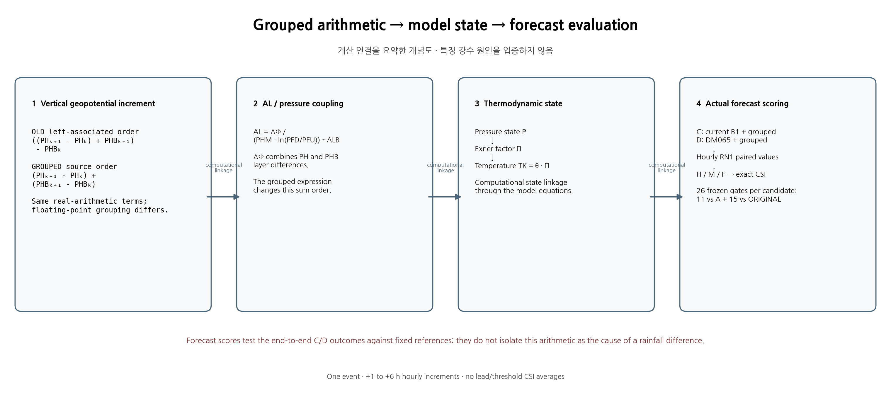

## 임계값 ≥ 0.1 mm

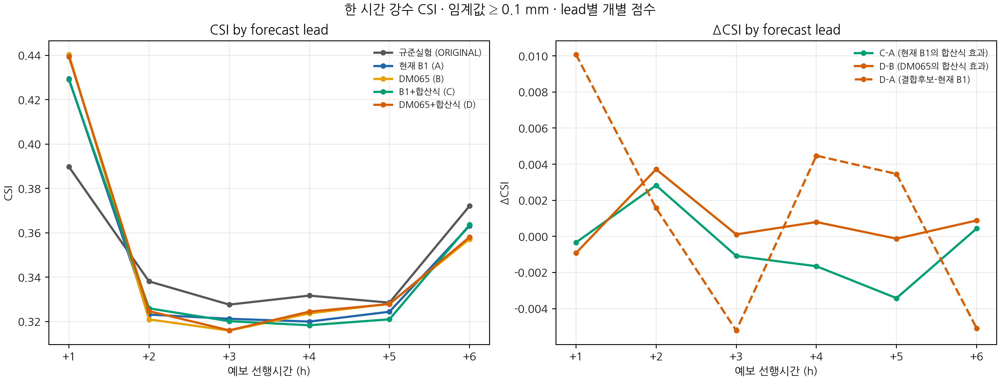

## 임계값 ≥ 0.5 mm

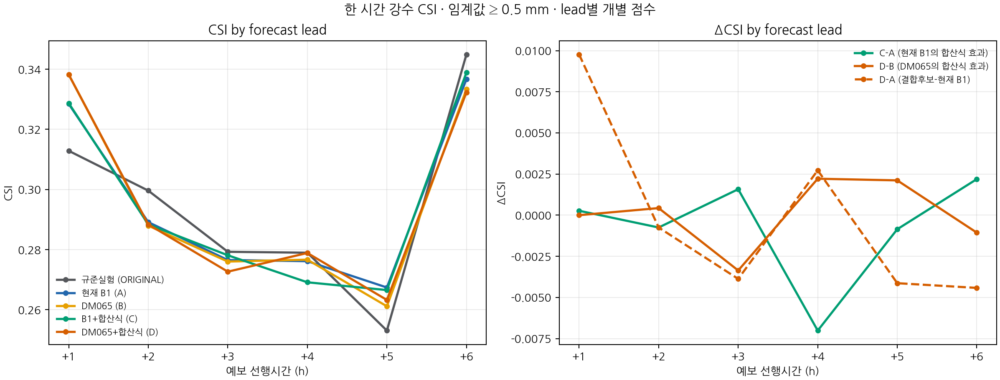

## 임계값 ≥ 1.0 mm

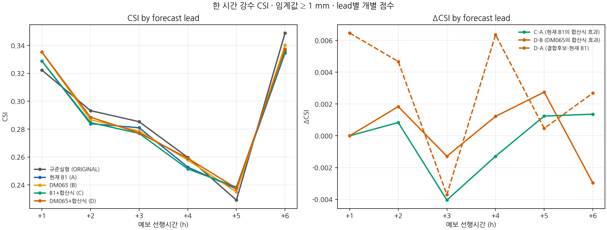

## 임계값 ≥ 2.5 mm

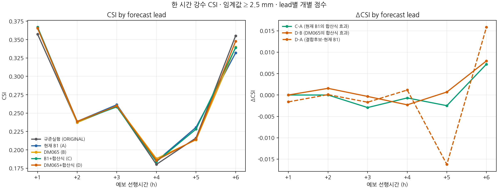

## 임계값 ≥ 5.0 mm

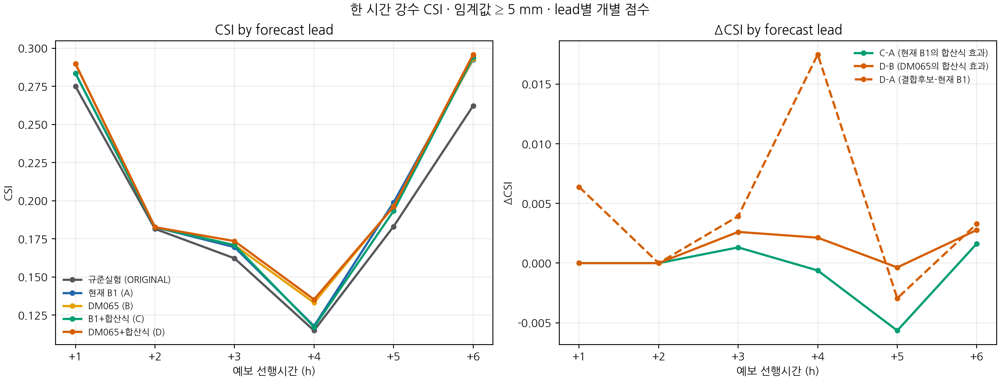

## 임계값 ≥ 10.0 mm

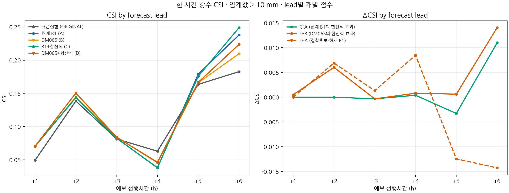

## +1시간 한 시간 강수와 규준실험·현재 B1 대비 차이

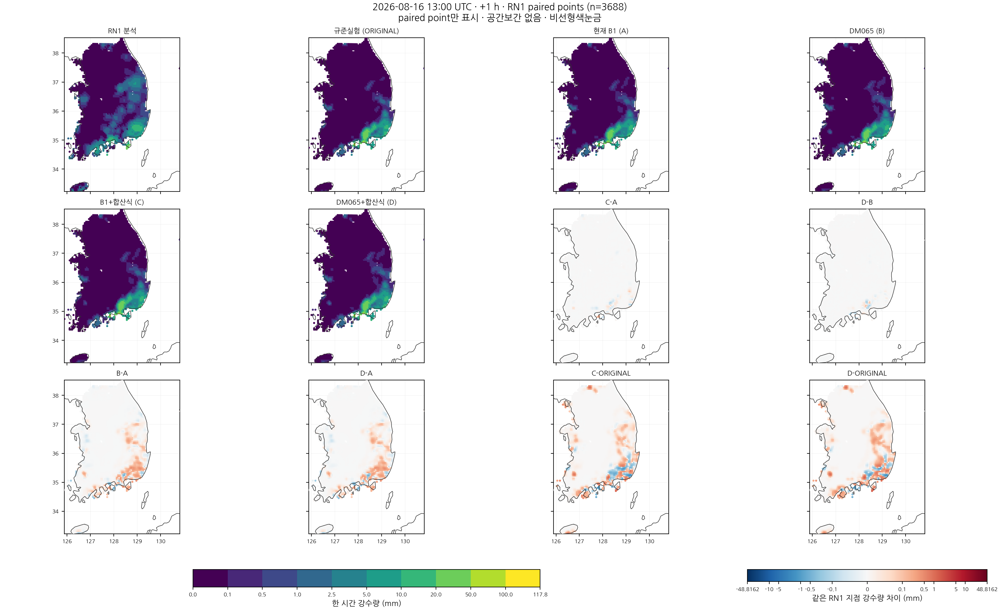

## +2시간 한 시간 강수와 규준실험·현재 B1 대비 차이

## +3시간 한 시간 강수와 규준실험·현재 B1 대비 차이

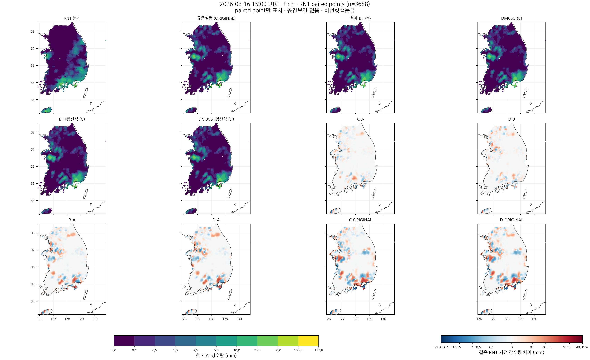

## +4시간 한 시간 강수와 규준실험·현재 B1 대비 차이

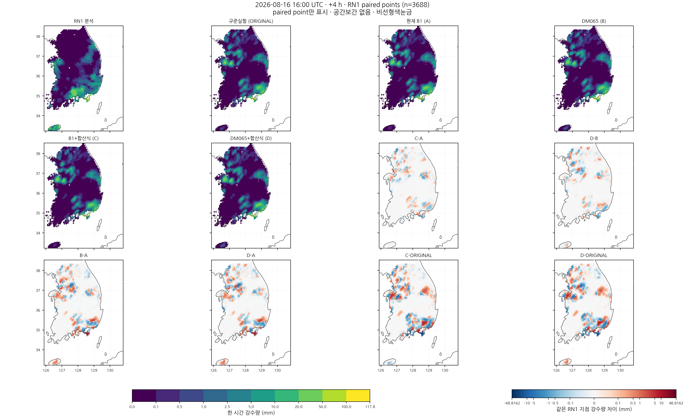

## +5시간 한 시간 강수와 규준실험·현재 B1 대비 차이

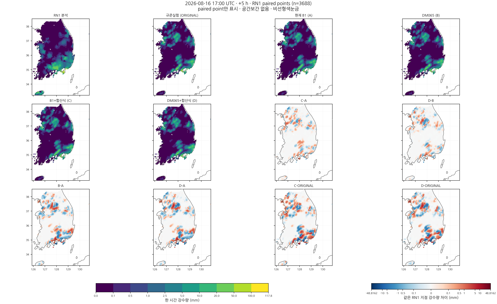

## +6시간 한 시간 강수와 규준실험·현재 B1 대비 차이

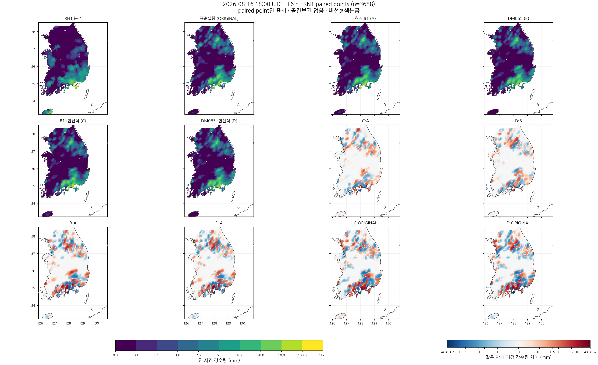
