# 첫 빙정 수정 후보 오경보 진단

기존 PR154 예측의 저장 결과를 재분석한 진단입니다. 새 예측 적분은 수행하지 않았습니다. RN1 공통 평가점 3,688개와 시간별 누적 강수 차이를 사용합니다. 그룹은 결과에 따른 사후 분류이며, RAINC와 RAINNC는 단일 물리 과정의 원인으로 해석할 수 없습니다.

[분석 보고서](../../CP02_ICE_FALSE_ALARM_20261109.md)  
[PR154 전체 점수](../cp02_first_ice_velocity_20261109/evaluation/results/FULL_SCORES.md)  
[평가점 집단](cohorts/membership.csv)  
[평가점별 경로](cohorts/point_paths.csv)  
[강수 강도 구간](cohorts/lead_bins.csv)  
[시간별 표면 강수 성분](surface/native/hourly_points.csv)  
[고정 집단 성분 평균](surface/native/group_means.csv)  

## 6시간 오경보 평가점

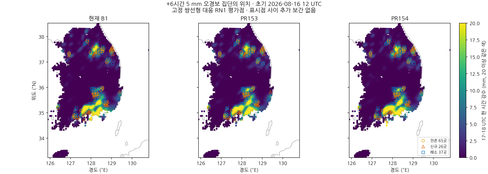

## 6시간 오경보 집단의 시간별 강수

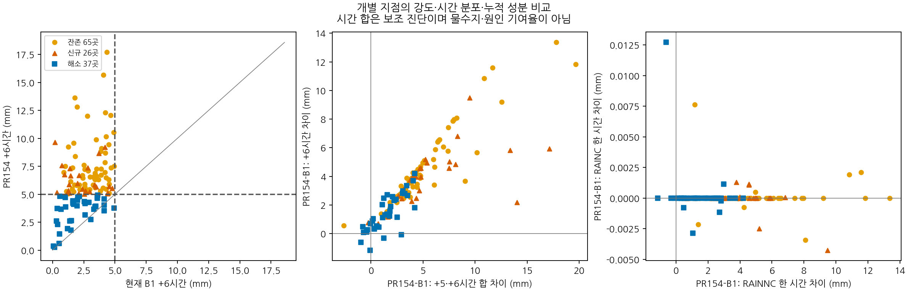

## 첫 시간 새 오경보 3개 평가점

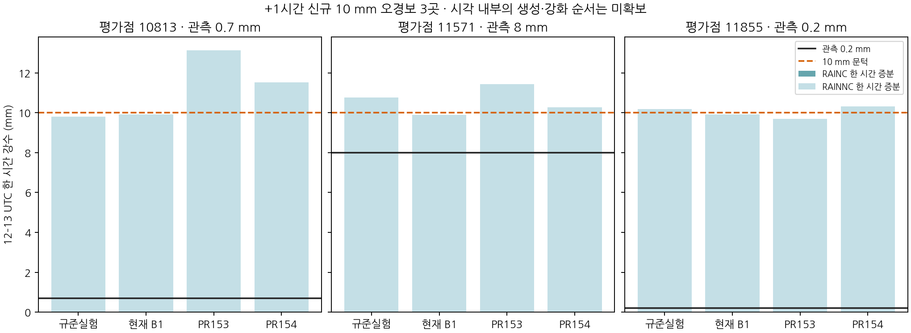

## 약한 관측 강수의 예측 강도

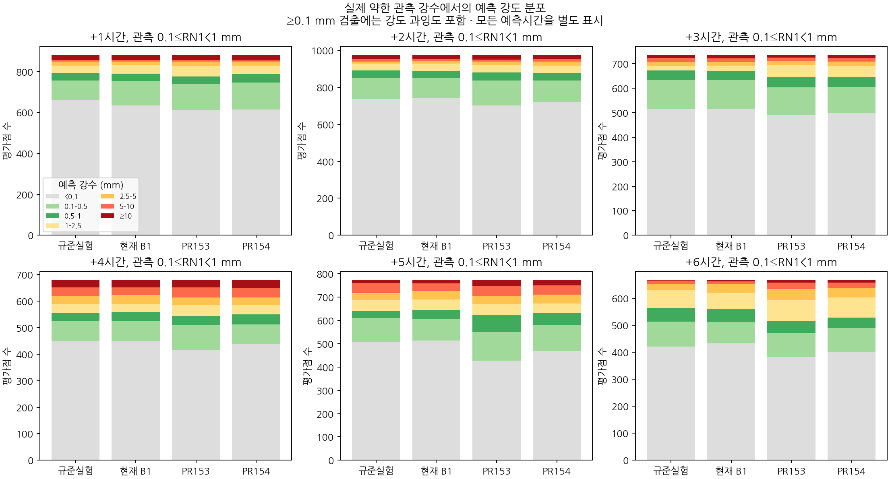

## 0.1 mm 이상 시간별 CSI

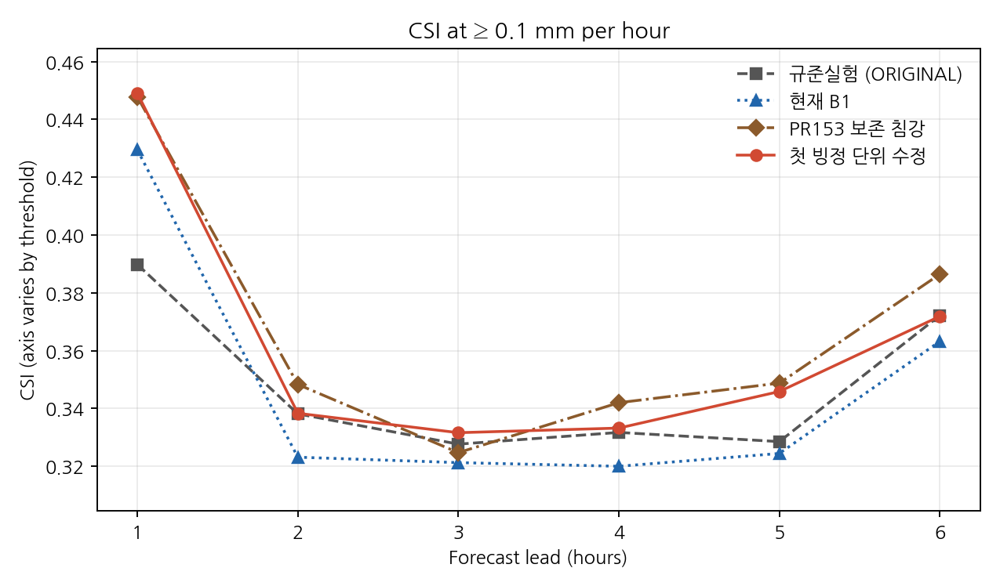

## 0.5 mm 이상 시간별 CSI

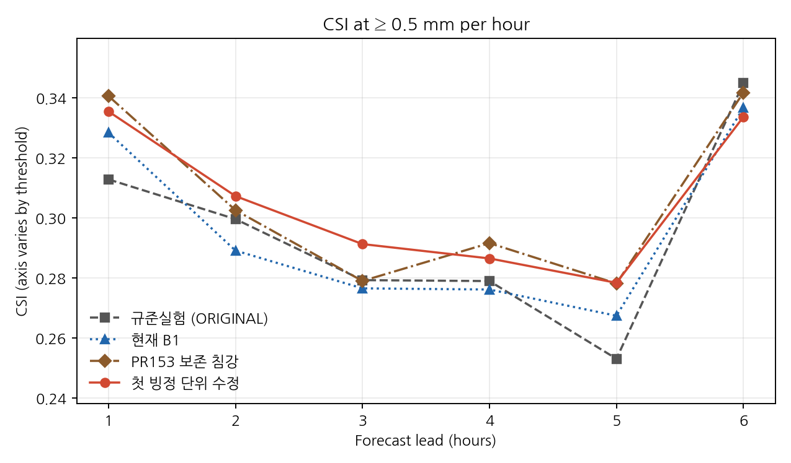

## 1 mm 이상 시간별 CSI

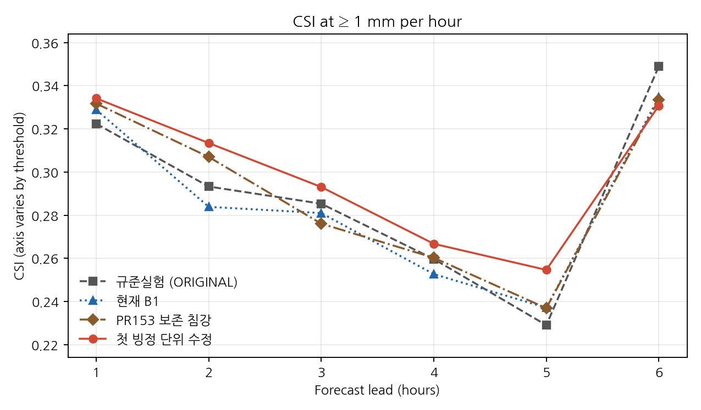

## 2.5 mm 이상 시간별 CSI

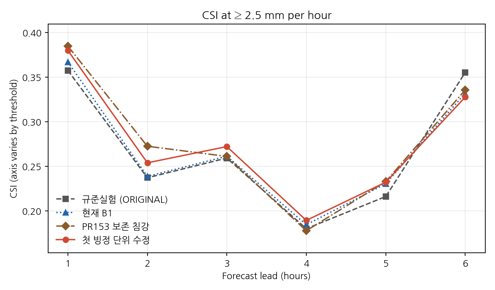

## 5 mm 이상 시간별 CSI

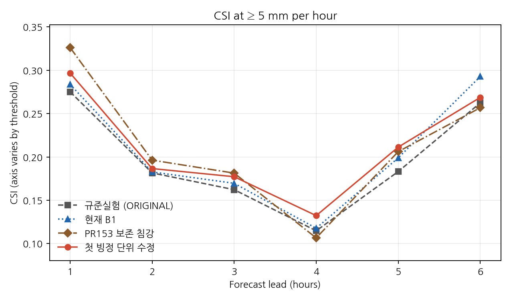

## 10 mm 이상 시간별 CSI

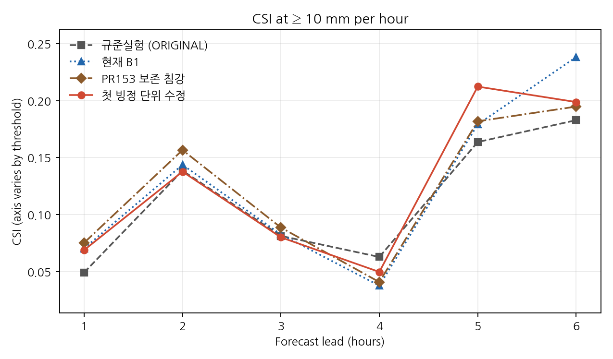

## +1시간: 12–13 UTC 한 시간 강수

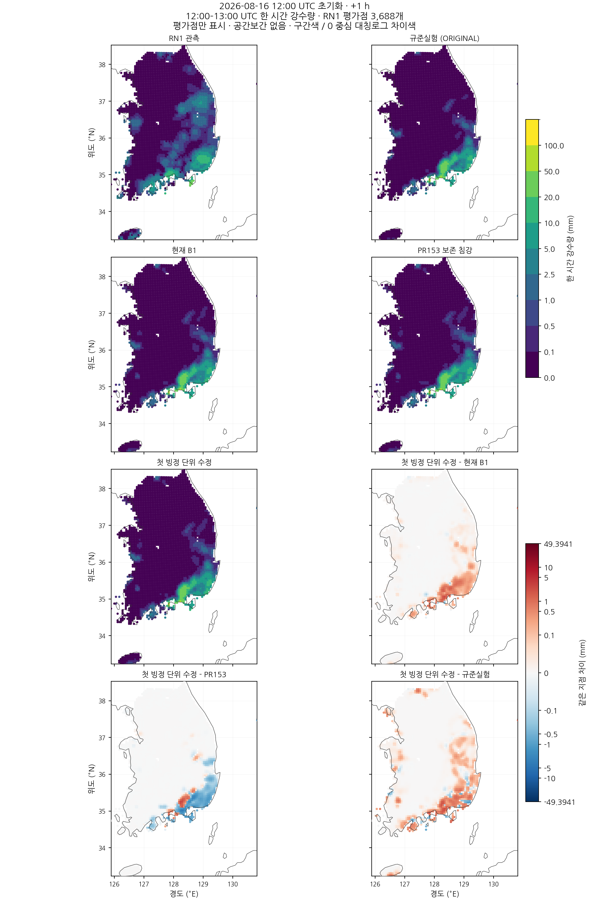

## +2시간: 13–14 UTC 한 시간 강수

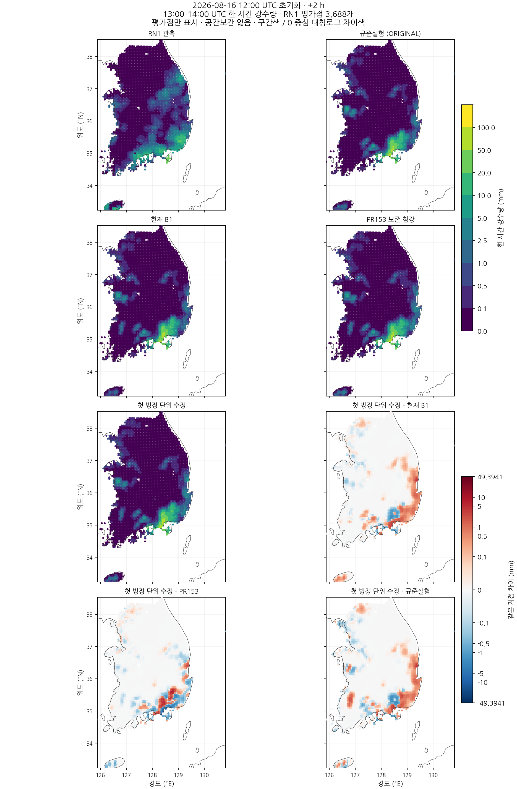

## +3시간: 14–15 UTC 한 시간 강수

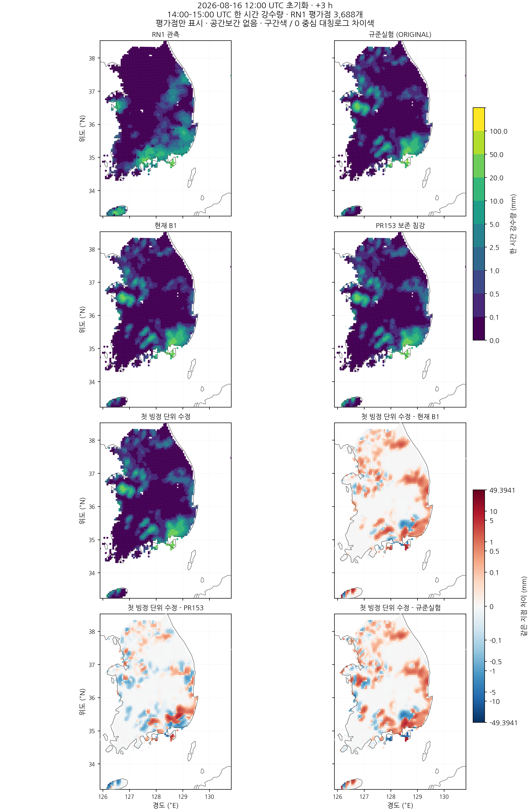

## +4시간: 15–16 UTC 한 시간 강수

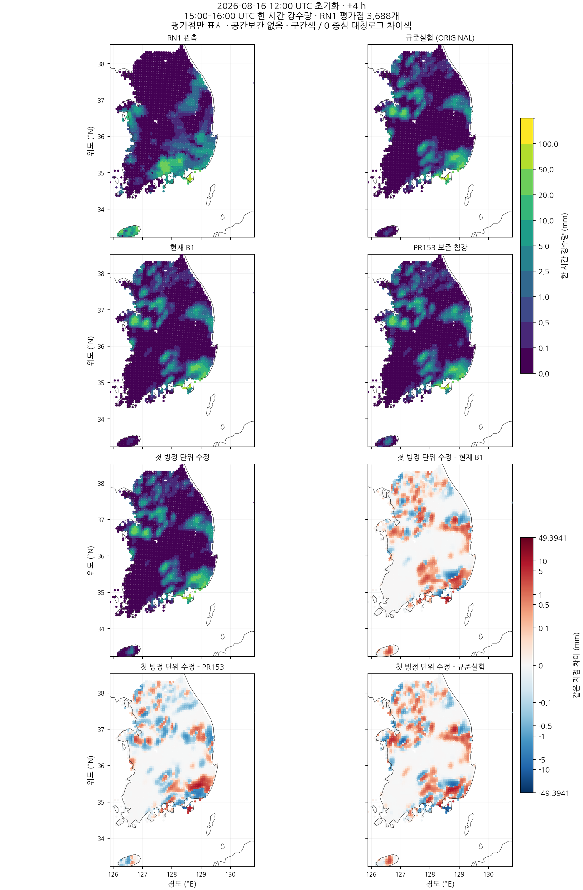

## +5시간: 16–17 UTC 한 시간 강수

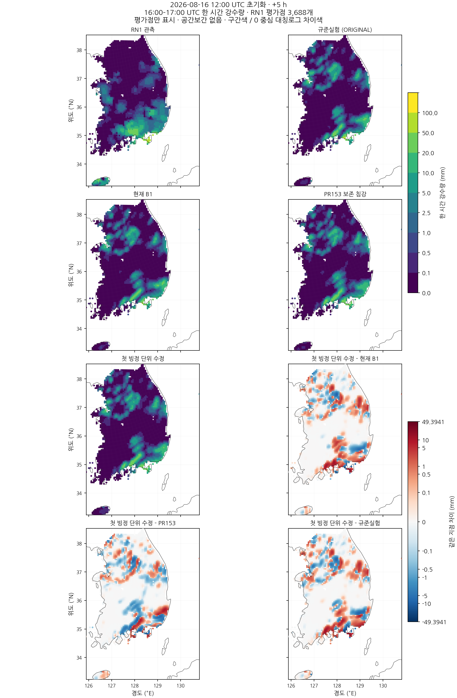

## +6시간: 17–18 UTC 한 시간 강수

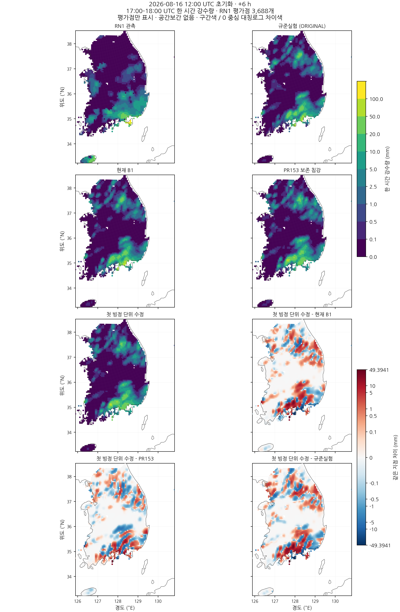
