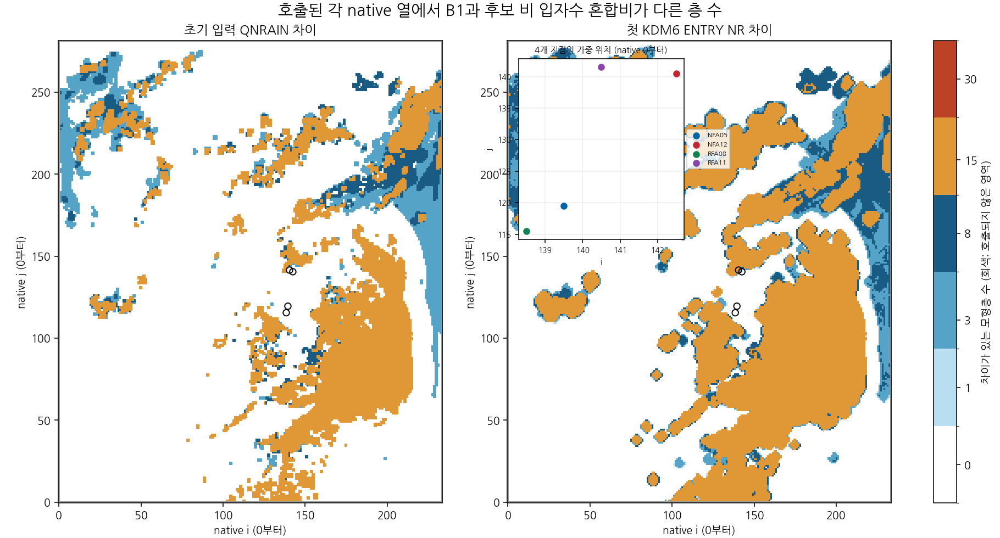
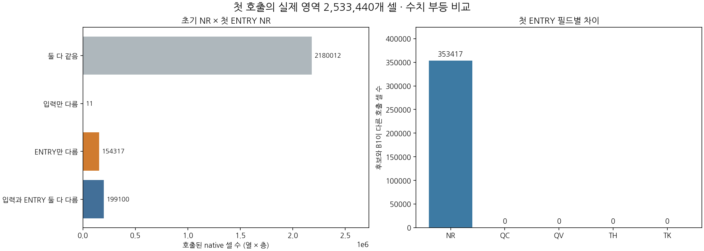
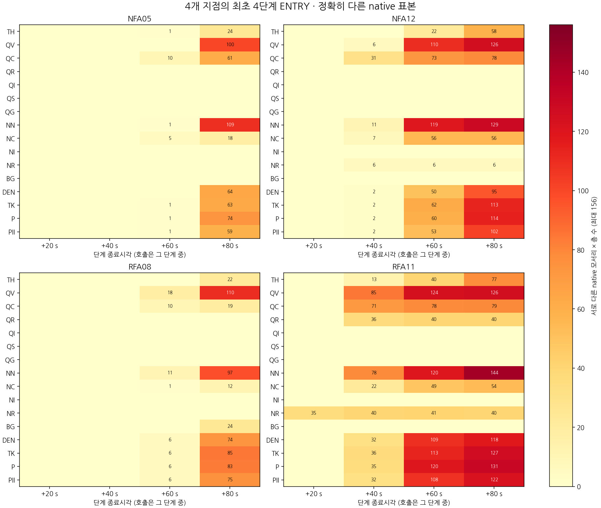

# 초기 입력과 첫 KDM6 경계

그림은 고정된 두 예보의 표본된 경계 차이를 나타냅니다. 호출되지 않은 셀은 0이 아닙니다. 첫 네 단계는 단계 종료시각으로 표시하며 호출은 단계 중 일어납니다. 원시 native 모서리×층의 개수는 빌리니어 평균이 아니며 최초 기록 차이는 원인이나 실제 최초 분기 시각을 증명하지 않습니다. 전역 14개 필드에 P/PII는 없고, 선택된 모서리의 16개 필드에만 P/PII가 있습니다. KDM6 내부 T→TH→TK 재구성은 호출 내 변화에 포함됩니다.

